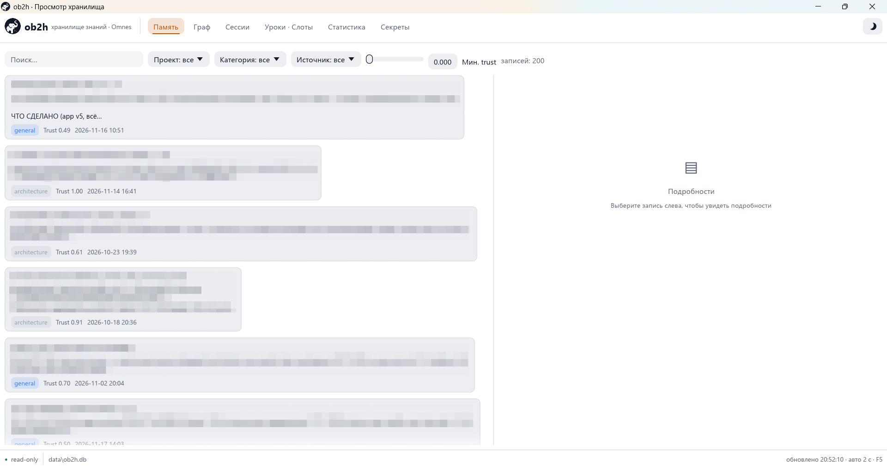
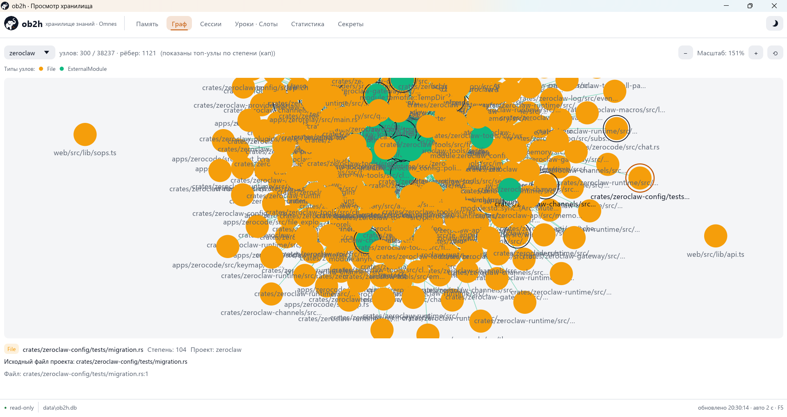
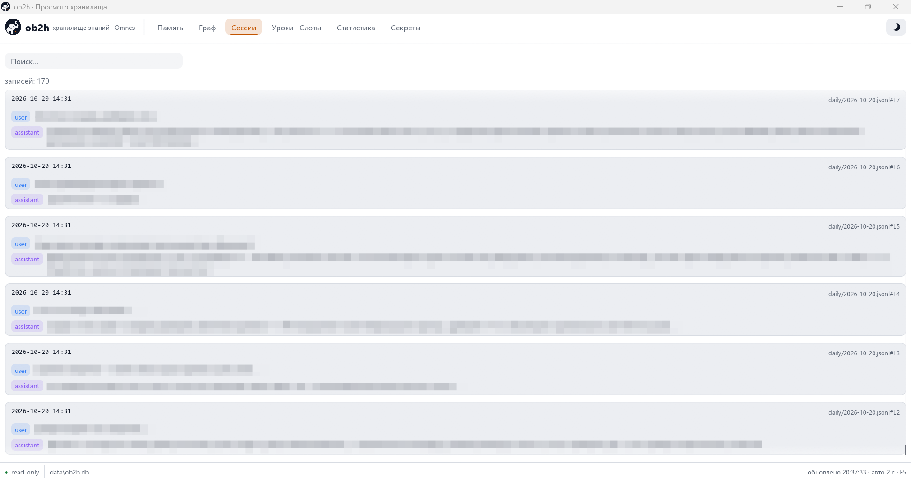
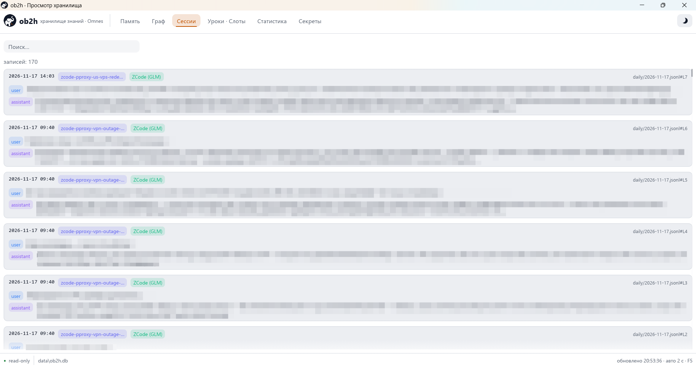
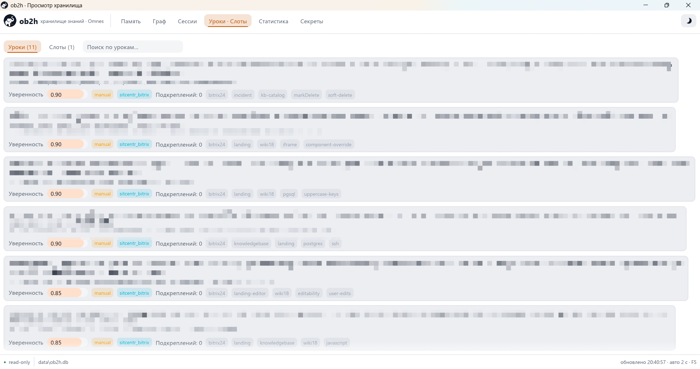
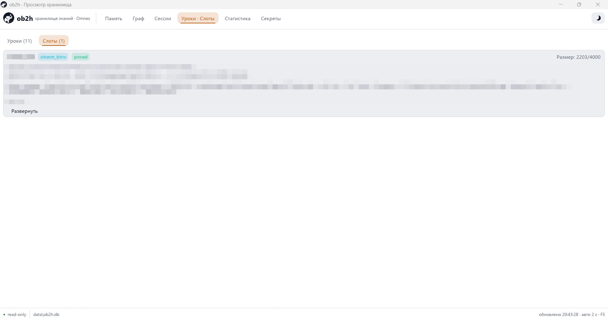
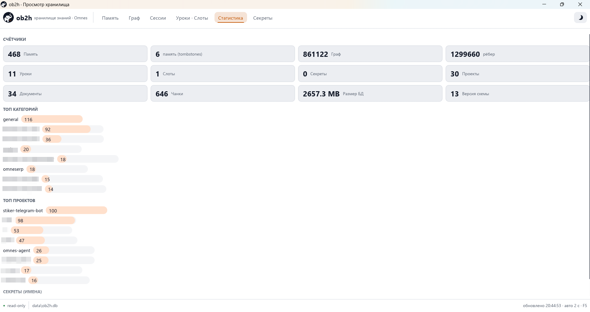

<div align="center">


# 🐘 ob2h (OmnesBot to Harness)

### Автономная долговременная память, граф знаний и AST-анализ для AI-агентов

*Бренд семейства **Omnes** (OmnesProducts): Dark Charcoal `#111827` · Off-White `#F4F5F7` · Brand Orange `#FF6B00`*

[](https://www.rust-lang.org/)
[](LICENSE)
[](https://github.com/Pofium/ob2h/releases)
[](https://github.com/Pofium/ob2h)
[-ff69b4.svg)](https://pay.cloudtips.ru/p/4e7f8019)

[**Быстрый старт**](#-быстрая-установка-в-1-клик) •
[**Мультиагентное подключение**](#-мультиагентная-поддержка-1-клик) •
[**Проектная память и AST-граф**](#-проектная-память-и-детерминированный-ast-граф-кода) •
[**Синхронизация машин**](#-синхронизация-двух-машин-pc--vps) •
[**Секреты и работа без API-ключа**](#-хранилище-секретов-и-работа-без-api-ключа) •
[**Команды CLI**](#-управление-через-консоль-cli) •
[**Поддержать автора**](#-поддержать-разработку)

</div>

---

## 🌟 Что это такое простыми словами?

Обычные ИИ-ассистенты забывают контекст и архитектуру ваших репозиториев, как только закрывается чат.

**OB2H (OmnesBot to Harness)** — это локальный «мозг», долговременная память и AST-граф кода для AI-агентов (**Hermes, Claude Code, Cursor, Windsurf, ZCode, Gemini CLI, Qwen Code, OpenCode, DSH**), полностью написанный на **Rust**.

Он даёт агенту возможность:
1. 🧠 **Помнить всё важное о вас и ваших проектах**: факты, предпочтения, стек технологий и архитектурные решения.
2. 🏛️ **Строить детерминированный AST-граф кода (вдохновлено Graphify)**: мгновенно сканирует кодовую базу — 31 расширение кода (Rust, Python, TS/TSX, JS/JSX, Go, SQL, PHP, Dart, Java, C#, C/C++, Kotlin, Swift, Ruby, Vue/Svelte, Scala, Lua, Elixir, Shell) плюс веб-разметка и стили (HTML, CSS/SCSS, blade), API-контракты (proto, GraphQL, OpenAPI), IaC (Dockerfile, Terraform, compose, K8s/Helm), манифесты пакетов (Cargo.toml, package.json, pyproject.toml, requirements.txt, go.mod, pubspec.yaml, composer.json) и спец-языки (Jupyter, Solidity, Zig); извлекает классы, функции, интерфейсы, трейты/миксины и связи со 100% точностью и без расхода токенов LLM. Опциональный движок **tree-sitter** (фича `treesitter`: Rust/Python/TS-TSX/Go/Dart, инкрементальный парсинг, fallback на regex при битых файлах, stub-режим для генерированного кода).
3. 👑 **Выявлять ключевые узлы архитектуры (God Nodes)**: автоматически рассчитывает связность и передает агенту компактный архитектурный дайджест.
4. 💥 **Оценивать безопасность рефакторинга (Blast Radius / `project_impact`)**: находит все зависимые функции/файлы и оценивает уровень риска изменений (`Low`, `Medium`, `High`); учитывает виртуальные вызовы и co-change связи, фильтрует рёбра по порогу `min_confidence` и сразу даёт список **затронутых тестов (TESTED_BY)** — что прогонять после правки функции.
5. 🔍 **Искать код естественным языком**: гибридный семантический поиск по кодовому графу (RRF $k=60$ + локальный Candle MiniLM 384d).
6. 📁 **Работать с нулевой настройкой (Zero-Config)**: автоматически определяет корень репозитория, уважает правила `.gitignore` и привязывает сессию.
7. ⚡ **Реагировать на изменения на лету (File Watcher + Git hooks)**: автоматически обновляет граф при сохранении файлов в IDE.
8. 🌙 **«Видеть сны» (Дриминг)**: пока вы отдыхаете, агент ночью в фоне анализирует историю дня, удаляет устаревшие данные, обновляет файлы памяти (`SOUL.md`, `USER.md`, `MEMORY.md`) и сохраняет версии в Git.
9. 🔄 **Помнить одно и то же на нескольких машинах**: домашний ПК и агент на VPS синхронизируют память и граф знаний между собой через защищенный SSH, а бандлы обмена можно шифровать end-to-end (AES-GCM, `OB2H_SYNC_KEY`).
10. 🤖 **Подключаться к любому AI-агенту в 1 клик**: `ob2h agent install --all` и диагностика `ob2h doctor --fix`.
11. 🎓 **Обучаемая память**: каждая запись имеет машинный `trust` — использование, feedback агента и ночная ревизия дримом поднимают или гасят его; устаревшее уходит из выдачи управляемо, без автоудалений.
12. 🕸️ **Multi-hop поиск (PPR)**: Personalized PageRank по памяти и графу знаний находит связанные факты, до которых линейный поиск не доходит.
13. 🔁 **Ralph Knowledge Layer**: знание о циклах разработки (вердикты по тестам, AST-дельты, reuse-кандидаты, debt-леджер) — для автономных agentic-циклов.
14. 🌙 **Ночной bench-гейт**: дрим, ухудшивший качество поиска (recall/MRR), автоматически откатывается той же ночью.
15. 🔐 **Хранилище секретов (Secrets Vault)**: агент сохраняет и читает пароли/токены инструментами `secrets_*` — шифрование XChaCha20-Poly1305, мастер-ключ Argon2id живёт только в памяти и стирается по TTL; PIN вводится в графическом окне и никогда не проходит через MCP/LLM/чат. Секреты изолированы от памяти, графа, дрима и бандлов синхронизации.
16. 🤖 **Работает без настроенного API-ключа (три эшелона LLM)**: явный ключ `OB2H_LLM_*` → автоподхват основной модели подключённого harness (Hermes, ZCode, Codex) → локальная мини-модель **Qwen3-0.6B** (~1.4 GB, Candle, качается лениво) для дриминга. Дриминг никогда не остаётся без модели.
17. ⬆️ **Самообновление**: `ob2h update check/apply` скачивает релиз с GitHub, самозаменяет бинарник и переустанавливает плагин/скилл; раз в сутки `serve` проверяет новую версию (только уведомление, без автоприменения).
18. 🎓 **Жизненный цикл памяти (v1.9.9)**: уроки (процедурный опыт с confidence и дедуп-укреплением), слоты рабочего контекста (`<agent_slots>` в контексте агента, бюджет 1500 символов), хронология и инкрементальный рекап сессий, провенанс фактов до цитат daily-логов, аудит-леджер операций и скрабинг секретов в конвейерах захвата.
19. 🖥️ **Окно просмотра (Viewer, v1.9.9–1.9.10)**: нативное окно (`ob2h viewer` или MCP `viewer_open`) — память с FTS-поиском, граф с force-layout, pan/zoom и **разбивкой по темам** (общая память / каждый проект), реплей сессий, уроки/слоты, статистика-дашборд. Строго read-only («ни одной записи»), single-instance, RU/EN, тёмная/светлая тема в стилистике семейства **Omnes** (логотип, палитра, Segoe UI/Consolas), хоткеи Ctrl+1…6 / F5 / Esc. Сборка: `--features gui`; headless отвечает честно.
20. 🔑 **Секреты во viewer**: вкладка «Секреты» в окне просмотра — инициализация сейфа («Начать сохранять», PIN дважды), разблокировка по локальному PIN, добавление/просмотр (маска, авто-скрытие 15 с)/копирование/удаление с подтверждением. PIN никогда не проходит через чат/MCP/LLM; ключ затирается при блокировке и закрытии окна.
21. 🕸️ **Глубокий call graph (v1.9.11)**: межфайловое разрешение символов по таблице импортов (`helpers::run()`, `mod.fn()`, `pkg.Func()` — включая алиасы и namespace-импорты TS), статика `Type::method()`, эвристика виртуальных вызовов по единственному кандидату; для Vue/Svelte парсится `<script>` (tree-sitter TS) без потери regex-мостов шаблонов; кросс-языковые цепочки C → asm (v2.0.1). Качество движка зажато F1-гейтами на эталонах 8 языков — включая ассемблер (v2.0.1) — (symbol ≥ 0.95, call ≥ 0.90) в `ob2h bench`.
21a. ⚙️ **Ассемблер в AST-графе (v2.0.1)**: `.s`/`.S` (GAS AT&T/Intel) и `.asm` (NASM/MASM) — диалект сниффингом контента; узлы `Function`/`Macro`/`Data` (метки, `PROC/ENDP`, `.macro`, `.equ`/`%define`), entry-пометки, skip-листы шумовых меток и регистров; tree-sitter для GAS под фичей `treesitter` с паритетом node_id против regex-пути.
22. ⏱ **Co-change связи (v1.9.11)**: из истории git (200 коммитов) извлекаются пары файлов, менявшихся вместе ≥3 раз в компактных коммитах — ребро `CO_CHANGES_WITH` ловит межъязыковое зацепление, которое не видит AST (Rust-хендлер ↔ SQL-миграция ↔ Dart-клиент ↔ `.env.example`), и подмешивается в blast radius.
23. 🧭 **Vector Spaces & U-PPR (v2.0.0)**: изоляция векторных пространств (`EmbeddingFingerprint`, `ob2h reindex --embeddings`), бинарное квантование (BQ) + INT8, usage-weighted PPR с `subtokens` FTS5-декомпозицией и токен-бюджетный AST-скелет `max_tokens` (с Elbow cutoff) в `graph_reason` / `memory_context`.
24. 🧹 **Автономное разрешение конфликтов Dream (v2.0.0)**: классификация противоречий (*Temporal Supersession*, *User Correction*, *Contextual Coexistence*), offline/online детектор, рёбра `SUPERSEDES`/`CONTRADICTS`, `git_head_sha` привязка фактов/findings, HITL-инструмент `knowledge_reconcile`, `DreamBudget` и автооткат по метрикам bench.
25. 📦 **Кроссплатформенный Lifecycle (v2.0.0)**: `ob2h doctor --fix` с preflight-диагностикой, `ob2h service install/uninstall`, JSONC-safe патч IDE-конфигов, `ob2h completions`, `ob2h models hydrate`, `ob2h migrate --dry-run` и `ob2h self uninstall [--keep-data | --purge-data] [--silent]`.

**Кому подходит:** у кого Hermes живёт на двух машинах (ПК + VPS/сервер, работа + дом)
и кому нужна **приватная** память — все данные остаются на ваших машинах, наружу уходит
только трафик к вашему LLM-API и (по желанию) SSH между вашими же серверами.

---

## 🖼 Скриншоты окна просмотра (`ob2h viewer`)

Нативное окно хранилища (сборка `--features gui`, строго read-only) — вкладки ниже
идут в порядке меню окна, слева направо (v2.0.1):

**1. Память** — список записей с фильтрами (проект, категория, источник, мин.
trust) и панелью «Подробности» справа.



**2. Граф знаний** — force-layout графа кода проекта: топ-узлы по степени (кап),
типы `File` / `ExternalModule`, pan/zoom; внизу — карточка выбранного узла
(исходный файл, степень 104).



**3. Сессии** — реплей диалогов из daily-логов: пары *user / assistant* с датами,
справа — ссылка на строку исходного `daily/2026-10-20.jsonl`.



**4. Сессии с бейджами** — те же сессии с именами сессий и бейджем
harness-источника (ZCode (GLM)), ссылки на строки `daily/2026-11-17.jsonl`.



**5. Уроки** — процедурный опыт агента: уверенность (confidence), теги и счётчик
подкреплений; поиск и фильтр по вкладкам «Уроки» / «Слоты».



**6. Слоты** — закреплённый (pinned) рабочий контекст проекта: имя проекта, лимит
размера (2203/4000) и раскрытие полного содержимого.



**7. Статистика** — дашборд хранилища: счётчики (память, узлы и рёбра графа,
уроки, слоты, проекты, документы, чанки, размер БД, версия схемы) и топ
категорий / проектов.



---

## ⚡ Почему именно версия на Rust?

| Параметр | Обычные решения (Python) | OB2H на Rust 🦀 |
|---|---|---|
| **Установка** | Нужен Python, pip, виртуальные окружения | **Один бинарник `ob2h.exe` (~15 МБ)** |
| **Скорость запуска** | 1.5 – 3.0 секунды | **< 15 миллисекунд** ⚡ |
| **Потребление ОЗУ** | 250 – 500 МБ | **Всего 15 – 30 МБ** |
| **Эмбеддинги** | Нужны внешние сервисы или PyTorch | **Встроены из коробки (чистый Rust / Candle)** |
| **Управление** | Консольные скрипты | **Удобный инсталлятор в 1 клик (`install.bat`)** |

---

## 🚀 Быстрая установка (в 1 клик)

### Шаг 1. Скачайте проект или релиз
Склонируйте репозиторий:
```bash
git clone https://github.com/Pofium/ob2h.git
cd ob2h
```

### Шаг 2. Запустите инсталлятор
Просто дважды кликните по файлу:
```text
👉 install.bat
```
*(Или выполните команду `ob2h install` в терминале).*

Скрипт автоматически:
- Соберет оптимизированный исполняемый файл `ob2h.exe`.
- Создаст резервную копию вашего конфига Hermes.
- Зарегистрирует сервер `ob2h` в `config.yaml`.

### Шаг 3. Перезапустите Hermes (или любого поддерживаемого агента)
Откройте вашего агента — все **56 инструментов** MCP (память, граф знаний, код, дриминг, Ralph-циклы, уроки/слоты, просмотр) активируются автоматически!

### Шаг 3.5 (рекомендуется). Включите «постоянную память» — плагин

```bash
ob2h plugin install
ob2h skill install
```

Затем добавьте в блок `memory:` конфига Hermes строку `provider: ob2h` и перезапустите
Hermes. Теперь **каждый ход диалога пишется в память автоматически**, а релевантные
воспоминания всплывают перед каждым ответом (индикатор 🧠) — без просьб и команд.

### Шаг 3.6. Автоматическая настройка для других агентов (1 клик)

```bash
ob2h agent install --agent all
ob2h doctor --fix
```
Команда автоматически обнаружит и сконфигурирует Claude Code, Cursor, Windsurf, ZCode, Gemini/Antigravity, Qwen Code, OpenCode и DSH (DeepSeek Harness).

Для DSH (`dsh` / Electron-GUI) интеграция — двухслойная: MCP-сервер через штатный плагин
`@deepseek-ai/dsh-mcp-client` (56 инструментов `mcp__ob2h__*`) плюс скилл `ob2h` **и**
cordis-плагин `plugin/dsh-ob2h`, который даёт то же, что MemoryProvider в Hermes:
сам подмешивает релевантные воспоминания блоком `<agent_memory>` перед ходом и сам
пишет состоявшиеся ходы в память. Подробности — в
[`docs/DSH_INTEGRATION.md`](docs/DSH_INTEGRATION.md):

```bash
ob2h agent install --agent dsh     # блок ob2h в patch-слое профиля (MCP + плагин) + скилл
ob2h agent status                  # строка «DSH (DeepSeek Harness)»
```

---

## 🛠️ Как это работает в диалоге с Hermes?

Вам не нужно писать специальные команды — агент использует память сам:

- **Сохранение:**
  > *«Запомни: я люблю кофе без сахара, а мой текущий проект — OmnesBot на Rust»*  
  > ↳ Hermes вызовет `memory_save` и зафиксирует факт с высоким приоритетом.

- **Вспоминание:**
  > *«Какой кофе мне заказать и над чем я работаю?»*  
  > ↳ Hermes выполнит `memory_search` (гибридный поиск FTS5 + векторный RRF) и сразу ответит с учётом ваших предпочтений.

- **Анализ документов:**
  > *«Изучи этот документ и добавь связи в граф»*  
  > ↳ Инструмент `knowledge_extract` извлечёт структуру, людей и связи в граф знаний.

- **Сложные вопросы по графу:**
  > *«Кто отвечает за архитектуру в проекте X и как он связан с модулем Y?»*  
  > ↳ Инструмент `graph_reason` пройдёт по графу связей и выдаст обоснованный ответ с цепочкой рассуждений.

---

## 🔄 Синхронизация двух машин (PC ↔ VPS)

У вас Hermes дома на Windows и Telegram-агент на Linux-VPS? С v0.9 их **память и граф
знаний — общие**: рассказали дома о новом проекте — серверный агент уже в курсе.
Обмен — инкрементальные дельта-бандлы v2 поверх SSH: только изменённое (курсор по `updated_at`).
Конфликты — как в [`docs/SYNC.md`](docs/SYNC.md): **LWW по `updated_at` для `content`** (tie-break
по `priority` origin'а; не молчаливый — журнал `conflicts.jsonl`, проигравшие версии — в
`meta.conflict_versions` за флагом `OB2H_SYNC_KEEP_LOSERS=1`) **+ поле-уровневый merge метаданных**
(`meta` — deep merge, `access_count` — max, trust/feedback — суммирование). В бандле — память,
trust, `memory_links` и удаления.
Идемпотентность, авто-бэкап перед импортом, `ob2h sync verify` — сверка дрейфа без переноса.
Живая БД никогда не передаётся. Бандлы можно шифровать end-to-end (AES-GCM): задайте общий
`OB2H_SYNC_KEY` на обеих машинах — и SSH-сервер, и промежуточные папки видят только шифротекст.

**Кому это надо:**
- ПК + VPS: общий мозг у десктопного и Telegram/gateway-агента;
- два компьютера (работа/дом): одна память без облака;
- каждая машина — живая реплика памяти другой (дополнительный бэкап).

**Быстрый старт** (полный гайд — [`docs/SYNC.md`](docs/SYNC.md)):

```bash
# PC: data/sync/peers.json (образец scripts/pc/peers.example.json)
#   { "origin": "pc", "priority": ["pc","vps"], "after_dream": true,
#     "peers": { "vps": { "method": "ssh", "host": "my-vps",
#       "push_to": "/root/ob2h_data/sync/inbox",
#       "pull_from": "/root/ob2h_data/sync/outbox" } } }
ob2h sync push --peer vps && ob2h sync pull --peer vps   # обмен вручную…
# …или само: после каждого ночного дрима (after_dream) + задача планировщика 05:30

# VPS: peers.json {"origin":"vps"} + таймер из scripts/vps/
#   systemctl enable --now ob2h-sync.timer
```

Диагностика: `ob2h sync status` на обеих машинах. Без прямого SSH между машинами —
режим `manual` (Syncthing/приватный git, только папка бандлов — **никогда** саму БД).

---

## 🔐 Хранилище секретов и работа без API-ключа

### Secrets Vault
Локальный сейф для паролей и токенов, доступный агенту как MCP-инструменты
(`secrets_status`, `secrets_set`, `secrets_get`, `secrets_delete`, `secrets_lock`):

- шифрование **XChaCha20-Poly1305**, мастер-ключ на базе **Argon2id** — только в ОЗУ
  (zeroize), стирается по TTL (30 мин) или командой `lock`;
- разблокировка — **4-значный PIN** в компактном графическом окне (RU/EN); на headless
  (SSH/CI) — откат в терминал; PIN **никогда** не проходит через MCP, LLM и чат;
- полная изоляция: секреты не попадают в контекст LLM-поисков, дрима и в бандлы
  синхронизации между машинами.

```bash
ob2h secrets init          # создать сейф (новый PIN запрашивается дважды)
ob2h secrets unlock        # разблокировать на 30 минут (TTL настраивается)
ob2h secrets list          # имена секретов без значений
ob2h secrets lock          # немедленно затереть мастер-ключ
```

### Три эшелона снабжения LLM
Для дриминга и экстракции знаний ob2h никогда не остаётся без модели:

1. **Явный ключ** — `OB2H_LLM_API_KEY` (литерал или имя env-переменной, фолбэк `<data_dir>/.env`).
2. **Автоподхват от harness** — при подключении MCP-клиента ob2h читает конфиг системы
   (Hermes → `config.yaml`, ZCode/Omnesagent → `~/.omnesagent/config.toml`, Codex →
   `auth.json`) и использует её основную LLM.
3. **Локальная мини-модель** — `LocalMiniLLM` на Candle (Qwen3-0.6B, ~1.4 GB) для
   дриминга; скачивается лениво при первом вызове, старт `serve` не блокирует.

---

## 💻 Управление через консоль (CLI)

Вы можете в любой момент посмотреть статистику или запустить дриминг вручную:

```bash
# Посмотреть статистику базы знаний и памяти
ob2h stats

# Проверить состояние дриминга
ob2h dream status

# Запустить процесс дриминга вручную
ob2h dream run

# Посмотреть историю изменений файлов памяти
ob2h dream log

# Создать резервную копию базы данных и воркспейса
ob2h backup

# Удалить интеграцию из Hermes при необходимости
ob2h uninstall

# Синхронизация двух машин (PC ↔ VPS)
ob2h sync push --peer vps && ob2h sync pull --peer vps
ob2h sync status

# Деплой плагина памяти и скилла в Hermes
ob2h plugin install
ob2h skill install

# Состояние плагина (установлен? включён в конфиге?)
ob2h plugin status

# Глубокая диагностика всех систем, баз данных, моделей и агентов
ob2h doctor
ob2h doctor --fix   # автоисправление конфигов агентов и Git-хуков

# Мультиагентное управление (Claude, Cursor, Windsurf, ZCode, Gemini, Qwen, OpenCode, DSH)
ob2h agent install --agent all
ob2h agent status
ob2h agent install --agent dsh     # DeepSeek Harness: MCP через dsh-mcp-client + cordis-плагин + скилл

# Управление проектами и AST-сканирование кодовой базы
ob2h project list
ob2h project scan --id <project_id>
ob2h project report --id <project_id>
ob2h project dead-code --id <project_id>   # мёртвые символы (без entrypoints)
ob2h project repo-map --id <project_id>    # карта репо под token budget

# Регрессионный контур поиска: golden set, recall@k/MRR, история прогонов
ob2h bench                                 # прогон на живой БД (data/bench/golden.jsonl)
ob2h bench --mode history                  # тренд ночных прогонов + вердикты
ob2h bench --mode code --project <id>      # bench по кодовому графу (PPR от сидов)

# Лёгкая база и бэкапы
ob2h db quantize-embeddings --dry-run      # int8-квантование эмбеддингов (оценка)
ob2h backup --scope quick                  # быстрый бэкап памяти+воркспейса
ob2h backup verify data/backups/<копия>    # проверка целостности копии

# Гигиена памяти
ob2h memory dedup --dry-run                # кандидаты на слияние (без LLM)

# Хранилище секретов (PIN, TTL, изоляция от LLM-контекста)
ob2h secrets init && ob2h secrets unlock
ob2h secrets list                          # имена без значений
ob2h secrets lock                          # затереть мастер-ключ немедленно

# Самообновление из GitHub Releases
ob2h update check                          # есть ли новая версия
ob2h update apply --yes                    # скачать, самозаменить бинарник, переустановить плагин/скилл
ob2h update status                         # текущая версия и время последней проверки

# Ralph-циклы разработки
ob2h ralph findings-to-memory --project <id>
ob2h ralph debt --project <id>             # debt-леджер: отложенный долг и upgrade-триггеры
```

---

## ⚙️ Настройки и переменные окружения

По умолчанию всё работает без дополнительных настроек. При необходимости тонкой настройки можно задать переменные в `.env` или конфиге:

| Переменная | По умолчанию | Описание |
|---|---|---|
| `OB2H_DATA_DIR` | `./data` | Папка для базы данных SQLite, файлов памяти и логов |
| `OB2H_LLM_BASE_URL` | `https://api.deepseek.com/v1` | URL OpenAI-совместимого API для рассуждений |
| `OB2H_LLM_API_KEY` | `DEEPSEEK_API_KEY` | Имя переменной с API ключом (или сам ключ) |
| `OB2H_LLM_MODEL` | `deepseek-v4-flash` | Модель для экстракции и дриминга |
| `OB2H_LLM_HARNESS_DETECT` | `1` | Автоподхват основной LLM от harness-системы при `initialize` (`0` — выкл) |
| `OB2H_LLM_HARNESS` | — | Форс ридера harness (`hermes`, `zcode`, `codex`) независимо от clientInfo |
| `OB2H_LOCAL_LLM` | `1` | Локальная мини-модель для дриминга, когда ключей нет (`0` — выкл) |
| `OB2H_LOCAL_LLM_MODEL` | `Qwen/Qwen3-0.6B` | Репозиторий локальной модели (qwen3-совместимый, ~1.4 GB, качается при первом вызове) |
| `OB2H_EMBED_PROVIDER` | `local` | `local` (встроенный Candle) или `api` (внешний эндпоинт) |
| `OB2H_AUTODREAM_ENABLED` | `true` | Фоновый авто-дриминг при работе Hermes |
| `OB2H_PREFETCH_MAX_CHARS` | `8000` | Бюджет блока памяти в промпте (рез по границам записей) |
| `OB2H_HALF_LIFE_DAYS` | `90` | Полураспад свежести в скоринге prefetch |
| `OB2H_BENCH_GATE` | `0` | Ночной гейт качества дрима (`1` — откат дрима при деградации recall/MRR) |
| `OB2H_PPR_DAMPING` | `0.85` | Damping Personalized PageRank (поиск по памяти/графу) |
| `OB2H_BACKUP_KEEP_FULL` / `OB2H_BACKUP_KEEP_QUICK` | `3` / `14` | Ротация бэкапов |
| `OB2H_DREAM_MEMORY_REVISION` | `true` | Ночная ревизия слабых записей дримом (trust ±) |
| `OB2H_VEC0` | `0` | Эксперимент sqlite-vec rescore (ADR-35.1, дефолт off) |
| `OB2H_SYNC_KEY` | — | Общий ключ E2EE-шифрования бандлов синка (AES-GCM); без него бандлы в открытом виде |
| `OB2H_SECRETS_TTL_MIN` | `30` | TTL разблокированного сейфа секретов (минуты) |
| `OB2H_PIN_GUI` | `1` | Графическое окно ввода PIN (`0` — только терминал) |
| `OB2H_UI_LANG` | авто | Язык окна PIN: `ru` \| `en` (по умолчанию — язык системы) |
| `OB2H_UPDATE_ENABLED` / `OB2H_UPDATE_INTERVAL_HOURS` | `true` / `24` | Авто-проверка новой версии при старте `serve` (только уведомление) |
| `OB2H_OFFLINE` | `0` | Полный офлайн (`1` — запретить загрузку локальной модели из HF Hub) |

---

## 📦 Навыки для агентов и IDE (`skills/`)

Проект поставляет готовые навыки (SKILL.md) для всех поддерживаемых агентов/IDE/harness —
файлы лежат в `skills/<агент>/SKILL.md` и описывают: как подключён OB2H в этом агенте на
конкретной машине (путь MCP-конфига, версия, команда `ob2h agent install`), ключевые команды
и питфоллы. Покрыты: `claude-code`, `codegraph`, `codex`, `cursor`, `deepx`, `dsh`,
`gemini-cli`, `hermes-agent`, `kilo-code`, `kimi-code`, `mimo-code`, `opencode`, `qoder`,
`qwen-code`, `trae`, `windsurf`, `zcode` (плюс каноничные `ob2h`, `ob2h-zcode` и
`ralph-loop` для автономных циклов).

Канал установки скилла в Hermes: `ob2h skill install`; мультиагентное подключение —
`ob2h agent install --agent all` и `ob2h doctor --fix`.

---

## 🤝 Обратная связь и Issues
Проект активно развивается! Если у вас:
- 💡 Есть идея новой фичи или предложения по улучшению;
- 🐛 Возникла ошибка или проблема с установкой;
- ❓ Появился вопрос по интеграции;

👉 **Пожалуйста, создайте [Issue на GitHub](https://github.com/Pofium/ob2h/issues)!** Мы обязательно ответим и поможем разобраться. Любой фидбек очень ценен!

---

## 💖 Поддержать разработку

Если этот проект помог вам сделать вашего персонального ассистента умнее и сэкономил время, вы можете сказать спасибо и поддержать дальнейшую разработку:

<div align="center">

### ☕ [**Отправить чаевые через CloudTips (для РФ)**](https://pay.cloudtips.ru/p/4e7f8019)

[-2ea44f?style=for-the-badge&logo=ruble)](https://pay.cloudtips.ru/p/4e7f8019)

*Ваша поддержка мотивирует развивать открытые локальные ИИ-инструменты!*

</div>

---

## 📄 Лицензия

Распространяется под свободной лицензией [MIT](LICENSE).
