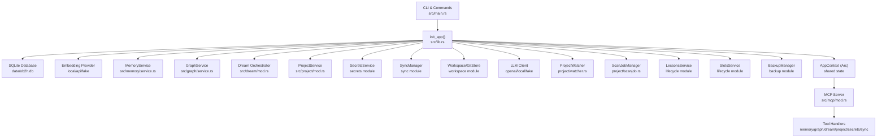
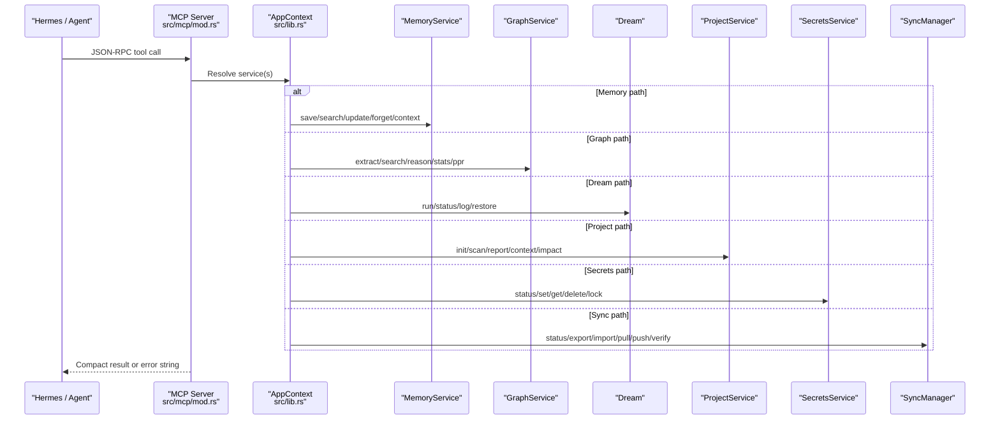
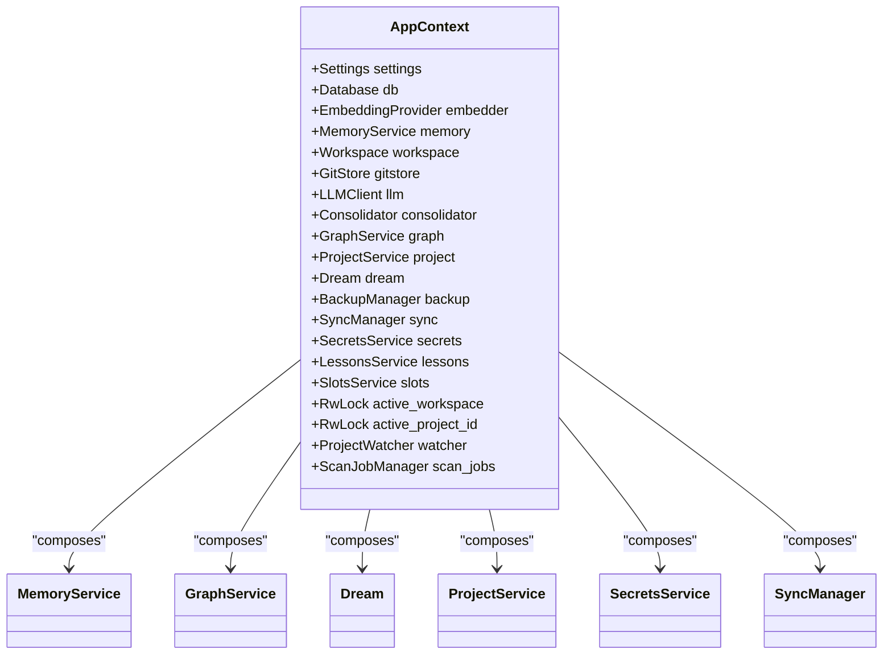
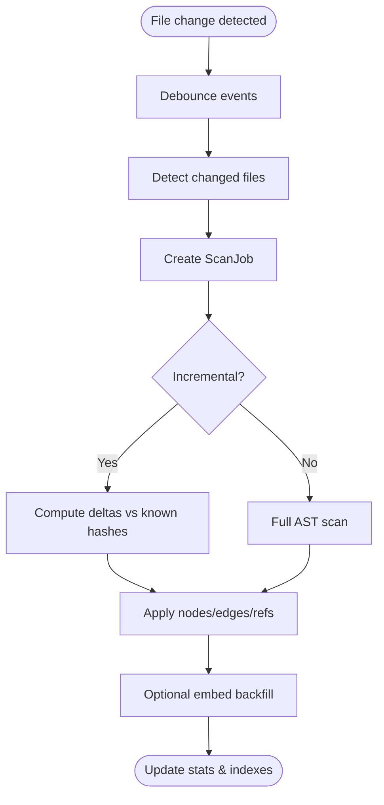
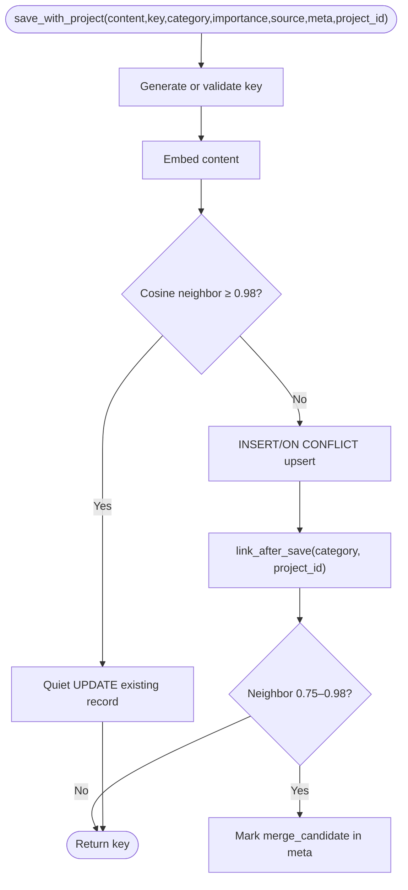
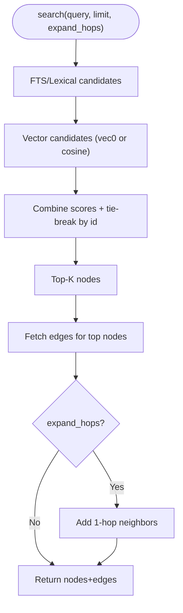
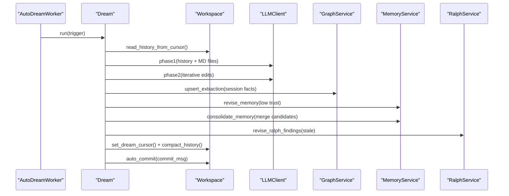
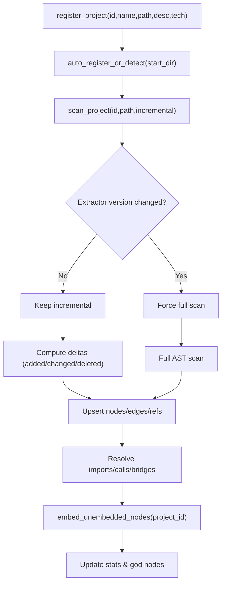
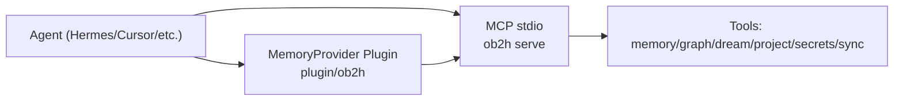
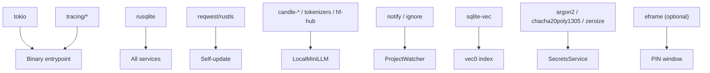

# Architecture Deep Dive

<cite>
**Referenced Files in This Document**
- [main.rs](file://src/main.rs)
- [lib.rs](file://src/lib.rs)
- [Cargo.toml](file://Cargo.toml)
- [ARCHITECTURE.md](file://docs/ARCHITECTURE.md)
- [README.md](file://README.md)
- [mod.rs (MCP)](file://src/mcp/mod.rs)
- [service.rs (MemoryService)](file://src/memory/service.rs)
- [service.rs (GraphService)](file://src/graph/service.rs)
- [mod.rs (Dream)](file://src/dream/mod.rs)
- [mod.rs (ProjectService)](file://src/project/mod.rs)
</cite>

## Table of Contents
1. [Introduction](#introduction)
2. [Project Structure](#project-structure)
3. [Core Components](#core-components)
4. [Architecture Overview](#architecture-overview)
5. [Detailed Component Analysis](#detailed-component-analysis)
6. [Dependency Analysis](#dependency-analysis)
7. [Performance Considerations](#performance-considerations)
8. [Troubleshooting Guide](#troubleshooting-guide)
9. [Conclusion](#conclusion)
10. [Appendices](#appendices)

## Introduction
OB2H is a local, Rust-based MCP knowledge store and long-term memory system for AI agents. It provides:
- Persistent memory with hybrid search (FTS + vector RRF).
- A deterministic AST code graph with analytics and reasoning.
- Background “dreaming” consolidation and maintenance.
- Project-scoped scanning, watchers, and incremental AST updates.
- Secrets vault isolated from memory, graph, dreams, and sync bundles.
- Machine-to-machine sync via SSH or manual transport with optional end-to-end encryption.
- Multi-agent integration through an MCP server and a MemoryProvider plugin abstraction.

The system follows a service-oriented architecture with clear separation between memory, graph, dream, project, secrets, and sync services. Application context initialization wires dependencies, background workers are orchestrated at startup, and the event-driven layer uses file watchers plus background processors.

**Section sources**
- [README.md:27-57](file://README.md#L27-L57)
- [ARCHITECTURE.md:11-58](file://docs/ARCHITECTURE.md#L11-L58)

## Project Structure
At runtime, the binary initializes settings, logging, application context, optional update checks, IPC secrets server, background workers, and the MCP stdio server. The library module exposes all core subsystems and centralizes dependency wiring.

**Diagram sources**
- [main.rs:17-90](file://src/main.rs#L17-L90)
- [lib.rs:45-135](file://src/lib.rs#L45-L135)
- [mod.rs (MCP):1-8](file://src/mcp/mod.rs#L1-L8)

**Section sources**
- [main.rs:17-90](file://src/main.rs#L17-L90)
- [lib.rs:45-135](file://src/lib.rs#L45-L135)

## Core Components
- MemoryService: Hybrid search (FTS5 trigram + cosine), save-time dedup heuristics, trust feedback, tombstones, typed links, merge operations, access tracking, and periodic maintenance hooks.
- GraphService: Entity upserts, edge accumulation, FTS/vector scoring, optional vec0 rescore, PPR ranking, and reasoning over retrieved facts.
- Dream: Two-phase agent loop (analysis then edits), session extraction into graph, memory trust revision, Ralph finding revision, Git-backed workspace commits, and bench-gate reporting.
- ProjectService: Project registration, zero-config detection, AST scanning (incremental/full), import/call resolution, bridge inference, manifest consolidation, embedding backfill, and scan job management.
- SecretsService: XChaCha20-Poly1305 vault with Argon2id master key, PIN unlock, TTL-based zeroization, and isolation from other subsystems.
- SyncManager: Incremental delta bundles, LWW merge with conflict journal, idempotent imports, push/pull/export/import/verify/status, and optional E2EE.
- MCP Server: JSON-RPC/stdio tool surface exposing memory, workspace, graph, dream, project, secrets, and service tools; also resources and prompts.

**Section sources**
- [service.rs (MemoryService):1-167](file://src/memory/service.rs#L1-L167)
- [service.rs (GraphService):96-216](file://src/graph/service.rs#L96-L216)
- [mod.rs (Dream):110-288](file://src/dream/mod.rs#L110-L288)
- [mod.rs (ProjectService):48-67](file://src/project/mod.rs#L48-L67)
- [ARCHITECTURE.md:203-278](file://docs/ARCHITECTURE.md#L203-L278)

## Architecture Overview
OB2H implements a service-oriented architecture with a single long-lived process serving MCP clients. Services are composed into an `AppContext` and shared via `Arc`. Background workers run autonomously inside the process. File watchers trigger incremental AST scans; dream and sync workers operate on schedules or triggers.

**Diagram sources**
- [main.rs:62-90](file://src/main.rs#L62-L90)
- [lib.rs:45-135](file://src/lib.rs#L45-L135)
- [ARCHITECTURE.md:203-278](file://docs/ARCHITECTURE.md#L203-L278)

## Detailed Component Analysis

### Service-Oriented Architecture and Dependency Injection
- `init_app` constructs all services, registers sqlite-vec extension, creates embedders, and wires cross-cutting concerns (workspace, gitstore, consolidator, pending session lock, lessons, slots, watcher, scan jobs).
- All services are exposed through `AppContext`, enabling clean separation of concerns and testability.
- Background workers (`AutoDreamWorker`, `AutoSyncWorker`) are started after IPC server initialization to avoid blocking MCP startup.

**Diagram sources**
- [lib.rs:45-135](file://src/lib.rs#L45-L135)

**Section sources**
- [lib.rs:45-161](file://src/lib.rs#L45-L161)

### Event-Driven Processing: File Watchers and Background Workers
- `ProjectWatcher` debounces file changes and triggers incremental AST scans via `ScanJobManager`.
- `AutoDreamWorker` runs based on time/event gates and orchestrates phases, memory revision, graph extraction, and Git commits.
- `AutoSyncWorker` periodically pushes/pulls bundles according to configuration.

**Diagram sources**
- [mod.rs (ProjectService):419-600](file://src/project/mod.rs#L419-L600)
- [lib.rs:137-161](file://src/lib.rs#L137-L161)

**Section sources**
- [lib.rs:137-161](file://src/lib.rs#L137-L161)
- [mod.rs (ProjectService):419-600](file://src/project/mod.rs#L419-L600)

### Memory Service: Hybrid Search, Deduplication, Trust, and Links
Key behaviors:
- Deterministic key generation and save-time cosine similarity checks for identity-duplicate suppression and merge-candidate marking.
- Hybrid search combining FTS5 trigram and vector cosine via Reciprocal Rank Fusion (RRF k=60).
- Access counting and trust increments on read paths; feedback and dream revisions adjust trust with bounded deltas.
- Typed links (`same_project`, `entity`, `category`, `manual`, `contradicts`, `causes`, `supersedes`) with soft-delete semantics.
- Merge operation merges metadata, importance, access counts, redirects links, and tombstones absorbed records.

**Diagram sources**
- [service.rs (MemoryService):48-167](file://src/memory/service.rs#L48-L167)

**Section sources**
- [service.rs (MemoryService):48-167](file://src/memory/service.rs#L48-L167)
- [service.rs (MemoryService):215-383](file://src/memory/service.rs#L215-L383)
- [service.rs (MemoryService):489-636](file://src/memory/service.rs#L489-L636)

### Graph Service: Knowledge Graph Analytics and Reasoning
Capabilities:
- Deterministic node IDs by label+type; entity upserts with description accumulation and edge context accumulation.
- FTS5 fallback to full scan if index unavailable; vector search optionally accelerated by vec0 rescore.
- PPR ranking over project-scoped graphs with edge-type-aware weights.
- Reasoning pipeline retrieves entities/relations and asks LLM for structured answers with confidence and steps.

**Diagram sources**
- [service.rs (GraphService):236-459](file://src/graph/service.rs#L236-L459)

**Section sources**
- [service.rs (GraphService):106-216](file://src/graph/service.rs#L106-L216)
- [service.rs (GraphService):236-459](file://src/graph/service.rs#L236-L459)
- [service.rs (GraphService):546-674](file://src/graph/service.rs#L546-L674)

### Dream Orchestrator: Phases, Revisions, and Git Backing
Phases:
- Phase 1: LLM analysis of new history against current memory files.
- Phase 2: Agent loop issuing minimal edit/read actions with strict JSON contracts.
- Extract session facts into the knowledge graph.
- Revise low-trust memories and propose belief edges.
- Optionally revise stale Ralph findings.
- Commit workspace changes to Git and compact history.

**Diagram sources**
- [mod.rs (Dream):145-288](file://src/dream/mod.rs#L145-L288)
- [mod.rs (Dream):290-395](file://src/dream/mod.rs#L290-L395)
- [mod.rs (Dream):397-543](file://src/dream/mod.rs#L397-L543)

**Section sources**
- [mod.rs (Dream):145-288](file://src/dream/mod.rs#L145-L288)
- [mod.rs (Dream):290-395](file://src/dream/mod.rs#L290-L395)
- [mod.rs (Dream):397-543](file://src/dream/mod.rs#L397-L543)

### Project Service: AST Scanning, Incremental Updates, and Embedding Backfill
Highlights:
- Zero-config project detection and registration with tech stack and branch info.
- Incremental scanning using known file hashes and extractor version gating.
- Import/call resolution, bridge inference, external import consolidation.
- Batch embedding backfill for nodes without vectors.
- Scan job manager for non-blocking scans and status reporting.

**Diagram sources**
- [mod.rs (ProjectService):165-214](file://src/project/mod.rs#L165-L214)
- [mod.rs (ProjectService):323-417](file://src/project/mod.rs#L323-L417)
- [mod.rs (ProjectService):419-600](file://src/project/mod.rs#L419-L600)
- [mod.rs (ProjectService):69-146](file://src/project/mod.rs#L69-L146)

**Section sources**
- [mod.rs (ProjectService):165-214](file://src/project/mod.rs#L165-L214)
- [mod.rs (ProjectService):323-417](file://src/project/mod.rs#L323-L417)
- [mod.rs (ProjectService):419-600](file://src/project/mod.rs#L419-L600)
- [mod.rs (ProjectService):69-146](file://src/project/mod.rs#L69-L146)

### Plugin System and Multi-Agent Support
- MCP stdio mode serves tools/resources/prompts to any MCP client.
- MemoryProvider plugin integrates with Hermes to prefetch relevant memory and inject `<agent_memory>` blocks, while syncing turns automatically.
- Plugin installation writes bundled Python assets and configures Hermes paths; status/uninstall commands manage lifecycle.

**Diagram sources**
- [main.rs:702-784](file://src/main.rs#L702-L784)
- [ARCHITECTURE.md:11-58](file://docs/ARCHITECTURE.md#L11-L58)

**Section sources**
- [main.rs:702-784](file://src/main.rs#L702-L784)
- [ARCHITECTURE.md:11-58](file://docs/ARCHITECTURE.md#L11-L58)

## Dependency Analysis
External dependencies include async runtime, SQLite driver, HTTP/TLS, CLI parsing, tracing/logging, chrono, regex, hashing, encoding, error handling, async traits, byte manipulation, compression, Candle ML, tokenizer, HuggingFace Hub, filesystem ignore, file watching, sqlite-vec, TOML/YAML, self-replace, semver, zip, cryptography primitives, secure random, password input, LRU cache, and optional GUI toolkit.

**Diagram sources**
- [Cargo.toml:7-66](file://Cargo.toml#L7-L66)

**Section sources**
- [Cargo.toml:7-66](file://Cargo.toml#L7-L66)

## Performance Considerations
- SQLite WAL with busy timeout supports concurrent processes (plugin, MCP, CLI).
- Hybrid search uses FTS5 trigram plus vector cosine with RRF k=60; optional vec0 rescore can accelerate large datasets.
- Embeddings stored as compact blobs; quantized int8 format supported with dual-read compatibility.
- Incremental AST scanning reduces rework; batch embedding backfill minimizes API calls.
- Background workers decouple heavy tasks (dream, sync) from request latency.
- Workspace daily logs archived to reduce disk usage; retention policies apply.

[No sources needed since this section provides general guidance]

## Troubleshooting Guide
Common areas:
- Logging: Non-blocking file appender and stderr routing depending on stdio mode; log level controlled via env filter.
- Errors: Tool handlers return compact strings; errors logged via tracing; graceful degradation when FTS5 or vec0 unavailable.
- Resources: Workspace archive old logs; GC of tombstones deferred to dream maintenance; backups before migrations and sync imports.
- Secrets: PIN UI or terminal fallback; master key zeroized on TTL expiry or lock command.

Operational tips:
- Use `ob2h doctor` to diagnose integrations and fix configs/hooks.
- Check `ob2h update status` and logs for self-update behavior.
- Inspect `ob2h sync status` and conflict journals for sync issues.
- Review dream logs and bench gate outcomes for quality regressions.

**Section sources**
- [main.rs:36-58](file://src/main.rs#L36-L58)
- [ARCHITECTURE.md:307-318](file://docs/ARCHITECTURE.md#L307-L318)

## Conclusion
OB2H’s architecture cleanly separates responsibilities across memory, graph, dream, project, secrets, and sync services, wired through a shared application context. The MCP server exposes a stable tool contract for multi-agent integration, while background workers and file watchers provide event-driven automation. With SQLite-backed persistence, optional vec0 acceleration, and robust error handling, OB2H balances performance, reliability, and extensibility for personal AI knowledge systems.

[No sources needed since this section summarizes without analyzing specific files]

## Appendices

### Infrastructure Requirements
- OS: Windows 11, Linux, macOS.
- Storage: SQLite database, workspace directory, logs, sync bundles, optional model cache.
- Network: Optional LLM API endpoints; optional GitHub releases; optional SSH for sync.
- Optional GUI: eframe-based PIN window (headless falls back to terminal).

**Section sources**
- [README.md:61-70](file://README.md#L61-L70)
- [Cargo.toml:49-66](file://Cargo.toml#L49-L66)

### Technology Stack Decisions and Compatibility
- Rust edition 2021; tokio full features for async runtime.
- rusqlite bundled with extensions; sqlite-vec for approximate nearest neighbor indexing.
- reqwest + rustls for TLS; serde ecosystem for serialization.
- Candle transformers for local models; tokenizers for text processing.
- Self-update via GitHub releases; semver for versioning.
- Optional GUI feature gated behind `gui` Cargo feature.

**Section sources**
- [Cargo.toml:1-66](file://Cargo.toml#L1-L66)