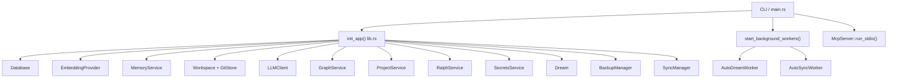
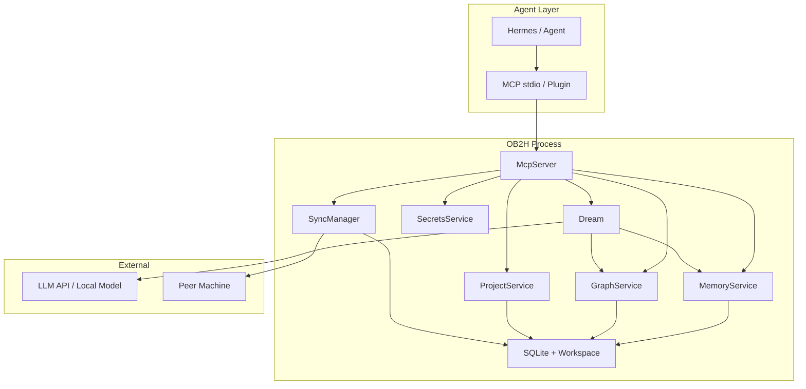
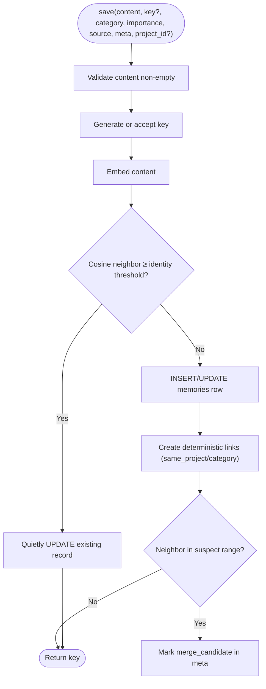
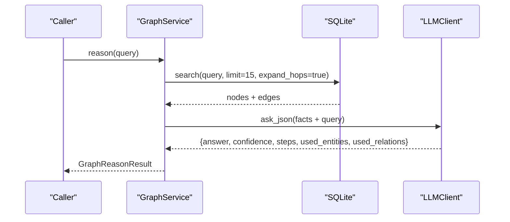
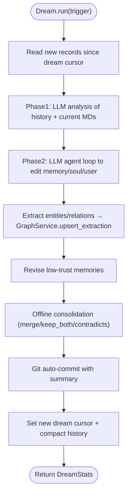
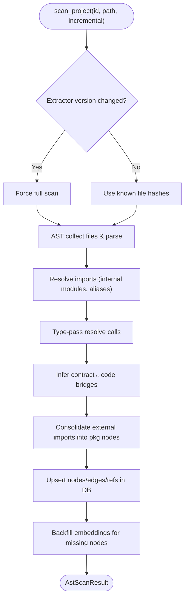
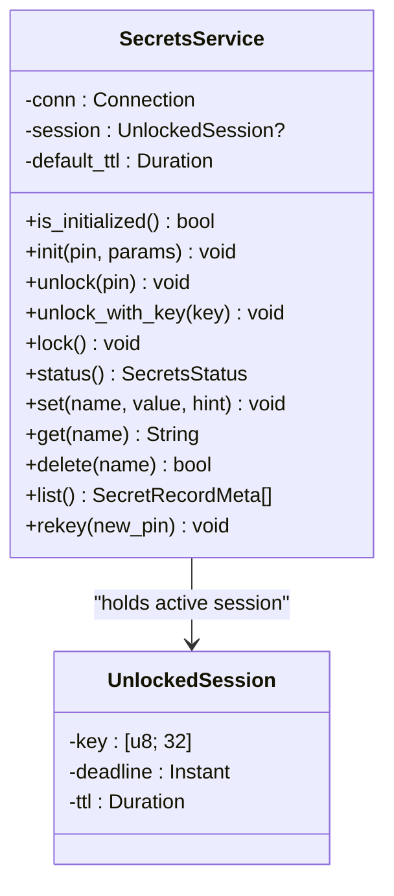
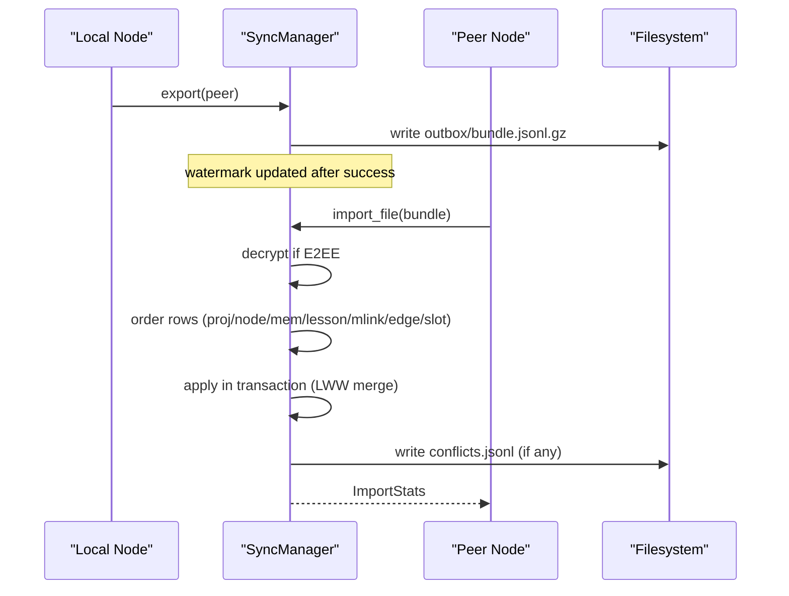
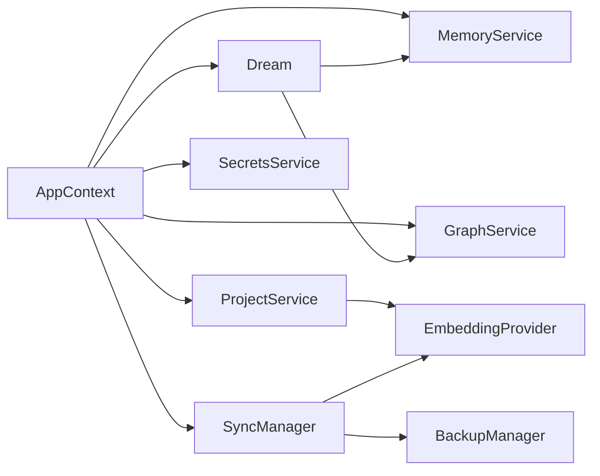

# Component Architecture

<cite>
**Referenced Files in This Document**
- [README.md](file://README.md)
- [ARCHITECTURE.md](file://docs/ARCHITECTURE.md)
- [main.rs](file://src/main.rs)
- [lib.rs](file://src/lib.rs)
- [service.rs](file://src/memory/service.rs)
- [service.rs](file://src/graph/service.rs)
- [mod.rs](file://src/dream/mod.rs)
- [mod.rs](file://src/project/mod.rs)
- [service.rs](file://src/secrets/service.rs)
- [mod.rs](file://src/sync/mod.rs)
</cite>

## Table of Contents
1. [Introduction](#introduction)
2. [Project Structure](#project-structure)
3. [Core Components](#core-components)
4. [Architecture Overview](#architecture-overview)
5. [Detailed Component Analysis](#detailed-component-analysis)
6. [Dependency Analysis](#dependency-analysis)
7. [Performance Considerations](#performance-considerations)
8. [Troubleshooting Guide](#troubleshooting-guide)
9. [Conclusion](#conclusion)

## Introduction
OB2H is a local Rust-based knowledge and memory system for AI agents. It provides persistent memory, AST-driven code graphs, automated “dreaming” maintenance, project scanning, encrypted secrets vaulting, and cross-machine synchronization. The runtime exposes MCP tools to agents while keeping data on the user’s machines.

This document focuses on the core service components:
- Memory Service: hybrid search (FTS + vector), trust feedback, tombstones, links.
- Graph Service: entity graph upserts, search, reasoning, PPR ranking.
- Dream Service: background consolidation, LLM-assisted edits, graph extraction, trust revision.
- Project Service: AST scanning, incremental updates, call/import resolution, embedding backfill.
- Secrets Service: PIN-protected vault with in-memory master key and TTL.
- Sync Service: delta bundles, LWW merge, optional E2EE, peer transport.

It also documents inter-service communication, lifecycle management, error handling, and resource management patterns.

**Section sources**
- [README.md:27-57](file://README.md#L27-L57)
- [ARCHITECTURE.md:11-58](file://docs/ARCHITECTURE.md#L11-L58)

## Project Structure
At process start, `main.rs` initializes settings, logging, app context, optional update checks, secrets IPC, background workers, and the MCP server. The application context wires all services together. Background workers can run AutoDream and AutoSync.

**Diagram sources**
- [main.rs:17-90](file://src/main.rs#L17-L90)
- [lib.rs:46-135](file://src/lib.rs#L46-L135)
- [lib.rs:137-161](file://src/lib.rs#L137-L161)

**Section sources**
- [main.rs:17-90](file://src/main.rs#L17-L90)
- [lib.rs:46-135](file://src/lib.rs#L46-L135)
- [lib.rs:137-161](file://src/lib.rs#L137-L161)

## Core Components
- MemoryService: persistent facts with hybrid retrieval, trust scoring, feedback, soft deletes, typed links, and project scoping.
- GraphService: knowledge graph with deduped nodes, weighted edges, semantic search, reasoning, and PPR ranking.
- Dream: orchestrates background analysis, file edits, graph extraction from sessions, memory trust revision, and Ralph findings review.
- ProjectService: registers projects, scans code via AST, resolves imports/calls, persists nodes/edges, and backfills embeddings.
- SecretsService: PIN-protected vault; master key lives only in memory with TTL; supports rekey and status/list/get/set/delete.
- SyncManager: exports/imports delta bundles, merges with LWW, supports SSH/manual transport, optional E2EE, and auto-sync worker.

These services are composed through `AppContext`, which holds shared dependencies such as Database, EmbeddingProvider, LLMClient, Workspace/GitStore, and configuration.

**Section sources**
- [lib.rs:46-135](file://src/lib.rs#L46-L135)
- [ARCHITECTURE.md:36-53](file://docs/ARCHITECTURE.md#L36-L53)

## Architecture Overview
The system runs as a single long-lived process exposing MCP tools. Services communicate via direct method calls within the same process. External integrations include:
- Agents via MCP stdio or Hermes plugin.
- LLM APIs for reasoning/extraction.
- Optional local Candle model for dreaming when no API key is configured.
- SSH or manual transport for sync.
- SQLite WAL database with FTS5 and BLOB vectors.

**Diagram sources**
- [ARCHITECTURE.md:11-58](file://docs/ARCHITECTURE.md#L11-L58)
- [main.rs:62-90](file://src/main.rs#L62-L90)
- [lib.rs:46-135](file://src/lib.rs#L46-L135)

## Detailed Component Analysis

### Memory Service
Responsibilities:
- Save/update/forget facts with deterministic keys and embeddings.
- Hybrid search combining FTS5 trigram and cosine similarity using RRF(k=60).
- Trust scoring updated by usage, feedback, and dream revisions.
- Soft deletes (tombstones) that propagate through sync.
- Typed links between memories and automatic link creation after save.

Key behaviors:
- Identity-duplicate detection at save-time using cosine threshold; quiet UPDATE if identical.
- Suspect duplicates marked for offline consolidation in dream.
- Feedback verdicts adjust trust and mark forget candidates.
- Forget marks tombstones and soft-deletes related links.

**Diagram sources**
- [service.rs:48-167](file://src/memory/service.rs#L48-L167)

Error handling:
- Empty content returns an error.
- Vector operations fall back gracefully where possible.
- Tombstone operations ensure related links are soft-deleted.

Resource management:
- Embeddings serialized into BLOBs; int8 format supported via quantization tooling.
- Access counters and last-access timestamps updated on explicit search hits.

**Section sources**
- [service.rs:48-167](file://src/memory/service.rs#L48-L167)
- [service.rs:489-636](file://src/memory/service.rs#L489-L636)
- [service.rs:683-757](file://src/memory/service.rs#L683-L757)

### Graph Service
Responsibilities:
- Upsert entities and relations with deduplication by node_id.
- Semantic search over nodes with lexical and vector scoring.
- Reasoning pipeline that queries the graph and asks LLM for structured answers.
- Personalized PageRank ranking over project-scoped graphs.

Key behaviors:
- Node IDs derived deterministically from label+type.
- Edge contexts stored as JSON arrays with bounded size.
- Search uses FTS5 fallback to full scan if needed; vec0 acceleration available.
- PPR builds seeds from initial match, then ranks reachable nodes with edge-type-aware weights.

**Diagram sources**
- [service.rs:462-509](file://src/graph/service.rs#L462-L509)

Error handling:
- If LLM fails, returns a safe result with low confidence and logs warnings.
- FTS5 unavailability triggers fallback to full scan.

Resource management:
- Embeddings computed lazily for nodes; optional vec0 index for faster approximate search.

**Section sources**
- [service.rs:106-216](file://src/graph/service.rs#L106-L216)
- [service.rs:236-460](file://src/graph/service.rs#L236-L460)
- [service.rs:546-674](file://src/graph/service.rs#L546-L674)

### Dream Service
Responsibilities:
- Background consolidation of session history into memory files.
- Two-phase LLM workflow: analyze and edit MD files.
- Extract entities/relations from sessions into the knowledge graph.
- Revise memory trust based on recent history.
- Optionally revise stale Ralph findings.

Lifecycle:
- Records a run entry, reads new history since cursor, executes phases, commits changes via Git, and updates cursor.
- Integrates with GraphService and MemoryService; optionally RalphService.

**Diagram sources**
- [mod.rs:145-288](file://src/dream/mod.rs#L145-L288)
- [mod.rs:290-395](file://src/dream/mod.rs#L290-L395)
- [mod.rs:397-416](file://src/dream/mod.rs#L397-L416)
- [mod.rs:418-543](file://src/dream/mod.rs#L418-L543)

Error handling:
- Errors during phases are logged; partial results may still be committed.
- Revision and consolidation failures are warned but do not abort the run.

Resource management:
- Cursor-based incremental processing; bounded iterations for phase2.
- History compaction limits growth.

**Section sources**
- [mod.rs:145-288](file://src/dream/mod.rs#L145-L288)
- [mod.rs:290-395](file://src/dream/mod.rs#L290-L395)
- [mod.rs:397-416](file://src/dream/mod.rs#L397-L416)
- [mod.rs:418-543](file://src/dream/mod.rs#L418-L543)

### Project Service
Responsibilities:
- Register and detect projects (Zero-Config).
- Incremental AST scanning with versioned extractor logic.
- Resolve imports and calls, bridge contracts to code, consolidate external imports.
- Persist AST nodes/edges and references; backfill embeddings for nodes without vectors.

Key behaviors:
- Version check forces full rescan when extractor logic changes.
- Incremental mode preserves unchanged symbols and refs to maintain cross-file relationships.
- Type-pass resolves simple calls; import resolution fixes internal module targets.
- Bridges infer connections between HTTP/gql/proto endpoints and code.

**Diagram sources**
- [mod.rs:419-800](file://src/project/mod.rs#L419-L800)

Error handling:
- Missing project root returns an error.
- Non-incremental scans clear old AST data before writing new data.

Resource management:
- Transactional writes for consistency.
- Batched embedding generation for nodes without vectors.

**Section sources**
- [mod.rs:419-800](file://src/project/mod.rs#L419-L800)

### Secrets Service
Responsibilities:
- Initialize vault with PIN-derived master key.
- Unlock with PIN or IPC-provided key; enforce TTL.
- Encrypt/decrypt values; store metadata and access stats.
- Rekey vault (rotate PIN and re-encrypt all records atomically).

Security model:
- Master key held in zeroized memory; wiped on lock or TTL expiry.
- PIN never leaves secure input path; errors surfaced as strings.

**Diagram sources**
- [service.rs:43-47](file://src/secrets/service.rs#L43-L47)
- [service.rs:58-111](file://src/secrets/service.rs#L58-L111)
- [service.rs:118-176](file://src/secrets/service.rs#L118-L176)
- [service.rs:186-203](file://src/secrets/service.rs#L186-L203)
- [service.rs:206-250](file://src/secrets/service.rs#L206-L250)
- [service.rs:267-358](file://src/secrets/service.rs#L267-L358)
- [service.rs:360-444](file://src/secrets/service.rs#L360-L444)

Error handling:
- Invalid PIN format or wrong PIN returns clear errors.
- Locked state prevents access; TTL expiry locks automatically.

Resource management:
- Zeroizing secret buffers; TTL-based cleanup.
- Atomic rekey transaction ensures consistency.

**Section sources**
- [service.rs:58-111](file://src/secrets/service.rs#L58-L111)
- [service.rs:118-176](file://src/secrets/service.rs#L118-L176)
- [service.rs:186-203](file://src/secrets/service.rs#L186-L203)
- [service.rs:206-250](file://src/secrets/service.rs#L206-L250)
- [service.rs:267-358](file://src/secrets/service.rs#L267-L358)
- [service.rs:360-444](file://src/secrets/service.rs#L360-L444)

### Sync Service
Responsibilities:
- Export delta bundles per peer with watermark cursors.
- Import bundles idempotently with LWW merge and conflict journaling.
- Support SSH/manual transport; optional E2EE container.
- Provide auto-sync worker and verification utilities.

Data flow:
- Export collects rows from memories, graph_nodes, graph_edges, projects, memory_links, lessons, slots; serializes to JSONL.gz; optionally encrypts.
- Import orders types to respect dependencies (projects/nodes first), applies rows in a transaction, tracks applied bundles, and journals conflicts.

**Diagram sources**
- [mod.rs:247-469](file://src/sync/mod.rs#L247-L469)
- [mod.rs:508-733](file://src/sync/mod.rs#L508-L733)

Error handling:
- Missing passphrase for E2EE bundle returns an error.
- Malformed headers/rows return contextual errors.
- Conflicts are journaled; lost LWW updates are counted.

Resource management:
- Auto-backup before applying unknown bundles.
- Applied bundles list capped to prevent kv growth.

**Section sources**
- [mod.rs:247-469](file://src/sync/mod.rs#L247-L469)
- [mod.rs:508-733](file://src/sync/mod.rs#L508-L733)

## Dependency Analysis
High-level dependency relationships:
- AppContext composes all services and shares Database, EmbeddingProvider, LLMClient, Workspace/GitStore.
- Dream depends on GraphService and MemoryService; optionally RalphService.
- ProjectService depends on AST extractor and optionally EmbeddingProvider for backfill.
- SyncManager depends on Database, EmbeddingProvider (for missing embeddings), and BackupManager.
- SecretsService is isolated and does not depend on other services except Database.

**Diagram sources**
- [lib.rs:46-135](file://src/lib.rs#L46-L135)
- [mod.rs:419-800](file://src/project/mod.rs#L419-L800)
- [mod.rs:204-229](file://src/sync/mod.rs#L204-L229)

Coupling and cohesion:
- Services are cohesive around their domain (memory, graph, dreams, projects, secrets, sync).
- Cross-service coupling is minimal and intentional: Dream orchestrates Graph and Memory; Sync interacts with DB and Embedder; Project uses Embedder optionally.

Potential circular dependencies:
- None observed; dependencies are directed from orchestrators (Dream, Sync) to infrastructure services (Graph, Memory, Embedder).

External integration points:
- LLM APIs via LLMClient.
- Local Candle model for dreaming when no API key is present.
- SSH/manual transport for sync.
- SQLite WAL database with FTS5 and BLOB vectors.

**Section sources**
- [lib.rs:46-135](file://src/lib.rs#L46-L135)
- [ARCHITECTURE.md:280-317](file://docs/ARCHITECTURE.md#L280-L317)

## Performance Considerations
- Hybrid search uses RRF(k=60) to combine FTS5 and vector results efficiently.
- vec0 acceleration can speed up vector search; recall@k gate validates accuracy.
- Embeddings are serialized compactly; int8 quantization reduces storage.
- Incremental AST scanning avoids full rescans unless extractor version changes.
- Dream phases are bounded; history compaction limits growth.
- Sync bundles are gzipped; E2EE adds cryptographic overhead but protects payloads.

[No sources needed since this section provides general guidance]

## Troubleshooting Guide
Common issues and strategies:
- Memory duplicate suspicion: use merge workflows; dream consolidates suspects offline.
- Graph search fallback: if FTS5 unavailable, full scan occurs; verify index health.
- Dream failures: check LLM connectivity and prompt constraints; inspect dream logs and status.
- Project scan errors: ensure project root exists; check extractor version changes forcing full rescan.
- Secrets locked: unlock via PIN or IPC; verify TTL and PIN format; rekey if needed.
- Sync conflicts: review conflicts.jsonl; adjust peer priority; verify OB2H_SYNC_KEY for E2EE.

Operational tips:
- Use `ob2h doctor` and `ob2h stats` for diagnostics.
- Monitor dream status and logs; consider bench gate to revert degraded dream runs.
- Verify sync state with `sync status` and `sync verify`.

**Section sources**
- [service.rs:48-167](file://src/memory/service.rs#L48-L167)
- [service.rs:236-460](file://src/graph/service.rs#L236-L460)
- [mod.rs:145-288](file://src/dream/mod.rs#L145-L288)
- [mod.rs:419-800](file://src/project/mod.rs#L419-L800)
- [service.rs:118-176](file://src/secrets/service.rs#L118-L176)
- [mod.rs:508-733](file://src/sync/mod.rs#L508-L733)

## Conclusion
OB2H’s architecture centers on well-defined services orchestrated by AppContext:
- MemoryService provides robust hybrid retrieval and trust-aware persistence.
- GraphService offers semantic search, reasoning, and advanced ranking.
- Dream automates maintenance, edits, and knowledge extraction.
- ProjectService delivers precise AST scanning and code graph construction.
- SecretsService secures sensitive data with strong in-memory protection.
- SyncManager enables reliable cross-machine synchronization with optional encryption.

Inter-service communication is straightforward and efficient, leveraging shared resources and clear boundaries. Lifecycle management includes background workers, cursors, and atomic transactions. Error handling is defensive and observable, while resource management emphasizes compact storage, incremental processing, and secure memory handling.

[No sources needed since this section summarizes without analyzing specific files]