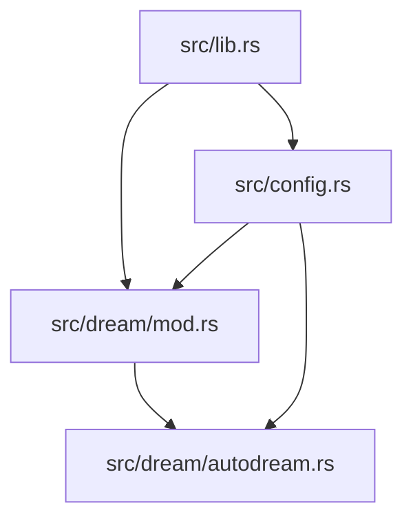
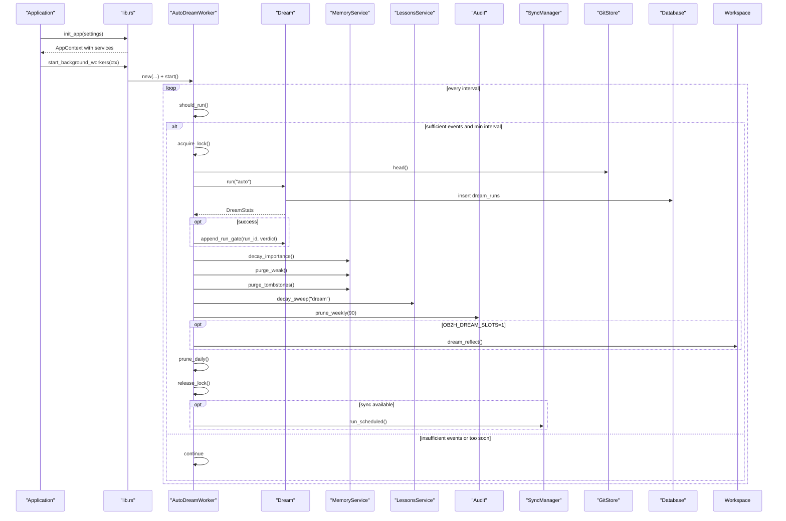
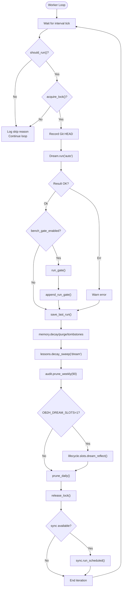
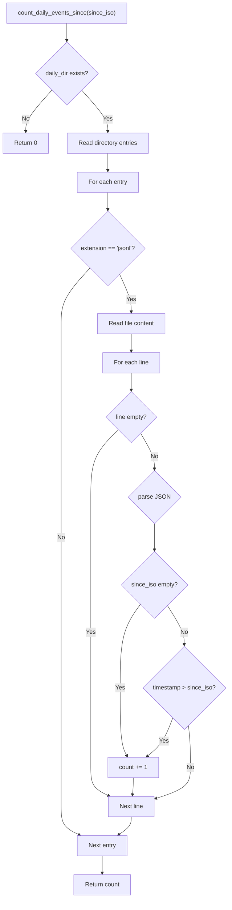
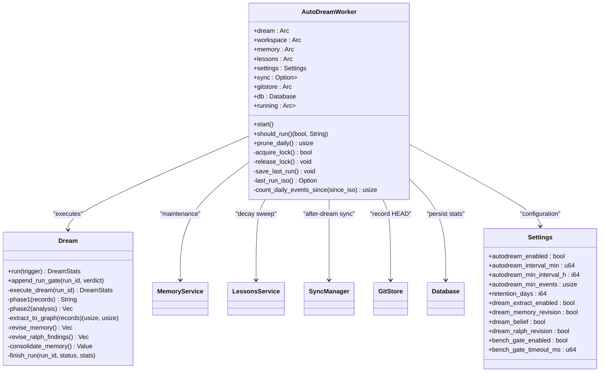

# AutoDream Worker

<cite>
**Referenced Files in This Document**
- [autodream.rs](file://src/dream/autodream.rs)
- [dream_mod.rs](file://src/dream/mod.rs)
- [config.rs](file://src/config.rs)
- [lib.rs](file://src/lib.rs)
</cite>

## Table of Contents
1. [Introduction](#introduction)
2. [Project Structure](#project-structure)
3. [Core Components](#core-components)
4. [Architecture Overview](#architecture-overview)
5. [Detailed Component Analysis](#detailed-component-analysis)
6. [Dependency Analysis](#dependency-analysis)
7. [Performance Considerations](#performance-considerations)
8. [Troubleshooting Guide](#troubleshooting-guide)
9. [Conclusion](#conclusion)

## Introduction
AutoDream Worker is the background component that automatically schedules and triggers nightly dream processing for OB2H. It periodically checks whether enough new daily events have occurred, safely acquires a file-based lock, runs the Dream pipeline, optionally performs a bench gate evaluation, and then executes scheduled maintenance tasks such as memory decay, purge, lessons decay sweep, audit ledger rotation, optional slot reflection, daily log pruning, and after-dream synchronization with peers.

The worker is integrated into the main application lifecycle through the shared `AppContext`, which constructs all services (workspace, memory, graph, Ralph, sync, Git store, database, LLM client) and passes them to both the Dream engine and AutoDream Worker. Configuration is driven by environment variables prefixed with `OB2H_`.

## Project Structure
AutoDream Worker lives under the `dream` module alongside the core Dream engine and related utilities:

**Diagram sources**
- [lib.rs:34-34](file://src/lib.rs#L34-L34)
- [dream_mod.rs:1-6](file://src/dream/mod.rs#L1-L6)
- [autodream.rs:1-16](file://src/dream/autodream.rs#L1-L16)
- [config.rs:1-106](file://src/config.rs#L1-L106)

**Section sources**
- [lib.rs:1-25](file://src/lib.rs#L1-L25)
- [dream_mod.rs:1-21](file://src/dream/mod.rs#L1-L21)
- [autodream.rs:1-16](file://src/dream/autodream.rs#L1-L16)
- [config.rs:1-106](file://src/config.rs#L1-L106)

## Core Components
- **AutoDreamWorker**: Background Tokio task that ticks on a configured interval, evaluates gating conditions, runs Dream, and performs post-run maintenance.
- **Dream**: The core dream processing engine that reads history, performs analysis and edits, extracts graph entities, revises memory trust, consolidates memory, revises Ralph findings, commits changes, and records run statistics.
- **Settings**: Central configuration object loaded from environment variables, including autodream toggles, intervals, thresholds, and feature flags.
- **AppContext integration**: Application initialization builds services and starts background workers conditionally based on settings.

Key responsibilities:
- Scheduling: periodic tick using Tokio interval.
- Gating: minimum time since last run and minimum number of new daily events.
- Concurrency safety: file-based lock with staleness detection.
- Execution: invoke Dream.run with trigger "auto".
- Post-processing: bench gate, memory maintenance, lessons decay, audit rotation, optional slot reflection, daily pruning, peer sync.

**Section sources**
- [autodream.rs:20-59](file://src/dream/autodream.rs#L20-L59)
- [dream_mod.rs:110-143](file://src/dream/mod.rs#L110-L143)
- [config.rs:8-106](file://src/config.rs#L8-L106)
- [lib.rs:46-134](file://src/lib.rs#L46-L134)

## Architecture Overview
AutoDream Worker integrates with the main application lifecycle and orchestrates Dream execution while coordinating with memory, lessons, audit, workspace, Git store, and sync components.

**Diagram sources**
- [lib.rs:137-161](file://src/lib.rs#L137-L161)
- [autodream.rs:61-145](file://src/dream/autodream.rs#L61-L145)
- [dream_mod.rs:145-181](file://src/dream/mod.rs#L145-L181)
- [dream_mod.rs:196-288](file://src/dream/mod.rs#L196-L288)

## Detailed Component Analysis

### AutoDreamWorker Lifecycle
AutoDreamWorker is constructed with references to Dream, Workspace, MemoryService, LessonsService, Settings, optional SyncManager, GitStore, and Database. Its `start` method spawns a Tokio task that:
- Checks if autodream is enabled.
- Creates a ticker with an interval derived from `autodream_interval_min`, clamped to at least 60 seconds.
- On each tick, evaluates `should_run()` and skips if conditions are not met.
- Acquires a file-based lock; if stale, warns and proceeds.
- Records Git HEAD before Dream execution.
- Runs Dream with trigger "auto".
- On success, optionally runs bench gate and appends verdict to Dream stats.
- Saves last run timestamp.
- Performs memory decay, purge weak entries, purge tombstones beyond retention.
- Runs weekly lessons decay sweep.
- Optionally runs weekly audit ledger pruning.
- Optionally reflects daily patterns into slots when `OB2H_DREAM_SLOTS` is set.
- Prunes daily logs older than retention.
- Releases lock.
- Attempts after-dream sync if SyncManager is present.

**Diagram sources**
- [autodream.rs:61-145](file://src/dream/autodream.rs#L61-L145)
- [autodream.rs:169-224](file://src/dream/autodream.rs#L169-L224)
- [autodream.rs:226-271](file://src/dream/autodream.rs#L226-L271)

**Section sources**
- [autodream.rs:20-59](file://src/dream/autodream.rs#L20-L59)
- [autodream.rs:61-145](file://src/dream/autodream.rs#L61-L145)
- [autodream.rs:169-271](file://src/dream/autodream.rs#L169-L271)

### Scheduling Mechanisms
Scheduling is driven by three primary mechanisms:
- **Interval ticker**: Uses `tokio::time::interval` with duration computed from `autodream_interval_min`, ensuring at least 60 seconds between ticks.
- **Minimum interval gate**: Enforces a minimum gap since the last successful run using `autodream_min_interval_h`.
- **Event threshold gate**: Counts new daily JSONL events since the last run timestamp and requires at least `autodream_min_events`.

The event counting logic scans the daily directory for `.jsonl` files, parses lines, and compares timestamps against the last run ISO string. If no last run exists, it counts all events.

**Diagram sources**
- [autodream.rs:194-224](file://src/dream/autodream.rs#L194-L224)

**Section sources**
- [autodream.rs:61-76](file://src/dream/autodream.rs#L61-L76)
- [autodream.rs:169-192](file://src/dream/autodream.rs#L169-L192)
- [autodream.rs:194-224](file://src/dream/autodream.rs#L194-L224)

### Integration with System Events
AutoDream Worker coordinates with several system components:
- **MemoryService**: Decay importance, purge weak entries, purge tombstones based on retention days.
- **LessonsService**: Weekly decay sweep with cursor tracking and candidate-for-forget reporting without deletion.
- **Audit Ledger**: Weekly pruning of audit entries older than 90 days.
- **Slots Service**: Optional reflection of daily patterns into slots when environment flag is set.
- **SyncManager**: Best-effort after-dream synchronization with peers.
- **GitStore**: Record HEAD before Dream execution for potential rollback reference.
- **Database**: Persist Dream run stats and support bench gate verdict appending.

**Section sources**
- [autodream.rs:114-142](file://src/dream/autodream.rs#L114-L142)
- [dream_mod.rs:545-566](file://src/dream/mod.rs#L545-L566)

### Error Handling and Resilience
- **Lock staleness**: If a lock file exists but is older than `LOCK_STALE_SECS` (3600 seconds), the worker warns and takes over the lock.
- **Dream errors**: Errors during Dream execution are logged and result in a failed run status recorded in the database.
- **Bench gate failures**: Bench gate execution is best-effort; failures do not prevent Dream completion.
- **Maintenance operations**: Memory decay, purge, lessons decay, audit pruning, and slot reflection are wrapped in best-effort calls that ignore errors to avoid disrupting the main flow.
- **After-dream sync**: Sync failures are warned but do not fail the Dream run.

**Section sources**
- [autodream.rs:226-247](file://src/dream/autodream.rs#L226-L247)
- [autodream.rs:86-110](file://src/dream/autodream.rs#L86-L110)
- [dream_mod.rs:155-181](file://src/dream/mod.rs#L155-L181)

## Dependency Analysis
AutoDream Worker depends on multiple subsystems, creating a cohesive integration layer between scheduling, data persistence, memory management, and external coordination.

**Diagram sources**
- [autodream.rs:20-59](file://src/dream/autodream.rs#L20-L59)
- [dream_mod.rs:110-143](file://src/dream/mod.rs#L110-L143)
- [config.rs:8-106](file://src/config.rs#L8-L106)

**Section sources**
- [autodream.rs:20-59](file://src/dream/autodream.rs#L20-L59)
- [dream_mod.rs:110-143](file://src/dream/mod.rs#L110-L143)
- [config.rs:8-106](file://src/config.rs#L8-L106)

## Performance Considerations
- **Interval tuning**: `autodream_interval_min` controls how frequently the worker checks for work. Lower values increase CPU usage but reduce latency; higher values reduce overhead but may delay processing.
- **Event threshold**: `autodream_min_events` prevents unnecessary Dream runs when few new events exist, reducing LLM calls and I/O.
- **Minimum interval**: `autodream_min_interval_h` ensures sufficient time between runs, preventing excessive processing.
- **Batch size**: `dream_batch` controls how many history records are processed per Dream run, balancing throughput and context window limits.
- **Memory maintenance**: Decay and purge operations are best-effort and designed to be lightweight; they run after each successful Dream to keep memory healthy without blocking the main flow.
- **Bench gate**: When enabled, adds overhead due to quick benchmark execution but provides valuable feedback on Dream effectiveness.

[No sources needed since this section provides general guidance]

## Troubleshooting Guide
Common issues and resolutions:
- **Autodream not running**: Check `OB2H_AUTODREAM_ENABLED`; ensure it is not set to `0` or `false`.
- **Too frequent or infrequent runs**: Adjust `OB2H_AUTODREAM_INTERVAL_MIN`, `OB2H_AUTODREAM_MIN_INTERVAL_H`, and `OB2H_AUTODREAM_MIN_EVENTS`.
- **Lock conflicts**: Verify that `autodream.lock` is not stale; the worker will warn and take over locks older than 1 hour.
- **No events detected**: Ensure daily JSONL files exist in the workspace daily directory and contain valid JSON lines with timestamps.
- **Dream failures**: Check database `dream_runs` table for error messages and review logs for LLM or I/O errors.
- **Memory not decaying**: Verify that MemoryService is properly initialized and that retention settings are correct.
- **Lessons not decaying**: Ensure LessonsService is available and that `OB2H_DREAM_SLOTS` is not interfering with expected behavior.
- **Sync not running**: Confirm SyncManager is provided and `OB2H_AUTOSYNC_ENABLED` is set appropriately.

**Section sources**
- [config.rs:225-239](file://src/config.rs#L225-L239)
- [autodream.rs:61-76](file://src/dream/autodream.rs#L61-L76)
- [autodream.rs:226-247](file://src/dream/autodream.rs#L226-L247)
- [dream_mod.rs:155-181](file://src/dream/mod.rs#L155-L181)

## Conclusion
AutoDream Worker provides robust automated scheduling and triggering of dream processing within OB2H. It combines configurable intervals, event-based gating, file locking, and comprehensive post-run maintenance to ensure reliable, efficient, and resilient operation. Integration with the main application lifecycle ensures seamless coordination with memory, lessons, audit, sync, and other subsystems. Proper configuration of environment variables allows fine-tuning of behavior to match operational requirements, while best-effort error handling maintains stability even when individual components fail.

[No sources needed since this section summarizes without analyzing specific files]