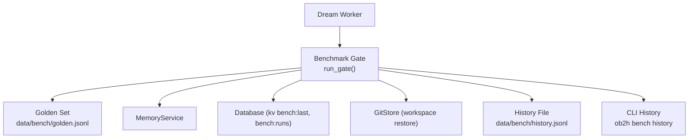
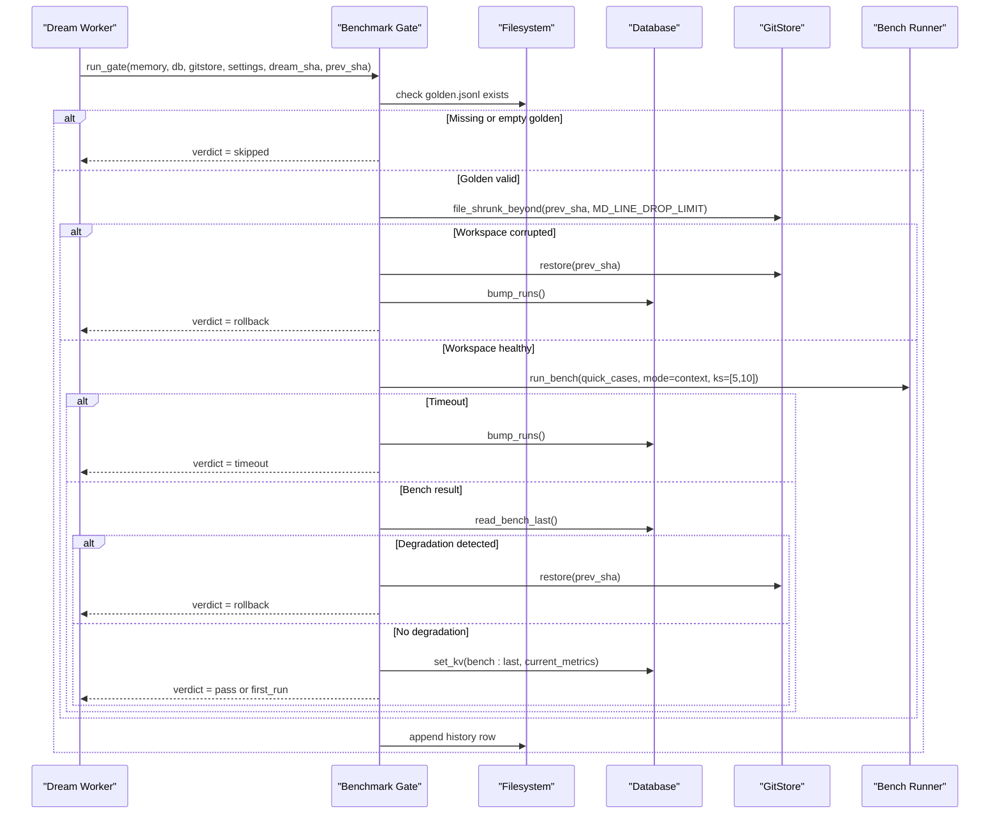
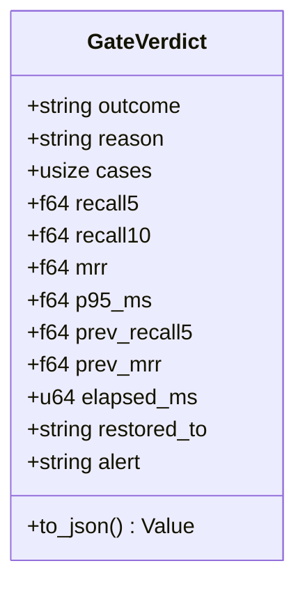
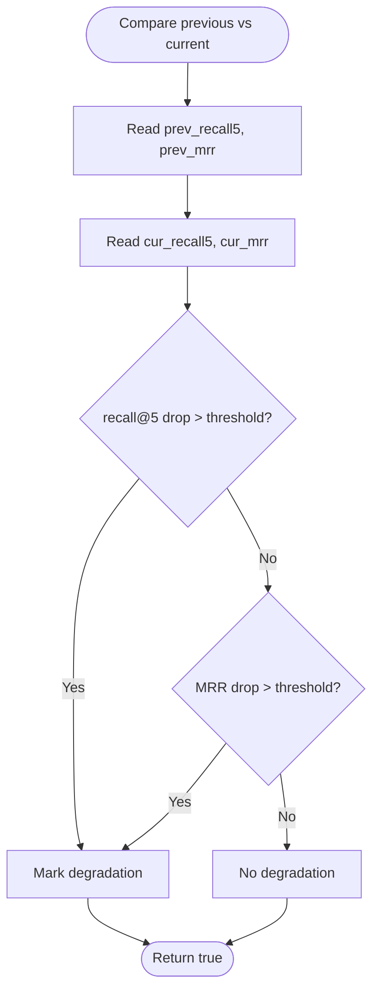
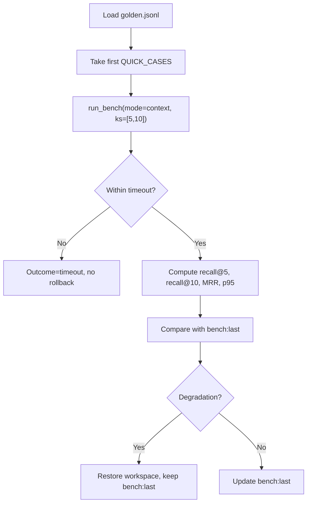
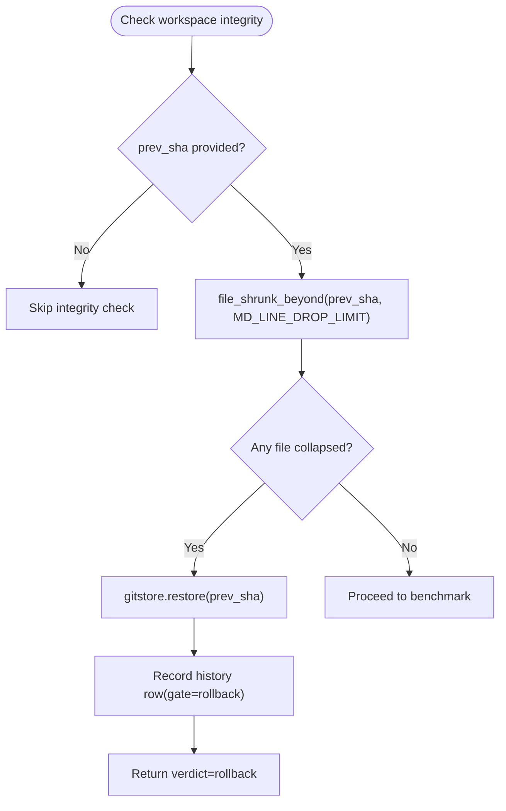
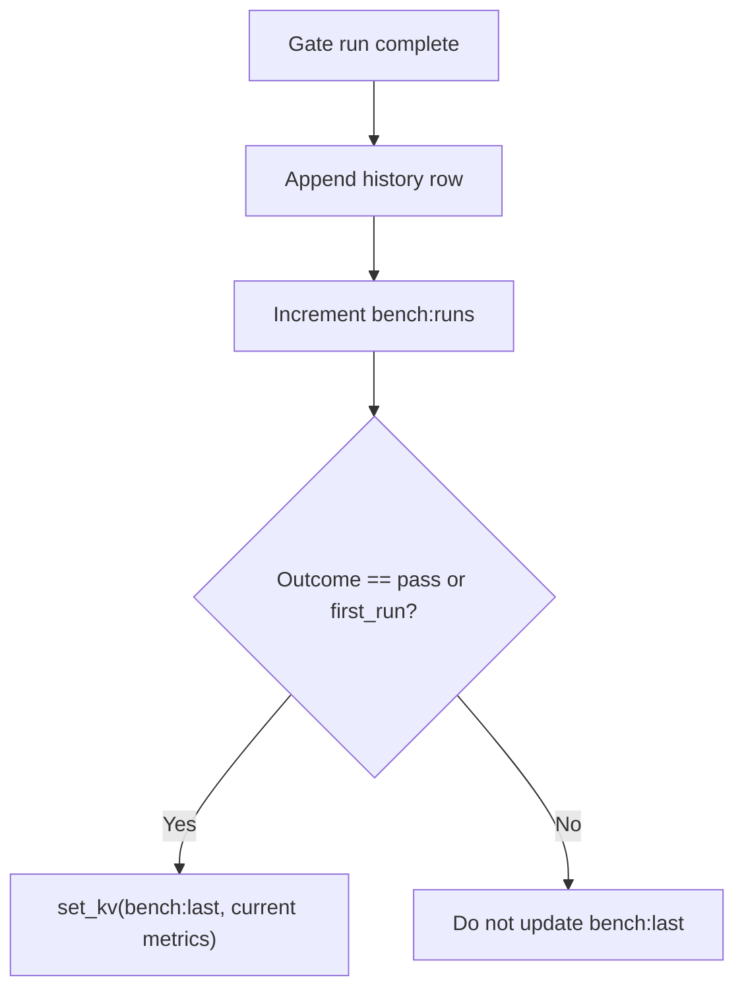
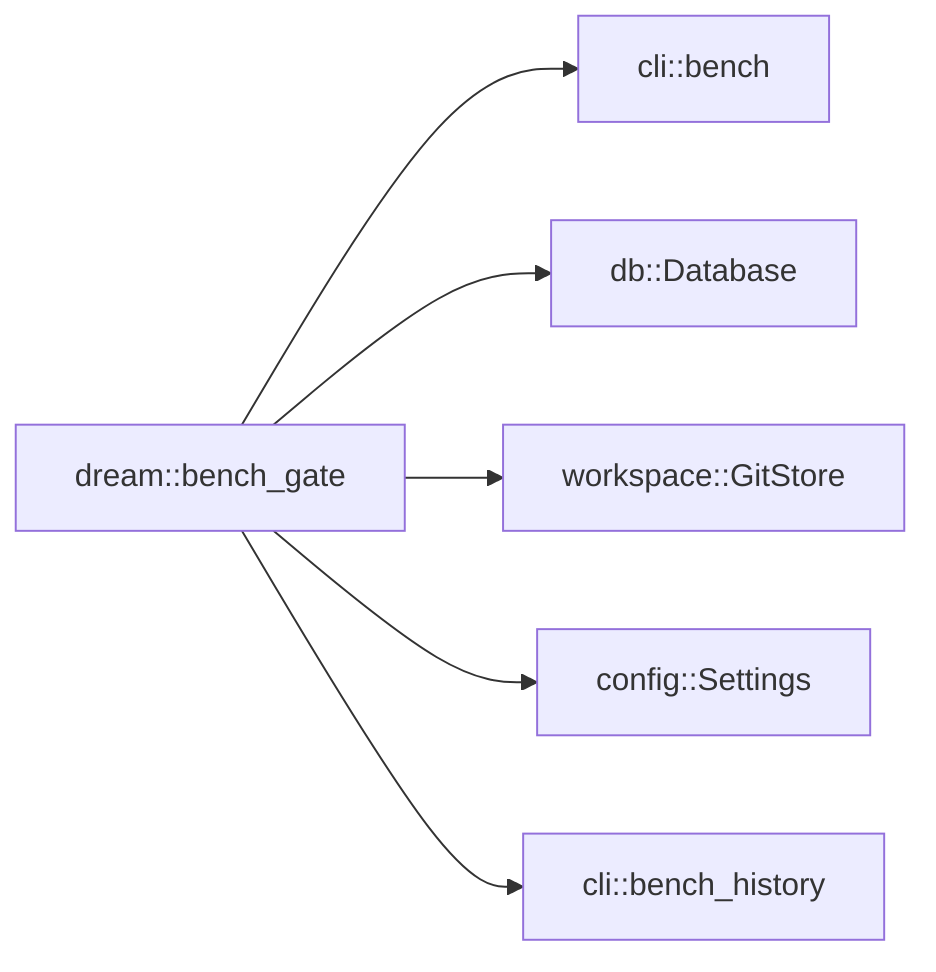

# Benchmark Gate

<cite>
**Referenced Files in This Document**
- [bench_gate.rs](file://src/dream/bench_gate.rs)
- [bench.rs](file://src/cli/bench.rs)
- [bench_history.rs](file://src/cli/bench_history.rs)
- [test_bench_gate.rs](file://tests/test_bench_gate.rs)
- [PLAN_v1.7_bench.md](file://docs/PLAN_v1.7_bench.md)
- [bench_baseline.md](file://docs/bench_baseline.md)
</cite>

## Table of Contents
1. [Introduction](#introduction)
2. [Project Structure](#project-structure)
3. [Core Components](#core-components)
4. [Architecture Overview](#architecture-overview)
5. [Detailed Component Analysis](#detailed-component-analysis)
6. [Dependency Analysis](#dependency-analysis)
7. [Performance Considerations](#performance-considerations)
8. [Troubleshooting Guide](#troubleshooting-guide)
9. [Conclusion](#conclusion)

## Introduction
The Benchmark Gate is a quality assurance and regression prevention component for the dream processing pipeline. It runs after a successful dream run, executes a quick benchmark against a golden set, validates output quality, compares results with the last recorded baseline, and automatically rolls back workspace changes when a regression is detected. The gate also protects workspace integrity by detecting severe document corruption that would otherwise be invisible to memory-only benchmarks.

Key goals:
- Prevent regressions in retrieval quality measured by recall@k and MRR.
- Protect workspace files from destructive dream edits.
- Provide auditable history and alerts for every gate outcome.
- Keep the system fail-open: timeouts and missing data do not roll back state.

## Project Structure
The Benchmark Gate lives under the dream module and integrates with the CLI benchmarking layer, persistent key-value storage, and the workspace Git store.

**Diagram sources**
- [bench_gate.rs:160-332](file://src/dream/bench_gate.rs#L160-L332)
- [bench.rs:120-255](file://src/cli/bench.rs#L120-L255)
- [bench_history.rs:21-37](file://src/cli/bench_history.rs#L21-L37)

**Section sources**
- [bench_gate.rs:1-39](file://src/dream/bench_gate.rs#L1-L39)
- [bench.rs:1-45](file://src/cli/bench.rs#L1-L45)
- [bench_history.rs:1-15](file://src/cli/bench_history.rs#L1-L15)

## Core Components
- Gate configuration constants define the quick case count, recall drop threshold, MRR drop threshold, and workspace integrity threshold.
- `GateVerdict` captures the final outcome, metrics, timing, rollback target, and alert text.
- `is_degradation` implements dual-signal regression detection using relative drops on recall@5 and MRR.
- `run_gate` orchestrates golden loading, workspace integrity checks, timed benchmark execution, baseline comparison, rollback or baseline update, history recording, and run counting.
- History utilities read and append JSONL rows for trend analysis and CLI reporting.
- Key-value helpers persist the last baseline and the number of gate runs.

**Section sources**
- [bench_gate.rs:31-57](file://src/dream/bench_gate.rs#L31-L57)
- [bench_gate.rs:78-87](file://src/dream/bench_gate.rs#L78-L87)
- [bench_gate.rs:89-128](file://src/dream/bench_gate.rs#L89-L128)
- [bench_gate.rs:130-158](file://src/dream/bench_gate.rs#L130-L158)
- [bench_gate.rs:160-332](file://src/dream/bench_gate.rs#L160-L332)
- [bench_gate.rs:334-365](file://src/dream/bench_gate.rs#L334-L365)

## Architecture Overview
The gate is invoked after a dream completes successfully. It first checks whether it is enabled, then validates the presence and readability of the golden set. A workspace integrity check detects severe file shrinkage beyond a configured line ratio. If the workspace is intact, the gate runs a quick benchmark in context mode over the first N golden cases, bounded by a timeout budget. Results are compared against the previous baseline stored in the database; if degradation is detected, the workspace is restored to the pre-dream commit and the baseline is not updated. Otherwise, the baseline is updated and the run is recorded in history.

**Diagram sources**
- [bench_gate.rs:160-332](file://src/dream/bench_gate.rs#L160-L332)
- [bench.rs:120-255](file://src/cli/bench.rs#L120-L255)

## Detailed Component Analysis

### Gate Configuration and Verdict Model
The gate exposes public constants controlling behavior:
- Quick case count: limits the benchmark to the first N golden cases.
- Recall drop limit: relative drop threshold for recall@5.
- MRR drop limit: relative drop threshold for MRR.
- Workspace integrity threshold: fraction of lines below which a tracked file is considered collapsed.

`GateVerdict` includes:
- Outcome: pass, first_run, rollback, timeout, skipped.
- Metrics: recall@5, recall@10, MRR, p95 latency.
- Previous baseline values: prev_recall5, prev_mrr.
- Timing and rollback metadata: elapsed_ms, restored_to.
- Alert text for human-readable reports.

**Diagram sources**
- [bench_gate.rs:40-76](file://src/dream/bench_gate.rs#L40-L76)

**Section sources**
- [bench_gate.rs:31-38](file://src/dream/bench_gate.rs#L31-L38)
- [bench_gate.rs:40-76](file://src/dream/bench_gate.rs#L40-L76)

### Regression Detection Logic
Regression is determined by comparing previous and current metrics:
- Relative recall@5 drop exceeding the configured threshold triggers degradation.
- Relative MRR drop exceeding its threshold also triggers degradation, even if recall is stable.
- Zero baselines are treated safely to avoid division issues.

**Diagram sources**
- [bench_gate.rs:78-87](file://src/dream/bench_gate.rs#L78-L87)

**Section sources**
- [bench_gate.rs:78-87](file://src/dream/bench_gate.rs#L78-L87)

### Benchmark Execution Pipeline
The gate uses the CLI benchmark runner:
- Loads the golden set from `data/bench/golden.jsonl`.
- Selects the first N cases as the quick subset.
- Runs the benchmark in context mode with k levels 5 and 10.
- Enforces a timeout budget; timeouts produce a skipped gate without rollback.
- Computes recall@5, recall@10, MRR, and p95 latency.

**Diagram sources**
- [bench_gate.rs:176-259](file://src/dream/bench_gate.rs#L176-L259)
- [bench.rs:120-255](file://src/cli/bench.rs#L120-L255)

**Section sources**
- [bench.rs:16-45](file://src/cli/bench.rs#L16-L45)
- [bench.rs:120-255](file://src/cli/bench.rs#L120-L255)

### Workspace Integrity Protection
Before running the benchmark, the gate checks whether any tracked file has shrunk beyond the configured line ratio relative to the pre-dream commit. If so, it immediately restores the workspace to the previous commit and records a rollback verdict. This protects against destructive dream edits that would otherwise bypass memory-only benchmarks.

**Diagram sources**
- [bench_gate.rs:193-221](file://src/dream/bench_gate.rs#L193-L221)

**Section sources**
- [bench_gate.rs:193-221](file://src/dream/bench_gate.rs#L193-L221)

### Baseline Persistence and History Tracking
The gate persists two important pieces of state:
- `bench:last`: the latest accepted baseline containing recall@5 and MRR.
- `bench:runs`: a counter incremented per gate run, used for long-term decisions.

Each run appends a JSONL row to `data/bench/history.jsonl`, including timestamp, gate outcome, metrics, p95 latency, database size, embedding backend, and optional dream SHA. The CLI provides a history viewer that prints recent rows and computes deltas.

**Diagram sources**
- [bench_gate.rs:291-316](file://src/dream/bench_gate.rs#L291-L316)
- [bench_gate.rs:334-343](file://src/dream/bench_gate.rs#L334-L343)
- [bench.rs:713-774](file://src/cli/bench.rs#L713-L774)

**Section sources**
- [bench_gate.rs:123-128](file://src/dream/bench_gate.rs#L123-L128)
- [bench_gate.rs:130-158](file://src/dream/bench_gate.rs#L130-L158)
- [bench_gate.rs:334-343](file://src/dream/bench_gate.rs#L334-L343)
- [bench.rs:713-774](file://src/cli/bench.rs#L713-L774)

### Failure Handling Strategies
- Missing or unreadable golden set: gate skips with a warning and does not alter state.
- Empty golden set: gate skips with a warning.
- Timeout: gate skips without rollback; baseline remains unchanged.
- Benchmark error: gate skips with a warning.
- Workspace collapse: immediate rollback to previous commit; alert recorded.
- Regression detected: rollback to previous commit; baseline not updated; alert recorded.
- Healthy run: baseline updated; history recorded; run counter incremented.

**Section sources**
- [bench_gate.rs:176-190](file://src/dream/bench_gate.rs#L176-L190)
- [bench_gate.rs:223-259](file://src/dream/bench_gate.rs#L223-L259)
- [bench_gate.rs:265-302](file://src/dream/bench_gate.rs#L265-L302)

## Dependency Analysis
The gate depends on several subsystems:
- CLI benchmark runner for metric computation.
- Database for baseline persistence and run counting.
- GitStore for workspace integrity checks and restoration.
- Settings for feature flags and thresholds.
- History utilities for auditability and CLI reporting.

**Diagram sources**
- [bench_gate.rs:17-29](file://src/dream/bench_gate.rs#L17-L29)
- [bench.rs:120-255](file://src/cli/bench.rs#L120-L255)
- [bench_history.rs:21-37](file://src/cli/bench_history.rs#L21-L37)

**Section sources**
- [bench_gate.rs:17-29](file://src/dream/bench_gate.rs#L17-L29)

## Performance Considerations
- Quick subset: only the first N golden cases are executed to reduce runtime.
- Context mode: uses build_context, which is generally faster than full hybrid search for small sets.
- Timeout budget: prevents the gate from blocking the worker indefinitely.
- Baseline comparison: lightweight key-value reads and simple arithmetic.
- History append: best-effort file write; failures do not break the gate.

[No sources needed since this section provides general guidance]

## Troubleshooting Guide
Common scenarios and how the gate responds:

- Golden set missing:
  - Outcome: skipped.
  - Action: create `data/bench/golden.jsonl` with query and expected keys.
- Golden set unreadable or empty:
  - Outcome: skipped.
  - Action: validate JSONL format and ensure non-empty entries.
- Benchmark timeout:
  - Outcome: timeout.
  - Action: increase timeout budget or optimize embedding provider; no rollback occurs.
- Workspace file collapse:
  - Outcome: rollback.
  - Action: inspect dream edits; workspace restored to previous commit.
- Regression detected:
  - Outcome: rollback.
  - Action: review changes affecting recall@5 or MRR; baseline preserved.
- Healthy run:
  - Outcome: pass or first_run.
  - Action: baseline updated; monitor history trends.

Use `ob2h bench history` to inspect recent gate outcomes, metrics, and deltas.

**Section sources**
- [bench_gate.rs:176-259](file://src/dream/bench_gate.rs#L176-L259)
- [bench.rs:713-774](file://src/cli/bench.rs#L713-L774)

## Conclusion
The Benchmark Gate provides robust quality assurance for dream processing by combining quick benchmarking, workspace integrity checks, and automated rollback on regression. It balances safety with operational resilience: timeouts and missing data skip the gate without altering state, while verified regressions trigger workspace restoration and preserve the last known-good baseline. The history log and CLI tools enable ongoing monitoring and informed decision-making about retrieval performance and workspace stability.

[No sources needed since this section summarizes without analyzing specific files]