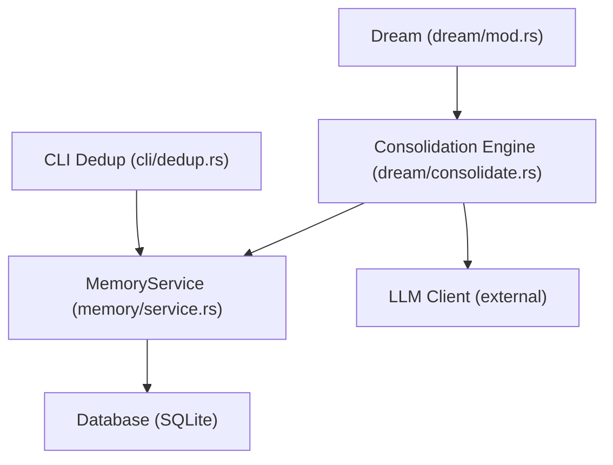
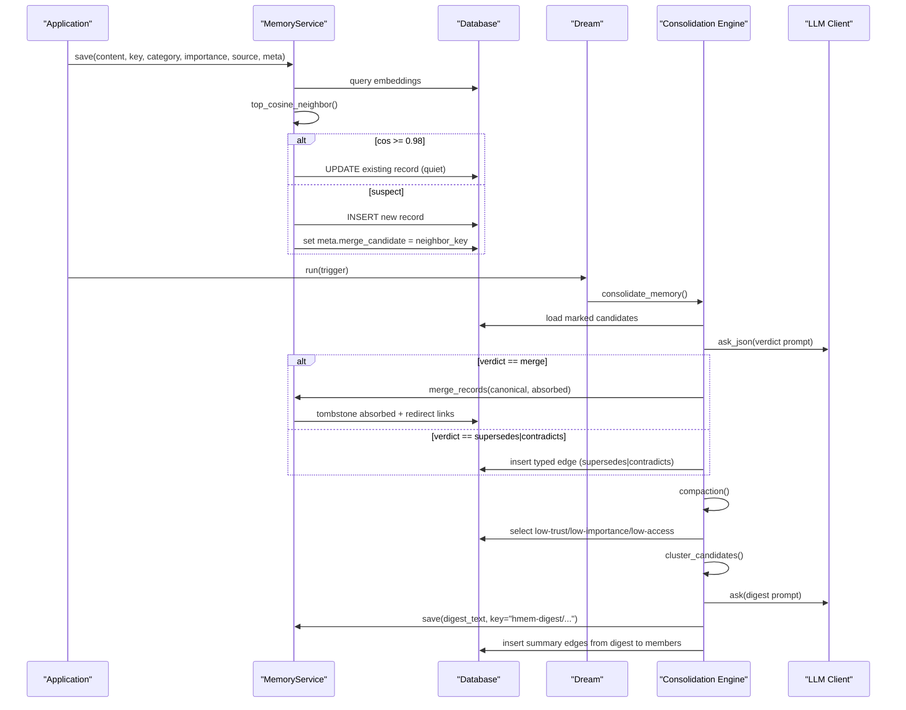
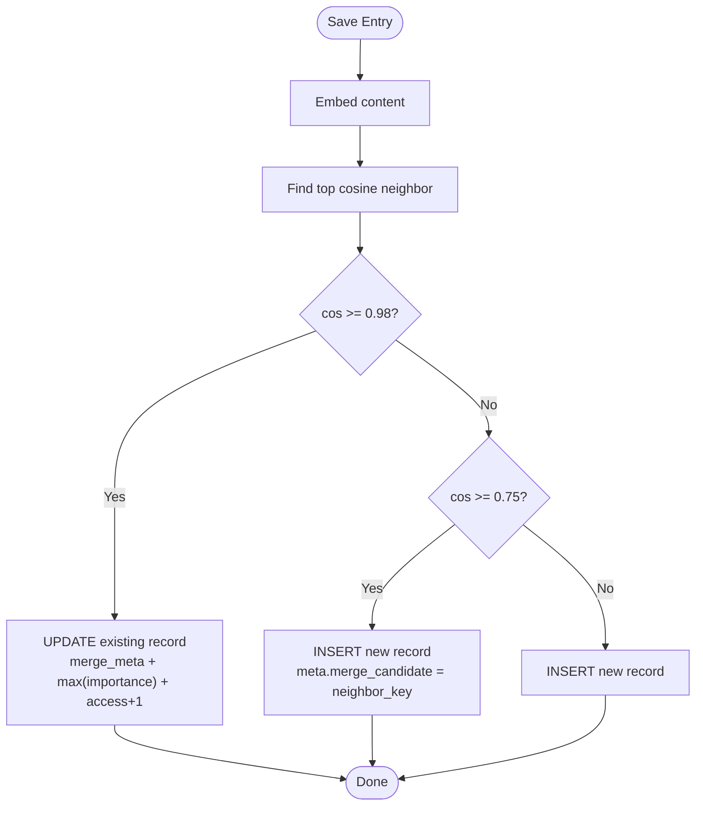
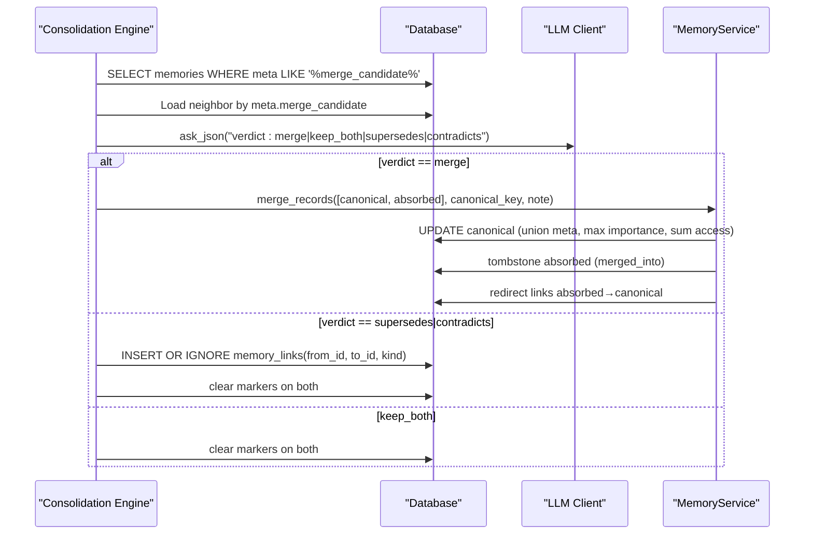
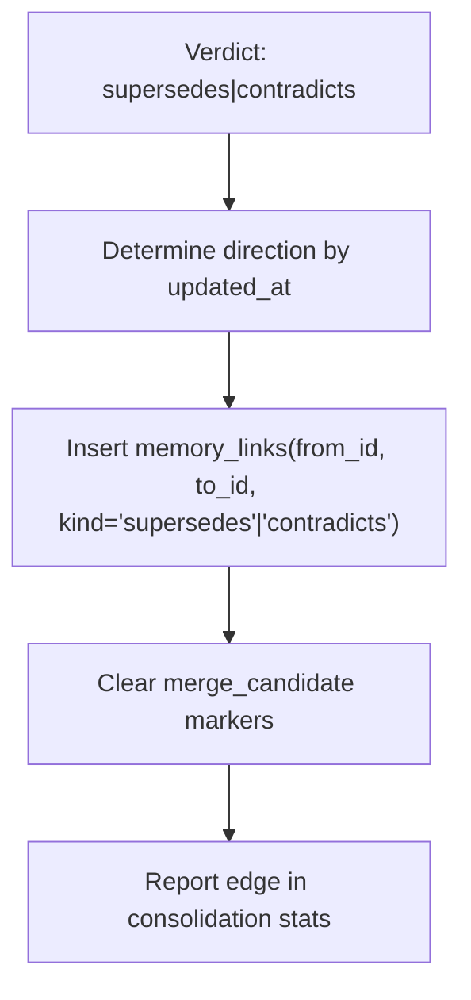
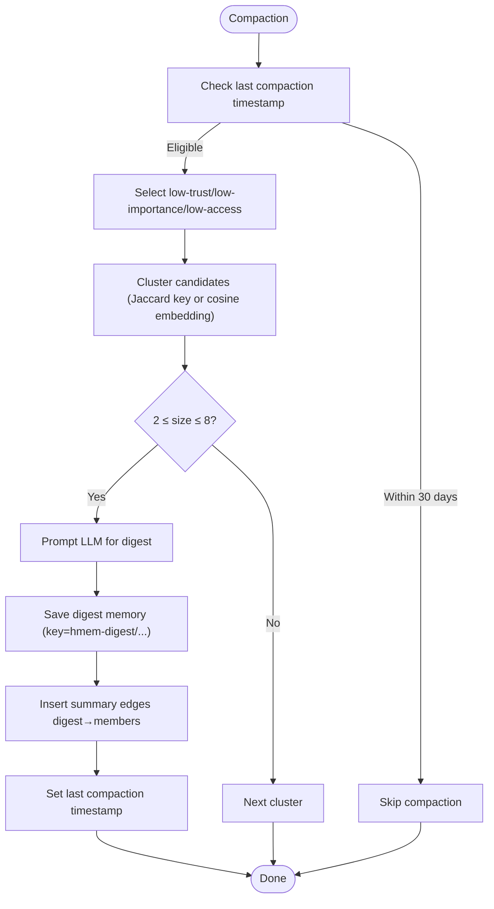
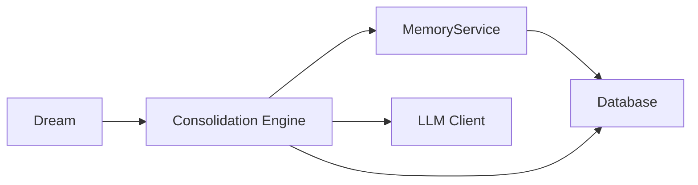

# Consolidation Engine

<cite>
**Referenced Files in This Document**
- [consolidate.rs](file://src/dream/consolidate.rs)
- [mod.rs (Dream)](file://src/dream/mod.rs)
- [service.rs (MemoryService)](file://src/memory/service.rs)
- [dedup.rs](file://src/cli/dedup.rs)
- [test_consolidation.rs](file://tests/test_consolidation.rs)
</cite>

## Table of Contents
1. [Introduction](#introduction)
2. [Project Structure](#project-structure)
3. [Core Components](#core-components)
4. [Architecture Overview](#architecture-overview)
5. [Detailed Component Analysis](#detailed-component-analysis)
6. [Dependency Analysis](#dependency-analysis)
7. [Performance Considerations](#performance-considerations)
8. [Troubleshooting Guide](#troubleshooting-guide)
9. [Conclusion](#conclusion)

## Introduction
This document explains the Consolidation Engine sub-component that performs offline memory consolidation using LLM verdicts and compaction strategies. It covers:
- How merge candidates are identified at save-time and via CLI scanning
- How LLM-based decisions drive merges, typed edges, and digest creation
- The compaction algorithm that clusters low-trust memories into summary digests
- Concrete workflows, performance characteristics, and configuration options

The Consolidation Engine is part of the Dream subsystem and integrates with MemoryService for persistence, link management, and trust updates.

## Project Structure
The consolidation logic spans several modules:
- Dream orchestrates offline consolidation runs and reports outcomes
- Consolidation algorithms live in a dedicated module under Dream
- MemoryService implements save-time duplicate detection, merging, and tombstoning
- CLI dedup provides an offline scanner to mark potential duplicates for later processing

**Diagram sources**
- [mod.rs (Dream):145-287](file://src/dream/mod.rs#L145-L287)
- [consolidate.rs:70-85](file://src/dream/consolidate.rs#L70-L85)
- [service.rs (MemoryService):49-167](file://src/memory/service.rs#L49-L167)
- [dedup.rs:44-135](file://src/cli/dedup.rs#L44-L135)

**Section sources**
- [mod.rs (Dream):145-287](file://src/dream/mod.rs#L145-L287)
- [consolidate.rs:70-85](file://src/dream/consolidate.rs#L70-L85)

## Core Components
- Merge candidate identification:
  - Save-time pre-check without LLM: identity-duplicate vs suspect-duplicate
  - CLI scan to find pairs and mark candidates
- LLM-based decision making:
  - Verdicts: merge, keep_both, supersedes, contradicts
  - Actions: silent update, tombstone + redirect links, typed edges
- Compaction:
  - Clustering low-trust, low-importance, low-access memories
  - LLM-generated summary nodes linked as “summary” edges

Key constants and thresholds:
- Identity threshold: cosine ≥ 0.98 → quiet UPDATE on save
- Suspect threshold: cosine ∈ [0.75, 0.98) → mark merge_candidate
- Compaction thresholds: trust < 0.35, importance < 0.35, access_count < 20
- Cluster size limit: up to 8 members per cluster
- Compaction throttling: once every 30 days

**Section sources**
- [service.rs (MemoryService):17-21](file://src/memory/service.rs#L17-L21)
- [service.rs (MemoryService):86-167](file://src/memory/service.rs#L86-L167)
- [dedup.rs:16-21](file://src/cli/dedup.rs#L16-L21)
- [consolidate.rs:29-38](file://src/dream/consolidate.rs#L29-L38)

## Architecture Overview
The consolidation pipeline integrates three phases:
1. Candidate discovery (save-time or CLI)
2. LLM verdict processing (merge vs typed edges)
3. Compaction clustering and digest generation

**Diagram sources**
- [service.rs (MemoryService):86-167](file://src/memory/service.rs#L86-L167)
- [service.rs (MemoryService):218-383](file://src/memory/service.rs#L218-L383)
- [consolidate.rs:70-85](file://src/dream/consolidate.rs#L70-L85)
- [consolidate.rs:89-190](file://src/dream/consolidate.rs#L89-L190)
- [consolidate.rs:252-335](file://src/dream/consolidate.rs#L252-L335)

## Detailed Component Analysis

### Merge Candidate Identification
Two mechanisms identify candidates:
- Save-time pre-check:
  - Computes cosine similarity between the new embedding and existing records
  - If cosine ≥ 0.98, it performs a quiet UPDATE on the existing record (identity-duplicate)
  - If cosine ∈ [0.75, 0.98), it marks the new record’s meta with merge_candidate pointing to the neighbor
- CLI dedup scan:
  - Scans up to 5000 records, computes pairwise cosine similarities
  - Produces pairs with canonical_key selection based on trust/importance
  - Optionally applies markers to less trusted records for Dream to process

**Diagram sources**
- [service.rs (MemoryService):86-167](file://src/memory/service.rs#L86-L167)

**Section sources**
- [service.rs (MemoryService):86-167](file://src/memory/service.rs#L86-L167)
- [dedup.rs:44-135](file://src/cli/dedup.rs#L44-L135)
- [dedup.rs:139-176](file://src/cli/dedup.rs#L139-L176)

### LLM-Based Decision Making for Optimization
Dream’s consolidation engine processes marked candidates:
- Loads marked candidates and builds pairs by reading target neighbors
- Sends each pair to LLM with a structured prompt requesting JSON verdict
- Applies actions based on verdict:
  - merge: delegate to MemoryService::merge_records; canonical absorbs absorbed; tombstone absorbed; redirect links
  - supersedes/contradicts: create typed edges from newer to older; clear markers
  - keep_both: no changes; clear markers

**Diagram sources**
- [consolidate.rs:89-190](file://src/dream/consolidate.rs#L89-L190)
- [service.rs (MemoryService):218-383](file://src/memory/service.rs#L218-L383)

**Section sources**
- [consolidate.rs:89-190](file://src/dream/consolidate.rs#L89-L190)
- [service.rs (MemoryService):218-383](file://src/memory/service.rs#L218-L383)

### Edge Creation Between Related Memories
For non-merge verdicts:
- Directed typed edges are inserted:
  - supersedes: newer record points to older record
  - contradicts: contradictory statements get typed edges
- Edges are idempotent via INSERT OR IGNORE
- Markers are cleared after processing

**Diagram sources**
- [consolidate.rs:164-187](file://src/dream/consolidate.rs#L164-L187)

**Section sources**
- [consolidate.rs:164-187](file://src/dream/consolidate.rs#L164-L187)

### Digest Generation and Compaction
Compaction creates summary nodes for clusters of weak memories:
- Throttled to once every 30 days
- Candidates selected by low trust (< 0.35), low importance (< 0.35), and low access (< 20)
- Excludes high-trust and high-access records
- Clusters formed by Jaccard token similarity on keys or cosine similarity on embeddings
- For each cluster of size 2–8:
  - LLM generates a compact digest preserving specifics
  - New memory node created with key hmem-digest/YYYY-MM-DD[-seq]
  - Summary edges created from digest to members

**Diagram sources**
- [consolidate.rs:252-335](file://src/dream/consolidate.rs#L252-L335)
- [consolidate.rs:338-380](file://src/dream/consolidate.rs#L338-L380)

**Section sources**
- [consolidate.rs:252-335](file://src/dream/consolidate.rs#L252-L335)
- [consolidate.rs:338-380](file://src/dream/consolidate.rs#L338-L380)

### Consolidation Workflows and Examples
- Example 1: Merge workflow
  - Two records suspected as duplicates; LLM returns merge with canonical key
  - Canonical record absorbs absorbed record; absorbed tombstoned; links redirected
- Example 2: Supersedes workflow
  - Two records where one supersedes another; both remain alive; typed edge created
- Example 3: Contradicts workflow
  - Conflicting rules; typed edge created; markers cleared
- Example 4: Keep both workflow
  - Different knowledge; no structural changes; markers cleared

These scenarios are validated by tests covering merge absorption, edge creation, idempotency, and marker clearing.

**Section sources**
- [test_consolidation.rs:282-359](file://tests/test_consolidation.rs#L282-L359)
- [test_consolidation.rs:361-404](file://tests/test_consolidation.rs#L361-L404)
- [test_consolidation.rs:406-433](file://tests/test_consolidation.rs#L406-L433)
- [test_consolidation.rs:435-457](file://tests/test_consolidation.rs#L435-L457)

## Dependency Analysis
Consolidation depends on:
- Database for storing memories, links, and metadata
- MemoryService for safe merge operations and link redirection
- LLM client for verdicts and digest generation
- Dream orchestrator for scheduling and reporting

**Diagram sources**
- [mod.rs (Dream):145-287](file://src/dream/mod.rs#L145-L287)
- [consolidate.rs:70-85](file://src/dream/consolidate.rs#L70-L85)
- [service.rs (MemoryService):218-383](file://src/memory/service.rs#L218-L383)

**Section sources**
- [mod.rs (Dream):145-287](file://src/dream/mod.rs#L145-L287)
- [consolidate.rs:70-85](file://src/dream/consolidate.rs#L70-L85)
- [service.rs (MemoryService):218-383](file://src/memory/service.rs#L218-L383)

## Performance Considerations
- Save-time duplicate detection avoids LLM calls and uses cosine similarity only
- CLI dedup scans up to 5000 records with O(n^2) pairwise comparisons capped by SCAN_CAP
- Consolidation limits groups processed per Dream run (MAX_GROUPS_PER_DREAM)
- Compaction throttles execution to once every 30 days
- Clustering caps cluster size at 8 to preserve specificity in digests
- Tombstoning and link redirection avoid hard deletes, enabling soft-delete semantics

[No sources needed since this section provides general guidance]

## Troubleshooting Guide
Common issues and resolutions:
- LLM verdict failures:
  - Consolidation logs warnings and skips the pair; markers remain for next Dream run
- Missing neighbor for marker:
  - If target disappeared (tombstone/forget), marker is cleared automatically
- Duplicate edges:
  - INSERT OR IGNORE prevents duplication; reruns do not add extra edges
- Compaction not running:
  - Check last compaction timestamp; throttling prevents frequent runs
- Merge errors:
  - Ensure all keys exist and are not tombstoned; canonical_key must be within provided keys

**Section sources**
- [consolidate.rs:125-136](file://src/dream/consolidate.rs#L125-L136)
- [consolidate.rs:192-213](file://src/dream/consolidate.rs#L192-L213)
- [consolidate.rs:219-231](file://src/dream/consolidate.rs#L219-L231)
- [consolidate.rs:252-261](file://src/dream/consolidate.rs#L252-L261)

## Conclusion
The Consolidation Engine provides robust offline memory optimization through:
- Efficient candidate identification at save-time and via CLI
- LLM-driven decisions for merges and typed edges
- Controlled compaction producing summary digests while preserving originals
- Safe persistence semantics with tombstoning and link redirection

It balances cost and quality by minimizing LLM usage, enforcing throttling, and maintaining idempotency across runs.

[No sources needed since this section summarizes without analyzing specific files]