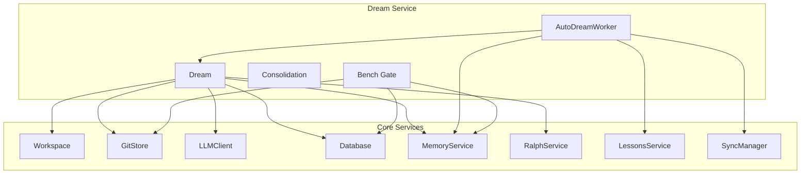
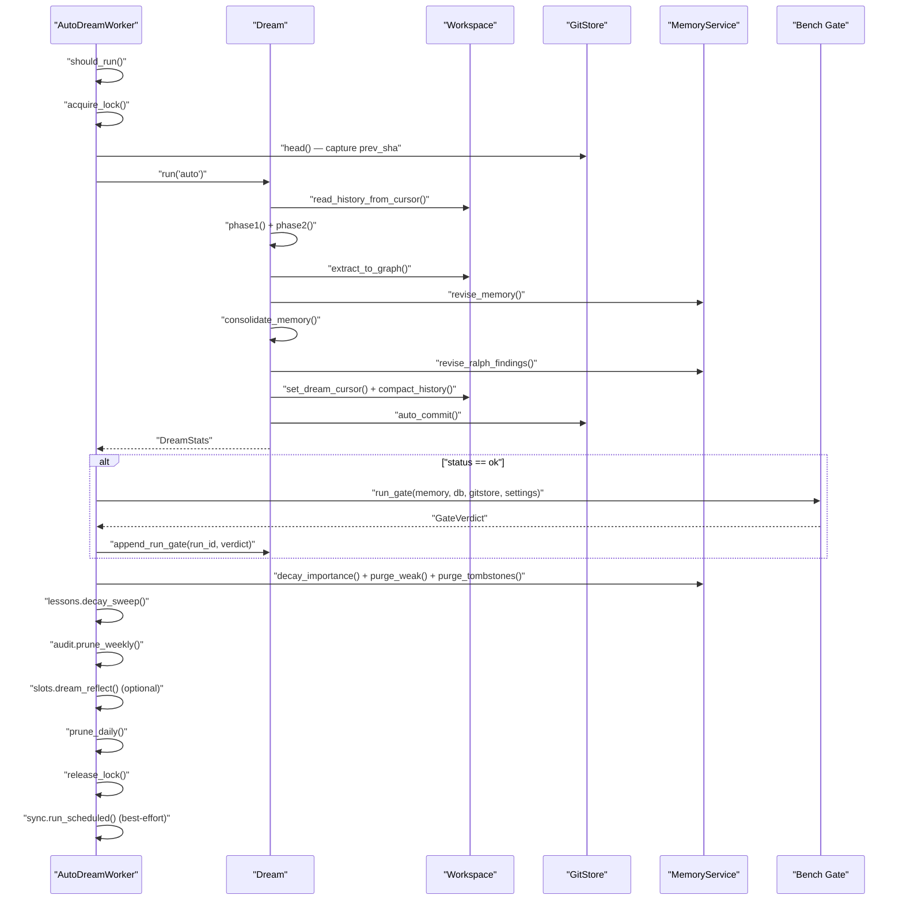
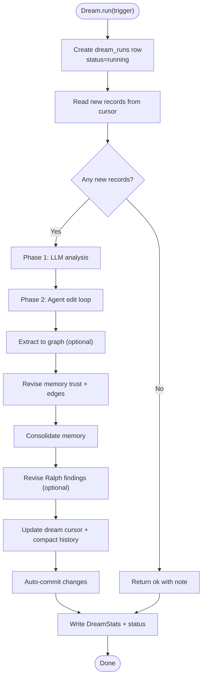
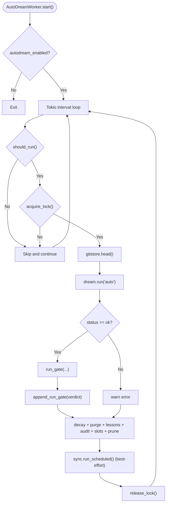
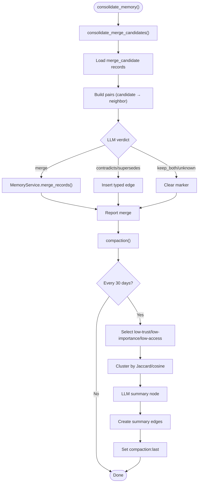
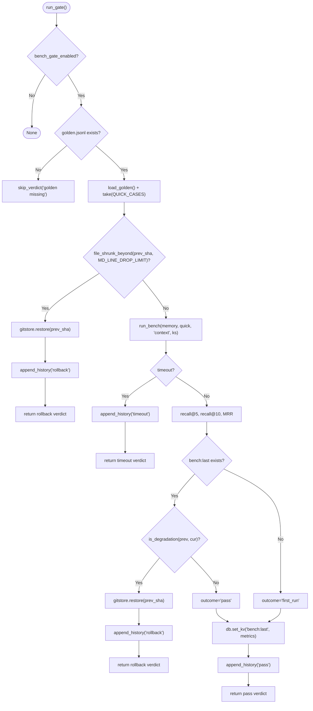
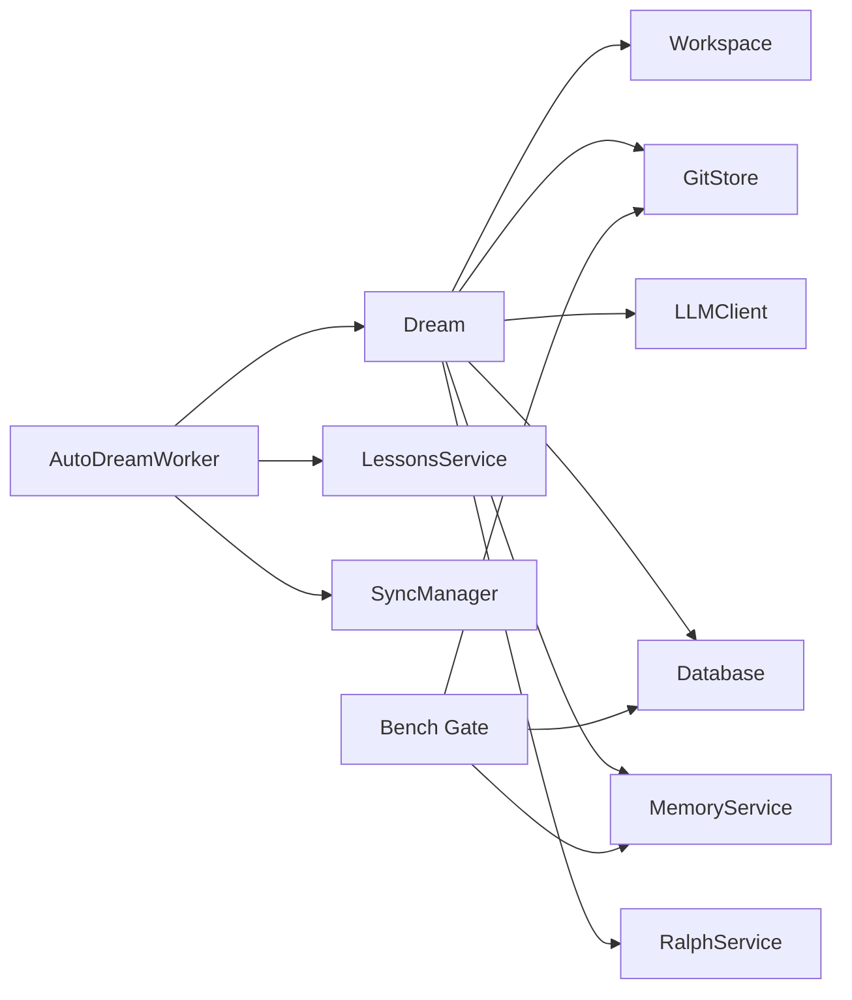

# Dream Service

<cite>
**Referenced Files in This Document**   
- [mod.rs](file://src/dream/mod.rs)
- [autodream.rs](file://src/dream/autodream.rs)
- [consolidate.rs](file://src/dream/consolidate.rs)
- [bench_gate.rs](file://src/dream/bench_gate.rs)
- [config.rs](file://src/config.rs)
- [README.md](file://README.md)
</cite>

## Table of Contents
1. [Introduction](#introduction)
2. [Project Structure](#project-structure)
3. [Core Components](#core-components)
4. [Architecture Overview](#architecture-overview)
5. [Detailed Component Analysis](#detailed-component-analysis)
6. [Dependency Analysis](#dependency-analysis)
7. [Performance Considerations](#performance-considerations)
8. [Troubleshooting Guide](#troubleshooting-guide)
9. [Conclusion](#conclusion)

## Introduction
The Dream Service is the automated nightly processing and memory consolidation subsystem for OB2H. It runs background “dreams” that analyze recent conversation history, update long-term memory files, extract knowledge into a project graph, revise low-trust facts, consolidate related records, optionally review stale Ralph findings, and then run a quality gate to prevent regression in search performance.

At a high level:
- **Autodream** schedules and guards dream execution with time-based and event-based gates.
- **Dream pipeline** performs multi-phase analysis, editing, extraction, revision, consolidation, and commit.
- **Consolidation** merges similar records, creates typed edges between conflicting or superseding facts, and periodically compacts weak records into summary nodes.
- **Benchmark gate** runs a quick benchmark against a golden set after each successful dream and can roll back workspace changes if recall or MRR degrades beyond thresholds.
- **Lifecycle integration** includes decay sweeps, tombstone cleanup, audit pruning, optional slot reflection, and post-dream sync.

This document explains how these pieces fit together, what configuration controls them, and how to monitor and troubleshoot them.

**Section sources**
- [README.md:27-52](file://README.md#L27-L52)

## Project Structure
The Dream Service lives under `src/dream` and integrates with several core modules:
- `Dream` orchestrates the full pipeline.
- `AutoDreamWorker` implements scheduling, locking, and lifecycle maintenance.
- `consolidate` implements offline consolidation and compaction.
- `bench_gate` implements the nightly quality gate.
- `config::Settings` provides environment-driven configuration.

**Diagram sources**
- [mod.rs:110-143](file://src/dream/mod.rs#L110-L143)
- [autodream.rs:20-59](file://src/dream/autodream.rs#L20-L59)
- [consolidate.rs:68-85](file://src/dream/consolidate.rs#L68-L85)
- [bench_gate.rs:163-170](file://src/dream/bench_gate.rs#L163-L170)

**Section sources**
- [mod.rs:1-23](file://src/dream/mod.rs#L1-L23)
- [autodream.rs:1-17](file://src/dream/autodream.rs#L1-L17)
- [consolidate.rs:1-16](file://src/dream/consolidate.rs#L1-L16)
- [bench_gate.rs:1-16](file://src/dream/bench_gate.rs#L1-L16)

## Core Components
- **Dream**: The central coordinator for a single dream run. It tracks run state, executes phases, updates workspace files, commits via Git, and writes structured stats.
- **AutoDreamWorker**: A Tokio-based background worker that decides when to run dreams, enforces locks, runs the bench gate, performs memory hygiene, lesson decay, audit pruning, optional slot reflection, and scheduled sync.
- **Consolidation**: Offline memory optimization including merge candidates, typed edge creation, and periodic compaction into digest nodes.
- **Bench Gate**: Nightly quality assurance using a quick subset of a golden benchmark set, comparing recall@k and MRR against stored baselines, with rollback support.

Key responsibilities:
- Scheduling and gating dream runs.
- Multi-phase LLM-assisted memory analysis and editing.
- Graph extraction from session history.
- Trust-based memory revision and belief proposals.
- Consolidation of duplicate or conflicting facts.
- Quality gating with automatic rollback on degradation.
- Lifecycle maintenance tasks (decay, purge, prune, sync).

**Section sources**
- [mod.rs:110-143](file://src/dream/mod.rs#L110-L143)
- [autodream.rs:20-59](file://src/dream/autodream.rs#L20-L59)
- [consolidate.rs:68-85](file://src/dream/consolidate.rs#L68-L85)
- [bench_gate.rs:40-76](file://src/dream/bench_gate.rs#L40-L76)

## Architecture Overview
The Dream Service integrates with the broader OB2H lifecycle:

**Diagram sources**
- [autodream.rs:61-145](file://src/dream/autodream.rs#L61-L145)
- [mod.rs:145-288](file://src/dream/mod.rs#L145-L288)
- [bench_gate.rs:163-332](file://src/dream/bench_gate.rs#L163-L332)

## Detailed Component Analysis

### Dream Pipeline
The Dream pipeline processes new history entries through multiple phases:

1. **Cursor-based ingestion**: Reads new history since the last dream cursor.
2. **Phase 1 — Analysis**: Summarizes recent history and current memory files to identify facts, contradictions, and needed edits.
3. **Phase 2 — Agent Editing Loop**: Iteratively asks an LLM to perform minimal edits to memory files, with strict JSON action contracts and error feedback.
4. **Graph Extraction**: Optionally extracts entities and edges from combined history text into the project graph.
5. **Memory Revision**: Reviews low-trust memory records and applies trust adjustments; may create typed edges (`supersedes`, `contradicts`) and optional belief edges (`causes`).
6. **Consolidation**: Runs offline consolidation to merge duplicates, create typed edges, and compact weak records into digest nodes.
7. **Ralph Revision**: Optionally reviews stale Ralph findings against fresh context.
8. **Commit and Stats**: Updates the dream cursor, compacts history, auto-commits changes, and returns structured stats.

**Diagram sources**
- [mod.rs:145-288](file://src/dream/mod.rs#L145-L288)

**Section sources**
- [mod.rs:145-288](file://src/dream/mod.rs#L145-L288)

### Autodream Scheduling and Lifecycle Integration
`AutoDreamWorker` manages the background dream loop:

- **Scheduling**: Uses a Tokio interval based on `autodream_interval_min`.
- **Gating**: Checks minimum elapsed hours since last run and minimum event count before running.
- **Locking**: Uses a file lock with staleness detection to avoid concurrent dreams.
- **Pre-run snapshot**: Captures Git HEAD before dream execution for potential rollback.
- **Post-run maintenance**: Performs memory decay, weak record purging, tombstone cleanup, lesson decay sweep, weekly audit pruning, optional slot reflection, daily log pruning, and best-effort sync.

**Diagram sources**
- [autodream.rs:61-145](file://src/dream/autodream.rs#L61-L145)

**Section sources**
- [autodream.rs:61-145](file://src/dream/autodream.rs#L61-L145)

### Consolidation Algorithms
Consolidation has two main strategies:

1. **Merge Candidates (31.2)**:
   - Loads records marked as merge candidates.
   - Pairs each candidate with its target neighbor.
   - Asks LLM for a verdict: `merge`, `keep_both`, `contradicts`, or `supersedes`.
   - For `merge`, delegates to `MemoryService::merge_records` and records canonical/absorbed keys.
   - For `contradicts`/`supersedes`, inserts typed edges and clears markers.
   - For `keep_both` or unrecognized verdicts, clears markers and logs the pair.

2. **Compaction (31.3)**:
   - Runs at most once every 30 days.
   - Selects low-trust, low-importance, low-access records excluding high-trust and high-access.
   - Clusters candidates using Jaccard similarity on key tokens or cosine similarity on embeddings.
   - Generates a compact summary node per cluster and links it to members with `summary` edges.
   - Stores compaction timestamp in KV store.

**Diagram sources**
- [consolidate.rs:68-85](file://src/dream/consolidate.rs#L68-L85)
- [consolidate.rs:87-190](file://src/dream/consolidate.rs#L87-L190)
- [consolidate.rs:250-336](file://src/dream/consolidate.rs#L250-L336)

**Section sources**
- [consolidate.rs:68-85](file://src/dream/consolidate.rs#L68-L85)
- [consolidate.rs:87-190](file://src/dream/consolidate.rs#L87-L190)
- [consolidate.rs:250-336](file://src/dream/consolidate.rs#L250-L336)

### Benchmark Gate Mechanism
The benchmark gate ensures that night-time dream changes do not degrade search quality:

- **Quick Set**: Runs only the first `QUICK_CASES` golden cases in `context` mode.
- **Workspace Invariant Check**: If tracked files have shrunk beyond a threshold compared to the pre-dream commit, it triggers an immediate rollback.
- **Timeout Handling**: If the benchmark exceeds the configured timeout, it logs a warning and skips the gate without modifying baselines.
- **Degradation Detection**: Compares current recall@5 and MRR against stored `bench:last`; if either drops beyond thresholds, it rolls back to the previous workspace commit.
- **Baseline Update**: On pass or first run, updates `bench:last` with new metrics.
- **History Logging**: Appends each gate outcome to `data/bench/history.jsonl`.

**Diagram sources**
- [bench_gate.rs:163-332](file://src/dream/bench_gate.rs#L163-L332)

**Section sources**
- [bench_gate.rs:163-332](file://src/dream/bench_gate.rs#L163-L332)

### Configuration Reference
Dream-related configuration is driven by environment variables:

| Variable | Default | Description |
|---|---|---|
| `OB2H_AUTODREAM_ENABLED` | `true` | Enables background autodream loop |
| `OB2H_AUTODREAM_INTERVAL_MIN` | `5` | Interval in minutes between autodream checks |
| `OB2H_AUTODREAM_MIN_INTERVAL_H` | `4` | Minimum hours between dream runs |
| `OB2H_AUTODREAM_MIN_EVENTS` | `10` | Minimum new events since last run to trigger |
| `OB2H_DREAM_BATCH` | `20` | Number of history records processed per dream |
| `OB2H_DREAM_EXTRACT_ENABLED` | `true` | Enable graph extraction during dream |
| `OB2H_DREAM_MEMORY_REVISION` | `true` | Enable trust-based memory revision |
| `OB2H_DREAM_BELIEF` | `false` | Allow creating `causes` edges between memory records |
| `OB2H_DREAM_RALPH` | `true` | Enable Ralph finding revision during dream |
| `OB2H_BENCH_GATE` | `false` | Enable nightly benchmark gate |
| `OB2H_BENCH_GATE_TIMEOUT_MS` | `3000` | Timeout budget for quick benchmark |
| `OB2H_RETENTION_DAYS` | varies | Controls daily log retention and tombstone cleanup window |

**Section sources**
- [config.rs:36-57](file://src/config.rs#L36-L57)
- [config.rs:225-273](file://src/config.rs#L225-L273)
- [README.md:300-329](file://README.md#L300-L329)

## Dependency Analysis
The Dream Service depends on several core services:

**Diagram sources**
- [mod.rs:110-143](file://src/dream/mod.rs#L110-L143)
- [autodream.rs:20-59](file://src/dream/autodream.rs#L20-L59)
- [bench_gate.rs:163-170](file://src/dream/bench_gate.rs#L163-L170)

**Section sources**
- [mod.rs:110-143](file://src/dream/mod.rs#L110-L143)
- [autodream.rs:20-59](file://src/dream/autodream.rs#L20-L59)
- [bench_gate.rs:163-170](file://src/dream/bench_gate.rs#L163-L170)

## Performance Considerations
- **Batch Processing**: Dream processes history in batches controlled by `dream_batch` to limit LLM calls and memory usage.
- **Iteration Limits**: Phase 2 uses a bounded iteration loop (`MAX_ITERATIONS`) to prevent infinite LLM loops.
- **Consolidation Throttling**: Compaction runs at most once every 30 days to avoid frequent LLM summarization.
- **Clustering Efficiency**: Candidate clustering uses token-based Jaccard similarity and cosine similarity to reduce LLM calls.
- **Benchmark Budget**: Quick benchmark uses a fixed number of golden cases and a timeout to prevent long-running quality checks.
- **Lock Staleness**: File-based locking includes staleness detection to recover from crashed dream runs.

[No sources needed since this section provides general guidance]

## Troubleshooting Guide
Common issues and diagnostics:

- **Autodream Not Running**:
  - Check `autodream_enabled` setting.
  - Verify minimum interval hours and minimum event thresholds.
  - Inspect lock file staleness and data directory permissions.

- **Dream Failing Mid-Pipeline**:
  - Review `dream_runs.stats.error` for detailed error messages.
  - Check LLM connectivity and model availability.
  - Validate memory file integrity and Git repository state.

- **Consolidation Not Triggering**:
  - Ensure merge candidates are properly marked in memory metadata.
  - Verify compaction interval has passed (30 days).
  - Check database connectivity and query performance.

- **Benchmark Gate Skipping or Rolling Back**:
  - Confirm `bench_gate_enabled` is set.
  - Verify `data/bench/golden.jsonl` exists and contains valid cases.
  - Check `bench:last` baseline values and degradation thresholds.
  - Review workspace file integrity and Git commit history.

- **Memory Hygiene Issues**:
  - Monitor decay importance and purge thresholds.
  - Check tombstone cleanup window relative to retention days.
  - Validate lesson decay sweep and audit pruning schedules.

**Section sources**
- [autodream.rs:169-247](file://src/dream/autodream.rs#L169-L247)
- [mod.rs:145-194](file://src/dream/mod.rs#L145-L194)
- [bench_gate.rs:171-220](file://src/dream/bench_gate.rs#L171-L220)

## Conclusion
The Dream Service provides a robust, automated system for maintaining and optimizing long-term memory in OB2H. Through scheduled dreaming, multi-phase analysis, consolidation algorithms, and quality gates, it ensures that memory stays accurate, concise, and performant over time. The integration with lifecycle services, Git versioning, and benchmark monitoring creates a resilient pipeline that can detect and recover from regressions while continuously improving knowledge representation.

[No sources needed since this section summarizes without analyzing specific files]