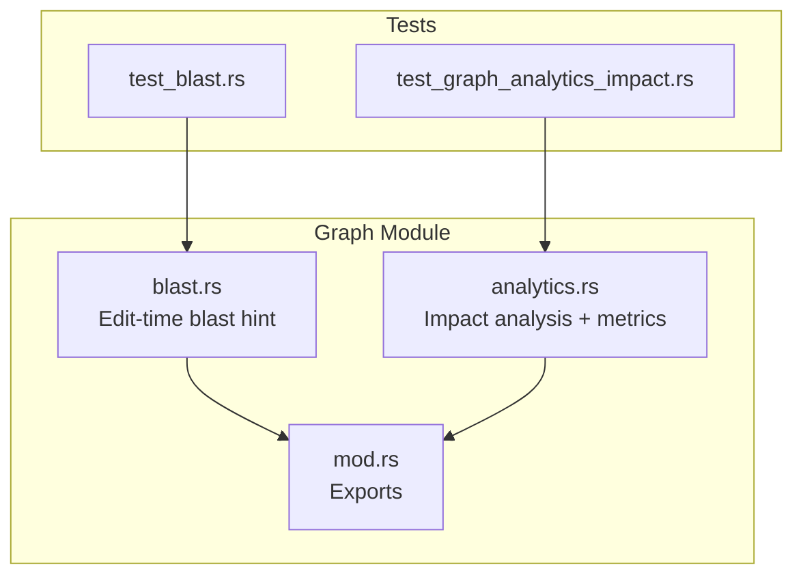
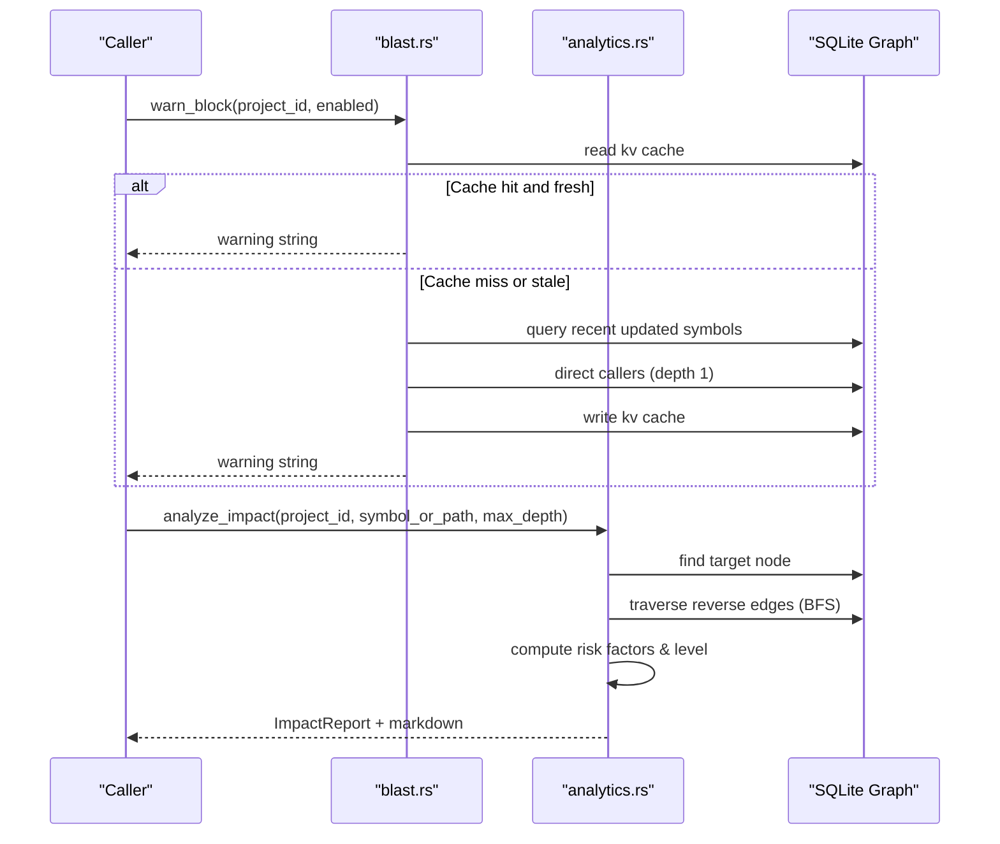
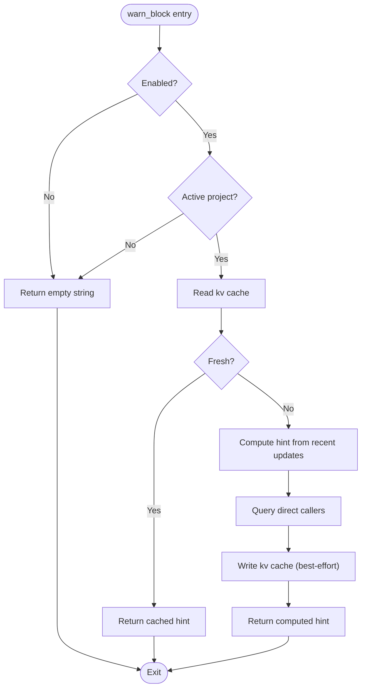
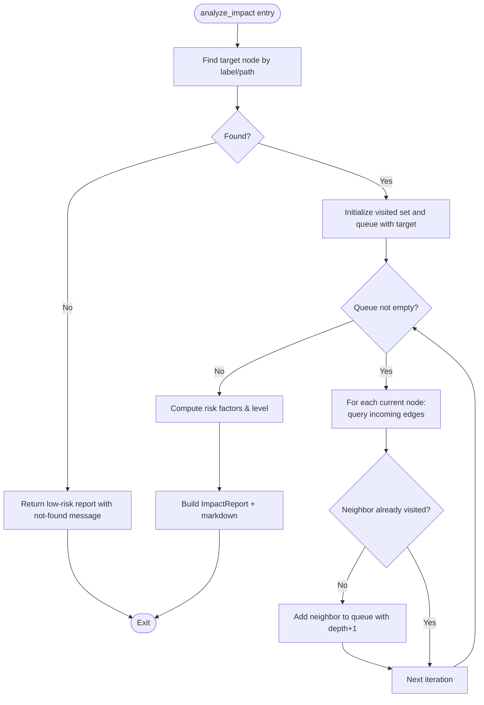
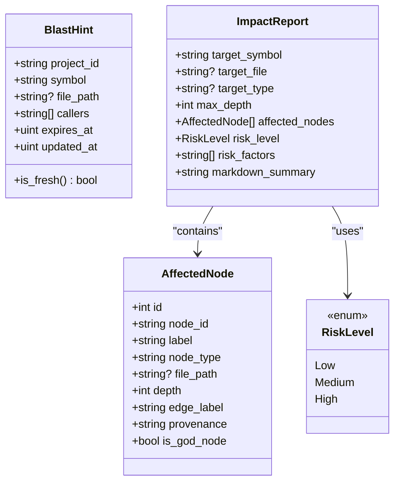
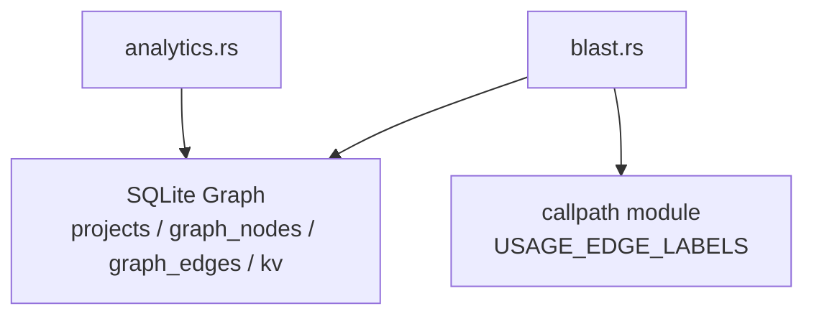

# Blast Radius Analysis

<cite>
**Referenced Files in This Document**
- [blast.rs](file://src/graph/blast.rs)
- [analytics.rs](file://src/graph/analytics.rs)
- [mod.rs](file://src/graph/mod.rs)
- [test_blast.rs](file://tests/test_blast.rs)
- [test_graph_analytics_impact.rs](file://tests/test_graph_analytics_impact.rs)
</cite>

## Table of Contents
1. [Introduction](#introduction)
2. [Project Structure](#project-structure)
3. [Core Components](#core-components)
4. [Architecture Overview](#architecture-overview)
5. [Detailed Component Analysis](#detailed-component-analysis)
6. [Dependency Analysis](#dependency-analysis)
7. [Performance Considerations](#performance-considerations)
8. [Troubleshooting Guide](#troubleshooting-guide)
9. [Conclusion](#conclusion)

## Introduction
This document explains the Blast Radius Analysis system that estimates the potential impact of code changes across the dependency graph. It covers two complementary mechanisms:

- Edit-time blast radius hint: a lightweight, warn-only notification during editing that highlights recently changed symbols and their direct callers.
- Full impact analysis: a BFS-based traversal over reverse dependencies to compute affected components, depth, risk level, and actionable recommendations.

The system is designed for practical risk assessment during refactoring or feature development, with clear outputs suitable for visualization and decision-making.

## Project Structure
Blast Radius functionality lives under the graph module and integrates with the project’s SQLite-backed knowledge graph. The main pieces are:

- Edit-time hint logic: `src/graph/blast.rs`
- Impact analysis and related analytics: `src/graph/analytics.rs`
- Module exports and re-exports: `src/graph/mod.rs`
- Tests validating behavior: `tests/test_blast.rs`, `tests/test_graph_analytics_impact.rs`

**Diagram sources**
- [blast.rs:1-202](file://src/graph/blast.rs#L1-L202)
- [analytics.rs:1-893](file://src/graph/analytics.rs#L1-L893)
- [mod.rs:1-23](file://src/graph/mod.rs#L1-L23)
- [test_blast.rs:1-118](file://tests/test_blast.rs#L1-L118)
- [test_graph_analytics_impact.rs:1-311](file://tests/test_graph_analytics_impact.rs#L1-L311)

**Section sources**
- [blast.rs:1-202](file://src/graph/blast.rs#L1-L202)
- [analytics.rs:1-893](file://src/graph/analytics.rs#L1-L893)
- [mod.rs:1-23](file://src/graph/mod.rs#L1-L23)

## Core Components
- Edit-time blast hint:
  - Provides a short warning block when enabled via environment flag.
  - Uses a TTL-cached hint keyed by project ID.
  - Selects the most recently updated symbol within the TTL window and returns its top direct callers.
- Impact analysis:
  - Finds a target node by label or file path.
  - Traverses reverse edges (who depends on the target) up to a configurable depth.
  - Computes risk factors and levels based on centrality indicators (God Node status), number of affected nodes, and whether any affected nodes are themselves high-centrality.
  - Produces a structured report and Markdown summary suitable for visualization.

Key data structures:
- `BlastHint`: cached edit-time hint with symbol, optional file path, callers list, and TTL metadata.
- `AffectedNode`: represents a node impacted by a change, including depth, edge type, provenance, and God Node flag.
- `ImpactReport`: aggregates target info, affected nodes, risk level, risk factors, and Markdown summary.
- `RiskLevel`: Low, Medium, High classification used in reports.

**Section sources**
- [blast.rs:14-52](file://src/graph/blast.rs#L14-L52)
- [analytics.rs:5-58](file://src/graph/analytics.rs#L5-L58)

## Architecture Overview
The system operates over a SQLite-backed graph where nodes represent code entities (functions, structs, classes, etc.) and edges represent relationships (e.g., CALLS, IMPORTS). Two primary flows exist:

- Edit-time flow:
  - Check environment gate.
  - Read cached hint; if stale or missing, compute from recent updates.
  - Return a concise warning string listing affected callers.

- Impact analysis flow:
  - Resolve target node by exact label or file path.
  - Perform BFS over incoming edges to collect affected nodes up to max depth.
  - Compute risk factors and level.
  - Generate structured and Markdown output.

**Diagram sources**
- [blast.rs:150-196](file://src/graph/blast.rs#L150-L196)
- [analytics.rs:377-616](file://src/graph/analytics.rs#L377-L616)

## Detailed Component Analysis

### Edit-Time Blast Hint
Purpose:
- Provide immediate, low-cost feedback about recent edits and their direct callers.

Algorithm:
- Gate check: only run when environment variable is set to enable warnings.
- TTL caching: store hint in key-value table with expiration time.
- Recent symbol selection: pick the most recently updated symbol within TTL window; prefer those with callers.
- Direct callers: query usage edges to get top N callers.

Complexity:
- Cache lookup: O(1).
- Recent symbol scan: bounded by limit and sorted by update time.
- Callers query: limited by constant N.

Error handling:
- Fail-open: database errors return empty warning string rather than panicking.

**Diagram sources**
- [blast.rs:150-196](file://src/graph/blast.rs#L150-L196)

**Section sources**
- [blast.rs:14-52](file://src/graph/blast.rs#L14-L52)
- [blast.rs:61-81](file://src/graph/blast.rs#L61-L81)
- [blast.rs:83-94](file://src/graph/blast.rs#L83-L94)
- [blast.rs:96-144](file://src/graph/blast.rs#L96-L144)
- [blast.rs:150-196](file://src/graph/blast.rs#L150-L196)

### Impact Analysis (Blast Radius)
Purpose:
- Determine how far a change propagates through the dependency graph and assess risk.

Algorithm:
- Target resolution: search by exact label or file path; prioritize exact matches.
- Reverse-edge BFS: start at target, traverse incoming edges to discover who depends on it, up to max depth.
- Risk computation:
  - Mark God Node involvement.
  - Count affected nodes and categorize breadth.
  - Assign risk level thresholds.
- Output:
  - Structured `ImpactReport`.
  - Markdown summary grouped by depth with recommendations.

Complexity:
- Target resolution: single SQL query.
- BFS: proportional to number of reachable reverse edges within depth bound.
- Risk computation: linear in number of affected nodes.

**Diagram sources**
- [analytics.rs:377-616](file://src/graph/analytics.rs#L377-L616)

**Section sources**
- [analytics.rs:377-616](file://src/graph/analytics.rs#L377-L616)

### Data Models and Relationships

**Diagram sources**
- [blast.rs:34-52](file://src/graph/blast.rs#L34-L52)
- [analytics.rs:5-58](file://src/graph/analytics.rs#L5-L58)

## Dependency Analysis
The Blast Radius system depends on:
- SQLite schema for projects, graph_nodes, graph_edges, and kv storage.
- Usage edge labels defined in callpath module for direct caller queries.
- God Node metadata to influence risk assessment.

**Diagram sources**
- [blast.rs:61-81](file://src/graph/blast.rs#L61-L81)
- [analytics.rs:377-616](file://src/graph/analytics.rs#L377-L616)

**Section sources**
- [blast.rs:61-81](file://src/graph/blast.rs#L61-L81)
- [analytics.rs:377-616](file://src/graph/analytics.rs#L377-L616)

## Performance Considerations
- Edit-time hint:
  - TTL caching avoids recomputation for 30 minutes.
  - Caller enumeration is limited to a small constant.
  - Fail-open design prevents blocking UI/editor workflows.
- Impact analysis:
  - Max depth parameter bounds traversal cost.
  - Reverse-edge queries are executed per node; ensure indexes on target_id/source_id and deleted_at filters.
  - For large graphs, consider precomputing adjacency lists or materializing reverse edges for frequently analyzed targets.
- Risk computation:
  - Linear in number of affected nodes; keep depth reasonable to avoid excessive memory usage.

[No sources needed since this section provides general guidance]

## Troubleshooting Guide
Common issues and resolutions:

- Warning block is empty:
  - Ensure environment flag is set to enable warnings.
  - Verify active project is selected.
  - Check that hints are not expired and there are recent updates within TTL.

- No affected nodes found:
  - Confirm target symbol exists in the graph.
  - Validate edges exist between nodes and are not marked deleted.
  - Reduce max depth if expecting deeper propagation.

- Unexpectedly high risk level:
  - Check if target or affected nodes are marked as God Nodes.
  - Review number of affected nodes; thresholds trigger higher risk levels.

- Slow analysis on large codebases:
  - Limit max depth.
  - Precompute or cache reverse adjacency for hot targets.
  - Use targeted queries by file path to reduce search space.

**Section sources**
- [test_blast.rs:40-68](file://tests/test_blast.rs#L40-L68)
- [test_blast.rs:70-104](file://tests/test_blast.rs#L70-L104)
- [test_graph_analytics_impact.rs:60-157](file://tests/test_graph_analytics_impact.rs#L60-L157)

## Conclusion
The Blast Radius Analysis system offers both immediate edit-time feedback and comprehensive impact analysis. By combining TTL-cached hints with BFS-based reverse dependency traversal, it provides actionable insights into change propagation, risk levels, and recommended safeguards. These capabilities support safer refactoring and feature development by making the potential impact of changes visible and quantifiable.

[No sources needed since this section summarizes without analyzing specific files]