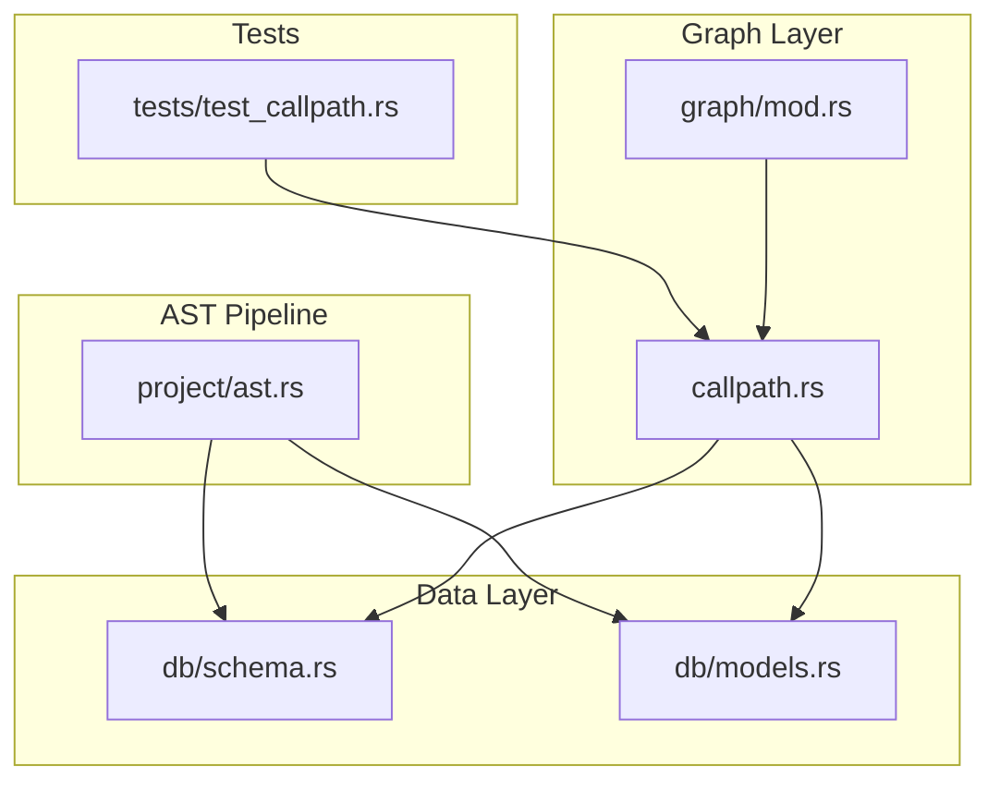
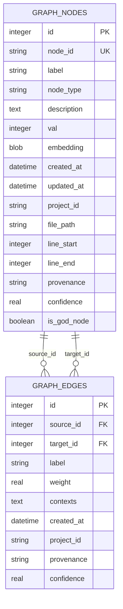
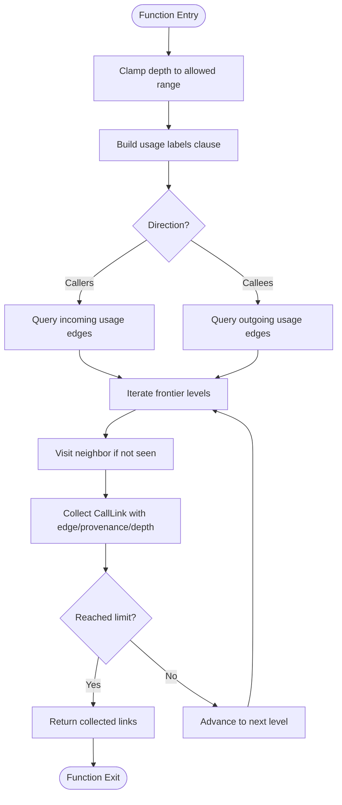
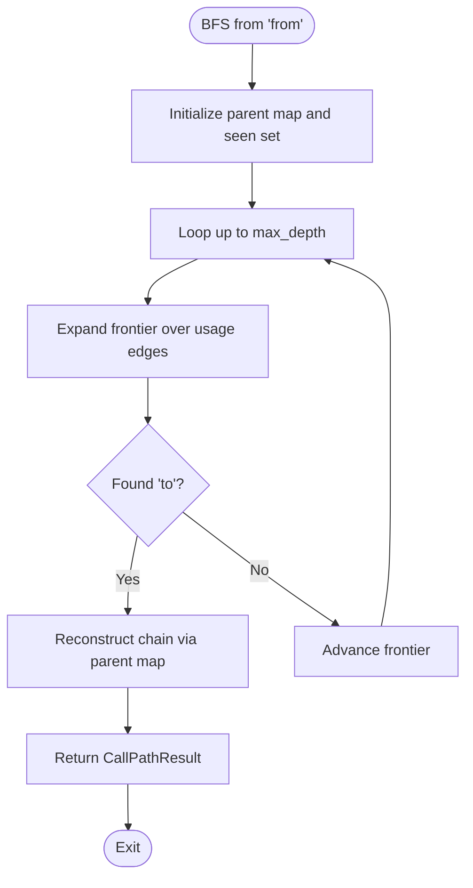
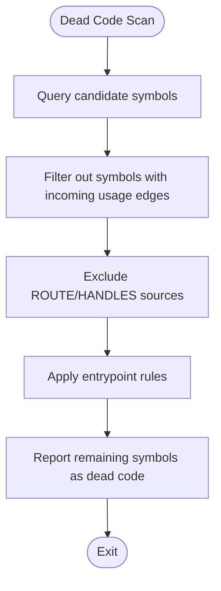
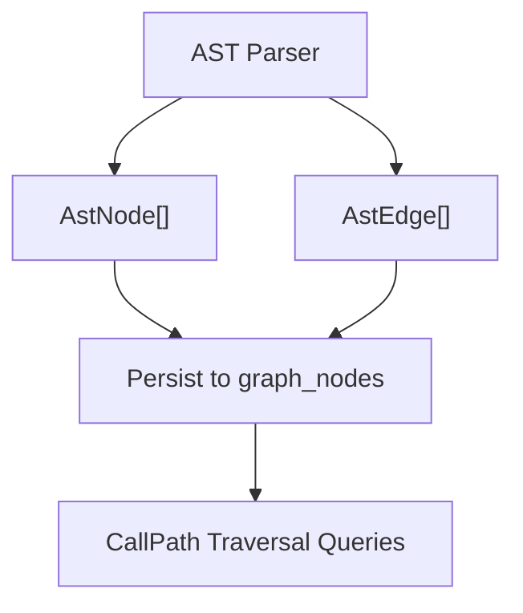
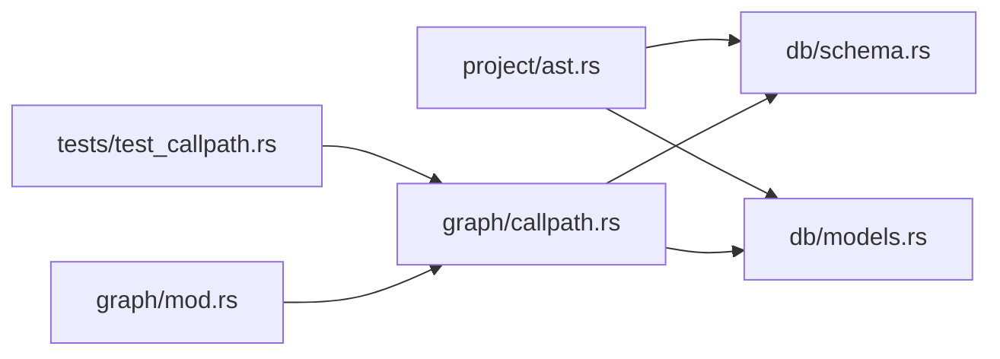

# Call Path Tracing

<cite>
**Referenced Files in This Document**
- [callpath.rs](file://src/graph/callpath.rs)
- [test_callpath.rs](file://tests/test_callpath.rs)
- [ast.rs](file://src/project/ast.rs)
- [schema.rs](file://src/db/schema.rs)
- [models.rs](file://src/db/models.rs)
- [mod.rs](file://src/graph/mod.rs)
</cite>

## Table of Contents
1. [Introduction](#introduction)
2. [Project Structure](#project-structure)
3. [Core Components](#core-components)
4. [Architecture Overview](#architecture-overview)
5. [Detailed Component Analysis](#detailed-component-analysis)
6. [Dependency Analysis](#dependency-analysis)
7. [Performance Considerations](#performance-considerations)
8. [Troubleshooting Guide](#troubleshooting-guide)
9. [Conclusion](#conclusion)

## Introduction
This document explains the Call Path Tracing system that analyzes function call relationships and execution flows within the codebase. It covers how call chains are traced, how entry points are identified, and how execution paths between modules are mapped. It also documents how call path data is extracted from AST analysis, transformed into a traversable graph stored in SQLite, and queried for common scenarios such as finding all callers of a function, identifying dead code, and understanding complex inheritance hierarchies. Finally, it outlines integration points with debugging workflows and performance profiling tools.

The implementation is built on top of an existing project graph stored in `graph_nodes` and `graph_edges`, without introducing new database tables or external analyzers. Usage edges considered by the tracing layer are `CALLS`, `IMPORTS`, `IMPLEMENTS`, and `DEPENDS_ON`. Service edges like `DEFINES` are intentionally excluded from usage counting so that symbols without real callers can still be detected as dead code.

## Project Structure
Call Path Tracing lives under the graph module and depends on:
- The SQLite-backed project graph (`graph_nodes`, `graph_edges`).
- The AST extraction pipeline that populates nodes and edges.
- Tests that seed deterministic fixtures and assert traversal behavior.



**Diagram sources**
- [callpath.rs:1-21](file://src/graph/callpath.rs#L1-L21)
- [mod.rs:1-23](file://src/graph/mod.rs#L1-L23)
- [schema.rs:268-293](file://src/db/schema.rs#L268-L293)
- [models.rs:64-95](file://src/db/models.rs#L64-L95)
- [ast.rs:15-52](file://src/project/ast.rs#L15-L52)
- [test_callpath.rs:1-10](file://tests/test_callpath.rs#L1-L10)

**Section sources**
- [callpath.rs:1-21](file://src/graph/callpath.rs#L1-L21)
- [mod.rs:1-23](file://src/graph/mod.rs#L1-L23)
- [schema.rs:268-293](file://src/db/schema.rs#L268-L293)
- [models.rs:64-95](file://src/db/models.rs#L64-L95)
- [ast.rs:15-52](file://src/project/ast.rs#L15-L52)
- [test_callpath.rs:1-10](file://tests/test_callpath.rs#L1-L10)

## Core Components
The core of Call Path Tracing is implemented in the call path module. It defines:
- Symbol references and call links used to represent nodes and edges in traversal results.
- Directional traversal over usage edges (callers vs callees).
- Explicit path reconstruction between two symbols.
- Entry point detection rules to avoid marking framework hooks, tests, public APIs, and migration-related functions as dead code.
- Dead code identification based on zero incoming usage edges among symbol types.
- Formatting helpers for Markdown output.

Key responsibilities:
- Resolve a symbol by name or file path.
- Traverse neighbors up to a bounded depth.
- Reconstruct a shortest path between two symbols using BFS and parent tracking.
- Identify dead code candidates while excluding known entry points.

**Section sources**
- [callpath.rs:38-92](file://src/graph/callpath.rs#L38-L92)
- [callpath.rs:94-149](file://src/graph/callpath.rs#L94-L149)
- [callpath.rs:151-219](file://src/graph/callpath.rs#L151-L219)
- [callpath.rs:221-311](file://src/graph/callpath.rs#L221-L311)
- [callpath.rs:313-446](file://src/graph/callpath.rs#L313-L446)
- [callpath.rs:448-503](file://src/graph/callpath.rs#L448-L503)

## Architecture Overview
Call Path Tracing operates over a persistent graph model:
- Nodes represent symbols such as functions, structs, classes, interfaces, traits, and methods.
- Edges represent actual usage relationships: calls, imports, implementations, and dependencies.
- The tracing layer queries this graph directly via SQL, performing breadth-first search to compute neighbors and reconstruct explicit call paths.

```mermaid
sequenceDiagram
participant Client as "Caller"
participant CP as "CallPath Module"
participant DB as "SQLite Graph"
participant AST as "AST Pipeline"
Client->>CP : resolve_symbol(project_id, symbol)
CP->>DB : SELECT graph_nodes WHERE label/file_path matches
DB-->>CP : SymbolRef
Client->>CP : neighbors(start_id, Dir, depth, limit)
CP->>DB : SELECT graph_edges JOIN graph_nodes (usage labels)
DB-->>CP : Neighbor rows
CP-->>Client : Vec<CallLink>
Client->>CP : call_path(from, to, max_depth)
CP->>DB : BFS over outgoing CALLS/IMPORTS/IMPLEMENTS/DEPENDS_ON
DB-->>CP : Parent map + frontier
CP-->>Client : CallPathResult(chain)
Note over AST,DB : AST extracts nodes/edges; schema persists them
```

**Diagram sources**
- [callpath.rs:105-149](file://src/graph/callpath.rs#L105-L149)
- [callpath.rs:151-219](file://src/graph/callpath.rs#L151-L219)
- [callpath.rs:221-311](file://src/graph/callpath.rs#L221-L311)
- [schema.rs:268-293](file://src/db/schema.rs#L268-L293)
- [ast.rs:15-52](file://src/project/ast.rs#L15-L52)

## Detailed Component Analysis

### Data Model and Graph Schema
The graph is persisted in SQLite with:
- `graph_nodes`: symbol definitions including label, node_type, description, file_path, line_start, provenance, confidence, and project scoping.
- `graph_edges`: directed edges with source/target IDs, label, weight, contexts, provenance, confidence, and project scoping.

Important constraints:
- Indices exist on source_id and target_id for efficient neighbor queries.
- Project isolation ensures queries filter by project_id.
- Provenance distinguishes between AST-extracted, type-pass resolved, and inferred edges.



**Diagram sources**
- [schema.rs:268-293](file://src/db/schema.rs#L268-L293)
- [models.rs:64-95](file://src/db/models.rs#L64-L95)

**Section sources**
- [schema.rs:268-293](file://src/db/schema.rs#L268-L293)
- [models.rs:64-95](file://src/db/models.rs#L64-L95)

### Symbol Resolution and Traversal Primitives
Symbol resolution supports exact match, fuzzy match by label, and file path matching. It returns the first best candidate according to ordering rules.

Traversal primitives:
- `neighbors`: BFS over usage edges in either direction (callers or callees), limited by depth and result count.
- `call_path`: BFS from a start symbol to find a shortest path to a target symbol, reconstructing the chain via parent pointers.

Complexity considerations:
- Each level performs SQL queries filtered by usage edge labels and project scope.
- Deduplication uses a set of visited node IDs to ensure shortest-path semantics.
- Depth clamping prevents unbounded traversal.



**Diagram sources**
- [callpath.rs:151-219](file://src/graph/callpath.rs#L151-L219)

**Section sources**
- [callpath.rs:105-149](file://src/graph/callpath.rs#L105-L149)
- [callpath.rs:151-219](file://src/graph/callpath.rs#L151-L219)

### Explicit Call Path Reconstruction
The explicit path algorithm performs BFS from the source symbol, recording parent pointers for each newly discovered target. When the target is found, it backtracks through parents to reconstruct the chain from source to target.

Key behaviors:
- Only usage edges are followed during path construction.
- The maximum depth is clamped to prevent excessive traversal.
- The returned chain includes edge labels and provenance for each hop.



**Diagram sources**
- [callpath.rs:221-311](file://src/graph/callpath.rs#L221-L311)

**Section sources**
- [callpath.rs:221-311](file://src/graph/callpath.rs#L221-L311)

### Entry Point Detection and Dead Code Identification
Entry point detection excludes certain symbols from dead code reports based on:
- Function names like `main` or `::main`.
- Migration and test environment paths.
- Lifecycle hooks and dunder methods.
- Test code patterns by directory, filename, or function prefix.
- Public API markers in descriptions (`pub fn`, `export`, etc.).
- Framework models (Pydantic/dataclass) and framework decorators (excluding utility decorators like `@property`).

Dead code identification:
- Scans symbol types considered meaningful for dead code.
- Excludes symbols with any incoming usage edges.
- Excludes symbols marked as route handlers.
- Excludes entry points per the above rules.



**Diagram sources**
- [callpath.rs:313-446](file://src/graph/callpath.rs#L313-L446)

**Section sources**
- [callpath.rs:313-446](file://src/graph/callpath.rs#L313-L446)

### AST Extraction and Graph Population
The AST pipeline produces nodes and edges representing code structure and relationships. Important aspects:
- Node types include code elements (File, Struct, Class, Interface, Trait, Function, Method, Table) and infrastructure elements (Route, Endpoint, Service, K8sResource, CssClass, ExternalPackage).
- Edge labels include code relationships (IMPORTS, CALLS, DEFINES, IMPLEMENTS, INHERITS, DEPENDS_ON, FOREIGN_KEY_TO) and framework-specific relations (ROUTE, QUERIES_TABLE, STYLES, BINDS_CLASS, PROVIDES_RPC, SERVES_ENDPOINT, QUERIES_FIELD, USES_SCHEMA, MOUNTS, BINDS_SELECTOR).
- Provenance indicates whether edges were extracted from AST, resolved via type-pass, or inferred via heuristics.

Call Path Tracing only considers usage edges (`CALLS`, `IMPORTS`, `IMPLEMENTS`, `DEPENDS_ON`) for traversal and dead code analysis. Infrastructure contract edges are intentionally excluded to avoid skewing usage metrics.



**Diagram sources**
- [ast.rs:15-52](file://src/project/ast.rs#L15-L52)
- [ast.rs:100-119](file://src/project/ast.rs#L100-L119)

**Section sources**
- [ast.rs:15-52](file://src/project/ast.rs#L15-L52)
- [ast.rs:100-119](file://src/project/ast.rs#L100-L119)

### Common Tracing Scenarios

#### Finding All Callers of a Function
Use directional traversal with `Dir::Callers` to collect all symbols that call the target, optionally expanding multiple levels to reveal indirect callers.

Example flow:
1. Resolve the target symbol.
2. Call `neighbors(target.id, Dir::Callers, depth, limit)`.
3. Inspect returned `CallLink` entries for caller locations, edge labels, provenance, and depth.

**Section sources**
- [test_callpath.rs:86-116](file://tests/test_callpath.rs#L86-L116)
- [callpath.rs:151-219](file://src/graph/callpath.rs#L151-L219)

#### Identifying Dead Code
Run the dead code scan to identify symbols with no incoming usage edges, excluding entry points and route handlers.

Example flow:
1. Call `dead_code(project_id)`.
2. Review reported symbols and their incoming usage counts.
3. Investigate false positives by adjusting entry point rules or adding missing usage edges.

**Section sources**
- [test_callpath.rs:118-136](file://tests/test_callpath.rs#L118-L136)
- [callpath.rs:396-446](file://src/graph/callpath.rs#L396-L446)

#### Understanding Complex Inheritance Hierarchies
While Call Path Tracing focuses on usage edges, the AST layer captures `INHERITS` and `IMPLEMENTS` relationships. For inheritance analysis:
- Use the AST edge labels to understand class/trait relationships.
- Combine with call path traversal to see where inherited members are invoked.

Note: Call Path Tracing’s usage edge set does not include `INHERITS`; use AST metadata for pure inheritance mapping.

**Section sources**
- [ast.rs:34-52](file://src/project/ast.rs#L34-L52)
- [callpath.rs:23-36](file://src/graph/callpath.rs#L23-L36)

#### Mapping Execution Paths Between Modules
Use `call_path(from, to, max_depth)` to obtain an explicit chain of symbols connected by usage edges.

Example flow:
1. Resolve `from` and `to` symbols.
2. Call `call_path(project_id, from, to, max_depth)`.
3. Inspect the returned chain for hops, edge labels, and provenance.

**Section sources**
- [test_callpath.rs:64-84](file://tests/test_callpath.rs#L64-L84)
- [callpath.rs:221-311](file://src/graph/callpath.rs#L221-L311)

## Dependency Analysis
Call Path Tracing depends on:
- SQLite schema for graph storage.
- AST pipeline for populating nodes and edges.
- Tests for validating traversal and formatting behavior.



**Diagram sources**
- [ast.rs:15-52](file://src/project/ast.rs#L15-L52)
- [schema.rs:268-293](file://src/db/schema.rs#L268-L293)
- [models.rs:64-95](file://src/db/models.rs#L64-L95)
- [callpath.rs:1-21](file://src/graph/callpath.rs#L1-L21)
- [mod.rs:1-23](file://src/graph/mod.rs#L1-L23)
- [test_callpath.rs:1-10](file://tests/test_callpath.rs#L1-L10)

**Section sources**
- [ast.rs:15-52](file://src/project/ast.rs#L15-L52)
- [schema.rs:268-293](file://src/db/schema.rs#L268-L293)
- [models.rs:64-95](file://src/db/models.rs#L64-L95)
- [callpath.rs:1-21](file://src/graph/callpath.rs#L1-L21)
- [mod.rs:1-23](file://src/graph/mod.rs#L1-L23)
- [test_callpath.rs:1-10](file://tests/test_callpath.rs#L1-L10)

## Performance Considerations
- Depth clamping prevents unbounded BFS traversal.
- Result limiting stops early when the configured limit is reached.
- Deduplication via visited sets ensures shortest-path semantics and avoids redundant work.
- SQL queries filter by project_id and usage edge labels to reduce result sets.
- Indices on source_id and target_id improve neighbor lookup performance.

Recommendations:
- Keep depth parameters small for interactive queries.
- Use limits to control output size.
- Ensure AST extraction populates accurate usage edges to minimize inference noise.

[No sources needed since this section provides general guidance]

## Troubleshooting Guide
Common issues and resolutions:
- No callers found: Verify the symbol exists and usage edges are present. Check that the symbol was correctly resolved by name or file path.
- Dead code false positives: Confirm entry point rules cover framework hooks, tests, and public APIs. Add missing usage edges if the symbol is actually used indirectly.
- Path not found: Ensure both symbols exist and are connected by usage edges within the specified max depth.

Debugging steps:
- Inspect `graph_nodes` for symbol existence and description content.
- Inspect `graph_edges` for usage edges connecting the symbols.
- Validate provenance values to understand edge origin (AST-extracted, type-pass resolved, inferred).

**Section sources**
- [callpath.rs:105-149](file://src/graph/callpath.rs#L105-L149)
- [callpath.rs:313-446](file://src/graph/callpath.rs#L313-L446)
- [test_callpath.rs:64-136](file://tests/test_callpath.rs#L64-L136)

## Conclusion
Call Path Tracing provides robust mechanisms for analyzing function call relationships and execution flows over a persistent project graph. By leveraging AST-extracted nodes and edges, it enables callers/callees exploration, explicit path reconstruction, and dead code detection while respecting framework conventions and project boundaries. The design emphasizes deterministic traversal, bounded complexity, and clear provenance, making it suitable for integration with debugging workflows and performance profiling tools.

[No sources needed since this section summarizes without analyzing specific files]