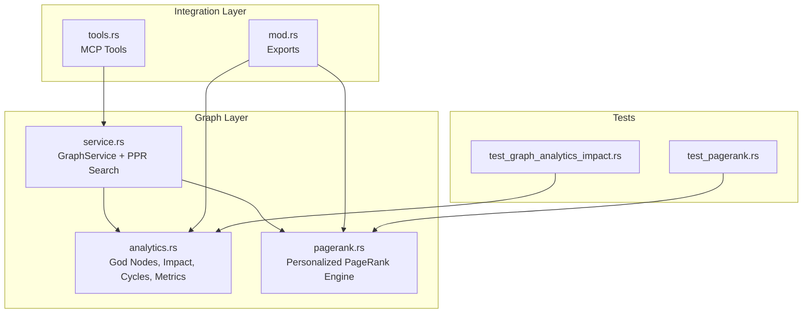
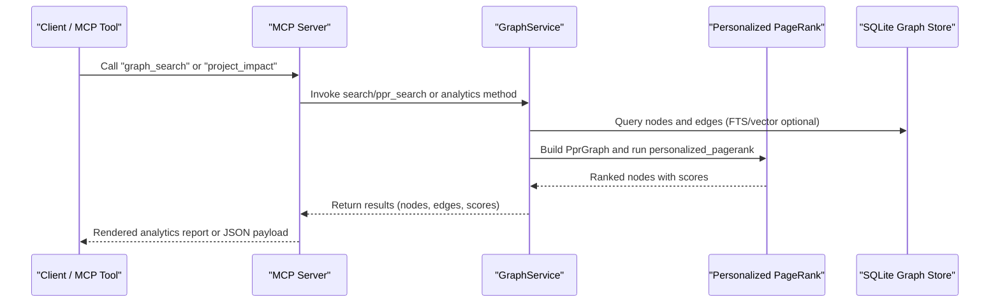
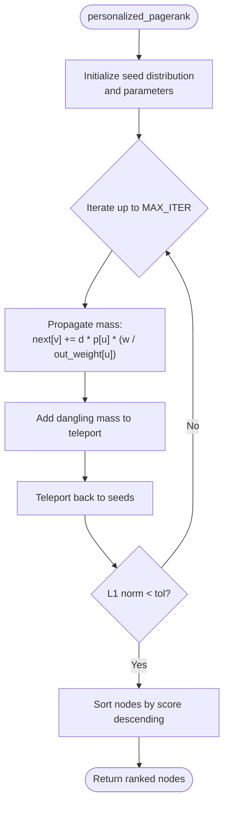
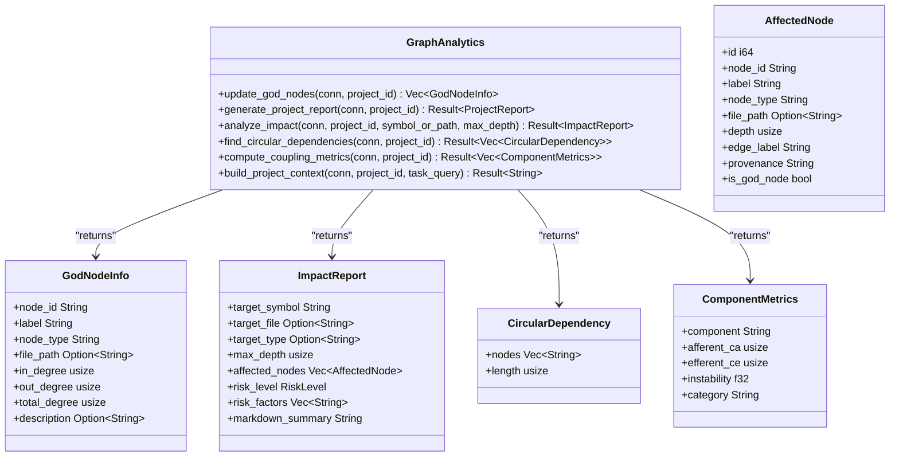
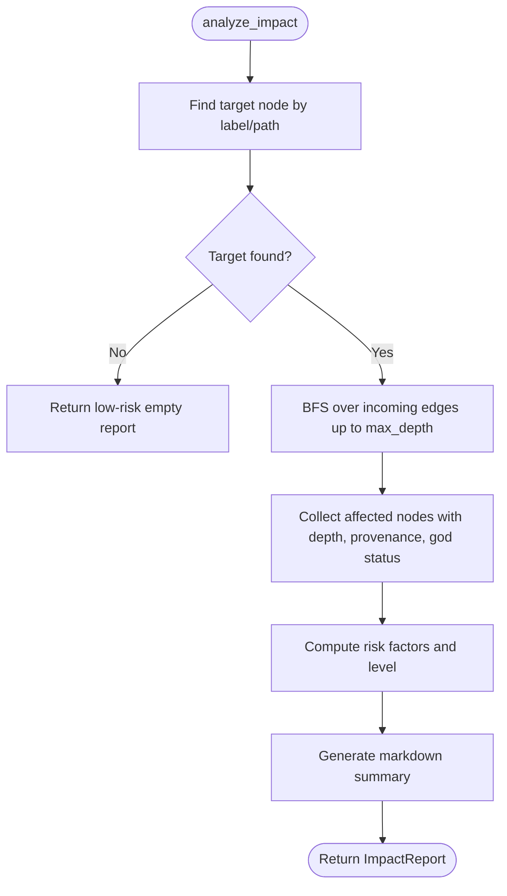
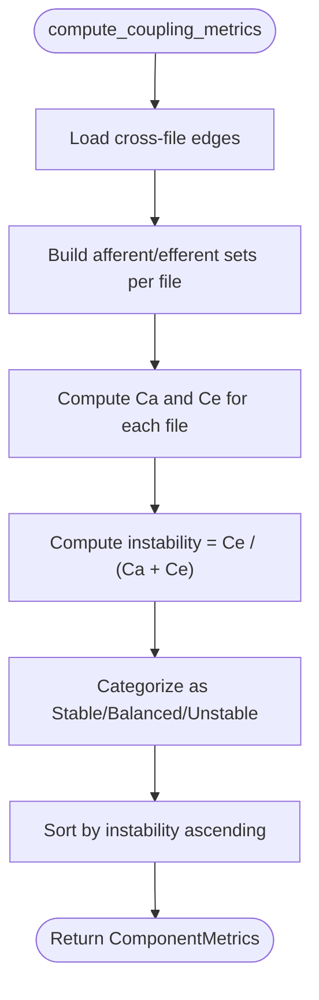
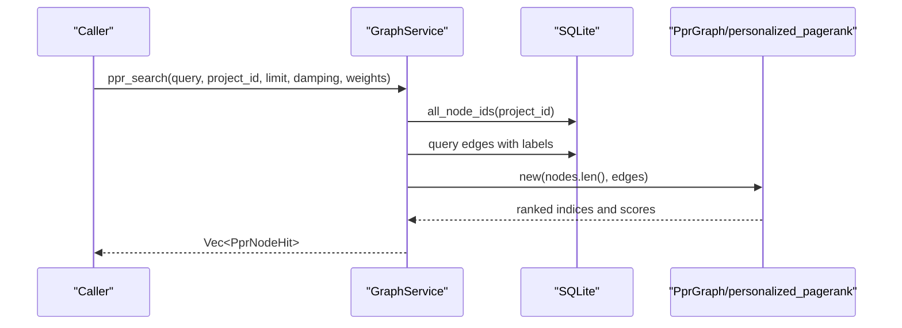
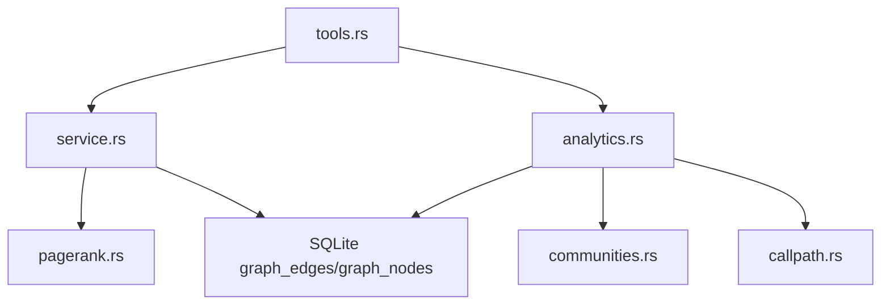

# Graph Analytics

<cite>
**Referenced Files in This Document**
- [analytics.rs](file://src/graph/analytics.rs)
- [pagerank.rs](file://src/graph/pagerank.rs)
- [service.rs](file://src/graph/service.rs)
- [mod.rs](file://src/graph/mod.rs)
- [tools.rs](file://src/mcp/tools.rs)
- [test_pagerank.rs](file://tests/test_pagerank.rs)
- [test_graph_analytics_impact.rs](file://tests/test_graph_analytics_impact.rs)
</cite>

## Table of Contents
1. [Introduction](#introduction)
2. [Project Structure](#project-structure)
3. [Core Components](#core-components)
4. [Architecture Overview](#architecture-overview)
5. [Detailed Component Analysis](#detailed-component-analysis)
6. [Dependency Analysis](#dependency-analysis)
7. [Performance Considerations](#performance-considerations)
8. [Troubleshooting Guide](#troubleshooting-guide)
9. [Conclusion](#conclusion)
10. [Appendices](#appendices)

## Introduction
This document explains the Graph Analytics component that provides advanced analytical capabilities over the knowledge graph and project code graph. It covers:

- Personalized PageRank implementation for node importance scoring across the knowledge graph and memory links.
- Impact analysis functions that compute blast radius, risk levels, and affected dependency trees.
- Statistical metrics such as God Node detection, circular dependency detection, and Robert C. Martin-style coupling and instability metrics.
- How analytics data is computed from graph relationships to identify critical code paths, high-impact nodes, and architectural bottlenecks.
- Examples of analytics queries through MCP tools, result interpretation, and integration with visualization workflows.
- Performance optimization strategies for large graphs, including degree normalization, iteration limits, convergence thresholds, and caching-friendly design patterns.

The component is implemented in Rust and integrates with SQLite-backed graph storage, an MCP tool surface, and a graph service that bridges search, embeddings, and PageRank computation.

## Project Structure
The Graph Analytics feature spans several modules under `src/graph/` and exposes functionality via MCP tools:

- `src/graph/analytics.rs`: Core analytics algorithms (God Nodes, impact analysis, circular dependencies, coupling metrics).
- `src/graph/pagerank.rs`: Personalized PageRank engine with edge-type-aware weights, hub protection, and entity normalization.
- `src/graph/service.rs`: Graph service that builds PPR graphs from database edges, runs PPR searches, and returns scored results.
- `src/graph/mod.rs`: Module exports for analytics and pagerank types.
- `src/mcp/tools.rs`: MCP tool definitions exposing `graph_search`, `project_report`, and `project_impact`.
- Tests validate behavior for both PageRank and analytics.

**Diagram sources**
- [analytics.rs:90-893](file://src/graph/analytics.rs#L90-L893)
- [pagerank.rs:17-214](file://src/graph/pagerank.rs#L17-L214)
- [service.rs:526-674](file://src/graph/service.rs#L526-L674)
- [mod.rs:1-23](file://src/graph/mod.rs#L1-L23)
- [tools.rs:190-431](file://src/mcp/tools.rs#L190-L431)
- [test_pagerank.rs:1-339](file://tests/test_pagerank.rs#L1-L339)
- [test_graph_analytics_impact.rs:1-311](file://tests/test_graph_analytics_impact.rs#L1-L311)

**Section sources**
- [analytics.rs:90-893](file://src/graph/analytics.rs#L90-L893)
- [pagerank.rs:17-214](file://src/graph/pagerank.rs#L17-L214)
- [service.rs:526-674](file://src/graph/service.rs#L526-L674)
- [mod.rs:1-23](file://src/graph/mod.rs#L1-L23)
- [tools.rs:190-431](file://src/mcp/tools.rs#L190-L431)

## Core Components
- GraphAnalytics: Provides project-level analytics including God Node identification, blast radius impact analysis, circular dependency detection, and coupling metrics.
- Personalized PageRank: Computes node importance scores using iterative mass propagation with damping, degree normalization, and seed personalization.
- GraphService: Bridges search, embeddings, and PPR; constructs PprGraph from database edges and returns ranked hits.
- MCP Tools: Expose analytics and search capabilities to external clients via MCP protocol.

Key responsibilities:
- Compute structural importance (PageRank) and connectivity (degrees, cycles, coupling).
- Provide actionable insights (risk levels, affected nodes, architectural summaries).
- Support multi-hop reasoning beyond 1-hop neighbors.

**Section sources**
- [analytics.rs:90-893](file://src/graph/analytics.rs#L90-L893)
- [pagerank.rs:17-214](file://src/graph/pagerank.rs#L17-L214)
- [service.rs:526-674](file://src/graph/service.rs#L526-L674)
- [tools.rs:190-431](file://src/mcp/tools.rs#L190-L431)

## Architecture Overview
The analytics pipeline connects user queries to graph computations and returns structured results suitable for visualization or downstream processing.

**Diagram sources**
- [tools.rs:190-431](file://src/mcp/tools.rs#L190-L431)
- [service.rs:526-674](file://src/graph/service.rs#L526-L674)
- [pagerank.rs:112-185](file://src/graph/pagerank.rs#L112-L185)

## Detailed Component Analysis

### Personalized PageRank Implementation
The PageRank engine computes importance scores by propagating probability mass along directed edges, with personalization seeds and damping. It includes:

- Degree normalization to prevent hub flooding.
- Dangling node handling where mass is returned to personalization.
- Iteration limit and L1-norm convergence threshold.
- Edge-type-aware weights parsed from configuration.

**Diagram sources**
- [pagerank.rs:112-185](file://src/graph/pagerank.rs#L112-L185)

Key behaviors validated by tests:
- Multi-hop reachability: seeds propagate beyond immediate neighbors.
- Hub protection: direct neighbors rank above leaves of high-degree hubs.
- Parameter clamping: damping within [0.5, 0.85], iterations capped at MAX_ITER.
- Default weights are fixed and robust against invalid configurations.

**Section sources**
- [pagerank.rs:17-214](file://src/graph/pagerank.rs#L17-L214)
- [test_pagerank.rs:63-174](file://tests/test_pagerank.rs#L63-L174)

### GraphAnalytics: God Nodes, Impact, Cycles, Coupling
GraphAnalytics provides:

- God Node detection: identifies top connected nodes while excluding infrastructure types like packages or CSS classes.
- Impact analysis: BFS over reverse edges to find affected dependents, compute risk level, and generate markdown summary.
- Circular dependency detection: Tarjan’s SCC algorithm to find strongly connected components indicating cycles.
- Coupling metrics: per-file afferent/efferent counts and instability index following Robert C. Martin principles.

**Diagram sources**
- [analytics.rs:5-88](file://src/graph/analytics.rs#L5-L88)
- [analytics.rs:90-893](file://src/graph/analytics.rs#L90-L893)

Impact analysis flow:

**Diagram sources**
- [analytics.rs:377-616](file://src/graph/analytics.rs#L377-L616)

Coupling metrics calculation:

**Diagram sources**
- [analytics.rs:763-835](file://src/graph/analytics.rs#L763-L835)

**Section sources**
- [analytics.rs:90-893](file://src/graph/analytics.rs#L90-L893)
- [test_graph_analytics_impact.rs:14-311](file://tests/test_graph_analytics_impact.rs#L14-L311)

### GraphService: PPR Integration and Search
GraphService orchestrates search and PPR:

- Builds PprGraph from database edges mapped to indices.
- Applies edge-type-aware weights.
- Runs personalized_pagerank and maps results back to node metadata.
- Supports hybrid search combining lexical and vector signals before PPR expansion.

**Diagram sources**
- [service.rs:526-674](file://src/graph/service.rs#L526-L674)
- [pagerank.rs:59-103](file://src/graph/pagerank.rs#L59-L103)

**Section sources**
- [service.rs:526-674](file://src/graph/service.rs#L526-L674)
- [test_pagerank.rs:290-339](file://tests/test_pagerank.rs#L290-L339)

### MCP Tools Integration
MCP tools expose analytics and search capabilities:

- `graph_search`: classic or PPR mode over the knowledge graph.
- `project_report`: generates architectural digest including God Nodes, cycles, and stability metrics.
- `project_impact`: analyzes blast radius for a symbol or path.

These tools are read-only and integrate with the underlying analytics and service layers.

**Section sources**
- [tools.rs:190-431](file://src/mcp/tools.rs#L190-L431)

## Dependency Analysis
The analytics module depends on:

- SQLite schema for nodes and edges.
- Pagerank engine for importance scoring.
- Community detection and callpath utilities for enriched reports.
- MCP server for external access.

**Diagram sources**
- [analytics.rs:90-893](file://src/graph/analytics.rs#L90-L893)
- [service.rs:526-674](file://src/graph/service.rs#L526-L674)
- [tools.rs:190-431](file://src/mcp/tools.rs#L190-L431)

**Section sources**
- [analytics.rs:90-893](file://src/graph/analytics.rs#L90-L893)
- [service.rs:526-674](file://src/graph/service.rs#L526-L674)
- [tools.rs:190-431](file://src/mcp/tools.rs#L190-L431)

## Performance Considerations
Optimization strategies used in the analytics and PageRank components:

- Iterative PageRank with bounded iterations (`MAX_ITER`) and L1-norm convergence tolerance (`DEFAULT_TOL`).
- Degree normalization prevents hub flooding and stabilizes rankings.
- Dangling node handling ensures mass conservation without artificial sinks.
- Edge-type-aware weights allow tuning influence by relation kind.
- God Node selection excludes infrastructure types to avoid skewing architectural insights.
- BFS-based impact analysis caps depth to control traversal cost.
- Coupling metrics aggregate sets per file to compute Ca/Ce efficiently.

Recommendations for large graphs:

- Use project-scoped queries to reduce graph size.
- Cache God Node updates and coupling metrics when inputs are stable.
- Limit PPR iterations and tune damping based on domain characteristics.
- Pre-filter edges by provenance or type to reduce noise.
- Leverage FTS and vector indexes to narrow candidate sets before PPR.

[No sources needed since this section provides general guidance]

## Troubleshooting Guide
Common issues and resolutions:

- Empty PPR results: ensure seeds are valid and exist in the graph; check that edges connect seed nodes to targets.
- Unexpected hub dominance: verify degree normalization is active and edge weights are positive and finite.
- Missing impact nodes: confirm reverse edges exist; impact analysis traverses incoming edges to find callers.
- Cycle detection false positives: self-loops are detected as cycles; ensure graph semantics align with expectations.
- High instability scores: files with many outgoing dependencies but few incoming references are classified as unstable leaves.

Validation points from tests:

- PPR reaches multi-hop targets and ranks nearer nodes higher than distant ones.
- Hub protection ensures direct neighbors outrank hub leaves.
- Impact analysis correctly identifies affected nodes and assigns risk levels.
- Coupling metrics classify stable, balanced, and unstable components accurately.

**Section sources**
- [test_pagerank.rs:63-174](file://tests/test_pagerank.rs#L63-L174)
- [test_graph_analytics_impact.rs:14-311](file://tests/test_graph_analytics_impact.rs#L14-L311)

## Conclusion
The Graph Analytics component delivers robust analytical capabilities over the knowledge graph and project code graph. It combines Personalized PageRank for importance scoring with structural analytics (God Nodes, cycles, coupling) to identify critical paths, high-impact nodes, and architectural bottlenecks. Through MCP tools, these analytics are accessible for visualization and decision-making. The implementation emphasizes performance and correctness through bounded iterations, convergence checks, degree normalization, and careful exclusion of infrastructure noise.

[No sources needed since this section summarizes without analyzing specific files]

## Appendices

### Analytics Queries and Interpretation
- `graph_search` with `mode=ppr`: returns ranked nodes based on PPR; interpret scores as relative importance influenced by edge types and damping.
- `project_impact`: returns affected nodes and risk level; use depth to control blast radius scope; high risk indicates God Node involvement or wide dependency spread.
- `project_report`: summarizes architecture; review God Nodes, cycles, and instability metrics to locate bottlenecks and fragile areas.

Visualization integration tips:

- Map PPR scores to node sizes or colors in graph viewers.
- Highlight God Nodes and affected nodes from impact analysis.
- Color-code cycle paths and unstable components for quick diagnosis.

[No sources needed since this section provides general guidance]