# Graph Service Core

<cite>
**Referenced Files in This Document**
- [service.rs](file://src/graph/service.rs)
- [mod.rs](file://src/graph/mod.rs)
- [analytics.rs](file://src/graph/analytics.rs)
- [schema.rs](file://src/db/schema.rs)
- [models.rs](file://src/db/models.rs)
- [lib.rs](file://src/lib.rs)
- [main.rs](file://src/main.rs)
- [server.rs](file://src/mcp/server.rs)
- [tools.rs](file://src/mcp/tools.rs)
</cite>

## Table of Contents
1. [Introduction](#introduction)
2. [Project Structure](#project-structure)
3. [Core Components](#core-components)
4. [Architecture Overview](#architecture-overview)
5. [Detailed Component Analysis](#detailed-component-analysis)
6. [Dependency Analysis](#dependency-analysis)
7. [Performance Considerations](#performance-considerations)
8. [Troubleshooting Guide](#troubleshooting-guide)
9. [Conclusion](#conclusion)

## Introduction
This document describes the Graph Service core infrastructure that orchestrates graph-related operations and exposes the main service interface for OB2H. It covers:
- Service lifecycle and initialization
- Configuration options relevant to graph operations
- Core data structures for nodes, edges, and relationships
- API surface for querying, updating, and reasoning over the knowledge graph
- Integration patterns with other OB2H services (MCP tools, LLM client, embedding provider, project scanner)
- Error handling, resource management, and performance monitoring capabilities

The Graph Service is a Rust module providing a `GraphService` that persists and queries a SQLite-backed knowledge graph, supports hybrid lexical/vector search, Personalized PageRank ranking, and integrates with an LLM for KAG-style reasoning.

## Project Structure
The Graph Service lives under `src/graph/`. The public module re-exports key types and delegates implementation to `service.rs`, while analytics utilities live in `analytics.rs`. Database schema and models are defined under `src/db/`. The service is wired into the application context and exposed through MCP tools.

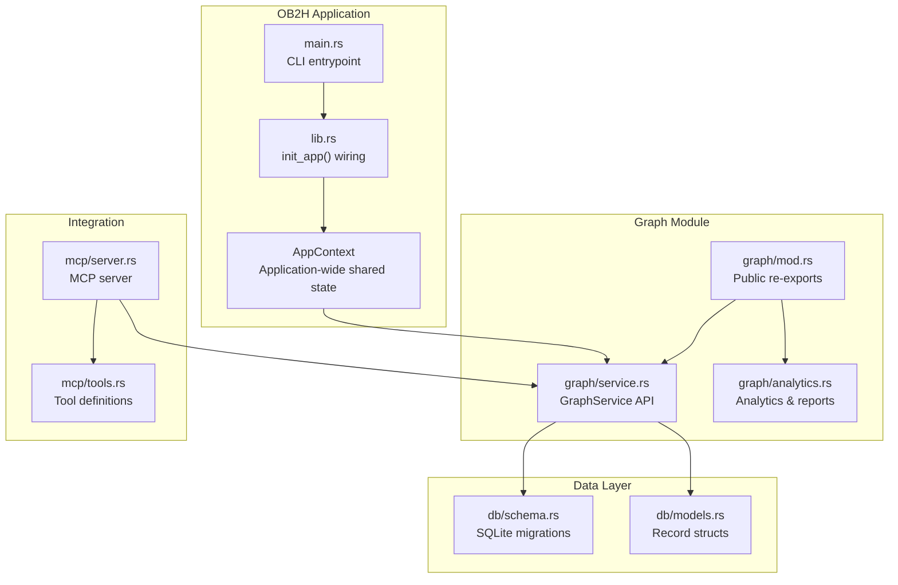

**Diagram sources**
- [lib.rs:46-135](file://src/lib.rs#L46-L135)
- [main.rs:17-90](file://src/main.rs#L17-L90)
- [mod.rs:1-23](file://src/graph/mod.rs#L1-L23)
- [service.rs:96-104](file://src/graph/service.rs#L96-L104)
- [schema.rs:222-334](file://src/db/schema.rs#L222-L334)
- [models.rs:65-95](file://src/db/models.rs#L65-L95)
- [server.rs:27-52](file://src/mcp/server.rs#L27-L52)
- [tools.rs:190-229](file://src/mcp/tools.rs#L190-L229)

**Section sources**
- [lib.rs:46-135](file://src/lib.rs#L46-L135)
- [main.rs:17-90](file://src/main.rs#L17-L90)
- [mod.rs:1-23](file://src/graph/mod.rs#L1-L23)

## Core Components
- GraphService: Central orchestrator for upserting extracted entities/relations, searching nodes, PPR ranking, and reasoning over facts.
- NodeWithNeighbors: Search result node with neighbor linkage.
- EdgeWithLabels: Edge with source/target labels, weight, and contexts.
- GraphSearchResult: Combined nodes and edges from a search.
- PprNodeHit: Ranked node hit from PPR search.
- GraphReasonResult: Structured answer with confidence, reasoning steps, and used entities/relations.
- GraphStats: Counts of nodes, edges, documents, chunks.
- ScoredProjectNode: Hybrid search result for project-scoped nodes.

Key responsibilities:
- Deterministic node ID generation
- Upserting extraction results (entities + relations)
- Lexical and vector search with fallbacks
- PPR-based ranking with edge-type-aware weights
- KAG-style reasoning via LLM JSON responses
- Stats and project-scoped hybrid search

**Section sources**
- [service.rs:26-94](file://src/graph/service.rs#L26-L94)
- [service.rs:96-104](file://src/graph/service.rs#L96-L104)
- [service.rs:106-216](file://src/graph/service.rs#L106-L216)
- [service.rs:236-460](file://src/graph/service.rs#L236-L460)
- [service.rs:462-509](file://src/graph/service.rs#L462-L509)
- [service.rs:511-524](file://src/graph/service.rs#L511-L524)
- [service.rs:546-674](file://src/graph/service.rs#L546-L674)
- [service.rs:676-875](file://src/graph/service.rs#L676-L875)
- [service.rs:878-891](file://src/graph/service.rs#L878-L891)

## Architecture Overview
The Graph Service is initialized during application startup and injected into the global `AppContext`. It depends on:
- A SQLite database (`Database`)
- An embedding provider (`EmbeddingProvider`)
- An LLM client (`LLMClient`) for reasoning

It is exposed to clients via MCP tools such as `graph_search`, `graph_reason`, and `graph_stats`.

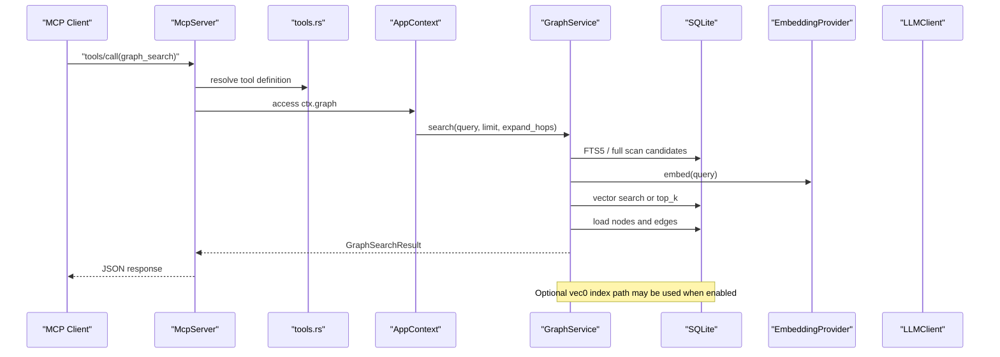

**Diagram sources**
- [server.rs:479-558](file://src/mcp/server.rs#L479-L558)
- [tools.rs:190-229](file://src/mcp/tools.rs#L190-L229)
- [service.rs:236-460](file://src/graph/service.rs#L236-L460)
- [lib.rs:73-120](file://src/lib.rs#L73-L120)

## Detailed Component Analysis

### GraphService Lifecycle and Initialization
- Construction: `GraphService::new(db, embedder)` creates the service with a database handle and embedding provider.
- Wiring: `init_app` constructs `GraphService` and places it into `AppContext.graph`.
- Background workers: Not directly started by GraphService; background tasks are managed elsewhere.

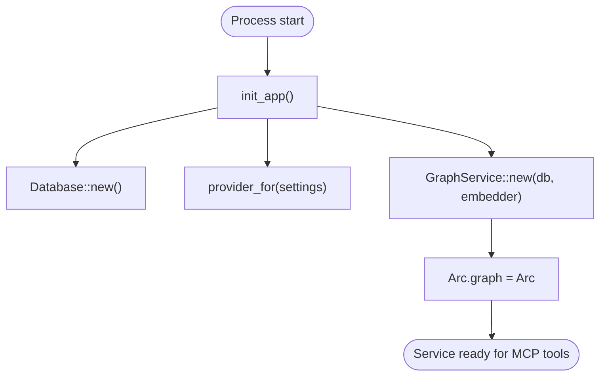

**Diagram sources**
- [lib.rs:46-135](file://src/lib.rs#L46-L135)
- [service.rs:96-104](file://src/graph/service.rs#L96-L104)

**Section sources**
- [lib.rs:46-135](file://src/lib.rs#L46-L135)
- [service.rs:96-104](file://src/graph/service.rs#L96-L104)

### Data Model and Schema
- Nodes: `graph_nodes` table stores unique `node_id`, label, type, description, value counter, embeddings, timestamps, project scoping, provenance, and god-node flags.
- Edges: `graph_edges` table stores directed edges between nodes with label, weight, contexts, timestamps, project scoping, provenance, and confidence.
- Migrations: Versioned migrations create tables, indexes, and FTS virtual tables for fast lexical search.

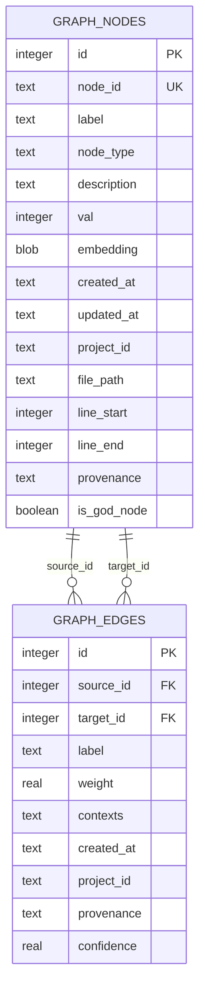

**Diagram sources**
- [schema.rs:268-293](file://src/db/schema.rs#L268-L293)
- [schema.rs:30-67](file://src/db/schema.rs#L30-L67)
- [schema.rs:350-374](file://src/db/schema.rs#L350-L374)
- [models.rs:65-95](file://src/db/models.rs#L65-L95)

**Section sources**
- [schema.rs:222-334](file://src/db/schema.rs#L222-L334)
- [schema.rs:350-374](file://src/db/schema.rs#L350-L374)
- [models.rs:65-95](file://src/db/models.rs#L65-L95)

### Upsert Extraction Pipeline
- Input: `ExtractionResult` containing entities and relations.
- Process:
  - Generate deterministic node IDs from label+type.
  - Upsert nodes: increment `val`, merge descriptions, update timestamps, store embeddings.
  - Upsert edges: deduplicate by (source, target, label), merge contexts, increment weight.
- Output: counts of new entities, updated entities, and new edges.

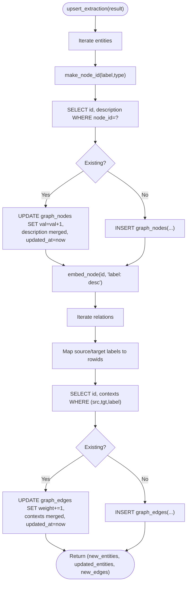

**Diagram sources**
- [service.rs:106-216](file://src/graph/service.rs#L106-L216)
- [service.rs:26-31](file://src/graph/service.rs#L26-L31)
- [service.rs:218-234](file://src/graph/service.rs#L218-L234)

**Section sources**
- [service.rs:106-216](file://src/graph/service.rs#L106-L216)
- [service.rs:218-234](file://src/graph/service.rs#L218-L234)

### Search Algorithm
- Lexical scoring: Uses FTS5 trigram index when available; falls back to full scan if unavailable.
- Vector scoring: Embeds query, then either uses vec0 index (if enabled) or computes cosine similarity against stored embeddings.
- Ranking: Combines scores, sorts deterministically by score then id, truncates to limit.
- Enrichment: Loads matching nodes and their incident edges; optional 1-hop expansion adds neighbors.

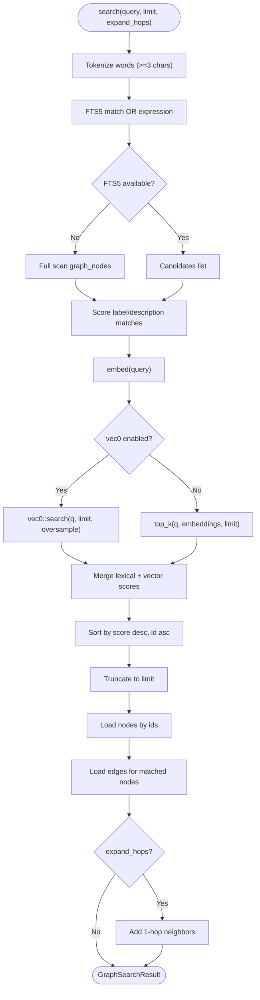

**Diagram sources**
- [service.rs:236-460](file://src/graph/service.rs#L236-L460)
- [schema.rs:350-374](file://src/db/schema.rs#L350-L374)

**Section sources**
- [service.rs:236-460](file://src/graph/service.rs#L236-L460)

### Personalized PageRank Search
- Seeds: Derived from initial search hits (FTS/vector).
- Graph construction: Builds `PprGraph` from project-scoped nodes and edges with edge-type-aware weights.
- Ranking: Runs personalized PPR with damping and iteration limits; returns top-k ranked nodes.

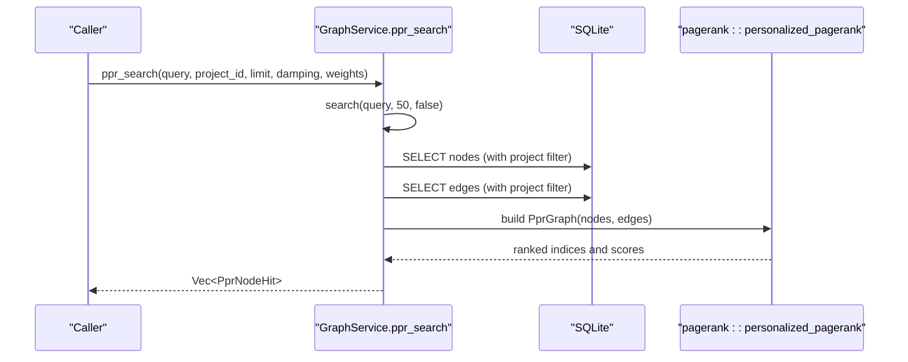

**Diagram sources**
- [service.rs:546-674](file://src/graph/service.rs#L546-L674)

**Section sources**
- [service.rs:546-674](file://src/graph/service.rs#L546-L674)

### KAG Reasoning
- Steps:
  - Search for related facts (nodes and edges).
  - Build a prompt with entities and relations.
  - Ask LLM to return structured JSON answer with confidence and reasoning steps.
- Error handling: If LLM fails, returns a safe error message with zero confidence.

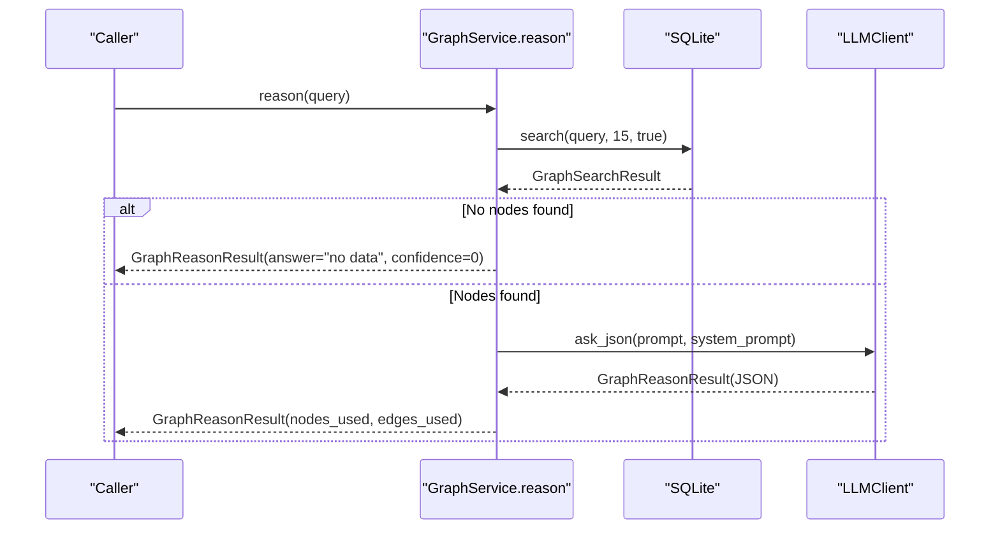

**Diagram sources**
- [service.rs:462-509](file://src/graph/service.rs#L462-L509)

**Section sources**
- [service.rs:462-509](file://src/graph/service.rs#L462-L509)

### Project-Scoped Hybrid Search
- Modes:
  - hybrid: RRF fusion of text and vector ranks (k=60).
  - text: lexical-only ranking.
  - vector: semantic-only ranking.
- Filters: By project and provenance.
- Output: `ScoredProjectNode` with metadata and score.

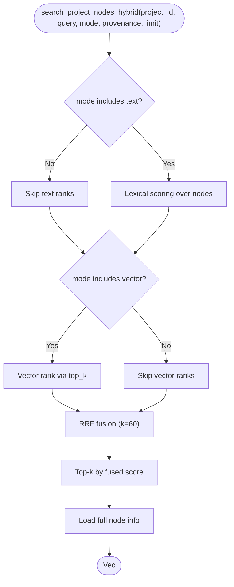

**Diagram sources**
- [service.rs:676-875](file://src/graph/service.rs#L676-L875)

**Section sources**
- [service.rs:676-875](file://src/graph/service.rs#L676-L875)

### Analytics and Reports
- God Nodes: Compute degrees, exclude infra hub types, mark top connected nodes.
- Impact analysis: BFS over reverse dependencies to estimate blast radius and risk level.
- Circular dependencies: Tarjan’s SCC algorithm to detect cycles.
- Coupling metrics: Robert Martin’s Ca/Ce/Instability per component.

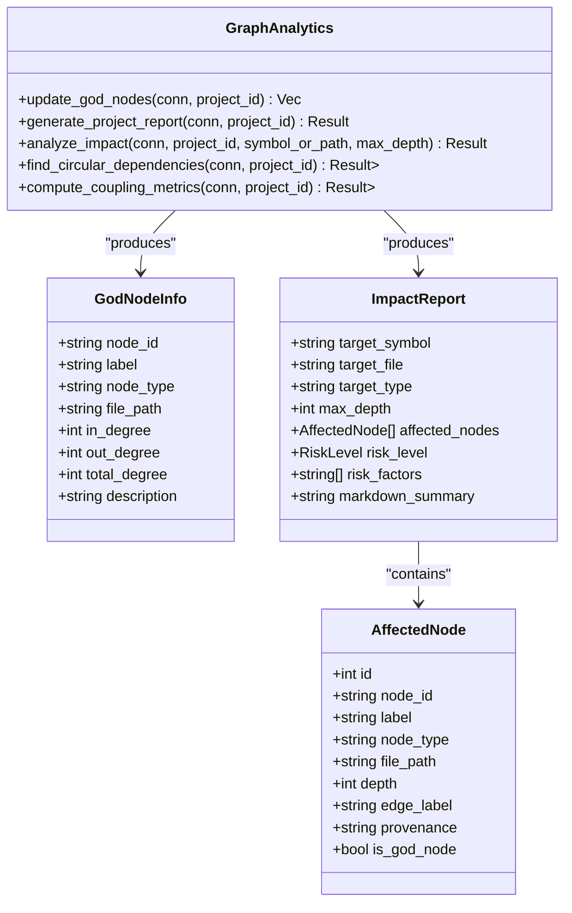

**Diagram sources**
- [analytics.rs:92-198](file://src/graph/analytics.rs#L92-L198)
- [analytics.rs:200-375](file://src/graph/analytics.rs#L200-L375)
- [analytics.rs:377-616](file://src/graph/analytics.rs#L377-L616)
- [analytics.rs:618-761](file://src/graph/analytics.rs#L618-L761)
- [analytics.rs:763-800](file://src/graph/analytics.rs#L763-L800)

**Section sources**
- [analytics.rs:92-198](file://src/graph/analytics.rs#L92-L198)
- [analytics.rs:200-375](file://src/graph/analytics.rs#L200-L375)
- [analytics.rs:377-616](file://src/graph/analytics.rs#L377-L616)
- [analytics.rs:618-761](file://src/graph/analytics.rs#L618-L761)
- [analytics.rs:763-800](file://src/graph/analytics.rs#L763-L800)

## Dependency Analysis
- GraphService depends on:
  - `Database`: SQL execution and connection management.
  - `EmbeddingProvider`: Vector embedding generation.
  - `LLMClient`: Structured JSON reasoning.
  - `vector` utilities: Serialization and top-k similarity.
- MCP integration:
  - `McpServer` routes tool calls to `GraphService`.
  - Tool definitions declare parameters and hints.

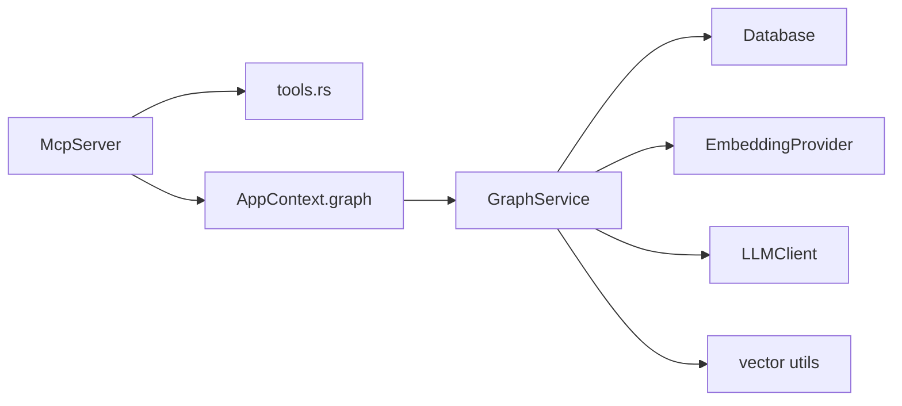

**Diagram sources**
- [server.rs:27-52](file://src/mcp/server.rs#L27-L52)
- [tools.rs:190-229](file://src/mcp/tools.rs#L190-L229)
- [service.rs:10-14](file://src/graph/service.rs#L10-L14)

**Section sources**
- [server.rs:27-52](file://src/mcp/server.rs#L27-L52)
- [tools.rs:190-229](file://src/mcp/tools.rs#L190-L229)
- [service.rs:10-14](file://src/graph/service.rs#L10-L14)

## Performance Considerations
- FTS5 fallback: When FTS5 is unavailable or corrupted, the service logs a warning and performs a full scan. Ensure FTS5 index integrity.
- vec0 index: When enabled, uses a binary-first pass plus rescore with real vectors; otherwise falls back to full-scan cosine similarity.
- Determinism: Sorting by score then id ensures stable top-k across runs.
- Context limits: Edge contexts truncated to 20 entries to bound storage growth.
- Embedding updates: Only non-empty node descriptions are embedded; empty texts are skipped.

Recommendations:
- Keep FTS5 indexes healthy; rebuild if needed.
- Enable vec0 indexing for large graphs to improve recall@k latency.
- Tune `limit` and `expand_hops` to balance result quality and cost.
- Monitor embedding dimensionality and storage size.

[No sources needed since this section provides general guidance]

## Troubleshooting Guide
Common issues and resolutions:
- FTS5 unavailable: The service warns and falls back to full scan. Verify SQLite FTS5 extension availability and index consistency.
- Empty search results: Check tokenization thresholds (minimum word length) and ensure embeddings exist for vector search.
- LLM reasoning failures: If JSON parsing fails, the service returns a safe error response; verify LLM connectivity and model output format.
- Missing project scope: Ensure `project_id` is provided for project-scoped searches and analytics.

Operational checks:
- Use `graph_stats` to inspect node/edge/document/chunk counts.
- Validate migration version and schema completeness.
- Review logs for warnings about FTS5 and vec0 index status.

**Section sources**
- [service.rs:268-289](file://src/graph/service.rs#L268-L289)
- [service.rs:496-509](file://src/graph/service.rs#L496-L509)
- [service.rs:511-524](file://src/graph/service.rs#L511-L524)
- [schema.rs:452-518](file://src/db/schema.rs#L452-L518)

## Conclusion
The Graph Service provides a robust, SQLite-backed knowledge graph with hybrid search, PPR ranking, and LLM-driven reasoning. It integrates cleanly into OB2H’s application context and exposes a clear MCP tool surface. With careful attention to FTS5 and vec0 indexing, deterministic ranking, and proper project scoping, it delivers reliable performance and extensibility for graph-centric workflows.

[No sources needed since this section summarizes without analyzing specific files]