# Graph Service

<cite>
**Referenced Files in This Document**
- [mod.rs](file://src/graph/mod.rs)
- [service.rs](file://src/graph/service.rs)
- [analytics.rs](file://src/graph/analytics.rs)
- [pagerank.rs](file://src/graph/pagerank.rs)
- [blast.rs](file://src/graph/blast.rs)
- [callpath.rs](file://src/graph/callpath.rs)
- [repomap.rs](file://src/graph/repomap.rs)
- [ast.rs](file://src/project/ast.rs)
- [schema.rs](file://src/db/schema.rs)
- [models.rs](file://src/db/models.rs)
</cite>

## Table of Contents
1. [Introduction](#introduction)
2. [Project Structure](#project-structure)
3. [Core Components](#core-components)
4. [Architecture Overview](#architecture-overview)
5. [Detailed Component Analysis](#detailed-component-analysis)
6. [Dependency Analysis](#dependency-analysis)
7. [Performance Considerations](#performance-considerations)
8. [Troubleshooting Guide](#troubleshooting-guide)
9. [Conclusion](#conclusion)
10. [Appendices](#appendices)

## Introduction
The Graph Service builds and queries a knowledge graph derived from static AST analysis. It persists nodes and edges in SQLite, enriches them with embeddings for semantic search, and provides analytics such as PageRank-based ranking, blast radius assessment, call path tracing, repository mapping, and architectural reports. The service integrates with the project scanning system to transform parsed code into graph entities and relationships, then exposes query, reasoning, and visualization-friendly data structures.

## Project Structure
The graph subsystem is organized by capability:
- `graph/mod.rs` re-exports core types and services.
- `graph/service.rs` implements the main `GraphService`: upserting extraction results, hybrid search, PPR search, and LLM-assisted reasoning.
- `graph/analytics.rs` computes architectural metrics, God Nodes, circular dependencies, coupling metrics, impact reports, and project context.
- `graph/pagerank.rs` implements Personalized PageRank over an in-memory CSR-like graph.
- `graph/callpath.rs` performs structural traversal (callers/callees), explicit call paths, dead-code detection, and formatting helpers.
- `graph/blast.rs` provides edit-time blast-radius hints with TTL caching.
- `graph/repomap.rs` builds token-budget repository maps using file-dependency PPR.
- `project/ast.rs` defines AST node/edge models and language registry used by scanners feeding the graph.
- `db/schema.rs` and `db/models.rs` define SQLite schema migrations and Rust models for graph tables.

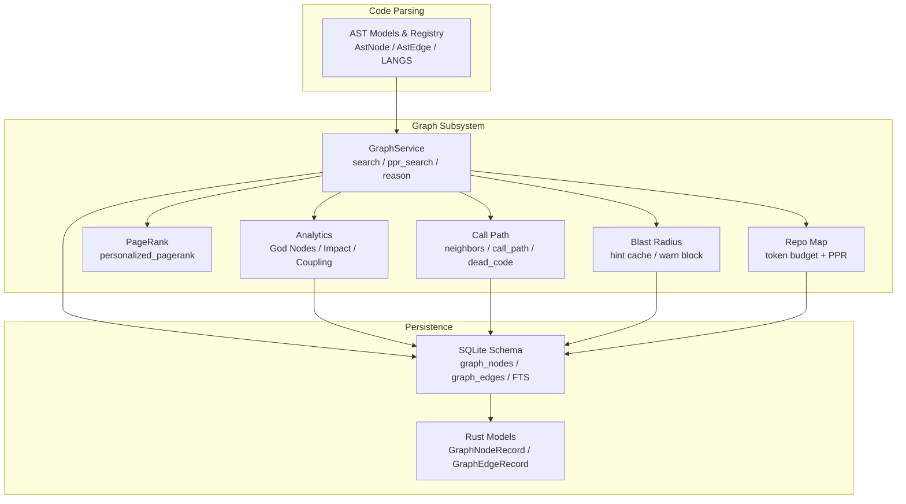

**Diagram sources**
- [service.rs:96-104](file://src/graph/service.rs#L96-L104)
- [analytics.rs:90-92](file://src/graph/analytics.rs#L90-L92)
- [pagerank.rs:59-84](file://src/graph/pagerank.rs#L59-L84)
- [callpath.rs:151-219](file://src/graph/callpath.rs#L151-L219)
- [blast.rs:146-196](file://src/graph/blast.rs#L146-L196)
- [repomap.rs:126-136](file://src/graph/repomap.rs#L126-L136)
- [ast.rs:15-52](file://src/project/ast.rs#L15-L52)
- [schema.rs:268-293](file://src/db/schema.rs#L268-L293)
- [models.rs:64-95](file://src/db/models.rs#L64-L95)

**Section sources**
- [mod.rs:1-23](file://src/graph/mod.rs#L1-L23)
- [service.rs:96-104](file://src/graph/service.rs#L96-L104)
- [ast.rs:15-52](file://src/project/ast.rs#L15-L52)
- [schema.rs:268-293](file://src/db/schema.rs#L268-L293)
- [models.rs:64-95](file://src/db/models.rs#L64-L95)

## Core Components
- GraphService: central orchestrator for ingestion, search, ranking, and reasoning.
- Analytics: architectural analysis utilities producing reports and metrics.
- PageRank: iterative algorithm for multi-hop ranking with degree normalization.
- Call Path: structural traversal and dead-code detection over usage edges.
- Blast Radius: lightweight edit-time warnings with TTL-cached hints.
- Repo Map: compact repository map under token budgets using file-dependency PPR.

Key responsibilities:
- Ingest AST extraction results into graph nodes and edges with deduplication and embedding generation.
- Provide lexical, vector, and hybrid search across nodes; optionally expand one hop.
- Compute personalized PageRank rankings seeded by search matches.
- Generate architectural summaries, detect cycles, compute coupling metrics, and identify God Nodes.
- Trace callers/callees, build explicit call chains, and surface dead code candidates.
- Produce token-bounded repo maps prioritizing files by centrality.

**Section sources**
- [service.rs:96-104](file://src/graph/service.rs#L96-L104)
- [analytics.rs:90-92](file://src/graph/analytics.rs#L90-L92)
- [pagerank.rs:59-84](file://src/graph/pagerank.rs#L59-L84)
- [callpath.rs:151-219](file://src/graph/callpath.rs#L151-L219)
- [blast.rs:146-196](file://src/graph/blast.rs#L146-L196)
- [repomap.rs:126-136](file://src/graph/repomap.rs#L126-L136)

## Architecture Overview
The pipeline flows from code parsing to graph persistence and then to analytics and queries.

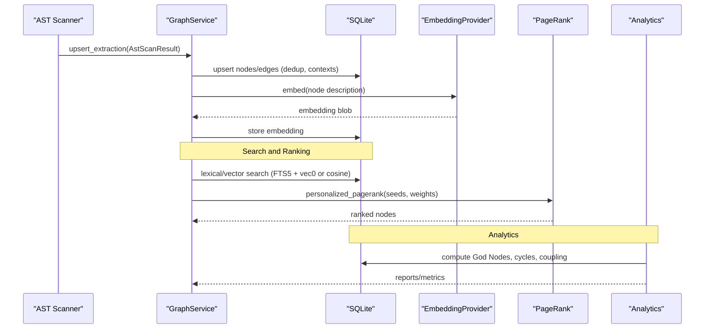

**Diagram sources**
- [service.rs:106-216](file://src/graph/service.rs#L106-L216)
- [service.rs:236-460](file://src/graph/service.rs#L236-L460)
- [service.rs:546-674](file://src/graph/service.rs#L546-L674)
- [analytics.rs:94-198](file://src/graph/analytics.rs#L94-L198)
- [pagerank.rs:112-185](file://src/graph/pagerank.rs#L112-L185)

**Section sources**
- [service.rs:106-216](file://src/graph/service.rs#L106-L216)
- [service.rs:236-460](file://src/graph/service.rs#L236-L460)
- [service.rs:546-674](file://src/graph/service.rs#L546-L674)
- [analytics.rs:94-198](file://src/graph/analytics.rs#L94-L198)
- [pagerank.rs:112-185](file://src/graph/pagerank.rs#L112-L185)

## Detailed Component Analysis

### GraphService: Ingestion, Search, Reasoning, and Ranking
Responsibilities:
- Upsert extraction results: create/update nodes, merge descriptions, track edge contexts, increment weights, and generate embeddings.
- Hybrid search: lexical (FTS5 fallback to full scan), vector (vec0 or cosine), optional 1-hop neighbor expansion.
- PPR search: seeds from search matches, project-scoped or global, weighted edges by type, returns scored hits.
- Reasoning: assemble facts from search results and ask an LLM for structured JSON answers.

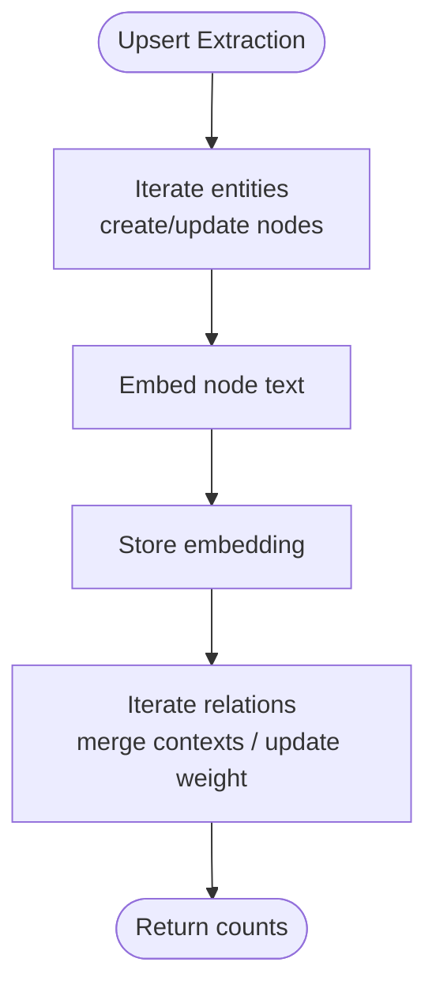

**Diagram sources**
- [service.rs:106-216](file://src/graph/service.rs#L106-L216)

Search flow:

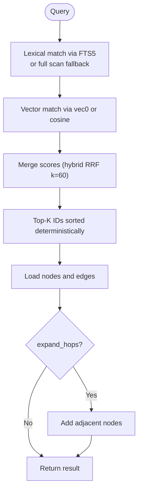

**Diagram sources**
- [service.rs:236-460](file://src/graph/service.rs#L236-L460)

PPR search flow:

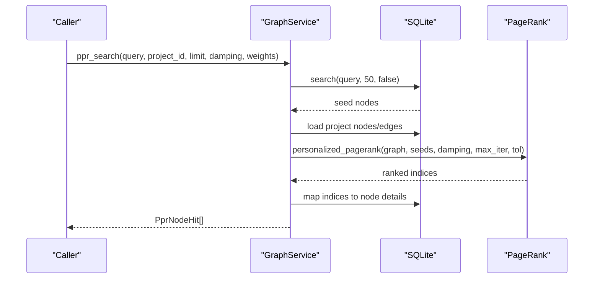

**Diagram sources**
- [service.rs:546-674](file://src/graph/service.rs#L546-L674)
- [pagerank.rs:112-185](file://src/graph/pagerank.rs#L112-L185)

Reasoning flow:

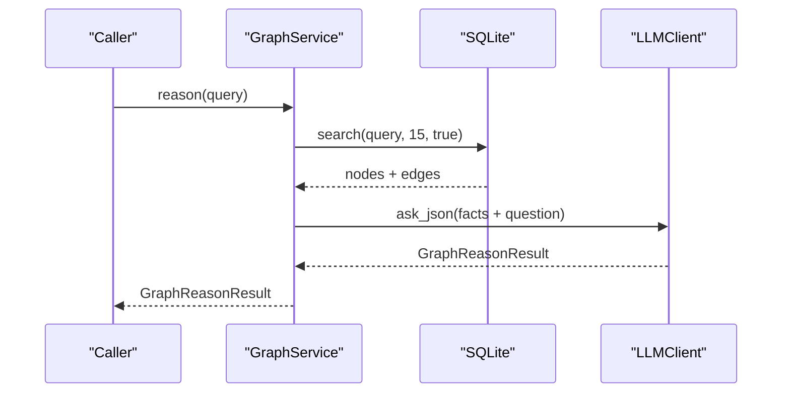

**Diagram sources**
- [service.rs:462-509](file://src/graph/service.rs#L462-L509)

**Section sources**
- [service.rs:106-216](file://src/graph/service.rs#L106-L216)
- [service.rs:236-460](file://src/graph/service.rs#L236-L460)
- [service.rs:462-509](file://src/graph/service.rs#L462-L509)
- [service.rs:546-674](file://src/graph/service.rs#L546-L674)

### Analytics: God Nodes, Impact Reports, Cycles, Coupling, Context
Capabilities:
- God Nodes: compute degrees, exclude infrastructure hubs, mark top connected nodes, and persist flags.
- Impact Report: BFS over incoming usage edges to assess blast radius, risk factors, and recommendations.
- Circular Dependencies: Tarjan’s SCC to find cycles among project nodes.
- Coupling Metrics: per-file afferent/efferent counts and instability classification.
- Project Context: compact summary including God Nodes and task-relevant nodes.

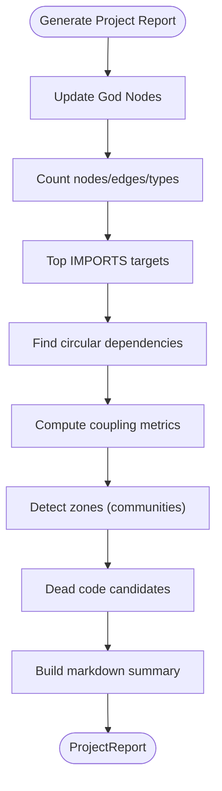

**Diagram sources**
- [analytics.rs:200-375](file://src/graph/analytics.rs#L200-L375)

Impact analysis flow:

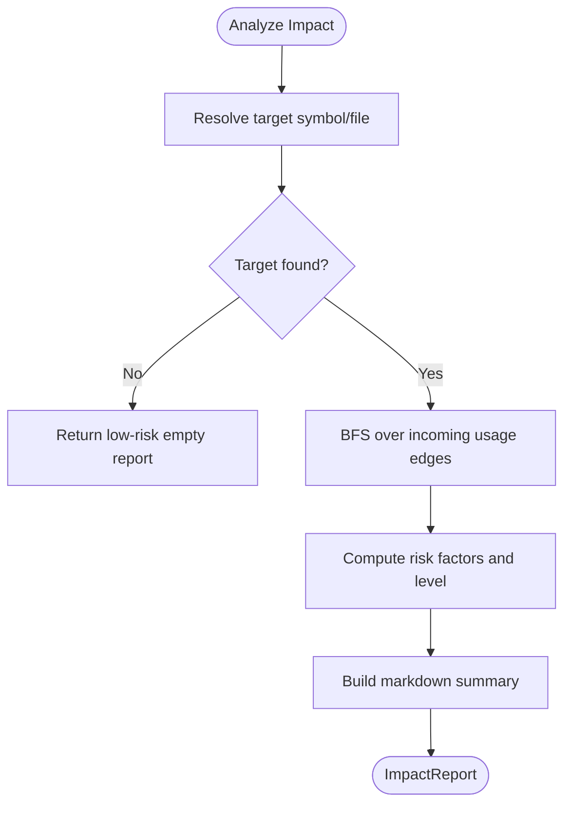

**Diagram sources**
- [analytics.rs:378-616](file://src/graph/analytics.rs#L378-L616)

**Section sources**
- [analytics.rs:94-198](file://src/graph/analytics.rs#L94-L198)
- [analytics.rs:200-375](file://src/graph/analytics.rs#L200-L375)
- [analytics.rs:378-616](file://src/graph/analytics.rs#L378-L616)
- [analytics.rs:618-761](file://src/graph/analytics.rs#L618-L761)
- [analytics.rs:763-835](file://src/graph/analytics.rs#L763-L835)
- [analytics.rs:837-891](file://src/graph/analytics.rs#L837-L891)

### PageRank: Multi-Hop Ranking with Degree Normalization
Implementation highlights:
- CSR-like adjacency with outgoing weight sums for hub protection.
- Damping clamped to safe range; iterations bounded; convergence by L1 norm.
- Dangling nodes return mass to personalization.
- Edge weights configurable by kind; unknown kinds use default weight.
- Entity normalization reduces noisy relation creation.

```mermaid
classDiagram
class PprGraph {
+usize n
+Vec<Vec<(usize,f64)>> out
+Vec<f64> out_weight
+new(n, edges)
+node_count() usize
+edge_count() usize
+out_weight(node) f64
+neighbors(node) &[(usize,f64)]
}
class PprEdge {
+usize from
+usize to
+f64 weight
}
PprGraph --> PprEdge : "uses"
```

**Diagram sources**
- [pagerank.rs:59-84](file://src/graph/pagerank.rs#L59-L84)
- [pagerank.rs:51-57](file://src/graph/pagerank.rs#L51-L57)

Algorithm flow:

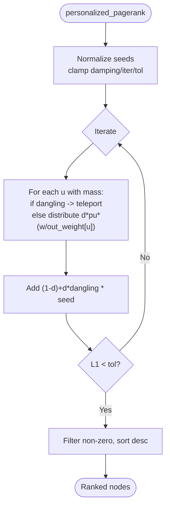

**Diagram sources**
- [pagerank.rs:112-185](file://src/graph/pagerank.rs#L112-L185)

**Section sources**
- [pagerank.rs:59-84](file://src/graph/pagerank.rs#L59-L84)
- [pagerank.rs:112-185](file://src/graph/pagerank.rs#L112-L185)
- [pagerank.rs:187-241](file://src/graph/pagerank.rs#L187-L241)

### Call Path Traversal and Dead Code Detection
Capabilities:
- Resolve symbols by label/path.
- Traverse callers/callees up to depth limits with provenance tracking.
- Build explicit call paths between two symbols.
- Detect dead code excluding entrypoints and framework registrations.

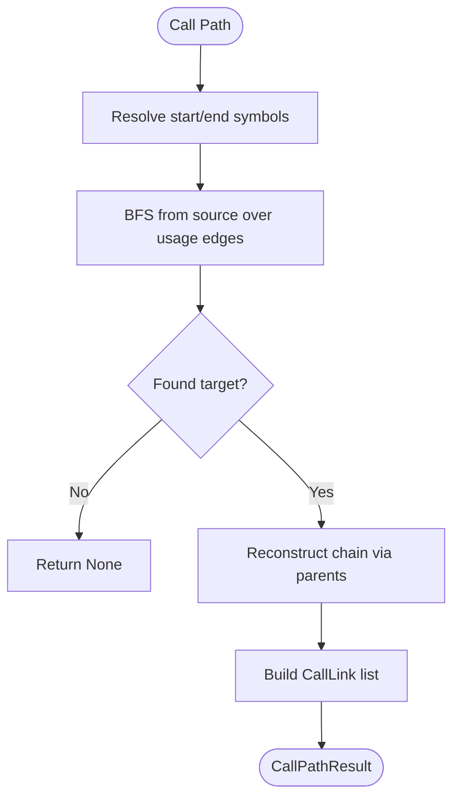

**Diagram sources**
- [callpath.rs:221-311](file://src/graph/callpath.rs#L221-L311)

Dead code flow:

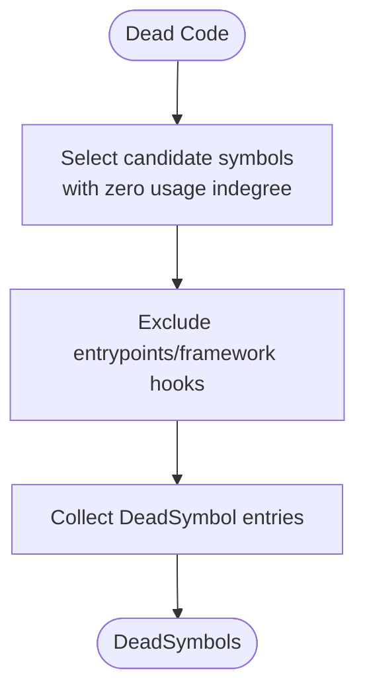

**Diagram sources**
- [callpath.rs:396-446](file://src/graph/callpath.rs#L396-L446)

**Section sources**
- [callpath.rs:105-128](file://src/graph/callpath.rs#L105-L128)
- [callpath.rs:151-219](file://src/graph/callpath.rs#L151-L219)
- [callpath.rs:221-311](file://src/graph/callpath.rs#L221-L311)
- [callpath.rs:313-394](file://src/graph/callpath.rs#L313-L394)
- [callpath.rs:396-446](file://src/graph/callpath.rs#L396-L446)

### Edit-Time Blast Radius Hints
Features:
- Warn-only mode gated by environment variable.
- Cache latest hint per project with TTL.
- Compute hint from recently updated symbols and direct callers.
- Fail-open: errors produce no warning rather than panics.

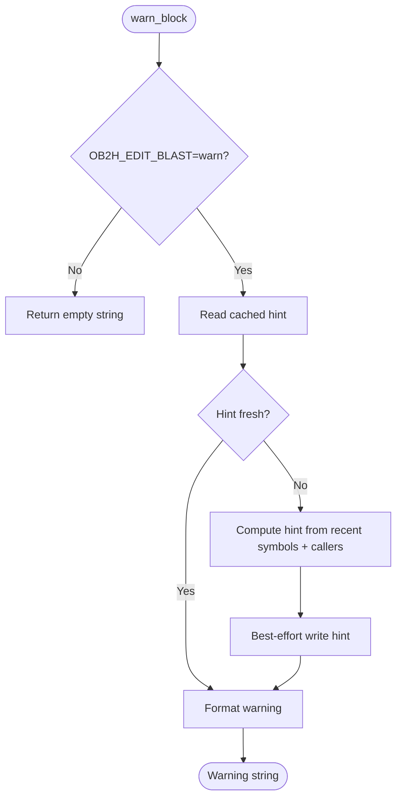

**Diagram sources**
- [blast.rs:146-196](file://src/graph/blast.rs#L146-L196)

**Section sources**
- [blast.rs:12-25](file://src/graph/blast.rs#L12-L25)
- [blast.rs:34-52](file://src/graph/blast.rs#L34-L52)
- [blast.rs:61-81](file://src/graph/blast.rs#L61-L81)
- [blast.rs:83-94](file://src/graph/blast.rs#L83-L94)
- [blast.rs:96-144](file://src/graph/blast.rs#L96-L144)
- [blast.rs:146-196](file://src/graph/blast.rs#L146-L196)

### Repository Map Under Token Budget
Highlights:
- Builds file-dependency graph from IMPORTS edges and co-import signals.
- Runs PPR on files to rank importance.
- Generates blocks per file with signatures extracted from node descriptions.
- Uses binary search to fit maximum prefix within token budget.

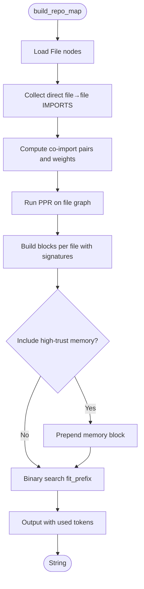

**Diagram sources**
- [repomap.rs:126-136](file://src/graph/repomap.rs#L126-L136)
- [repomap.rs:144-228](file://src/graph/repomap.rs#L144-L228)
- [repomap.rs:258-325](file://src/graph/repomap.rs#L258-L325)
- [repomap.rs:327-344](file://src/graph/repomap.rs#L327-L344)

**Section sources**
- [repomap.rs:1-18](file://src/graph/repomap.rs#L1-L18)
- [repomap.rs:42-68](file://src/graph/repomap.rs#L42-L68)
- [repomap.rs:70-94](file://src/graph/repomap.rs#L70-L94)
- [repomap.rs:96-124](file://src/graph/repomap.rs#L96-L124)
- [repomap.rs:126-136](file://src/graph/repomap.rs#L126-L136)
- [repomap.rs:144-228](file://src/graph/repomap.rs#L144-L228)
- [repomap.rs:258-325](file://src/graph/repomap.rs#L258-L325)
- [repomap.rs:327-344](file://src/graph/repomap.rs#L327-L344)

## Dependency Analysis
Component relationships:
- GraphService depends on Database, EmbeddingProvider, LLMClient, and vector utilities.
- Analytics depends on SQLite connections and calls into callpath and communities modules.
- PageRank is independent of storage and operates on in-memory graphs built from edges.
- Call Path and Blast Radius depend on usage edge labels and provenance fields.
- Repo Map depends on PageRank and AST language specs to filter code files.

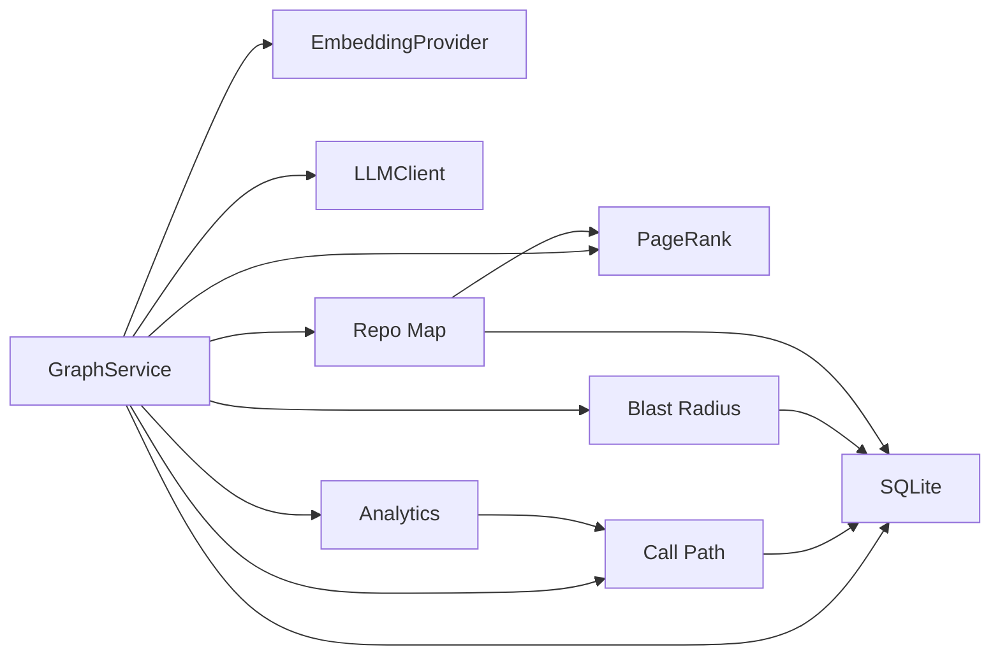

**Diagram sources**
- [service.rs:96-104](file://src/graph/service.rs#L96-L104)
- [analytics.rs:90-92](file://src/graph/analytics.rs#L90-L92)
- [pagerank.rs:59-84](file://src/graph/pagerank.rs#L59-L84)
- [callpath.rs:151-219](file://src/graph/callpath.rs#L151-L219)
- [blast.rs:146-196](file://src/graph/blast.rs#L146-L196)
- [repomap.rs:126-136](file://src/graph/repomap.rs#L126-L136)

**Section sources**
- [service.rs:96-104](file://src/graph/service.rs#L96-L104)
- [analytics.rs:90-92](file://src/graph/analytics.rs#L90-L92)
- [pagerank.rs:59-84](file://src/graph/pagerank.rs#L59-L84)
- [callpath.rs:151-219](file://src/graph/callpath.rs#L151-L219)
- [blast.rs:146-196](file://src/graph/blast.rs#L146-L196)
- [repomap.rs:126-136](file://src/graph/repomap.rs#L126-L136)

## Performance Considerations
- Lexical search uses FTS5 with trigram tokenizer; falls back to full scan if unavailable.
- Vector search supports vec0 oversample + rescore when enabled; otherwise cosine similarity over stored embeddings.
- PageRank uses bounded iterations and damping clamping; degree normalization prevents hub flooding.
- Repo map uses binary search to fit token budget efficiently.
- Blast radius hints are TTL-cached to avoid repeated computation.
- Node descriptions are truncated during merges to bound storage growth.
- Edge contexts are limited to prevent unbounded growth.

Recommendations for large codebases:
- Prefer hybrid search modes to leverage both lexical and vector signals.
- Use project-scoped queries to reduce graph traversal scope.
- Enable vec0 for faster approximate nearest neighbor retrieval where supported.
- Tune PageRank damping and iteration limits based on workload characteristics.
- Monitor God Nodes and coupling metrics to identify hotspots and refactor opportunities.

[No sources needed since this section provides general guidance]

## Troubleshooting Guide
Common issues and mitigations:
- FTS5 unavailable: search degrades gracefully to full scan with a warning.
- Empty search results: ensure embeddings exist and query terms meet minimum length thresholds.
- PPR returning empty: verify seeds are valid and within graph bounds; check edge weights and connectivity.
- Missing blast warnings: confirm environment gate is set and project is active; check hint TTL expiration.
- Repo map empty: ensure project has scanned File nodes and code languages are recognized.

Operational checks:
- Validate database schema version and migrations applied.
- Inspect node and edge counts via stats endpoints.
- Review provenance and confidence fields to understand edge reliability.

**Section sources**
- [service.rs:268-289](file://src/graph/service.rs#L268-L289)
- [service.rs:314-342](file://src/graph/service.rs#L314-L342)
- [service.rs:546-674](file://src/graph/service.rs#L546-L674)
- [blast.rs:22-25](file://src/graph/blast.rs#L22-L25)
- [repomap.rs:137-142](file://src/graph/repomap.rs#L137-L142)
- [schema.rs:452-518](file://src/db/schema.rs#L452-L518)

## Conclusion
The Graph Service provides a robust, local-first knowledge graph layer that transforms AST scans into actionable insights. It combines lexical and vector search with multi-hop PageRank ranking, offers comprehensive analytics for architectural health, and supports practical developer workflows like blast radius warnings and token-bounded repository maps. Its design emphasizes deterministic behavior, performance safeguards, and graceful degradation, making it suitable for large and evolving codebases.

[No sources needed since this section summarizes without analyzing specific files]

## Appendices

### Data Model Overview
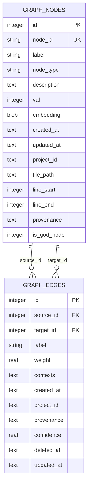

**Diagram sources**
- [schema.rs:268-293](file://src/db/schema.rs#L268-L293)
- [models.rs:64-95](file://src/db/models.rs#L64-L95)

### Example Queries and Operations
- Upsert extraction: ingest AST nodes/relations, deduplicate, merge contexts, update weights, and generate embeddings.
- Hybrid search: combine lexical and vector ranks using reciprocal rank fusion.
- PPR search: seed from search matches, apply edge-type weights, and return ranked nodes.
- Impact analysis: BFS over incoming usage edges to compute affected nodes and risk level.
- Call path: traverse usage edges to construct explicit chains between symbols.
- Repo map: generate token-bounded repository overview with file PPR ranking.

[No sources needed since this section lists conceptual operations]