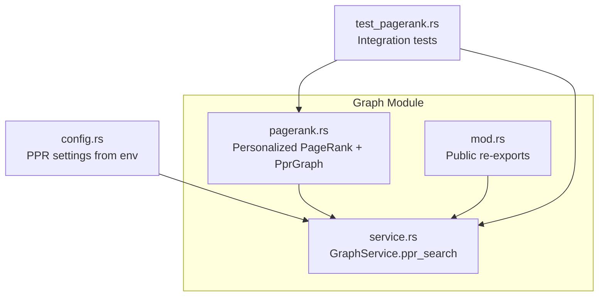
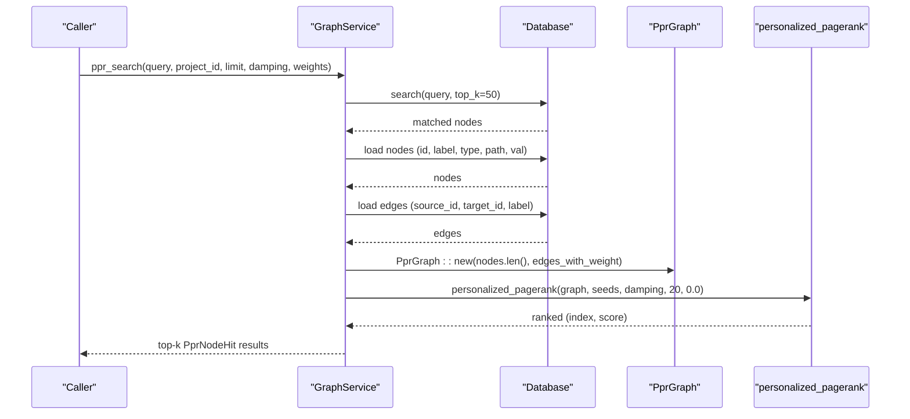
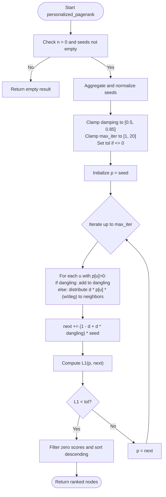
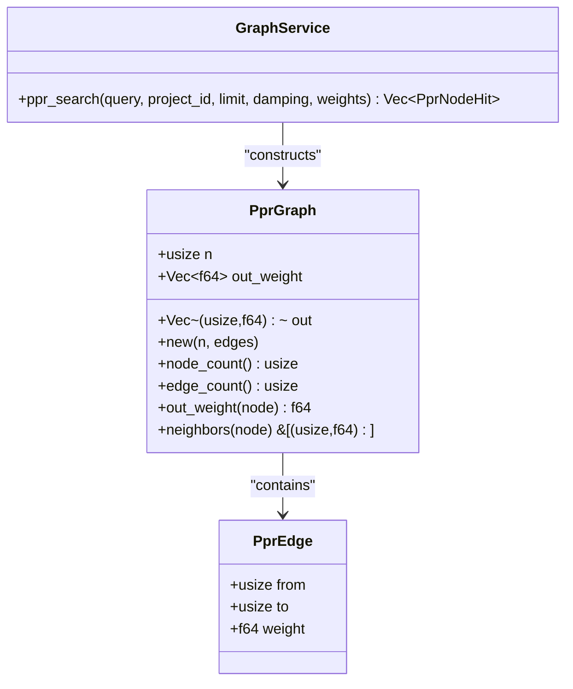
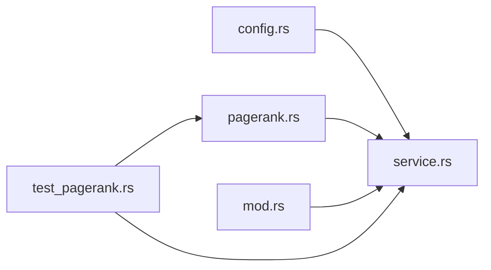

# PageRank Scoring

<cite>
**Referenced Files in This Document**
- [pagerank.rs](file://src/graph/pagerank.rs)
- [service.rs](file://src/graph/service.rs)
- [mod.rs](file://src/graph/mod.rs)
- [config.rs](file://src/config.rs)
- [test_pagerank.rs](file://tests/test_pagerank.rs)
</cite>

## Table of Contents
1. [Introduction](#introduction)
2. [Project Structure](#project-structure)
3. [Core Components](#core-components)
4. [Architecture Overview](#architecture-overview)
5. [Detailed Component Analysis](#detailed-component-analysis)
6. [Dependency Analysis](#dependency-analysis)
7. [Performance Considerations](#performance-considerations)
8. [Troubleshooting Guide](#troubleshooting-guide)
9. [Conclusion](#conclusion)

## Introduction
This document explains the PageRank Scoring system used for code analysis and memory reasoning. It implements an iterative Personalized PageRank algorithm over a directed graph where nodes represent code entities (modules, functions, files, or knowledge-graph concepts) and edges represent relationships such as imports, calls, references, project membership, and manual links. The implementation is designed to be lightweight, deterministic, and safe against hub bias, while exposing configuration knobs for damping, convergence tolerance, iteration limits, and edge-type weights.

The scoring output is a ranked list of node identifiers with non-negative scores that reflect how much “personalization mass” flows from seed nodes through the graph. Higher scores indicate nodes that are structurally important relative to the query seeds and the configured relationship types.

## Project Structure
The PageRank subsystem lives under the graph module and is exposed through both a low-level API and higher-level services:

- `src/graph/pagerank.rs` — core algorithm, graph representation, edge-weight parsing, and entity normalization.
- `src/graph/service.rs` — knowledge-graph service that builds PPR graphs from database-backed nodes and edges and returns scored hits.
- `src/graph/mod.rs` — re-exports the public PageRank API.
- `src/config.rs` — loads PageRank-related settings from environment variables.
- `tests/test_pagerank.rs` — integration tests covering multi-hop reachability, hub protection, dual-seed behavior, MCP contract, and default weight constraints.

**Diagram sources**
- [pagerank.rs:1-408](file://src/graph/pagerank.rs#L1-L408)
- [service.rs:546-674](file://src/graph/service.rs#L546-L674)
- [mod.rs:1-23](file://src/graph/mod.rs#L1-L23)
- [config.rs:63-71](file://src/config.rs#L63-L71)
- [test_pagerank.rs:1-339](file://tests/test_pagerank.rs#L1-L339)

**Section sources**
- [pagerank.rs:1-408](file://src/graph/pagerank.rs#L1-L408)
- [service.rs:546-674](file://src/graph/service.rs#L546-L674)
- [mod.rs:1-23](file://src/graph/mod.rs#L1-L23)
- [config.rs:63-71](file://src/config.rs#L63-L71)
- [test_pagerank.rs:1-339](file://tests/test_pagerank.rs#L1-L339)

## Core Components
The PageRank system consists of:

- **PprEdge**: a directed edge with integer node indices and a positive finite weight.
- **PprGraph**: an adjacency structure storing outgoing neighbors and per-node outgoing weight sums for degree-normalization.
- **personalized_pagerank**: the iterative solver that computes a probability distribution over nodes given seed personalization, damping, iteration cap, and L1 convergence tolerance.
- **parse_ppr_weights / weight_for**: parse JSON-based edge-type weights and map unknown relationship kinds to a default weight.
- **normalize_entity**: normalize textual entity labels to reduce noise when seeding by phrase matching.
- **GraphService.ppr_search**: build a PPR graph from database-backed nodes and edges, apply edge-type-aware weights, and return top-k scored hits.

Key invariants:
- Damping is clamped into `[0.5, 0.85]`.
- Iterations are clamped into `[1, MAX_ITER]`, where `MAX_ITER = 20`.
- Convergence uses L1 norm with a default tolerance of `1e-6`.
- Degree-normalization prevents hub nodes from flooding downstream nodes.
- Dangling nodes (no outgoing edges) return their mass to personalization, preserving total probability mass.

**Section sources**
- [pagerank.rs:17-67](file://src/graph/pagerank.rs#L17-L67)
- [pagerank.rs:112-185](file://src/graph/pagerank.rs#L112-L185)
- [pagerank.rs:187-214](file://src/graph/pagerank.rs#L187-L214)
- [pagerank.rs:216-241](file://src/graph/pagerank.rs#L216-L241)
- [service.rs:546-674](file://src/graph/service.rs#L546-L674)

## Architecture Overview
At runtime, a search query is first matched to candidate nodes using text/vector retrieval. Those candidates become personalization seeds. The service then materializes a compact index of project-scoped nodes, maps database IDs to local indices, and constructs a `PprGraph` from edges whose weights are derived from relationship labels via configured edge-type weights. Finally, `personalized_pagerank` iterates until convergence or the iteration cap, returning a sorted list of `(node_index, score)` pairs.

**Diagram sources**
- [service.rs:546-674](file://src/graph/service.rs#L546-L674)
- [pagerank.rs:112-185](file://src/graph/pagerank.rs#L112-L185)

## Detailed Component Analysis

### Mathematical Foundations
The algorithm follows Personalized PageRank with these specifics:

- **Personalization vector**: seeds are aggregated per node and normalized to sum to 1. Invalid seeds (out-of-range indices, non-positive, or non-finite weights) are ignored.
- **Damping factor**: clamped to `[0.5, 0.85]`. Controls the balance between following edges and teleporting back to personalization.
- **Degree-normalization**: each outgoing edge weight is divided by the sum of outgoing weights from the source node. This protects against hubs that would otherwise distribute too much mass to many leaves.
- **Dangling nodes**: if a node has no outgoing edges, its entire mass is added back to personalization during teleportation.
- **Convergence**: after each iteration, the L1 distance between the previous and next distributions is computed; if it falls below the tolerance, iterations stop early.
- **Iteration cap**: at most `MAX_ITER = 20` iterations.

These properties ensure stable ranking even on large, heterogeneous graphs with mixed relationship strengths.

**Diagram sources**
- [pagerank.rs:112-185](file://src/graph/pagerank.rs#L112-L185)

**Section sources**
- [pagerank.rs:17-26](file://src/graph/pagerank.rs#L17-L26)
- [pagerank.rs:112-185](file://src/graph/pagerank.rs#L112-L185)

### Edge Weights and Relationship Types
Edge weights are determined by relationship labels:

- A JSON configuration maps relationship kinds to numeric weights. Unknown kinds fall back to a default weight.
- Default weights include known kinds such as `manual`, `contradicts`, `causes`, `category`, and `same_project`.
- For code graphs, the repository’s calibration notes state that on the current golden dataset, PPR ranking does not depend on code-edge weights; therefore, code edges use the unknown-kind default unless explicitly configured.
- Environment variable `OB2H_PPR_WEIGHTS` allows overriding defaults.

Practical implications:
- Stronger relationship types (higher weights) increase the likelihood that mass flows along those edges.
- Weak or unknown relationship types act as neutral connectors, preventing accidental dominance by rare edge types.

Configuration entry points:
- `Settings.ppr_weights`: parsed from environment.
- `weight_for(weights, kind)`: resolves the effective weight for a given edge label.

**Section sources**
- [pagerank.rs:28-49](file://src/graph/pagerank.rs#L28-L49)
- [pagerank.rs:187-214](file://src/graph/pagerank.rs#L187-L214)
- [config.rs:63-71](file://src/config.rs#L63-L71)
- [config.rs:281-297](file://src/config.rs#L281-L297)

### Parameter Tuning Options
Tunable parameters and their effects:

| Parameter | Description | Default / Range | Effect |
|---|---|---:|---|
| `damping` | Probability of following edges vs teleporting to personalization | Clamped to `[0.5, 0.85]`; environment default `0.85` | Higher damping emphasizes graph structure; lower damping favors personalization. |
| `max_iter` | Maximum number of power-iteration steps | Clamped to `[1, 20]` | More iterations allow deeper propagation but risk diminishing returns. |
| `tol` | L1 convergence threshold | Defaults to `1e-6` if non-positive | Smaller tolerance requires more precise convergence; larger tolerance stops earlier. |
| `weights` | Map of relationship kind → weight | Parsed from `OB2H_PPR_WEIGHTS`; unknown kinds → `0.5` | Changes which relationships propagate mass more strongly. |
| `limit` | Top-k results returned by service | Caller-defined | Does not affect ranking computation, only final output size. |

Environment variables:
- `OB2H_PPR_WEIGHTS`: JSON object mapping relationship kinds to positive finite weights.
- `OB2H_PPR_DAMPING`: damping factor override.
- `OB2H_GRAPH_REASON_MEMORY_MAX_NODES`: maximum nodes in memory subgraph reasoning.
- `OB2H_GRAPH_REASON_MEMORY_TIMEOUT_MS`: timeout budget for memory subgraph reasoning.

**Section sources**
- [pagerank.rs:17-26](file://src/graph/pagerank.rs#L17-L26)
- [pagerank.rs:187-214](file://src/graph/pagerank.rs#L187-L214)
- [config.rs:63-71](file://src/config.rs#L63-L71)
- [config.rs:281-297](file://src/config.rs#L281-L297)

### Interpreting PageRank Scores
Scores represent the steady-state personalization flow reaching each node. Interpret them as relative importance rather than absolute probabilities:

- **Architectural hotspots**: nodes with high scores are central relative to the query seeds. In code analysis, these often correspond to modules or files that are frequently imported, called, or referenced by relevant components.
- **Critical modules**: nodes that bridge multiple clusters or receive mass from several strong relationship paths tend to rank highly. These are good targets for careful design reviews and dependency management.
- **Potential refactoring targets**: nodes with very high out-degree and moderate-to-low incoming mass may be hubs that dilute relevance across many leaves. Refactoring can reduce hub leakage and improve signal clarity.
- **Multi-hop relevance**: nodes reachable only through chains of relationships can still receive meaningful scores, enabling discovery of indirect dependencies.

Guidelines:
- Use damping near `0.85` to emphasize structural connectivity.
- Increase `limit` to inspect broader context, but keep performance budgets in mind.
- Adjust edge-type weights only after validating impact on your specific dataset; the repository’s calibration suggests default unknown-kind weights are safe for code graphs.

**Section sources**
- [test_pagerank.rs:63-103](file://tests/test_pagerank.rs#L63-L103)
- [test_pagerank.rs:105-147](file://tests/test_pagerank.rs#L105-L147)
- [test_pagerank.rs:290-338](file://tests/test_pagerank.rs#L290-L338)

### Memory and Graph Construction
The service builds the PPR graph efficiently:

- Nodes are loaded into a vector and mapped to contiguous indices.
- Edges are converted to `PprEdge` objects with weights resolved by relationship label.
- Invalid edges (out-of-range indices, non-finite weights, non-positive weights) are silently dropped to avoid breaking searches.
- The resulting `PprGraph` stores outgoing neighbor lists and precomputed outgoing weight sums for fast degree-normalization.

**Diagram sources**
- [pagerank.rs:51-103](file://src/graph/pagerank.rs#L51-L103)
- [service.rs:546-674](file://src/graph/service.rs#L546-L674)

**Section sources**
- [pagerank.rs:51-103](file://src/graph/pagerank.rs#L51-L103)
- [service.rs:600-657](file://src/graph/service.rs#L600-L657)

## Dependency Analysis
The PageRank system has clear layering:

- Configuration depends on environment variables and parses edge weights.
- The graph module exposes the core algorithm and data structures.
- The service layer composes database access, embedding/search, and PPR computation.
- Tests validate behavior across memory and knowledge-graph scopes.

**Diagram sources**
- [config.rs:281-297](file://src/config.rs#L281-L297)
- [pagerank.rs:1-408](file://src/graph/pagerank.rs#L1-L408)
- [service.rs:546-674](file://src/graph/service.rs#L546-L674)
- [mod.rs:1-23](file://src/graph/mod.rs#L1-L23)
- [test_pagerank.rs:1-339](file://tests/test_pagerank.rs#L1-L339)

**Section sources**
- [config.rs:281-297](file://src/config.rs#L281-L297)
- [pagerank.rs:1-408](file://src/graph/pagerank.rs#L1-L408)
- [service.rs:546-674](file://src/graph/service.rs#L546-L674)
- [mod.rs:1-23](file://src/graph/mod.rs#L1-L23)
- [test_pagerank.rs:1-339](file://tests/test_pagerank.rs#L1-L339)

## Performance Considerations
Optimizations implemented in the codebase:

- **Memory reuse**: the algorithm allocates vectors per iteration but avoids heavy external dependencies; the design emphasizes in-memory computation over graph databases.
- **Degree-normalization**: reduces hub-induced mass flooding, improving convergence stability and ranking quality.
- **Early convergence**: L1 tolerance allows stopping before reaching the iteration cap when the distribution stabilizes.
- **Invalid edge filtering**: construction skips malformed edges, preventing wasted computation and avoiding crashes.
- **Index-based traversal**: nodes are mapped to contiguous indices, enabling efficient neighbor iteration.

Recommendations for large graphs:
- Keep `max_iter` modest (default cap is 20); rely on tolerance for early stopping.
- Tune damping based on desired hop depth; higher values propagate further but may require more iterations.
- Limit the scope of nodes and edges (e.g., project-scoped queries) to reduce graph size.
- Monitor `graph_reason_memory_max_nodes` and timeout settings when reasoning over memory subgraphs.

[No sources needed since this section provides general guidance]

## Troubleshooting Guide
Common issues and resolutions:

- **Empty results**: occurs when there are no valid seeds or no nodes in the graph. Verify that the initial search matches nodes and that project scoping includes expected entities.
- **Hub flooding**: if unrelated leaf nodes outrank direct neighbors, check edge-type weights and confirm degree-normalization is active. The implementation guards against hub flooding by dividing edge contributions by outgoing weight sums.
- **Non-convergence**: if the algorithm runs to the iteration cap without converging, consider increasing tolerance or adjusting damping. Very noisy graphs may need stronger personalization or fewer weak edges.
- **Unexpected edge weights**: verify `OB2H_PPR_WEIGHTS` configuration and ensure relationship labels match expected kinds. Unknown kinds default to `0.5`.
- **Entity normalization surprises**: entity phrases are normalized to lowercase, with punctuation handling and single-character token removal. This reduces noise but may merge similar-looking names.

Validation checks from tests:
- Multi-hop reachability ensures distant nodes can receive mass through chains.
- Hub protection asserts that direct neighbors outrank hub leaves.
- Dual-seed behavior ensures entity phrases can seed unlinked records.
- Default weights and limits are fixed and documented.

**Section sources**
- [pagerank.rs:251-308](file://src/graph/pagerank.rs#L251-L308)
- [test_pagerank.rs:63-103](file://tests/test_pagerank.rs#L63-L103)
- [test_pagerank.rs:105-147](file://tests/test_pagerank.rs#L105-L147)
- [test_pagerank.rs:149-174](file://tests/test_pagerank.rs#L149-L174)
- [test_pagerank.rs:176-195](file://tests/test_pagerank.rs#L176-L195)

## Conclusion
The PageRank Scoring system provides a robust, configurable mechanism for ranking code and knowledge-graph nodes based on personalized propagation through typed relationships. Its design emphasizes safety (clamped parameters, invalid edge filtering), stability (degree-normalization, dangling-node handling), and practicality (environment-driven configuration, early convergence). By tuning damping, iteration limits, tolerance, and edge-type weights, users can adapt the scorer to identify architectural hotspots, critical modules, and refactoring opportunities while maintaining predictable performance on large graphs.

[No sources needed since this section summarizes without analyzing specific files]