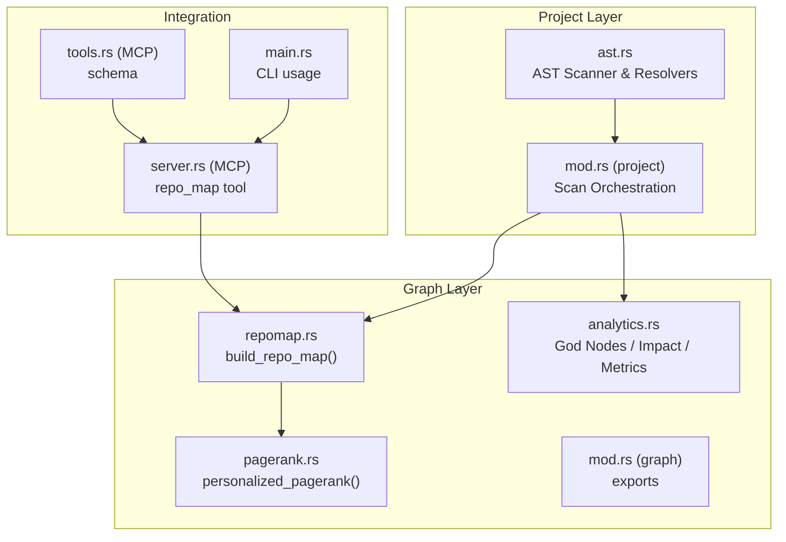
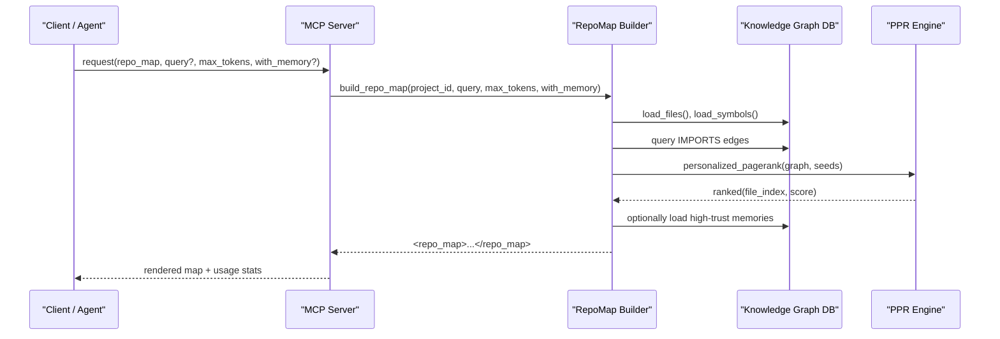
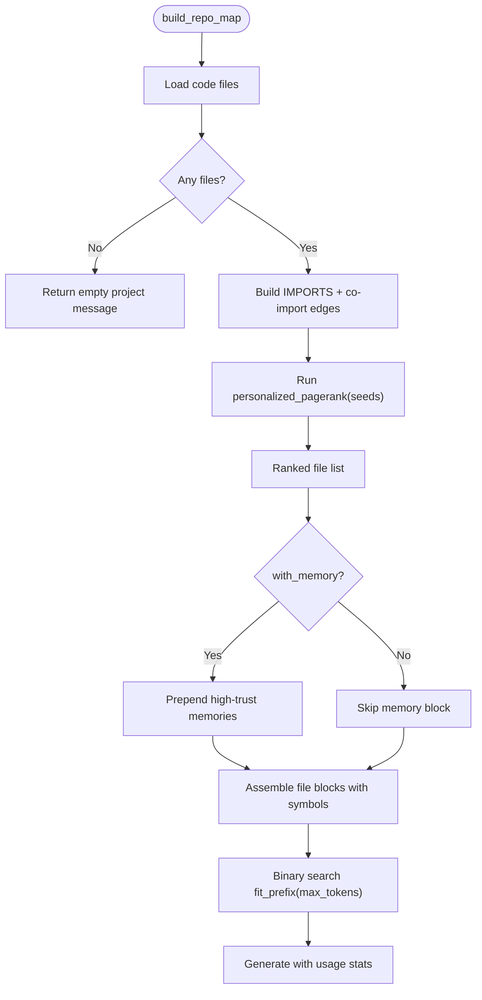
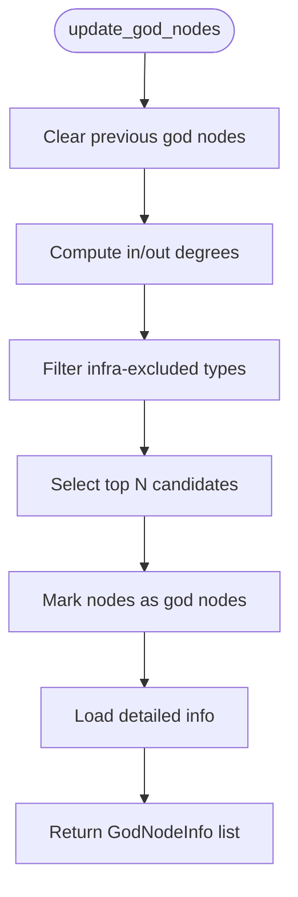
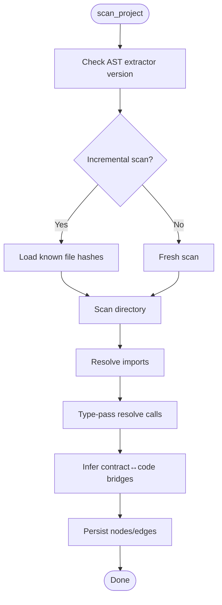
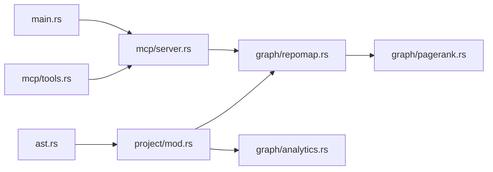

# Repository Mapping

<cite>
**Referenced Files in This Document**
- [repomap.rs](file://src/graph/repomap.rs)
- [pagerank.rs](file://src/graph/pagerank.rs)
- [analytics.rs](file://src/graph/analytics.rs)
- [mod.rs (graph)](file://src/graph/mod.rs)
- [ast.rs](file://src/project/ast.rs)
- [mod.rs (project)](file://src/project/mod.rs)
- [test_repomap.rs](file://tests/test_repomap.rs)
- [server.rs (MCP)](file://src/mcp/server.rs)
- [tools.rs (MCP)](file://src/mcp/tools.rs)
- [main.rs](file://src/main.rs)
</cite>

## Table of Contents
1. [Introduction](#introduction)
2. [Project Structure](#project-structure)
3. [Core Components](#core-components)
4. [Architecture Overview](#architecture-overview)
5. [Detailed Component Analysis](#detailed-component-analysis)
6. [Dependency Analysis](#dependency-analysis)
7. [Performance Considerations](#performance-considerations)
8. [Troubleshooting Guide](#troubleshooting-guide)
9. [Conclusion](#conclusion)
10. [Appendices](#appendices)

## Introduction
This document explains the Repository Mapping system that generates high-level architectural overviews and module organization maps from code analysis. It focuses on how repository structure is inferred from file organization, import statements, and naming conventions; how package boundaries and architectural layers are identified; and how generated maps include dependency graphs, architectural diagrams, and coupling metrics.

The implementation centers on:
- AST-based scanning to extract nodes (files, symbols, external modules) and edges (imports, definitions, calls).
- A Personalized PageRank algorithm to rank files by structural importance.
- A token-budget-aware “repo-map” generator that produces compact, deterministic summaries suitable for LLM context windows.
- Analytics utilities that compute God Nodes, impact reports, circular dependencies, and component metrics.

## Project Structure
The Repository Mapping feature spans several modules:

- Graph layer:
  - `repomap.rs`: builds a token-bounded repo map using PPR-ranked files and symbol signatures.
  - `pagerank.rs`: implements Personalized PageRank with hub protection and configurable edge weights.
  - `analytics.rs`: computes architectural metrics such as God Nodes, impact reports, and component instability.
  - `mod.rs (graph)`: exposes public graph services and analytics types.

- Project layer:
  - `ast.rs`: multi-language AST scanner producing nodes and edges, including imports, definitions, and framework bridges.
  - `mod.rs (project)`: orchestrates project registration, incremental scanning, import/call resolution, and persistence into the knowledge graph.

- Integration points:
  - MCP server and tools expose `repo_map` mode for agents.
  - CLI and main entry points invoke mapping generation.



**Diagram sources**
- [repomap.rs:126-325](file://src/graph/repomap.rs#L126-L325)
- [pagerank.rs:112-185](file://src/graph/pagerank.rs#L112-L185)
- [analytics.rs:92-198](file://src/graph/analytics.rs#L92-L198)
- [ast.rs:100-119](file://src/project/ast.rs#L100-L119)
- [mod.rs (project):419-580](file://src/project/mod.rs#L419-L580)
- [server.rs (MCP):1837-1848](file://src/mcp/server.rs#L1837-L1848)
- [tools.rs (MCP):366-368](file://src/mcp/tools.rs#L366-L368)
- [main.rs:537-540](file://src/main.rs#L537-L540)

**Section sources**
- [repomap.rs:1-345](file://src/graph/repomap.rs#L1-L345)
- [pagerank.rs:1-408](file://src/graph/pagerank.rs#L1-L408)
- [analytics.rs:1-200](file://src/graph/analytics.rs#L1-L200)
- [ast.rs:1-200](file://src/project/ast.rs#L1-L200)
- [mod.rs (project):419-580](file://src/project/mod.rs#L419-L580)
- [server.rs (MCP):1837-1848](file://src/mcp/server.rs#L1837-L1848)
- [tools.rs (MCP):366-368](file://src/mcp/tools.rs#L366-L368)
- [main.rs:537-540](file://src/main.rs#L537-L540)

## Core Components
- Repo Map Builder (`build_repo_map`):
  - Loads code files and their symbols from the knowledge graph.
  - Builds a file-dependency graph using direct IMPORTS edges and co-import signals between files sharing external modules.
  - Ranks files via Personalized PageRank with optional query seeds.
  - Produces a compact, token-bounded summary with optional high-trust project memory prepended.

- Personalized PageRank Engine:
  - Iterative solver with damping clamping, degree-normalization, and dangling-node mass redistribution.
  - Configurable edge weights and entity normalization utilities.

- Analytics Utilities:
  - God Node detection based on node degrees with infrastructure exclusions.
  - Impact reports and circular dependency detection.
  - Component metrics (afferent/efferent coupling, instability).

- AST Scanner and Resolvers:
  - Multi-language parsing to produce nodes and edges (IMPORTS, DEFINES, CALLS, etc.).
  - Import resolution across internal modules and aliases.
  - Call-site type-pass resolution and bridge inference (e.g., HTTP endpoints to routes).

**Section sources**
- [repomap.rs:126-325](file://src/graph/repomap.rs#L126-L325)
- [pagerank.rs:112-185](file://src/graph/pagerank.rs#L112-L185)
- [analytics.rs:92-198](file://src/graph/analytics.rs#L92-L198)
- [ast.rs:100-119](file://src/project/ast.rs#L100-L119)
- [mod.rs (project):419-580](file://src/project/mod.rs#L419-L580)

## Architecture Overview
The Repository Mapping pipeline transforms raw source files into an actionable architectural overview:

1. Scanning:
   - The AST scanner extracts nodes (File, Module, Function, Struct, ExternalModule, etc.) and edges (IMPORTS, DEFINES, CALLS).
   - Import and call resolution enriches the graph with internal relationships and inferred bridges.

2. Ranking:
   - File-dependency edges and co-import signals form a graph used by Personalized PageRank.
   - Query seeds focus ranking on relevant files; otherwise, global centrality identifies “God Nodes.”

3. Summarization:
   - Symbols per file are extracted and formatted into concise blocks.
   - Token budgeting selects the top-ranked blocks within a character limit.
   - Optional high-trust memories are prepended to prioritize important project context.



**Diagram sources**
- [server.rs (MCP):1837-1848](file://src/mcp/server.rs#L1837-L1848)
- [repomap.rs:126-325](file://src/graph/repomap.rs#L126-L325)
- [pagerank.rs:112-185](file://src/graph/pagerank.rs#L112-L185)

## Detailed Component Analysis

### Repo Map Builder
Responsibilities:
- Load code files and symbols deterministically.
- Build file-dependency graph from IMPORTS edges and co-import signals.
- Rank files using PPR with optional query seeds.
- Generate token-bounded output with optional high-trust memory block.

Key behaviors:
- Only code files are included in the repo map; manifests/styles/infrastructure are filtered out.
- Co-import weighting uses 1/|files_in_module| to reflect shared external dependencies.
- Budget calculation uses a binary search over sorted blocks to maximize content within token limits.



**Diagram sources**
- [repomap.rs:126-325](file://src/graph/repomap.rs#L126-L325)

**Section sources**
- [repomap.rs:70-124](file://src/graph/repomap.rs#L70-L124)
- [repomap.rs:144-228](file://src/graph/repomap.rs#L144-L228)
- [repomap.rs:258-325](file://src/graph/repomap.rs#L258-L325)

### Personalized PageRank Engine
Responsibilities:
- Provide iterative PPR solver with robust parameters.
- Normalize entities and parse edge weights configuration.

Key behaviors:
- Damping clamped to [0.5, 0.85].
- Degree-normalization prevents hubs from dominating rankings.
- Dangling nodes redistribute mass back to personalization.
- Edge weight parsing falls back to defaults if invalid.

```mermaid
classDiagram
class PprEdge {
+usize from
+usize to
+f64 weight
}
class PprGraph {
+usize n
+Vec<Vec<(usize,f64)>> out
+Vec<f64> out_weight
+new(n, edges)
+node_count() usize
+edge_count() usize
+out_weight(node) f64
+neighbors(node) &[(usize,f64)]
}
class Pagerank {
+personalized_pagerank(graph, seeds, damping, max_iter, tol) Vec<(usize,f64)>
+parse_ppr_weights(json) PprWeights
+weight_for(weights, kind) f64
+normalize_entity(s) String
}
PprGraph --> PprEdge : "uses"
Pagerank --> PprGraph : "computes on"
```

**Diagram sources**
- [pagerank.rs:51-103](file://src/graph/pagerank.rs#L51-L103)
- [pagerank.rs:112-185](file://src/graph/pagerank.rs#L112-L185)
- [pagerank.rs:187-241](file://src/graph/pagerank.rs#L187-L241)

**Section sources**
- [pagerank.rs:1-408](file://src/graph/pagerank.rs#L1-L408)

### Analytics Utilities
Responsibilities:
- Compute God Nodes based on node degrees with infrastructure exclusions.
- Generate impact reports and circular dependency detection.
- Calculate component metrics (afferent/efferent coupling, instability).

Key behaviors:
- God Nodes exclude infrastructure hubs like ExternalPackage/BaseImage/CssClass.
- Top candidates selected by percentage or minimum thresholds.
- Reports include markdown summaries and structured data for downstream consumers.



**Diagram sources**
- [analytics.rs:92-198](file://src/graph/analytics.rs#L92-L198)

**Section sources**
- [analytics.rs:1-200](file://src/graph/analytics.rs#L1-L200)

### AST Scanner and Resolvers
Responsibilities:
- Parse multiple languages to extract nodes and edges.
- Resolve imports and calls to enrich the graph.
- Infer bridges between contracts and code (HTTP/GQL/RPC).

Key behaviors:
- Unified language registry ensures consistent file collection and parsing.
- Incremental scans preserve unchanged symbols and references.
- Import resolution handles relative paths, aliases, and framework-specific patterns.



**Diagram sources**
- [mod.rs (project):419-580](file://src/project/mod.rs#L419-L580)
- [ast.rs:100-119](file://src/project/ast.rs#L100-L119)

**Section sources**
- [mod.rs (project):419-580](file://src/project/mod.rs#L419-L580)
- [ast.rs:1-200](file://src/project/ast.rs#L1-L200)

## Dependency Analysis
The Repository Mapping system exhibits clear separation of concerns:

- Graph layer depends on pagerank for ranking and analytics for metrics.
- Project layer provides scanned data consumed by graph layer.
- MCP integration exposes mapping functionality to agents.



**Diagram sources**
- [ast.rs:100-119](file://src/project/ast.rs#L100-L119)
- [mod.rs (project):419-580](file://src/project/mod.rs#L419-L580)
- [repomap.rs:126-325](file://src/graph/repomap.rs#L126-L325)
- [pagerank.rs:112-185](file://src/graph/pagerank.rs#L112-L185)
- [analytics.rs:92-198](file://src/graph/analytics.rs#L92-L198)
- [server.rs (MCP):1837-1848](file://src/mcp/server.rs#L1837-L1848)
- [tools.rs (MCP):366-368](file://src/mcp/tools.rs#L366-L368)
- [main.rs:537-540](file://src/main.rs#L537-L540)

**Section sources**
- [mod.rs (graph):1-23](file://src/graph/mod.rs#L1-L23)
- [repomap.rs:1-345](file://src/graph/repomap.rs#L1-L345)
- [pagerank.rs:1-408](file://src/graph/pagerank.rs#L1-L408)
- [analytics.rs:1-200](file://src/graph/analytics.rs#L1-L200)
- [ast.rs:1-200](file://src/project/ast.rs#L1-L200)
- [mod.rs (project):419-580](file://src/project/mod.rs#L419-L580)
- [server.rs (MCP):1837-1848](file://src/mcp/server.rs#L1837-L1848)
- [tools.rs (MCP):366-368](file://src/mcp/tools.rs#L366-L368)
- [main.rs:537-540](file://src/main.rs#L537-L540)

## Performance Considerations
- Token budgeting uses binary search to efficiently select the maximum prefix of blocks fitting within the character limit.
- PPR iteration is bounded and converges quickly due to damping and tolerance checks.
- Hub protection via degree-normalization prevents performance degradation from highly connected nodes.
- Incremental scanning avoids reprocessing unchanged files, reducing overhead.

[No sources needed since this section provides general guidance]

## Troubleshooting Guide
Common issues and resolutions:

- Empty project message:
  - If no code files are found, the repo map returns a message indicating no scanned files. Ensure project scanning has been executed.

- Budget exceeded:
  - If the generated map exceeds the token budget, increase `max_tokens` or reduce the number of files/symbols included.

- Determinism:
  - The repo map is deterministic for the same database state. Sorting by PPR score and file path ensures consistent ordering.

- Memory inclusion:
  - High-trust memories are only included when `with_memory` is enabled. Verify flag settings if expected memories are missing.

**Section sources**
- [repomap.rs:137-142](file://src/graph/repomap.rs#L137-L142)
- [repomap.rs:299-325](file://src/graph/repomap.rs#L299-L325)
- [test_repomap.rs:116-123](file://tests/test_repomap.rs#L116-L123)
- [test_repomap.rs:144-170](file://tests/test_repomap.rs#L144-L170)

## Conclusion
The Repository Mapping system provides a robust, efficient, and customizable approach to generating architectural overviews from code analysis. By combining AST-based scanning, Personalized PageRank ranking, and token-bounded summarization, it delivers actionable insights into module organization, dependency graphs, and architectural layers. The system’s design supports various project structures through configurable language support, import resolution, and analytics metrics, making it suitable for diverse development environments and documentation workflows.

[No sources needed since this section summarizes without analyzing specific files]

## Appendices

### Example Generated Maps
- Dependency Graphs:
  - Visualize file-to-file IMPORTS edges and co-import relationships derived from shared external modules.

- Architectural Diagrams:
  - Highlight God Nodes and critical components based on degree analysis and infrastructure exclusions.

- Module Coupling Metrics:
  - Report afferent/efferent coupling and instability scores per component to identify tightly coupled or unstable modules.

[No sources needed since this section provides conceptual examples]