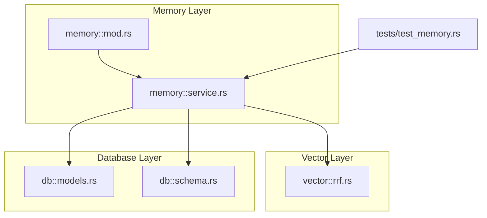
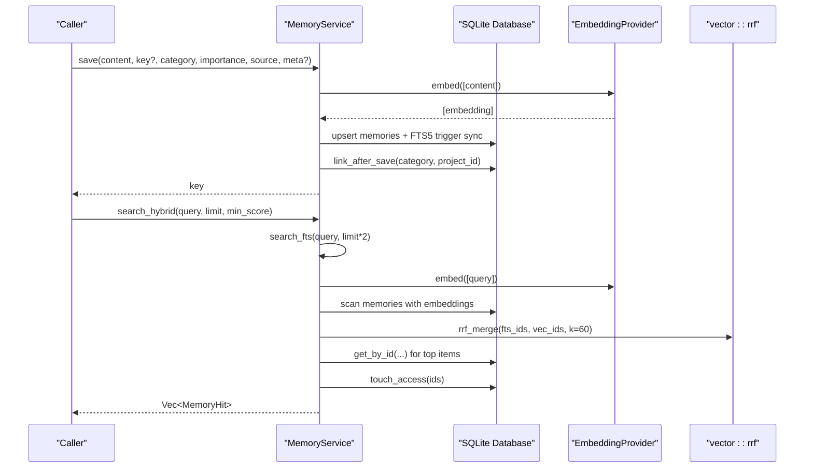
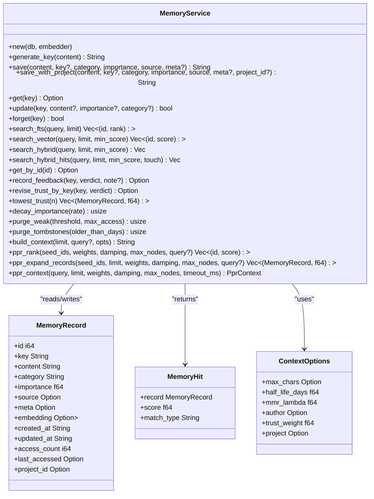
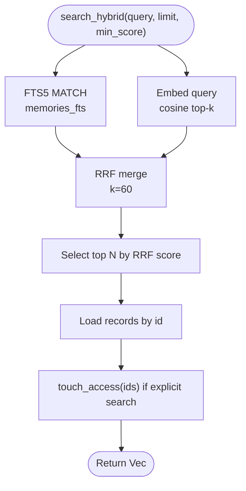
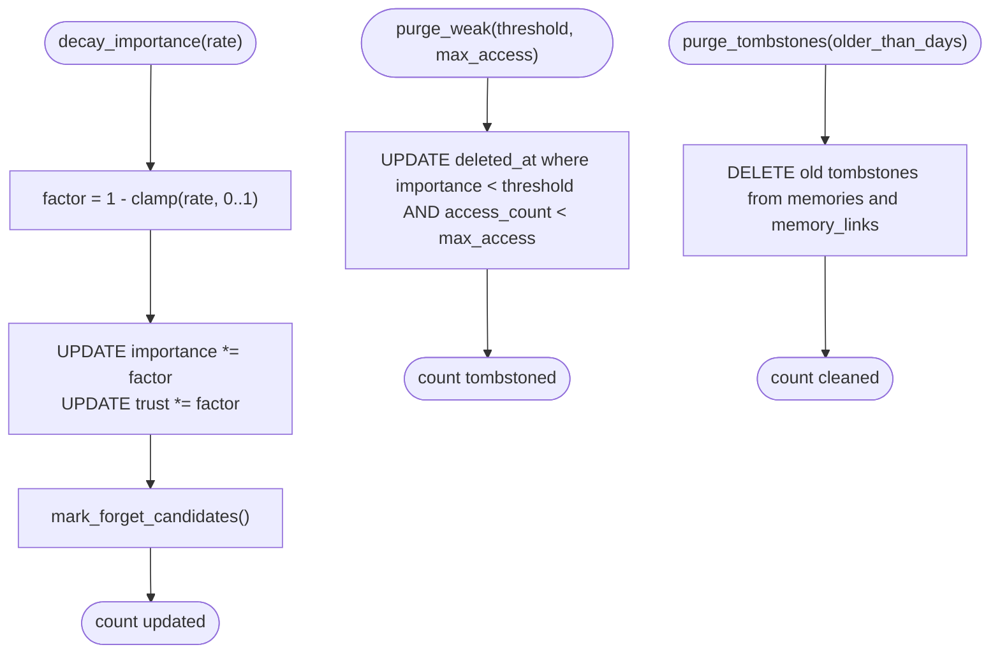
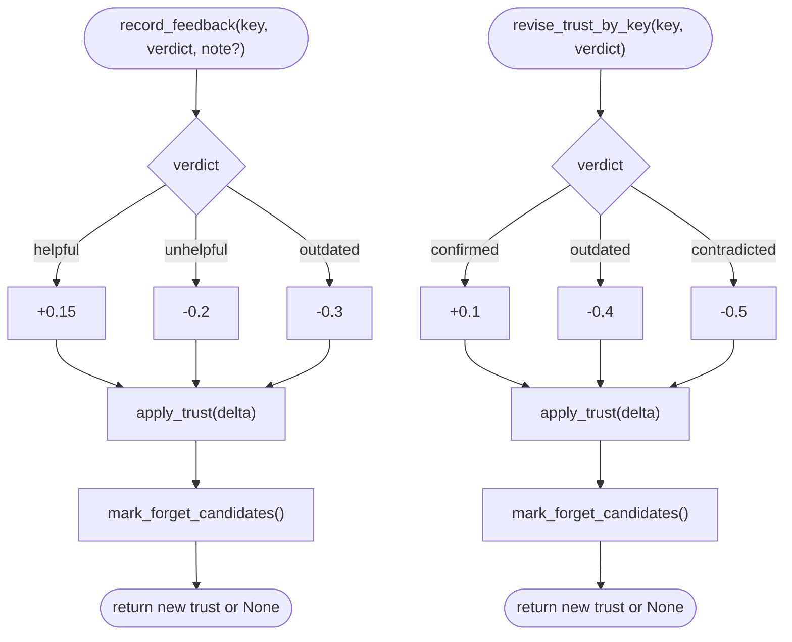
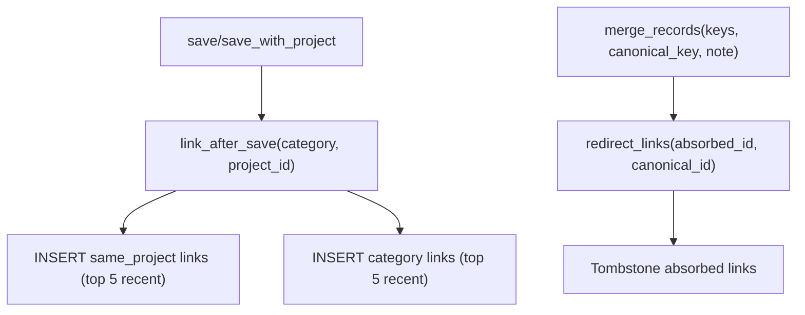
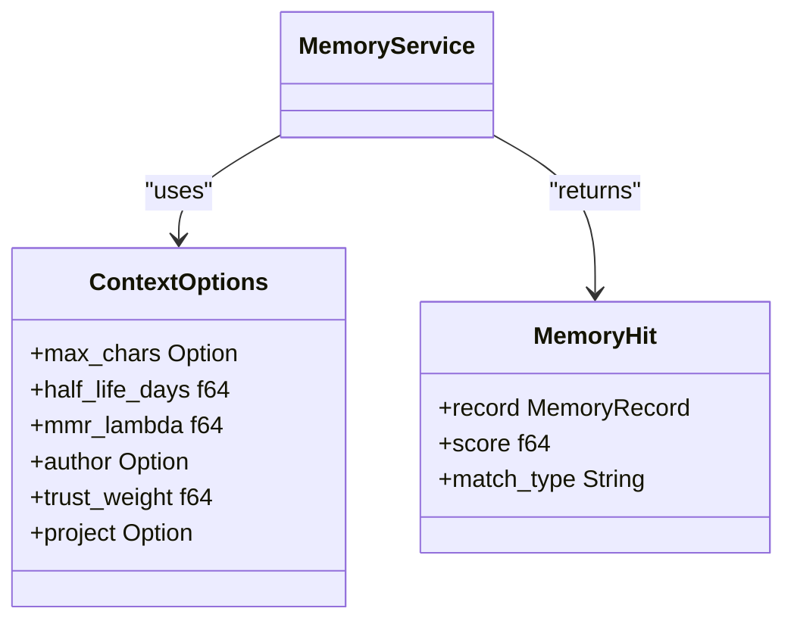
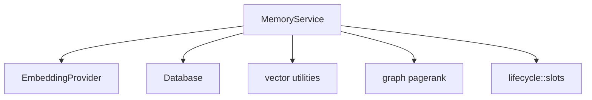
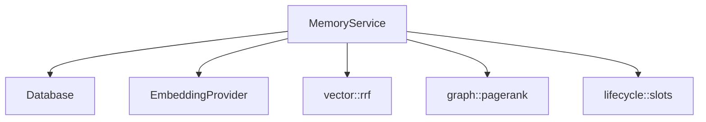

# Memory Service

<cite>
**Referenced Files in This Document**
- [mod.rs](file://src/memory/mod.rs)
- [service.rs](file://src/memory/service.rs)
- [rrf.rs](file://src/vector/rrf.rs)
- [models.rs](file://src/db/models.rs)
- [schema.rs](file://src/db/schema.rs)
- [test_memory.rs](file://tests/test_memory.rs)
</cite>

## Table of Contents
1. [Introduction](#introduction)
2. [Project Structure](#project-structure)
3. [Core Components](#core-components)
4. [Architecture Overview](#architecture-overview)
5. [Detailed Component Analysis](#detailed-component-analysis)
6. [Dependency Analysis](#dependency-analysis)
7. [Performance Considerations](#performance-considerations)
8. [Troubleshooting Guide](#troubleshooting-guide)
9. [Conclusion](#conclusion)
10. [Appendices](#appendices)

## Introduction
The Memory Service is the persistent memory subsystem for the application. It stores, updates, and retrieves structured memories with full-text search, vector similarity search, and hybrid ranking using Reciprocal Rank Fusion (RRF). It also manages memory lifecycle through decay and purge strategies, trust scoring based on usage and feedback, category-based organization, provenance-aware links, and context building for agents.

Key capabilities:
- CRUD operations over memories with deterministic keys and optional project binding.
- Hybrid search combining FTS5 trigram full-text search and vector embeddings, merged via RRF with k=60.
- Trust scoring that increases on access and feedback, supports agent and dream revisions, and marks low-trust candidates for forgetting.
- Category-based auto-links and typed memory links with soft-delete semantics.
- Context assembly with MMR diversification, recency decay, budget control, and pinned slot injection.
- Personalized PageRank expansion over the memory graph for reasoning contexts.

## Project Structure
The Memory Service lives under `src/memory` and integrates with the database layer, embedding provider, and vector utilities.

**Diagram sources**
- [mod.rs:1-5](file://src/memory/mod.rs#L1-L5)
- [service.rs:1-16](file://src/memory/service.rs#L1-L16)
- [rrf.rs:1-11](file://src/vector/rrf.rs#L1-L11)
- [models.rs:18-33](file://src/db/models.rs#L18-L33)
- [schema.rs:222-334](file://src/db/schema.rs#L222-L334)
- [test_memory.rs:1-48](file://tests/test_memory.rs#L1-L48)

**Section sources**
- [mod.rs:1-5](file://src/memory/mod.rs#L1-L5)
- [service.rs:1-16](file://src/memory/service.rs#L1-L16)
- [rrf.rs:1-11](file://src/vector/rrf.rs#L1-L11)
- [models.rs:18-33](file://src/db/models.rs#L18-L33)
- [schema.rs:222-334](file://src/db/schema.rs#L222-L334)
- [test_memory.rs:1-48](file://tests/test_memory.rs#L1-L48)

## Core Components
- MemoryService: main API surface for persistence, search, trust, links, PPR, and context building.
- MemoryRecord: persisted memory row model.
- MemoryHit: hybrid search result including record, score, and match type.
- ContextOptions: configuration for context building including budget, half-life, MMR lambda, author filter, trust weight, and project scope.
- RankedItem: RRF merge output item containing per-source ranks and fused score.

Important constants and behaviors:
- Identity-duplicate threshold at save time uses cosine similarity to quietly update existing records when content is near-identical.
- Suspect-duplicate range marks new records as potential merges for later review.
- Hybrid search uses FTS5 trigram BM25 plus vector cosine similarity; results are merged by RRF with k=60.
- Access increments trust slightly and timestamps last access and feedback.
- Decay reduces importance and trust multiplicatively and marks low-trust forget candidates.
- Purge weak memories tombstone them; physical cleanup removes old tombstones after retention.

**Section sources**
- [service.rs:23-38](file://src/memory/service.rs#L23-L38)
- [service.rs:40-167](file://src/memory/service.rs#L40-L167)
- [service.rs:489-636](file://src/memory/service.rs#L489-L636)
- [service.rs:665-837](file://src/memory/service.rs#L665-L837)
- [service.rs:912-925](file://src/memory/service.rs#L912-L925)
- [service.rs:1312-1345](file://src/memory/service.rs#L1312-L1345)
- [rrf.rs:1-50](file://src/vector/rrf.rs#L1-L50)
- [models.rs:18-33](file://src/db/models.rs#L18-L33)

## Architecture Overview
The Memory Service composes several layers:
- Persistence: SQLite-backed storage with schema migrations, FTS5 indexes, and soft-delete tombstones.
- Embedding: pluggable embedding provider used to generate vectors for content and queries.
- Vector Utilities: cosine similarity, serialization helpers, top-k selection, and RRF merging.
- Graph Reasoning: personalized PageRank over memory nodes and typed edges for expanded context.
- Context Assembly: hybrid candidate pool, scoring, MMR diversification, budget trimming, and slot injection.

**Diagram sources**
- [service.rs:48-167](file://src/memory/service.rs#L48-L167)
- [service.rs:489-636](file://src/memory/service.rs#L489-L636)
- [rrf.rs:14-50](file://src/vector/rrf.rs#L14-L50)
- [schema.rs:305-319](file://src/db/schema.rs#L305-L319)

## Detailed Component Analysis

### MemoryService Interface and Lifecycle
MemoryService exposes:
- Key generation and deterministic upserts with duplicate detection.
- Get, update, and forget (tombstone) operations.
- Full-text search via FTS5 with fallback to LIKE.
- Vector semantic search using stored embeddings and cosine similarity.
- Hybrid search merging FTS5 and vector results with RRF k=60.
- Feedback and revision trust adjustments.
- Decay and purge workflows.
- Typed links creation, conflict detection, and supersession handling.
- Personalized PageRank ranking and context expansion.
- Context building with MMR diversification, recency decay, trust weighting, and slot injection.

**Diagram sources**
- [service.rs:23-38](file://src/memory/service.rs#L23-L38)
- [service.rs:48-167](file://src/memory/service.rs#L48-L167)
- [service.rs:386-487](file://src/memory/service.rs#L386-L487)
- [service.rs:489-636](file://src/memory/service.rs#L489-L636)
- [service.rs:683-837](file://src/memory/service.rs#L683-L837)
- [service.rs:912-1046](file://src/memory/service.rs#L912-L1046)
- [service.rs:1075-1309](file://src/memory/service.rs#L1075-L1309)
- [service.rs:1312-1576](file://src/memory/service.rs#L1312-L1576)
- [service.rs:1586-1608](file://src/memory/service.rs#L1586-L1608)
- [models.rs:18-33](file://src/db/models.rs#L18-L33)

**Section sources**
- [service.rs:48-167](file://src/memory/service.rs#L48-L167)
- [service.rs:386-487](file://src/memory/service.rs#L386-L487)
- [service.rs:489-636](file://src/memory/service.rs#L489-L636)
- [service.rs:683-837](file://src/memory/service.rs#L683-L837)
- [service.rs:912-1046](file://src/memory/service.rs#L912-L1046)
- [service.rs:1075-1309](file://src/memory/service.rs#L1075-L1309)
- [service.rs:1312-1576](file://src/memory/service.rs#L1312-L1576)
- [service.rs:1586-1608](file://src/memory/service.rs#L1586-L1608)
- [models.rs:18-33](file://src/db/models.rs#L18-L33)

### Hybrid Search with FTS5 and Vector Embeddings (RRF k=60)
Hybrid search combines:
- FTS5 trigram BM25 search over `memories.content`.
- Vector cosine similarity search over stored embeddings.
- RRF merging with parameter k=60 to fuse ranked lists.

**Diagram sources**
- [service.rs:489-538](file://src/memory/service.rs#L489-L538)
- [service.rs:540-574](file://src/memory/service.rs#L540-L574)
- [service.rs:576-636](file://src/memory/service.rs#L576-L636)
- [rrf.rs:14-50](file://src/vector/rrf.rs#L14-L50)

**Section sources**
- [service.rs:489-636](file://src/memory/service.rs#L489-L636)
- [rrf.rs:14-50](file://src/vector/rrf.rs#L14-L50)

### Memory Lifecycle Management: Decay and Purge
Decay reduces importance and trust multiplicatively and marks low-trust candidates for forgetting. Purge weak memories tombstone them based on thresholds; physical cleanup removes old tombstones after a retention window.

**Diagram sources**
- [service.rs:912-925](file://src/memory/service.rs#L912-L925)
- [service.rs:806-837](file://src/memory/service.rs#L806-L837)
- [service.rs:1312-1345](file://src/memory/service.rs#L1312-L1345)

**Section sources**
- [service.rs:912-925](file://src/memory/service.rs#L912-L925)
- [service.rs:806-837](file://src/memory/service.rs#L806-L837)
- [service.rs:1312-1345](file://src/memory/service.rs#L1312-L1345)

### Trust Scoring Mechanisms
Trust evolves through:
- Access: each accessed record gains small trust increment capped at 1.0.
- Agent feedback: helpful (+0.15), unhelpful (-0.2), outdated (-0.3).
- Dream revision: confirmed (+0.1), outdated (-0.4), contradicted (-0.5).
- Low-trust marking: records below threshold marked as forget candidates.

**Diagram sources**
- [service.rs:683-738](file://src/memory/service.rs#L683-L738)
- [service.rs:740-757](file://src/memory/service.rs#L740-L757)
- [service.rs:790-804](file://src/memory/service.rs#L790-L804)
- [service.rs:806-837](file://src/memory/service.rs#L806-L837)

**Section sources**
- [service.rs:683-757](file://src/memory/service.rs#L683-L757)
- [service.rs:790-837](file://src/memory/service.rs#L790-L837)

### Category-Based Organization and Provenance Tracking
Category-based organization:
- Auto-links created after save connect a memory to other memories in the same category and project.
- Links are typed (`same_project`, `category`, reserved kinds like `entity`, `contradicts`, `supersedes`).
- Links support soft-delete semantics and redirection during merges.

Provenance tracking:
- Records carry `origin`, `source`, and `meta` fields.
- Links include `kind`, `weight`, and `created_at`; tombstoned links are preserved for sync.
- Supersession and contradiction relationships allow knowledge evolution without loss.

**Diagram sources**
- [service.rs:136-140](file://src/memory/service.rs#L136-L140)
- [service.rs:839-862](file://src/memory/service.rs#L839-L862)
- [service.rs:337-383](file://src/memory/service.rs#L337-L383)

**Section sources**
- [service.rs:136-140](file://src/memory/service.rs#L136-L140)
- [service.rs:337-383](file://src/memory/service.rs#L337-L383)
- [service.rs:839-862](file://src/memory/service.rs#L839-L862)

### Implementation Details: MemoryService Interface, ContextOptions, MemoryHit
- MemoryService: central orchestrator for persistence, search, trust, links, PPR, and context building.
- ContextOptions: controls context building behavior including character budget, recency half-life, MMR diversity weight, author filtering, trust weighting, and project-scoped slots.
- MemoryHit: represents a hybrid search hit with underlying record, fused score, and match type indicating whether it came from FTS, vector, or hybrid fusion.

**Diagram sources**
- [service.rs:1586-1608](file://src/memory/service.rs#L1586-L1608)
- [service.rs:23-28](file://src/memory/service.rs#L23-L28)

**Section sources**
- [service.rs:23-28](file://src/memory/service.rs#L23-L28)
- [service.rs:1586-1608](file://src/memory/service.rs#L1586-L1608)

### Integration Patterns with Other Services
- EmbeddingProvider: provides vector embeddings for content and queries; decouples vector model implementation.
- Database: SQL interface for SQLite with connection pooling and transactional blocks.
- Vector utilities: cosine similarity, serialization/deserialization, top-k selection, and RRF merging.
- Graph PageRank: personalizes ranking over memory graph for reasoning contexts.
- Lifecycle slots: injects pinned slots into context blocks scoped by project.

**Diagram sources**
- [service.rs:9-15](file://src/memory/service.rs#L9-L15)
- [service.rs:1347-1356](file://src/memory/service.rs#L1347-L1356)

**Section sources**
- [service.rs:9-15](file://src/memory/service.rs#L9-L15)
- [service.rs:1347-1356](file://src/memory/service.rs#L1347-L1356)

### Examples of Operations, Queries, and Workflows
- Save a preference and a tech fact, retrieve by key, perform hybrid search, decay importance, build context, and forget a record.
- Use feedback to adjust trust and mark forget candidates.
- Build context with non-empty query to leverage hybrid search and MMR diversification; fallback to importance+overlap when no hits.

Example references:
- CRUD and hybrid search workflow: [test_memory.rs:6-47](file://tests/test_memory.rs#L6-L47)
- Hybrid search pipeline: [service.rs:576-636](file://src/memory/service.rs#L576-L636)
- Context building with MMR and budget: [service.rs:1453-1576](file://src/memory/service.rs#L1453-L1576)

**Section sources**
- [test_memory.rs:6-47](file://tests/test_memory.rs#L6-L47)
- [service.rs:576-636](file://src/memory/service.rs#L576-L636)
- [service.rs:1453-1576](file://src/memory/service.rs#L1453-L1576)

## Dependency Analysis
MemoryService depends on:
- Database layer for persistence and FTS5 indexing.
- EmbeddingProvider for vectorization.
- Vector utilities for similarity and RRF merging.
- Graph PageRank for personalized ranking.
- Lifecycle slots for context augmentation.

**Diagram sources**
- [service.rs:9-15](file://src/memory/service.rs#L9-L15)
- [service.rs:1347-1356](file://src/memory/service.rs#L1347-L1356)

**Section sources**
- [service.rs:9-15](file://src/memory/service.rs#L9-L15)
- [service.rs:1347-1356](file://src/memory/service.rs#L1347-L1356)

## Performance Considerations
- Hybrid search scans all embeddings for vector similarity; consider pre-filtering by category or project for large datasets.
- RRF merging is linear in combined list sizes; keep pool sizes reasonable (e.g., limit*2) to balance recall and latency.
- Decay and purge operations are bulk SQL updates; schedule maintenance jobs to avoid hot paths.
- Context building performs multiple DB reads and vector computations; use caching for repeated queries and tune `half_life_days`, `mmr_lambda`, and `trust_weight`.
- Personalized PageRank limits node count and enforces timeouts; truncated contexts signal resource constraints.

[No sources needed since this section provides general guidance]

## Troubleshooting Guide
Common issues and resolutions:
- Empty hybrid results: ensure embeddings exist and FTS5 index is populated; verify query normalization and tokenization.
- Duplicate memories: identity-duplicate detection may silently update existing records; check `meta.merge_candidate` for suspect duplicates.
- Trust not increasing: confirm access events are recorded and feedback is valid; verify clamping logic.
- Forget candidates not removed: remember that marking does not auto-delete; call `forget` explicitly.
- Context budget truncation: adjust `max_chars` and `mmr_lambda`; inspect truncated markers in output.

**Section sources**
- [service.rs:86-109](file://src/memory/service.rs#L86-L109)
- [service.rs:665-681](file://src/memory/service.rs#L665-L681)
- [service.rs:1526-1576](file://src/memory/service.rs#L1526-L1576)

## Conclusion
The Memory Service provides a robust, extensible foundation for persistent memory management. It combines lexical and semantic search through RRF fusion, maintains evolving trust scores, organizes memories by categories and projects, and constructs rich contextual blocks for agents. Its lifecycle mechanisms ensure relevance and hygiene through decay and purge strategies, while its integration points allow flexible embedding backends and reasoning pipelines.

[No sources needed since this section summarizes without analyzing specific files]

## Appendices

### Data Model Reference
- MemoryRecord fields include identifiers, content, categorization, importance, provenance metadata, embeddings, timestamps, access metrics, and project association.

**Section sources**
- [models.rs:18-33](file://src/db/models.rs#L18-L33)

### Schema Highlights
- Memories table includes FTS5 virtual table with trigram tokenizer and triggers for insert/update/delete synchronization.
- Memory links table supports typed edges with soft-delete tombstones.
- Schema versioning ensures incremental migrations.

**Section sources**
- [schema.rs:222-334](file://src/db/schema.rs#L222-L334)
- [schema.rs:83-109](file://src/db/schema.rs#L83-L109)