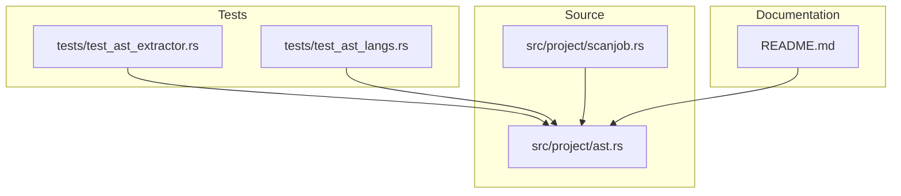
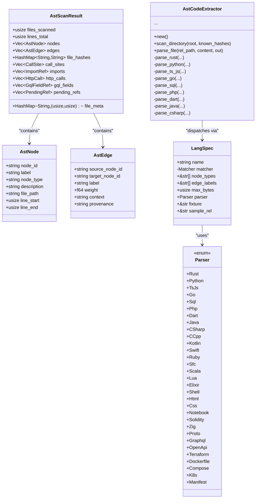
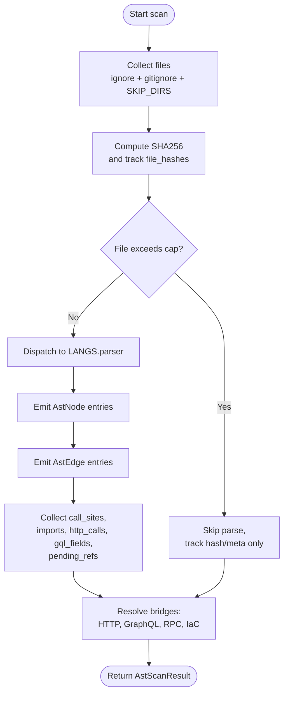
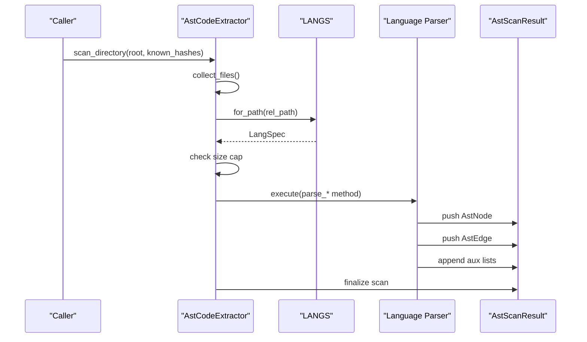
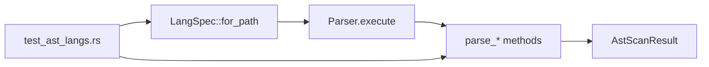

# AST Parsing Engine

<cite>
**Referenced Files in This Document**
- [ast.rs](file://src/project/ast.rs)
- [scanjob.rs](file://src/project/scanjob.rs)
- [test_ast_extractor.rs](file://tests/test_ast_extractor.rs)
- [test_ast_langs.rs](file://tests/test_ast_langs.rs)
- [README.md](file://README.md)
</cite>

## Table of Contents
1. [Introduction](#introduction)
2. [Project Structure](#project-structure)
3. [Core Components](#core-components)
4. [Architecture Overview](#architecture-overview)
5. [Detailed Component Analysis](#detailed-component-analysis)
6. [Dependency Analysis](#dependency-analysis)
7. [Performance Considerations](#performance-considerations)
8. [Troubleshooting Guide](#troubleshooting-guide)
9. [Conclusion](#conclusion)

## Introduction
This document explains the deterministic, local AST parsing engine used for multi-language code analysis. It does not call LLMs and does not consume tokens. The engine scans repositories, identifies supported languages by extension or filename, extracts structural symbols, and produces a graph of nodes and edges representing files, classes, functions, tables, routes, styles, services, infrastructure resources, and more.

Supported language families include Rust, Python, TypeScript/JavaScript, Go, SQL, PHP, Dart, Java, C#, C/C++, Kotlin, Swift, Ruby, Vue/Svelte single-file components, Scala, Lua, Elixir, Shell, HTML, CSS/SCSS, Jupyter notebooks, Solidity, Zig, Protocol Buffers, GraphQL, OpenAPI/Swagger, Terraform/OpenTofu, Dockerfile, docker-compose, Kubernetes/Helm YAML, and package manifests such as Cargo.toml, package.json, pyproject.toml, requirements.txt, go.mod, pubspec.yaml, and composer.json.

The core design is:
- A single registry of languages and formats.
- Language-specific parsers that emit structured AST nodes and edges.
- Bridge phases that connect client HTTP calls to server endpoints, GraphQL identifiers to schema fields, RPC definitions to handlers, and IaC dependencies across files.
- Deterministic output suitable for downstream graph analytics, semantic search, and agent context.

**Section sources**
- [README.md:27-52](file://README.md#L27-L52)
- [ast.rs:1-8](file://src/project/ast.rs#L1-L8)

## Project Structure
The AST parsing engine lives under `src/project/ast.rs`. Supporting test coverage is in `tests/test_ast_extractor.rs` and `tests/test_ast_langs.rs`. Scan job results are summarized in `src/project/scanjob.rs`.

**Diagram sources**
- [ast.rs:100-119](file://src/project/ast.rs#L100-L119)
- [scanjob.rs:16-24](file://src/project/scanjob.rs#L16-L24)
- [test_ast_extractor.rs:1-42](file://tests/test_ast_extractor.rs#L1-L42)
- [test_ast_langs.rs:1-52](file://tests/test_ast_langs.rs#L1-L52)
- [README.md:27-52](file://README.md#L27-L52)

**Section sources**
- [ast.rs:100-119](file://src/project/ast.rs#L100-L119)
- [scanjob.rs:16-24](file://src/project/scanjob.rs#L16-L24)
- [test_ast_extractor.rs:1-42](file://tests/test_ast_extractor.rs#L1-L42)
- [test_ast_langs.rs:1-52](file://tests/test_ast_langs.rs#L1-L52)
- [README.md:27-52](file://README.md#L27-L52)

## Core Components
The engine centers on these data structures and responsibilities:

- `AstNode`: Represents a code or manifest element with identity, label, type, description, file path, and line span.
- `AstEdge`: Represents a relationship between nodes with source/target IDs, label, weight, context, and provenance.
- `AstScanResult`: Aggregates scan metrics, nodes, edges, file hashes, metadata, call sites, imports, HTTP calls, GraphQL field references, and pending cross-file references.
- `LangSpec` and `LANGS`: Centralized registry mapping file paths to language/format specifications, including allowed node types, edge labels, size caps, parser tag, fixtures, and sample paths.
- `Parser`: Dispatches parsing to language-specific methods.
- `AstCodeExtractor`: Holds precompiled regular expressions and implements per-language extraction logic.

**Diagram sources**
- [ast.rs:15-52](file://src/project/ast.rs#L15-L52)
- [ast.rs:100-119](file://src/project/ast.rs#L100-L119)
- [ast.rs:155-230](file://src/project/ast.rs#L155-L230)
- [ast.rs:1461-1641](file://src/project/ast.rs#L1461-L1641)

**Section sources**
- [ast.rs:15-52](file://src/project/ast.rs#L15-L52)
- [ast.rs:100-119](file://src/project/ast.rs#L100-L119)
- [ast.rs:155-230](file://src/project/ast.rs#L155-L230)
- [ast.rs:1461-1641](file://src/project/ast.rs#L1461-L1641)

## Architecture Overview
The parsing pipeline is deterministic and file-driven:

1. File discovery uses an ignore-aware walker and filters by the central `LANGS` registry.
2. Each file is hashed; unchanged files can be skipped when previous hashes are provided.
3. File size is checked against per-format caps; oversized files are tracked but not parsed.
4. Content is dispatched to a language-specific parser based on extension or filename predicate.
5. Parsers emit `AstNode` and `AstEdge` entries into `AstScanResult`, along with auxiliary lists for later bridge resolution.
6. Bridges resolve client/server relationships, GraphQL queries to schema fields, RPC definitions to implementations, and IaC dependencies.

**Diagram sources**
- [ast.rs:1837-1894](file://src/project/ast.rs#L1837-L1894)
- [ast.rs:1896-1928](file://src/project/ast.rs#L1896-L1928)
- [ast.rs:1930-1950](file://src/project/ast.rs#L1930-L1950)

**Section sources**
- [ast.rs:1837-1894](file://src/project/ast.rs#L1837-L1894)
- [ast.rs:1896-1928](file://src/project/ast.rs#L1896-L1928)
- [ast.rs:1930-1950](file://src/project/ast.rs#L1930-L1950)

## Detailed Component Analysis

### Supported Languages and Formats
The registry `LANGS` defines each language/format with:
- Human-readable name.
- Matcher: extension list, exact filename list, or predicate function.
- Allowed node types and edge labels.
- Maximum bytes before skipping parsing.
- Parser tag.
- Fixture for tests.
- Sample relative path for consistency checks.

Examples include:
- Rust: structs, traits, functions, route attributes.
- Python: classes, functions, imports, SQLAlchemy table names, FastAPI/Flask routes.
- TypeScript/JS: classes, interfaces, functions, imports, React `className` bindings.
- Go: structs, functions, imports.
- SQL: tables, foreign keys.
- PHP: classes, interfaces, traits, functions, use imports.
- Dart: classes, mixins, functions, imports.
- Java: packages, imports, classes, interfaces, methods.
- C#: namespaces, usings, types, interfaces, methods.
- C/C++: includes, classes, structs, functions.
- Kotlin: imports, classes, interfaces, functions.
- Swift: imports, classes/structs/enums, protocols, functions.
- Ruby: modules, classes, functions, requires.
- SFC: script blocks reuse TS/JS parsing; template binds classes; style extracts CSS classes.
- HTML: elements, styles, routes from href/action/hx-*.
- CSS/SCSS: selectors, variables, imports.
- Jupyter: notebook container plus code cells.
- Solidity: contracts, interfaces, libraries, mappings, functions.
- Zig: imports, functions, tests, structs, variables.
- Protocol Buffers: packages, services, RPCs, messages, enums, imports, fields.
- GraphQL: schemas, types, interfaces, enums, query/mutation fields.
- OpenAPI/Swagger: endpoints, routes, schemas, parameters.
- Terraform/OpenTofu: resources, modules, variables, outputs, depends_on.
- Dockerfile: base images, environment variables, COPY dependencies.
- docker-compose: services, images, env, ports, volumes, networks, mounts.
- Kubernetes/Helm YAML: K8s resources, base images, selector bindings.
- Package manifests: external packages and scripts.

**Section sources**
- [ast.rs:232-1189](file://src/project/ast.rs#L232-L1189)
- [test_ast_langs.rs:153-800](file://tests/test_ast_langs.rs#L153-L800)

### AST Node Types and Edge Labels
Node types cover both code constructs and framework/infrastructure abstractions:
- Code: `File`, `Module`, `Struct`, `Class`, `Interface`, `Trait`, `Function`, `Table`, `Element`, `Mapping`, `Variable`, `Service`, `Endpoint`, `Contract`, `Schema`, `Resource`, `BaseImage`, `K8sResource`, `ExternalPackage`, `Script`, `DataSource`, `Port`, `Volume`, `Network`, `CssClass`, `CssId`, `CssVar`, `Stylesheet`, `Notebook`, `Field`.
- Auto-created targets by prefix: `Route`, `Table`, `ExternalModule`, `Service`, `Endpoint`, `Contract`, `Schema`, `ExternalPackage`, `CssClass`, `CssId`, `CssVar`, `Element`, `Resource`, `K8sResource`, `BaseImage`.

Edge labels represent relationships:
- Code relations: `IMPORTS`, `DEFINES`, `CALLS`, `INHERITS`, `IMPLEMENTS`, `DEPENDS_ON`, `FOREIGN_KEY_TO`.
- Framework heuristics: `ROUTE`, `QUERIES_TABLE`.
- New v1.7 relations: `STYLES`, `BINDS_CLASS`, `PROVIDES_RPC`, `SERVES_ENDPOINT`, `QUERIES_FIELD`, `USES_SCHEMA`, `MOUNTS`, `BINDS_SELECTOR`.

Provenance indicates origin:
- `EXTRACTED`: direct parsing.
- `RESOLVED`: resolved during type-pass or bridge phase.
- `INFERRED`: heuristic inference (e.g., route detection).

**Section sources**
- [ast.rs:15-52](file://src/project/ast.rs#L15-L52)
- [ast.rs:1231-1260](file://src/project/ast.rs#L1231-L1260)
- [ast.rs:232-1189](file://src/project/ast.rs#L232-L1189)

### AstCodeExtractor Implementation
`AstCodeExtractor` holds compiled regex patterns for each language and provides:
- `new()` initializes all patterns.
- `file_sha256()` computes deterministic file hashes.
- `scan_directory()` walks the repository, applies skip directories, matches extensions/filenames through `LANGS`, enforces size caps, and parses changed files.
- `parse_file()` creates a `File` node and dispatches to the correct parser.
- Per-language parsers extract symbols, imports, inheritance/implementations, routes, styles, and framework-specific semantics.

Key implementation patterns:
- Line spans capture function/class bodies rather than single-line signatures.
- Decorator blocks in Python are scanned to associate routes with functions.
- Embedded code in SFC and notebooks preserves global offsets.
- Client HTTP calls and GraphQL string literals are collected for bridge resolution.
- External module normalization maps import strings to package IDs like `pkg:rust:...`, `pkg:npm:...`, `pkg:pypi:...`, `pkg:go:...`, `pkg:composer:...`, `pkg:pub:...`.

**Diagram sources**
- [ast.rs:1837-1894](file://src/project/ast.rs#L1837-L1894)
- [ast.rs:1896-1928](file://src/project/ast.rs#L1896-L1928)
- [ast.rs:1930-1950](file://src/project/ast.rs#L1930-L1950)
- [ast.rs:1649-1835](file://src/project/ast.rs#L1649-L1835)

**Section sources**
- [ast.rs:1649-1835](file://src/project/ast.rs#L1649-L1835)
- [ast.rs:1837-1894](file://src/project/ast.rs#L1837-L1894)
- [ast.rs:1896-1928](file://src/project/ast.rs#L1896-L1928)
- [ast.rs:1930-1950](file://src/project/ast.rs#L1930-L1950)

### Scan Results Structure
`AstScanResult` aggregates:
- Metrics: `files_scanned`, `lines_total`.
- Graph: `nodes`, `edges`.
- Tracking: `file_hashes`, `file_meta` mapping relative paths to `(size, lines_count)`.
- Type-pass candidates: `call_sites`, `imports`.
- Bridge candidates: `http_calls`, `gql_fields`.
- Cross-file references: `pending_refs` for Terraform `depends_on` and Kubernetes config/secret references.

A higher-level summary result is available in `ScanJobResult`, which reports counts for files scanned, nodes, edges, lines total, and embedded items.

**Section sources**
- [ast.rs:100-119](file://src/project/ast.rs#L100-L119)
- [scanjob.rs:16-24](file://src/project/scanjob.rs#L16-L24)

### Converting AST Nodes to Graph Nodes
AST nodes become graph nodes through their identity and type:
- `node_id` encodes scope and kind, e.g., `file:...`, `module:...`, `class:...`, `fn:...`, `table:...`, `route:...`, `cssclass:...`, `service:...`, `endpoint:...`, `contract:...`, `schema:...`, `pkg:...`, `resource:...`, `k8s:...`, `image:...`, `el:...`.
- `node_type_for_prefix` maps prefixes to canonical types such as `File`, `Stylesheet`, `CssClass`, `CssId`, `CssVar`, `Service`, `Endpoint`, `Contract`, `Schema`, `ExternalPackage`, `Resource`, `K8sResource`, `BaseImage`, `Element`.
- Auto-generated targets like `route:METHOD /path` and `table:name` enable consistent linking between frontend routes, backend handlers, and database models.

**Section sources**
- [ast.rs:1231-1260](file://src/project/ast.rs#L1231-L1260)

### Examples of Parsing Different File Types
- Rust: extracts structs, traits, functions, `use` imports, and axum/actix route attributes.
- Python: extracts classes, functions, imports, SQLAlchemy `__tablename__`, and FastAPI/Flask routes.
- TypeScript/JS: extracts classes, interfaces, functions, imports, and static `className` bindings.
- SQL: extracts tables and foreign key relationships.
- PHP: extracts classes, interfaces, traits, functions, and `use` imports.
- Dart: extracts classes, mixins, functions, and imports.
- Java: extracts packages, imports, classes, interfaces, and methods.
- C#: extracts usings, types, interfaces, and methods.
- C/C++: extracts includes, classes, structs, and functions.
- Kotlin: extracts imports, classes, interfaces, and functions.
- Swift: extracts imports, classes/structs/enums, protocols, and functions.
- Ruby: extracts modules, classes, functions, and requires.
- SFC: script blocks reuse TS/JS parsing; templates bind classes; styles define CSS classes.
- HTML: extracts elements, styles, routes from links/forms.
- CSS/SCSS: extracts selectors, variables, imports.
- Jupyter: extracts notebook container and code cell symbols.
- Solidity: extracts contracts, interfaces, libraries, mappings, and functions.
- Zig: extracts imports, functions, tests, structs, and variables.
- Protocol Buffers: extracts packages, services, RPCs, messages, enums, imports, fields.
- GraphQL: extracts schemas, types, interfaces, enums, and query/mutation fields.
- OpenAPI/Swagger: extracts endpoints, routes, schemas, and parameters.
- Terraform/OpenTofu: extracts resources, modules, variables, outputs, and dependencies.
- Dockerfile: extracts base images, environment variables, and copy dependencies.
- docker-compose: extracts services, images, env, ports, volumes, networks, and mounts.
- Kubernetes/Helm YAML: extracts K8s resources, base images, and selector bindings.
- Package manifests: extracts external packages and scripts.

These behaviors are validated by tests that assert expected nodes and edges for each language fixture.

**Section sources**
- [test_ast_extractor.rs:5-800](file://tests/test_ast_extractor.rs#L5-L800)
- [test_ast_langs.rs:153-800](file://tests/test_ast_langs.rs#L153-L800)

### Handling Syntax Errors and Robustness
The engine avoids panics on malformed inputs by:
- Treating unknown or non-code files as unmatched by `LANGS`.
- Skipping files exceeding format-specific byte caps while still tracking them.
- Producing only declared node types and edge labels per `LangSpec`.
- Gracefully handling Jupyter notebooks without cells.
- Using conservative regex-based extraction where full parsing would be fragile.

For example, a broken notebook JSON without `cells` yields only `File` nodes and no crashes.

**Section sources**
- [ast.rs:1869-1889](file://src/project/ast.rs#L1869-L1889)
- [test_ast_langs.rs:481-492](file://tests/test_ast_langs.rs#L481-L492)

### Extracting Semantic Information
Semantic extraction goes beyond syntax:
- Route inference from decorators and HTML attributes.
- SQLAlchemy table binding from model annotations.
- React `className` binding to CSS classes.
- Client HTTP calls bridged to server endpoints.
- GraphQL identifiers bridged to schema fields.
- RPC definitions bridged to handler functions.
- IaC dependency graphs across Terraform modules and Kubernetes resources.
- External package normalization for dependency graphs.

**Section sources**
- [ast.rs:2052-2118](file://src/project/ast.rs#L2052-L2118)
- [ast.rs:2271-2294](file://src/project/ast.rs#L2271-L2294)
- [ast.rs:2381-2403](file://src/project/ast.rs#L2381-L2403)
- [ast.rs:2405-2418](file://src/project/ast.rs#L2405-L2418)
- [test_ast_langs.rs:678-739](file://tests/test_ast_langs.rs#L678-L739)
- [test_ast_langs.rs:741-800](file://tests/test_ast_langs.rs#L741-L800)

## Dependency Analysis
The AST engine has clear internal boundaries:
- `LangSpec::for_path` centralizes language matching.
- `Parser` enum dispatches to language-specific methods.
- `AstCodeExtractor` owns regex state and parsing logic.
- `AstScanResult` is the mutable output accumulator.
- Tests validate registry consistency, watcher alignment, and per-language semantics.

**Diagram sources**
- [ast.rs:1191-1222](file://src/project/ast.rs#L1191-L1222)
- [ast.rs:1649-1835](file://src/project/ast.rs#L1649-L1835)
- [test_ast_langs.rs:41-52](file://tests/test_ast_langs.rs#L41-L52)

**Section sources**
- [ast.rs:1191-1222](file://src/project/ast.rs#L1191-L1222)
- [ast.rs:1649-1835](file://src/project/ast.rs#L1649-L1835)
- [test_ast_langs.rs:41-52](file://tests/test_ast_langs.rs#L41-L52)

## Performance Considerations
Optimizations for large codebases:
- Deterministic hashing avoids re-parsing unchanged files when previous hashes are supplied.
- Ignore-aware walking respects `.gitignore`, global excludes, and custom ignore rules.
- Skip directories filter common noise at multiple levels.
- Format-specific size caps prevent parsing extremely large manifests or notebooks.
- Regex-based extraction is lightweight compared to full AST libraries.
- Deduplication reduces redundant nodes and edges, especially for CSS classes and inferred bindings.
- Auxiliary lists (`call_sites`, `imports`, `http_calls`, `gql_fields`, `pending_refs`) defer expensive resolution until after scanning.

Recommendations:
- Provide known hashes for incremental scans.
- Keep project roots clean and rely on `.gitignore` to exclude generated artifacts.
- Use size caps appropriately for new formats.
- Prefer static bindings over dynamic runtime constructs for reliable inference.

**Section sources**
- [ast.rs:1837-1894](file://src/project/ast.rs#L1837-L1894)
- [ast.rs:1896-1928](file://src/project/ast.rs#L1896-L1928)
- [ast.rs:1350-1355](file://src/project/ast.rs#L1350-L1355)
- [test_ast_langs.rs:412-436](file://tests/test_ast_langs.rs#L412-L436)

## Troubleshooting Guide
Common issues and resolutions:
- Missing nodes for a new language: ensure the language is added to `LANGS`, implement its parser, and add a minimal fixture and test.
- Unexpected edges: verify that the edge label is declared in the language’s `edge_labels`.
- Routes not detected: check decorator proximity for Python and attribute proximity for Rust; confirm method/path patterns match expectations.
- Styles not linked: ensure static `className` values are used; dynamic bindings are intentionally out of scope.
- Large files skipped: confirm the file size is within the format cap; otherwise it will be tracked but not parsed.
- Broken notebooks: expect only `File` nodes if `cells` are missing; avoid parsing outputs.

Validation helpers:
- Use `assert_has_node` and `assert_has_edge` in tests to verify extraction outcomes.
- Check registry consistency to ensure every spec matches its sample path and watcher behavior.

**Section sources**
- [test_ast_langs.rs:10-32](file://tests/test_ast_langs.rs#L10-L32)
- [test_ast_langs.rs:48-103](file://tests/test_ast_langs.rs#L48-L103)
- [test_ast_langs.rs:481-492](file://tests/test_ast_langs.rs#L481-L492)
- [ast.rs:1869-1889](file://src/project/ast.rs#L1869-L1889)

## Conclusion
The AST parsing engine delivers deterministic, high-performance code analysis across 31+ languages and formats. It converts source files into a structured graph of nodes and edges, supports semantic bridges, and integrates cleanly with downstream analytics and agent workflows. Its centralized registry, explicit node/edge vocabularies, and robust testing make it extensible and maintainable. For large repositories, hashing, ignore rules, size caps, and deduplication keep scans fast and stable.