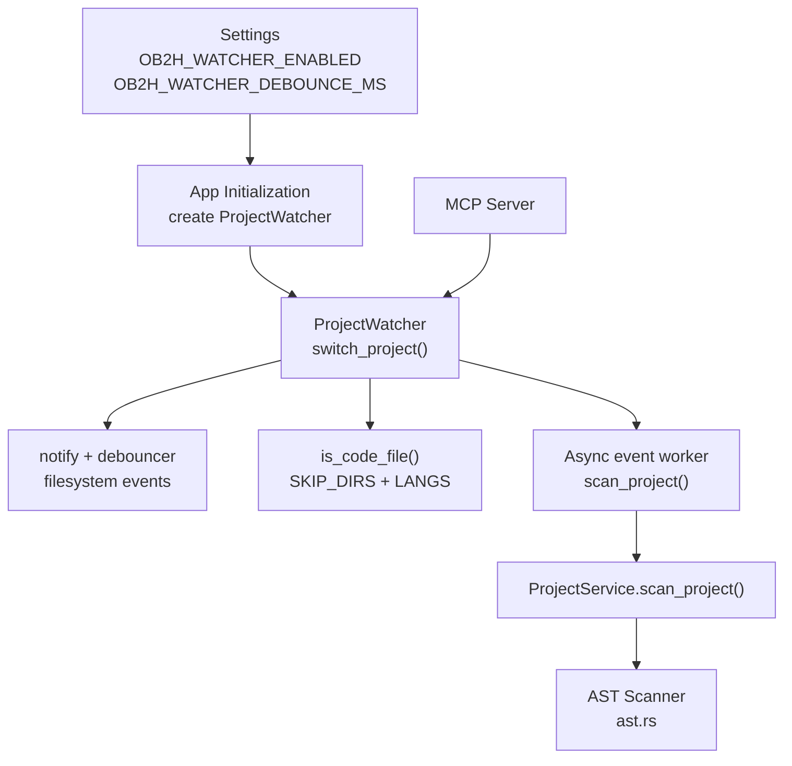
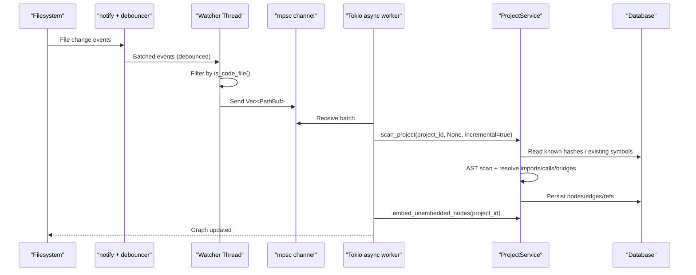
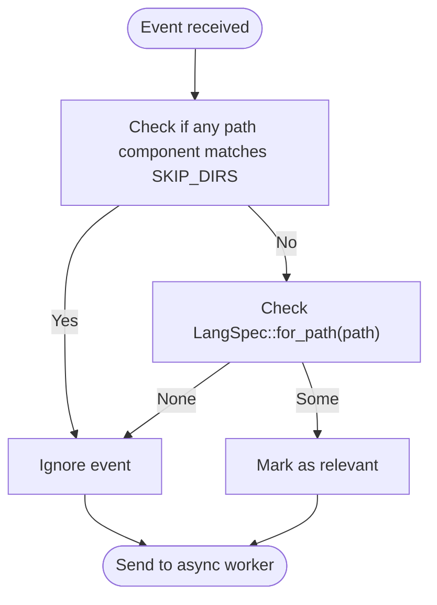
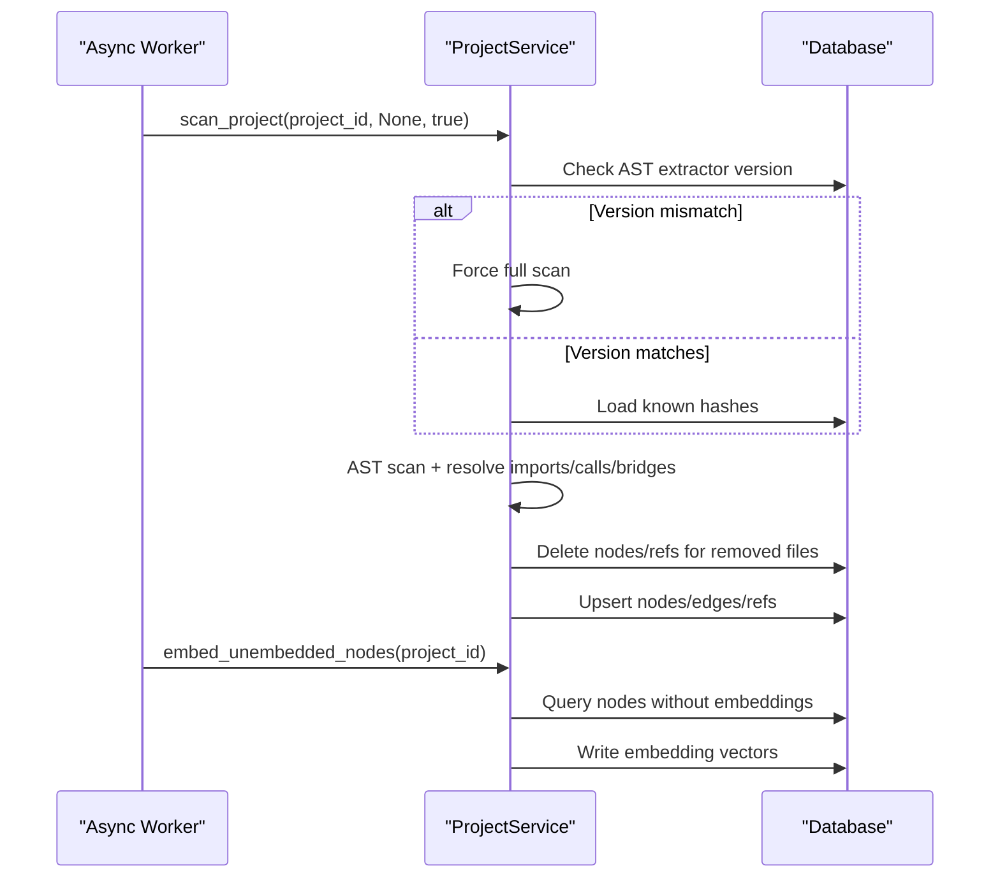
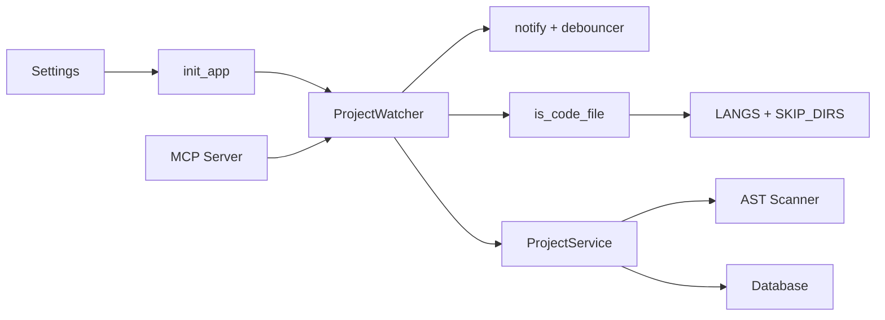

# File Watching System

<cite>
**Referenced Files in This Document**
- [watcher.rs](file://src/project/watcher.rs)
- [mod.rs (project)](file://src/project/mod.rs)
- [ast.rs](file://src/project/ast.rs)
- [config.rs](file://src/config.rs)
- [lib.rs](file://src/lib.rs)
- [server.rs (MCP)](file://src/mcp/server.rs)
- [test_watcher.rs](file://tests/test_watcher.rs)
</cite>

## Table of Contents
1. [Introduction](#introduction)
2. [Project Structure](#project-structure)
3. [Core Components](#core-components)
4. [Architecture Overview](#architecture-overview)
5. [Detailed Component Analysis](#detailed-component-analysis)
6. [Dependency Analysis](#dependency-analysis)
7. [Performance Considerations](#performance-considerations)
8. [Troubleshooting Guide](#troubleshooting-guide)
9. [Conclusion](#conclusion)

## Introduction
This document explains the real-time file watching system that monitors project changes and triggers incremental updates to the code graph. It focuses on:
- The `ProjectWatcher` implementation
- File change detection and filtering
- Event processing pipeline from filesystem events to AST scanning
- How different file types are distinguished
- Concurrency model and coordination with the AST scanner
- Configuration options for enabling/disabling the watcher, debounce timing, watch paths, exclusion patterns, and performance tuning
- Common operational issues such as file lock conflicts, memory usage, and cross-platform considerations

The system is part of a Rust-based application that maintains an in-memory and database-backed knowledge graph of source files, manifests, and contracts.

## Project Structure
The file watching feature lives under the project module and integrates with configuration, MCP server lifecycle, and the AST scanner.



**Diagram sources**
- [config.rs:80-84](file://src/config.rs#L80-L84)
- [config.rs:318-324](file://src/config.rs#L318-L324)
- [lib.rs:97-100](file://src/lib.rs#L97-L100)
- [watcher.rs:28-41](file://src/project/watcher.rs#L28-L41)
- [watcher.rs:44-165](file://src/project/watcher.rs#L44-L165)
- [ast.rs:129-145](file://src/project/ast.rs#L129-L145)
- [ast.rs:232-233](file://src/project/ast.rs#L232-L233)
- [server.rs:291-296](file://src/mcp/server.rs#L291-L296)

**Section sources**
- [config.rs:80-84](file://src/config.rs#L80-L84)
- [config.rs:318-324](file://src/config.rs#L318-L324)
- [lib.rs:97-100](file://src/lib.rs#L97-L100)
- [watcher.rs:28-41](file://src/project/watcher.rs#L28-L41)
- [server.rs:291-296](file://src/mcp/server.rs#L291-L296)

## Core Components
- `ProjectWatcher`: owns a background thread running the filesystem debouncer and an async worker that processes batches of relevant file changes.
- `is_code_file`: filters filesystem events to only include supported code or manifest files while excluding tracked directories.
- `ProjectService.scan_project`: performs incremental or full AST scans, persists nodes/edges, and coordinates type-pass resolution and embedding generation.
- `Settings`: provides watcher enable flag and debounce duration via environment variables.
- MCP server: starts/stops watching per active project.

Key responsibilities:
- Debounce rapid filesystem events into batches
- Filter events to relevant files
- Trigger incremental scan when changes occur
- Generate embeddings for newly scanned nodes

**Section sources**
- [watcher.rs:16-32](file://src/project/watcher.rs#L16-L32)
- [watcher.rs:44-165](file://src/project/watcher.rs#L44-L165)
- [mod.rs (project):419-590](file://src/project/mod.rs#L419-L590)
- [config.rs:80-84](file://src/config.rs#L80-L84)
- [config.rs:318-324](file://src/config.rs#L318-L324)

## Architecture Overview
The watcher uses a two-stage pipeline:
1. A native OS-level watcher (via `notify`) runs in a dedicated thread. Events are debounced and filtered to relevant code files.
2. An asynchronous worker consumes batches of changed paths and invokes the project service to perform an incremental AST scan. After scanning, it generates embeddings for unembedded nodes.



**Diagram sources**
- [watcher.rs:70-120](file://src/project/watcher.rs#L70-L120)
- [watcher.rs:122-165](file://src/project/watcher.rs#L122-L165)
- [mod.rs (project):419-590](file://src/project/mod.rs#L419-L590)
- [mod.rs (project):69-146](file://src/project/mod.rs#L69-L146)

## Detailed Component Analysis

### ProjectWatcher Implementation
`ProjectWatcher` encapsulates:
- A reference to `ProjectService`
- Debounce duration
- Current watch target (project ID and root path), protected by a Tokio mutex
- Lifecycle management for switching projects

Important behaviors:
- `switch_project` stops any previous watcher using a one-shot channel
- Spawns a background thread to run the debouncer and filter events
- Spawns a Tokio task to process event batches asynchronously
- Uses a bounded channel (`mpsc`) to pass batches of changed paths from the blocking thread to the async worker

Concurrency model:
- Blocking thread handles OS events and filtering
- Async worker handles I/O-bound work (database access, AST scanning) without blocking the event loop
- One-shot channel ensures clean shutdown when switching projects

Error handling:
- Logs errors from debouncer creation and filesystem watch subscription
- Warns on filesystem errors and scan failures
- Gracefully breaks out of loops when channels close

**Section sources**
- [watcher.rs:28-41](file://src/project/watcher.rs#L28-L41)
- [watcher.rs:44-165](file://src/project/watcher.rs#L44-L165)

#### Class Diagram
```mermaid
classDiagram
class ProjectWatcher {
- project_service : Arc<ProjectService>
- debounce_ms : u64
- current_watch : Mutex<Option<(String, PathBuf, Sender<()>)>>
+ new(project_service, debounce_ms)
+ switch_project(project_id, root_path) Result
}
class ProjectService {
+ scan_project(project_id, custom_path, incremental) AstScanResult
+ embed_unembedded_nodes(project_id) usize
}
ProjectWatcher --> ProjectService : "uses"
```

**Diagram sources**
- [watcher.rs:28-41](file://src/project/watcher.rs#L28-L41)
- [mod.rs (project):419-590](file://src/project/mod.rs#L419-L590)
- [mod.rs (project):69-146](file://src/project/mod.rs#L69-L146)

### File Change Detection and Filtering
The watcher filters events through `is_code_file`, which:
- Excludes paths containing any directory name from `SKIP_DIRS`
- Accepts files recognized by `LangSpec::for_path`, which maps extensions/filenames/predicates to supported parsers

Excluded directories:
- `.git`, `target`, `node_modules`, `dist`, `build`, `venv`, `.venv`, `vendor`, `data`, `logs`, `backups`, `__pycache__`

Supported languages/formats:
- Single registry `LANGS` defines matchers for extensions, exact filenames, and predicates
- Includes Rust, Python, TS/JS, Go, SQL, HTML/CSS, Jupyter, Solidity, Zig, Proto, GraphQL, OpenAPI, Terraform, Dockerfile, Compose, K8s, and package manifests

This design ensures consistency between the scanner and the watcher; adding a language requires updating the single registry.

**Section sources**
- [watcher.rs:16-24](file://src/project/watcher.rs#L16-L24)
- [ast.rs:129-145](file://src/project/ast.rs#L129-L145)
- [ast.rs:232-233](file://src/project/ast.rs#L232-L233)

#### Flowchart: File Relevance Check


**Diagram sources**
- [watcher.rs:16-24](file://src/project/watcher.rs#L16-L24)
- [ast.rs:129-145](file://src/project/ast.rs#L129-L145)
- [ast.rs:232-233](file://src/project/ast.rs#L232-L233)

### Event Processing Pipeline
After filtering, the watcher sends batches of changed paths to an async worker:
- The worker spawns a blocking task to call `ProjectService.scan_project` with incremental mode enabled
- On success, it logs scan metrics
- It then calls `embed_unembedded_nodes` to vectorize nodes lacking embeddings

Incremental scan behavior:
- Compares stored AST extractor version; if changed, forces a full rescan
- Loads known file hashes and existing symbols/refs for unchanged files
- Detects deleted files and removes their nodes/refs
- Resolves imports, calls, bridges, and consolidates external imports
- Persists nodes, edges, and references in a transaction

Embedding generation:
- Queries nodes without embeddings up to a limit
- Batches embedding requests and writes vectors back to the database

**Section sources**
- [watcher.rs:122-165](file://src/project/watcher.rs#L122-L165)
- [mod.rs (project):419-590](file://src/project/mod.rs#L419-L590)
- [mod.rs (project):69-146](file://src/project/mod.rs#L69-L146)

#### Sequence Diagram: Incremental Scan Trigger


**Diagram sources**
- [watcher.rs:138-154](file://src/project/watcher.rs#L138-L154)
- [mod.rs (project):419-590](file://src/project/mod.rs#L419-L590)
- [mod.rs (project):69-146](file://src/project/mod.rs#L69-L146)

### Coordination with the AST Scanner
The AST scanner is invoked through `ProjectService.scan_project`. It:
- Validates project existence and path
- Determines whether to run incremental or full scan based on extractor version and known hashes
- Performs multi-step analysis: extraction, import resolution, call resolution, bridge inference, and external import consolidation
- Persists results atomically within a transaction

The watcher does not directly parse files; it delegates all parsing and graph construction to the AST scanner via the project service.

**Section sources**
- [mod.rs (project):419-590](file://src/project/mod.rs#L419-L590)

### Concurrency Model
- Background thread: runs `notify_debouncer_mini` and filters events
- Tokio task: receives batches over `mpsc` and schedules blocking tasks for scanning
- One-shot channel: used to stop the background thread when switching projects
- Mutexes: protect current watch state and database connections where needed

This separation prevents blocking the async runtime on filesystem events and heavy I/O operations.

**Section sources**
- [watcher.rs:70-120](file://src/project/watcher.rs#L70-L120)
- [watcher.rs:122-165](file://src/project/watcher.rs#L122-L165)

### Configuration Options
Watcher settings are loaded from environment variables:
- `OB2H_WATCHER_ENABLED`: Enable/disable the watcher (default enabled)
- `OB2H_WATCHER_DEBOUNCE_MS`: Debounce interval in milliseconds (default 2500 ms)

These values are consumed during app initialization to construct the `ProjectWatcher`.

Watch paths:
- The watcher subscribes recursively to the project root path provided by `switch_project`
- There is no explicit list of additional watch paths; the project root is the primary scope

Exclusion patterns:
- Directory exclusions are defined centrally in `SKIP_DIRS`
- File-type filtering is centralized in `LANGS`; only recognized files are processed

Performance tuning parameters:
- Debounce interval controls batching frequency
- Embedding batch size and limits are internal to embedding logic
- No explicit queue depth parameter beyond the default channel capacity

**Section sources**
- [config.rs:80-84](file://src/config.rs#L80-L84)
- [config.rs:318-324](file://src/config.rs#L318-L324)
- [lib.rs:97-100](file://src/lib.rs#L97-L100)
- [ast.rs:129-145](file://src/project/ast.rs#L129-L145)
- [ast.rs:232-233](file://src/project/ast.rs#L232-L233)

### Integration Points
- App initialization constructs `ProjectWatcher` with configured debounce time
- MCP server conditionally starts watching when enabled and switches to the active project
- Tests verify filtering rules and basic watcher lifecycle

**Section sources**
- [lib.rs:97-100](file://src/lib.rs#L97-L100)
- [server.rs:291-296](file://src/mcp/server.rs#L291-L296)
- [test_watcher.rs:11-31](file://tests/test_watcher.rs#L11-L31)
- [test_watcher.rs:33-62](file://tests/test_watcher.rs#L33-L62)

## Dependency Analysis


**Diagram sources**
- [config.rs:80-84](file://src/config.rs#L80-L84)
- [lib.rs:97-100](file://src/lib.rs#L97-L100)
- [watcher.rs:16-24](file://src/project/watcher.rs#L16-L24)
- [ast.rs:129-145](file://src/project/ast.rs#L129-L145)
- [ast.rs:232-233](file://src/project/ast.rs#L232-L233)
- [server.rs:291-296](file://src/mcp/server.rs#L291-L296)

**Section sources**
- [config.rs:80-84](file://src/config.rs#L80-L84)
- [lib.rs:97-100](file://src/lib.rs#L97-L100)
- [watcher.rs:16-24](file://src/project/watcher.rs#L16-L24)
- [ast.rs:129-145](file://src/project/ast.rs#L129-L145)
- [ast.rs:232-233](file://src/project/ast.rs#L232-L233)
- [server.rs:291-296](file://src/mcp/server.rs#L291-L296)

## Performance Considerations
- Debounce interval: Increase `OB2H_WATCHER_DEBOUNCE_MS` to reduce scan frequency during rapid edits; decrease for more responsive updates.
- Event filtering: Centralized `SKIP_DIRS` and `LANGS` prevent unnecessary parsing of large generated or dependency directories.
- Incremental scans: Avoid full rescans unless the AST extractor version changes or no changes are detected.
- Embedding batching: Embeddings are generated in chunks to limit memory pressure and API load.
- Database transactions: Node/edge persistence is wrapped in transactions to minimize lock contention and ensure consistency.
- Channel capacity: The event channel has a fixed capacity; if the async worker falls behind, events may be dropped. Monitor logs for missed updates and consider reducing workload or increasing debounce time.

[No sources needed since this section provides general guidance]

## Troubleshooting Guide
Common issues and resolutions:
- Watcher not starting:
  - Ensure `OB2H_WATCHER_ENABLED` is set to enable the watcher.
  - Verify that the MCP server is invoking `switch_project` with a valid project ID and root path.
- No updates after file changes:
  - Confirm the changed files are not under excluded directories (`SKIP_DIRS`).
  - Confirm the file extension/name is recognized by `LANGS`.
  - Check logs for filesystem errors or debouncer creation failures.
- Frequent full rescans:
  - If the AST extractor version changes, the system forces a full rescan once; subsequent changes will be incremental.
- File lock conflicts:
  - Some editors write temporary files or lock files; these may trigger extra events. Use debounce to coalesce bursts.
  - Exclude build artifacts and generated directories via `SKIP_DIRS` to reduce noise.
- Memory usage spikes:
  - Large repositories can cause many nodes to be queued for embedding. Adjust debounce and monitor embedding batch sizes.
  - Ensure the async worker is keeping up; otherwise, increase debounce or reduce concurrent workloads.
- Cross-platform compatibility:
  - The watcher relies on `notify`, which abstracts OS-specific APIs. Differences in event semantics across platforms may affect granularity; test behavior on your platform.
  - Path normalization and UNC prefix handling exist elsewhere in the codebase; ensure project roots are canonicalized properly.

Operational tips:
- Log level: Set `OB2H_LOG_LEVEL` to capture detailed watcher and scan logs.
- Monitoring: Track scan metrics (files scanned, nodes, edges) to detect regressions.
- Testing: Use integration tests to validate filtering rules and watcher lifecycle.

**Section sources**
- [config.rs:318-324](file://src/config.rs#L318-L324)
- [watcher.rs:70-120](file://src/project/watcher.rs#L70-L120)
- [watcher.rs:122-165](file://src/project/watcher.rs#L122-L165)
- [test_watcher.rs:11-31](file://tests/test_watcher.rs#L11-L31)
- [test_watcher.rs:33-62](file://tests/test_watcher.rs#L33-L62)

## Conclusion
The file watching system provides a robust, debounced, and filtered mechanism to keep the code graph synchronized with project changes. By centralizing file-type recognition and directory exclusions, it avoids inconsistencies between the watcher and scanner. The concurrency model separates OS event handling from async processing, improving responsiveness. Configuration allows tuning debounce timing and enabling/disabling the watcher. With careful monitoring and appropriate exclusions, the system scales well across diverse projects and platforms.

[No sources needed since this section summarizes without analyzing specific files]