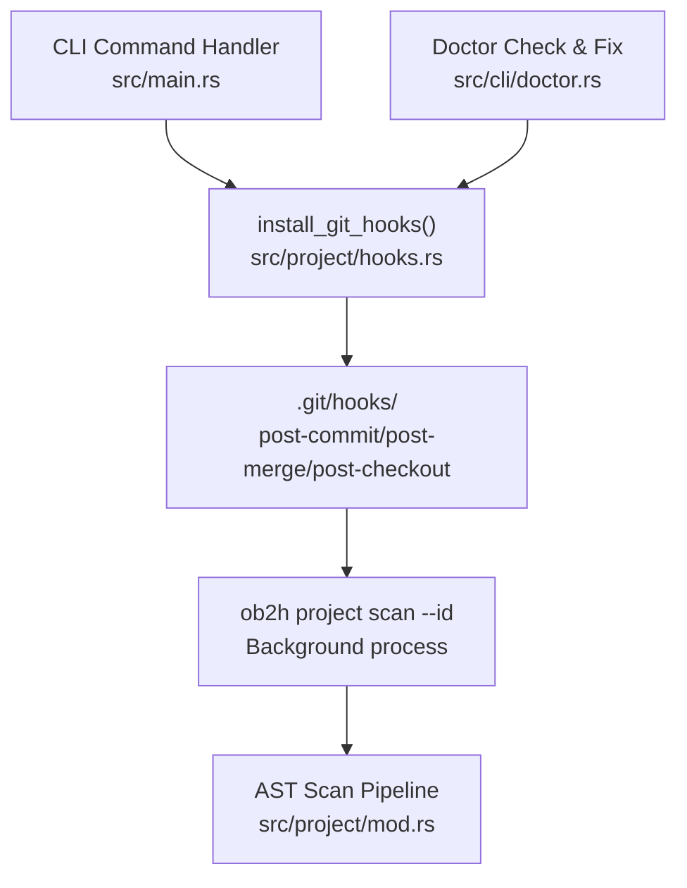
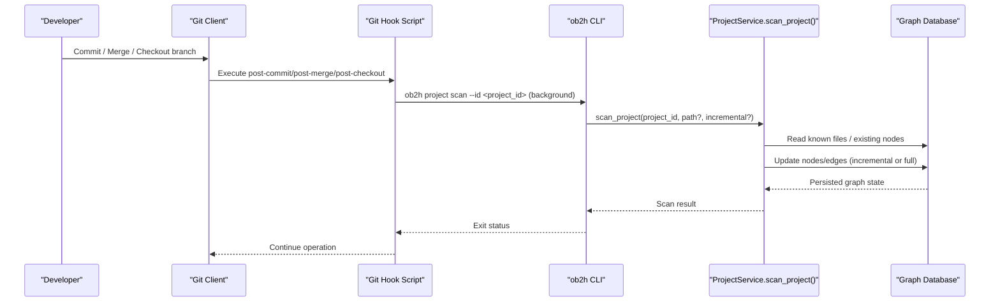
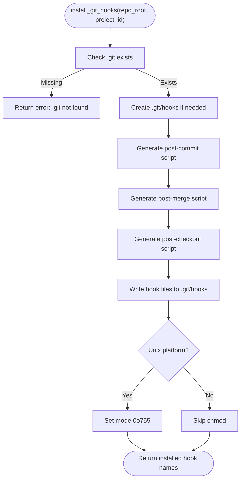
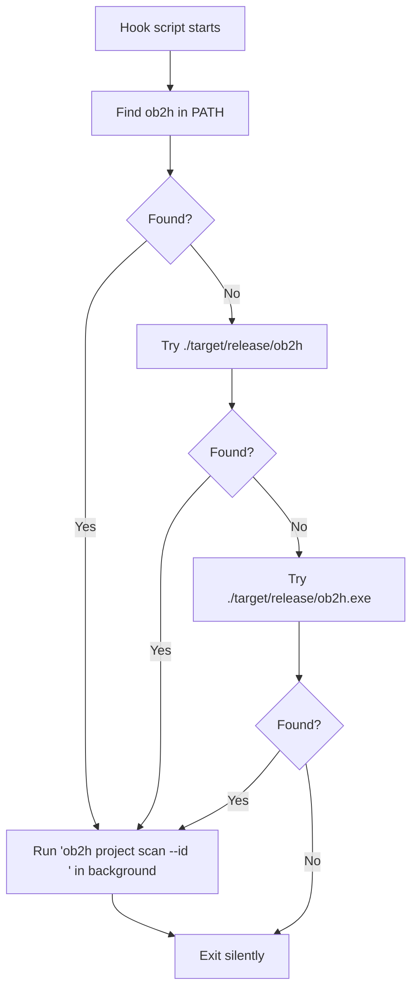
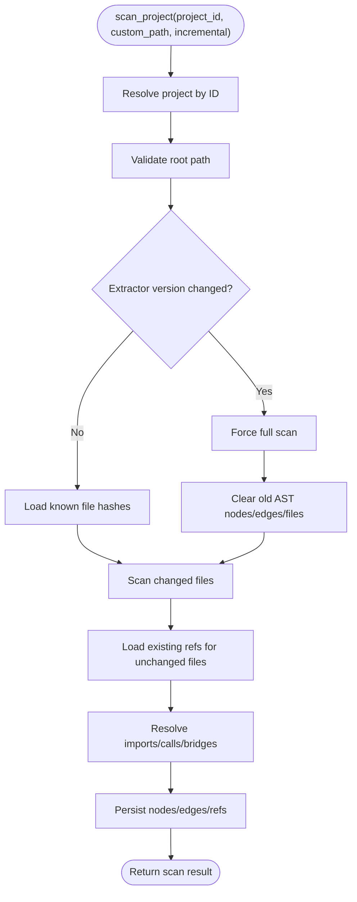
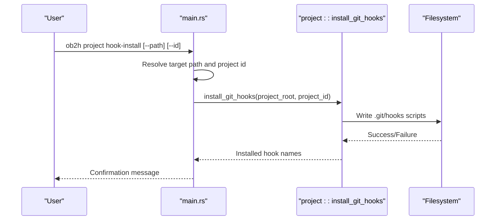
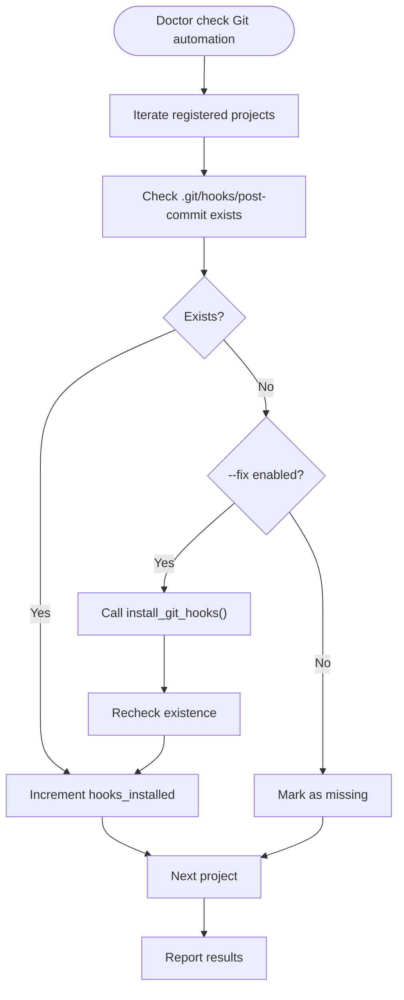
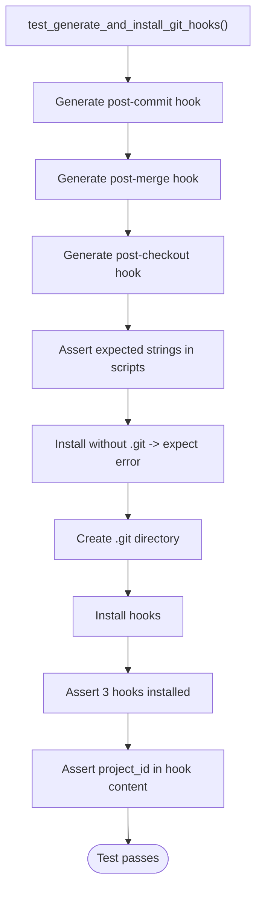
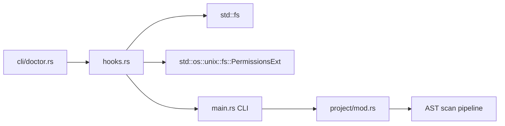

# Git Hooks Integration

<cite>
**Referenced Files in This Document**
- [hooks.rs](file://src/project/hooks.rs)
- [mod.rs](file://src/project/mod.rs)
- [main.rs](file://src/main.rs)
- [doctor.rs](file://src/cli/doctor.rs)
- [test_git_hooks.rs](file://tests/test_git_hooks.rs)
</cite>

## Table of Contents
1. [Introduction](#introduction)
2. [Project Structure](#project-structure)
3. [Core Components](#core-components)
4. [Architecture Overview](#architecture-overview)
5. [Detailed Component Analysis](#detailed-component-analysis)
6. [Dependency Analysis](#dependency-analysis)
7. [Performance Considerations](#performance-considerations)
8. [Troubleshooting Guide](#troubleshooting-guide)
9. [Conclusion](#conclusion)

## Introduction
This document explains the Git hooks integration that automates AST scanning when code changes occur. It covers how hooks are generated and installed, how they trigger background scans, how they integrate with the project scanning pipeline, and how to set them up across different Git workflows. It also includes customization guidance, security considerations, permission requirements, cross-platform compatibility notes, and troubleshooting steps.

The integration focuses on three Git hooks:
- post-commit
- post-merge
- post-checkout (branch switch only)

These hooks invoke the ob2h CLI to run an incremental or full AST scan for a registered project, keeping the local knowledge graph consistent with the repository state.

## Project Structure
The Git hooks feature is implemented under the project module and exposed through the CLI. The key files are:
- src/project/hooks.rs: hook script generation and installation logic
- src/project/mod.rs: re-exports install_git_hooks for public use
- src/main.rs: CLI command handler for installing hooks
- src/cli/doctor.rs: health check and optional automatic fix for missing hooks
- tests/test_git_hooks.rs: integration tests validating hook generation and installation

**Diagram sources**
- [main.rs:553-573](file://src/main.rs#L553-L573)
- [hooks.rs:68-102](file://src/project/hooks.rs#L68-L102)
- [mod.rs:419-589](file://src/project/mod.rs#L419-L589)
- [doctor.rs:580-617](file://src/cli/doctor.rs#L580-L617)

**Section sources**
- [hooks.rs:1-103](file://src/project/hooks.rs#L1-L103)
- [mod.rs:1-19](file://src/project/mod.rs#L1-L19)
- [main.rs:553-573](file://src/main.rs#L553-L573)
- [doctor.rs:580-617](file://src/cli/doctor.rs#L580-L617)
- [test_git_hooks.rs:1-40](file://tests/test_git_hooks.rs#L1-L40)

## Core Components
- Hook script generators:
  - generate_post_commit_hook(project_id)
  - generate_post_merge_hook(project_id)
  - generate_post_checkout_hook(project_id)
- Hook installer:
  - install_git_hooks(repo_root, project_id) -> Result<Vec<String>>
- CLI entry point:
  - ob2h project hook-install [--path] [--id]
- Doctor integration:
  - Checks whether .git/hooks/post-commit exists per registered project
  - Optionally installs hooks via --fix

Key behaviors:
- Hooks write shell scripts into .git/hooks and set executable permissions on Unix-like systems.
- Hooks attempt to find ob2h in PATH; if not found, they fall back to target/release/ob2h or target/release/ob2h.exe.
- Hooks invoke ob2h project scan asynchronously in the background to avoid blocking Git operations.
- The scanner supports incremental updates based on file hashes and extractor versioning.

**Section sources**
- [hooks.rs:9-65](file://src/project/hooks.rs#L9-L65)
- [hooks.rs:68-102](file://src/project/hooks.rs#L68-L102)
- [main.rs:553-573](file://src/main.rs#L553-L573)
- [doctor.rs:580-617](file://src/cli/doctor.rs#L580-L617)

## Architecture Overview
The end-to-end flow from developer action to updated AST graph:

**Diagram sources**
- [hooks.rs:10-65](file://src/project/hooks.rs#L10-L65)
- [main.rs:553-573](file://src/main.rs#L553-L573)
- [mod.rs:419-589](file://src/project/mod.rs#L419-L589)

## Detailed Component Analysis

### Hook Installation Process
The installer performs the following steps:
- Validates that .git exists at the repository root.
- Creates .git/hooks if necessary.
- Generates and writes three hook scripts: post-commit, post-merge, post-checkout.
- On Unix-like platforms, sets executable permissions (mode 0o755).
- Returns a list of installed hook names.

Error handling:
- If .git is missing, returns an error indicating the directory was not found.
- File write errors are wrapped with context including the hook path.

Cross-platform behavior:
- Hook scripts are POSIX sh and try to locate ob2h in PATH first.
- Fallbacks include target/release/ob2h and target/release/ob2h.exe for Windows.
- Permissions are only adjusted on Unix-like systems due to conditional compilation.

**Diagram sources**
- [hooks.rs:68-102](file://src/project/hooks.rs#L68-L102)

**Section sources**
- [hooks.rs:68-102](file://src/project/hooks.rs#L68-L102)

### Hook Scripts and Automatic Triggering
Each hook script:
- Uses #!/usr/bin/env sh shebang.
- Attempts to execute ob2h project scan --id "<project_id>" in the background.
- Falls back to local binary paths if ob2h is not in PATH.
- Redirects output to /dev/null to avoid cluttering terminal sessions.

Trigger conditions:
- post-commit: runs after every commit.
- post-merge: runs after pull/merge operations.
- post-checkout: runs only when switching branches (BRANCH_FLAG == 1), ensuring scans happen on branch changes.

**Diagram sources**
- [hooks.rs:10-25](file://src/project/hooks.rs#L10-L25)
- [hooks.rs:28-43](file://src/project/hooks.rs#L28-L43)
- [hooks.rs:46-65](file://src/project/hooks.rs#L46-L65)

**Section sources**
- [hooks.rs:10-65](file://src/project/hooks.rs#L10-L65)

### Integration with Scanning Pipeline
When hooks invoke ob2h project scan, the scanner:
- Resolves the project by ID and validates the root path.
- Determines whether to perform an incremental scan based on stored file hashes and extractor version.
- Loads existing symbols and references for unchanged files to preserve inter-file relationships.
- Performs import/call resolution and bridge inference.
- Persists nodes and edges to the database, updating or deleting entries as needed.

Incremental vs full scan:
- Incremental scans compare current file hashes against known hashes and update only changed files.
- Full scans clear previous AST data before re-scanning, triggered when the extractor version changes.

**Diagram sources**
- [mod.rs:419-589](file://src/project/mod.rs#L419-L589)

**Section sources**
- [mod.rs:419-589](file://src/project/mod.rs#L419-L589)

### CLI Command: Hook Installation
The CLI exposes a command to install hooks:
- Path resolution: uses provided path or current directory.
- Project detection: auto-registers or detects project if ID is not provided.
- Installs hooks and prints confirmation with installed hook names.

**Diagram sources**
- [main.rs:553-573](file://src/main.rs#L553-L573)
- [hooks.rs:68-102](file://src/project/hooks.rs#L68-L102)

**Section sources**
- [main.rs:553-573](file://src/main.rs#L553-L573)

### Doctor Integration: Health Check and Auto-Fix
The doctor checks each registered project for the presence of .git/hooks/post-commit:
- Counts projects checked and hooks installed.
- Reports status as OK or Warn depending on coverage.
- With --fix, attempts to install missing hooks automatically.

**Diagram sources**
- [doctor.rs:580-617](file://src/cli/doctor.rs#L580-L617)

**Section sources**
- [doctor.rs:580-617](file://src/cli/doctor.rs#L580-L617)

### Tests: Validation of Hook Generation and Installation
Tests verify:
- Generated hook content contains expected commands and variables.
- Installation fails without .git directory.
- Installation succeeds with .git directory and creates all three hooks.
- Hook files contain the correct project ID.

**Diagram sources**
- [test_git_hooks.rs:8-39](file://tests/test_git_hooks.rs#L8-L39)

**Section sources**
- [test_git_hooks.rs:1-40](file://tests/test_git_hooks.rs#L1-L40)

## Dependency Analysis
The hooks integration depends on:
- Filesystem operations for writing hook scripts and setting permissions.
- Shell environment for executing ob2h from PATH or local binaries.
- CLI routing for exposing the hook-install command.
- Project service for scanning and persisting AST data.

**Diagram sources**
- [hooks.rs:1-103](file://src/project/hooks.rs#L1-L103)
- [main.rs:553-573](file://src/main.rs#L553-L573)
- [mod.rs:1-19](file://src/project/mod.rs#L1-L19)
- [doctor.rs:580-617](file://src/cli/doctor.rs#L580-L617)

**Section sources**
- [hooks.rs:1-103](file://src/project/hooks.rs#L1-L103)
- [main.rs:553-573](file://src/main.rs#L553-L573)
- [mod.rs:1-19](file://src/project/mod.rs#L1-L19)
- [doctor.rs:580-617](file://src/cli/doctor.rs#L580-L617)

## Performance Considerations
- Background execution: Hooks run scans asynchronously to avoid blocking Git operations.
- Incremental scans: Prefer incremental updates using file hashes to minimize work.
- Extractor versioning: Forces full rescan when extractor logic changes to maintain correctness.
- Output redirection: Hook scripts redirect stdout/stderr to /dev/null to reduce noise.

Recommendations:
- Ensure ob2h is available in PATH for faster startup compared to resolving local binaries.
- Use incremental scans where possible; full scans are more expensive but necessary after major changes.
- Monitor disk I/O during large scans; consider scheduling scans off-peak if needed.

[No sources needed since this section provides general guidance]

## Troubleshooting Guide
Common issues and resolutions:
- Missing .git directory:
  - Symptom: install_git_hooks returns an error indicating .git not found.
  - Resolution: Initialize Git repository in the project root before installing hooks.
- Hooks not executable on Unix-like systems:
  - Symptom: Hooks fail to run due to lack of execute permissions.
  - Resolution: The installer sets mode 0o755 on Unix platforms; ensure you are running on such systems or manually chmod +x the hook files.
- ob2h not found in PATH:
  - Symptom: Hooks cannot find ob2h and fallbacks also fail.
  - Resolution: Add ob2h to PATH or build the binary and place it in target/release/.
- Hooks not triggering:
  - Symptom: Scans do not run after commits/merges/checkouts.
  - Resolution: Verify .git/hooks/post-commit exists; use ob2h doctor to check and optionally fix missing hooks.
- Cross-platform differences:
  - Windows: Hooks attempt to run target/release/ob2h.exe; ensure the binary exists.
  - macOS/Linux: Hooks attempt to run target/release/ob2h; ensure executable permissions are set.

Security considerations:
- Hook scripts are generated by the tool and executed locally; review them if you require strict control over what runs on your machine.
- Avoid committing hook scripts to shared repositories unless explicitly intended; they are typically local-only.
- Ensure ob2h binary integrity and trust its source before enabling automated scans.

**Section sources**
- [hooks.rs:68-102](file://src/project/hooks.rs#L68-L102)
- [doctor.rs:580-617](file://src/cli/doctor.rs#L580-L617)

## Conclusion
The Git hooks integration provides a robust mechanism to keep the AST graph synchronized with repository changes. By generating and installing post-commit, post-merge, and post-checkout hooks, the system ensures that scans run automatically and efficiently. The CLI and doctor utilities simplify setup and maintenance, while the scanner’s incremental logic optimizes performance. With proper configuration and awareness of cross-platform nuances, teams can maintain consistency between local and remote repositories securely and reliably.

[No sources needed since this section summarizes without analyzing specific files]