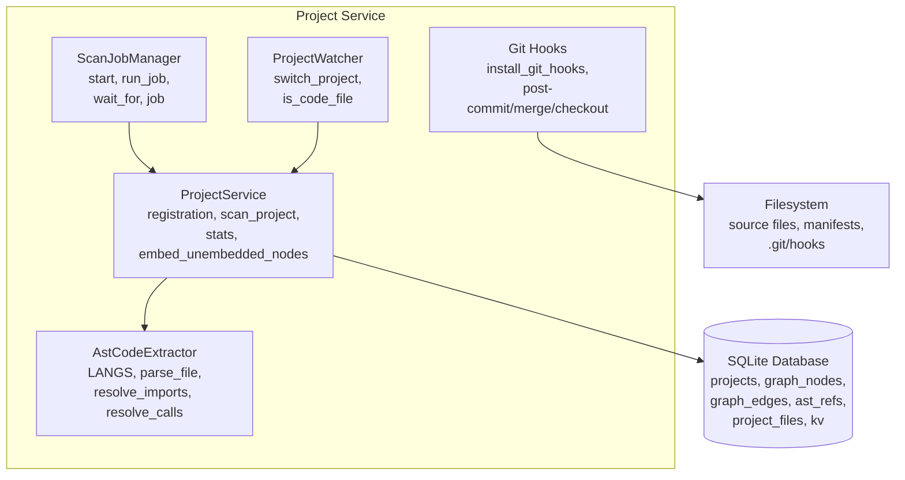
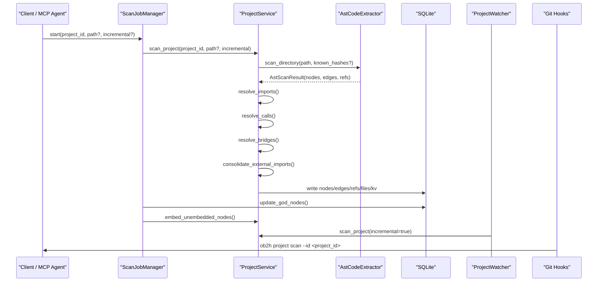
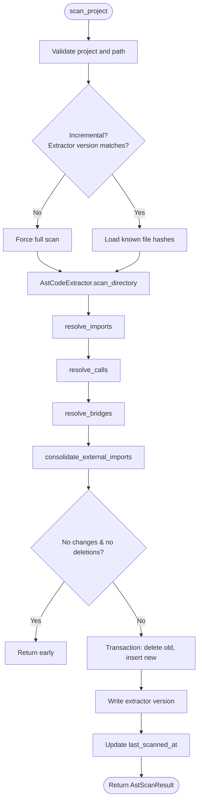
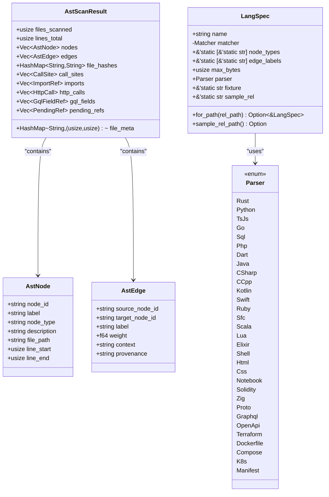
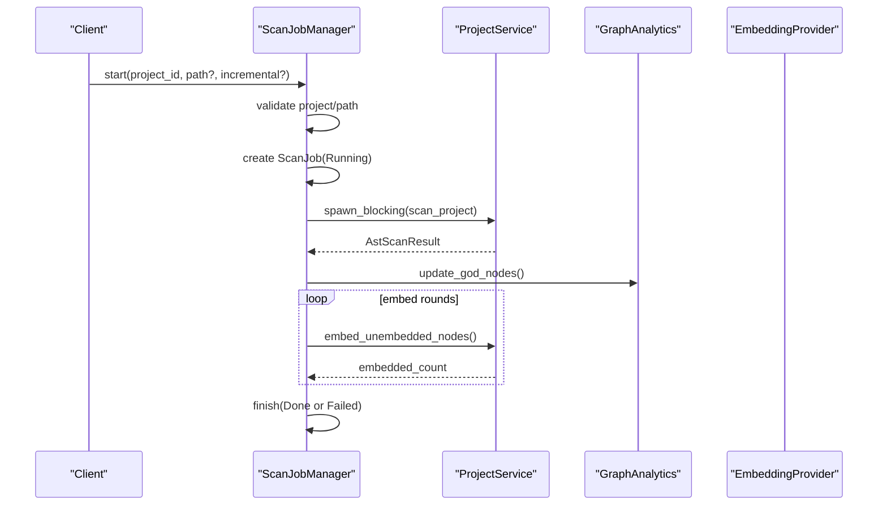
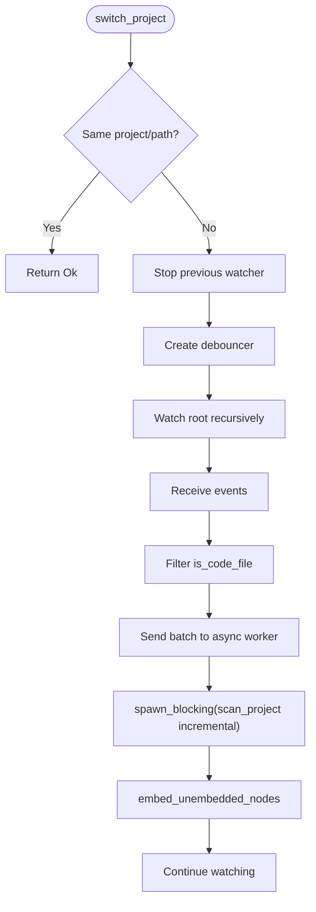
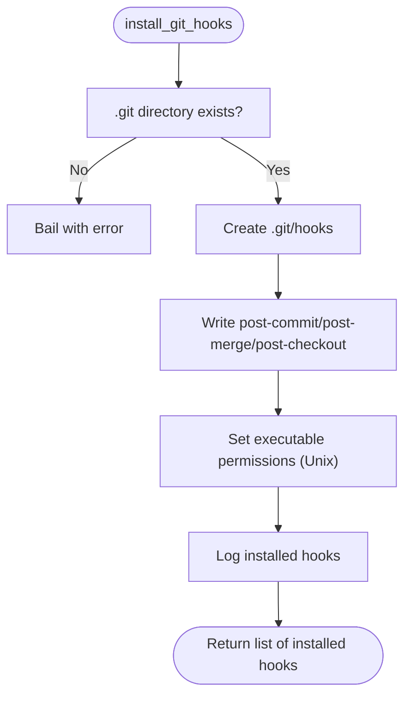
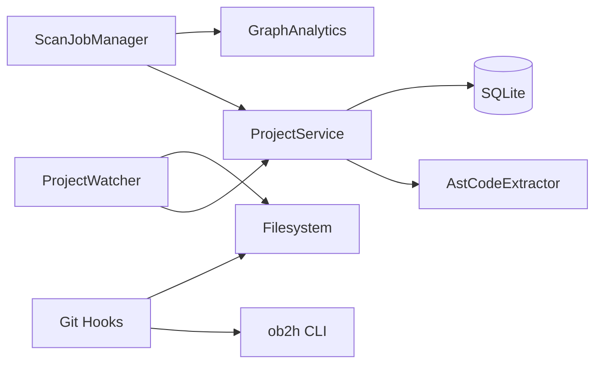

# Project Service

<cite>
**Referenced Files in This Document**
- [mod.rs](file://src/project/mod.rs)
- [ast.rs](file://src/project/ast.rs)
- [scanjob.rs](file://src/project/scanjob.rs)
- [watcher.rs](file://src/project/watcher.rs)
- [hooks.rs](file://src/project/hooks.rs)
</cite>

## Table of Contents
1. [Introduction](#introduction)
2. [Project Structure](#project-structure)
3. [Core Components](#core-components)
4. [Architecture Overview](#architecture-overview)
5. [Detailed Component Analysis](#detailed-component-analysis)
6. [Dependency Analysis](#dependency-analysis)
7. [Performance Considerations](#performance-considerations)
8. [Troubleshooting Guide](#troubleshooting-guide)
9. [Conclusion](#conclusion)

## Introduction
The Project Service is the central component responsible for registering projects, scanning codebases, extracting AST-like symbols and edges, persisting graph data, and keeping the project graph up to date through background jobs and file watching. It supports a large set of programming languages and configuration formats through a single language registry, performs incremental scans based on file hashes, resolves cross-file relationships such as imports and calls, and integrates with Git hooks and an optional embedding provider for vectorized node search.

This document explains:
- Multi-language AST parsing capabilities and supported languages/formats.
- File watching and real-time change detection.
- Incremental update strategies and scan job processing.
- Git hook integration.
- Symbol extraction, AST node types, edge labels, and import/call resolution.
- Configuration examples, scanning workflows, and integration with the graph service.
- Performance optimizations and error handling strategies.

## Project Structure
The Project Service lives under `src/project` and is composed of five main modules:
- `mod.rs`: Project registration, scanning orchestration, persistence, statistics, manifest metadata detection, and CodeGraph import.
- `ast.rs`: Language registry, file collection, AST/code parsing, symbol extraction, import/call resolution, and bridge consolidation.
- `scanjob.rs`: Background scan job lifecycle, idempotent start, God Node recalculation, and batched embedding.
- `watcher.rs`: Debounced file watcher that triggers incremental scans and post-scan embedding.
- `hooks.rs`: Generation and installation of Git hooks that trigger project scans after commit, merge, or checkout.

**Diagram sources**
- [mod.rs:40-67](file://src/project/mod.rs#L40-L67)
- [mod.rs:420-846](file://src/project/mod.rs#L420-L846)
- [ast.rs:15-119](file://src/project/ast.rs#L15-L119)
- [ast.rs:233-1189](file://src/project/ast.rs#L233-L1189)
- [scanjob.rs:46-108](file://src/project/scanjob.rs#L46-L108)
- [scanjob.rs:111-176](file://src/project/scanjob.rs#L111-L176)
- [watcher.rs:28-41](file://src/project/watcher.rs#L28-L41)
- [watcher.rs:44-165](file://src/project/watcher.rs#L44-L165)
- [hooks.rs:68-102](file://src/project/hooks.rs#L68-L102)

**Section sources**
- [mod.rs:1-20](file://src/project/mod.rs#L1-L20)
- [ast.rs:1-8](file://src/project/ast.rs#L1-L8)
- [scanjob.rs:1-5](file://src/project/scanjob.rs#L1-L5)
- [watcher.rs:1-12](file://src/project/watcher.rs#L1-L12)
- [hooks.rs:1-8](file://src/project/hooks.rs#L1-L8)

## Core Components
- **ProjectService**: Manages project records, runs AST scans, persists nodes/edges/references, computes embeddings, and exposes statistics. It also detects project roots and manifest metadata for zero-config registration.
- **AstCodeExtractor**: Implements multi-language parsing via a centralized `LANGS` registry, collects files, parses them into `AstNode` and `AstEdge`, and provides helpers for import/call resolution and external package consolidation.
- **ScanJobManager**: Provides idempotent background scanning, tracks job status, recalculates God Nodes, and batches embedding until all unembedded nodes are processed.
- **ProjectWatcher**: Uses debounced filesystem events to detect relevant code changes and triggers incremental scans plus embedding updates.
- **Git Hooks**: Generates and installs shell scripts that invoke the CLI to scan a project after Git operations.

Key responsibilities and entry points:
- Project registration and auto-detection: `register_project`, `auto_register_or_detect`.
- Scanning: `scan_project` orchestrates AST extraction, resolution passes, persistence, and versioning.
- Embedding: `embed_unembedded_nodes` batches node text into vectors and stores them.
- Background jobs: `ScanJobManager::start` and `run_job`.
- Watching: `ProjectWatcher::switch_project`.
- Hooks: `install_git_hooks`.

**Section sources**
- [mod.rs:40-67](file://src/project/mod.rs#L40-L67)
- [mod.rs:165-214](file://src/project/mod.rs#L165-L214)
- [mod.rs:324-417](file://src/project/mod.rs#L324-L417)
- [mod.rs:420-846](file://src/project/mod.rs#L420-L846)
- [ast.rs:15-119](file://src/project/ast.rs#L15-L119)
- [ast.rs:233-1189](file://src/project/ast.rs#L233-L1189)
- [scanjob.rs:46-108](file://src/project/scanjob.rs#L46-L108)
- [scanjob.rs:111-176](file://src/project/scanjob.rs#L111-L176)
- [watcher.rs:28-41](file://src/project/watcher.rs#L28-L41)
- [watcher.rs:44-165](file://src/project/watcher.rs#L44-L165)
- [hooks.rs:68-102](file://src/project/hooks.rs#L68-L102)

## Architecture Overview
The Project Service composes several layers:
- **Registration Layer**: Registers projects, detects root directories and tech stacks from manifests, and optionally reads active Git branch.
- **Scanning Layer**: Traverses the repository, classifies files using `LANGS`, extracts symbols and edges, resolves imports and calls, consolidates external imports, and persists results.
- **Persistence Layer**: Writes nodes, edges, references, file hashes, and extractor version atomically within transactions.
- **Background Job Layer**: Runs scans asynchronously, recalculates analytics, and batches embedding.
- **Real-Time Layer**: Watches filesystem changes, debounces events, filters relevant files, and triggers incremental scans.
- **Integration Layer**: Installs Git hooks to trigger scans automatically; optionally integrates with the graph service for God Node analytics and with an embedding provider for vector search.

**Diagram sources**
- [scanjob.rs:65-108](file://src/project/scanjob.rs#L65-L108)
- [scanjob.rs:111-176](file://src/project/scanjob.rs#L111-L176)
- [mod.rs:420-846](file://src/project/mod.rs#L420-L846)
- [watcher.rs:44-165](file://src/project/watcher.rs#L44-L165)
- [hooks.rs:10-65](file://src/project/hooks.rs#L10-L65)

## Detailed Component Analysis

### ProjectService
Responsibilities:
- Register/update projects and detect project roots and tech stacks.
- Run full or incremental AST scans.
- Persist graph nodes, edges, AST references, file hashes, and extractor version.
- Batch embedding of unembedded nodes.
- Import external CodeGraph SQLite databases.
- Provide project statistics.

Important behaviors:
- Version-aware incremental scans: if the AST extractor version changed, it forces a full rescan.
- Deleted file handling during incremental scans: removes nodes and references for deleted files.
- Cross-file relationship preservation: loads existing symbols and AST references for unchanged files to maintain inter-file links.
- Resolution passes: imports, calls, bridges, and external import consolidation.
- Transactional persistence: deletes old AST data (full scan) or targeted rows (incremental), then inserts new nodes/edges/refs and updates project timestamps.

**Diagram sources**
- [mod.rs:420-846](file://src/project/mod.rs#L420-L846)

**Section sources**
- [mod.rs:40-67](file://src/project/mod.rs#L40-L67)
- [mod.rs:165-214](file://src/project/mod.rs#L165-L214)
- [mod.rs:324-417](file://src/project/mod.rs#L324-L417)
- [mod.rs:420-846](file://src/project/mod.rs#L420-L846)
- [mod.rs:849-956](file://src/project/mod.rs#L849-L956)
- [mod.rs:958-1000](file://src/project/mod.rs#L958-L1000)

### AstCodeExtractor and Language Registry
Responsibilities:
- Maintain a single registry of supported languages and formats (`LANGS`).
- Classify files by extension, filename, or predicate.
- Parse source files into AST-like nodes and edges.
- Collect file hashes and metadata for incremental scanning.
- Resolve imports and calls across files.
- Normalize external module references to package nodes.

Supported languages and formats include:
- Rust, Python, TypeScript/JavaScript, Go, SQL, PHP, Dart, Java, C#, C/C++, Kotlin, Swift, Ruby, Vue/Svelte SFC, Scala, Lua, Elixir, Shell.
- HTML, CSS/SCSS, Jupyter notebooks, Solidity, Zig.
- Protocol Buffers, GraphQL, OpenAPI/Swagger.
- Terraform/OpenTofu, Dockerfile, docker-compose, Kubernetes/Helm YAML.
- Package manifests: Cargo.toml, package.json, pyproject.toml, requirements.txt, go.mod, pubspec.yaml, composer.json.

AST data structures:
- `AstNode`: node identifier, label, type, description, file path, line range.
- `AstEdge`: source/target identifiers, label, weight, context, provenance.
- `AstScanResult`: aggregated scan metrics, nodes, edges, file hashes, metadata, call sites, imports, HTTP calls, GraphQL fields, pending references.

Node types and edge labels are defined centrally and extended per language/specification. Auto-created target nodes for edges use prefix-based mapping.

**Diagram sources**
- [ast.rs:15-119](file://src/project/ast.rs#L15-L119)
- [ast.rs:155-230](file://src/project/ast.rs#L155-L230)
- [ast.rs:233-1189](file://src/project/ast.rs#L233-L1189)

**Section sources**
- [ast.rs:15-119](file://src/project/ast.rs#L15-L119)
- [ast.rs:129-150](file://src/project/ast.rs#L129-L150)
- [ast.rs:155-230](file://src/project/ast.rs#L155-L230)
- [ast.rs:233-1189](file://src/project/ast.rs#L233-L1189)
- [ast.rs:1191-1222](file://src/project/ast.rs#L1191-L1222)
- [ast.rs:1231-1260](file://src/project/ast.rs#L1231-L1260)
- [ast.rs:1262-1348](file://src/project/ast.rs#L1262-L1348)

### ScanJobManager
Responsibilities:
- Start background scans idempotently (if a running job exists for the same project, return it).
- Validate inputs synchronously before spawning background tasks.
- Execute AST scan in a blocking task to avoid blocking async runtime.
- Recalculate God Nodes using the graph analytics service.
- Batch embedding of unembedded nodes until completion or failure.
- Track job status and allow waiting with timeout.

**Diagram sources**
- [scanjob.rs:65-108](file://src/project/scanjob.rs#L65-L108)
- [scanjob.rs:111-176](file://src/project/scanjob.rs#L111-L176)

**Section sources**
- [scanjob.rs:16-44](file://src/project/scanjob.rs#L16-L44)
- [scanjob.rs:46-108](file://src/project/scanjob.rs#L46-L108)
- [scanjob.rs:111-176](file://src/project/scanjob.rs#L111-L176)
- [scanjob.rs:178-204](file://src/project/scanjob.rs#L178-L204)

### ProjectWatcher
Responsibilities:
- Determine whether a file is a code file using the shared `LANGS` registry and skip directories.
- Switch watched projects, stopping previous watchers when necessary.
- Use debounced filesystem events to batch changes.
- Trigger incremental scans and post-scan embedding.

**Diagram sources**
- [watcher.rs:16-24](file://src/project/watcher.rs#L16-L24)
- [watcher.rs:44-165](file://src/project/watcher.rs#L44-L165)

**Section sources**
- [watcher.rs:1-12](file://src/project/watcher.rs#L1-L12)
- [watcher.rs:16-24](file://src/project/watcher.rs#L16-L24)
- [watcher.rs:28-41](file://src/project/watcher.rs#L28-L41)
- [watcher.rs:44-165](file://src/project/watcher.rs#L44-L165)

### Git Hooks Integration
Responsibilities:
- Generate shell scripts for post-commit, post-merge, and post-checkout hooks.
- Install hooks into `.git/hooks` with executable permissions on Unix.
- Invoke the CLI to scan the project asynchronously after Git operations.

**Diagram sources**
- [hooks.rs:68-102](file://src/project/hooks.rs#L68-L102)

**Section sources**
- [hooks.rs:1-8](file://src/project/hooks.rs#L1-L8)
- [hooks.rs:10-65](file://src/project/hooks.rs#L10-L65)
- [hooks.rs:68-102](file://src/project/hooks.rs#L68-L102)

## Dependency Analysis
Component relationships:
- `ProjectService` depends on `AstCodeExtractor` for parsing and resolution.
- `ScanJobManager` depends on `ProjectService` for scanning and embedding, and on `GraphAnalytics` for God Node updates.
- `ProjectWatcher` depends on `ProjectService` for incremental scanning and embedding.
- `Git Hooks` depend on the CLI to trigger scans; they do not directly call internal services.

External dependencies:
- SQLite database for project metadata, graph nodes/edges, AST references, file hashes, and key-value store.
- Filesystem for source files, manifests, and Git hooks.
- Optional embedding provider for vectorizing nodes.

Potential coupling concerns:
- The watcher and scanner both rely on the shared `LANGS` registry to ensure consistent file classification.
- The scanner’s resolution passes depend on previously extracted nodes and references; incremental mode preserves unchanged symbols to maintain cross-file relationships.

**Diagram sources**
- [mod.rs:40-67](file://src/project/mod.rs#L40-L67)
- [scanjob.rs:46-108](file://src/project/scanjob.rs#L46-L108)
- [scanjob.rs:111-176](file://src/project/scanjob.rs#L111-L176)
- [watcher.rs:28-41](file://src/project/watcher.rs#L28-L41)
- [watcher.rs:44-165](file://src/project/watcher.rs#L44-L165)
- [hooks.rs:68-102](file://src/project/hooks.rs#L68-L102)

**Section sources**
- [mod.rs:40-67](file://src/project/mod.rs#L40-L67)
- [scanjob.rs:46-108](file://src/project/scanjob.rs#L46-L108)
- [scanjob.rs:111-176](file://src/project/scanjob.rs#L111-L176)
- [watcher.rs:28-41](file://src/project/watcher.rs#L28-L41)
- [watcher.rs:44-165](file://src/project/watcher.rs#L44-L165)
- [hooks.rs:68-102](file://src/project/hooks.rs#L68-L102)

## Performance Considerations
- Single language registry avoids duplicated whitelists and ensures consistent file classification between traversal and watching.
- Incremental scans compare file hashes and only re-parse changed files; unchanged symbols and references are preserved to maintain cross-file links.
- Batched embedding processes up to 500 nodes per call and loops until completion or failure, capping rounds to guarantee termination.
- Debounced file watching reduces scan frequency during rapid edits.
- Large files can be tracked by hash without parsing when size caps apply to specific formats.
- Transactions minimize database writes and ensure atomic updates of nodes, edges, references, file hashes, and extractor version.

Recommendations:
- Prefer incremental scans for frequent edits; use full scans after major refactors or extractor version changes.
- Monitor embedding progress and failures; consider adjusting batch sizes or timeouts based on repository size.
- Exclude noisy directories via `SKIP_DIRS` and ensure watchers filter irrelevant files.

[No sources needed since this section provides general guidance]

## Troubleshooting Guide
Common issues and resolutions:
- Project not found: Ensure the project ID exists and the path is valid before starting a scan.
- Path does not exist: Validate the custom path or project root before invoking scans.
- Extractor version mismatch: A version change forces a full rescan; verify expected behavior.
- File watcher errors: Check filesystem permissions and debouncer initialization; review logs for watch errors.
- Background scan failures: Inspect job status and error messages; God Node recalculation and embedding may continue partially.
- Git hooks not executing: Verify `.git/hooks` exists, scripts are written, and have executable permissions on Unix.

Operational tips:
- Use `get_project_stats` to monitor node/edge counts and God Nodes.
- Use `pending_embeddings` to check how many AST nodes still need vectorization.
- Review logs for incremental scan outcomes and embedding progress.

**Section sources**
- [scanjob.rs:65-82](file://src/project/scanjob.rs#L65-L82)
- [scanjob.rs:123-154](file://src/project/scanjob.rs#L123-L154)
- [watcher.rs:70-91](file://src/project/watcher.rs#L70-L91)
- [watcher.rs:138-154](file://src/project/watcher.rs#L138-L154)
- [hooks.rs:68-102](file://src/project/hooks.rs#L68-L102)

## Conclusion
The Project Service provides a robust, extensible foundation for codebase scanning and AST analysis across many languages and formats. Its centralized language registry, incremental update strategy, background job management, and file watching enable efficient maintenance of a live knowledge graph. Git hooks integrate seamlessly with development workflows, while embedding support enhances semantic search capabilities. For large repositories, performance is optimized through batching, debouncing, transactional persistence, and selective parsing. Error handling and observability are built into each layer, ensuring reliable operation and clear diagnostics.

[No sources needed since this section summarizes without analyzing specific files]