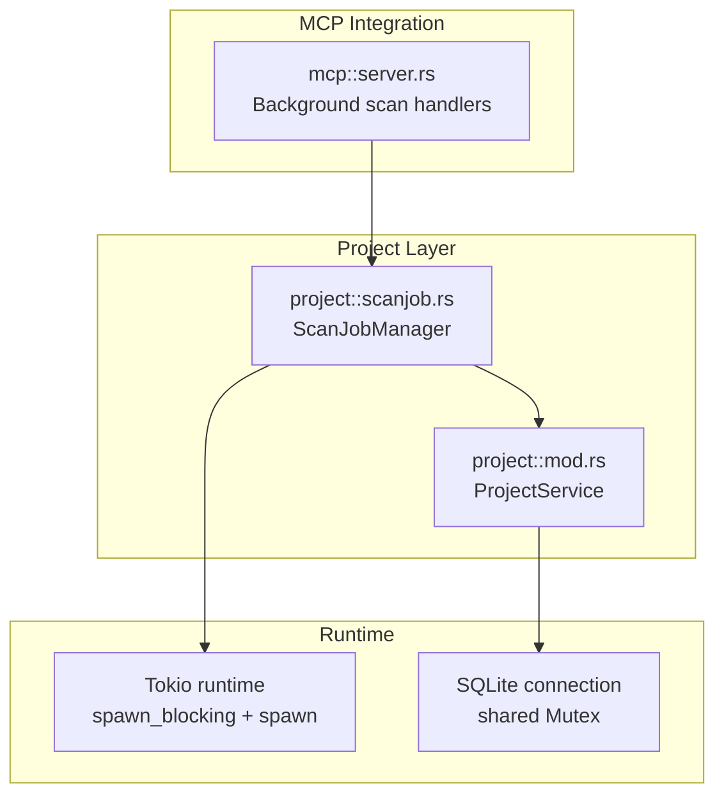
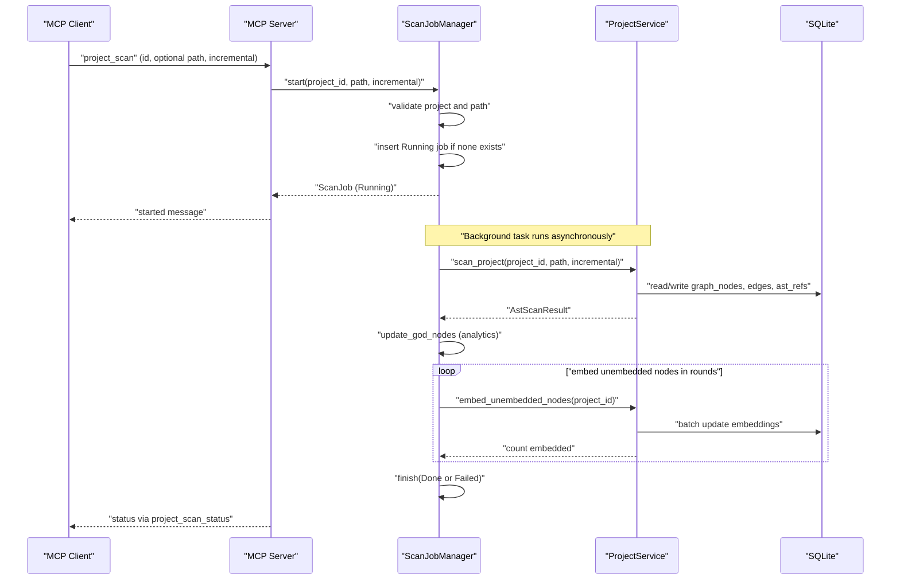
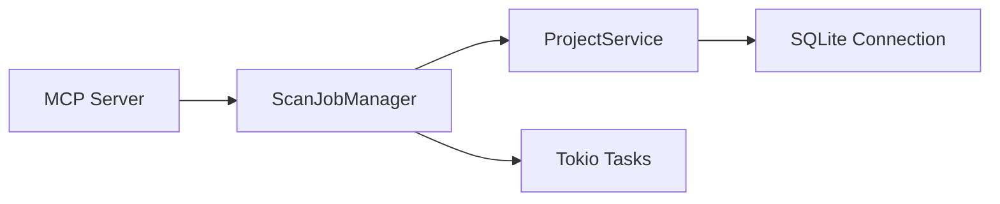

# Scan Job Manager

<cite>
**Referenced Files in This Document**
- [scanjob.rs](file://src/project/scanjob.rs)
- [mod.rs](file://src/project/mod.rs)
- [server.rs](file://src/mcp/server.rs)
- [lib.rs](file://src/lib.rs)
</cite>

## Table of Contents
1. [Introduction](#introduction)
2. [Project Structure](#project-structure)
3. [Core Components](#core-components)
4. [Architecture Overview](#architecture-overview)
5. [Detailed Component Analysis](#detailed-component-analysis)
6. [Dependency Analysis](#dependency-analysis)
7. [Performance Considerations](#performance-considerations)
8. [Troubleshooting Guide](#troubleshooting-guide)
9. [Conclusion](#conclusion)

## Introduction
This document explains the scan job management system that orchestrates background scanning operations for projects. It focuses on:
- The `ScanJob` data model and its lifecycle.
- The `ScanJobManager` lifecycle, including starting jobs, waiting for completion, and querying status.
- Job status tracking through `ScanJobStatus` and `ScanJobResult`.
- Background queue processing via Tokio tasks, concurrency control, and resource management.
- Progress reporting and error handling patterns exposed to callers.
- Practical guidance for creating custom scans, monitoring progress, and integrating callbacks at the MCP layer.
- Notes on persistence and recovery for interrupted scans based on current implementation behavior.

The system is designed so that long-running AST scans do not block MCP client calls. Instead, clients start a scan and poll its status until completion or failure.

## Project Structure
The scan job subsystem lives under the project module and integrates with the MCP server as an entry point for background scanning.

**Diagram sources**
- [scanjob.rs:46-204](file://src/project/scanjob.rs#L46-L204)
- [mod.rs:40-146](file://src/project/mod.rs#L40-L146)
- [server.rs:1750-1825](file://src/mcp/server.rs#L1750-L1825)

**Section sources**
- [scanjob.rs:1-205](file://src/project/scanjob.rs#L1-L205)
- [mod.rs:1-146](file://src/project/mod.rs#L1-L146)
- [server.rs:1750-1825](file://src/mcp/server.rs#L1750-L1825)

## Core Components
- `ScanJob`: Represents the active or completed scan for a project, including timestamps and status.
- `ScanJobStatus`: Enumerates running, done, and failed states; the done state carries `ScanJobResult`.
- `ScanJobResult`: Summarizes completed scan metrics such as files scanned, nodes, edges, lines, and embedded vectors.
- `ScanJobManager`: Manages background scan jobs per project, provides start, wait, and query APIs.

Key responsibilities:
- Validate inputs before launching background work.
- Ensure idempotent start behavior (no duplicate concurrent scans per project).
- Run AST scanning off the main async task using blocking execution.
- Update analytics and embed graph nodes after scanning.
- Provide polling-friendly status updates.

**Section sources**
- [scanjob.rs:16-51](file://src/project/scanjob.rs#L16-L51)
- [scanjob.rs:53-204](file://src/project/scanjob.rs#L53-L204)

## Architecture Overview
The MCP server triggers background scans and exposes status queries. `ScanJobManager` coordinates the lifecycle and delegates heavy work to `ProjectService`.

**Diagram sources**
- [server.rs:1750-1825](file://src/mcp/server.rs#L1750-L1825)
- [scanjob.rs:65-176](file://src/project/scanjob.rs#L65-L176)
- [mod.rs:420-800](file://src/project/mod.rs#L420-L800)
- [mod.rs:70-146](file://src/project/mod.rs#L70-L146)

## Detailed Component Analysis

### ScanJob Data Model
`ScanJob` captures:
- `project_id`: Identifier of the project being scanned.
- `started_at`: Timestamp when the job started.
- `finished_at`: Optional timestamp when the job finished.
- `status`: Current state (`Running`, `Done(ScanJobResult)`, `Failed(String)`).

`ScanJobResult` summarizes:
- `files_scanned`: Number of files processed.
- `nodes`: Count of AST nodes produced.
- `edges`: Count of edges produced.
- `lines_total`: Total lines processed.
- `embedded`: Number of nodes vectorized during the job.

These structures are serialized for transport and logging, enabling MCP responses to report progress and outcomes.

**Section sources**
- [scanjob.rs:16-39](file://src/project/scanjob.rs#L16-L39)

### ScanJobManager Lifecycle
Lifecycle phases:
1. Start:
   - Validates project existence and path validity synchronously.
   - Checks for an existing running job for the same project; returns it if present (idempotency).
   - Creates a new `ScanJob` with `Running` status and inserts it into an in-memory map keyed by `project_id`.
   - Spawns a Tokio task to execute the background work.
2. Run:
   - Executes `ProjectService::scan_project` in a blocking task to avoid blocking the async runtime.
   - On success, updates God Nodes analytics (non-critical errors are ignored).
   - Iteratively embeds unembedded nodes in batches up to a bounded number of rounds.
   - Marks the job as `Done` with `ScanJobResult`, or `Failed` with an error message.
3. Wait:
   - Polls job status until completion or timeout, returning the latest job snapshot.
4. Query:
   - Returns the latest job for a project or `None` if no job exists.

Concurrency control:
- A single `Mutex<HashMap<String, ScanJob>>` protects the job registry.
- Each project has at most one active background scan due to idempotent start logic.
- Blocking I/O is isolated via `spawn_blocking`, preventing async starvation.

Resource management:
- Database connections are shared via `Arc<Mutex<Connection>>` and used within transactions where appropriate.
- Embedding uses batched requests and transactional writes to minimize overhead.

Error handling:
- Validation errors return immediately from `start`.
- Background failures set job status to `Failed` with a descriptive string.
- Analytics updates are best-effort; embedding loops stop on errors but still allow finalization.

**Section sources**
- [scanjob.rs:53-204](file://src/project/scanjob.rs#L53-L204)

### Job Queue Processing and Priority Handling
Current design:
- There is no explicit priority queue. Jobs are managed per project ID.
- If a project already has a running job, subsequent starts return the existing job without duplication.
- Multiple projects can run concurrently because each call spawns its own Tokio task.

Implications:
- No global ordering or fairness policy across projects.
- Resource contention depends on underlying services (AST scanner, embedding provider, database).

Optimization opportunities:
- Introduce a bounded worker pool to limit concurrent scans.
- Add priorities (e.g., full vs incremental) if needed.
- Implement backpressure when too many jobs are queued.

**Section sources**
- [scanjob.rs:65-108](file://src/project/scanjob.rs#L65-L108)
- [scanjob.rs:110-176](file://src/project/scanjob.rs#L110-L176)

### Progress Reporting and Error Handling Patterns
Progress reporting:
- Clients poll `project_scan_status` to observe job state transitions: `Running` → `Done` or `Failed`.
- The MCP server composes a human-readable status line including timestamps and result metrics.

Error handling patterns:
- Synchronous validation errors are returned directly from start.
- Asynchronous failures are captured and stored in the job’s `Failed` status.
- Non-fatal steps (God Node updates, embedding) log warnings and continue or stop gracefully.

Callbacks:
- The current implementation does not expose callback hooks.
- Callers implement polling-based “callbacks” by repeatedly checking status until completion.

**Section sources**
- [server.rs:1750-1825](file://src/mcp/server.rs#L1750-L1825)
- [scanjob.rs:110-176](file://src/project/scanjob.rs#L110-L176)

### Creating Custom Scan Jobs
To create a custom scan job:
- Use `ScanJobManager::start` with the target project ID, optional custom path, and incremental flag.
- Handle the returned `ScanJob` to monitor progress via `wait_for` or periodic `job` queries.
- For custom post-processing, extend `ScanJobManager::run_job` or wrap it with your own service layer.

Example workflow:
1. Start a scan and receive a `ScanJob`.
2. Optionally wait with a timeout.
3. Read the final status and result metrics.

**Section sources**
- [scanjob.rs:65-108](file://src/project/scanjob.rs#L65-L108)
- [scanjob.rs:186-204](file://src/project/scanjob.rs#L186-L204)

### Monitoring Job Progress
Monitoring approach:
- Use `ScanJobManager::wait_for` to block until completion or timeout.
- Alternatively, poll `ScanJobManager::job` periodically to inspect status.
- The MCP server exposes `project_scan_status` for external clients to query.

Status interpretation:
- `Running`: Still executing.
- `Done(ScanJobResult)`: Completed successfully with metrics.
- `Failed(String)`: Encountered an error; inspect the message.

**Section sources**
- [scanjob.rs:186-204](file://src/project/scanjob.rs#L186-L204)
- [server.rs:1780-1825](file://src/mcp/server.rs#L1780-L1825)

### Implementing Job Callbacks
Since there are no built-in callbacks:
- Implement a polling loop in your application code.
- On completion, invoke your own callback function with the final `ScanJobResult`.
- On failure, handle the error message accordingly.

Best practices:
- Debounce polls to reduce load.
- Respect timeouts to avoid indefinite waits.
- Log transitions for observability.

**Section sources**
- [server.rs:1750-1825](file://src/mcp/server.rs#L1750-L1825)

### Concurrency Control
- In-memory job registry protected by a mutex ensures thread-safe access.
- One active scan per project prevents duplicate work.
- Blocking operations are offloaded to separate threads via `spawn_blocking`.

Considerations:
- The process-local job map is not persisted across restarts.
- Long-running scans may hold resources until completion.

**Section sources**
- [scanjob.rs:46-51](file://src/project/scanjob.rs#L46-L51)
- [scanjob.rs:84-108](file://src/project/scanjob.rs#L84-L108)

### Job Persistence and Recovery
Current behavior:
- Job metadata (`ScanJob`) is kept only in memory for the lifetime of the process.
- There is no explicit persistence of job state or recovery of interrupted scans.
- Scans themselves write durable results to the database; however, job-level recovery is not implemented.

Recommendations:
- Persist job records to a table with fields like `project_id`, `started_at`, `finished_at`, `status`, and `result_json`.
- On startup, scan for incomplete jobs and resume or mark them failed based on heuristics.
- Expose an API to list historical jobs and their outcomes.

**Section sources**
- [scanjob.rs:46-51](file://src/project/scanjob.rs#L46-L51)
- [scanjob.rs:178-184](file://src/project/scanjob.rs#L178-L184)

## Dependency Analysis
The scan job system depends on:
- `ProjectService` for AST scanning and embedding.
- Shared SQLite connection for reading/writing graph data.
- Tokio runtime for asynchronous task management.
- MCP server for exposing scan initiation and status endpoints.

**Diagram sources**
- [scanjob.rs:46-204](file://src/project/scanjob.rs#L46-L204)
- [mod.rs:40-146](file://src/project/mod.rs#L40-L146)
- [server.rs:1750-1825](file://src/mcp/server.rs#L1750-L1825)

**Section sources**
- [scanjob.rs:46-204](file://src/project/scanjob.rs#L46-L204)
- [mod.rs:40-146](file://src/project/mod.rs#L40-L146)
- [server.rs:1750-1825](file://src/mcp/server.rs#L1750-L1825)

## Performance Considerations
- AST scanning is CPU-intensive; running it in `spawn_blocking` avoids blocking the async event loop.
- Embedding is performed in batches of 500 nodes per round, capped at 200 rounds to guarantee termination.
- Database writes are transactional and use prepared statements for efficiency.
- God Node updates are best-effort to avoid failing the entire scan if analytics fail.

Optimization tips:
- Tune batch sizes for embedding based on provider limits.
- Limit concurrent scans per process to bound resource usage.
- Cache known file hashes to speed up incremental scans.

**Section sources**
- [scanjob.rs:41-44](file://src/project/scanjob.rs#L41-L44)
- [scanjob.rs:110-176](file://src/project/scanjob.rs#L110-L176)
- [mod.rs:70-146](file://src/project/mod.rs#L70-L146)

## Troubleshooting Guide
Common issues and resolutions:
- Project not found: Ensure the project ID exists before starting a scan.
- Path does not exist: Verify the root path or custom path provided.
- Scan still running: Poll status until completion or increase timeout.
- Embedding stopped early: Check embedding provider availability and logs; embedding errors are non-fatal.
- Analytics update failed: Ignore if non-critical; scan results remain valid.

Diagnostic commands:
- Use `project_scan_status` to inspect job state and pending embeddings.
- Review logs for warnings about embedding stops or failed analytics.

**Section sources**
- [server.rs:1750-1825](file://src/mcp/server.rs#L1750-L1825)
- [scanjob.rs:110-176](file://src/project/scanjob.rs#L110-L176)

## Conclusion
The scan job manager provides a robust foundation for background AST scanning with clear status reporting and safe concurrency controls. While it lacks persistent job storage and advanced queue prioritization, it offers a solid base for extending functionality such as job history, recovery, and callback mechanisms. Integrating these enhancements will improve resilience and observability for long-running scans.