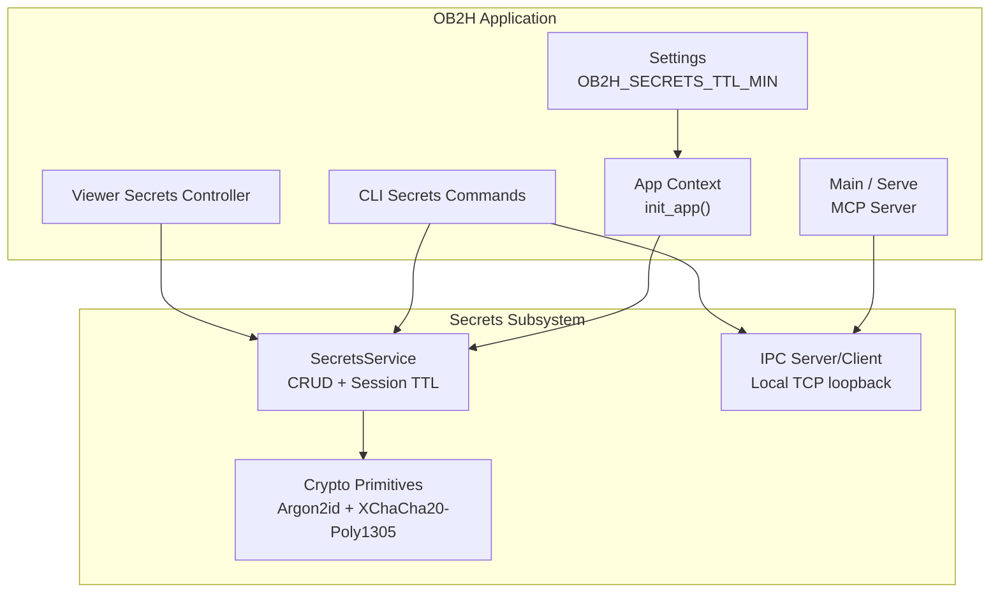
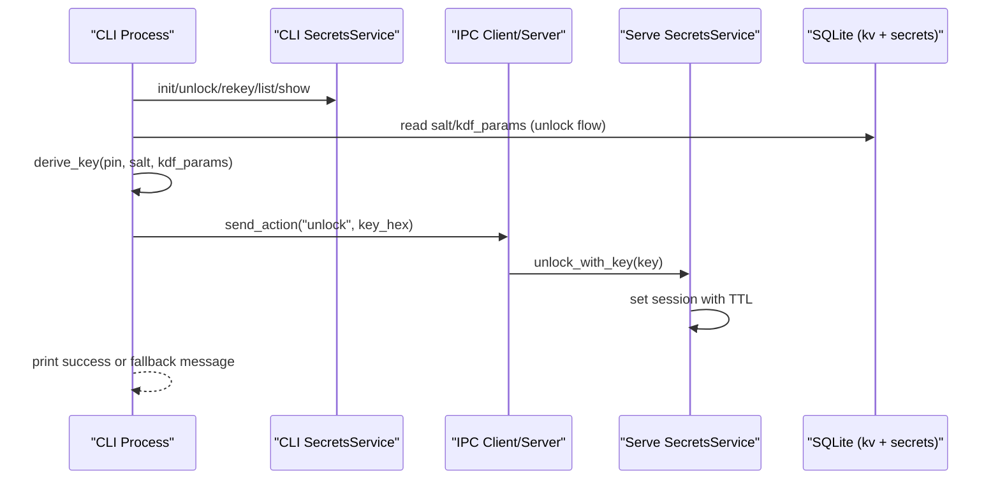
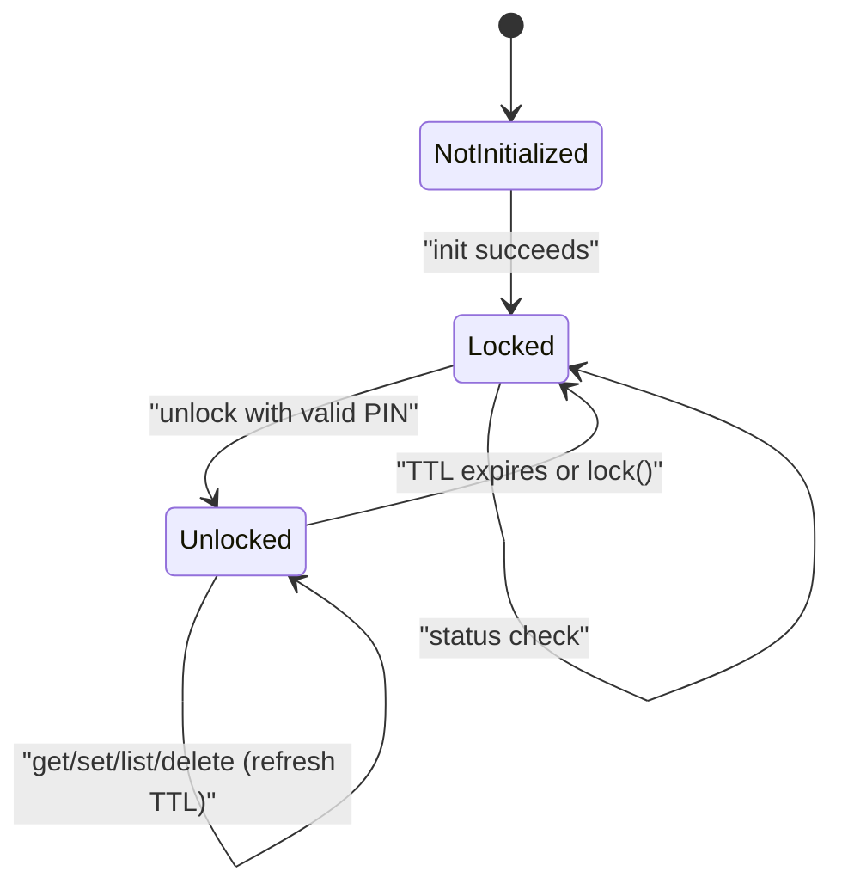
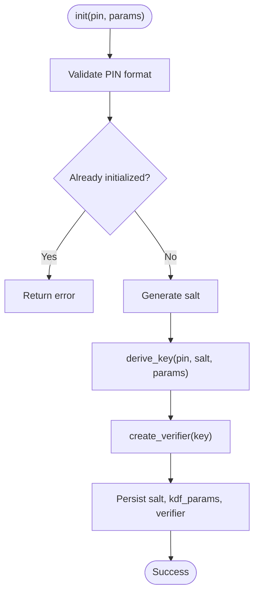
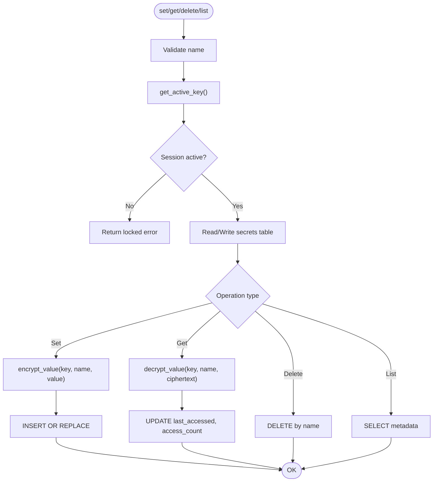
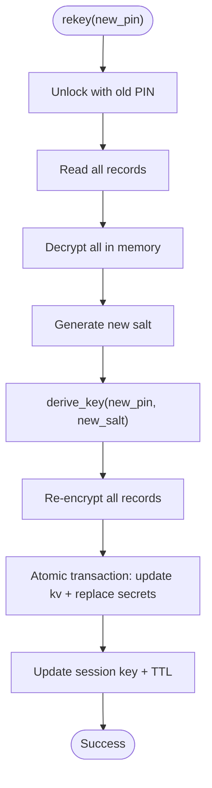
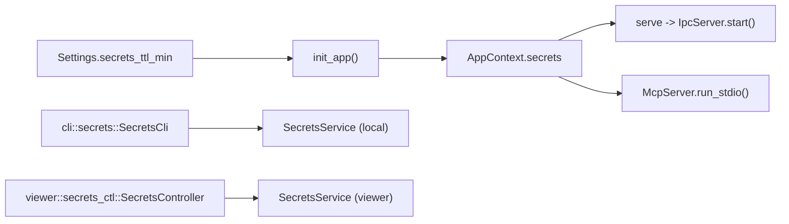
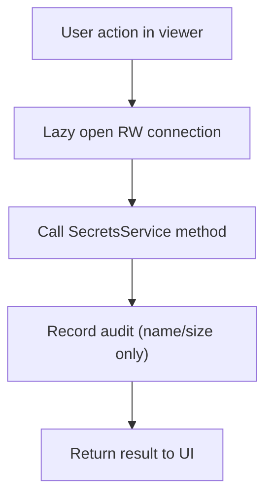
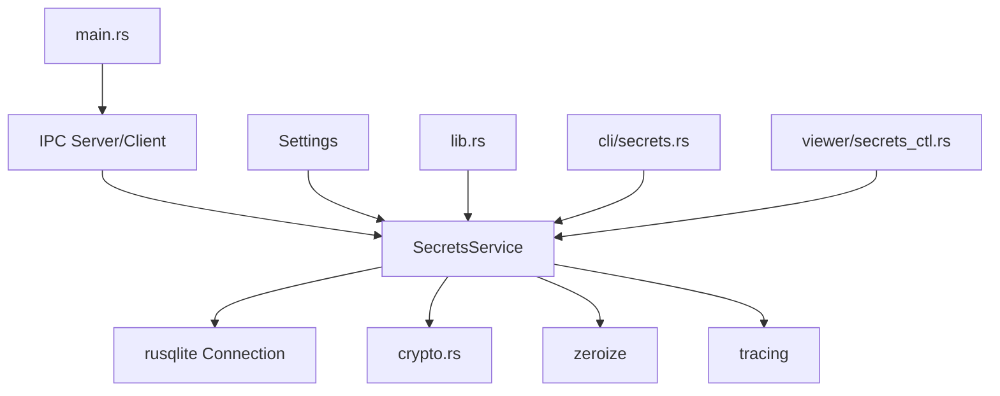

# Core Service Implementation

<cite>
**Referenced Files in This Document**
- [service.rs](file://src/secrets/service.rs)
- [mod.rs](file://src/secrets/mod.rs)
- [crypto.rs](file://src/secrets/crypto.rs)
- [ipc.rs](file://src/secrets/ipc.rs)
- [config.rs](file://src/config.rs)
- [lib.rs](file://src/lib.rs)
- [main.rs](file://src/main.rs)
- [secrets_ctl.rs](file://src/viewer/secrets_ctl.rs)
- [secrets.rs](file://src/cli/secrets.rs)
</cite>

## Table of Contents
1. [Introduction](#introduction)
2. [Project Structure](#project-structure)
3. [Core Components](#core-components)
4. [Architecture Overview](#architecture-overview)
5. [Detailed Component Analysis](#detailed-component-analysis)
6. [Dependency Analysis](#dependency-analysis)
7. [Performance Considerations](#performance-considerations)
8. [Troubleshooting Guide](#troubleshooting-guide)
9. [Conclusion](#conclusion)

## Introduction
This document explains the core SecretsService implementation that provides a secure, PIN-protected local secrets vault for OB2H. It covers the service lifecycle, vault initialization, encryption and decryption primitives, CRUD operations, TTL-based session management, IPC integration with the long-running serve process, configuration options, error handling patterns, thread safety, resource management, and performance considerations. The goal is to make the design understandable for both developers integrating the service and operators configuring it.

## Project Structure
The secrets subsystem lives under `src/secrets` and exposes:
- A cryptographic layer using Argon2id for key derivation and XChaCha20-Poly1305 for authenticated encryption.
- A stateful `SecretsService` that manages database-backed encrypted records, PIN validation, session TTL, and audit-friendly status reporting.
- An IPC mechanism allowing CLI unlock/lock commands to synchronize vault state with a background `ob2h serve` process.
- Integration points into the application context, CLI, viewer UI controller, and global settings.



**Diagram sources**
- [service.rs:43-56](file://src/secrets/service.rs#L43-L56)
- [crypto.rs:14-32](file://src/secrets/crypto.rs#L14-L32)
- [ipc.rs:35-43](file://src/secrets/ipc.rs#L35-L43)
- [config.rs:101-101](file://src/config.rs#L101-L101)
- [lib.rs:76-76](file://src/lib.rs#L76-L76)
- [main.rs:87-87](file://src/main.rs#L87-L87)
- [secrets.rs:137-143](file://src/cli/secrets.rs#L137-L143)
- [secrets_ctl.rs:37-57](file://src/viewer/secrets_ctl.rs#L37-L57)

**Section sources**
- [mod.rs:1-15](file://src/secrets/mod.rs#L1-L15)
- [service.rs:1-446](file://src/secrets/service.rs#L1-L446)
- [crypto.rs:1-168](file://src/secrets/crypto.rs#L1-L168)
- [ipc.rs:1-196](file://src/secrets/ipc.rs#L1-L196)
- [config.rs:1-523](file://src/config.rs#L1-L523)
- [lib.rs:46-135](file://src/lib.rs#L46-L135)
- [main.rs:17-90](file://src/main.rs#L17-L90)
- [secrets.rs:1-311](file://src/cli/secrets.rs#L1-L311)
- [secrets_ctl.rs:1-305](file://src/viewer/secrets_ctl.rs#L1-L305)

## Core Components
- SecretsService: Thread-safe service managing encrypted secret records, PIN-based unlocking, TTL sessions, and metadata access.
- Crypto module: Provides KDF parameters, salt generation, key derivation, AEAD encryption/decryption, and PIN verifier creation/checking.
- IPC module: Starts a local TCP server bound to loopback, exchanges JSON requests/responses with token authentication, and forwards unlock/lock actions to SecretsService.
- Settings: Global configuration including `secrets_ttl_min`, which controls default TTL for unlocked sessions.
- CLI and Viewer controllers: User-facing entry points that construct SecretsService instances, handle PIN prompts, and record audit events.

Key responsibilities:
- Initialization: Validate PIN format, generate salt, derive master key, store verifier and KDF params.
- Unlock/Lock: Derive key from PIN, verify against stored verifier, manage in-memory session with TTL.
- CRUD: Encrypt/decrypt values with name-bound AAD; track access counts and timestamps.
- Rekey: Decrypt all records with old key, re-encrypt with new key, atomically update DB and session.
- Status: Report initialized state, lock state, TTL remaining, and list of secret names without exposing values.

**Section sources**
- [service.rs:43-56](file://src/secrets/service.rs#L43-L56)
- [service.rs:58-111](file://src/secrets/service.rs#L58-L111)
- [service.rs:118-176](file://src/secrets/service.rs#L118-L176)
- [service.rs:205-250](file://src/secrets/service.rs#L205-L250)
- [service.rs:266-358](file://src/secrets/service.rs#L266-L358)
- [service.rs:360-444](file://src/secrets/service.rs#L360-L444)
- [crypto.rs:14-32](file://src/secrets/crypto.rs#L14-L32)
- [crypto.rs:34-52](file://src/secrets/crypto.rs#L34-L52)
- [crypto.rs:54-98](file://src/secrets/crypto.rs#L54-L98)
- [crypto.rs:100-111](file://src/secrets/crypto.rs#L100-L111)
- [ipc.rs:35-145](file://src/secrets/ipc.rs#L35-L145)
- [config.rs:101-101](file://src/config.rs#L101-L101)
- [config.rs:349-352](file://src/config.rs#L349-L352)
- [lib.rs:76-76](file://src/lib.rs#L76-L76)
- [main.rs:87-87](file://src/main.rs#L87-L87)
- [secrets.rs:137-143](file://src/cli/secrets.rs#L137-L143)
- [secrets_ctl.rs:37-57](file://src/viewer/secrets_ctl.rs#L37-L57)

## Architecture Overview
The SecretsService is instantiated once per process and shared via `Arc`. In the main serve process, an IPC server is started so that CLI commands can remotely unlock or lock the vault. The CLI constructs its own SecretsService instance for local operations and optionally notifies the running server when unlocking. The viewer UI controller lazily opens a read-write connection and wraps SecretsService to provide a safe, auditable UI workflow.



**Diagram sources**
- [secrets.rs:162-190](file://src/cli/secrets.rs#L162-L190)
- [ipc.rs:156-195](file://src/secrets/ipc.rs#L156-L195)
- [ipc.rs:39-145](file://src/secrets/ipc.rs#L39-L145)
- [service.rs:166-176](file://src/secrets/service.rs#L166-L176)

## Detailed Component Analysis

### SecretsService Lifecycle and State Model
SecretsService maintains:
- A shared SQLite connection (`Arc<Mutex<Connection>>`).
- An optional in-memory unlocked session containing the master key, deadline, and TTL.
- Default TTL duration configured at construction.

Lifecycle phases:
- Not initialized: No vault metadata present.
- Locked: Initialized but no active session or session expired.
- Unlocked: Active session exists within TTL; operations allowed.

Session behavior:
- Unlock derives and verifies the key, then sets a deadline based on TTL.
- Every successful operation refreshes the deadline (activity-based extension).
- Lock clears the session immediately.
- TTL expiry automatically locks the session on next access.



**Diagram sources**
- [service.rs:43-56](file://src/secrets/service.rs#L43-L56)
- [service.rs:118-176](file://src/secrets/service.rs#L118-L176)
- [service.rs:185-203](file://src/secrets/service.rs#L185-L203)
- [service.rs:205-250](file://src/secrets/service.rs#L205-L250)

**Section sources**
- [service.rs:43-56](file://src/secrets/service.rs#L43-L56)
- [service.rs:118-176](file://src/secrets/service.rs#L118-L176)
- [service.rs:185-203](file://src/secrets/service.rs#L185-L203)
- [service.rs:205-250](file://src/secrets/service.rs#L205-L250)

### Vault Initialization and PIN Handling
Initialization validates PIN format, ensures the vault is not already initialized, generates a random salt, derives the master key using Argon2id with configurable KDF parameters, creates a verifier, and persists salt, KDF params, and verifier in the KV table.

PIN handling:
- Strict format validation for new PINs (e.g., four digits).
- Unlock accepts legacy PIN formats for compatibility, relying on verifier check for correctness.
- Rekey enforces new PIN format and performs full re-encryption.



**Diagram sources**
- [service.rs:72-111](file://src/secrets/service.rs#L72-L111)
- [crypto.rs:34-52](file://src/secrets/crypto.rs#L34-L52)
- [crypto.rs:100-111](file://src/secrets/crypto.rs#L100-L111)

**Section sources**
- [service.rs:72-111](file://src/secrets/service.rs#L72-L111)
- [crypto.rs:34-52](file://src/secrets/crypto.rs#L34-L52)
- [crypto.rs:100-111](file://src/secrets/crypto.rs#L100-L111)

### Secret CRUD Operations
Operations require an unlocked session:
- Set: Validates name and value size, encrypts value with name-bound AAD, upserts record with timestamps and access count.
- Get: Validates name, retrieves ciphertext, decrypts, updates last accessed timestamp and access count.
- Delete: Validates name, removes record if present.
- List: Requires unlock, returns metadata without values.

Name validation restricts characters and length; value size limit prevents oversized payloads.



**Diagram sources**
- [service.rs:252-264](file://src/secrets/service.rs#L252-L264)
- [service.rs:266-358](file://src/secrets/service.rs#L266-L358)
- [service.rs:185-203](file://src/secrets/service.rs#L185-L203)
- [crypto.rs:54-98](file://src/secrets/crypto.rs#L54-L98)

**Section sources**
- [service.rs:252-264](file://src/secrets/service.rs#L252-L264)
- [service.rs:266-358](file://src/secrets/service.rs#L266-L358)
- [crypto.rs:54-98](file://src/secrets/crypto.rs#L54-L98)

### Rekey Operation
Rekey changes the PIN and re-encrypts all existing records:
1. Unlock with current PIN.
2. Read all records and decrypt them in memory.
3. Generate new salt and derive new key.
4. Re-encrypt all records with new key.
5. Atomically update KV metadata and replace secrets table contents.
6. Update the in-memory session with the new key and refreshed TTL.



**Diagram sources**
- [service.rs:360-444](file://src/secrets/service.rs#L360-L444)

**Section sources**
- [service.rs:360-444](file://src/secrets/service.rs#L360-L444)

### IPC Integration
The serve process starts an IPC server bound to loopback with a generated token. CLI processes connect to this server to request unlock or lock. The server validates the token, decodes the key hex, and calls `unlock_with_key` or `lock` on the shared SecretsService instance.

```mermaid
sequenceDiagram
participant CLI as "CLI"
participant IPCClient as "IpcClient"
participant IPCServer as "IpcServer"
participant Svc as "SecretsService"
CLI->>IPCClient : send_action("unlock", key_hex)
IPCClient->>IPCServer : JSON {token, action, key_hex}
IPCServer->>IPCServer : validate token
IPCServer->>Svc : unlock_with_key(Zeroizing<[u8;32]>)
Svc-->>IPCServer : session updated
IPCServer-->>IPCClient : {ok : true, message : "Vault unlocked"}
IPCClient-->>CLI : true/false
```

**Diagram sources**
- [ipc.rs:39-145](file://src/secrets/ipc.rs#L39-L145)
- [ipc.rs:156-195](file://src/secrets/ipc.rs#L156-L195)
- [service.rs:166-176](file://src/secrets/service.rs#L166-L176)

**Section sources**
- [ipc.rs:39-145](file://src/secrets/ipc.rs#L39-L145)
- [ipc.rs:156-195](file://src/secrets/ipc.rs#L156-L195)
- [service.rs:166-176](file://src/secrets/service.rs#L166-L176)

### Configuration Options
- `OB2H_SECRETS_TTL_MIN`: Controls default TTL in minutes for unlocked sessions. Converted to seconds when constructing SecretsService.
- KDF parameters are persisted per vault and default to Argon2id with specific memory/time/parallelism costs.

Environment resolution:
- Settings reads environment variables and defaults.
- Secrets TTL is applied across CLI and serve contexts.

**Section sources**
- [config.rs:101-101](file://src/config.rs#L101-L101)
- [config.rs:349-352](file://src/config.rs#L349-L352)
- [config.rs:365-414](file://src/config.rs#L365-L414)
- [crypto.rs:14-32](file://src/secrets/crypto.rs#L14-L32)

### Dependency Injection and Usage Points
- App context initialization constructs SecretsService with the shared DB connection and TTL derived from settings.
- Main serve path starts IPC server with the same SecretsService instance.
- CLI constructs a separate SecretsService instance for local operations and optionally notifies the serve process.
- Viewer controller lazily initializes SecretsService and records audit events for user actions.



**Diagram sources**
- [lib.rs:76-76](file://src/lib.rs#L76-L76)
- [main.rs:87-87](file://src/main.rs#L87-L87)
- [secrets.rs:137-143](file://src/cli/secrets.rs#L137-L143)
- [secrets_ctl.rs:37-57](file://src/viewer/secrets_ctl.rs#L37-L57)

**Section sources**
- [lib.rs:46-135](file://src/lib.rs#L46-L135)
- [main.rs:87-87](file://src/main.rs#L87-L87)
- [secrets.rs:137-143](file://src/cli/secrets.rs#L137-L143)
- [secrets_ctl.rs:37-57](file://src/viewer/secrets_ctl.rs#L37-L57)

### Audit Logging and Viewer Safety
The viewer controller wraps SecretsService operations and records audit entries with actor=user and source_tool=viewer. It logs only names and sizes, never secret values. Incorrect PIN attempts do not write audit entries.



**Diagram sources**
- [secrets_ctl.rs:86-92](file://src/viewer/secrets_ctl.rs#L86-L92)
- [secrets_ctl.rs:94-166](file://src/viewer/secrets_ctl.rs#L94-L166)

**Section sources**
- [secrets_ctl.rs:86-92](file://src/viewer/secrets_ctl.rs#L86-L92)
- [secrets_ctl.rs:94-166](file://src/viewer/secrets_ctl.rs#L94-L166)

## Dependency Analysis
SecretsService depends on:
- SQLite via rusqlite for persistent storage of KV metadata and encrypted secrets.
- Crypto primitives for key derivation, salt generation, and AEAD encryption/decryption.
- Zeroize for secure memory handling of master keys.
- Tracing for structured logging of lifecycle events.
- IPC for cross-process synchronization between CLI and serve.

External integrations:
- Settings provide TTL configuration.
- Main and lib orchestrate service instantiation and IPC startup.
- CLI and viewer provide user interaction and audit recording.



**Diagram sources**
- [service.rs:1-15](file://src/secrets/service.rs#L1-L15)
- [crypto.rs:1-11](file://src/secrets/crypto.rs#L1-L11)
- [ipc.rs:1-13](file://src/secrets/ipc.rs#L1-L13)
- [config.rs:1-10](file://src/config.rs#L1-L10)
- [lib.rs:46-76](file://src/lib.rs#L46-L76)
- [main.rs:87-87](file://src/main.rs#L87-L87)
- [secrets.rs:1-10](file://src/cli/secrets.rs#L1-L10)
- [secrets_ctl.rs:1-19](file://src/viewer/secrets_ctl.rs#L1-L19)

**Section sources**
- [service.rs:1-15](file://src/secrets/service.rs#L1-L15)
- [crypto.rs:1-11](file://src/secrets/crypto.rs#L1-L11)
- [ipc.rs:1-13](file://src/secrets/ipc.rs#L1-L13)
- [config.rs:1-10](file://src/config.rs#L1-L10)
- [lib.rs:46-76](file://src/lib.rs#L46-L76)
- [main.rs:87-87](file://src/main.rs#L87-L87)
- [secrets.rs:1-10](file://src/cli/secrets.rs#L1-L10)
- [secrets_ctl.rs:1-19](file://src/viewer/secrets_ctl.rs#L1-L19)

## Performance Considerations
- Key derivation uses Argon2id with tunable parameters; defaults balance security and performance. For interactive flows, consider adjusting KDF parameters if needed, though persistence ensures consistent behavior across runs.
- Encryption uses XChaCha20-Poly1305 with random nonces and name-bound AAD, ensuring integrity and confidentiality while preventing cross-name misuse.
- Session TTL reduces exposure window; activity-based extension improves UX without compromising security.
- Database writes are wrapped in transactions during initialization and rekey to ensure atomicity.
- Viewer controller lazily opens RW connections to avoid unnecessary overhead when the secrets tab is idle.
- Access statistics (last_accessed, access_count) are updated after successful get operations; batch updates could be considered for high-frequency access patterns.

[No sources needed since this section provides general guidance]

## Troubleshooting Guide
Common issues and resolutions:
- Vault not initialized: Run initialization command; ensure PIN format matches requirements.
- Wrong PIN: Unlock fails verifier check; confirm correct PIN or use rekey after successful unlock.
- Session expired: Unlock again; adjust `OB2H_SECRETS_TTL_MIN` for longer sessions.
- IPC not reachable: Verify serve process is running; CLI will fall back to local unlock notification.
- Name validation errors: Use allowed characters `[A-Za-z0-9._-]` and keep length within limits.
- Value too large: Keep secret values under the enforced maximum size.
- Viewer audit missing: Ensure RW connection is established by performing an action; incorrect PIN does not write audit.

Operational checks:
- Use status command to inspect initialized state, lock state, TTL remaining, and secret names.
- Confirm IPC server info file exists when serve is running.
- Review logs for lifecycle events such as initialization, unlock, lock, and rekey completion.

**Section sources**
- [service.rs:58-111](file://src/secrets/service.rs#L58-L111)
- [service.rs:118-176](file://src/secrets/service.rs#L118-L176)
- [service.rs:205-250](file://src/secrets/service.rs#L205-L250)
- [service.rs:252-264](file://src/secrets/service.rs#L252-L264)
- [service.rs:266-358](file://src/secrets/service.rs#L266-L358)
- [service.rs:360-444](file://src/secrets/service.rs#L360-L444)
- [ipc.rs:156-195](file://src/secrets/ipc.rs#L156-L195)
- [secrets_ctl.rs:86-92](file://src/viewer/secrets_ctl.rs#L86-L92)

## Conclusion
SecretsService provides a robust, secure, and configurable secrets vault integrated throughout OB2H. Its design emphasizes secure memory handling, strong cryptography, clear lifecycle states, and minimal exposure windows through TTL. Integration points across CLI, serve, and viewer ensure consistent behavior and comprehensive auditing. Operators should configure TTL appropriately, maintain PIN hygiene, and monitor IPC connectivity for seamless cross-process operations.

[No sources needed since this section summarizes without analyzing specific files]