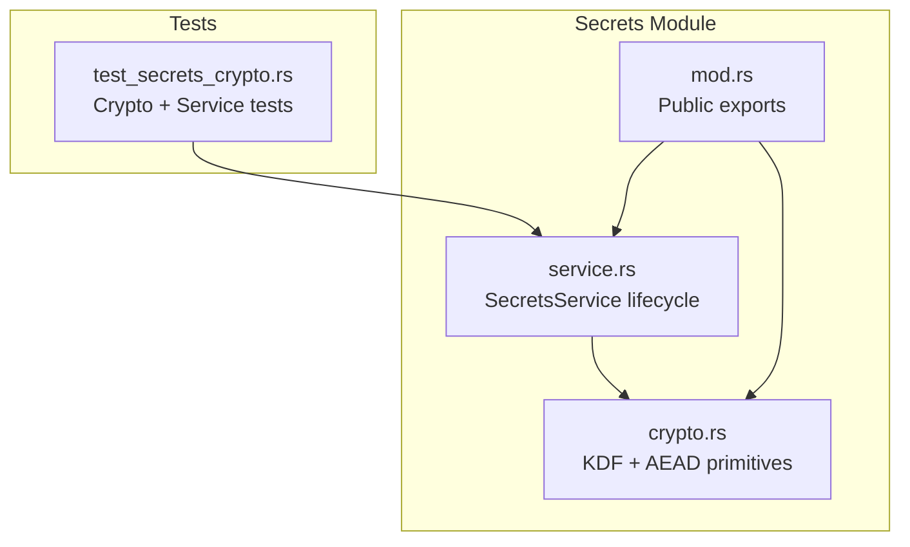
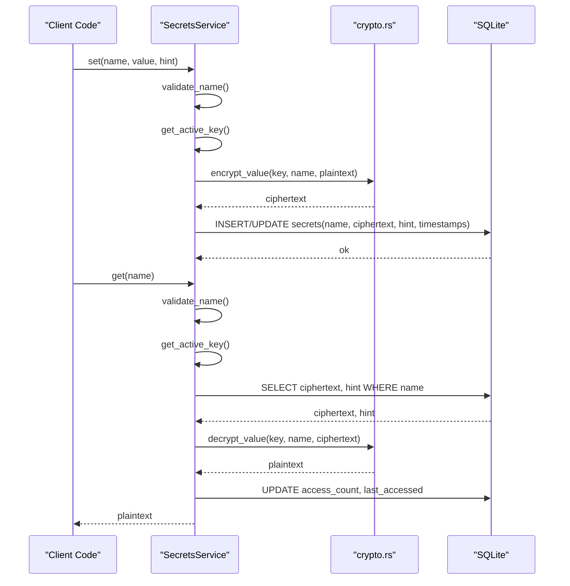
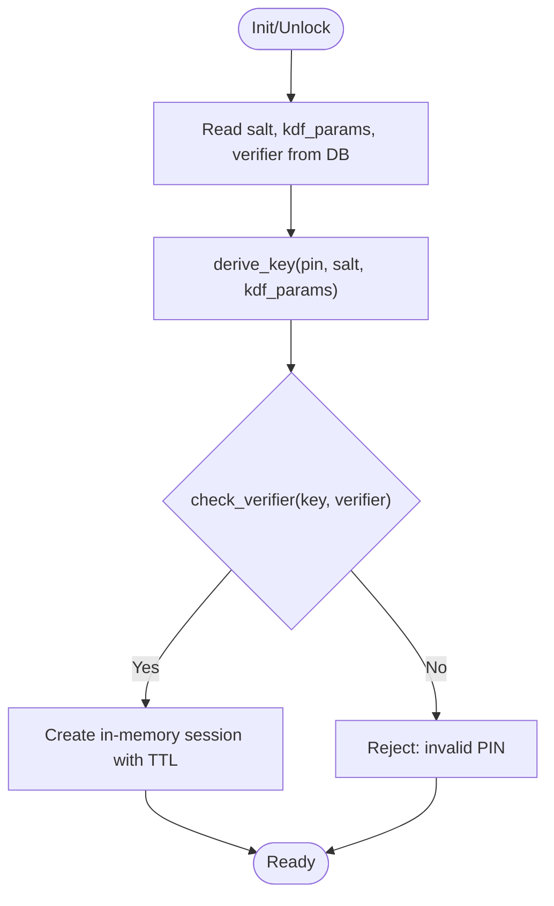
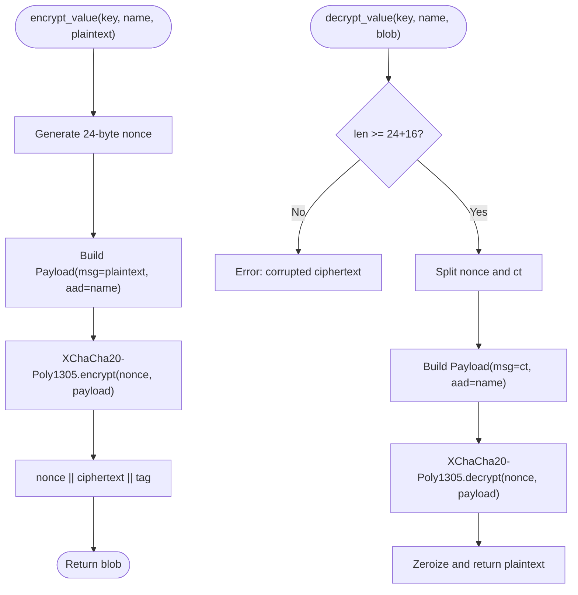
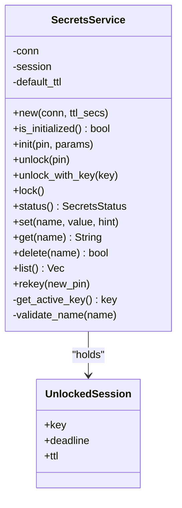
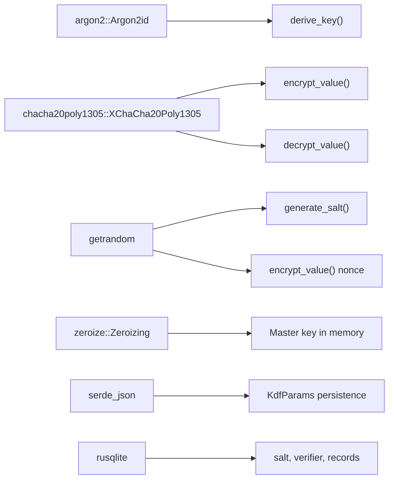

# Cryptographic Implementation

<cite>
**Referenced Files in This Document**
- [crypto.rs](file://src/secrets/crypto.rs)
- [service.rs](file://src/secrets/service.rs)
- [mod.rs](file://src/secrets/mod.rs)
- [test_secrets_crypto.rs](file://tests/test_secrets_crypto.rs)
</cite>

## Table of Contents
1. [Introduction](#introduction)
2. [Project Structure](#project-structure)
3. [Core Components](#core-components)
4. [Architecture Overview](#architecture-overview)
5. [Detailed Component Analysis](#detailed-component-analysis)
6. [Dependency Analysis](#dependency-analysis)
7. [Performance Considerations](#performance-considerations)
8. [Troubleshooting Guide](#troubleshooting-guide)
9. [Conclusion](#conclusion)

## Introduction
This document explains the cryptographic implementation of the Secrets Service, focusing on:
- XChaCha20-Poly1305 authenticated encryption for secret values
- Argon2id key derivation from a PIN and salt to produce a 32-byte master key
- Secure handling of salts, nonces, verifiers, and in-memory keys
- KDF parameters and their storage
- Encryption/decryption workflows, key rotation, and security considerations

The implementation is designed to keep secrets encrypted at rest and only decrypt them while the vault session is active. Master keys are held in memory with zeroization support and are automatically invalidated after lock or TTL expiration.

## Project Structure
The cryptographic layer lives under the Secrets module:
- `src/secrets/crypto.rs` implements primitives: Argon2id KDF, XChaCha20-Poly1305 AEAD, salt generation, verifier creation/checking
- `src/secrets/service.rs` implements the SecretsService lifecycle: init, unlock, lock, set/get/delete/list, rekey, TTL-based session management
- `src/secrets/mod.rs` exposes public types and services
- `tests/test_secrets_crypto.rs` validates crypto round-trips, error conditions, and service lifecycle including rekey behavior

**Diagram sources**
- [crypto.rs:1-168](file://src/secrets/crypto.rs#L1-L168)
- [service.rs:1-446](file://src/secrets/service.rs#L1-L446)
- [mod.rs:1-15](file://src/secrets/mod.rs#L1-L15)
- [test_secrets_crypto.rs:1-131](file://tests/test_secrets_crypto.rs#L1-L131)

**Section sources**
- [crypto.rs:1-168](file://src/secrets/crypto.rs#L1-L168)
- [service.rs:1-446](file://src/secrets/service.rs#L1-L446)
- [mod.rs:1-15](file://src/secrets/mod.rs#L1-L15)
- [test_secrets_crypto.rs:1-131](file://tests/test_secrets_crypto.rs#L1-L131)

## Core Components
- KdfParams: Serializable parameters for Argon2id (memory cost, time cost, parallelism). Defaults are tuned for security; tests use lower costs for speed.
- derive_key: Derives a 32-byte master key from PIN and salt using Argon2id. Returns a zeroized buffer.
- generate_salt: Produces a cryptographically secure 16-byte salt via getrandom.
- encrypt_value / decrypt_value: XChaCha20-Poly1305 AEAD encryption/decryption with per-record random nonce and name-bound AAD.
- create_verifier / check_verifier: Verifies PIN correctness by encrypting/decrypting a known magic string bound to a dedicated AAD.
- SecretsService: Manages vault initialization, unlocking with PIN, TTL-based sessions, CRUD operations over encrypted records, and rekeying (PIN rotation) with full re-encryption.

Key design points:
- Nonce is unique per encryption and stored alongside ciphertext.
- Secret names are used as AAD to bind ciphertext to its logical identity.
- Master key never persists; it exists only in process memory during an unlocked session.
- Session TTL auto-locks the vault and drops the key.

**Section sources**
- [crypto.rs:13-52](file://src/secrets/crypto.rs#L13-L52)
- [crypto.rs:54-111](file://src/secrets/crypto.rs#L54-L111)
- [service.rs:37-47](file://src/secrets/service.rs#L37-L47)
- [service.rs:71-111](file://src/secrets/service.rs#L71-L111)
- [service.rs:118-176](file://src/secrets/service.rs#L118-L176)
- [service.rs:185-203](file://src/secrets/service.rs#L185-L203)
- [service.rs:266-358](file://src/secrets/service.rs#L266-L358)
- [service.rs:360-444](file://src/secrets/service.rs#L360-L444)

## Architecture Overview
The Secrets Service composes cryptographic primitives with a session-aware service layer. The flow for storing and retrieving secrets is:

**Diagram sources**
- [service.rs:266-322](file://src/secrets/service.rs#L266-L322)
- [crypto.rs:54-98](file://src/secrets/crypto.rs#L54-L98)

## Detailed Component Analysis

### KDF and Key Management
- Algorithm: Argon2id (password hashing variant resistant to both side-channel and GPU/ASIC attacks).
- Output: 32-byte master key suitable for XChaCha20-Poly1305.
- Parameters:
  - m_cost: Memory usage in KiB (default 65536 KiB = 64 MiB)
  - t_cost: Iterations (default 3)
  - p_cost: Parallelism (default 1)
- Salt: 16 bytes generated via getrandom, stored in the database as hex.
- Verifier: A small ciphertext of a known magic string bound to a dedicated AAD; used to validate PIN without exposing the master key.

Security practices:
- Master key is wrapped in a zeroizing container and dropped when the session ends.
- KDF parameters are persisted so that future unlocks can reproduce the same key.
- PIN validation uses the verifier rather than comparing raw hashes.

**Diagram sources**
- [service.rs:118-164](file://src/secrets/service.rs#L118-L164)
- [crypto.rs:34-52](file://src/secrets/crypto.rs#L34-L52)
- [crypto.rs:100-111](file://src/secrets/crypto.rs#L100-L111)

**Section sources**
- [crypto.rs:13-52](file://src/secrets/crypto.rs#L13-L52)
- [crypto.rs:100-111](file://src/secrets/crypto.rs#L100-L111)
- [service.rs:71-111](file://src/secrets/service.rs#L71-L111)
- [service.rs:118-164](file://src/secrets/service.rs#L118-L164)

### Encryption and Decryption Primitives
- Cipher: XChaCha20-Poly1305 (AEAD), providing confidentiality and integrity.
- Nonce: 24 bytes, randomly generated per encryption, prepended to ciphertext.
- AAD: Secret name is bound to ciphertext to prevent cross-name misuse.
- Storage format: nonce || ciphertext || tag.

Error handling:
- Rejects malformed ciphertext length.
- Fails decryption if AAD mismatches or key is incorrect.
- Zeroizes decrypted output before returning.

**Diagram sources**
- [crypto.rs:54-98](file://src/secrets/crypto.rs#L54-L98)

**Section sources**
- [crypto.rs:54-98](file://src/secrets/crypto.rs#L54-L98)

### SecretsService Lifecycle and Operations
- Initialization:
  - Validates PIN format.
  - Generates salt and derives key.
  - Creates verifier and stores salt, KDF params, and verifier in the database.
- Unlock/Lock:
  - Unlock reconstructs key from PIN and verifies against stored verifier.
  - Stores master key in a zeroized session with TTL; lock clears the session.
- Get/Set/Delete/List:
  - All require an active unlocked session.
  - Set encrypts with name-bound AAD and persists metadata.
  - Get decrypts and updates access statistics.
  - List returns metadata without values.
- Rekey (Key Rotation):
  - Reads all records, decrypts in memory with old key.
  - Generates new salt and derives new key from new PIN.
  - Re-encrypts all records with new key and atomically updates DB.
  - Updates in-memory session to new key.

**Diagram sources**
- [service.rs:37-47](file://src/secrets/service.rs#L37-L47)
- [service.rs:49-203](file://src/secrets/service.rs#L49-L203)
- [service.rs:266-444](file://src/secrets/service.rs#L266-L444)

**Section sources**
- [service.rs:49-203](file://src/secrets/service.rs#L49-L203)
- [service.rs:266-444](file://src/secrets/service.rs#L266-L444)

### Example Workflows

#### Encryption/Decryption Round-Trip
- Generate salt and derive key from PIN.
- Encrypt a secret value with its name as AAD.
- Decrypt using the same key and name; verify equality.
- Verify failure cases: wrong name (AAD mismatch), wrong key, single-bit corruption.

These scenarios are validated in unit tests covering round-trip success and multiple error paths.

**Section sources**
- [test_secrets_crypto.rs:7-38](file://tests/test_secrets_crypto.rs#L7-L38)
- [crypto.rs:117-149](file://src/secrets/crypto.rs#L117-L149)

#### Service Lifecycle and Rekey
- Initialize vault with PIN and optional KDF parameters.
- Unlock with correct PIN; verify status shows unlocked with TTL.
- Set and get a secret; list metadata; delete a secret.
- Rekey to a new PIN; confirm previous values remain accessible until lock/unlock cycle.
- Lock and unlock with new PIN; confirm old PIN fails.

**Section sources**
- [test_secrets_crypto.rs:61-130](file://tests/test_secrets_crypto.rs#L61-L130)
- [service.rs:71-111](file://src/secrets/service.rs#L71-L111)
- [service.rs:118-176](file://src/secrets/service.rs#L118-L176)
- [service.rs:266-444](file://src/secrets/service.rs#L266-L444)

## Dependency Analysis
Cryptographic dependencies and relationships:
- `argon2` provides Argon2id for KDF.
- `chacha20poly1305` provides XChaCha20-Poly1305 AEAD.
- `getrandom` supplies secure randomness for salt and nonce.
- `zeroize` ensures sensitive buffers are cleared from memory.
- `serde_json` serializes KDF parameters for persistence.
- `rusqlite` persists salt, verifier, KDF parameters, and encrypted records.

**Diagram sources**
- [crypto.rs:3-8](file://src/secrets/crypto.rs#L3-L8)
- [crypto.rs:34-52](file://src/secrets/crypto.rs#L34-L52)
- [crypto.rs:54-98](file://src/secrets/crypto.rs#L54-L98)
- [service.rs:8-15](file://src/secrets/service.rs#L8-L15)

**Section sources**
- [crypto.rs:3-8](file://src/secrets/crypto.rs#L3-L8)
- [service.rs:8-15](file://src/secrets/service.rs#L8-L15)

## Performance Considerations
- Argon2id tuning:
  - Default m_cost=65536 KiB, t_cost=3, p_cost=1 balances security and performance.
  - Tests reduce m_cost/t_cost for faster execution.
  - Adjust parameters based on target hardware and threat model.
- AEAD overhead:
  - XChaCha20-Poly1305 is fast and efficient; overhead includes tag and nonce storage.
  - Each record adds 24 bytes for nonce plus Poly1305 tag size.
- I/O patterns:
  - Rekey performs full read-decrypt-reencrypt-write cycle; consider batching and minimizing contention.
- Memory safety:
  - Zeroizing master key reduces exposure window; ensure no accidental logging or long-lived references.

[No sources needed since this section provides general guidance]

## Troubleshooting Guide
Common issues and resolutions:
- Invalid PIN:
  - Unlock fails due to verifier mismatch. Ensure PIN matches the one used during init or rekey.
- Wrong secret name:
  - Decryption fails because AAD does not match the original name used during encryption. Use the exact name.
- Corrupted ciphertext:
  - Any modification to stored ciphertext will fail integrity checks. Restore from backup if necessary.
- Expired session:
  - Accessing secrets after TTL expires requires unlocking again.
- Rekey failures:
  - Ensure sufficient memory and CPU for Argon2id and AEAD operations; rekey processes all records.

Operational tips:
- Monitor access counts and last accessed timestamps to detect unusual usage.
- Keep KDF parameters consistent across environments; changing them invalidates existing vaults unless migration logic is provided.
- Avoid logging sensitive data; use structured logs with redaction where possible.

**Section sources**
- [crypto.rs:77-98](file://src/secrets/crypto.rs#L77-L98)
- [service.rs:185-203](file://src/secrets/service.rs#L185-L203)
- [service.rs:266-322](file://src/secrets/service.rs#L266-L322)
- [service.rs:360-444](file://src/secrets/service.rs#L360-L444)

## Conclusion
The Secrets Service implements a robust cryptographic stack:
- Argon2id securely derives a master key from a PIN and salt.
- XChaCha20-Poly1305 provides authenticated encryption with name-bound AAD.
- Salts, nonces, and verifiers are handled securely, with master keys confined to memory and zeroized upon session end.
- The service enforces strict access controls, TTL-based locking, and supports safe key rotation through rekey.

For compliance and best practices:
- Tune Argon2id parameters to your environment’s capabilities and threat model.
- Enforce strong PIN policies and rotate periodically via rekey.
- Protect backups and avoid leaking metadata or logs containing sensitive information.
- Regularly audit access patterns and update KDF parameters as standards evolve.

[No sources needed since this section summarizes without analyzing specific files]