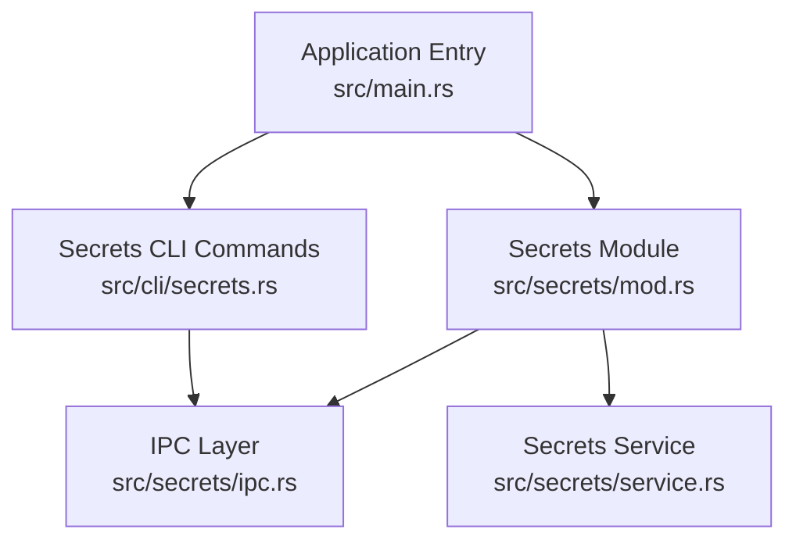
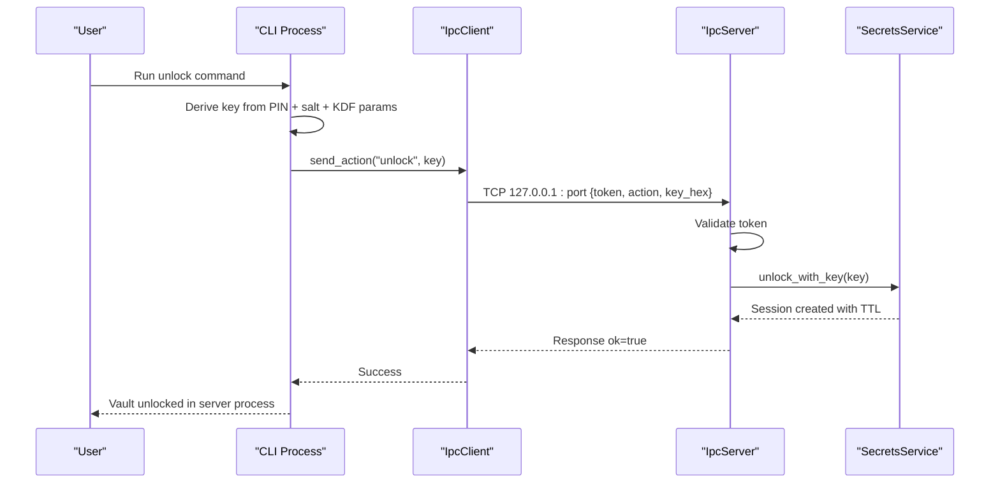
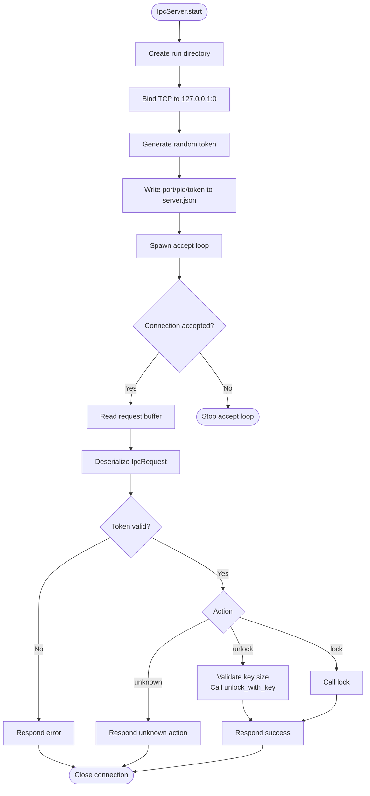
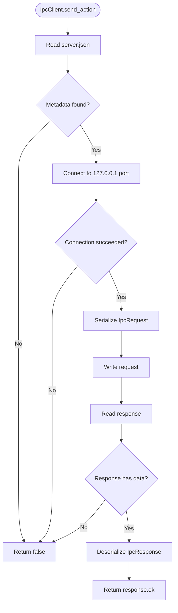
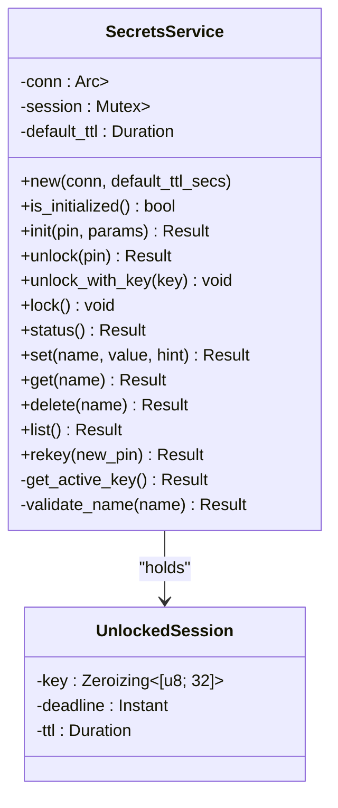
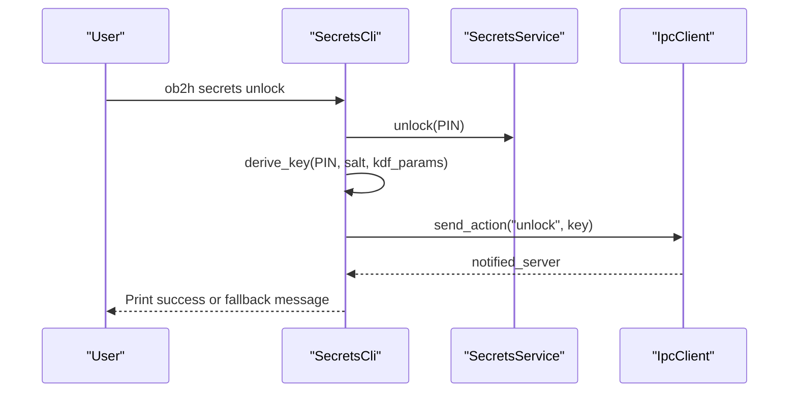
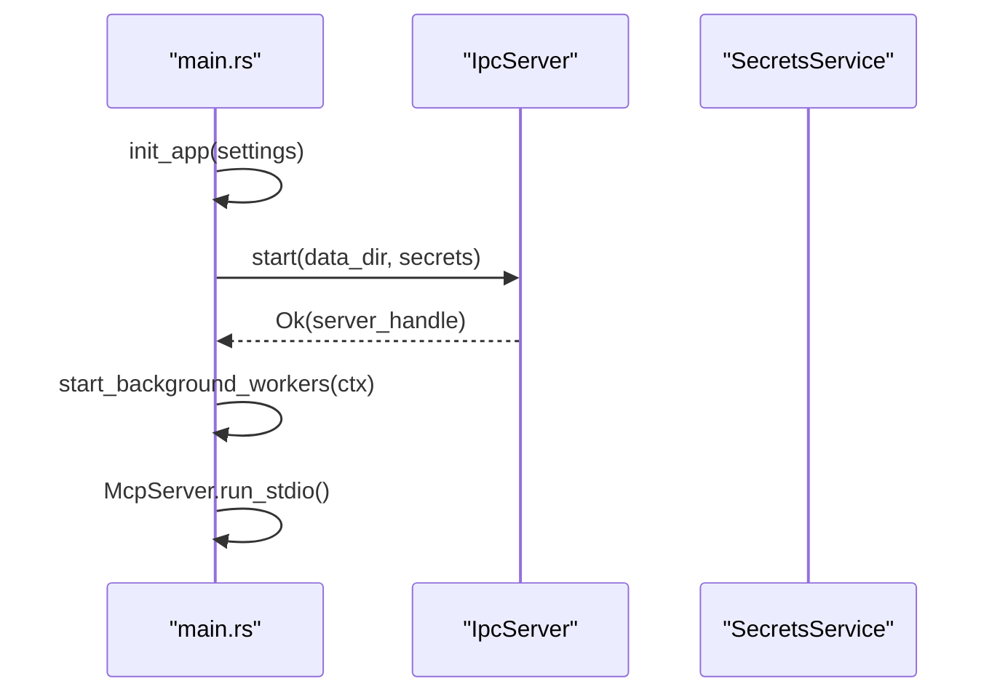
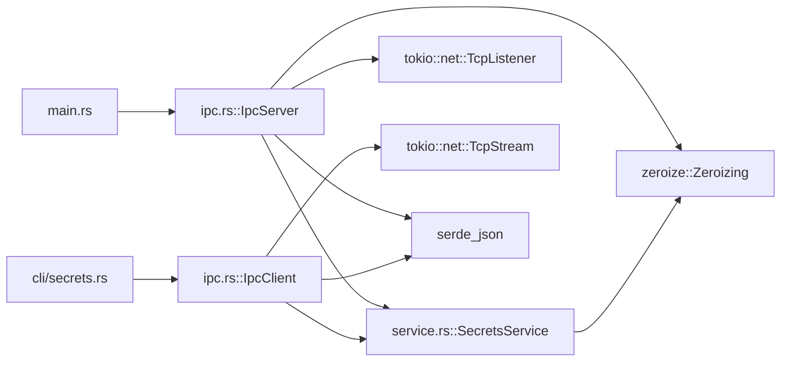

# Inter-Process Communication

<cite>
**Referenced Files in This Document**
- [ipc.rs](file://src/secrets/ipc.rs)
- [service.rs](file://src/secrets/service.rs)
- [mod.rs](file://src/secrets/mod.rs)
- [secrets.rs](file://src/cli/secrets.rs)
- [main.rs](file://src/main.rs)
</cite>

## Table of Contents
1. [Introduction](#introduction)
2. [Project Structure](#project-structure)
3. [Core Components](#core-components)
4. [Architecture Overview](#architecture-overview)
5. [Detailed Component Analysis](#detailed-component-analysis)
6. [Dependency Analysis](#dependency-analysis)
7. [Performance Considerations](#performance-considerations)
8. [Troubleshooting Guide](#troubleshooting-guide)
9. [Conclusion](#conclusion)

## Introduction
This document explains the inter-process communication (IPC) system used to securely coordinate secret vault state between a long-running `ob2h serve` process and short-lived CLI commands. The IPC layer is intentionally minimal: it exposes only two operations, unlock and lock, over a loopback TCP channel protected by a per-server random token. The actual secrets master key never leaves the server process; instead, the CLI derives the same key locally and asks the server to enter an unlocked session for a bounded time-to-live.

The design isolates secrets through:
- Process boundaries: only one privileged process holds the decrypted master key.
- Loopback-only networking: connections are restricted to `127.0.0.1`.
- Token-based access control: every request must include a randomly generated server token.
- Time-bounded sessions: the server automatically expires the active key after a configured TTL.
- In-memory key isolation: the master key is wrapped with zeroization and dropped on lock or expiration.

## Project Structure
The IPC implementation lives under the secrets module and is wired into the application entry point and CLI:

**Diagram sources**
- [main.rs:62-90](file://src/main.rs#L62-L90)
- [mod.rs:1-15](file://src/secrets/mod.rs#L1-L15)
- [ipc.rs:35-195](file://src/secrets/ipc.rs#L35-L195)
- [service.rs:43-47](file://src/secrets/service.rs#L43-L47)
- [secrets.rs:134-310](file://src/cli/secrets.rs#L134-L310)

**Section sources**
- [main.rs:62-90](file://src/main.rs#L62-L90)
- [mod.rs:1-15](file://src/secrets/mod.rs#L1-L15)

## Core Components
The IPC system consists of three primary components:

| Component | Responsibility | Security Role |
|---|---|---|
| `IpcServer` | Starts a loopback TCP listener, writes server metadata to disk, validates tokens, and dispatches actions to `SecretsService`. | Enforces process-local binding, token validation, and action authorization. |
| `IpcClient` | Reads server metadata from disk, connects to the server, sends JSON requests, and parses responses. | Avoids sending raw keys across the network; sends only hex-encoded derived keys when needed. |
| `SecretsService` | Manages initialization, PIN unlocking, TTL-bound sessions, encryption/decryption, and persistence. | Holds the master key in memory, enforces TTL, and wipes it on lock. |

Key data structures:

| Structure | Fields | Purpose |
|---|---|---|
| `ServerIpcInfo` | `port`, `pid`, `token` | Server discovery and authentication metadata written to `run/server.json`. |
| `IpcRequest` | `token`, `action`, `key_hex` | Client request payload. |
| `IpcResponse` | `ok`, `message` | Server response payload. |
| `UnlockedSession` | `key`, `deadline`, `ttl` | In-memory session holding the master key and its expiry. |

**Section sources**
- [ipc.rs:15-33](file://src/secrets/ipc.rs#L15-L33)
- [service.rs:37-47](file://src/secrets/service.rs#L37-L47)

## Architecture Overview
The secure flow relies on separating responsibilities:

- The server owns the secret vault and the decrypted master key.
- The CLI can derive the same key locally using the stored salt and KDF parameters.
- The CLI asks the server to unlock or lock via IPC, but does not expose the key outside the process unless explicitly requested.
- The server validates the token before performing any operation.

**Diagram sources**
- [secrets.rs:162-190](file://src/cli/secrets.rs#L162-L190)
- [ipc.rs:163-194](file://src/secrets/ipc.rs#L163-L194)
- [ipc.rs:66-140](file://src/secrets/ipc.rs#L66-L140)
- [service.rs:166-176](file://src/secrets/service.rs#L166-L176)

## Detailed Component Analysis

### IpcServer
`IpcServer` starts a Tokio TCP listener bound to `127.0.0.1` on a random port. It generates a cryptographically random token, writes `port`, `pid`, and `token` to `data_dir/run/server.json`, and spawns an accept loop. Each accepted connection is handled in a separate task that:

1. Reads up to 4096 bytes.
2. Deserializes the JSON request.
3. Validates the token against the expected server token.
4. Dispatches the action:
   - `unlock`: expects a 32-byte key encoded as hex; calls `SecretsService::unlock_with_key`.
   - `lock`: calls `SecretsService::lock`.
5. Serializes and writes the response.

On drop, the server removes the `server.json` file.

**Diagram sources**
- [ipc.rs:39-145](file://src/secrets/ipc.rs#L39-L145)
- [ipc.rs:148-152](file://src/secrets/ipc.rs#L148-L152)

**Section sources**
- [ipc.rs:35-152](file://src/secrets/ipc.rs#L35-L152)

### IpcClient
`IpcClient` provides two methods:

- `read_server_info`: reads `data_dir/run/server.json` and returns server metadata if present.
- `send_action`: connects to `127.0.0.1:<port>`, sends a JSON request containing the token, action, and optional hex-encoded key, then reads and parses the response.

Important behavior:
- If the server metadata file is missing, the client treats this as “server not running” and returns success without error.
- If the TCP connection fails, the client also returns success without error.
- Only successful deserialization and non-empty read result in returning the response’s `ok` field.

**Diagram sources**
- [ipc.rs:154-195](file://src/secrets/ipc.rs#L154-L195)

**Section sources**
- [ipc.rs:154-195](file://src/secrets/ipc.rs#L154-L195)

### SecretsService
`SecretsService` manages the encrypted secret store and the in-memory unlocked session:

- Initialization stores salt, KDF parameters, and a verifier.
- PIN-based unlocking derives the key, verifies it, and creates a session with a deadline.
- IPC-based unlocking accepts a pre-derived 32-byte key directly.
- Locking clears the session.
- All sensitive keys are wrapped with zeroization.
- TTL checks extend the deadline on successful access and reject expired sessions.

**Diagram sources**
- [service.rs:37-47](file://src/secrets/service.rs#L37-L47)
- [service.rs:49-203](file://src/secrets/service.rs#L49-L203)

**Section sources**
- [service.rs:1-446](file://src/secrets/service.rs#L1-L446)

### CLI Integration
The CLI integrates IPC into secret management commands:

- `unlock`: derives the key locally, then notifies the server via IPC.
- `lock`: notifies the server via IPC.
- `status`: shows local service status and whether the server is running.
- `rekey`: unlocks locally, rekeys records, derives the new key, and notifies the server.

**Diagram sources**
- [secrets.rs:162-190](file://src/cli/secrets.rs#L162-L190)

**Section sources**
- [secrets.rs:134-310](file://src/cli/secrets.rs#L134-L310)

### Application Entry Point
The application starts the IPC server during `serve`:

- The main process initializes the app context.
- For `Serve`, it starts `IpcServer` with the shared `SecretsService`.
- Background workers and the MCP server are started afterward.

**Diagram sources**
- [main.rs:62-90](file://src/main.rs#L62-L90)

**Section sources**
- [main.rs:62-90](file://src/main.rs#L62-L90)

## Dependency Analysis
The IPC layer depends on several subsystems:

**Diagram sources**
- [main.rs:87-90](file://src/main.rs#L87-L90)
- [ipc.rs:1-13](file://src/secrets/ipc.rs#L1-L13)
- [service.rs:1-15](file://src/secrets/service.rs#L1-L15)
- [secrets.rs:1-10](file://src/cli/secrets.rs#L1-L10)

**Section sources**
- [ipc.rs:1-13](file://src/secrets/ipc.rs#L1-L13)
- [service.rs:1-15](file://src/secrets/service.rs#L1-L15)
- [secrets.rs:1-10](file://src/cli/secrets.rs#L1-L10)
- [main.rs:87-90](file://src/main.rs#L87-L90)

## Performance Considerations
- IPC traffic is small: each request and response is a short JSON object.
- The server handles each connection in a separate Tokio task, allowing concurrent requests.
- The client performs a single synchronous-style async call per command.
- Memory usage is bounded by fixed-size buffers and in-memory sessions.
- Key derivation happens in the CLI, not the server, reducing server-side work.
- TTL-based session expiry prevents long-lived exposure of the master key.

[No sources needed since this section provides general guidance]

## Troubleshooting Guide

Common issues and their likely causes:

| Symptom | Likely Cause | Resolution |
|---|---|---|
| CLI reports server not running | `run/server.json` is missing or unreadable | Ensure `ob2h serve` is running and the data directory is correct. |
| IPC unlock succeeds locally but server remains locked | Server token mismatch or server not reachable | Verify the server token matches and the server process is alive. |
| IPC lock has no effect | Server not running or token invalid | Confirm the server is running and the token is valid. |
| Unlock fails with invalid key size | Hex-encoded key is not exactly 32 bytes | Re-derive the key correctly from PIN, salt, and KDF parameters. |
| Unlock fails with parse error | Malformed JSON request or response | Check logging and ensure consistent serialization formats. |
| Status shows server inactive | Server metadata file removed or server crashed | Restart the server process. |

Security-related troubleshooting:

- Never share `server.json` externally: it contains the server token.
- Do not log raw keys or PINs.
- Treat IPC as trusted only within the same host and process boundary.
- If unauthorized access is suspected, restart the server to rotate the token.

**Section sources**
- [ipc.rs:83-133](file://src/secrets/ipc.rs#L83-L133)
- [ipc.rs:157-194](file://src/secrets/ipc.rs#L157-L194)
- [service.rs:185-203](file://src/secrets/service.rs#L185-L203)

## Conclusion
The IPC system provides a focused, secure bridge between the CLI and the long-running server process. By keeping the master key inside the server process, enforcing loopback-only connections, validating per-session tokens, and limiting key exposure through TTL-bound sessions, the implementation reduces the attack surface for cross-process secret sharing. The CLI remains responsible for user interaction and key derivation, while the server retains exclusive ownership of decrypted secrets.

[No sources needed since this section summarizes without analyzing specific files]