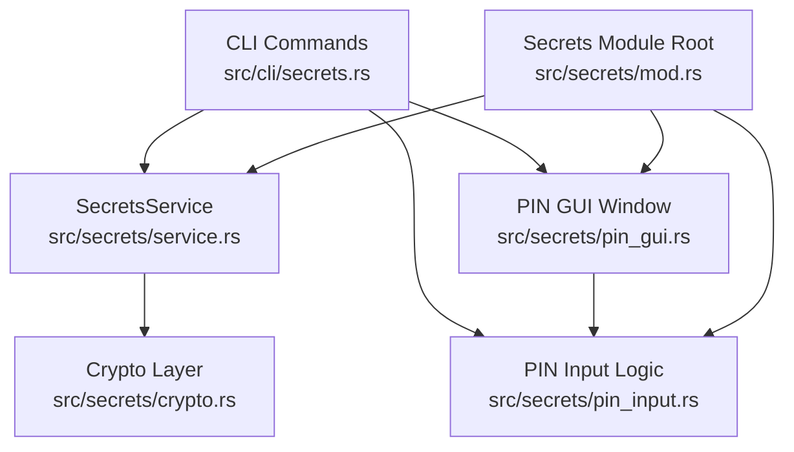
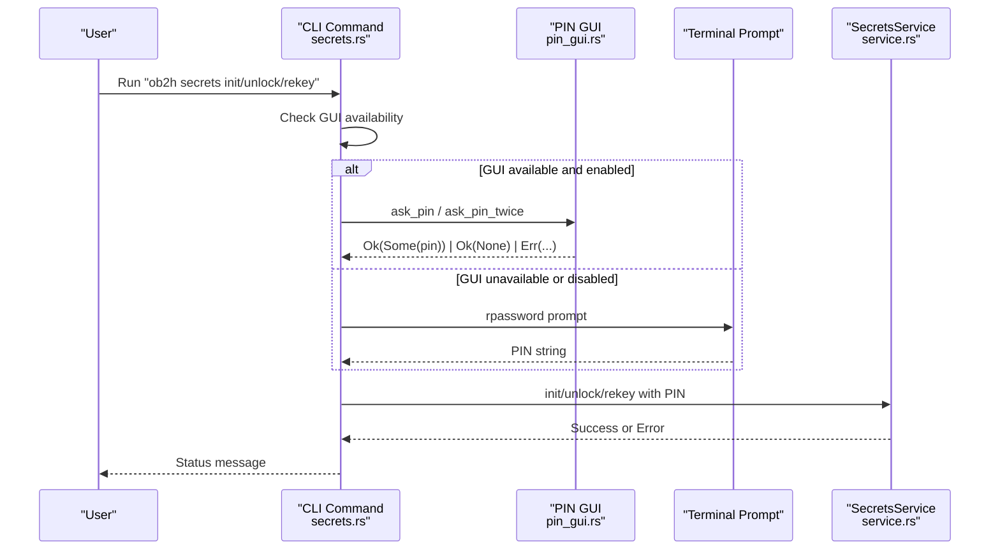
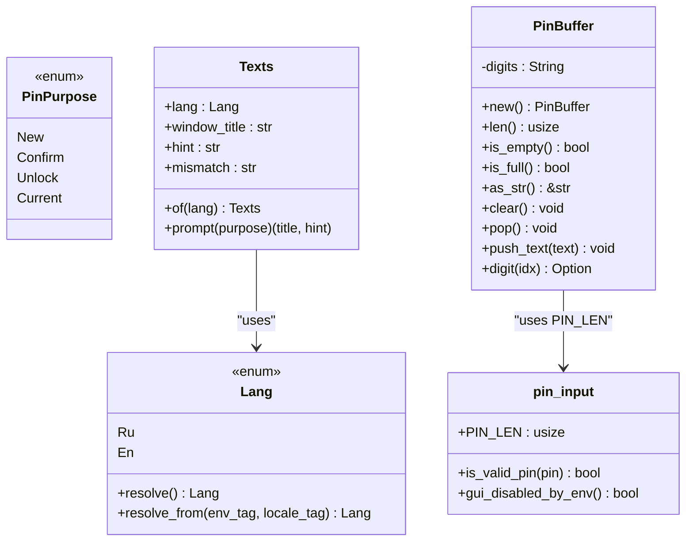
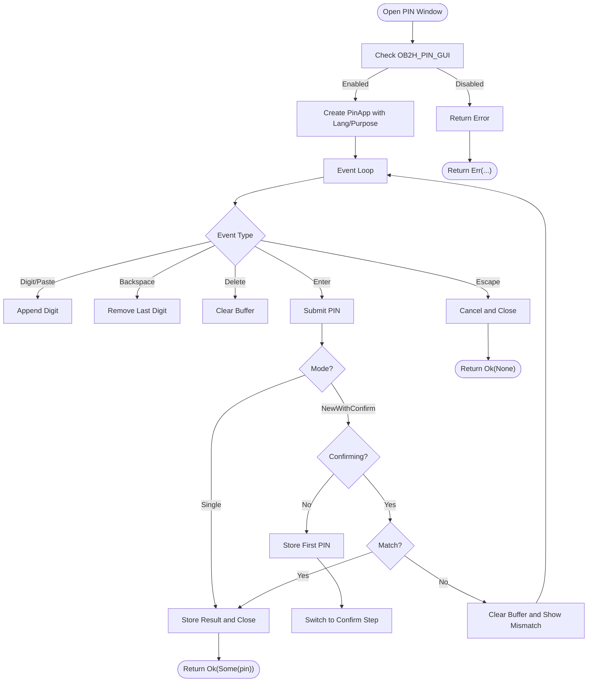
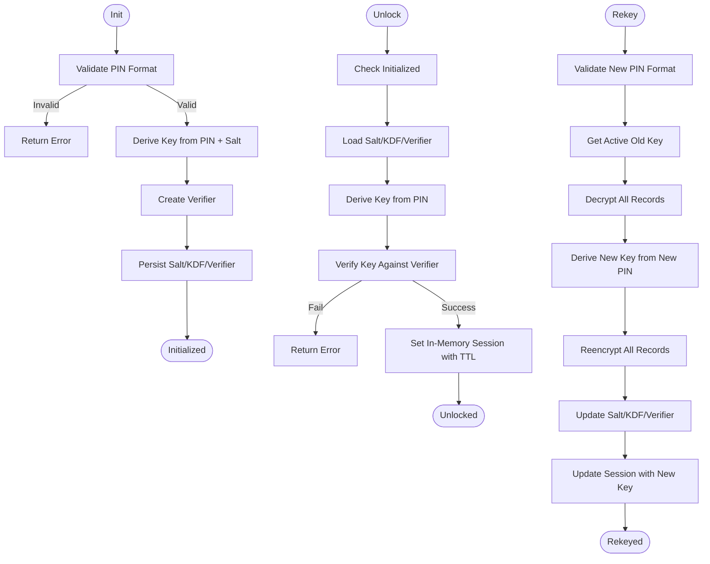
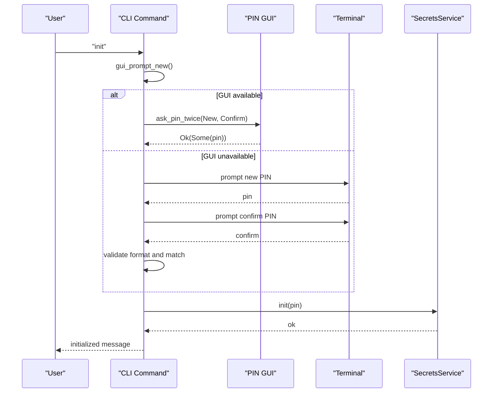
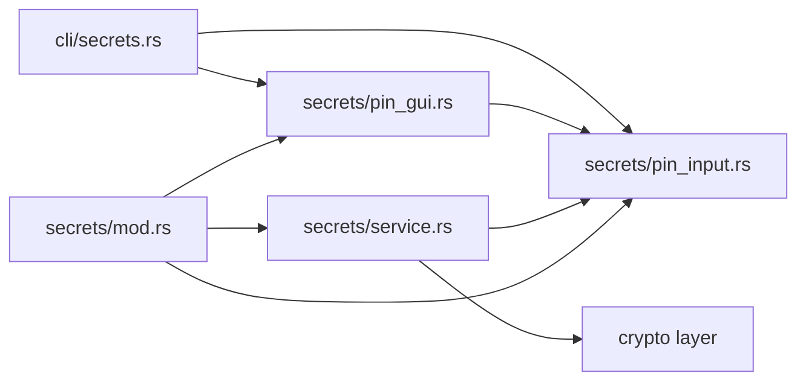

# PIN Authentication System

<cite>
**Referenced Files in This Document**
- [pin_input.rs](file://src/secrets/pin_input.rs)
- [pin_gui.rs](file://src/secrets/pin_gui.rs)
- [service.rs](file://src/secrets/service.rs)
- [secrets.rs](file://src/cli/secrets.rs)
- [mod.rs](file://src/secrets/mod.rs)
</cite>

## Table of Contents
1. [Introduction](#introduction)
2. [Project Structure](#project-structure)
3. [Core Components](#core-components)
4. [Architecture Overview](#architecture-overview)
5. [Detailed Component Analysis](#detailed-component-analysis)
6. [Dependency Analysis](#dependency-analysis)
7. [Performance Considerations](#performance-considerations)
8. [Troubleshooting Guide](#troubleshooting-guide)
9. [Conclusion](#conclusion)

## Introduction
This document explains the PIN-based authentication system used by the Secrets Vault. It covers:
- Terminal-based PIN entry and validation logic.
- Graphical PIN prompts using egui/eframe.
- PIN setup, unlock, rekey, and session management flows.
- Security measures against shoulder surfing and brute-force attempts.
- User experience design for both CLI and GUI interfaces.

The system is designed so that PIN input is local to the process, never sent to external agents or chat systems, and master keys are kept only in memory with automatic zeroization on lock or TTL expiry.

## Project Structure
The PIN authentication system lives under the secrets module and is exposed through CLI commands and optional GUI support.

**Diagram sources**
- [secrets.rs:1-311](file://src/cli/secrets.rs#L1-L311)
- [service.rs:1-446](file://src/secrets/service.rs#L1-L446)
- [pin_input.rs:1-257](file://src/secrets/pin_input.rs#L1-L257)
- [pin_gui.rs:1-348](file://src/secrets/pin_gui.rs#L1-L348)
- [mod.rs:1-15](file://src/secrets/mod.rs#L1-L15)

**Section sources**
- [mod.rs:1-15](file://src/secrets/mod.rs#L1-L15)
- [secrets.rs:1-311](file://src/cli/secrets.rs#L1-L311)

## Core Components
- PIN input model and localization: pure logic without GUI, including PIN length/format rules, language selection, localized text, and a digit-only buffer.
- GUI window: compact egui/eframe prompt for 4-digit PIN entry, supporting single PIN and new-PIN-with-confirmation flows.
- Secrets service: initialization, unlock, lock, status, rekey, and secret CRUD operations backed by encrypted storage and a short-lived in-memory master key.
- CLI integration: orchestrates GUI vs terminal fallback, validates PIN format, and coordinates with IPC to notify a background server when unlocking.

Key responsibilities:
- `pin_input`: defines constants, validation, language resolution, localized strings, and a safe digit buffer.
- `pin_gui`: renders the PIN window, handles keyboard events, and returns either a valid PIN, cancellation, or an error if the GUI cannot be started.
- `service`: enforces PIN format during setup/rekey, verifies PIN via a stored verifier, manages TTL-based sessions, and performs secure reencryption on PIN change.
- `cli/secrets`: user-facing commands, GUI/terminal fallback, and orchestration of unlock/rekey workflows.

**Section sources**
- [pin_input.rs:1-257](file://src/secrets/pin_input.rs#L1-L257)
- [pin_gui.rs:1-348](file://src/secrets/pin_gui.rs#L1-L348)
- [service.rs:1-446](file://src/secrets/service.rs#L1-L446)
- [secrets.rs:1-311](file://src/cli/secrets.rs#L1-L311)

## Architecture Overview
The authentication flow starts at the CLI command, chooses the best input method (GUI if available, otherwise terminal), collects a PIN, validates it, and unlocks the vault. The GUI window is isolated from agent pipelines and runs only locally.

**Diagram sources**
- [secrets.rs:47-132](file://src/cli/secrets.rs#L47-L132)
- [pin_gui.rs:269-347](file://src/secrets/pin_gui.rs#L269-L347)
- [service.rs:71-164](file://src/secrets/service.rs#L71-L164)

## Detailed Component Analysis

### PIN Input Model and Localization (`pin_input`)
Responsibilities:
- Enforce exactly four ASCII digits as the PIN format.
- Provide localized UI strings for Russian and English.
- Resolve UI language from environment override and system locale.
- Offer a safe digit-only buffer for GUI and terminal flows.

Important behaviors:
- `is_valid_pin` accepts only strings of exactly four ASCII digits.
- `Lang::resolve` prefers an environment variable, then system locale, then falls back to English.
- `Texts::prompt` returns purpose-specific titles and hints for New, Confirm, Unlock, and Current PIN scenarios.
- `PinBuffer` filters non-digit characters, supports push/pop/clear, and exposes individual digits.
- `gui_disabled_by_env` allows disabling the GUI via an environment variable.

Security notes:
- Buffer only stores ASCII digits; no sensitive logging of raw PIN values.
- Language resolution is deterministic and testable.

**Diagram sources**
- [pin_input.rs:7-178](file://src/secrets/pin_input.rs#L7-L178)
- [pin_input.rs:180-189](file://src/secrets/pin_input.rs#L180-L189)

**Section sources**
- [pin_input.rs:7-178](file://src/secrets/pin_input.rs#L7-L178)
- [pin_input.rs:180-189](file://src/secrets/pin_input.rs#L180-L189)

### GUI PIN Prompt (`pin_gui`)
Responsibilities:
- Render a compact, centered window with four square fields for digits.
- Handle keyboard events: digits, paste, Backspace, Delete, Enter, Escape.
- Support two modes: single PIN entry and new PIN with confirmation.
- Return a result indicating success, cancellation, or failure to open the window.

UX highlights:
- Title and prompt adapt to the selected language and current purpose.
- Active field highlighting indicates cursor position.
- Mismatch feedback shown when confirmation does not match.
- Hint text shows keyboard shortcuts.

Error handling:
- If GUI cannot start (headless, CI, SSH, missing display), returns an error so CLI can fall back to terminal input.
- Environment variable can force disable GUI.

**Diagram sources**
- [pin_gui.rs:101-177](file://src/secrets/pin_gui.rs#L101-L177)
- [pin_gui.rs:269-347](file://src/secrets/pin_gui.rs#L269-L347)

**Section sources**
- [pin_gui.rs:17-58](file://src/secrets/pin_gui.rs#L17-L58)
- [pin_gui.rs:101-177](file://src/secrets/pin_gui.rs#L101-L177)
- [pin_gui.rs:269-347](file://src/secrets/pin_gui.rs#L269-L347)

### Secrets Service and PIN Validation (`service`)
Responsibilities:
- Initialize the vault with a PIN, storing salt, KDF parameters, and a verifier.
- Unlock using a PIN, deriving a key and verifying it against the stored verifier.
- Manage a short-lived in-memory master key session with TTL.
- Rekey all records when changing the PIN.
- Provide status, list, get, set, delete operations protected by active session checks.

PIN validation and security:
- During initialization and rekey, PIN must be exactly four ASCII digits.
- During unlock, old PIN formats may still be accepted for migration, but verification uses the stored verifier to prevent incorrect PINs.
- Master key is wrapped in a zeroizing type and cleared on lock or TTL expiry.

Session lifecycle:
- Unlock sets a deadline based on default TTL.
- Access methods extend TTL on successful use.
- Lock clears the session immediately.

**Diagram sources**
- [service.rs:71-111](file://src/secrets/service.rs#L71-L111)
- [service.rs:118-164](file://src/secrets/service.rs#L118-L164)
- [service.rs:360-443](file://src/secrets/service.rs#L360-L443)

**Section sources**
- [service.rs:71-111](file://src/secrets/service.rs#L71-L111)
- [service.rs:118-164](file://src/secrets/service.rs#L118-L164)
- [service.rs:178-203](file://src/secrets/service.rs#L178-L203)
- [service.rs:360-443](file://src/secrets/service.rs#L360-L443)

### CLI Orchestration and Fallback (`cli/secrets`)
Responsibilities:
- Provide subcommands: init, unlock, lock, status, rekey, list, show.
- Prefer GUI PIN input when available and enabled; otherwise fall back to terminal password prompt.
- Validate PIN format and mismatch in terminal mode.
- Notify a background server via IPC after successful unlock/rekey.

Fallback logic:
- If GUI feature is compiled and not disabled by environment, attempt to open the PIN window.
- On GUI error or unavailability, prompt securely via terminal using a password reader.
- For new PIN setup, collect and confirm PIN in terminal if GUI is unavailable.

**Diagram sources**
- [secrets.rs:47-132](file://src/cli/secrets.rs#L47-L132)
- [secrets.rs:146-160](file://src/cli/secrets.rs#L146-L160)

**Section sources**
- [secrets.rs:33-132](file://src/cli/secrets.rs#L33-L132)
- [secrets.rs:136-311](file://src/cli/secrets.rs#L136-L311)

## Dependency Analysis
The components have clear boundaries:
- CLI depends on `pin_input` for validation and on `pin_gui` for GUI prompts.
- `pin_gui` depends on `pin_input` for shared types and utilities.
- `service` depends on `pin_input` for PIN format validation and on crypto primitives for key derivation and encryption.
- The module root exports core types and conditionally includes the GUI module.

**Diagram sources**
- [secrets.rs:1-311](file://src/cli/secrets.rs#L1-L311)
- [pin_gui.rs:1-348](file://src/secrets/pin_gui.rs#L1-L348)
- [pin_input.rs:1-257](file://src/secrets/pin_input.rs#L1-L257)
- [service.rs:1-446](file://src/secrets/service.rs#L1-L446)
- [mod.rs:1-15](file://src/secrets/mod.rs#L1-L15)

**Section sources**
- [mod.rs:1-15](file://src/secrets/mod.rs#L1-L15)
- [secrets.rs:1-311](file://src/cli/secrets.rs#L1-L311)

## Performance Considerations
- PIN validation is O(n) over the input string length; with a fixed 4-digit requirement, this is negligible.
- GUI event handling processes only necessary events and avoids unnecessary allocations.
- Secret decryption/encryption occurs only within unlocked sessions and is bounded by record count.
- Rekey operation decrypts and reencrypts all records in memory before atomic DB update; consider large vault sizes and potential memory usage spikes.
- TTL-based session management reduces exposure time of master keys in memory.

[No sources needed since this section provides general guidance]

## Troubleshooting Guide
Common issues and resolutions:
- GUI PIN window fails to open:
  - Cause: headless environment, CI, SSH, or `OB2H_PIN_GUI` disabled.
  - Resolution: CLI automatically falls back to terminal input; ensure terminal supports secure password prompting.
- PIN rejected during initialization or rekey:
  - Cause: PIN is not exactly four ASCII digits.
  - Resolution: Use a 4-digit numeric PIN.
- PIN mismatch during setup:
  - Cause: Confirmation does not match initial PIN.
  - Resolution: Re-enter matching PINs.
- Unlock fails:
  - Cause: Incorrect PIN or vault not initialized.
  - Resolution: Verify PIN; run initialization if needed.
- Session expired:
  - Cause: TTL elapsed while idle.
  - Resolution: Re-run unlock to refresh session.

Operational tips:
- Use `status` to check initialization, lock state, TTL remaining, and record count.
- Use `lock` to immediately clear the in-memory master key.
- Use `rekey` to rotate PINs and reencrypt all records.

**Section sources**
- [pin_gui.rs:269-347](file://src/secrets/pin_gui.rs#L269-L347)
- [service.rs:118-164](file://src/secrets/service.rs#L118-L164)
- [service.rs:178-203](file://src/secrets/service.rs#L178-L203)
- [secrets.rs:146-311](file://src/cli/secrets.rs#L146-L311)

## Conclusion
The PIN authentication system combines robust validation, secure input handling, and a clean separation between CLI and GUI layers. The PIN model enforces strict format rules, the GUI provides a focused and accessible UX, and the service ensures cryptographic integrity with short-lived in-memory keys. The CLI gracefully falls back to terminal input when GUI is unavailable, ensuring usability across environments. Together, these components provide strong protection against shoulder surfing and mitigate brute-force risks through limited exposure, verifier-based checks, and controlled session lifetimes.

[No sources needed since this section summarizes without analyzing specific files]