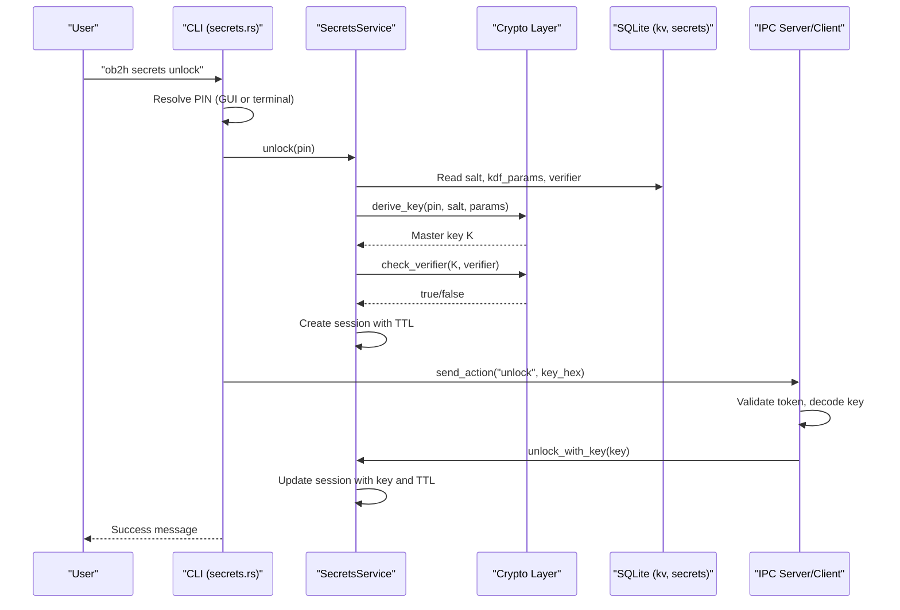
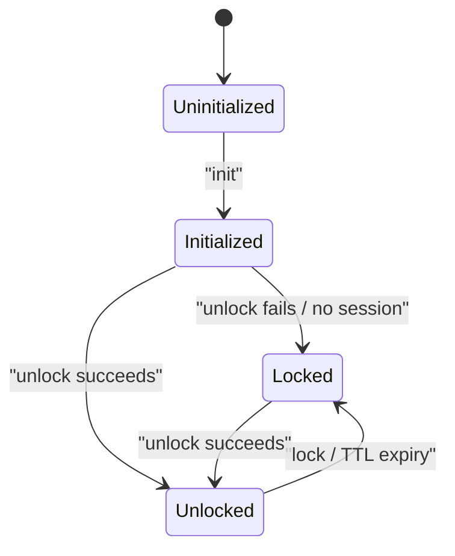
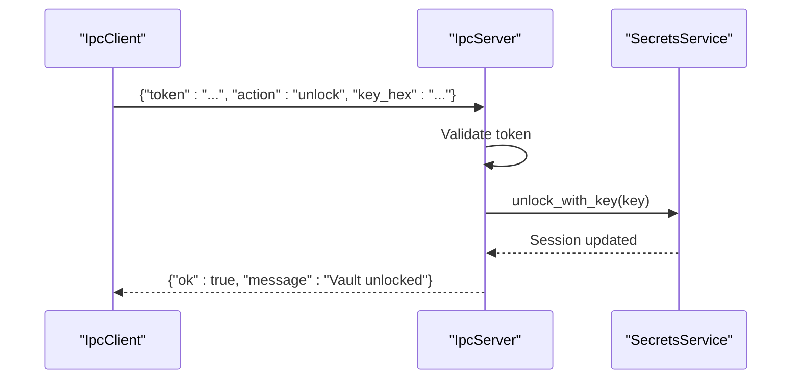
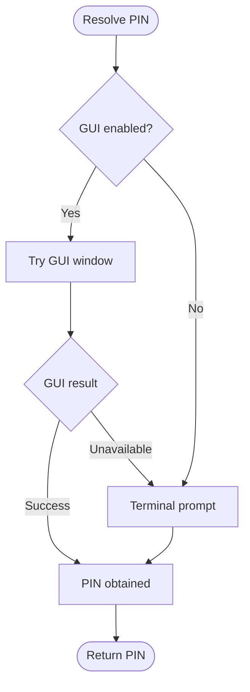
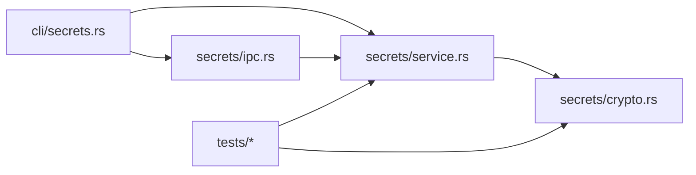

# Secrets Service

<cite>
**Referenced Files in This Document**
- [mod.rs](file://src/secrets/mod.rs)
- [crypto.rs](file://src/secrets/crypto.rs)
- [service.rs](file://src/secrets/service.rs)
- [ipc.rs](file://src/secrets/ipc.rs)
- [pin_input.rs](file://src/secrets/pin_input.rs)
- [pin_gui.rs](file://src/secrets/pin_gui.rs)
- [secrets.rs](file://src/cli/secrets.rs)
- [schema.rs](file://src/db/schema.rs)
- [test_secrets_crypto.rs](file://tests/test_secrets_crypto.rs)
- [test_secrets_isolation.rs](file://tests/test_secrets_isolation.rs)
- [test_secrets_mcp.rs](file://tests/test_secrets_mcp.rs)
</cite>

## Table of Contents
1. [Introduction](#introduction)
2. [Project Structure](#project-structure)
3. [Core Components](#core-components)
4. [Architecture Overview](#architecture-overview)
5. [Detailed Component Analysis](#detailed-component-analysis)
6. [Dependency Analysis](#dependency-analysis)
7. [Performance Considerations](#performance-considerations)
8. [Troubleshooting Guide](#troubleshooting-guide)
9. [Conclusion](#conclusion)
10. [Appendices](#appendices)

## Introduction
The Secrets Service is an encrypted vault component that stores sensitive values using XChaCha20-Poly1305, derives a master key from a PIN via Argon2id, and exposes secure operations through CLI, GUI, and IPC. The master key lives only in process memory and is automatically cleared on lock or TTL expiry. The design emphasizes:
- Strong cryptographic primitives with authenticated encryption and AAD binding to secret names.
- PIN-based authentication with strict format validation for interactive flows.
- Local loopback IPC for synchronizing unlock state between CLI and a long-running server process.
- Memory isolation, audit logging, and access controls to prevent secrets leakage into search, sync, or agent context.

This document explains the security model, cryptographic implementation, key management, storage strategy, operational flows, threat considerations, and best practices.

## Project Structure
The Secrets Service is implemented under `src/secrets` and integrates with CLI, database schema, and tests:
- `mod.rs`: Module entry point and public exports.
- `crypto.rs`: Cryptographic primitives (Argon2id KDF, XChaCha20-Poly1305 AEAD, verifier).
- `service.rs`: SecretsService orchestrating initialization, unlocking, TTL sessions, CRUD, and rekeying.
- `ipc.rs`: Local TCP IPC server/client for cross-process unlock/lock synchronization.
- `pin_input.rs`: Pure logic for PIN validation, language selection, and input buffer.
- `pin_gui.rs`: Optional egui window for PIN entry (feature-gated).
- `cli/secrets.rs`: CLI commands wiring user interaction to SecretsService and IPC.
- `db/schema.rs`: SQLite schema including the `secrets` table and migrations.
- Tests validate crypto round-trips, service lifecycle, MCP integration, and isolation guarantees.

```mermaid
graph TB
subgraph "Secrets Module"
MOD["secrets/mod.rs"]
CRYPTO["secrets/crypto.rs"]
SERVICE["secrets/service.rs"]
IPC["secrets/ipc.rs"]
PIN_INPUT["secrets/pin_input.rs"]
PIN_GUI["secrets/pin_gui.rs"]
end
subgraph "CLI"
CLI["cli/secrets.rs"]
end
subgraph "Database"
SCHEMA["db/schema.rs"]
end
subgraph "Tests"
T_CRYPTO["tests/test_secrets_crypto.rs"]
T_ISOLATION["tests/test_secrets_isolation.rs"]
T_MCP["tests/test_secrets_mcp.rs"]
end
MOD --> CRYPTO
MOD --> SERVICE
MOD --> IPC
MOD --> PIN_INPUT
MOD --> PIN_GUI
CLI --> SERVICE
CLI --> IPC
SERVICE --> CRYPTO
SERVICE --> SCHEMA
T_CRYPTO --> CRYPTO
T_CRYPTO --> SERVICE
T_ISOLATION --> SERVICE
T_MCP --> SERVICE
```

**Diagram sources**
- [mod.rs:1-15](file://src/secrets/mod.rs#L1-L15)
- [crypto.rs:1-168](file://src/secrets/crypto.rs#L1-L168)
- [service.rs:1-446](file://src/secrets/service.rs#L1-L446)
- [ipc.rs:1-196](file://src/secrets/ipc.rs#L1-L196)
- [pin_input.rs:1-257](file://src/secrets/pin_input.rs#L1-L257)
- [pin_gui.rs:1-348](file://src/secrets/pin_gui.rs#L1-L348)
- [secrets.rs:1-311](file://src/cli/secrets.rs#L1-L311)
- [schema.rs:337-348](file://src/db/schema.rs#L337-L348)
- [test_secrets_crypto.rs:1-131](file://tests/test_secrets_crypto.rs#L1-L131)
- [test_secrets_isolation.rs:1-59](file://tests/test_secrets_isolation.rs#L1-L59)
- [test_secrets_mcp.rs:1-85](file://tests/test_secrets_mcp.rs#L1-L85)

**Section sources**
- [mod.rs:1-15](file://src/secrets/mod.rs#L1-L15)
- [schema.rs:337-348](file://src/db/schema.rs#L337-L348)

## Core Components
- SecretsService: Central controller for vault lifecycle, session management, and secret CRUD. It enforces unlocked-only operations and TTL-based session expiration.
- Crypto layer: Argon2id key derivation, XChaCha20-Poly1305 authenticated encryption with AAD bound to secret name, salt generation, and verifier creation/check.
- IPC: Loopback TCP server and client exchanging JSON requests with token authentication; supports unlock and lock actions.
- PIN Input: Pure logic for PIN validation, localization, and buffer handling; optional GUI window for secure PIN entry.
- CLI: Commands for init, unlock, lock, status, list, show, and rekey; integrates GUI fallback to terminal input when needed.
- Database Schema: SQLite tables for KV metadata and encrypted secrets, with migration support.

Key responsibilities:
- Derive master key from PIN + salt using Argon2id.
- Encrypt/decrypt secrets with XChaCha20-Poly1305, binding name as AAD.
- Maintain in-memory master key with TTL and zeroization.
- Provide local IPC for cross-process unlock/lock.
- Enforce access control by requiring unlocked session for all secret operations.

**Section sources**
- [service.rs:1-446](file://src/secrets/service.rs#L1-L446)
- [crypto.rs:1-168](file://src/secrets/crypto.rs#L1-L168)
- [ipc.rs:1-196](file://src/secrets/ipc.rs#L1-L196)
- [pin_input.rs:1-257](file://src/secrets/pin_input.rs#L1-L257)
- [pin_gui.rs:1-348](file://src/secrets/pin_gui.rs#L1-L348)
- [secrets.rs:1-311](file://src/cli/secrets.rs#L1-L311)
- [schema.rs:337-348](file://src/db/schema.rs#L337-L348)

## Architecture Overview
The Secrets Service operates within a single process but can synchronize its unlocked state across processes via local IPC. The CLI may prompt for PIN either via a GUI window or terminal. All secret data is stored encrypted in SQLite; the master key never persists.



**Diagram sources**
- [secrets.rs:162-190](file://src/cli/secrets.rs#L162-L190)
- [service.rs:118-176](file://src/secrets/service.rs#L118-L176)
- [crypto.rs:34-111](file://src/secrets/crypto.rs#L34-L111)
- [ipc.rs:157-195](file://src/secrets/ipc.rs#L157-L195)

## Detailed Component Analysis

### Cryptographic Primitives and Key Management
- KDF: Argon2id with configurable parameters (memory cost, time cost, parallelism). Default parameters are tuned for security vs performance balance.
- Salt: 16-byte cryptographically random salt generated per vault.
- Master Key: 32-byte derived key K used for AEAD encryption.
- Encryption: XChaCha20-Poly1305 AEAD with random nonce prepended to ciphertext; secret name bound as AAD to prevent substitution attacks.
- Verifier: Encrypted magic string under K to validate PIN correctness without exposing plaintext.

Security properties:
- AAD binding ensures ciphertext cannot be decrypted with wrong secret name.
- Zeroizing wrappers ensure keys are wiped from memory after use.
- Verifier prevents offline brute-force without additional checks.

Complexity:
- Derivation cost depends on Argon2id parameters; default m_cost=65536 KiB, t_cost=3, p_cost=1.
- Encryption/decryption overhead proportional to secret size plus AEAD tag.

Optimization opportunities:
- Tune KDF parameters based on workload and hardware constraints.
- Batch rekey operations to minimize repeated I/O.

Error handling:
- Invalid parameters, RNG failures, and AEAD decryption errors are surfaced with descriptive messages.

**Section sources**
- [crypto.rs:13-111](file://src/secrets/crypto.rs#L13-L111)
- [test_secrets_crypto.rs:7-38](file://tests/test_secrets_crypto.rs#L7-L38)

### SecretsService Lifecycle and Access Control
Responsibilities:
- Initialization: Validates PIN format, generates salt, derives key, stores verifier and KDF params.
- Unlock: Reads persisted metadata, derives key, verifies PIN, creates in-memory session with TTL.
- Lock: Clears session immediately.
- TTL Session: Active key checked and extended on each operation; expired sessions require re-authentication.
- CRUD Operations: Set, Get, Delete, List enforce unlocked state and validate secret names.
- Rekey: Decrypts all records with old key, re-encrypts with new key, atomically updates DB and session.

Access control:
- All secret operations require active session; otherwise return explicit locked errors.
- Name validation restricts characters and length to safe identifiers.

Audit logging:
- Operations log success/failure events via tracing/info macros.

State transitions:


**Diagram sources**
- [service.rs:58-203](file://src/secrets/service.rs#L58-L203)

**Section sources**
- [service.rs:58-203](file://src/secrets/service.rs#L58-L203)
- [service.rs:266-444](file://src/secrets/service.rs#L266-L444)

### IPC Communication Patterns
Design:
- Server binds to loopback address and writes PID/port/token to a run file.
- Client reads server info and sends JSON requests with token authentication.
- Actions supported: unlock (with 32-byte key), lock.
- Responses indicate success/failure with messages.

Security:
- Token-based request validation prevents unauthorized IPC usage.
- Keys transmitted only over loopback and never persisted.

Flow:


**Diagram sources**
- [ipc.rs:39-145](file://src/secrets/ipc.rs#L39-L145)
- [ipc.rs:157-195](file://src/secrets/ipc.rs#L157-L195)

**Section sources**
- [ipc.rs:1-196](file://src/secrets/ipc.rs#L1-L196)

### PIN-Based Authentication and GUI Integration
PIN validation:
- Strict format: exactly four ASCII digits.
- Language-aware prompts and error messages.
- Buffer handles digit-only input, backspace, delete, and submission.

GUI flow:
- Optional egui window for PIN entry; disabled via environment variable.
- Supports single PIN or two-step new PIN confirmation.
- Falls back to terminal input if GUI unavailable.

Integration:
- CLI resolves PIN via GUI first, then terminal.
- On unlock, CLI derives key and notifies IPC server if running.



**Diagram sources**
- [pin_input.rs:17-19](file://src/secrets/pin_input.rs#L17-L19)
- [pin_gui.rs:277-347](file://src/secrets/pin_gui.rs#L277-L347)
- [secrets.rs:50-102](file://src/cli/secrets.rs#L50-L102)

**Section sources**
- [pin_input.rs:1-257](file://src/secrets/pin_input.rs#L1-L257)
- [pin_gui.rs:1-348](file://src/secrets/pin_gui.rs#L1-L348)
- [secrets.rs:50-132](file://src/cli/secrets.rs#L50-L132)

### Secure Storage Strategy
Storage layout:
- KV table stores vault metadata: initialized flag, salt, KDF parameters, verifier.
- Secrets table stores encrypted ciphertext, hint, timestamps, and access statistics.

Encryption details:
- Each secret value is encrypted with XChaCha20-Poly1305 using the master key and a unique nonce.
- Secret name is bound as AAD to prevent cross-name misuse.

Integrity and recovery:
- Verifier ensures correct PIN before granting access.
- Rekey operation atomically migrates all records to a new key.

**Section sources**
- [schema.rs:337-348](file://src/db/schema.rs#L337-L348)
- [service.rs:71-110](file://src/secrets/service.rs#L71-L110)
- [service.rs:360-444](file://src/secrets/service.rs#L360-L444)

## Dependency Analysis
Component relationships:
- CLI depends on SecretsService and IPC for user-facing operations.
- SecretsService depends on Crypto for key derivation and encryption.
- IPC depends on SecretsService for unlock/lock actions.
- Tests depend on Services and Crypto for validation.



**Diagram sources**
- [secrets.rs:1-311](file://src/cli/secrets.rs#L1-L311)
- [service.rs:1-446](file://src/secrets/service.rs#L1-L446)
- [ipc.rs:1-196](file://src/secrets/ipc.rs#L1-L196)
- [crypto.rs:1-168](file://src/secrets/crypto.rs#L1-L168)
- [test_secrets_crypto.rs:1-131](file://tests/test_secrets_crypto.rs#L1-L131)
- [test_secrets_isolation.rs:1-59](file://tests/test_secrets_isolation.rs#L1-L59)
- [test_secrets_mcp.rs:1-85](file://tests/test_secrets_mcp.rs#L1-L85)

**Section sources**
- [secrets.rs:1-311](file://src/cli/secrets.rs#L1-L311)
- [service.rs:1-446](file://src/secrets/service.rs#L1-L446)
- [ipc.rs:1-196](file://src/secrets/ipc.rs#L1-L196)
- [crypto.rs:1-168](file://src/secrets/crypto.rs#L1-L168)

## Performance Considerations
- Argon2id KDF tuning: Adjust m_cost, t_cost, p_cost based on system capabilities and security requirements. Higher costs increase resistance to brute force but slow down unlock/rekey.
- Session TTL: Balance usability and security by setting appropriate TTL durations. Frequent operations extend TTL; idle periods trigger lock.
- Bulk operations: Rekey iterates all records; consider batching and minimizing I/O during large vaults.
- IPC overhead: Local loopback communication is lightweight; however, frequent unlock notifications should be minimized.

[No sources needed since this section provides general guidance]

## Troubleshooting Guide
Common issues and resolutions:
- Vault not initialized: Run initialization command to set up PIN and store metadata.
- Incorrect PIN: Verify PIN format and ensure it matches the one used during initialization.
- Secrets locked: Unlock with valid PIN or wait for TTL expiry if already unlocked.
- GUI unavailable: Disable GUI explicitly or fall back to terminal input.
- IPC connection failed: Ensure server process is running and token matches.

Operational tips:
- Use status command to check initialization, lock state, TTL remaining, and record count.
- Monitor logs for successful operations and errors.
- Regularly rotate PIN via rekey to mitigate long-term exposure risks.

**Section sources**
- [service.rs:58-203](file://src/secrets/service.rs#L58-L203)
- [secrets.rs:146-221](file://src/cli/secrets.rs#L146-L221)

## Conclusion
The Secrets Service provides a robust, secure vault solution leveraging modern cryptographic primitives and careful memory management. Its design isolates secrets from non-sensitive operations, enforces strict access controls, and offers flexible authentication via PIN with optional GUI integration. The IPC mechanism enables seamless coordination between CLI and background processes while maintaining security boundaries. By following best practices for key management, session handling, and operational workflows, users can securely manage sensitive data with confidence.

[No sources needed since this section summarizes without analyzing specific files]

## Appendices

### Security Model Summary
- Memory isolation: Master key exists only in process memory and is zeroized on lock/expiry.
- Audit logging: Operations are logged for traceability.
- Access controls: All secret operations require unlocked session; invalid attempts are rejected.
- Threat mitigation: AAD binding prevents substitution; verifier validates PIN without exposing plaintext; IPC uses token authentication.

### Compliance Considerations
- Data protection: Encrypted at rest with strong AEAD; keys never persisted.
- Auditability: Logging supports compliance reporting.
- Least privilege: Only authorized operations succeed; secrets excluded from search/sync contexts.

[No sources needed since this section provides general guidance]