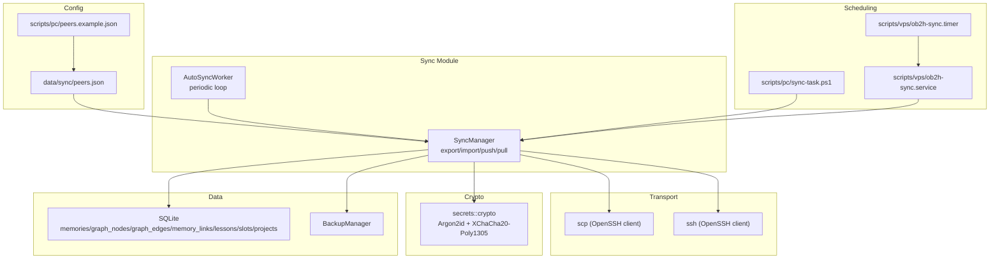
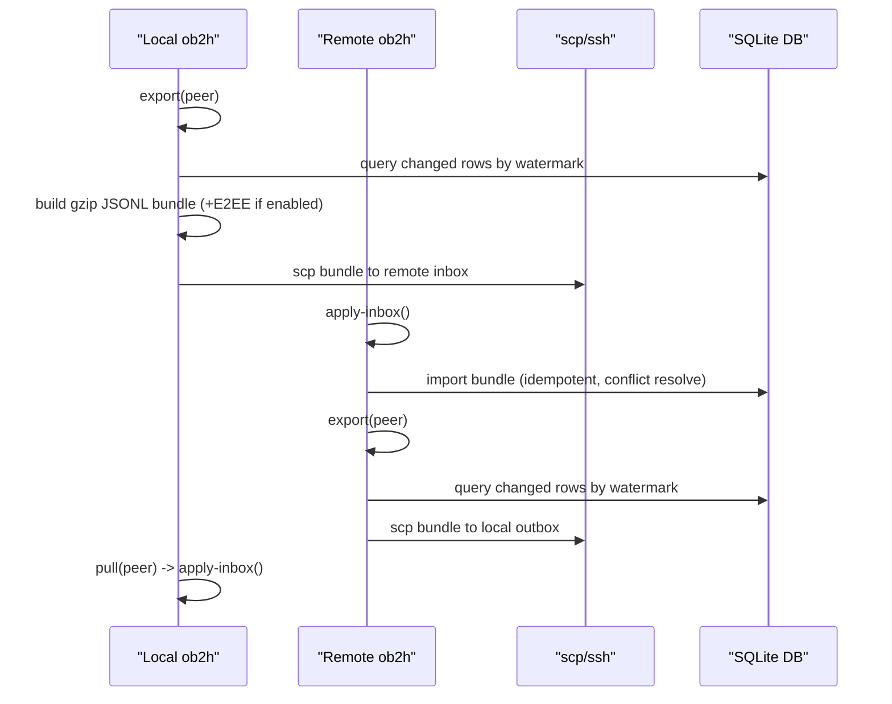
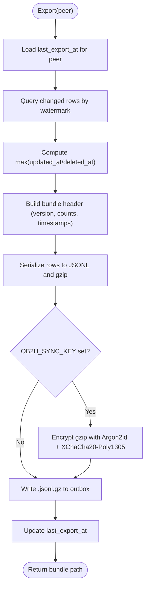
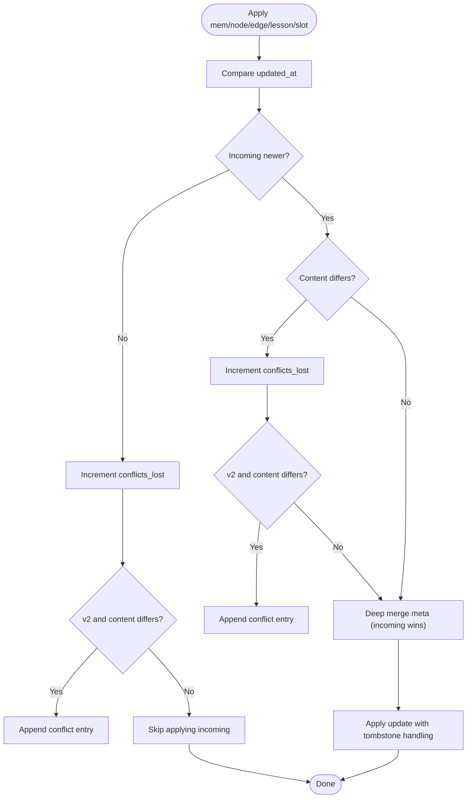
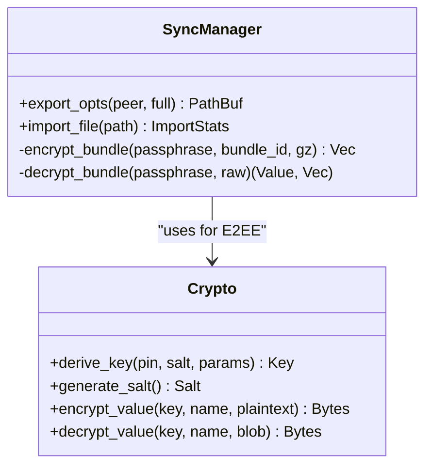
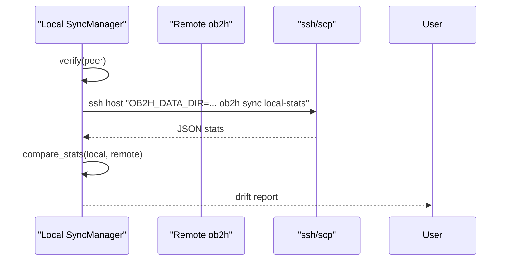
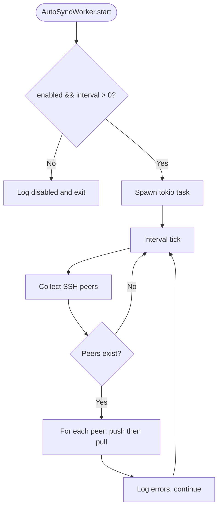
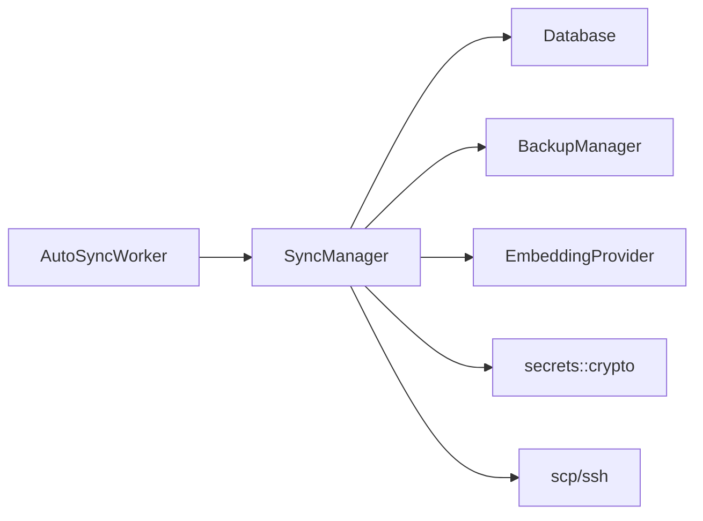

# Sync Service

<cite>
**Referenced Files in This Document**
- [SYNC.md](file://docs/SYNC.md)
- [mod.rs](file://src/sync/mod.rs)
- [worker.rs](file://src/sync/worker.rs)
- [crypto.rs](file://src/secrets/crypto.rs)
- [peers.example.json](file://scripts/pc/peers.example.json)
- [ob2h-sync.service](file://scripts/vps/ob2h-sync.service)
- [ob2h-sync.timer](file://scripts/vps/ob2h-sync.timer)
- [sync-task.ps1](file://scripts/pc/sync-task.ps1)
</cite>

## Table of Contents
1. [Introduction](#introduction)
2. [Project Structure](#project-structure)
3. [Core Components](#core-components)
4. [Architecture Overview](#architecture-overview)
5. [Detailed Component Analysis](#detailed-component-analysis)
6. [Dependency Analysis](#dependency-analysis)
7. [Performance Considerations](#performance-considerations)
8. [Troubleshooting Guide](#troubleshooting-guide)
9. [Conclusion](#conclusion)
10. [Appendices](#appendices)

## Introduction
The Sync Service provides cross-machine synchronization between two ob2h instances, typically a local PC and a remote VPS. It exchanges incremental delta bundles over SSH or manual file transfer, applies them idempotently to the local SQLite database, resolves field-level conflicts using later-write-wins with origin priority, and optionally encrypts bundle payloads end-to-end. The service also supports background periodic synchronization through a worker process, conflict journaling, and drift verification without transferring data.

Key capabilities:
- Delta bundle creation per peer watermark
- SSH-based push/pull and manual transfer modes
- Field-level merge for metadata and LWW for content
- Append-only conflict journaling
- Optional AES-GCM-like AEAD encryption via XChaCha20-Poly1305 with Argon2id key derivation
- Background sync worker and scheduled tasks
- Drift verification and status reporting

[No sources needed since this section summarizes without analyzing specific files]

## Project Structure
The Sync Service is implemented primarily under `src/sync`, with supporting configuration and scripts under `scripts`. Documentation and examples are under `docs` and `scripts/pc`.

**Diagram sources**
- [mod.rs:194-246](file://src/sync/mod.rs#L194-L246)
- [worker.rs:9-64](file://src/sync/worker.rs#L9-L64)
- [crypto.rs:1-111](file://src/secrets/crypto.rs#L1-L111)
- [peers.example.json:1-20](file://scripts/pc/peers.example.json#L1-L20)
- [ob2h-sync.service:1-20](file://scripts/vps/ob2h-sync.service#L1-L20)
- [ob2h-sync.timer:1-20](file://scripts/vps/ob2h-sync.timer#L1-L20)
- [sync-task.ps1:1-20](file://scripts/pc/sync-task.ps1#L1-L20)

**Section sources**
- [mod.rs:1-30](file://src/sync/mod.rs#L1-L30)
- [worker.rs:1-65](file://src/sync/worker.rs#L1-L65)
- [SYNC.md:32-67](file://docs/SYNC.md#L32-L67)

## Core Components
- SyncManager: Central orchestrator for export, import, push, pull, apply-inbox, verify, and status. Handles peer configuration, watermark management, bundle format, conflict resolution, and optional E2EE.
- AutoSyncWorker: Tokio-based background worker that periodically pushes and pulls configured SSH peers.
- Peer configuration: JSON-based node identity, priority ordering, and peer transport settings.
- Crypto primitives: Argon2id key derivation and XChaCha20-Poly1305 AEAD used for bundle encryption.
- Transport: Uses external OpenSSH tools (`scp`, `ssh`) for secure file transfer and remote command execution.
- Scheduling: Windows Task Scheduler via PowerShell script; systemd timer/service on Linux VPS.

**Section sources**
- [mod.rs:194-246](file://src/sync/mod.rs#L194-L246)
- [worker.rs:9-64](file://src/sync/worker.rs#L9-L64)
- [mod.rs:31-70](file://src/sync/mod.rs#L31-L70)
- [crypto.rs:1-111](file://src/secrets/crypto.rs#L1-L111)

## Architecture Overview
The Sync Service uses a file-bundle model over SSH. Each machine exports delta bundles based on a per-peer watermark and transfers them to the peer’s inbox/outbox directories. Import applies bundles idempotently, resolving conflicts deterministically.

**Diagram sources**
- [mod.rs:247-469](file://src/sync/mod.rs#L247-L469)
- [mod.rs:1498-1574](file://src/sync/mod.rs#L1498-L1574)
- [mod.rs:506-733](file://src/sync/mod.rs#L506-L733)

**Section sources**
- [SYNC.md:32-67](file://docs/SYNC.md#L32-L67)
- [mod.rs:247-469](file://src/sync/mod.rs#L247-L469)
- [mod.rs:1498-1574](file://src/sync/mod.rs#L1498-L1574)

## Detailed Component Analysis

### Delta Bundle Creation and Transfer
- Watermark-based deltas: Export queries changes by `updated_at`/`deleted_at` per table, computes a global cursor from the maximum timestamp across all row types, and writes a gzipped JSONL bundle with a header containing bundle ID, version, counts, and time range.
- Full vs delta: A full bundle can be requested explicitly; otherwise, it uses the stored watermark per peer.
- Bundle payload: Includes memories, graph nodes, edges, projects, memory links, lessons, and slots. Embeddings are serialized as hex strings.
- E2EE wrapper: If `OB2H_SYNC_KEY` is set, the gzip payload is wrapped in an encrypted container using Argon2id-derived keys and XChaCha20-Poly1305 AEAD with AAD binding the header.
- Transfer: Push uses `scp` to upload bundles to the peer’s `push_to`; Pull uses `scp` to download bundles from the peer’s `pull_from`.

**Diagram sources**
- [mod.rs:247-469](file://src/sync/mod.rs#L247-L469)
- [mod.rs:127-192](file://src/sync/mod.rs#L127-L192)
- [crypto.rs:34-98](file://src/secrets/crypto.rs#L34-L98)

**Section sources**
- [mod.rs:247-469](file://src/sync/mod.rs#L247-L469)
- [mod.rs:127-192](file://src/sync/mod.rs#L127-L192)
- [crypto.rs:34-98](file://src/secrets/crypto.rs#L34-L98)

### Field-Level Merge Conflict Resolution
- Content conflicts: Resolved by later-write-wins using `updated_at`; ties broken by origin priority defined in `peers.json`.
- Metadata merging: For v2 bundles, metadata is deep merged with incoming keys winning; `access_count` takes the maximum; trust and feedback metrics are updated accordingly.
- Tombstones: Deletions propagate via `deleted_at`; re-saving resurrects the record.
- Journaling: All content conflicts are recorded in an append-only `conflicts.jsonl` with winner/loser details. An environment flag allows keeping losing versions in `meta.conflict_versions`.
- Idempotency: Re-importing the same bundle is a no-op based on `bundle_id`.

**Diagram sources**
- [mod.rs:747-963](file://src/sync/mod.rs#L747-L963)
- [mod.rs:965-1002](file://src/sync/mod.rs#L965-L1002)
- [mod.rs:1004-1184](file://src/sync/mod.rs#L1004-L1184)

**Section sources**
- [mod.rs:747-963](file://src/sync/mod.rs#L747-L963)
- [mod.rs:965-1002](file://src/sync/mod.rs#L965-L1002)
- [mod.rs:1004-1184](file://src/sync/mod.rs#L1004-L1184)
- [SYNC.md:58-67](file://docs/SYNC.md#L58-L67)

### End-to-End AES-GCM Encryption
Note: The implementation uses XChaCha20-Poly1305 AEAD rather than AES-GCM. The security properties are similar (authenticated encryption), but the cipher differs.

- Key derivation: Argon2id with configurable memory/time/parallelism parameters.
- Encryption: XChaCha20-Poly1305 with random nonce and AAD bound to the header string.
- Container format: Magic bytes, header length, JSON header, ciphertext.
- Decryption: Validates magic/header, derives key, decrypts, and returns original gzip payload.

**Diagram sources**
- [mod.rs:127-192](file://src/sync/mod.rs#L127-L192)
- [crypto.rs:34-98](file://src/secrets/crypto.rs#L34-L98)

**Section sources**
- [mod.rs:127-192](file://src/sync/mod.rs#L127-L192)
- [crypto.rs:34-98](file://src/secrets/crypto.rs#L34-L98)

### Peer Discovery Protocols and SSH Communication Patterns
- Peer discovery: Static configuration via `data/sync/peers.json`. There is no dynamic discovery protocol; peers are explicitly listed.
- SSH patterns:
  - Push: Executes `scp` to upload bundles to the peer’s `push_to` directory.
  - Pull: Executes `scp` to download bundles from the peer’s `pull_from` directory.
  - Verify: Executes `ssh` to run `ob2h sync local-stats` on the remote side and compares aggregated checksums locally.

**Diagram sources**
- [mod.rs:1721-1800](file://src/sync/mod.rs#L1721-L1800)
- [mod.rs:1519-1574](file://src/sync/mod.rs#L1519-L1574)

**Section sources**
- [mod.rs:1519-1574](file://src/sync/mod.rs#L1519-L1574)
- [mod.rs:1721-1800](file://src/sync/mod.rs#L1721-L1800)
- [SYNC.md:100-137](file://docs/SYNC.md#L100-L137)

### Worker Process Architecture and Background Tasks
- AutoSyncWorker spawns a Tokio task that ticks at a configured interval, collects SSH peers, and performs push/pull for each. Errors are logged but do not stop the loop.
- Integration points:
  - Windows: Scheduled via PowerShell script.
  - Linux: Managed by systemd timer/service.

**Diagram sources**
- [worker.rs:24-64](file://src/sync/worker.rs#L24-L64)

**Section sources**
- [worker.rs:9-64](file://src/sync/worker.rs#L9-L64)
- [SYNC.md:143-175](file://docs/SYNC.md#L143-L175)

### Error Recovery Mechanisms
- Bundle idempotency: Applied bundles tracked in `applied_bundles`; re-import is a no-op.
- Auto-backup: Before applying a new bundle, a backup snapshot is created; failures are warned but do not abort import.
- Robust config loading: If `peers.json` is malformed, sync is disabled gracefully while other functionality continues.
- Network reliability: External `scp`/`ssh` commands return non-zero on failure; errors are propagated and logged.
- Conflict visibility: Cumulative lost-conflict counter persisted in KV store; status reports total losses.

**Section sources**
- [mod.rs:506-560](file://src/sync/mod.rs#L506-L560)
- [mod.rs:549-555](file://src/sync/mod.rs#L549-L555)
- [mod.rs:204-229](file://src/sync/mod.rs#L204-L229)
- [mod.rs:1519-1574](file://src/sync/mod.rs#L1519-L1574)
- [mod.rs:688-700](file://src/sync/mod.rs#L688-L700)

### Examples

#### Peer Configuration
- Example peer configuration is provided under `scripts/pc/peers.example.json`. It defines origin, priority, after_dream behavior, and peer transport settings including method, host, ports, and directories.

**Section sources**
- [peers.example.json:1-20](file://scripts/pc/peers.example.json#L1-L20)
- [mod.rs:31-70](file://src/sync/mod.rs#L31-L70)
- [SYNC.md:100-137](file://docs/SYNC.md#L100-L137)

#### Sync Workflows
- Manual workflow: Export on local, scp to remote inbox, apply-inbox on remote, export on remote, scp back to local, pull and apply-inbox on local.
- Automated workflow: Use `after_dream: true` or scheduled tasks to perform push/pull automatically.

**Section sources**
- [SYNC.md:163-175](file://docs/SYNC.md#L163-L175)
- [mod.rs:1576-1597](file://src/sync/mod.rs#L1576-L1597)

#### Conflict Resolution Strategies
- Later-write-wins with origin priority tie-break.
- Deep merge of metadata with incoming keys winning.
- Monotonic counters (e.g., reinforcement count) take the maximum of local and incoming values.
- Tombstone semantics for deletions.

**Section sources**
- [mod.rs:747-963](file://src/sync/mod.rs#L747-L963)
- [mod.rs:1004-1184](file://src/sync/mod.rs#L1004-L1184)
- [SYNC.md:58-67](file://docs/SYNC.md#L58-L67)

#### Monitoring Approaches
- Status command prints origin, priority, peers, watermarks, bundle counts, and cumulative conflict losses.
- Verify command runs remote stats and compares checksums to detect drift without transferring data.

**Section sources**
- [mod.rs:1802-1880](file://src/sync/mod.rs#L1802-L1880)
- [mod.rs:1721-1800](file://src/sync/mod.rs#L1721-L1800)

## Dependency Analysis
The Sync Service depends on:
- Database layer for querying and applying changes.
- Backup manager for pre-import snapshots.
- Embedding provider for recomputing missing embeddings during import.
- Secrets crypto module for E2EE bundle wrapping.
- External OpenSSH tools for transport.
- System schedulers for automation.

**Diagram sources**
- [mod.rs:194-246](file://src/sync/mod.rs#L194-L246)
- [worker.rs:9-64](file://src/sync/worker.rs#L9-L64)

**Section sources**
- [mod.rs:194-246](file://src/sync/mod.rs#L194-L246)
- [worker.rs:9-64](file://src/sync/worker.rs#L9-L64)

## Performance Considerations
- Bandwidth optimization: Delta bundles avoid sending unchanged rows; full bundles are only used when explicitly requested.
- Compression: Bundles are gzipped to reduce network overhead.
- Embedding recomputation: Missing embeddings are computed locally using the configured embedding provider to avoid retransmitting large blobs.
- Cursor precision: Timestamps include milliseconds to prevent duplicate bundle IDs and ensure correct delta boundaries.
- Verification checksums: XOR-aggregated SHA-256 hashes provide fast drift detection without transferring content.

[No sources needed since this section provides general guidance]

## Troubleshooting Guide
Common issues and resolutions:
- SCP destination open failure: Ensure the remote `push_to` directory exists.
- Peer not found: Check spelling and existence of `data/sync/peers.json`.
- Silent no-ops: Confirm `after_dream` is enabled or scheduled tasks are configured.
- Conflicts reported: Normal when local edits are older than incoming ones; check clock synchronization.
- Bundle not applied again: Expected due to idempotency by `bundle_id`.
- Sync disabled until fixed: Indicates malformed `peers.json`.

**Section sources**
- [SYNC.md:211-222](file://docs/SYNC.md#L211-L222)
- [mod.rs:204-229](file://src/sync/mod.rs#L204-L229)
- [mod.rs:1519-1574](file://src/sync/mod.rs#L1519-L1574)

## Conclusion
The Sync Service delivers robust, secure, and efficient cross-machine synchronization for ob2h instances. It leverages delta bundles, deterministic conflict resolution, optional end-to-end encryption, and reliable transport over SSH. Background workers and system schedulers enable automated operation, while status and verify commands support monitoring and troubleshooting. By adhering to these mechanisms, users can maintain consistent knowledge graphs and memory across machines without relying on cloud services or opening ports.

[No sources needed since this section summarizes without analyzing specific files]

## Appendices

### Scheduling Examples
- Windows: Register and run the PowerShell sync task.
- Linux: Install and enable the systemd timer/service.

**Section sources**
- [sync-task.ps1:1-20](file://scripts/pc/sync-task.ps1#L1-L20)
- [ob2h-sync.service:1-20](file://scripts/vps/ob2h-sync.service#L1-L20)
- [ob2h-sync.timer:1-20](file://scripts/vps/ob2h-sync.timer#L1-L20)
- [SYNC.md:143-175](file://docs/SYNC.md#L143-L175)