# System Design Overview

<cite>
**Referenced Files in This Document**
- [main.rs](file://src/main.rs)
- [lib.rs](file://src/lib.rs)
- [Cargo.toml](file://Cargo.toml)
- [README.md](file://README.md)
- [mod.rs](file://src/mcp/mod.rs)
- [service.rs](file://src/memory/service.rs)
- [service.rs](file://src/graph/service.rs)
- [mod.rs](file://src/dream/mod.rs)
- [mod.rs](file://src/project/mod.rs)
- [service.rs](file://src/secrets/service.rs)
- [mod.rs](file://src/sync/mod.rs)
</cite>

## Table of Contents
1. [Introduction](#introduction)
2. [Project Structure](#project-structure)
3. [Core Components](#core-components)
4. [Architecture Overview](#architecture-overview)
5. [Detailed Component Analysis](#detailed-component-analysis)
6. [Dependency Analysis](#dependency-analysis)
7. [Performance Considerations](#performance-considerations)
8. [Troubleshooting Guide](#troubleshooting-guide)
9. [Conclusion](#conclusion)
10. [Appendices](#appendices)

## Introduction
OB2H is a Rust-based autonomous knowledge and long-term memory system for AI agents. It exposes an MCP server, maintains persistent memory and a code-aware graph, performs background “dreaming” consolidation, supports project scanning with AST extraction, provides a secrets vault, and synchronizes state between machines through file bundles. The design follows a service-oriented architecture with clear separation of concerns: memory, graph, dream, project, secrets, and sync are independent services composed into a shared application context.

This document explains the overall architecture, initialization flow, event-driven background processing, plugin abstraction via MCP, system boundaries, data flows, infrastructure requirements, scalability considerations, and deployment topologies for PC and VPS environments.

## Project Structure
The repository is organized by feature modules under `src/`, with CLI entrypoint logic in `main.rs` and library composition in `lib.rs`. Core subsystems include:
- MCP server and protocol abstraction
- Memory service with hybrid search and trust feedback
- Graph service with entity/edge upserts, vector scoring, and PPR ranking
- Dream orchestrator for offline consolidation and revision
- Project service for AST scanning, incremental updates, and Git hooks
- Secrets service with PIN-gated in-memory master key and TTL
- Sync manager for peer-to-peer bundle export/import with LWW conflict resolution and optional E2EE

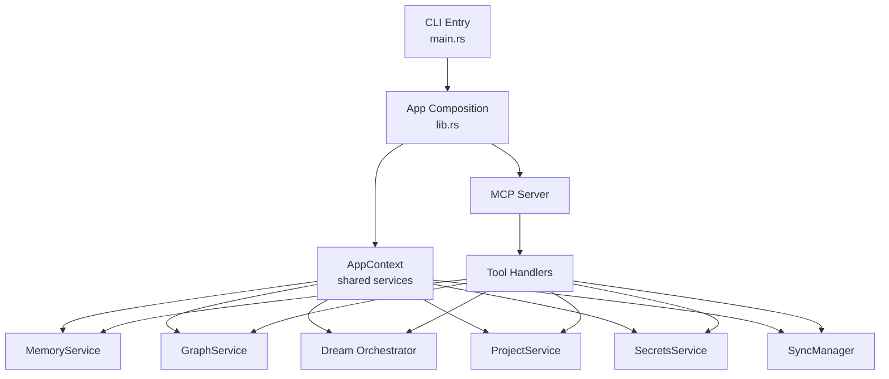

**Diagram sources**
- [main.rs:17-90](file://src/main.rs#L17-L90)
- [lib.rs:45-134](file://src/lib.rs#L45-L134)
- [mod.rs:1-8](file://src/mcp/mod.rs#L1-L8)

**Section sources**
- [main.rs:17-90](file://src/main.rs#L17-L90)
- [lib.rs:45-134](file://src/lib.rs#L45-L134)
- [Cargo.toml:1-69](file://Cargo.toml#L1-L69)
- [README.md:27-57](file://README.md#L27-L57)

## Core Components
- Application Context (`AppContext`)
  - Holds settings, database connection, embedding provider, workspace, Git store, LLM client, consolidator, pending session lock, graph, project, dream, backup, sync, Ralph service, secrets, lessons, slots, watcher, scan jobs, and active workspace/project locks.
- Services
  - MemoryService: persistence, embeddings, hybrid search (FTS + vector), trust feedback, merge operations.
  - GraphService: entity/edge upserts, node embeddings, lexical/vector search, PPR ranking, stats.
  - Dream: multi-phase orchestration over history, memory revision, graph extraction, Ralph stale findings review, Git commits.
  - ProjectService: project registration, AST scanning, incremental updates, import bridges, embedding backfill.
  - SecretsService: PIN unlock, TTL-based session, encryption/decryption, rekey, status/list/get/set/delete.
  - SyncManager: peer config, export/import, watermark cursors, LWW conflict resolution, E2EE container support.

Key responsibilities and interactions are injected at startup and exposed through MCP tools. Background workers run AutoDream and AutoSync based on configuration flags.

**Section sources**
- [lib.rs:45-134](file://src/lib.rs#L45-L134)
- [service.rs:30-38](file://src/memory/service.rs#L30-L38)
- [service.rs:96-104](file://src/graph/service.rs#L96-L104)
- [mod.rs:110-143](file://src/dream/mod.rs#L110-L143)
- [mod.rs:39-67](file://src/project/mod.rs#L39-L67)
- [service.rs:43-56](file://src/secrets/service.rs#L43-L56)
- [mod.rs:196-229](file://src/sync/mod.rs#L196-L229)

## Architecture Overview
OB2H uses a service-oriented architecture with a central `AppContext` that composes all services. The CLI initializes settings, ensures directories, sets up logging, constructs the context, and then either runs a read-only viewer or starts the MCP server. Background workers are launched after the IPC server for secrets is started.

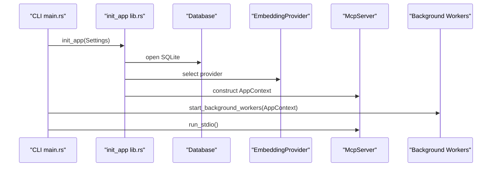

**Diagram sources**
- [main.rs:17-90](file://src/main.rs#L17-L90)
- [lib.rs:45-134](file://src/lib.rs#L45-L134)

System boundaries:
- External: MCP clients (agents like Hermes, Claude Code, Cursor, etc.), LLM APIs, Git repositories, SSH peers.
- Internal: Services (memory, graph, dream, project, secrets, sync), DB (SQLite), Workspace/GitStore, Vector index (sqlite-vec).

Data flow highlights:
- Agent calls MCP tools → McpServer dispatches to services → services update DB/workspace → background workers process asynchronously.

**Section sources**
- [main.rs:17-90](file://src/main.rs#L17-L90)
- [lib.rs:45-134](file://src/lib.rs#L45-L134)
- [README.md:130-149](file://README.md#L130-L149)

## Detailed Component Analysis

### Service-Oriented Architecture and Dependency Injection
The application context wires services together:
- Database and embedding provider are foundational.
- MemoryService depends on DB and EmbeddingProvider.
- GraphService depends on DB and EmbeddingProvider.
- ProjectService optionally depends on EmbeddingProvider for batch embedding.
- Dream orchestrates Workspace, GitStore, LLM, Settings, DB, and optionally Graph/Memory/Ralph.
- SecretsService depends on DB and manages in-memory session.
- SyncManager depends on Settings, DB, EmbeddingProvider, BackupManager, and NodeConfig.

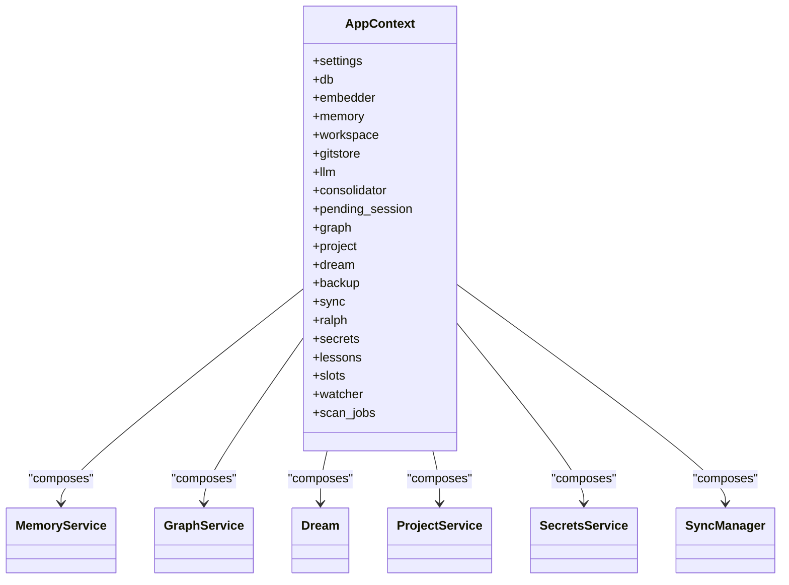

**Diagram sources**
- [lib.rs:45-134](file://src/lib.rs#L45-L134)

**Section sources**
- [lib.rs:45-134](file://src/lib.rs#L45-L134)

### Event-Driven Architecture: File Watchers and Background Workers
- File watchers:
  - ProjectWatcher integrates with ProjectService to react to file changes and trigger scans.
  - Git hooks can be installed per project to invoke scans automatically.
- Background workers:
  - AutoDreamWorker runs periodic dream cycles when enabled.
  - AutoSyncWorker runs periodic sync tasks when enabled.

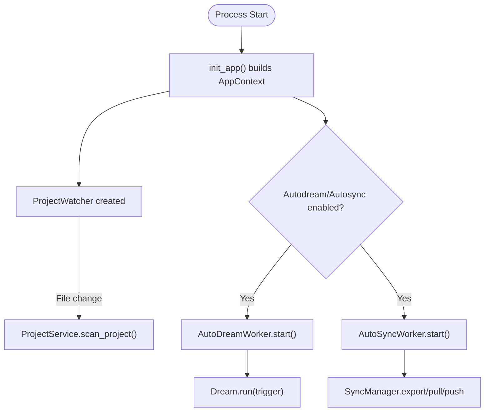

**Diagram sources**
- [lib.rs:97-100](file://src/lib.rs#L97-L100)
- [lib.rs:137-161](file://src/lib.rs#L137-L161)
- [mod.rs:419-580](file://src/project/mod.rs#L419-L580)
- [mod.rs:145-287](file://src/dream/mod.rs#L145-L287)
- [mod.rs:247-469](file://src/sync/mod.rs#L247-L469)

**Section sources**
- [lib.rs:97-100](file://src/lib.rs#L97-L100)
- [lib.rs:137-161](file://src/lib.rs#L137-L161)
- [mod.rs:419-580](file://src/project/mod.rs#L419-L580)
- [mod.rs:145-287](file://src/dream/mod.rs#L145-L287)
- [mod.rs:247-469](file://src/sync/mod.rs#L247-L469)

### Memory Service: Hybrid Search, Trust, and Merges
Responsibilities:
- Deterministic key generation and upsert semantics.
- Identity-duplicate detection using cosine similarity thresholds.
- FTS5 fallback to LIKE if needed.
- Vector semantic search with local embeddings.
- Hybrid RRF merging of FTS and vector results.
- Trust feedback loops and dream revisions.
- Merge records with link redirection and tombstones.

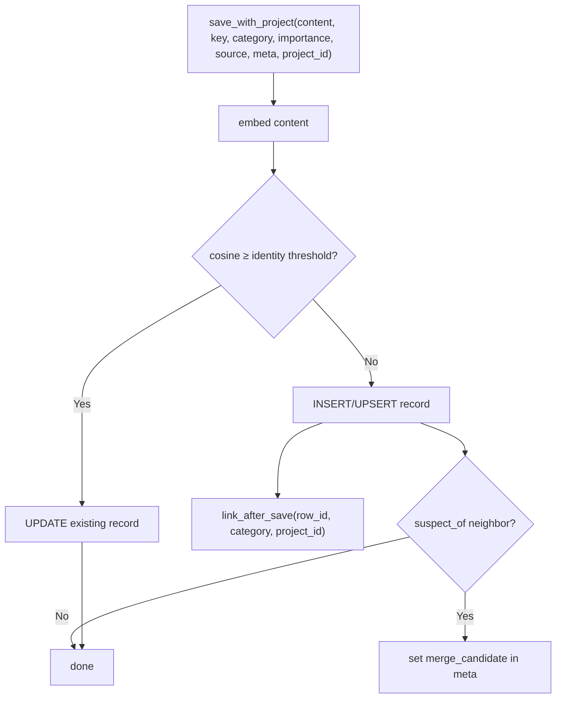

**Diagram sources**
- [service.rs:48-167](file://src/memory/service.rs#L48-L167)
- [service.rs:170-213](file://src/memory/service.rs#L170-L213)
- [service.rs:489-636](file://src/memory/service.rs#L489-L636)
- [service.rs:685-757](file://src/memory/service.rs#L685-L757)
- [service.rs:218-335](file://src/memory/service.rs#L218-L335)

**Section sources**
- [service.rs:48-167](file://src/memory/service.rs#L48-L167)
- [service.rs:489-636](file://src/memory/service.rs#L489-L636)
- [service.rs:685-757](file://src/memory/service.rs#L685-L757)
- [service.rs:218-335](file://src/memory/service.rs#L218-L335)

### Graph Service: Entities, Edges, Search, and PPR
Responsibilities:
- Upsert entities and edges from extractions.
- Embed nodes for vector search.
- Lexical search with FTS5 fallback.
- Optional vec0 acceleration for vector search.
- PPR ranking over project-scoped graphs.
- Stats and reasoning helpers.

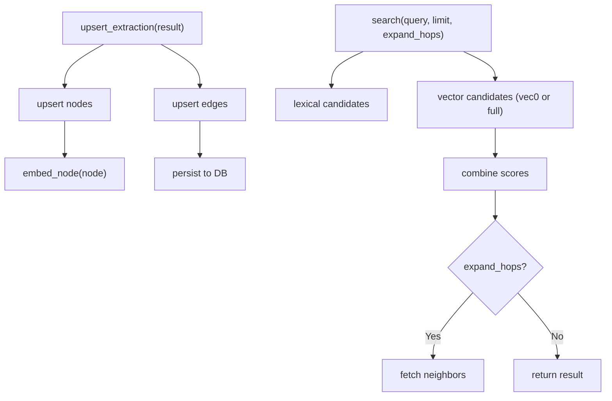

**Diagram sources**
- [service.rs:106-216](file://src/graph/service.rs#L106-L216)
- [service.rs:236-460](file://src/graph/service.rs#L236-L460)
- [service.rs:546-674](file://src/graph/service.rs#L546-L674)

**Section sources**
- [service.rs:106-216](file://src/graph/service.rs#L106-L216)
- [service.rs:236-460](file://src/graph/service.rs#L236-L460)
- [service.rs:546-674](file://src/graph/service.rs#L546-L674)

### Dream Orchestrator: Phases, Revisions, and Git Commits
Responsibilities:
- Read new history entries since last cursor.
- Phase 1 analysis via LLM.
- Phase 2 agent loop editing memory/soul/user files.
- Extract session facts into graph.
- Revise low-trust memories and propose belief links.
- Consolidate memory candidates and revise Ralph stale findings.
- Commit changes to Git and compact history.

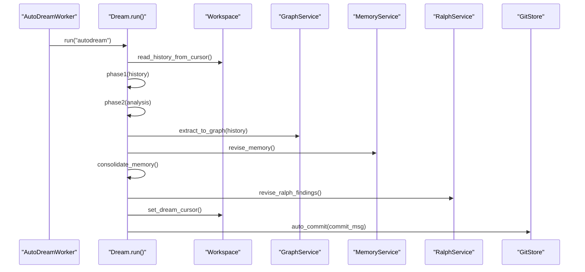

**Diagram sources**
- [mod.rs:145-287](file://src/dream/mod.rs#L145-L287)
- [mod.rs:290-395](file://src/dream/mod.rs#L290-L395)
- [mod.rs:397-416](file://src/dream/mod.rs#L397-L416)
- [mod.rs:418-543](file://src/dream/mod.rs#L418-L543)
- [mod.rs:568-616](file://src/dream/mod.rs#L568-L616)

**Section sources**
- [mod.rs:145-287](file://src/dream/mod.rs#L145-L287)
- [mod.rs:290-395](file://src/dream/mod.rs#L290-L395)
- [mod.rs:397-416](file://src/dream/mod.rs#L397-L416)
- [mod.rs:418-543](file://src/dream/mod.rs#L418-L543)
- [mod.rs:568-616](file://src/dream/mod.rs#L568-L616)

### Project Service: AST Scanning and Incremental Updates
Responsibilities:
- Register projects and auto-detect by path.
- Full/incremental AST scanning with versioned extractor.
- Resolve imports/calls and build bridges.
- Persist nodes/edges and ast_refs.
- Batch embed unembedded nodes.

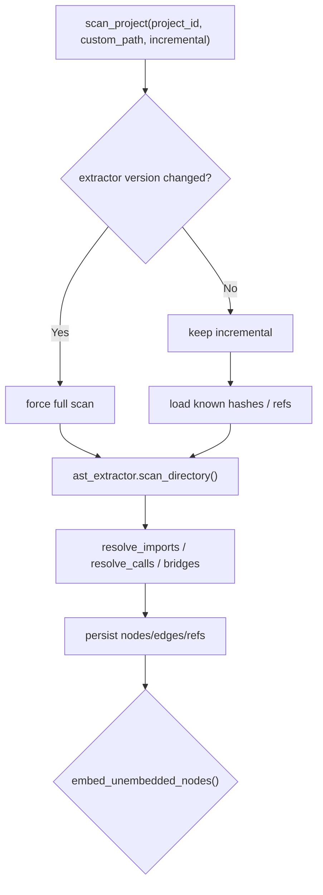

**Diagram sources**
- [mod.rs:419-580](file://src/project/mod.rs#L419-L580)
- [mod.rs:69-146](file://src/project/mod.rs#L69-L146)

**Section sources**
- [mod.rs:419-580](file://src/project/mod.rs#L419-L580)
- [mod.rs:69-146](file://src/project/mod.rs#L69-L146)

### Secrets Service: PIN-Gated Vault and TTL Sessions
Responsibilities:
- Initialize vault with salt, KDF params, verifier.
- Unlock via PIN; derive key and create in-memory session with TTL.
- Encrypt/decrypt values; list metadata without exposing values.
- Rekey entire vault atomically.

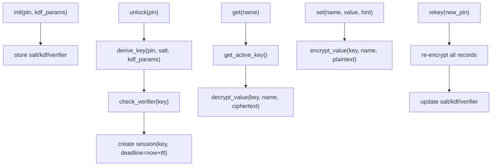

**Diagram sources**
- [service.rs:71-111](file://src/secrets/service.rs#L71-L111)
- [service.rs:118-176](file://src/secrets/service.rs#L118-L176)
- [service.rs:186-203](file://src/secrets/service.rs#L186-L203)
- [service.rs:267-333](file://src/secrets/service.rs#L267-L333)
- [service.rs:360-444](file://src/secrets/service.rs#L360-L444)

**Section sources**
- [service.rs:71-111](file://src/secrets/service.rs#L71-L111)
- [service.rs:118-176](file://src/secrets/service.rs#L118-L176)
- [service.rs:186-203](file://src/secrets/service.rs#L186-L203)
- [service.rs:267-333](file://src/secrets/service.rs#L267-L333)
- [service.rs:360-444](file://src/secrets/service.rs#L360-L444)

### Sync Manager: Bundle Export/Import, LWW, and E2EE
Responsibilities:
- Load peer configuration and compute effective origin/priority.
- Export deltas to outbox with watermark cursors and optional full bundles.
- Import bundles idempotently with ordering and transactional apply.
- Resolve conflicts using Last-Write-Wins with priority tie-break.
- Support optional end-to-end encryption of bundles.

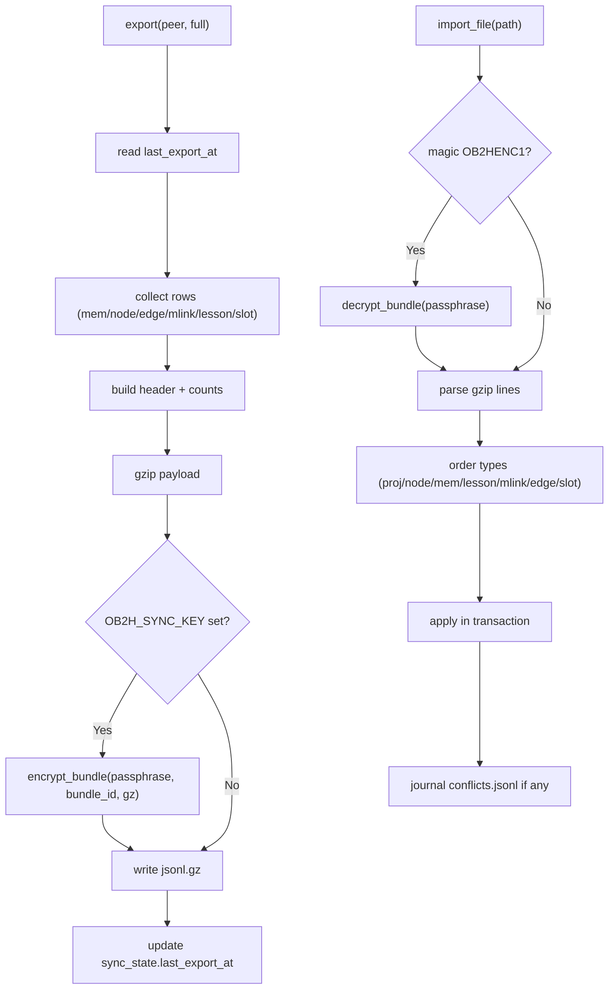

**Diagram sources**
- [mod.rs:247-469](file://src/sync/mod.rs#L247-L469)
- [mod.rs:508-733](file://src/sync/mod.rs#L508-L733)
- [mod.rs:127-192](file://src/sync/mod.rs#L127-L192)

**Section sources**
- [mod.rs:247-469](file://src/sync/mod.rs#L247-L469)
- [mod.rs:508-733](file://src/sync/mod.rs#L508-L733)
- [mod.rs:127-192](file://src/sync/mod.rs#L127-L192)

### Plugin System and Multi-Agent Support via MCP Abstraction
- MCP server acts as the protocol boundary for agents.
- Tools expose capabilities such as memory operations, graph queries, dream control, lessons, secrets, and sync.
- Plugins integrate agents (e.g., Hermes, DSH) by wiring MCP tool calls to OB2H services.
- README documents multi-agent installation and skill/plugin setup.

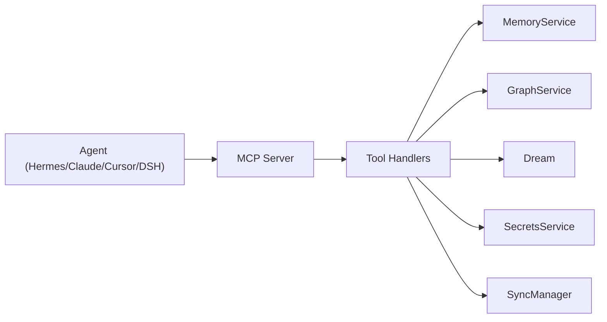

**Diagram sources**
- [mod.rs:1-8](file://src/mcp/mod.rs#L1-L8)
- [README.md:97-127](file://README.md#L97-L127)

**Section sources**
- [mod.rs:1-8](file://src/mcp/mod.rs#L1-L8)
- [README.md:97-127](file://README.md#L97-L127)

## Dependency Analysis
High-level dependencies:
- main.rs depends on CLI commands, update checks, MCP server, and app initialization.
- lib.rs composes services and background workers.
- Services depend on DB, EmbeddingProvider, Workspace/GitStore, LLMClient where applicable.
- SyncManager depends on BackupManager and EmbeddingProvider for missing embeddings during import.

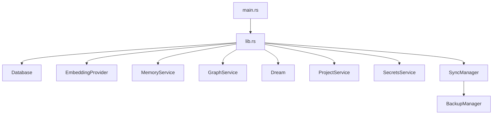

**Diagram sources**
- [main.rs:17-90](file://src/main.rs#L17-L90)
- [lib.rs:45-134](file://src/lib.rs#L45-L134)
- [mod.rs:196-229](file://src/sync/mod.rs#L196-L229)

**Section sources**
- [main.rs:17-90](file://src/main.rs#L17-L90)
- [lib.rs:45-134](file://src/lib.rs#L45-L134)
- [mod.rs:196-229](file://src/sync/mod.rs#L196-L229)

## Performance Considerations
- Vector search acceleration:
  - Optional sqlite-vec rescore path controlled by environment flag; falls back to full scan when disabled or index empty.
- Hybrid search:
  - FTS5 combined with vector similarity via RRF; avoids expensive full scans by narrowing candidates.
- Embedding batching:
  - ProjectService batches embeddings for unembedded nodes to reduce API/local model overhead.
- Logging and archival:
  - Workspace archives old daily logs to prevent unbounded growth.
- Index building:
  - vec0 index build command allows precomputing indices for faster recall benchmarks.

[No sources needed since this section provides general guidance]

## Troubleshooting Guide
Common operational issues and diagnostics:
- MCP server not starting:
  - Ensure stdio mode is selected for serve; check logging output and environment filters.
- Secrets vault locked:
  - Use unlock command; verify PIN format and TTL expiration; use status to inspect lock state.
- Sync conflicts:
  - Inspect conflicts journal; adjust peer priorities; verify E2EE passphrase consistency across peers.
- Dream failures:
  - Check dream status/log; ensure LLM availability; validate workspace files and Git commit permissions.
- Project scan inconsistencies:
  - Verify extractor version; force full scan if version mismatch; confirm incremental hashes and deleted files handling.

**Section sources**
- [main.rs:40-58](file://src/main.rs#L40-L58)
- [service.rs:186-203](file://src/secrets/service.rs#L186-L203)
- [mod.rs:702-733](file://src/sync/mod.rs#L702-L733)
- [mod.rs:618-646](file://src/dream/mod.rs#L618-L646)
- [mod.rs:445-468](file://src/project/mod.rs#L445-L468)

## Conclusion
OB2H’s architecture cleanly separates core services while sharing a common application context. The MCP server abstracts multi-agent integration, enabling consistent tool exposure. Background workers and file watchers provide asynchronous processing for dreaming and synchronization. The system supports scalable operation through vector indexing, batching, and incremental scans, and offers flexible deployment topologies for both desktop PCs and remote VPS instances.

[No sources needed since this section summarizes without analyzing specific files]

## Appendices

### Infrastructure Requirements
- Runtime:
  - SQLite database (bundled), optional sqlite-vec extension.
  - Optional local LLM runtime (Candle) for embeddings and dreaming fallback.
- Storage:
  - Data directory for DB, workspace, logs, backups, sync folders.
- Networking:
  - Outbound access to LLM APIs; optional SSH for peer sync.
- OS:
  - Windows, Linux, macOS; GUI features optional.

**Section sources**
- [Cargo.toml:1-69](file://Cargo.toml#L1-L69)
- [README.md:300-329](file://README.md#L300-L329)

### Deployment Topology Options
- PC:
  - Local MCP server, optional GUI PIN input, local model caching.
- VPS:
  - Headless operation, scheduled sync timer, SSH-based peer exchange.
- Multi-machine:
  - Configure peers.json with ssh/manual methods; enable after_dream sync; consider E2EE via shared passphrase.

**Section sources**
- [README.md:152-185](file://README.md#L152-L185)
- [scripts/vps/README.md](file://scripts/vps/README.md)