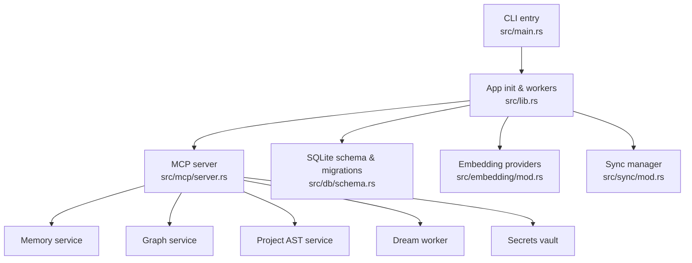
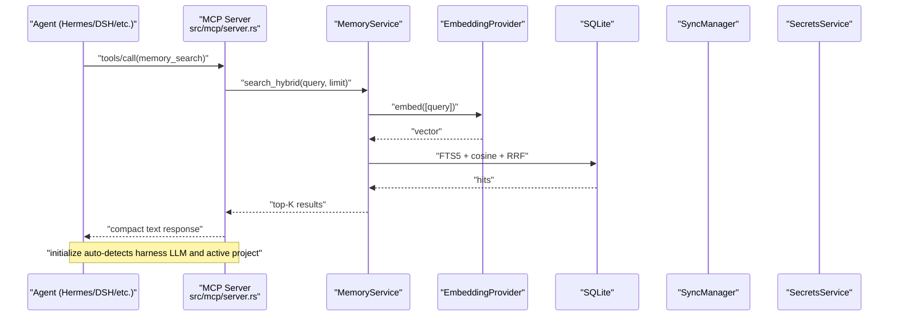
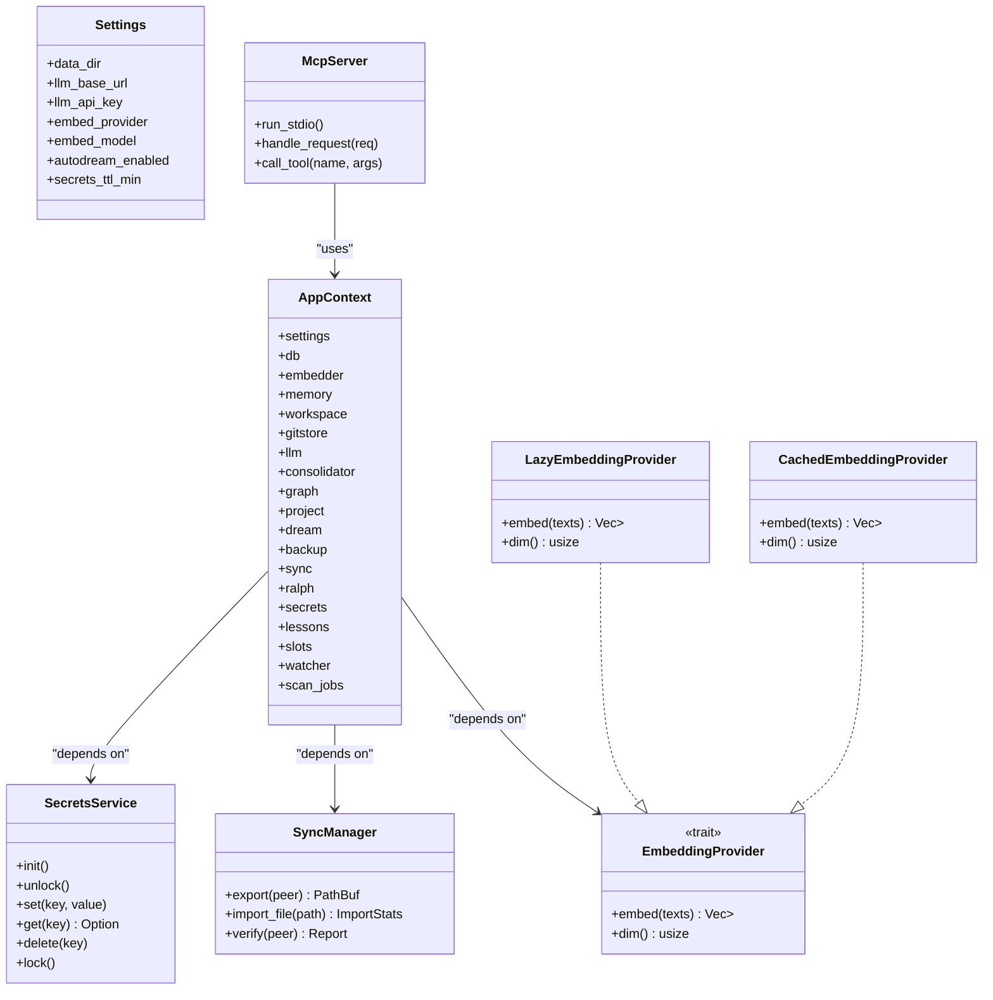
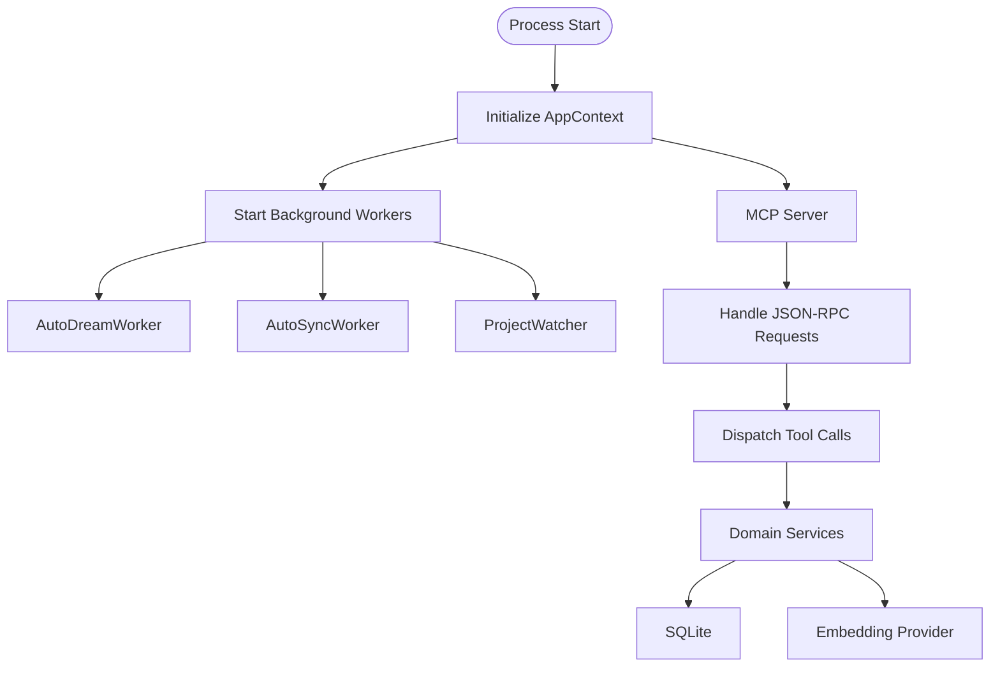
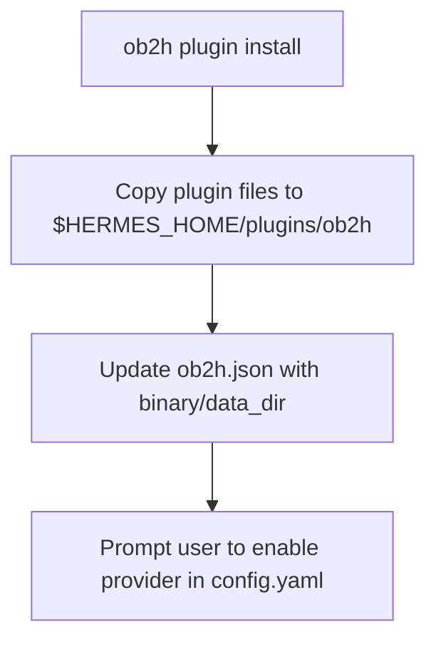
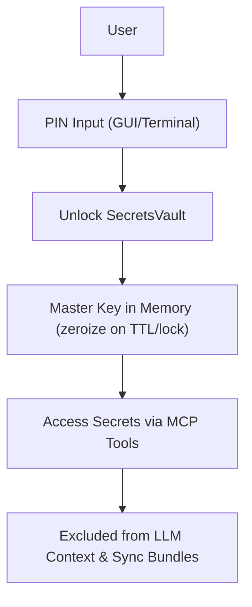
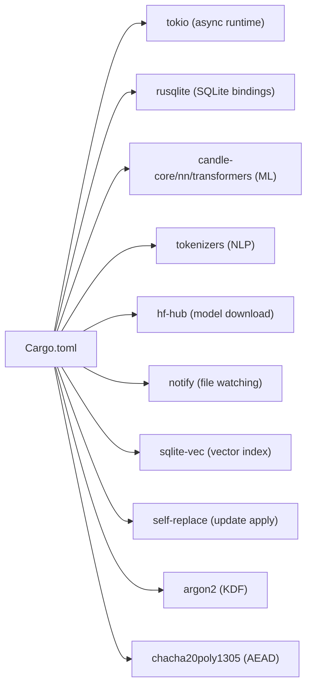
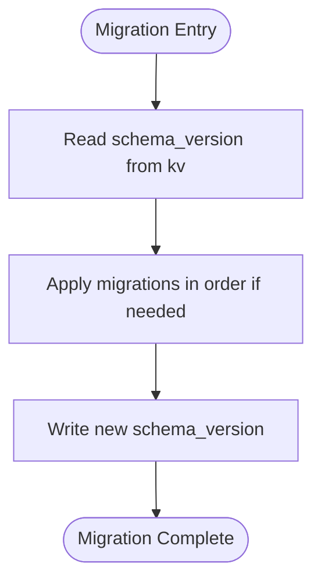
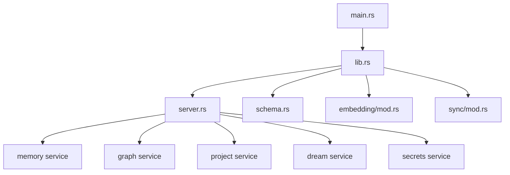
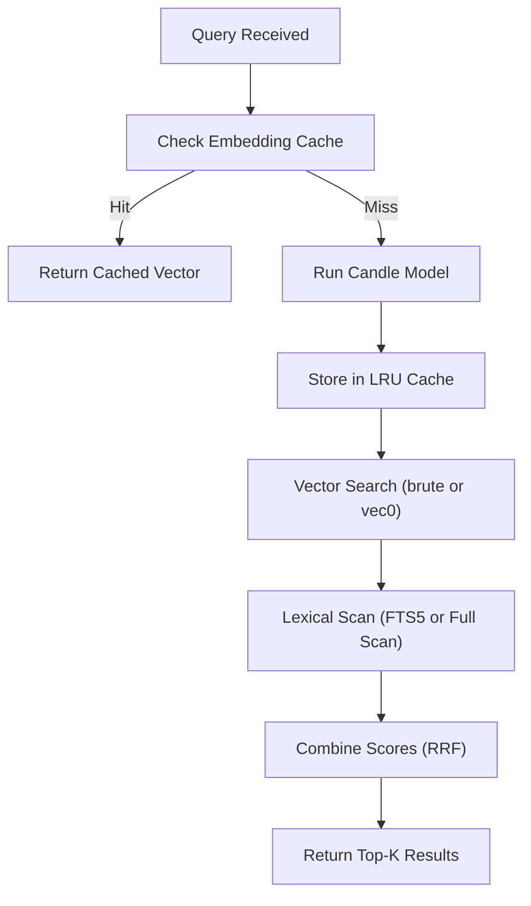

# Technical Decisions & Patterns

<cite>
**Referenced Files in This Document**   
- [README.md](file://README.md)
- [Cargo.toml](file://Cargo.toml)
- [ARCHITECTURE.md](file://docs/ARCHITECTURE.md)
- [ADR-35.1-sqlite-vec.md](file://docs/ADR-35.1-sqlite-vec.md)
- [main.rs](file://src/main.rs)
- [lib.rs](file://src/lib.rs)
- [server.rs](file://src/mcp/server.rs)
- [schema.rs](file://src/db/schema.rs)
- [embedding_mod.rs](file://src/embedding/mod.rs)
- [sync_mod.rs](file://src/sync/mod.rs)
</cite>

## Table of Contents
1. [Introduction](#introduction)
2. [Project Structure](#project-structure)
3. [Core Components](#core-components)
4. [Architecture Overview](#architecture-overview)
5. [Detailed Component Analysis](#detailed-component-analysis)
6. [Dependency Analysis](#dependency-analysis)
7. [Performance Considerations](#performance-considerations)
8. [Troubleshooting Guide](#troubleshooting-guide)
9. [Conclusion](#conclusion)

## Introduction
This document explains the technical decisions and design patterns behind OB2H, focusing on its architecture, technology stack, data layer, async runtime, security model, extensibility mechanisms, dependency management, performance strategy, and migration approach. It is intended for engineers evaluating or extending OB2H, as well as operators deploying it across machines.

OB2H is a local knowledge store and long-term memory system for AI agents, implemented in Rust. It exposes an MCP server, maintains a SQLite-backed knowledge graph, supports vector search with Candle-based embeddings, provides AST-driven project analysis, and offers secure synchronization between peers.

**Section sources**
- [README.md:27-57](file://README.md#L27-L57)
- [ARCHITECTURE.md:1-58](file://docs/ARCHITECTURE.md#L1-L58)

## Project Structure
The repository follows a layered Rust application structure:
- Entry point and CLI routing live in `src/main.rs`.
- Application context and background workers are initialized in `src/lib.rs`.
- The MCP server handles JSON-RPC requests and dispatches tools in `src/mcp/server.rs`.
- Database schema and migrations are centralized in `src/db/schema.rs`.
- Embedding providers (local Candle, API, fake) are defined in `src/embedding/mod.rs`.
- Synchronization logic for peer bundles is in `src/sync/mod.rs`.
- Documentation and architectural decisions are under `docs/`, including ADRs and integration guides.

**Diagram sources**
- [main.rs:17-90](file://src/main.rs#L17-L90)
- [lib.rs:46-135](file://src/lib.rs#L46-L135)
- [server.rs:27-56](file://src/mcp/server.rs#L27-L56)

**Section sources**
- [main.rs:17-90](file://src/main.rs#L17-L90)
- [lib.rs:46-135](file://src/lib.rs#L46-L135)
- [ARCHITECTURE.md:11-58](file://docs/ARCHITECTURE.md#L11-L58)

## Core Components
- **Rust binary and CLI**: Single executable with subcommands for serve, bench, doctor, dream, backup, sync, vec0, secrets, agent, project, and update.
- **MCP server**: Stdio transport handling initialize, ping, tools/list, resources/list/prompts/get/call, and tool dispatch.
- **Database layer**: SQLite with WAL mode, FTS5 virtual tables, versioned migrations, and optional sqlite-vec extension.
- **Embedding layer**: Pluggable providers with lazy initialization, LRU caching, and fallback to API or fake when local model fails.
- **Sync layer**: File-based delta bundles with LWW merge, tombstones, E2EE container format, and idempotent import tracking.
- **Security layer**: Secrets vault with XChaCha20-Poly1305, Argon2id master key in memory, PIN-gated unlock, and isolation from LLM context and sync payloads.
- **Extensibility**: Plugin installer for Hermes, skill definitions for multiple agents, and MCP tools/resources/prompts contract.

**Section sources**
- [main.rs:62-583](file://src/main.rs#L62-L583)
- [server.rs:138-570](file://src/mcp/server.rs#L138-L570)
- [schema.rs:452-518](file://src/db/schema.rs#L452-L518)
- [embedding_mod.rs:31-107](file://src/embedding/mod.rs#L31-L107)
- [sync_mod.rs:194-469](file://src/sync/mod.rs#L194-L469)

## Architecture Overview
OB2H uses a service-oriented architecture where each domain (memory, graph, project, dream, sync, secrets, lessons, slots) is encapsulated behind services exposed through MCP tools. The MCP server is the single public boundary for agents and CLI. Background workers run AutoDream and AutoSync tasks independently of request processing.

**Diagram sources**
- [server.rs:210-324](file://src/mcp/server.rs#L210-L324)
- [server.rs:479-558](file://src/mcp/server.rs#L479-L558)
- [embedding_mod.rs:210-239](file://src/embedding/mod.rs#L210-L239)

**Section sources**
- [ARCHITECTURE.md:11-58](file://docs/ARCHITECTURE.md#L11-L58)
- [server.rs:138-570](file://src/mcp/server.rs#L138-L570)

## Detailed Component Analysis

### Technology Stack Decisions
- **Rust**: Chosen for performance-critical components, small binary size, low memory footprint, and deterministic startup time.
- **Tokio**: Full-featured async runtime used for stdio MCP server, background workers, and concurrent task handling.
- **SQLite with FTS5**: Used for full-text search with trigram tokenization; virtual tables keep indexes synchronized via triggers.
- **sqlite-vec (vec0)**: Optional vector index over `graph_nodes` for approximate nearest neighbor search; opt-in via environment flag.
- **Candle ML framework**: Local embedding provider using MiniLM models; lazy loading avoids blocking server start.
- **External LLM API**: OpenAI-compatible client for reasoning and extraction; harness auto-detection selects primary model.

**Diagram sources**
- [server.rs:27-56](file://src/mcp/server.rs#L27-L56)
- [embedding_mod.rs:31-107](file://src/embedding/mod.rs#L31-L107)
- [embedding_mod.rs:116-208](file://src/embedding/mod.rs#L116-L208)
- [sync_mod.rs:194-233](file://src/sync/mod.rs#L194-L233)

**Section sources**
- [README.md:61-70](file://README.md#L61-L70)
- [Cargo.toml:7-54](file://Cargo.toml#L7-L54)
- [ARCHITECTURE.md:280-305](file://docs/ARCHITECTURE.md#L280-L305)

### Service-Oriented Architecture
Each domain is wrapped in a service:
- `MemoryService`: Hybrid search (FTS5 + vector), tombstone filtering, trust scoring, PPR expansion.
- `GraphService`: Knowledge graph upsert, node deduplication, edge typing, analytics.
- `ProjectService`: AST scanning, call-path analysis, repo-map generation, dead-code detection.
- `Dream`: Two-phase dreaming, maintenance decay/purge, Git-backed restore.
- `SyncManager`: Bundle export/import, LWW merge, E2EE, watermark tracking.
- `SecretsService`: Encrypted storage, PIN-gated unlock, TTL-based key zeroization.
- `LessonsService` / `SlotsService`: Procedural experience and pinned context units.

Services are composed into `AppContext`, shared across MCP handlers and background workers.

**Section sources**
- [lib.rs:46-135](file://src/lib.rs#L46-L135)
- [ARCHITECTURE.md:36-52](file://docs/ARCHITECTURE.md#L36-L52)

### Event-Driven Processing
- **AutoDreamWorker**: Runs periodically based on time/event gates, performs analysis and updates workspace files, then optionally triggers sync.
- **AutoSyncWorker**: Periodically pushes/pulls bundles based on configuration.
- **File Watcher**: Observes project file changes and triggers incremental AST scans.
- **MCP Request Handling**: Each JSON-RPC request is processed in a separate Tokio task to avoid blocking stdin reading and keepalive.

**Diagram sources**
- [lib.rs:137-161](file://src/lib.rs#L137-L161)
- [server.rs:138-206](file://src/mcp/server.rs#L138-L206)

**Section sources**
- [lib.rs:137-161](file://src/lib.rs#L137-L161)
- [server.rs:138-206](file://src/mcp/server.rs#L138-L206)

### Plugin Architecture for Extensibility
- **Hermes Plugin Installer**: Copies plugin files into Hermes plugin directory and updates `ob2h.json` with binary/data paths.
- **Skill Definitions**: SKILL.md files per agent describe integration steps, commands, and pitfalls.
- **MCP Contract**: Stable set of tools, resources, and prompts with annotations for read-only/destructive hints.

**Diagram sources**
- [main.rs:702-784](file://src/main.rs#L702-L784)

**Section sources**
- [main.rs:702-784](file://src/main.rs#L702-L784)
- [README.md:332-343](file://README.md#L332-L343)

### Layered Security Model
- **Secrets Vault**: XChaCha20-Poly1305 encryption, Argon2id-derived master key held only in memory, zeroized on TTL expiry or lock command.
- **PIN Gating**: GUI or terminal PIN input; PIN never enters LLM context, MCP messages, or chat.
- **Isolation**: Secrets excluded from sync bundles, LLM prompts, and memory/graph contexts.
- **E2EE Bundles**: Optional AES-GCM encryption of sync bundles using `OB2H_SYNC_KEY`; header integrity protected via AAD.

**Diagram sources**
- [README.md:188-199](file://README.md#L188-L199)
- [sync_mod.rs:127-192](file://src/sync/mod.rs#L127-L192)

**Section sources**
- [README.md:188-199](file://README.md#L188-L199)
- [sync_mod.rs:127-192](file://src/sync/mod.rs#L127-L192)

### Third-Party Dependency Management
- **Rust Crates**: Managed via Cargo.toml with explicit versions and feature flags.
- **Optional GUI**: `eframe`, `sys-locale`, `image` enabled via `gui` feature.
- **Platform-Specific Dependencies**: Windows syscalls and Unix libc gated by cfg targets.
- **TLS & Networking**: rustls with aws-lc-rs backend, reqwest with rustls-tls.
- **Vector Search**: sqlite-vec extension registered once before connections.

**Diagram sources**
- [Cargo.toml:7-54](file://Cargo.toml#L7-L54)

**Section sources**
- [Cargo.toml:7-54](file://Cargo.toml#L7-L54)

### Version Compatibility Matrices
- **Schema Versions**: Migrations M1–M11 applied incrementally; current SCHEMA_VERSION is 11.
- **Bundle Versions**: v1 and v2 bundle formats supported; v2 adds trust, last_feedback_at, mlink type, and field-level merge.
- **Embedding Formats**: Dual-read support for int8 quantized vectors alongside legacy f32 blobs.
- **Runtime Compatibility**: Requires Rust 1.80+; supports Windows, Linux, macOS.

**Section sources**
- [schema.rs:5](file://src/db/schema.rs#L5)
- [schema.rs:452-518](file://src/db/schema.rs#L452-L518)
- [sync_mod.rs:541-547](file://src/sync/mod.rs#L541-L547)
- [README.md:9](file://README.md#L9)

### Migration Strategies
- **Additive Migrations**: New columns added with DEFAULT values; old binaries continue to work.
- **Pre-Migration Backups**: Automatic backups before applying new migrations or importing bundles.
- **Downgrade Safety**: Migrations do not drop or rename existing columns.
- **Watermark Tracking**: Sync state tracks last_export_at/last_import_at for idempotent delta exports/imports.

**Diagram sources**
- [schema.rs:452-518](file://src/db/schema.rs#L452-L518)

**Section sources**
- [schema.rs:452-518](file://src/db/schema.rs#L452-L518)

## Dependency Analysis
OB2H’s dependencies form a clear hierarchy:
- **Entry Point**: `main.rs` parses CLI and routes to commands.
- **Application Context**: `lib.rs` initializes services and background workers.
- **MCP Server**: `server.rs` handles protocol and dispatches to services.
- **Domain Services**: Memory, graph, project, dream, sync, secrets, lessons, slots.
- **Infrastructure**: SQLite, embedding providers, LLM clients, file watcher, backup manager.

**Diagram sources**
- [main.rs:17-90](file://src/main.rs#L17-L90)
- [lib.rs:46-135](file://src/lib.rs#L46-L135)

**Section sources**
- [main.rs:17-90](file://src/main.rs#L17-L90)
- [lib.rs:46-135](file://src/lib.rs#L46-L135)

## Performance Considerations
- **Startup Time**: Lazy embedding provider defers model loading until first use.
- **Concurrency**: MCP server processes each request in a separate Tokio task; JoinSet bounded to prevent unbounded growth.
- **Vector Search Optimization**: sqlite-vec vec0 index provides ~2.9× speedup on vector scan stage; end-to-end p95 improvement modest due to lexical scan bottleneck.
- **Caching**: LRU cache for embedding queries reduces repeated model calls.
- **Database Tuning**: WAL mode, foreign keys enabled, busy timeout configured for multi-process access.
- **Resource Management**: Daily log archival, tombstone retention, compacted memory digests, and rotation of backups.

**Diagram sources**
- [embedding_mod.rs:116-208](file://src/embedding/mod.rs#L116-L208)
- [ADR-35.1-sqlite-vec.md:59-84](file://docs/ADR-35.1-sqlite-vec.md#L59-L84)

**Section sources**
- [embedding_mod.rs:116-208](file://src/embedding/mod.rs#L116-L208)
- [ADR-35.1-sqlite-vec.md:59-84](file://docs/ADR-35.1-sqlite-vec.md#L59-L84)
- [ARCHITECTURE.md:307-318](file://docs/ARCHITECTURE.md#L307-L318)

## Troubleshooting Guide
- **MCP Connection Issues**: Ensure stdio transport is available; check that Hermes or DSH launches ob2h correctly.
- **LLM Harness Detection**: Verify `OB2H_LLM_HARNESS_DETECT` and harness config paths; manual override via `OB2H_LLM_*` variables.
- **Embedding Failures**: Local model load failures fall back to API or fake provider; check offline mode and network connectivity.
- **Sync Conflicts**: Review `sync/conflicts.jsonl` for content conflicts; adjust `OB2H_SYNC_KEEP_LOSERS` to preserve losing versions.
- **Secrets Vault Lockout**: Use `ob2h secrets lock` to immediately zeroize master key; PIN reset requires reinitialization.
- **Viewer Read-Only Mode**: Viewer runs as separate process without migrations or writes; ensure data directory is readable.

**Section sources**
- [server.rs:210-324](file://src/mcp/server.rs#L210-L324)
- [embedding_mod.rs:40-64](file://src/embedding/mod.rs#L40-L64)
- [sync_mod.rs:702-724](file://src/sync/mod.rs#L702-L724)
- [README.md:188-199](file://README.md#L188-L199)
- [main.rs:22-34](file://src/main.rs#L22-L34)

## Conclusion
OB2H’s architecture combines a Rust-based MCP server, SQLite with FTS5 and optional sqlite-vec indexing, Candle-powered local embeddings, and a robust sync mechanism with E2EE support. Its service-oriented design, event-driven background workers, plugin extensibility, and layered security model provide a scalable foundation for long-term memory and code-aware AI assistance. Performance optimizations focus on lazy loading, caching, and selective vector indexing, while migration strategies ensure backward compatibility and safe evolution. Operators can tune behavior via environment variables and configuration files, and extend functionality through plugins and skills.