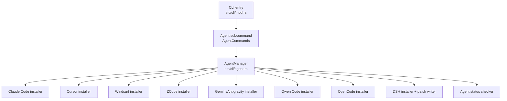
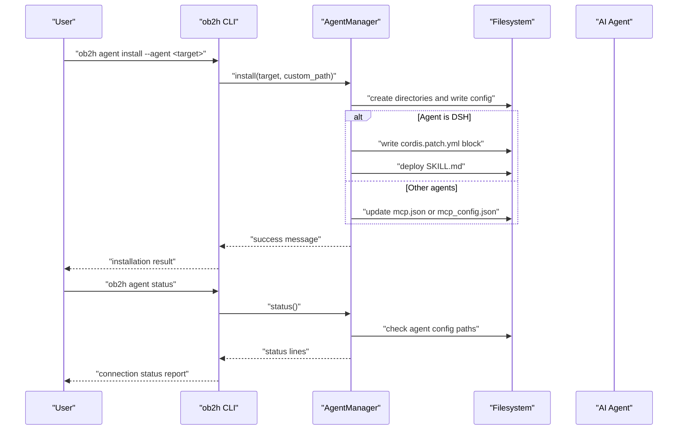
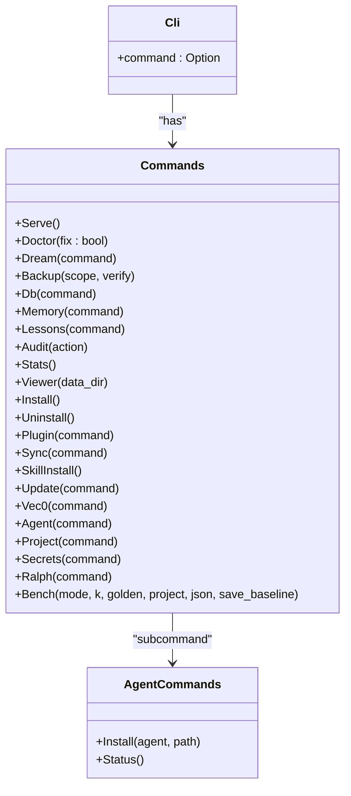
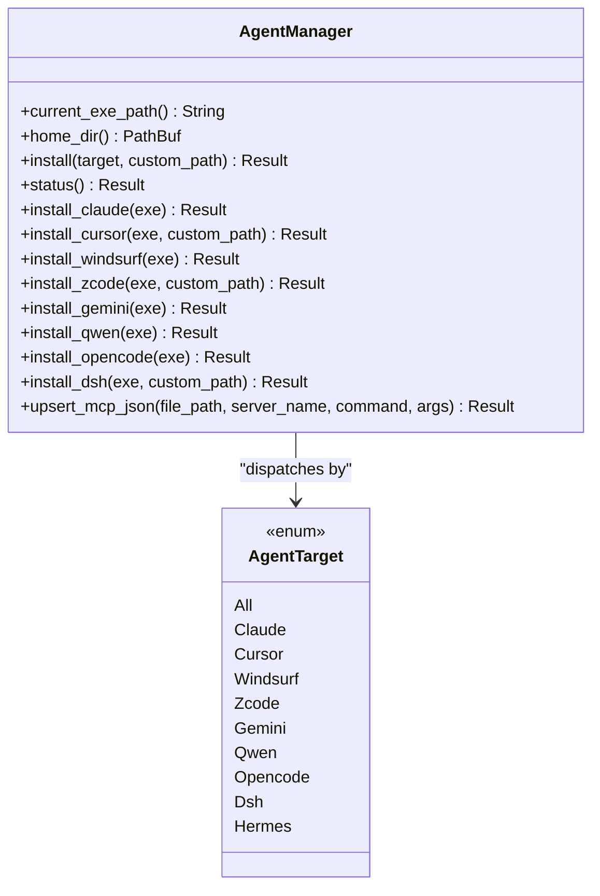
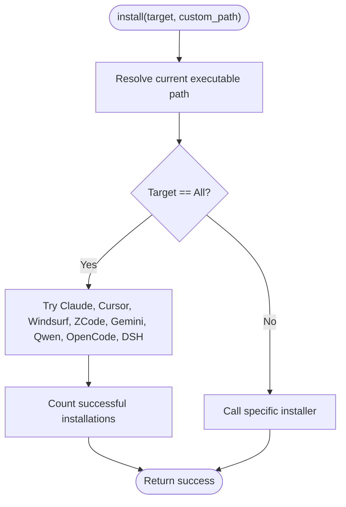
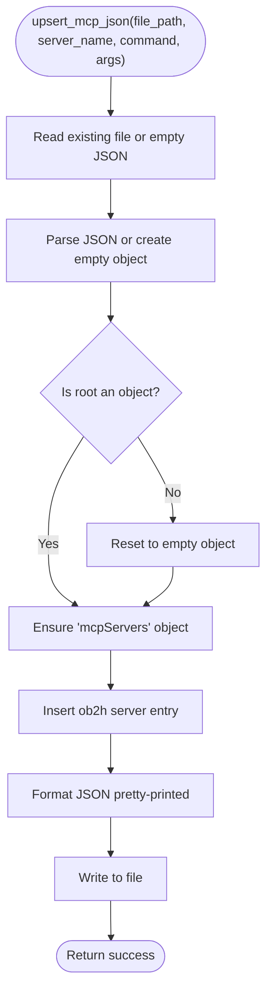
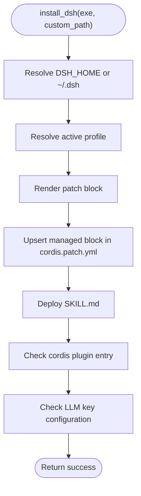
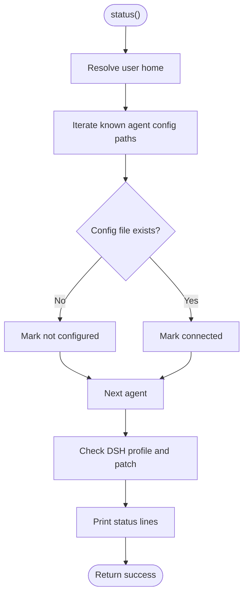
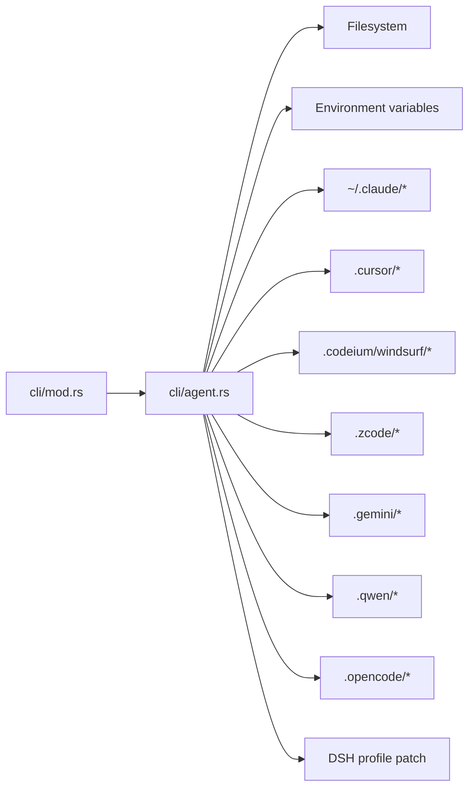

# Agent Management Commands

<cite>
**Referenced Files in This Document**
- [src/cli/mod.rs](file://src/cli/mod.rs)
- [src/cli/agent.rs](file://src/cli/agent.rs)
- [README.md](file://README.md)
- [AGENTS.md](file://AGENTS.md)
- [docs/DSH_INTEGRATION.md](file://docs/DSH_INTEGRATION.md)
- [plugin/dsh-ob2h/README.md](file://plugin/dsh-ob2h/README.md)
</cite>

## Table of Contents
1. [Introduction](#introduction)
2. [Project Structure](#project-structure)
3. [Core Components](#core-components)
4. [Architecture Overview](#architecture-overview)
5. [Detailed Component Analysis](#detailed-component-analysis)
6. [Dependency Analysis](#dependency-analysis)
7. [Performance Considerations](#performance-considerations)
8. [Troubleshooting Guide](#troubleshooting-guide)
9. [Conclusion](#conclusion)
10. [Appendices](#appendices)

## Introduction
This document explains the OB2H agent management commands and how they connect AI agents to the local OB2H knowledge layer. It focuses on:

- The `ob2h agent` command group: installation, configuration, and status checking.
- Supported agent targets: Claude Code, Cursor, Windsurf, ZCode, Gemini CLI / Antigravity, Qwen Code, OpenCode, DSH (DeepSeek Harness), and Hermes.
- Target system paths, MCP registration patterns, and environment variables.
- Practical setup examples for each supported agent.
- Troubleshooting connection issues and verifying successful integration.
- Platform-specific considerations and first-time user guidance.

The goal is to help both new and experienced users install and verify OB2H integrations reliably across different IDEs and harnesses.

## Project Structure
OB2H exposes a Rust-based CLI with subcommands. The agent management functionality lives under the CLI module and is implemented by an agent manager that writes per-agent configuration files and skills.



**Diagram sources**
- [src/cli/mod.rs:102-116](file://src/cli/mod.rs#L102-L116)
- [src/cli/mod.rs:203-215](file://src/cli/mod.rs#L203-L215)
- [src/cli/agent.rs:69-144](file://src/cli/agent.rs#L69-L144)

**Section sources**
- [src/cli/mod.rs:16-21](file://src/cli/mod.rs#L16-L21)
- [src/cli/mod.rs:102-116](file://src/cli/mod.rs#L102-L116)
- [src/cli/mod.rs:203-215](file://src/cli/mod.rs#L203-L215)
- [src/cli/agent.rs:69-144](file://src/cli/agent.rs#L69-L144)

## Core Components
The agent management system consists of two main parts:

1. **CLI definition**: defines the `ob2h agent` command group, its subcommands (`install`, `status`), and arguments (`--agent`, `--path`).
2. **Agent manager**: implements target detection, path resolution, MCP JSON updates, DSH profile patching, skill deployment, and status reporting.

Key responsibilities:

- Resolve the current executable path used by agents.
- Detect the user home directory via platform environment variables.
- Install or update MCP server entries for supported agents.
- Write or update DSH profile patches idempotently.
- Render and deploy agent skills where applicable.
- Report whether each agent’s configuration file exists and looks configured.

**Section sources**
- [src/cli/mod.rs:203-215](file://src/cli/mod.rs#L203-L215)
- [src/cli/agent.rs:69-144](file://src/cli/agent.rs#L69-L144)
- [src/cli/agent.rs:628-666](file://src/cli/agent.rs#L628-L666)

## Architecture Overview
At runtime, the agent management flow follows these steps:

1. User runs `ob2h agent install --agent <target>` or `ob2h agent install --agent all`.
2. CLI parses the command and selects the appropriate installer.
3. Installer writes or updates the agent’s MCP configuration file or DSH profile patch.
4. For DSH, the installer also deploys a skill and optionally registers a cordis plugin.
5. User can run `ob2h agent status` to check whether each agent’s configuration file or patch block exists.



**Diagram sources**
- [src/cli/mod.rs:203-215](file://src/cli/mod.rs#L203-L215)
- [src/cli/agent.rs:91-144](file://src/cli/agent.rs#L91-L144)
- [src/cli/agent.rs:146-209](file://src/cli/agent.rs#L146-L209)
- [src/cli/agent.rs:530-606](file://src/cli/agent.rs#L530-L606)

## Detailed Component Analysis

### Command Group Definition
The `ob2h agent` command group is defined as a subcommand of the main CLI. It supports:

- `install`: installs or updates agent integrations.
- `status`: prints connection status for supported agents.

Arguments:

- `--agent`: target agent; default is `all`.
- `--path`: optional custom path for project-scoped agents (Cursor, ZCode) or DSH profile directory.

Supported values include `all`, `claude`, `cursor`, `windsurf`, `zcode`, `gemini`, `qwen`, `opencode`, `dsh`, and `hermes`.



**Diagram sources**
- [src/cli/mod.rs:16-21](file://src/cli/mod.rs#L16-L21)
- [src/cli/mod.rs:23-147](file://src/cli/mod.rs#L23-L147)
- [src/cli/mod.rs:203-215](file://src/cli/mod.rs#L203-L215)

**Section sources**
- [src/cli/mod.rs:102-116](file://src/cli/mod.rs#L102-L116)
- [src/cli/mod.rs:203-215](file://src/cli/mod.rs#L203-L215)

### AgentTarget Enum
`AgentTarget` enumerates supported agent targets. It is used by the CLI argument parser and the agent manager to dispatch installation logic.

Supported targets:

| Target | Integration behavior |
|---|---|
| `All` | Attempts to install every supported agent; counts successful installations. |
| `Claude` | Writes Claude skill and MCP entry. |
| `Cursor` | Updates global or project-scoped Cursor MCP config. |
| `Windsurf` | Updates Windsurf MCP config. |
| `Zcode` | Updates global or project-scoped ZCode MCP config. |
| `Gemini` | Updates Gemini CLI / Antigravity MCP configs. |
| `Qwen` | Updates Qwen Code MCP config. |
| `Opencode` | Updates OpenCode MCP config. |
| `Dsh` | Writes DSH profile patch and deploys skill; may register cordis plugin. |
| `Hermes` | Prints guidance to use `ob2h install`, `ob2h plugin install`, and `ob2h skill install`. |



**Diagram sources**
- [src/cli/agent.rs:9-21](file://src/cli/agent.rs#L9-L21)
- [src/cli/agent.rs:69-144](file://src/cli/agent.rs#L69-L144)

**Section sources**
- [src/cli/agent.rs:9-21](file://src/cli/agent.rs#L9-L21)
- [src/cli/agent.rs:91-144](file://src/cli/agent.rs#L91-L144)

### Installation Logic
The `install` method resolves the current executable path and then dispatches to per-agent installers. When `--agent all` is used, it attempts each agent and prints a summary count.

Important behaviors:

- Uses the current executable path so agents call the same binary.
- Creates required directories before writing configuration files.
- Uses a shared helper to update MCP JSON files safely.
- Treats DSH specially because it uses a profile patch file rather than a simple MCP JSON.



**Diagram sources**
- [src/cli/agent.rs:71-78](file://src/cli/agent.rs#L71-L78)
- [src/cli/agent.rs:91-144](file://src/cli/agent.rs#L91-L144)

**Section sources**
- [src/cli/agent.rs:71-78](file://src/cli/agent.rs#L71-L78)
- [src/cli/agent.rs:91-144](file://src/cli/agent.rs#L91-L144)

### MCP Configuration Helper
Most agents use an MCP JSON configuration file. The manager provides a helper that:

- Reads existing JSON if present.
- Parses it into a value object.
- Ensures the root is an object.
- Creates or updates the `mcpServers` section.
- Inserts the `ob2h` server entry with command and arguments.
- Writes formatted JSON back to disk.

This pattern is reused by Claude, Cursor, Windsurf, ZCode, Gemini, Qwen, and OpenCode installers.



**Diagram sources**
- [src/cli/agent.rs:628-666](file://src/cli/agent.rs#L628-L666)

**Section sources**
- [src/cli/agent.rs:628-666](file://src/cli/agent.rs#L628-L666)

### Per-Agent Installers

#### Claude Code
- Writes a skill file under the Claude skills directory.
- Registers the `ob2h` MCP server in Claude’s configuration JSON.
- Uses forward slashes in the executable path inside the skill description.

Target paths:

- Skill: `~/.claude/skills/ob2h/SKILL.md`
- Config: `~/.claude/config.json`

**Section sources**
- [src/cli/agent.rs:213-253](file://src/cli/agent.rs#L213-L253)

#### Cursor
- Supports global or project-scoped configuration through `--path`.
- If `--path` is provided, writes to `<custom_path>/.cursor/mcp.json`; otherwise uses `~/.cursor/mcp.json`.

Target paths:

- Global: `~/.cursor/mcp.json`
- Project-scoped: `<custom_path>/.cursor/mcp.json`

**Section sources**
- [src/cli/agent.rs:255-269](file://src/cli/agent.rs#L255-L269)

#### Windsurf
- Writes MCP configuration under the Codeium/Windsurf directory.

Target path:

- `~/.codeium/windsurf/mcp_config.json`

**Section sources**
- [src/cli/agent.rs:271-286](file://src/cli/agent.rs#L271-L286)

#### ZCode
- Supports global or project-scoped configuration through `--path`.
- If `--path` is provided, writes to `<custom_path>/.zcode/mcp.json`; otherwise uses `~/.zcode/mcp.json`.

Target paths:

- Global: `~/.zcode/mcp.json`
- Project-scoped: `<custom_path>/.zcode/mcp.json`

**Section sources**
- [src/cli/agent.rs:288-302](file://src/cli/agent.rs#L288-L302)

#### Gemini CLI / Antigravity
- Writes MCP configuration for both Antigravity IDE and legacy Antigravity paths.
- Handles missing parent directories gracefully.

Target paths:

- `~/.gemini/antigravity-ide/mcp_config.json`
- `~/.gemini/antigravity/mcp_config.json`

**Section sources**
- [src/cli/agent.rs:304-330](file://src/cli/agent.rs#L304-L330)

#### Qwen Code
- Writes MCP configuration under the Qwen directory.

Target path:

- `~/.qwen/mcp.json`

**Section sources**
- [src/cli/agent.rs:332-344](file://src/cli/agent.rs#L332-L344)

#### OpenCode
- Writes MCP configuration under the OpenCode directory.

Target path:

- `~/.opencode/mcp.json`

**Section sources**
- [src/cli/agent.rs:346-358](file://src/cli/agent.rs#L346-L358)

#### DSH (DeepSeek Harness)
DSH integration is more complex because DSH does not use a simple MCP JSON file. Instead, OB2H writes a controlled block into the DSH profile’s patch file and deploys a skill.

Key behaviors:

- Resolves DSH home from `DSH_HOME` or `~/.dsh`.
- Resolves active profile from `DSH_PROFILE`, then `desktop`, then `web`, then alphabetically first profile.
- Renders a patch block with placeholders for binary path, project directory, data directory, LLM base URL, and LLM model.
- Idempotently inserts or replaces the managed block between markers.
- Skips insertion if a manual `serverName: ob2h` entry already exists.
- Deploys the DSH skill under `$DSH_HOME/skills/ob2h/SKILL.md`.
- Optionally registers the cordis plugin if the source file is found.
- Warns if no LLM key is configured.



**Diagram sources**
- [src/cli/agent.rs:362-368](file://src/cli/agent.rs#L362-L368)
- [src/cli/agent.rs:370-393](file://src/cli/agent.rs#L370-L393)
- [src/cli/agent.rs:405-434](file://src/cli/agent.rs#L405-L434)
- [src/cli/agent.rs:455-512](file://src/cli/agent.rs#L455-L512)
- [src/cli/agent.rs:514-526](file://src/cli/agent.rs#L514-L526)
- [src/cli/agent.rs:530-606](file://src/cli/agent.rs#L530-L606)

**Section sources**
- [src/cli/agent.rs:362-393](file://src/cli/agent.rs#L362-L393)
- [src/cli/agent.rs:405-434](file://src/cli/agent.rs#L405-L434)
- [src/cli/agent.rs:455-512](file://src/cli/agent.rs#L455-L512)
- [src/cli/agent.rs:530-606](file://src/cli/agent.rs#L530-L606)

### Status Checking
The `status` command checks whether each agent’s expected configuration file or patch block exists.

For standard agents, it checks:

- Claude Code skill file.
- Cursor MCP config.
- Windsurf MCP config.
- ZCode MCP config.
- Gemini/Antigravity MCP config.
- Qwen Code MCP config.
- OpenCode MCP config.

For DSH, it checks:

- Whether a DSH profile directory exists.
- Whether the patch file contains the managed block or a manual `serverName: ob2h` entry.

Output shows a human-readable status line for each agent along with the relevant path.



**Diagram sources**
- [src/cli/agent.rs:146-209](file://src/cli/agent.rs#L146-L209)

**Section sources**
- [src/cli/agent.rs:146-209](file://src/cli/agent.rs#L146-L209)

### Environment Variables and Configuration
OB2H uses environment variables for configuration. Relevant variables for agent integration include:

| Variable | Default | Purpose |
|---|---|---|
| `OB2H_DATA_DIR` | `./data` | Data directory for database, memory files, and logs. |
| `OB2H_LLM_BASE_URL` | `https://api.deepseek.com/v1` | OpenAI-compatible API base URL. |
| `OB2H_LLM_API_KEY` | `DEEPSEEK_API_KEY` | Literal API key or name of environment variable holding the key. |
| `OB2H_LLM_MODEL` | `deepseek-v4-flash` | Model used for extraction and dreaming. |
| `DSH_HOME` | `~/.dsh` | DSH home directory. |
| `DSH_PROFILE` | none | Active DSH profile name. |

For DSH specifically, the installer reads `OB2H_LLM_BASE_URL` and `OB2H_LLM_MODEL` when rendering the patch block. The LLM key itself is intentionally not written into the patch; OB2H reads it from process environment or `.env` in the working directory.

**Section sources**
- [README.md:300-329](file://README.md#L300-L329)
- [src/cli/agent.rs:405-434](file://src/cli/agent.rs#L405-L434)
- [src/cli/agent.rs:608-626](file://src/cli/agent.rs#L608-L626)
- [docs/DSH_INTEGRATION.md:91-123](file://docs/DSH_INTEGRATION.md#L91-L123)

### Platform-Specific Considerations
- Windows uses backslashes in paths; the manager normalizes paths for MCP configurations and DSH patch blocks.
- Home directory detection prefers `USERPROFILE` on Windows and falls back to `HOME`.
- DSH profiles are resolved through environment variables and directory discovery.
- Some agents support project-scoped configuration through `--path`.

**Section sources**
- [src/cli/agent.rs:71-89](file://src/cli/agent.rs#L71-L89)
- [src/cli/agent.rs:255-302](file://src/cli/agent.rs#L255-L302)
- [src/cli/agent.rs:362-393](file://src/cli/agent.rs#L362-L393)

## Dependency Analysis
The agent management layer has clear boundaries:

- CLI module defines commands and delegates to the agent manager.
- Agent manager depends on filesystem operations and environment variables.
- Per-agent installers depend on known configuration paths.
- DSH installer additionally depends on profile discovery and patch file parsing.



**Diagram sources**
- [src/cli/mod.rs:102-116](file://src/cli/mod.rs#L102-L116)
- [src/cli/agent.rs:146-209](file://src/cli/agent.rs#L146-L209)
- [src/cli/agent.rs:362-393](file://src/cli/agent.rs#L362-L393)

**Section sources**
- [src/cli/mod.rs:102-116](file://src/cli/mod.rs#L102-L116)
- [src/cli/agent.rs:146-209](file://src/cli/agent.rs#L146-L209)
- [src/cli/agent.rs:362-393](file://src/cli/agent.rs#L362-L393)

## Performance Considerations
Agent installation is lightweight:

- File creation and JSON updates are synchronous but fast.
- No network calls are made during installation.
- DSH patch writing is idempotent and avoids unnecessary rewrites.
- Status checking only reads files and checks existence.

The heavier operations happen at runtime when agents invoke OB2H tools, especially when LLM-backed tools are used.

[No sources needed since this section provides general guidance]

## Troubleshooting Guide

### General First Steps
1. Run `ob2h agent status` to see which agents are detected.
2. Verify that the reported configuration path exists.
3. Check whether the agent was installed with `--agent all` or a specific agent.
4. Restart the agent after configuration changes.

**Section sources**
- [src/cli/agent.rs:146-209](file://src/cli/agent.rs#L146-L209)

### Claude Code
Symptoms:

- Tools not visible in Claude.
- Skill not found.

Checks:

- Confirm `~/.claude/skills/ob2h/SKILL.md` exists.
- Confirm `~/.claude/config.json` contains the `ob2h` MCP server entry.
- Restart Claude.

**Section sources**
- [src/cli/agent.rs:213-253](file://src/cli/agent.rs#L213-L253)

### Cursor
Symptoms:

- MCP server not registered.
- Project-scoped configuration not applied.

Checks:

- Use `ob2h agent install --agent cursor --path <project_root>` for project-scoped setup.
- Verify `<project_root>/.cursor/mcp.json` or `~/.cursor/mcp.json`.
- Restart Cursor.

**Section sources**
- [src/cli/agent.rs:255-269](file://src/cli/agent.rs#L255-L269)

### Windsurf
Symptoms:

- MCP server not loaded.

Checks:

- Verify `~/.codeium/windsurf/mcp_config.json`.
- Restart Windsurf.

**Section sources**
- [src/cli/agent.rs:271-286](file://src/cli/agent.rs#L271-L286)

### ZCode
Symptoms:

- MCP server not registered.
- Project-scoped configuration not applied.

Checks:

- Use `ob2h agent install --agent zcode --path <project_root>` for project-scoped setup.
- Verify `<project_root>/.zcode/mcp.json` or `~/.zcode/mcp.json`.
- Restart ZCode.

**Section sources**
- [src/cli/agent.rs:288-302](file://src/cli/agent.rs#L288-L302)

### Gemini CLI / Antigravity
Symptoms:

- MCP server not loaded.

Checks:

- Verify `~/.gemini/antigravity-ide/mcp_config.json`.
- Also check `~/.gemini/antigravity/mcp_config.json` if using the legacy path.
- Restart Gemini or Antigravity.

**Section sources**
- [src/cli/agent.rs:304-330](file://src/cli/agent.rs#L304-L330)

### Qwen Code
Symptoms:

- MCP server not registered.

Checks:

- Verify `~/.qwen/mcp.json`.
- Restart Qwen Code.

**Section sources**
- [src/cli/agent.rs:332-344](file://src/cli/agent.rs#L332-L344)

### OpenCode
Symptoms:

- MCP server not registered.

Checks:

- Verify `~/.opencode/mcp.json`.
- Restart OpenCode.

**Section sources**
- [src/cli/agent.rs:346-358](file://src/cli/agent.rs#L346-L358)

### DSH
Symptoms:

- Tools `mcp__ob2h__*` not visible.
- Block `<agent_memory>` not appearing.
- Hints about LLM tools being disabled.

Checks:

- Run `ob2h agent status` and inspect the DSH line.
- Inspect `$DSH_HOME/profiles/<profile>/cordis.patch.yml`.
- Look for the managed block between markers.
- Check whether the cordis plugin entry was added.
- Verify `OB2H_LLM_API_KEY` is available in environment or `.env`.
- Restart DSH if necessary.

Reference documentation provides detailed troubleshooting tables and live verification steps.

**Section sources**
- [src/cli/agent.rs:362-393](file://src/cli/agent.rs#L362-L393)
- [src/cli/agent.rs:455-512](file://src/cli/agent.rs#L455-L512)
- [src/cli/agent.rs:530-606](file://src/cli/agent.rs#L530-L606)
- [docs/DSH_INTEGRATION.md:22-53](file://docs/DSH_INTEGRATION.md#L22-L53)
- [docs/DSH_INTEGRATION.md:91-123](file://docs/DSH_INTEGRATION.md#L91-L123)
- [docs/DSH_INTEGRATION.md:195-280](file://docs/DSH_INTEGRATION.md#L195-L280)
- [plugin/dsh-ob2h/README.md:42-96](file://plugin/dsh-ob2h/README.md#L42-L96)

### Hermes
The `ob2h agent install --agent hermes` command does not perform direct file edits. Instead, it guides users to use:

- `ob2h install`
- `ob2h plugin install`
- `ob2h skill install`

This keeps Hermes integration separate from the generic agent MCP registration flow.

**Section sources**
- [src/cli/agent.rs:138-140](file://src/cli/agent.rs#L138-L140)
- [README.md:97-106](file://README.md#L97-L106)

## Conclusion
The OB2H agent management commands provide a consistent interface for connecting multiple AI agents to a single local knowledge layer. Most agents are configured through MCP JSON files, while DSH uses a profile patch mechanism and optional cordis plugin. The `--agent all` option simplifies bulk setup, and `ob2h agent status` helps verify integration. For reliable operation, ensure the correct configuration paths exist, environment variables are set, and agents are restarted after changes.

[No sources needed since this section summarizes without analyzing specific files]

## Appendices

### Quick Setup Examples

#### First-Time User
1. Build or download OB2H.
2. Run `ob2h agent install --agent all`.
3. Run `ob2h agent status`.
4. Restart your agents.

**Section sources**
- [README.md:108-126](file://README.md#L108-L126)
- [src/cli/agent.rs:91-144](file://src/cli/agent.rs#L91-L144)

#### Claude Code
Run:

```bash
ob2h agent install --agent claude
```

Then restart Claude.

**Section sources**
- [src/cli/agent.rs:213-253](file://src/cli/agent.rs#L213-L253)

#### Cursor
Global:

```bash
ob2h agent install --agent cursor
```

Project-scoped:

```bash
ob2h agent install --agent cursor --path <project_root>
```

Restart Cursor.

**Section sources**
- [src/cli/agent.rs:255-269](file://src/cli/agent.rs#L255-L269)

#### Windsurf
Run:

```bash
ob2h agent install --agent windsurf
```

Restart Windsurf.

**Section sources**
- [src/cli/agent.rs:271-286](file://src/cli/agent.rs#L271-L286)

#### ZCode
Global:

```bash
ob2h agent install --agent zcode
```

Project-scoped:

```bash
ob2h agent install --agent zcode --path <project_root>
```

Restart ZCode.

**Section sources**
- [src/cli/agent.rs:288-302](file://src/cli/agent.rs#L288-L302)

#### Gemini CLI / Antigravity
Run:

```bash
ob2h agent install --agent gemini
```

Restart Gemini or Antigravity.

**Section sources**
- [src/cli/agent.rs:304-330](file://src/cli/agent.rs#L304-L330)

#### Qwen Code
Run:

```bash
ob2h agent install --agent qwen
```

Restart Qwen Code.

**Section sources**
- [src/cli/agent.rs:332-344](file://src/cli/agent.rs#L332-L344)

#### OpenCode
Run:

```bash
ob2h agent install --agent opencode
```

Restart OpenCode.

**Section sources**
- [src/cli/agent.rs:346-358](file://src/cli/agent.rs#L346-L358)

#### DSH
Run:

```bash
ob2h agent install --agent dsh
ob2h agent status
```

If needed, specify a custom profile:

```bash
ob2h agent install --agent dsh --path <dsh_profile_directory>
```

Set the LLM key in environment or `.env`, then restart DSH.

**Section sources**
- [docs/DSH_INTEGRATION.md:22-53](file://docs/DSH_INTEGRATION.md#L22-L53)
- [docs/DSH_INTEGRATION.md:91-123](file://docs/DSH_INTEGRATION.md#L91-L123)
- [src/cli/agent.rs:530-606](file://src/cli/agent.rs#L530-L606)

#### Hermes
Use the dedicated Hermes workflow:

```bash
ob2h install
ob2h plugin install
ob2h skill install
```

Then configure Hermes according to its own instructions.

**Section sources**
- [src/cli/agent.rs:138-140](file://src/cli/agent.rs#L138-L140)
- [README.md:97-106](file://README.md#L97-L106)