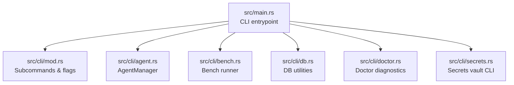
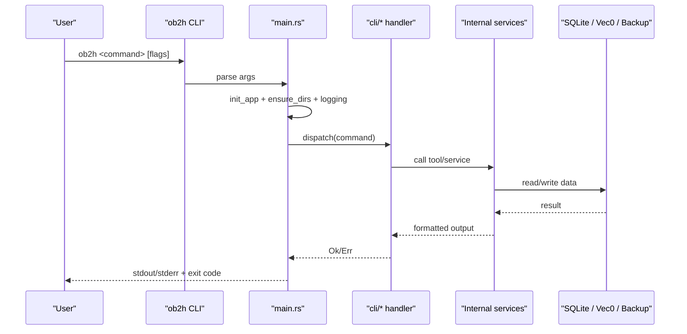
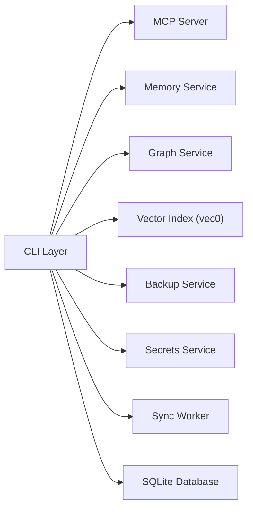

# CLI Commands Reference

<cite>
**Referenced Files in This Document**   
- [main.rs](file://src/main.rs)
- [mod.rs](file://src/cli/mod.rs)
- [agent.rs](file://src/cli/agent.rs)
- [bench.rs](file://src/cli/bench.rs)
- [db.rs](file://src/cli/db.rs)
- [doctor.rs](file://src/cli/doctor.rs)
- [secrets.rs](file://src/cli/secrets.rs)
- [README.md](file://README.md)
</cite>

## Table of Contents
1. [Introduction](#introduction)
2. [Project Structure](#project-structure)
3. [Core Components](#core-components)
4. [Architecture Overview](#architecture-overview)
5. [Detailed Component Analysis](#detailed-component-analysis)
6. [Dependency Analysis](#dependency-analysis)
7. [Performance Considerations](#performance-considerations)
8. [Troubleshooting Guide](#troubleshooting-guide)
9. [Conclusion](#conclusion)
10. [Appendices](#appendices)

## Introduction
This document is the comprehensive command-line reference for OB2H. It covers all major command groups exposed by the `ob2h` binary: agent management, benchmarking, database operations, doctor diagnostics, memory maintenance, project management, secrets management, and synchronization. For each group it documents command syntax, parameters, flags, output formats, dependencies, required permissions, environment variables, exit behavior, logging, scripting examples, platform-specific notes, and shell completion support.

The CLI is built with a structured subcommand model. The top-level entry point parses arguments, initializes application context, configures logging, and dispatches to the appropriate handler. Many commands are wrappers around MCP tools or internal services such as memory, graph, sync, vector index, backup, and secrets.

## Project Structure
The CLI is defined in a dedicated module under `src/cli`, with one file per feature area. The main binary wires these modules into the runtime and prints user-facing messages.

**Diagram sources**
- [main.rs:17-20](file://src/main.rs#L17-L20)
- [mod.rs:16-147](file://src/cli/mod.rs#L16-L147)
- [agent.rs:69-144](file://src/cli/agent.rs#L69-L144)
- [bench.rs:328-556](file://src/cli/bench.rs#L328-L556)
- [db.rs:17-90](file://src/cli/db.rs#L17-L90)
- [doctor.rs:46-168](file://src/cli/doctor.rs#L46-L168)
- [secrets.rs:134-309](file://src/cli/secrets.rs#L134-L309)

**Section sources**
- [main.rs:17-20](file://src/main.rs#L17-L20)
- [mod.rs:16-147](file://src/cli/mod.rs#L16-L147)

## Core Components
- Top-level CLI structure defines the command tree and global options.
- Each subcommand group has its own module implementing parsing, validation, execution, and output formatting.
- The main process initializes settings, ensures directories, sets up tracing (logs), starts background workers, and optionally runs an MCP server when serving.

Key responsibilities:
- `src/cli/mod.rs`: declares all subcommands, flags, and argument types.
- `src/main.rs`: routes parsed commands to handlers, handles special cases like viewer, serve, update, plugin, skill install, and prints results.
- Feature modules implement domain logic and interact with DB, memory, graph, sync, vector index, backup, and secrets.

**Section sources**
- [mod.rs:16-147](file://src/cli/mod.rs#L16-L147)
- [main.rs:17-20](file://src/main.rs#L17-L20)
- [main.rs:36-60](file://src/main.rs#L36-L60)

## Architecture Overview
The CLI follows a layered architecture:
- Entry layer: argument parsing and dispatch.
- Service layer: MCP tool calls, background workers, and direct service accessors.
- Storage layer: SQLite database, vector index, backups, and workspace files.
- External integrations: AI agents, LLM providers, SSH-based sync peers, and Hermes plugin/skill installation.

**Diagram sources**
- [main.rs:17-60](file://src/main.rs#L17-L60)
- [main.rs:62-583](file://src/main.rs#L62-L583)

## Detailed Component Analysis

### Agent Management (`ob2h agent`)
Purpose: Install and configure integrations for supported AI agents and check their connection status.

Command syntax:
- `ob2h agent install --agent <target> [--path <path>]`
  - `--agent`: Target agent; default `all`. Supported values include `all`, `claude`, `cursor`, `windsurf`, `zcode`, `gemini`, `qwen`, `opencode`, `dsh`, `hermes`.
  - `--path`: Optional custom path for project-specific configuration (e.g., `.cursor/mcp.json`, `.zcode/mcp.json`, or DSH profile directory).
- `ob2h agent status`

Parameters and flags:
- `--agent`: Selects which agent(s) to configure. When set to `all`, the installer attempts detection and writes MCP entries or patch blocks where applicable.
- `--path`: Overrides auto-detected paths for agents that support per-project configuration.

Output format:
- Installation prints confirmation lines indicating target paths and whether MCP entries were created or updated.
- Status lists agents and their configuration locations with a connected/disconnected indicator.

Dependencies and permissions:
- Requires write access to agent configuration directories under the user’s home directory (e.g., `.claude`, `.cursor`, `.codeium/windsurf`, `.zcode`, `.gemini`, `.qwen`, `.opencode`).
- For DSH, requires write access to the active profile’s `cordis.patch.yml` and ability to place a skill file under `$DSH_HOME/skills/ob2h/SKILL.md`.
- Some agents may require an LLM key configured via environment or `.env`; otherwise certain tools will be disabled.

Environment variables:
- `OB2H_LLM_BASE_URL`, `OB2H_LLM_MODEL`, `OB2H_LLM_API_KEY` influence DSH patch rendering and LLM availability checks.
- `DSH_HOME`, `DSH_PROFILE` control DSH profile discovery.

Exit codes:
- Success returns zero; errors propagate through `anyhow::Result` and cause non-zero exit.

Logging:
- Errors and warnings are printed to stderr; success messages go to stdout.

Platform considerations:
- Windows uses `%LOCALAPPDATA%` for some agent paths; Unix-like systems use `$HOME`.
- DSH integration writes YAML patch blocks and a Markdown skill file.

Scripting example:
- Configure all agents and verify:
  - `ob2h agent install --agent all`
  - `ob2h agent status`

Troubleshooting:
- If an agent shows disconnected, inspect the listed config path and ensure the MCP entry points to `ob2h serve`.
- For DSH, if the cordis plugin is not found, only MCP client mode works; auto-capture of turns and prefetch memory will be unavailable.

**Section sources**
- [mod.rs:202-215](file://src/cli/mod.rs#L202-L215)
- [agent.rs:69-144](file://src/cli/agent.rs#L69-L144)
- [agent.rs:213-358](file://src/cli/agent.rs#L213-L358)
- [agent.rs:360-606](file://src/cli/agent.rs#L360-L606)
- [agent.rs:628-666](file://src/cli/agent.rs#L628-L666)

### Benchmarking (`ob2h bench`)
Purpose: Run regression benchmarks over a golden dataset to measure retrieval quality and latency.

Command syntax:
- `ob2h bench [subcommand] [flags]`
  - Subcommands:
    - `history [--last N]`: Show trend of nightly bench runs from history.
  - Flags:
    - `--mode <search|context|code|latency|history>`: Mode of benchmarking. Default `search`.
    - `--k <k1,k2,...>`: Levels for recall@k. Default `5,10`.
    - `--golden <path>`: Path to golden dataset. Default `data/bench/golden.jsonl` (or `golden_code.jsonl` for `mode=code`).
    - `--project <id>`: Required for `mode=code` to run PPR over code graph.
    - `--json`: Machine-readable JSON output.
    - `--save-baseline`: Save aggregated metrics to `docs/bench_baseline.md`.

Parameters and flags:
- `--mode`: Determines evaluation strategy:
  - `search`: Hybrid memory search against golden keys.
  - `context`: Build context and match content against expected keys.
  - `code`: Personalized PageRank over code graph using project seeds.
  - `latency`: Measure p50/p95 latencies for embedding query, memories search, and graph search.
  - `history`: Read accumulated history without running new tests.
- `--k`: Comma-separated integers specifying recall levels. Must be ≥ 1.
- `--golden`: Golden dataset path; must exist and contain valid JSONL records.
- `--project`: Project identifier used for code-mode benchmarks.
- `--json`: Outputs structured JSON suitable for CI pipelines.
- `--save-baseline`: Writes baseline markdown with aggregated metrics.

Output format:
- Human-readable tables with recall@k, recall-all@k, any-hit@k, MRR, empty count, p50/p95 latencies.
- JSON output includes fields like `mode`, `cases`, `k`, `recall_at_k`, `mrr`, `empty_count`, `p50_ms`, `p95_ms`, `missing_keys`.
- History mode prints a table of recent runs with timestamps, gate status, recall deltas, MRR, p95, DB size, and dream SHA.

Dependencies:
- Requires a valid golden dataset file.
- For `mode=code`, requires a registered project and code graph.
- For `mode=latency`, measures latencies across memory and graph services.

Environment variables:
- `OB2H_CONTEXT_TRUST_WEIGHT`: Trust weight for context building.
- `OB2H_PPR_DAMPING`: Damping factor for PPR.
- `OB2H_PPR_WEIGHTS`: Weights for PPR components.

Exit codes:
- Non-zero on invalid inputs, missing golden file, or runtime errors.

Logging:
- Errors and warnings printed to stderr; results to stdout.

Scripting example:
- Run search benchmark and save baseline:
  - `ob2h bench --mode search --k 5,10 --json --save-baseline`
- Check history:
  - `ob2h bench history --last 20`

Troubleshooting:
- If golden dataset is missing or empty, the command fails with a clear error message.
- For `mode=code`, ensure `--project` is provided and the project exists.

**Section sources**
- [mod.rs:122-147](file://src/cli/mod.rs#L122-L147)
- [mod.rs:171-179](file://src/cli/mod.rs#L171-L179)
- [bench.rs:16-45](file://src/cli/bench.rs#L16-L45)
- [bench.rs:122-255](file://src/cli/bench.rs#L122-L255)
- [bench.rs:328-556](file://src/cli/bench.rs#L328-L556)
- [bench.rs:713-774](file://src/cli/bench.rs#L713-L774)

### Database Operations (`ob2h db`)
Purpose: Perform maintenance operations on the SQLite database, including quantization of embeddings.

Command syntax:
- `ob2h db quantize-embeddings [--dry-run]`

Parameters and flags:
- `--dry-run`: Only report legacy vectors and do not modify data.

Output format:
- Reports total vectors and legacy f32 vectors per table.
- In dry-run mode, indicates no changes applied.
- On apply, reports converted counts and final DB size after VACUUM.

Dependencies:
- Requires read/write access to the SQLite database.
- Creates a pre-backup before irreversible vector conversion.

Environment variables:
- None specific to this command beyond general settings.

Exit codes:
- Non-zero on errors; zero on successful completion.

Logging:
- Progress and status printed to stdout; errors to stderr.

Scripting example:
- Estimate impact:
  - `ob2h db quantize-embeddings --dry-run`
- Apply quantization:
  - `ob2h db quantize-embeddings`

Troubleshooting:
- If no legacy vectors are found, the command exits successfully with a message indicating nothing to convert.

**Section sources**
- [mod.rs:192-200](file://src/cli/mod.rs#L192-L200)
- [db.rs:17-90](file://src/cli/db.rs#L17-L90)

### Doctor Diagnostics (`ob2h doctor`)
Purpose: Diagnose system health, including directories, SQLite integrity, embeddings provider, AI agent configurations, Git hooks, and sync configuration. Supports automatic fixes.

Command syntax:
- `ob2h doctor [--fix]`

Parameters and flags:
- `--fix`: Automatically fix missing agent MCP entries and install Git hooks where possible.

Output format:
- Grouped diagnostic items with category, name, status symbol (✅/⚠️/❌), and details.
- Summary line with counts of errors and warnings.

Dependencies:
- Reads SQLite database for table statistics and Ralph/orphan checks.
- Checks filesystem paths for agent configs and workspace.
- Optionally connects to DB for secrets vault status and Ralph runs.

Environment variables:
- General settings affect paths and behavior; no doctor-specific variables.

Exit codes:
- Returns zero on successful diagnosis; non-zero on fatal errors.

Logging:
- Diagnostic output to stdout; errors to stderr.

Scripting example:
- Run full diagnosis:
  - `ob2h doctor`
- Auto-fix issues:
  - `ob2h doctor --fix`

Troubleshooting:
- If Viewer GUI is not compiled, doctor warns about headless mode.
- If FTS5 index fails, doctor reports an error requiring rebuild or repair.

**Section sources**
- [mod.rs:27-32](file://src/cli/mod.rs#L27-L32)
- [doctor.rs:46-168](file://src/cli/doctor.rs#L46-L168)
- [doctor.rs:170-326](file://src/cli/doctor.rs#L170-L326)
- [doctor.rs:328-388](file://src/cli/doctor.rs#L328-L388)
- [doctor.rs:390-564](file://src/cli/doctor.rs#L390-L564)
- [doctor.rs:566-653](file://src/cli/doctor.rs#L566-L653)
- [doctor.rs:668-702](file://src/cli/doctor.rs#L668-L702)

### Memory Maintenance (`ob2h memory`)
Purpose: Analyze near-duplicate memories and optionally mark candidates for merging.

Command syntax:
- `ob2h memory dedup [--dry-run]`

Parameters and flags:
- `--dry-run`: Only report pairs without setting merge markers.

Output format:
- Prints number of marked records (if not dry-run) and a deduplication report.

Dependencies:
- Requires read access to the database to collect pairs and apply markers.

Environment variables:
- None specific to this command.

Exit codes:
- Zero on success; non-zero on errors.

Logging:
- Report printed to stdout; errors to stderr.

Scripting example:
- Preview duplicates:
  - `ob2h memory dedup --dry-run`
- Mark candidates:
  - `ob2h memory dedup`

Troubleshooting:
- If no duplicates are found, the report will indicate zero marked records.

**Section sources**
- [mod.rs:181-190](file://src/cli/mod.rs#L181-L190)
- [main.rs:164-175](file://src/main.rs#L164-L175)

### Project Management (`ob2h project`)
Purpose: Register projects, scan codebases via AST, import code graphs, list projects, generate reports, build repo maps, detect dead code, and install Git hooks.

Command syntax:
- `ob2h project init --id <id> --name <name> --path <path> [--description <desc>]`
- `ob2h project scan --id <id> [--path <path>] [--full]`
- `ob2h project import-codegraph --id <id> --db-path <path>`
- `ob2h project list`
- `ob2h project report --id <id>`
- `ob2h project repo-map --id <id> [--tokens <n>] [--query <q>] [--memory]`
- `ob2h project dead-code --id <id> [--limit <n>]`
- `ob2h project hook-install [--path <repo>] [--id <id>]`

Parameters and flags:
- `init`: Registers a project with id, name, root path, and optional description.
- `scan`: Scans codebase; optional path overrides project root; `--full` forces full AST rebuild.
- `import-codegraph`: Imports nodes and edges from CodeGraph index.
- `report`: Generates architectural summary.
- `repo-map`: Builds token-budget-aware map with optional query seed and high-trust memory mixing.
- `dead-code`: Lists symbols with in-degree zero excluding entrypoints; limit controls output size.
- `hook-install`: Installs Git hooks for incremental scanning; auto-detects project root and id if omitted.

Output format:
- Registration prints id, name, and root path.
- Scan prints files scanned, nodes, edges, and lines.
- Import prints imported node/edge counts.
- List prints registered projects with last scan time.
- Report prints markdown summary.
- Repo-map prints generated map text.
- Dead-code prints formatted dead code list.
- Hook-install prints installed hook paths.

Dependencies:
- Requires write access to project directories for Git hooks.
- Requires DB access for project metadata and analytics updates.

Environment variables:
- General settings affect paths and behavior.

Exit codes:
- Zero on success; non-zero on errors.

Logging:
- Results printed to stdout; errors to stderr.

Scripting example:
- Initialize and scan:
  - `ob2h project init --id myproj --name "My Project" --path /path/to/repo`
  - `ob2h project scan --id myproj --full`
- Generate report:
  - `ob2h project report --id myproj`

Troubleshooting:
- If hooks fail to install, ensure Git is available and the repository is initialized.

**Section sources**
- [mod.rs:217-285](file://src/cli/mod.rs#L217-L285)
- [main.rs:464-574](file://src/main.rs#L464-L574)

### Secrets Management (`ob2h secrets`)
Purpose: Manage the encrypted secrets vault: initialize, unlock, lock, change PIN, list names, and show values securely.

Command syntax:
- `ob2h secrets init`
- `ob2h secrets unlock`
- `ob2h secrets lock`
- `ob2h secrets status`
- `ob2h secrets rekey`
- `ob2h secrets list`
- `ob2h secrets show <name>`

Parameters and flags:
- No additional flags; interactive PIN prompts are handled internally.

Output format:
- Initialization confirms vault creation.
- Unlock prints TTL and server notification status.
- Lock prints confirmation.
- Status prints initialization state, locked/unlocked status, server activity, record count, and available names.
- Rekey confirms PIN change and re-encryption.
- List prints table of secret names, hints, creation times, and access counts.
- Show prints the decrypted value to stdout.

Dependencies:
- Requires IPC communication with active `ob2h serve` process for unlocking/locking notifications.
- Requires DB access for vault metadata and records.

Environment variables:
- `OB2H_SECRETS_TTL_MIN`: Controls TTL for unlocked state.
- `OB2H_PIN_GUI`: Enables/disables GUI PIN input.

Exit codes:
- Zero on success; non-zero on errors.

Logging:
- Success messages to stdout; errors to stderr.

Scripting example:
- Initialize and unlock:
  - `ob2h secrets init`
  - `ob2h secrets unlock`
- List and show:
  - `ob2h secrets list`
  - `ob2h secrets show api_key`

Troubleshooting:
- If vault is not initialized, commands prompt to run `init`.
- If server is not running, unlock still succeeds locally but does not notify server.

**Section sources**
- [mod.rs:113-117](file://src/cli/mod.rs#L113-L117)
- [secrets.rs:12-31](file://src/cli/secrets.rs#L12-L31)
- [secrets.rs:134-309](file://src/cli/secrets.rs#L134-L309)
- [main.rs:575-582](file://src/main.rs#L575-L582)

### Synchronization (`ob2h sync`)
Purpose: Sync two OB2H instances using bundles over SSH or manual transfer. Supports export, import, apply inbox, push, pull, verify, and local stats.

Command syntax:
- `ob2h sync status`
- `ob2h sync export --peer <peer> [--full]`
- `ob2h sync import <file...>`
- `ob2h sync apply-inbox`
- `ob2h sync push --peer <peer> [--full]`
- `ob2h sync pull --peer <peer>`
- `ob2h sync verify --peer <peer>`
- `ob2h sync local-stats`

Parameters and flags:
- `export`: Exports bundle to `data/sync/outbox/`; `--full` ignores cursor and exports full snapshot.
- `import`: Applies one or more bundle files.
- `apply-inbox`: Applies all bundles in `data/sync/inbox/`.
- `push`: Exports and transfers bundle to peer via SSH.
- `pull`: Transfers peer bundles to inbox and applies them.
- `verify`: Compares counts, trust averages, and checksums without transferring data.
- `local-stats`: Prints local side statistics in JSON.

Output format:
- Status prints peer configuration, watermarks, and bundle counts.
- Export/Pull/Apply print import stats including memories, nodes, edges, links, conflicts lost/journaled, and skipped references.
- Verify prints comparison report.
- Local-stats prints JSON object.

Dependencies:
- Requires SSH access for push/pull unless using manual mode.
- Requires write access to `data/sync/outbox` and `data/sync/inbox`.

Environment variables:
- `OB2H_SYNC_KEY`: Enables end-to-end encryption of bundles.

Exit codes:
- Zero on success; non-zero on errors.

Logging:
- Results printed to stdout; errors to stderr.

Scripting example:
- Push and pull:
  - `ob2h sync push --peer vps`
  - `ob2h sync pull --peer vps`
- Verify consistency:
  - `ob2h sync verify --peer vps`

Troubleshooting:
- If no bundles are found, commands print informative messages.
- If SSH connectivity fails, verify peer configuration and network access.

**Section sources**
- [mod.rs:287-327](file://src/cli/mod.rs#L287-L327)
- [main.rs:268-319](file://src/main.rs#L268-L319)

## Dependency Analysis
The CLI depends on several internal services and external integrations:

**Diagram sources**
- [main.rs:62-583](file://src/main.rs#L62-L583)

Key relationships:
- Bench and vec0 recall depend on memory, graph, embedder, and DB.
- Doctor reads DB and filesystem paths.
- Secrets CLI interacts with IPC server and DB.
- Sync commands rely on peer configuration and filesystem I/O.

**Section sources**
- [main.rs:62-583](file://src/main.rs#L62-L583)

## Performance Considerations
- Benchmarking modes provide latency measurements and recall metrics to guide optimization decisions.
- Quantizing embeddings reduces storage size and may improve performance.
- Vec0 index builds approximate nearest neighbor indexes for faster recall at scale.
- Background workers and MCP server startup are designed to avoid blocking critical paths.

[No sources needed since this section provides general guidance]

## Troubleshooting Guide
Common issues and resolutions:
- Missing golden dataset: Ensure `data/bench/golden.jsonl` exists and contains valid JSONL records.
- Agent not connected: Verify MCP entries in agent config files point to `ob2h serve`.
- Secrets vault not initialized: Run `ob2h secrets init` before accessing secrets.
- Sync failures: Check peer configuration and SSH connectivity; verify `peers.json` validity.
- Viewer GUI unavailable: Compile with `--features gui` or use CLI commands instead.

**Section sources**
- [bench.rs:360-373](file://src/cli/bench.rs#L360-L373)
- [agent.rs:599-606](file://src/cli/agent.rs#L599-L606)
- [secrets.rs:146-160](file://src/cli/secrets.rs#L146-L160)
- [doctor.rs:139-153](file://src/cli/doctor.rs#L139-L153)

## Conclusion
The OB2H CLI provides a comprehensive interface for managing agents, benchmarking retrieval, maintaining databases and memory, diagnosing system health, securing secrets, and synchronizing instances. By understanding command syntax, flags, outputs, and dependencies, users can automate workflows, integrate with CI/CD pipelines, and troubleshoot effectively across platforms.

[No sources needed since this section summarizes without analyzing specific files]

## Appendices

### Environment Variables
Relevant environment variables for CLI operations:
- `OB2H_DATA_DIR`: Data directory for DB, logs, and workspace.
- `OB2H_LLM_*`: LLM provider configuration.
- `OB2H_VEC0`: Enable experimental vec0 index.
- `OB2H_SYNC_KEY`: E2EE key for sync bundles.
- `OB2H_SECRETS_TTL_MIN`: Secrets vault TTL.
- `OB2H_PIN_GUI`: Toggle GUI PIN input.
- `HERMES_HOME`, `LOCALAPPDATA`, `HOME`, `USERPROFILE`: Platform-specific paths.

**Section sources**
- [README.md:300-329](file://README.md#L300-L329)

### Exit Codes and Error Handling
- Most commands return zero on success and non-zero on failure.
- Errors are propagated via `anyhow::Result` and printed to stderr.
- Logging is configured to write to both stderr and log files depending on mode.

**Section sources**
- [main.rs:40-58](file://src/main.rs#L40-L58)
- [main.rs:374-377](file://src/main.rs#L374-L377)
- [main.rs:422-425](file://src/main.rs#L422-L425)

### Shell Completion
Clap-based CLI supports shell completion generation. Use your shell’s completion generator with the `ob2h` binary to enable tab-completion for subcommands and flags.

[No sources needed since this section provides general guidance]