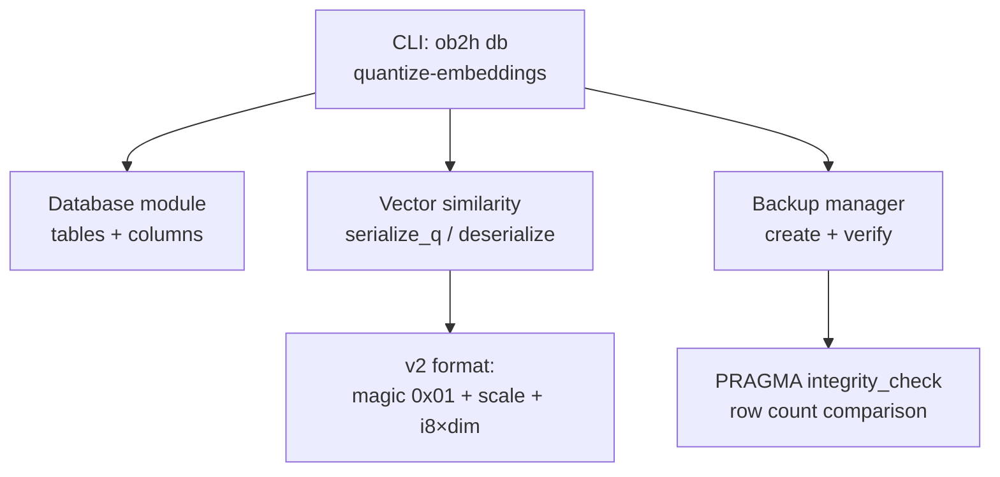
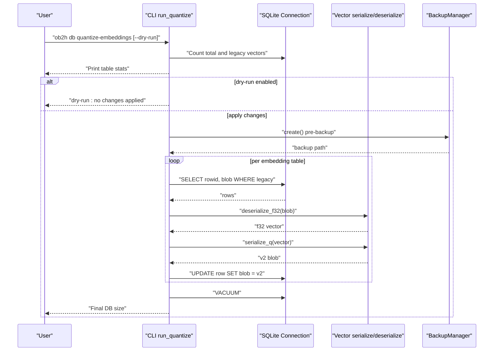
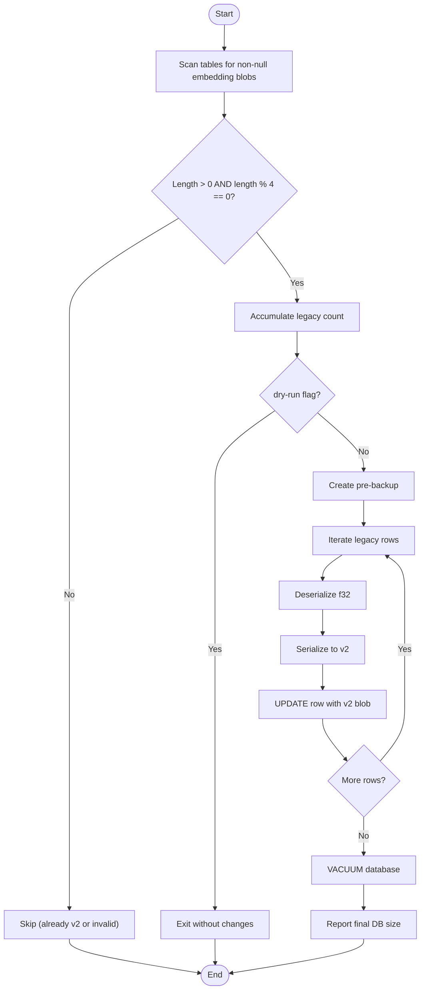
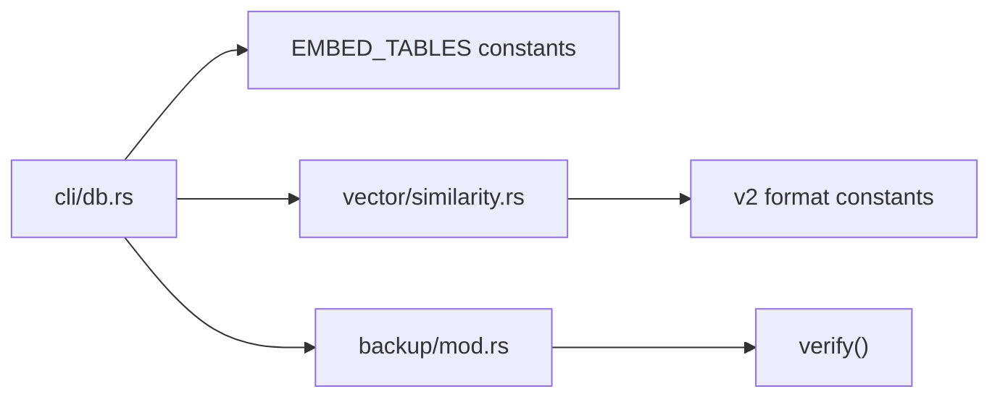

# Database Utilities

<cite>
**Referenced Files in This Document**
- [db.rs](file://src/cli/db.rs)
- [similarity.rs](file://src/vector/similarity.rs)
- [mod.rs (vector)](file://src/vector/mod.rs)
- [test_quantize.rs](file://tests/test_quantize.rs)
- [mod.rs (backup)](file://src/backup/mod.rs)
</cite>

## Table of Contents
1. [Introduction](#introduction)
2. [Project Structure](#project-structure)
3. [Core Components](#core-components)
4. [Architecture Overview](#architecture-overview)
5. [Detailed Component Analysis](#detailed-component-analysis)
6. [Dependency Analysis](#dependency-analysis)
7. [Performance Considerations](#performance-considerations)
8. [Troubleshooting Guide](#troubleshooting-guide)
9. [Conclusion](#conclusion)

## Introduction
This document explains the OB2H database utility commands focused on low-level maintenance and vector storage optimization. The primary command is `ob2h db quantize-embeddings`, which converts legacy float32 embeddings into a compact int8 v2 format, typically reducing storage by approximately four times while preserving similarity search quality through dual-read compatibility. It also covers dry-run previewing, technical details of vector quantization, expected space savings, recovery procedures using backups, and database integrity checks.

## Project Structure
The quantization feature spans three main areas:
- CLI entry point for the `db` subcommands
- Vector serialization/deserialization supporting both legacy f32 and new int8 v2 formats
- Backup manager providing full and quick snapshots plus verification

**Diagram sources**
- [db.rs:8-13](file://src/cli/db.rs#L8-L13)
- [db.rs:17-90](file://src/cli/db.rs#L17-L90)
- [similarity.rs:5-28](file://src/vector/similarity.rs#L5-L28)
- [similarity.rs:57-64](file://src/vector/similarity.rs#L57-L64)
- [mod.rs (backup):23-43](file://src/backup/mod.rs#L23-L43)
- [mod.rs (backup):75-122](file://src/backup/mod.rs#L75-L122)

**Section sources**
- [db.rs:8-13](file://src/cli/db.rs#L8-L13)
- [db.rs:17-90](file://src/cli/db.rs#L17-L90)
- [similarity.rs:5-28](file://src/vector/similarity.rs#L5-L28)
- [similarity.rs:57-64](file://src/vector/similarity.rs#L57-L64)
- [mod.rs (backup):23-43](file://src/backup/mod.rs#L23-L43)
- [mod.rs (backup):75-122](file://src/backup/mod.rs#L75-L122)

## Core Components
- `run_quantize`: Scans embedding columns across tables, identifies legacy f32 vectors, optionally previews changes with dry-run, creates a pre-backup, performs batch conversion to int8 v2, and runs VACUUM to reclaim space.
- Vector format support: Legacy f32 BLOBs are read via `deserialize_f32`; new v2 BLOBs use magic byte 0x01 followed by a per-vector scale factor and int8 components via `serialize_q`/`deserialize_q`. Dual-read `deserialize` automatically selects the correct decoder.
- Backup and verification: Full backup uses `VACUUM INTO` for an atomic snapshot; quick backup captures only memory-related tables; `verify` runs SQLite integrity checks and compares row counts between live and backup databases.

Key responsibilities:
- Safe migration from f32 to int8 without breaking existing reads
- Transparent dual-read so old and new data coexist during transition
- Pre-migration backup and post-migration vacuum
- Integrity validation of backups

**Section sources**
- [db.rs:17-90](file://src/cli/db.rs#L17-L90)
- [similarity.rs:5-28](file://src/vector/similarity.rs#L5-L28)
- [similarity.rs:30-64](file://src/vector/similarity.rs#L30-L64)
- [mod.rs (backup):23-43](file://src/backup/mod.rs#L23-L43)
- [mod.rs (backup):48-70](file://src/backup/mod.rs#L48-L70)
- [mod.rs (backup):75-122](file://src/backup/mod.rs#L75-L122)

## Architecture Overview
The quantization workflow integrates CLI, database access, vector serialization, and backup utilities.

**Diagram sources**
- [db.rs:17-90](file://src/cli/db.rs#L17-L90)
- [similarity.rs:30-28](file://src/vector/similarity.rs#L30-L28)
- [mod.rs (backup):23-43](file://src/backup/mod.rs#L23-L43)

## Detailed Component Analysis

### Command: `ob2h db quantize-embeddings`
Purpose:
- Identify legacy f32 embeddings stored as BLOBs
- Optionally preview changes without modifying data
- Convert eligible vectors to int8 v2 format
- Create a pre-backup before irreversible writes
- Run VACUUM to reclaim freed space and report final DB size

Tables and columns scanned:
- `graph_nodes.embedding`
- `memories.embedding`
- `chunks.embedding`

Legacy detection:
- Non-null BLOB with length greater than zero
- Length divisible by 4 (indicative of f32 arrays)
- New v2 format is identified by magic byte 0x01 and has length dim+5, never divisible by 4 for typical dimensions

Dry-run behavior:
- Prints counts of total and legacy vectors per table
- Does not modify any data or create backups

Apply behavior:
- Creates a full backup via `BackupManager::create`
- Iterates over matching rows, deserializes f32, serializes to v2, and updates the row
- After conversion, executes VACUUM and prints the resulting DB file size

Idempotency:
- Re-running after conversion finds no legacy vectors and reports that there is nothing to quantize

Operational notes:
- Conversion is batched per table
- Uses prepared statements and parameterized updates
- Reports progress per table and final DB size

**Section sources**
- [db.rs:8-13](file://src/cli/db.rs#L8-L13)
- [db.rs:17-90](file://src/cli/db.rs#L17-L90)

#### Flowchart: Quantization Decision Logic

**Diagram sources**
- [db.rs:24-42](file://src/cli/db.rs#L24-L42)
- [db.rs:57-82](file://src/cli/db.rs#L57-L82)

### Vector Quantization Technical Details
Format evolution:
- Legacy format: raw little-endian f32 array BLOB
- New v2 format: magic byte 0x01, then a 32-bit LE scale factor, then dim int8 values

Quantization algorithm:
- Per-vector scale computed as max absolute value divided by 127
- Each component is scaled and rounded to nearest int8 clamped to [-127, 127]
- v2 BLOB length equals dim + 5 bytes

Dual-read compatibility:
- `deserialize` checks the first byte for magic 0x01
- If present, decodes v2; otherwise falls back to f32 decoding
- This allows mixed f32 and v2 data during transition

Quality guarantees:
- Self-similarity distortion after quantization is bounded (tests assert cosine deviation < 0.01)
- Cross-similarity distortion is similarly bounded (tests assert cross-cosine deviation < 0.01)
- Max element-wise error after dequantization is small (tests assert < 0.03)

Complexity:
- Serialization: O(dim)
- Deserialization: O(dim)
- Space: v2 uses ~1 byte per dimension plus 5 overhead vs 4 bytes per dimension for f32

**Section sources**
- [similarity.rs:5-28](file://src/vector/similarity.rs#L5-L28)
- [similarity.rs:30-64](file://src/vector/similarity.rs#L30-L64)
- [similarity.rs:142-171](file://src/vector/similarity.rs#L142-L171)

### Backup and Recovery Procedures
Full backup:
- Uses SQLite’s `VACUUM INTO` to atomically copy the live database
- Copies workspace files alongside the DB snapshot
- Rotates backups according to configured retention

Quick backup:
- Captures only memory-related tables (`memories`, `kv`, `memory_links`)
- Useful for fast, smaller snapshots (~10–30 MB vs multi-gigabyte full backups)
- Does not include graph tables

Verification:
- Opens backup read-only
- Runs `PRAGMA integrity_check`
- Compares row counts for tables present in the backup against live DB
- Produces a human-readable report including integrity status and per-table counts

Recovery guidance:
- Before running quantization, ensure a recent full backup exists
- After quantization, verify the backup remains valid
- If corruption is detected, restore from the latest verified backup

**Section sources**
- [mod.rs (backup):23-43](file://src/backup/mod.rs#L23-L43)
- [mod.rs (backup):48-70](file://src/backup/mod.rs#L48-L70)
- [mod.rs (backup):75-122](file://src/backup/mod.rs#L75-L122)

### Examples and Expected Space Savings
When to use quantization:
- Large embeddings datasets where storage cost is significant
- Mixed legacy f32 and new v2 data requiring migration
- Environments constrained by disk space or I/O bandwidth

Expected savings:
- v2 stores one int8 per dimension plus 5 bytes overhead versus four bytes per dimension for f32
- Typical reduction approaches ~4x depending on dimensionality and metadata overhead
- Post-conversion VACUUM reclaims unused pages, further reducing file size

Example calculation:
- For dimension d, f32 storage ≈ 4 × d bytes per vector
- v2 storage ≈ d + 5 bytes per vector
- Approximate ratio ≈ 4d / (d + 5); for large d this approaches 4x

Validation:
- Tests assert v2 length equals dim + 5
- Tests validate dual-read behavior and quantization error bounds

**Section sources**
- [similarity.rs:5-28](file://src/vector/similarity.rs#L5-L28)
- [similarity.rs:142-171](file://src/vector/similarity.rs#L142-L171)
- [test_quantize.rs:53-55](file://tests/test_quantize.rs#L53-L55)

### Database Integrity Checks and Maintenance Best Practices
Integrity checks:
- Use backup verification to run `PRAGMA integrity_check` on copies
- Compare row counts between live and backup to detect discrepancies
- Treat any integrity failure as a signal to stop operations and restore from a known-good backup

Maintenance best practices:
- Always create a full backup before running destructive maintenance like quantization
- Prefer dry-run mode to assess impact before applying changes
- After bulk updates, run VACUUM to reclaim space and defragment the database
- Regularly verify backups to ensure recoverability
- Monitor DB file size after maintenance to confirm expected reductions

**Section sources**
- [mod.rs (backup):75-122](file://src/backup/mod.rs#L75-L122)
- [db.rs:82-90](file://src/cli/db.rs#L82-L90)

## Dependency Analysis
The quantization command depends on:
- Database schema knowledge (tables and embedding columns)
- Vector serialization utilities for safe conversion
- Backup manager for pre-migration safety
- SQLite operations for scanning, updating, and vacuuming

**Diagram sources**
- [db.rs:8-13](file://src/cli/db.rs#L8-L13)
- [db.rs:17-90](file://src/cli/db.rs#L17-L90)
- [similarity.rs:5-28](file://src/vector/similarity.rs#L5-L28)
- [mod.rs (backup):75-122](file://src/backup/mod.rs#L75-L122)

**Section sources**
- [db.rs:8-13](file://src/cli/db.rs#L8-L13)
- [db.rs:17-90](file://src/cli/db.rs#L17-L90)
- [similarity.rs:5-28](file://src/vector/similarity.rs#L5-L28)
- [mod.rs (backup):75-122](file://src/backup/mod.rs#L75-L122)

## Performance Considerations
- Conversion complexity is linear in the number of vectors and their dimensionality
- Batch processing per table reduces overhead
- VACUUM can be expensive but is necessary to reclaim space after bulk updates
- Dual-read adds minimal overhead since it branches on the first byte
- Int8 quantization reduces memory bandwidth and storage pressure, improving I/O-bound workloads

[No sources needed since this section provides general guidance]

## Troubleshooting Guide
Common issues and resolutions:
- No legacy vectors found:
  - Indicates all embeddings are already in v2 format or none match legacy criteria
  - Re-run with dry-run to confirm counts
- Corruption detected during backup verification:
  - Stop operations immediately
  - Restore from the latest verified backup
  - Investigate disk health and process stability
- Unexpected DB size after quantization:
  - Ensure VACUUM was executed
  - Verify that legacy vectors were correctly identified and converted
- Compatibility errors when reading embeddings:
  - Confirm dual-read is active and magic byte handling is intact
  - Validate that both f32 and v2 paths are supported

Operational checks:
- Use dry-run to preview changes
- Verify backups before and after maintenance
- Monitor logs for conversion counts and final DB size

**Section sources**
- [db.rs:44-50](file://src/cli/db.rs#L44-L50)
- [db.rs:82-90](file://src/cli/db.rs#L82-L90)
- [mod.rs (backup):95-122](file://src/backup/mod.rs#L95-L122)
- [test_quantize.rs:60-81](file://tests/test_quantize.rs#L60-L81)

## Conclusion
The `ob2h db quantize-embeddings` command provides a safe, efficient pathway to migrate legacy float32 embeddings to a compact int8 v2 format. With dry-run previewing, automatic pre-backups, dual-read compatibility, and robust verification, it enables substantial storage savings with minimal risk. Following the recommended maintenance and recovery procedures ensures database integrity and operational reliability.

[No sources needed since this section summarizes without analyzing specific files]