# Dream Processing Commands

<cite>
**Referenced Files in This Document**
- [main.rs](file://src/main.rs)
- [mod.rs (CLI)](file://src/cli/mod.rs)
- [tools.rs](file://src/mcp/tools.rs)
- [server.rs](file://src/mcp/server.rs)
- [dream mod.rs](file://src/dream/mod.rs)
- [autodream.rs](file://src/dream/autodream.rs)
- [consolidate.rs](file://src/dream/consolidate.rs)
- [bench_gate.rs](file://src/dream/bench_gate.rs)
</cite>

## Table of Contents
1. [Introduction](#introduction)
2. [Project Structure](#project-structure)
3. [Core Components](#core-components)
4. [Architecture Overview](#architecture-overview)
5. [Detailed Component Analysis](#detailed-component-analysis)
6. [Dependency Analysis](#dependency-analysis)
7. [Performance Considerations](#performance-considerations)
8. [Troubleshooting Guide](#troubleshooting-guide)
9. [Conclusion](#conclusion)

## Introduction
This document explains the OB2H dream processing commands and their role in automated memory consolidation. The `ob2h dream` command family provides a controlled interface for running, monitoring, reviewing, and restoring the state produced by the dream pipeline. It supports:

- Manual execution with optional background mode.
- Status inspection including last run metadata and automation gate results.
- History browsing over Git-backed workspace commits created by dream runs.
- Disaster recovery by restoring workspace files to a specific commit.

The dream pipeline itself is an LLM-assisted consolidation process that reads new session history, edits agent workspace files (`MEMORY.md`, `SOUL.md`, `USER.md`), optionally extracts graph entities, revises low-trust memories, consolidates near-duplicate memories, and commits changes through a Git-backed workspace store. Automation is provided by a background worker that schedules runs based on time and event thresholds, while a bench gate can automatically roll back degraded outcomes.

## Project Structure
The dream commands are exposed at three layers:

1. **CLI layer**: defines the `DreamCommands` subcommands and arguments.
2. **Main entrypoint**: routes `ob2h dream <subcommand>` calls into MCP tools.
3. **MCP server**: implements tool handlers for `dream_run`, `dream_status`, `dream_log`, and `dream_restore`.
4. **Dream engine**: performs the actual consolidation workflow and persists run statistics.
5. **Automation and gates**: background scheduling, bench gating, and rollback logic.

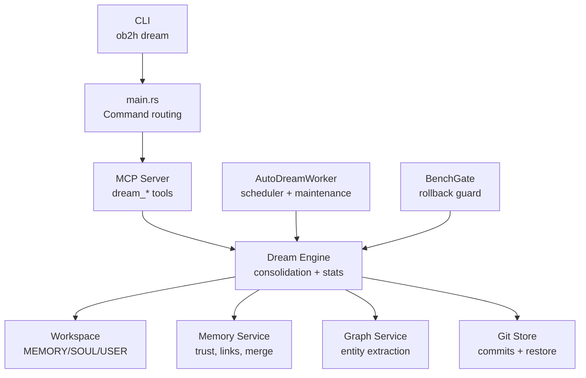

**Diagram sources**
- [mod.rs (CLI):378-397](file://src/cli/mod.rs#L378-L397)
- [main.rs:120-145](file://src/main.rs#L120-L145)
- [tools.rs:231-270](file://src/mcp/tools.rs#L231-L270)
- [server.rs:1579-1637](file://src/mcp/server.rs#L1579-L1637)
- [dream mod.rs:145-288](file://src/dream/mod.rs#L145-L288)
- [autodream.rs:61-145](file://src/dream/autodream.rs#L61-L145)
- [bench_gate.rs:160-332](file://src/dream/bench_gate.rs#L160-L332)

**Section sources**
- [mod.rs (CLI):378-397](file://src/cli/mod.rs#L378-L397)
- [main.rs:120-145](file://src/main.rs#L120-L145)
- [tools.rs:231-270](file://src/mcp/tools.rs#L231-L270)
- [server.rs:1579-1637](file://src/mcp/server.rs#L1579-L1637)

## Core Components
The dream system consists of several cooperating components:

| Component | Responsibility | Key Behavior |
|---|---|---|
| `DreamCommands` | CLI argument model | Defines `run --background`, `status`, `log --limit`, `restore --commit`. |
| `Dream` | Consolidation engine | Reads history, edits workspace files, updates memory/graph/Ralph, commits via Git. |
| `AutoDreamWorker` | Background scheduler | Runs dream periodically, enforces minimum intervals, triggers maintenance. |
| `BenchGate` | Quality gate | Runs quick benchmark against golden set; can rollback workspace on degradation. |
| `MCP Tools` | Tool contract | Declares tool names, descriptions, input schemas, and read-only/destructive hints. |
| `MCP Server Handlers` | Request dispatch | Parses arguments, locks concurrent dream runs, returns formatted output. |
| `GitStore` | Versioning backend | Provides commit log, HEAD capture, file shrink detection, and restoration. |

**Section sources**
- [mod.rs (CLI):378-397](file://src/cli/mod.rs#L378-L397)
- [dream mod.rs:110-143](file://src/dream/mod.rs#L110-L143)
- [autodream.rs:20-59](file://src/dream/autodream.rs#L20-L59)
- [bench_gate.rs:42-57](file://src/dream/bench_gate.rs#L42-L57)
- [tools.rs:231-270](file://src/mcp/tools.rs#L231-L270)
- [server.rs:1579-1637](file://src/mcp/server.rs#L1579-L1637)

## Architecture Overview
The end-to-end flow from CLI to Git-backed workspace change is shown below.

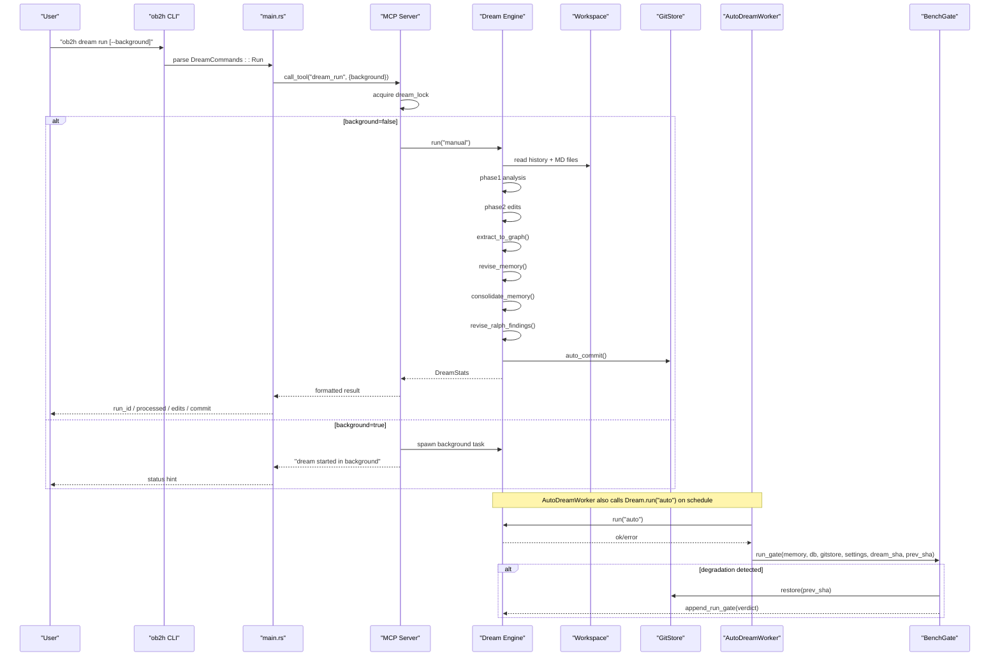

**Diagram sources**
- [main.rs:120-145](file://src/main.rs#L120-L145)
- [server.rs:1579-1637](file://src/mcp/server.rs#L1579-L1637)
- [dream mod.rs:145-288](file://src/dream/mod.rs#L145-L288)
- [autodream.rs:61-145](file://src/dream/autodream.rs#L61-L145)
- [bench_gate.rs:160-332](file://src/dream/bench_gate.rs#L160-L332)

## Detailed Component Analysis

### Dream Subcommands

#### `ob2h dream run [--background]`
- Purpose: manually trigger dream consolidation.
- Arguments:
  - `--background`: when true, starts dream in a background task instead of waiting.
- Behavior:
  - CLI parses `DreamCommands::Run`.
  - Main forwards to MCP tool `dream_run`.
  - MCP handler acquires a global dream lock to avoid concurrent runs.
  - If background is false, it waits for `Dream::run` and prints summary fields.
  - If background is true, it spawns a Tokio task and returns a short message directing users to `dream_status`.

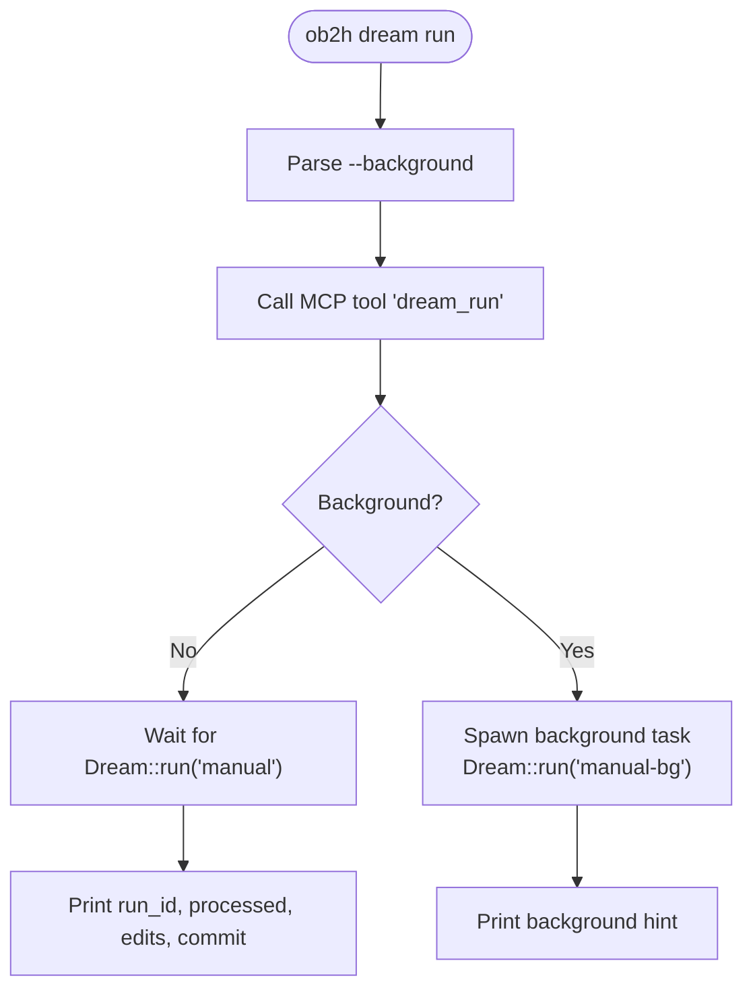

**Diagram sources**
- [main.rs:120-126](file://src/main.rs#L120-L126)
- [server.rs:1579-1612](file://src/mcp/server.rs#L1579-L1612)

**Section sources**
- [mod.rs (CLI):378-384](file://src/cli/mod.rs#L378-L384)
- [main.rs:120-126](file://src/main.rs#L120-L126)
- [tools.rs:231-241](file://src/mcp/tools.rs#L231-L241)
- [server.rs:1579-1612](file://src/mcp/server.rs#L1579-L1612)

#### `ob2h dream status`
- Purpose: inspect the most recent dream run and automation gate information.
- Behavior:
  - CLI maps to `DreamCommands::Status`.
  - Main calls MCP tool `dream_status`.
  - MCP handler calls `Dream::last_status`.
  - Output includes last run ID, timestamps, status, trigger, and serialized stats.
  - Stats may include bench gate verdicts appended by the automation worker.

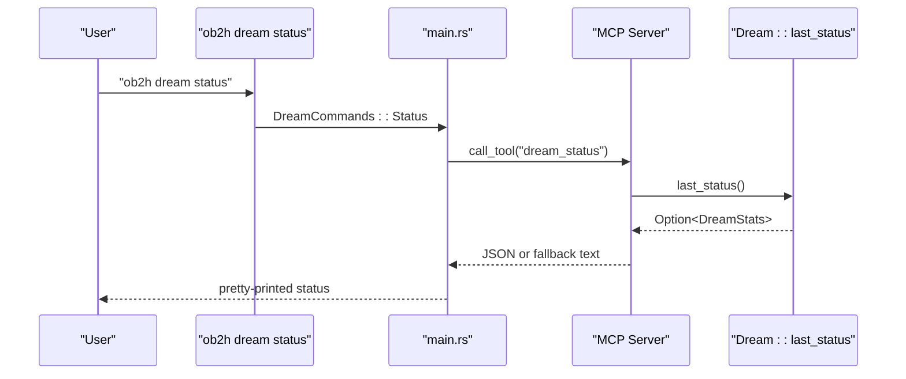

**Diagram sources**
- [main.rs:127-132](file://src/main.rs#L127-L132)
- [dream mod.rs:618-645](file://src/dream/mod.rs#L618-L645)
- [server.rs:1614-1617](file://src/mcp/server.rs#L1614-L1617)

**Section sources**
- [mod.rs (CLI):385-386](file://src/cli/mod.rs#L385-L386)
- [main.rs:127-132](file://src/main.rs#L127-L132)
- [tools.rs:242-247](file://src/mcp/tools.rs#L242-L247)
- [server.rs:1614-1617](file://src/mcp/server.rs#L1614-L1617)
- [dream mod.rs:618-645](file://src/dream/mod.rs#L618-L645)

#### `ob2h dream log [--limit N]`
- Purpose: view recent Git commits produced by dream operations.
- Arguments:
  - `--limit`: maximum number of entries to show; default is 10.
- Behavior:
  - CLI parses `DreamCommands::Log`.
  - Main calls MCP tool `dream_log`.
  - MCP handler asks `GitStore::log(limit)` and formats each entry as SHA, date, and message.
  - If no commits exist, it returns a short message indicating empty history.

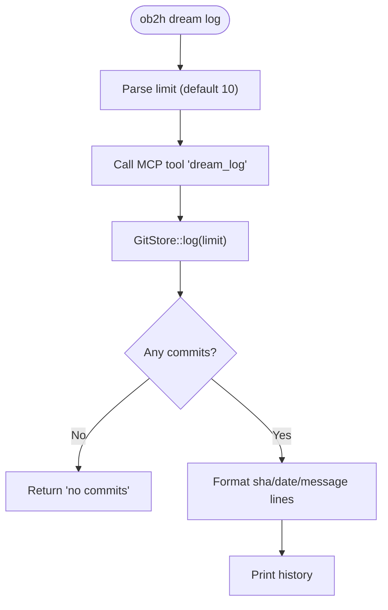

**Diagram sources**
- [main.rs:133-138](file://src/main.rs#L133-L138)
- [server.rs:1619-1630](file://src/mcp/server.rs#L1619-L1630)

**Section sources**
- [mod.rs (CLI):387-391](file://src/cli/mod.rs#L387-L391)
- [main.rs:133-138](file://src/main.rs#L133-L138)
- [tools.rs:248-258](file://src/mcp/tools.rs#L248-L258)
- [server.rs:1619-1630](file://src/mcp/server.rs#L1619-L1630)

#### `ob2h dream restore --commit <sha>`
- Purpose: roll back workspace files to a previous commit recorded in dream history.
- Arguments:
  - `--commit`: required Git SHA to restore.
- Behavior:
  - CLI parses `DreamCommands::Restore`.
  - Main calls MCP tool `dream_restore`.
  - MCP handler validates the commit argument and delegates to `GitStore::restore(commit)`.
  - This is marked as a destructive tool in the MCP tool annotations.

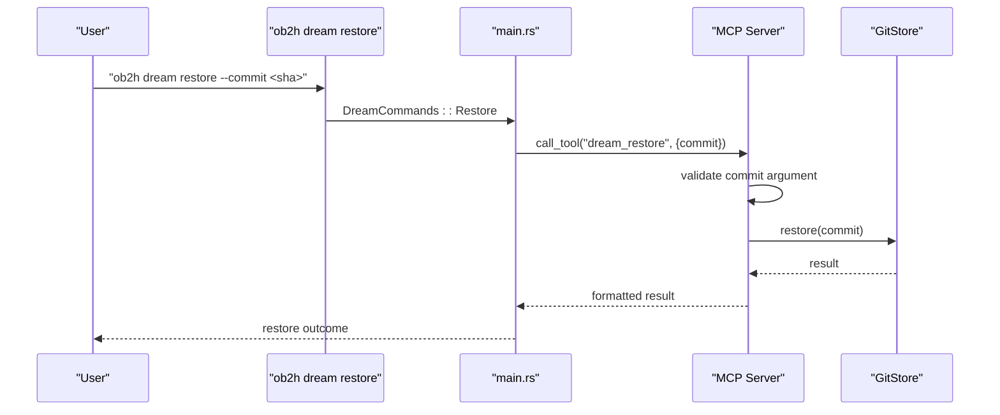

**Diagram sources**
- [main.rs:139-144](file://src/main.rs#L139-L144)
- [server.rs:1631-1637](file://src/mcp/server.rs#L1631-L1637)

**Section sources**
- [mod.rs (CLI):392-397](file://src/cli/mod.rs#L392-L397)
- [main.rs:139-144](file://src/main.rs#L139-L144)
- [tools.rs:259-270](file://src/mcp/tools.rs#L259-L270)
- [server.rs:1631-1637](file://src/mcp/server.rs#L1631-L1637)

### Dream Processing Pipeline
The core consolidation pipeline is implemented in `Dream::execute_dream`. It processes new history records and produces a structured `DreamStats` object.

Key phases:

1. **Cursor-based history ingestion**: reads new records since the last dream cursor.
2. **Phase 1 analysis**: sends recent history plus current workspace files to the LLM for analysis.
3. **Phase 2 editing loop**: iteratively asks the LLM for small JSON actions such as reading or editing workspace files.
4. **Graph extraction**: optionally extracts entities and edges into the knowledge graph.
5. **Memory revision**: reviews low-trust memories and adjusts trust or creates typed relations.
6. **Consolidation**: merges near-duplicate memories, adds typed edges, and optionally creates compact digests.
7. **Ralph findings revision**: re-evaluates stale development findings using fresh context.
8. **Cursor update and history compaction**: advances the dream cursor and compacts old history.
9. **Git commit**: creates an automatic commit summarizing edits and revisions.

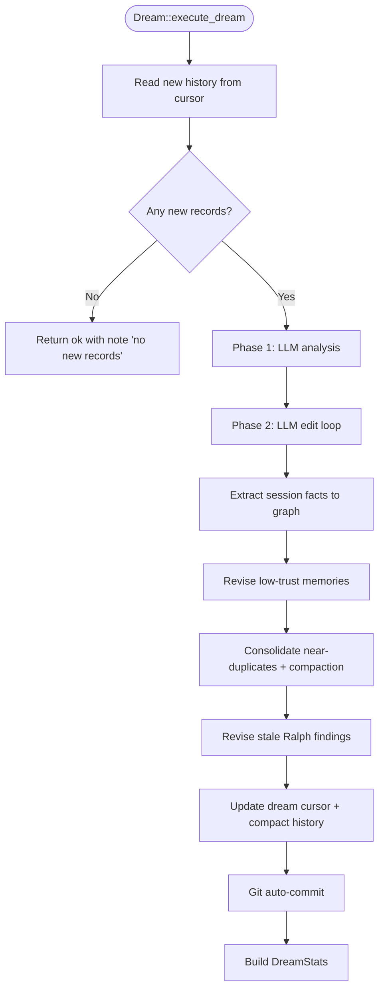

**Diagram sources**
- [dream mod.rs:196-288](file://src/dream/mod.rs#L196-L288)

**Section sources**
- [dream mod.rs:196-288](file://src/dream/mod.rs#L196-L288)

### Quality Gates

#### Bench Gate
The bench gate is an automated quality check that runs after a successful dream run. Its responsibilities include:

- Checking whether the bench gate is enabled.
- Loading a golden test set from `data/bench/golden.jsonl`.
- Running a quick benchmark over the first configured number of cases.
- Detecting workspace file damage before benchmarking.
- Comparing recall and MRR against the previous baseline stored in database key-value storage.
- Rolling back the workspace to the pre-dream HEAD if degradation is detected.
- Recording gate outcomes in both history and the last dream run stats.

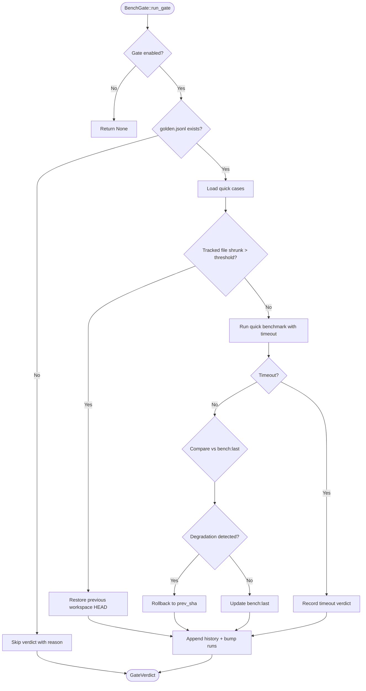

**Diagram sources**
- [bench_gate.rs:160-332](file://src/dream/bench_gate.rs#L160-L332)

**Section sources**
- [bench_gate.rs:1-15](file://src/dream/bench_gate.rs#L1-L15)
- [bench_gate.rs:42-87](file://src/dream/bench_gate.rs#L42-L87)
- [bench_gate.rs:160-332](file://src/dream/bench_gate.rs#L160-L332)

#### Automation Triggers
The background automation worker controls when dream runs occur and what maintenance happens afterward.

Important behaviors:

- The worker is disabled unless autodream is enabled in settings.
- It uses a Tokio interval based on configured minutes.
- Before running, it checks:
  - Minimum elapsed time since last run.
  - Minimum number of daily events since last run.
  - A file-based lock to prevent overlapping runs.
- On success, it runs the bench gate immediately after dream completion.
- After the gate, it performs memory decay, weak purge, tombstone cleanup, lesson decay sweep, audit ledger pruning, optional slot reflection, daily log pruning, and scheduled sync.

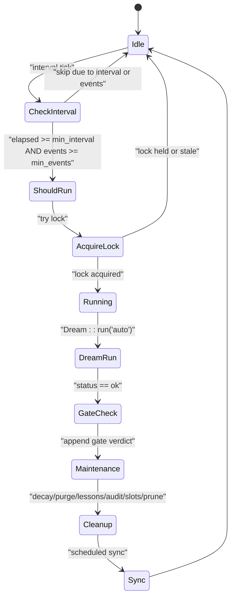

**Diagram sources**
- [autodream.rs:61-145](file://src/dream/autodream.rs#L61-L145)
- [autodream.rs:169-192](file://src/dream/autodream.rs#L169-L192)
- [autodream.rs:226-247](file://src/dream/autodream.rs#L226-L247)

**Section sources**
- [autodream.rs:20-59](file://src/dream/autodream.rs#L20-L59)
- [autodream.rs:61-145](file://src/dream/autodream.rs#L61-L145)
- [autodream.rs:169-192](file://src/dream/autodream.rs#L169-L192)
- [autodream.rs:226-247](file://src/dream/autodream.rs#L226-L247)

### Git-Backed Workspace Versioning
Dream operations are versioned through a Git-backed workspace store. Each successful dream run creates an automatic commit. The commit message summarizes edits and revisions. The same Git store is used for:

- Listing dream-related commits via `dream_log`.
- Capturing the workspace HEAD before automation runs.
- Detecting workspace file shrinkage during bench gating.
- Restoring workspace files to a specified commit via `dream_restore`.

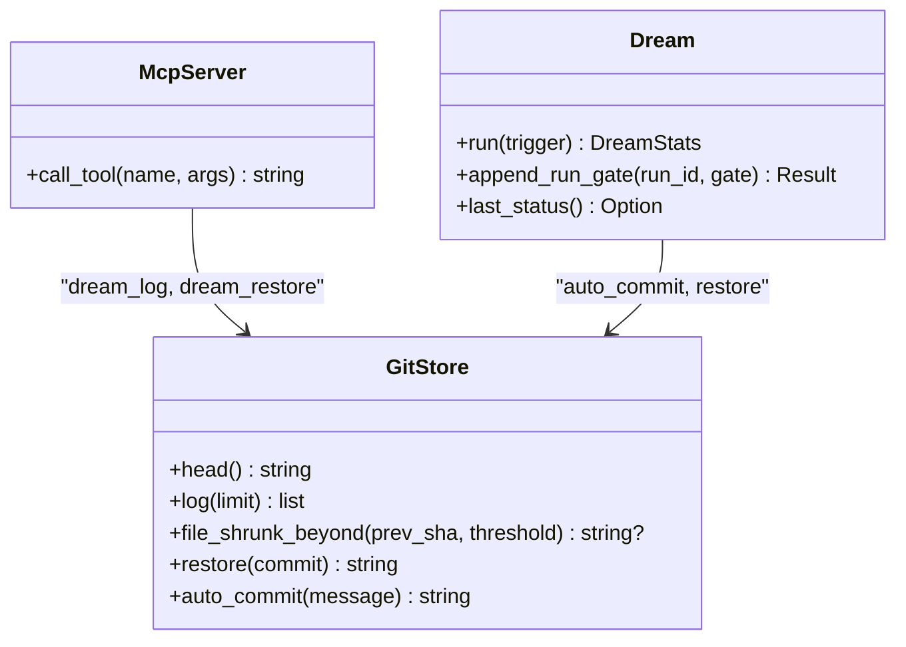

**Diagram sources**
- [dream mod.rs:547-565](file://src/dream/mod.rs#L547-L565)
- [server.rs:1619-1637](file://src/mcp/server.rs#L1619-L1637)
- [bench_gate.rs:193-220](file://src/dream/bench_gate.rs#L193-L220)

**Section sources**
- [dream mod.rs:254-271](file://src/dream/mod.rs#L254-L271)
- [server.rs:1619-1637](file://src/mcp/server.rs#L1619-L1637)
- [bench_gate.rs:193-220](file://src/dream/bench_gate.rs#L193-L220)

### Memory Consolidation Details
The consolidation subsystem handles near-duplicate memories and long-term memory hygiene.

Key behaviors:

- Merge candidates are identified by markers in memory metadata.
- Pairs are deduplicated by unordered ID pairs.
- LLM verdicts decide between merging, keeping both, contradicting, or superseding.
- Merges reuse the unified memory service merge engine.
- Typed edges are inserted for relationships like `supersedes` or `contradicts`.
- Compaction clusters low-trust, low-importance, low-access memories and creates digest nodes linked by `summary` edges.
- Compaction is throttled by a timestamp stored in key-value storage.

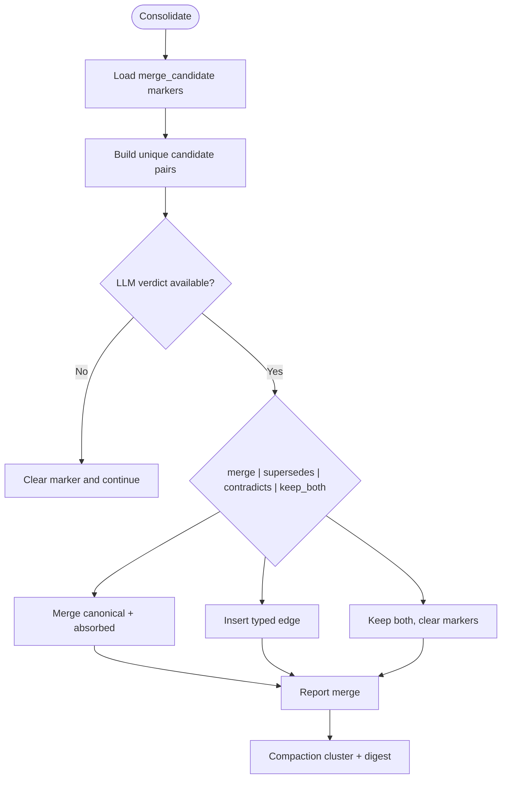

**Diagram sources**
- [consolidate.rs:68-85](file://src/dream/consolidate.rs#L68-L85)
- [consolidate.rs:89-190](file://src/dream/consolidate.rs#L89-L190)
- [consolidate.rs:252-336](file://src/dream/consolidate.rs#L252-L336)

**Section sources**
- [consolidate.rs:1-15](file://src/dream/consolidate.rs#L1-L15)
- [consolidate.rs:68-85](file://src/dream/consolidate.rs#L68-L85)
- [consolidate.rs:89-190](file://src/dream/consolidate.rs#L89-L190)
- [consolidate.rs:252-336](file://src/dream/consolidate.rs#L252-L336)

## Dependency Analysis
The dream command path depends on multiple modules:

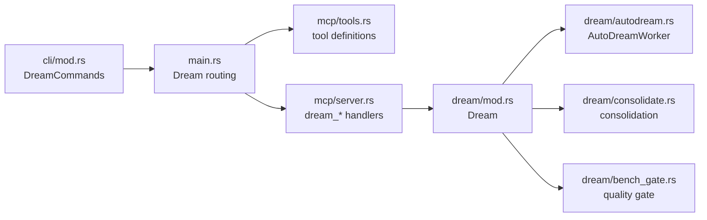

**Diagram sources**
- [mod.rs (CLI):378-397](file://src/cli/mod.rs#L378-L397)
- [main.rs:120-145](file://src/main.rs#L120-L145)
- [tools.rs:231-270](file://src/mcp/tools.rs#L231-L270)
- [server.rs:1579-1637](file://src/mcp/server.rs#L1579-L1637)
- [dream mod.rs:1-5](file://src/dream/mod.rs#L1-L5)
- [autodream.rs:1-16](file://src/dream/autodream.rs#L1-L16)
- [consolidate.rs:1-24](file://src/dream/consolidate.rs#L1-L24)
- [bench_gate.rs:1-29](file://src/dream/bench_gate.rs#L1-L29)

**Section sources**
- [mod.rs (CLI):378-397](file://src/cli/mod.rs#L378-L397)
- [main.rs:120-145](file://src/main.rs#L120-L145)
- [tools.rs:231-270](file://src/mcp/tools.rs#L231-L270)
- [server.rs:1579-1637](file://src/mcp/server.rs#L1579-L1637)

## Performance Considerations
- **Concurrent control**: dream runs are protected by a global lock in the MCP server to avoid overlapping manual or background runs.
- **Background execution**: `dream run --background` avoids blocking the caller by spawning a Tokio task.
- **Automation throttling**: the background worker enforces minimum intervals and minimum event counts before running.
- **Benchmark timeout**: the bench gate uses a configurable timeout so slow benchmarks do not block automation indefinitely.
- **Consolidation limits**: merge candidate processing is limited per dream run, and compaction is throttled by a timestamp.
- **Output truncation**: MCP tool responses are truncated according to configured character limits to avoid oversized outputs.

[No sources needed since this section provides general guidance]

## Troubleshooting Guide

### Manual Intervention Scenarios

| Scenario | Recommended Command | Expected Outcome |
|---|---|---|
| Trigger consolidation now | `ob2h dream run` | Waits for completion and prints run summary. |
| Trigger without blocking | `ob2h dream run --background` | Starts background task and suggests checking status. |
| Inspect last run | `ob2h dream status` | Shows last run metadata and any bench gate verdict. |
| Review recent changes | `ob2h dream log` | Lists recent Git commits from dream runs. |
| Limit history view | `ob2h dream log --limit 20` | Shows up to 20 entries. |
| Recover from bad consolidation | `ob2h dream restore --commit <sha>` | Restores workspace files to the specified commit. |

**Section sources**
- [main.rs:120-144](file://src/main.rs#L120-L144)
- [server.rs:1579-1637](file://src/mcp/server.rs#L1579-L1637)

### Monitoring Automated Processing

Useful indicators:

- `dream status` shows the latest automation run, its trigger, and embedded stats.
- Bench gate verdicts appear in the last dream run stats when enabled.
- Automation skips runs when the minimum interval or minimum event thresholds are not met.
- Lock files prevent overlapping automation runs; stale locks may be reclaimed with warnings.

**Section sources**
- [dream mod.rs:618-645](file://src/dream/mod.rs#L618-L645)
- [autodream.rs:169-192](file://src/dream/autodream.rs#L169-L192)
- [autodream.rs:226-247](file://src/dream/autodream.rs#L226-L247)
- [bench_gate.rs:160-332](file://src/dream/bench_gate.rs#L160-L332)

### Disaster Recovery Procedures

Recommended recovery steps:

1. Run `ob2h dream log` to identify recent commits.
2. Choose a known-good commit SHA.
3. Run `ob2h dream restore --commit <sha>`.
4. Verify workspace files and memory state.
5. If automation keeps rolling back, inspect bench gate verdicts in `dream status` and review the golden benchmark configuration.

Notes:

- `dream_restore` is explicitly marked as a destructive MCP tool.
- Bench gate rollback restores the workspace to the captured HEAD before the problematic dream run.
- Workspace file shrinkage beyond the configured threshold also triggers automatic rollback.

**Section sources**
- [tools.rs:38-52](file://src/mcp/tools.rs#L38-L52)
- [server.rs:1631-1637](file://src/mcp/server.rs#L1631-L1637)
- [bench_gate.rs:193-220](file://src/dream/bench_gate.rs#L193-L220)

## Conclusion
The OB2H dream processing commands provide a safe, observable, and reversible interface for automated memory consolidation. Manual commands allow operators to trigger and inspect consolidation, while automation ensures regular maintenance with bounded risk. Git-backed versioning gives explicit rollback points, and the bench gate adds an automated safety net against regression. For reliable operation, monitor `dream status`, review `dream log`, and use `dream restore` only when a specific commit is known to represent a stable workspace state.

[No sources needed since this section summarizes without analyzing specific files]