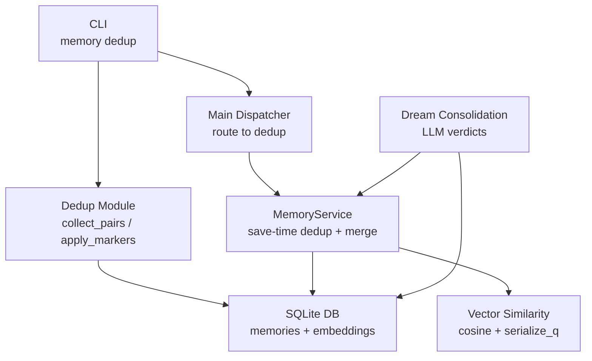
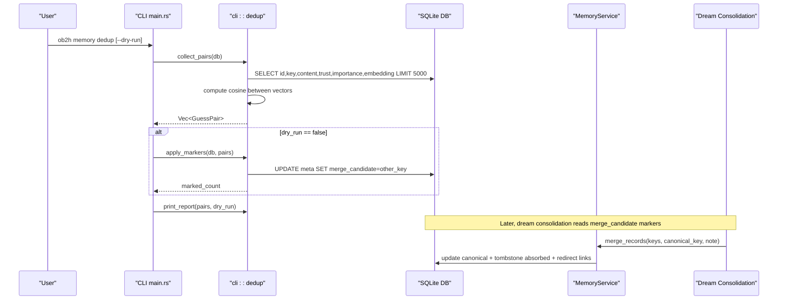
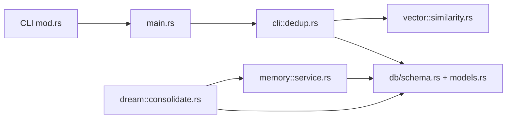

# Memory Operations Commands

<cite>
**Referenced Files in This Document**
- [dedup.rs](file://src/cli/dedup.rs)
- [mod.rs (CLI)](file://src/cli/mod.rs)
- [main.rs](file://src/main.rs)
- [service.rs (MemoryService)](file://src/memory/service.rs)
- [similarity.rs](file://src/vector/similarity.rs)
- [consolidate.rs (Dream consolidation)](file://src/dream/consolidate.rs)
- [schema.rs](file://src/db/schema.rs)
- [models.rs](file://src/db/models.rs)
</cite>

## Table of Contents
1. [Introduction](#introduction)
2. [Project Structure](#project-structure)
3. [Core Components](#core-components)
4. [Architecture Overview](#architecture-overview)
5. [Detailed Component Analysis](#detailed-component-analysis)
6. [Dependency Analysis](#dependency-analysis)
7. [Performance Considerations](#performance-considerations)
8. [Troubleshooting Guide](#troubleshooting-guide)
9. [Conclusion](#conclusion)
10. [Appendices](#appendices)

## Introduction
This document explains OB2H memory maintenance and optimization commands with a focus on the memory deduplication workflow. It covers how near-duplicate memories are identified using cosine similarity, how candidates are marked for later consolidation, and how the offline dream processing finalizes merges or creates typed edges. Practical examples, report interpretation, automation patterns, performance considerations, and best practices are included to help you maintain clean, high-quality memory over time.

## Project Structure
The memory dedup feature spans several modules:
- CLI entry points define the `ob2h memory dedup` command and its dry-run mode.
- The dedup module computes candidate pairs using stored embeddings and cosine similarity.
- Memory service implements save-time duplicate detection and explicit merge logic.
- Dream consolidation consumes merge candidates and performs LLM-based decisions.
- Vector similarity utilities provide quantized embedding storage and cosine computation.
- Database schema defines the memory table and related structures used by these flows.

**Diagram sources**
- [mod.rs (CLI):181-190](file://src/cli/mod.rs#L181-L190)
- [main.rs:164-175](file://src/main.rs#L164-L175)
- [dedup.rs:44-135](file://src/cli/dedup.rs#L44-L135)
- [service.rs:48-167](file://src/memory/service.rs#L48-L167)
- [similarity.rs:76-97](file://src/vector/similarity.rs#L76-L97)
- [consolidate.rs:68-85](file://src/dream/consolidate.rs#L68-L85)

**Section sources**
- [mod.rs (CLI):181-190](file://src/cli/mod.rs#L181-L190)
- [main.rs:164-175](file://src/main.rs#L164-L175)

## Core Components
- CLI command definition: `ob2h memory dedup [--dry-run]`.
- Dedup module: computes cosine-similarity pairs, selects canonical keys, marks candidates.
- Memory service: save-time identity check and suspect marking; explicit merge engine.
- Vector similarity: int8-quantized embedding format and cosine calculation.
- Dream consolidation: processes merge candidates via LLM, applies merges or typed edges.

Key behaviors:
- Cosine thresholds: identity ≥ 0.98; suspect range 0.75–0.98.
- Dry-run mode: reports candidates without modifying metadata.
- Merge candidate marking: sets `meta.merge_candidate` on the less-trusted record.
- Dream consolidation: decides merge vs keep_both vs contradicts vs supersedes.

**Section sources**
- [dedup.rs:16-32](file://src/cli/dedup.rs#L16-L32)
- [service.rs:17-21](file://src/memory/service.rs#L17-L21)
- [similarity.rs:16-28](file://src/vector/similarity.rs#L16-L28)
- [consolidate.rs:40-45](file://src/dream/consolidate.rs#L40-L45)

## Architecture Overview
The dedup pipeline integrates CLI, vector similarity, database access, and dream consolidation:

**Diagram sources**
- [main.rs:164-175](file://src/main.rs#L164-L175)
- [dedup.rs:44-135](file://src/cli/dedup.rs#L44-L135)
- [dedup.rs:139-176](file://src/cli/dedup.rs#L139-L176)
- [service.rs:215-335](file://src/memory/service.rs#L215-L335)
- [consolidate.rs:87-190](file://src/dream/consolidate.rs#L87-L190)

## Detailed Component Analysis

### CLI Command Definition and Dispatch
- Subcommand: `MemoryCommands::Dedup` with optional `--dry-run`.
- Dispatch in main: calls `collect_pairs`, optionally `apply_markers`, then prints report.

Behavior:
- Without `--dry-run`: marks records with `meta.merge_candidate`.
- With `--dry-run`: only reports candidates; no metadata changes.

**Section sources**
- [mod.rs (CLI):181-190](file://src/cli/mod.rs#L181-L190)
- [main.rs:164-175](file://src/main.rs#L164-L175)

### Dedup Module: Pair Collection and Candidate Marking
- Thresholds:
  - Identity threshold: 0.98.
  - Suspect threshold: 0.75.
- Scan cap: up to 5000 live memories.
- Algorithm:
  - Load rows with embeddings.
  - For each pair, compute cosine similarity.
  - Keep top neighbor per record above suspect threshold.
  - Deduplicate unordered pairs.
  - Select canonical key based on trust and importance.
  - Return sorted list of candidate pairs.

Marking:
- Sets `meta.merge_candidate` on the non-canonical record.
- Avoids redundant updates if already marked with the same target.

Report:
- Prints total candidates, identity count, suspect count.
- Lists each pair with cosine score and canonical direction.
- Indicates whether markers were set or not (dry-run).

Complexity:
- O(n^2) pairwise comparisons within scan cap; optimized by early pruning below suspect threshold.

**Section sources**
- [dedup.rs:16-32](file://src/cli/dedup.rs#L16-L32)
- [dedup.rs:44-135](file://src/cli/dedup.rs#L44-L135)
- [dedup.rs:139-176](file://src/cli/dedup.rs#L139-L176)
- [dedup.rs:178-218](file://src/cli/dedup.rs#L178-L218)

### Memory Service: Save-Time Duplicate Detection and Explicit Merge
Save-time behavior:
- Generates deterministic key if none provided.
- Computes embedding and checks top cosine neighbor among live records.
- If cosine ≥ 0.98: identity duplicate → quiet UPDATE of existing record (no new row).
- If cosine ∈ [0.75, 0.98): suspect duplicate → mark new record with `meta.merge_candidate` pointing to neighbor.

Explicit merge (`memory_merge`):
- Validates at least two keys.
- Chooses canonical record by trust/importance or explicit canonical_key.
- Merges metadata (union), sums access counts, takes max importance.
- Tombstones absorbed records with `meta.merged_into` and optional note.
- Redirects links from absorbed to canonical; tombstones absorbed edges.

Trust and feedback integration:
- Feedback and dream revisions adjust trust and may mark forget candidates.

**Section sources**
- [service.rs:48-167](file://src/memory/service.rs#L48-L167)
- [service.rs:169-213](file://src/memory/service.rs#L169-L213)
- [service.rs:215-335](file://src/memory/service.rs#L215-L335)
- [service.rs:337-383](file://src/memory/service.rs#L337-L383)

### Vector Similarity Utilities
- Quantization: int8 per-vector scale for compact storage (~4× smaller than f32).
- Dual-read: supports legacy f32 blobs and v2 int8+scale blobs.
- Cosine function: robust normalization-aware dot product.
- Top-k search: filters by min_score and sorts descending.

Performance implications:
- Int8 quantization reduces I/O and memory footprint while preserving cosine accuracy within small distortion bounds.

**Section sources**
- [similarity.rs:16-28](file://src/vector/similarity.rs#L16-L28)
- [similarity.rs:48-64](file://src/vector/similarity.rs#L48-L64)
- [similarity.rs:76-97](file://src/vector/similarity.rs#L76-L97)
- [similarity.rs:99-126](file://src/vector/similarity.rs#L99-L126)

### Dream Consolidation: LLM Verdicts and Automated Maintenance
Consolidation flow:
- Loads records marked with `meta.merge_candidate`.
- Pairs candidate with neighbor; deduplicates unordered pairs.
- Sends prompt to LLM with system instructions for merge decisions.
- Outcomes:
  - merge: uses unified merge engine to absorb one into canonical.
  - supersedes/contradicts: inserts typed edge between records.
  - keep_both or unrecognized: clears markers without changes.

Compaction:
- Periodic clustering of low-trust, low-importance, low-access records.
- Creates summary nodes linked via kind=summary.
- Throttled to once every 30 days.

Integration with dedup:
- Consumes merge candidates produced by save-time checks and CLI dedup.
- Ensures automatic merges only occur via LLM verdicts (rule №1).

**Section sources**
- [consolidate.rs:68-85](file://src/dream/consolidate.rs#L68-L85)
- [consolidate.rs:87-190](file://src/dream/consolidate.rs#L87-L190)
- [consolidate.rs:250-336](file://src/dream/consolidate.rs#L250-L336)
- [consolidate.rs:338-401](file://src/dream/consolidate.rs#L338-L401)

### Database Schema and Models
- Memories table includes fields for content, category, importance, source, meta, embedding, timestamps, access metrics, project linkage, trust, and deletion tombstones.
- Memory links table stores typed relationships between memories with soft-delete support.
- FTS5 indexes enable fast full-text search.

Relevance to dedup:
- Embedding column stores serialized vectors used for cosine similarity.
- Meta field holds merge_candidate markers consumed by dream consolidation.

**Section sources**
- [schema.rs:222-240](file://src/db/schema.rs#L222-L240)
- [schema.rs:83-109](file://src/db/schema.rs#L83-L109)
- [schema.rs:305-319](file://src/db/schema.rs#L305-L319)
- [models.rs:18-33](file://src/db/models.rs#L18-L33)

## Dependency Analysis
The dedup feature depends on:
- CLI routing and argument parsing.
- Vector similarity for cosine computation and embedding serialization.
- SQLite for reading/writing memories and metadata.
- Memory service for explicit merge operations and save-time checks.
- Dream consolidation for LLM-driven decisions and compaction.

**Diagram sources**
- [mod.rs (CLI):181-190](file://src/cli/mod.rs#L181-L190)
- [main.rs:164-175](file://src/main.rs#L164-L175)
- [dedup.rs:44-135](file://src/cli/dedup.rs#L44-L135)
- [similarity.rs:76-97](file://src/vector/similarity.rs#L76-L97)
- [service.rs:215-335](file://src/memory/service.rs#L215-L335)
- [consolidate.rs:87-190](file://src/dream/consolidate.rs#L87-L190)

**Section sources**
- [mod.rs (CLI):181-190](file://src/cli/mod.rs#L181-L190)
- [main.rs:164-175](file://src/main.rs#L164-L175)
- [dedup.rs:44-135](file://src/cli/dedup.rs#L44-L135)
- [service.rs:215-335](file://src/memory/service.rs#L215-L335)
- [consolidate.rs:87-190](file://src/dream/consolidate.rs#L87-L190)

## Performance Considerations
- Pairwise cosine computation is O(n^2) within the scan cap (5000). Early pruning below suspect threshold reduces work.
- Int8 quantization reduces embedding size by ~4×, improving I/O and memory usage.
- Save-time dedup avoids LLM calls and prevents duplicate rows for identity cases.
- Dream consolidation throttles compaction to once per 30 days and limits groups processed per run.
- Use dry-run mode to assess impact before applying markers.

Best practices:
- Run dedup periodically during off-peak hours.
- Monitor candidate counts and identity ratios to tune thresholds if needed.
- Ensure embeddings exist for all memories to maximize dedup effectiveness.
- Combine automated maintenance schedules with manual review of dream consolidation reports.

[No sources needed since this section provides general guidance]

## Troubleshooting Guide
Common issues and resolutions:
- No candidates reported:
  - Verify embeddings exist and are valid.
  - Check that cosine thresholds are appropriate for your data distribution.
- Excessive suspects:
  - Review content diversity; consider adjusting thresholds or improving embedding quality.
- Markers not cleared after consolidation:
  - Confirm dream consolidation ran successfully and processed the marked candidates.
  - Inspect dream status logs for errors in LLM verdicts.
- Merge failures:
  - Ensure canonical key is present and valid.
  - Check link redirection and tombstone updates in memory_links.

Operational tips:
- Use `ob2h memory dedup --dry-run` to preview changes.
- After applying markers, trigger dream consolidation to finalize merges.
- Review dream status and logs to understand LLM decisions and outcomes.

**Section sources**
- [dedup.rs:178-218](file://src/cli/dedup.rs#L178-L218)
- [consolidate.rs:87-190](file://src/dream/consolidate.rs#L87-L190)
- [service.rs:215-335](file://src/memory/service.rs#L215-L335)

## Conclusion
OB2H’s memory deduplication workflow provides a robust, efficient mechanism for identifying and managing near-duplicate memories. By leveraging cosine similarity thresholds, quantized embeddings, and a clear separation between candidate marking and LLM-driven consolidation, it ensures data hygiene without risking unintended merges. Integrating periodic dedup runs with automated maintenance schedules helps maintain a clean, high-quality memory base over time.

[No sources needed since this section summarizes without analyzing specific files]

## Appendices

### Practical Examples

- Identify candidates without modifications:
  - Run: `ob2h memory dedup --dry-run`
  - Interpret output: number of candidates, identity duplicates, suspect pairs, and canonical directions.

- Apply markers for later consolidation:
  - Run: `ob2h memory dedup`
  - Outcome: records receive `meta.merge_candidate`; dream consolidation will process them.

- Manual merge when needed:
  - Use explicit merge operation to combine records, selecting canonical key and noting reasons.

- Automated maintenance schedule:
  - Schedule nightly dedup runs during off-peak hours.
  - Trigger dream consolidation after marker application.
  - Monitor reports and adjust thresholds based on observed patterns.

[No sources needed since this section provides general guidance]