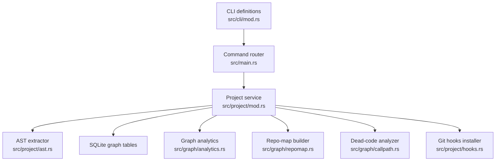
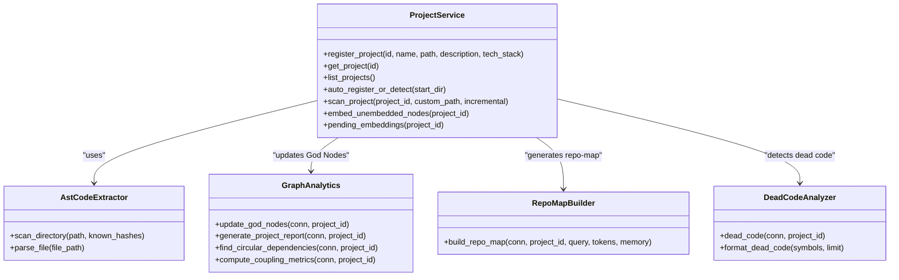
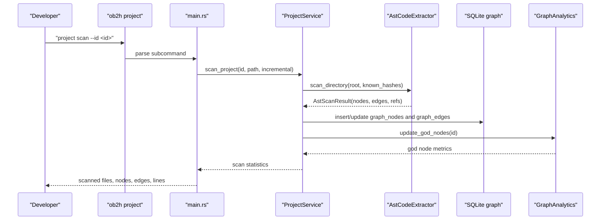
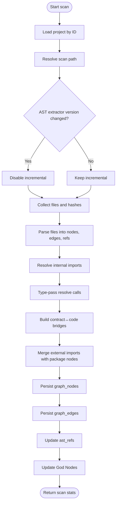
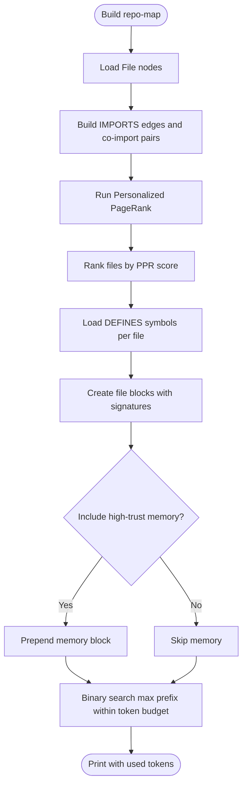
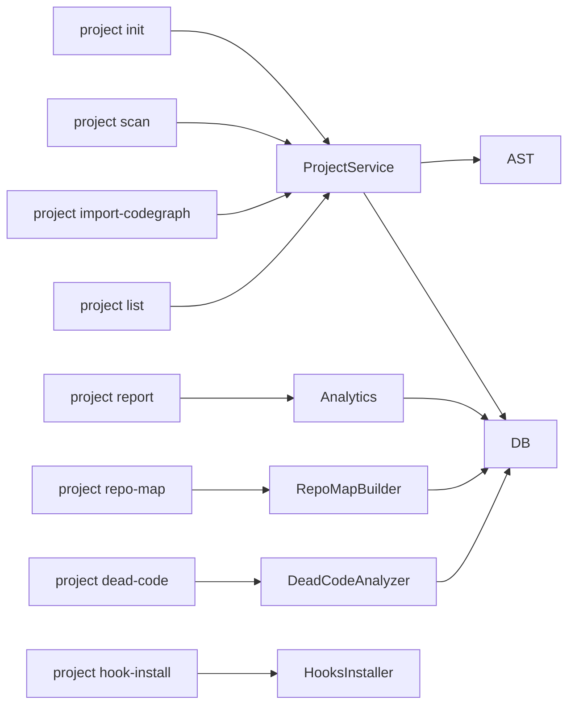

# Project Management Commands

<cite>
**Referenced Files in This Document**   
- [README.md](file://README.md)
- [main.rs](file://src/main.rs)
- [mod.rs](file://src/cli/mod.rs)
- [project_mod.rs](file://src/project/mod.rs)
- [ast.rs](file://src/project/ast.rs)
- [repomap.rs](file://src/graph/repomap.rs)
- [callpath.rs](file://src/graph/callpath.rs)
- [analytics.rs](file://src/graph/analytics.rs)
</cite>

## Table of Contents
1. [Introduction](#introduction)
2. [Project Structure](#project-structure)
3. [Core Components](#core-components)
4. [Architecture Overview](#architecture-overview)
5. [Detailed Component Analysis](#detailed-component-analysis)
6. [Dependency Analysis](#dependency-analysis)
7. [Performance Considerations](#performance-considerations)
8. [Troubleshooting Guide](#troubleshooting-guide)
9. [Conclusion](#conclusion)

## Introduction
This document explains the OB2H project management commands that register projects, scan codebases through AST parsing, import external code graphs, list projects, generate architectural digests, build token-budget-aware repository maps, detect dead code, and install Git hooks for incremental scanning. It also clarifies how projects, AST parsing, and knowledge graph building relate to each other, and provides lifecycle guidance for integrating these operations into development workflows.

The project management command group is `ob2h project`, with subcommands:
- `init` — register a project
- `scan` — AST-based codebase analysis
- `import-codegraph` — import an external CodeGraph index
- `list` — show registered projects
- `report` — generate an architectural digest
- `repo-map` — token-budget-aware file-to-symbol map
- `dead-code` — unused symbol detection
- `hook-install` — set up Git hooks for automatic incremental scans

These commands are part of the CLI entrypoint and dispatch to the project service, AST extractor, and graph analytics modules.

**Section sources**
- [README.md:263-268](file://README.md#L263-L268)
- [mod.rs:107-111](file://src/cli/mod.rs#L107-L111)
- [mod.rs:217-285](file://src/cli/mod.rs#L217-L285)
- [main.rs:464-573](file://src/main.rs#L464-L573)

## Project Structure
The project management feature spans three layers:

| Layer | Responsibility | Key files |
|---|---|---|
| CLI definition | Command names, flags, and parameter types | `src/cli/mod.rs` |
| CLI routing | Dispatching subcommands to services and printing results | `src/main.rs` |
| Domain logic | Project registration, AST scanning, graph persistence, analytics, repo-map, dead-code, hooks | `src/project/mod.rs`, `src/project/ast.rs`, `src/graph/repomap.rs`, `src/graph/callpath.rs`, `src/graph/analytics.rs` |



**Diagram sources**
- [mod.rs:217-285](file://src/cli/mod.rs#L217-L285)
- [main.rs:464-573](file://src/main.rs#L464-L573)
- [project_mod.rs:1-20](file://src/project/mod.rs#L1-L20)
- [ast.rs:1-119](file://src/project/ast.rs#L1-L119)
- [analytics.rs:90-92](file://src/graph/analytics.rs#L90-L92)
- [repomap.rs:1-18](file://src/graph/repomap.rs#L1-L18)
- [callpath.rs:1-21](file://src/graph/callpath.rs#L1-L21)

**Section sources**
- [mod.rs:217-285](file://src/cli/mod.rs#L217-L285)
- [main.rs:464-573](file://src/main.rs#L464-L573)

## Core Components
The project management system is centered on the following components:

- **Project service**: registers projects, detects roots, scans directories, persists AST nodes and edges, updates project metadata, and coordinates embedding generation.
- **AST extractor**: parses supported languages and formats, extracts symbols, imports, calls, contracts, infrastructure, and manifests, then resolves cross-file references.
- **Graph analytics**: computes God Nodes, generates project reports, finds circular dependencies, and measures component coupling.
- **Repo-map builder**: builds a compact file-to-symbol map under a token budget using PPR ranking and co-import signals.
- **Dead-code analyzer**: identifies symbols with no usage edges except framework or public API entrypoints.
- **Hooks installer**: installs Git hooks so changes trigger incremental scans.



**Diagram sources**
- [project_mod.rs:39-67](file://src/project/mod.rs#L39-L67)
- [project_mod.rs:165-214](file://src/project/mod.rs#L165-L214)
- [project_mod.rs:419-590](file://src/project/mod.rs#L419-L590)
- [ast.rs:100-119](file://src/project/ast.rs#L100-L119)
- [analytics.rs:90-92](file://src/graph/analytics.rs#L90-L92)
- [repomap.rs:126-136](file://src/graph/repomap.rs#L126-L136)
- [callpath.rs:396-446](file://src/graph/callpath.rs#L396-L446)

**Section sources**
- [project_mod.rs:39-67](file://src/project/mod.rs#L39-L67)
- [ast.rs:1-119](file://src/project/ast.rs#L1-L119)
- [analytics.rs:90-92](file://src/graph/analytics.rs#L90-L92)
- [repomap.rs:1-18](file://src/graph/repomap.rs#L1-L18)
- [callpath.rs:1-21](file://src/graph/callpath.rs#L1-L21)

## Architecture Overview
The project lifecycle flows from CLI parameters through the router into domain services, which persist deterministic AST-derived structures into the SQLite graph. After scanning, analytics update structural metrics such as God Nodes; downstream commands read those structures to produce reports, repo-maps, and dead-code lists.



**Diagram sources**
- [main.rs:483-497](file://src/main.rs#L483-L497)
- [project_mod.rs:419-590](file://src/project/mod.rs#L419-L590)
- [ast.rs:100-119](file://src/project/ast.rs#L100-L119)
- [analytics.rs:92-198](file://src/graph/analytics.rs#L92-L198)

**Section sources**
- [main.rs:483-497](file://src/main.rs#L483-L497)
- [project_mod.rs:419-590](file://src/project/mod.rs#L419-L590)

## Detailed Component Analysis

### Project Registration: `ob2h project init`
Registers or updates a project record with an ID, display name, root path, optional description, and optional tech stack. The service canonicalizes the path, stores metadata, and returns the project record.

**Parameters**
- `--id`: unique project identifier
- `--name`: human-readable project name
- `--path`: absolute or relative root directory of the codebase
- `--description`: optional project description

**Usage example**
```bash
ob2h project init --id my-app --name "My Application" --path /home/user/my-app --description "Rust backend with TS frontend"
```

**Output format**
A confirmation line including the registered project ID, name, and resolved root path.

**Lifecycle role**
Registration is the first step before scanning. It enables zero-config auto-detection when a project root matches the current working directory.

**Section sources**
- [mod.rs:217-229](file://src/cli/mod.rs#L217-L229)
- [main.rs:464-482](file://src/main.rs#L464-L482)
- [project_mod.rs:165-214](file://src/project/mod.rs#L165-L214)

### Codebase Analysis: `ob2h project scan`
Scans the project’s codebase using the AST extractor, supports incremental updates, resolves imports and calls, merges manifest dependencies, and persists nodes and edges into the graph. After scanning, it recomputes God Nodes.

**Parameters**
- `--id`: project identifier
- `--path`: optional override for the scan root
- `--full`: force full rescan instead of incremental

**Usage example**
```bash
ob2h project scan --id my-app
ob2h project scan --id my-app --path /tmp/my-app-checkout --full
```

**Processing flow**


**Diagram sources**
- [project_mod.rs:419-590](file://src/project/mod.rs#L419-L590)
- [project_mod.rs:591-800](file://src/project/mod.rs#L591-L800)
- [ast.rs:100-119](file://src/project/ast.rs#L100-L119)
- [analytics.rs:92-198](file://src/graph/analytics.rs#L92-L198)

**Output format**
A summary line showing the project ID, number of files scanned, nodes created, edges created, and total lines processed.

**Incremental behavior**
- Uses stored file hashes to skip unchanged files.
- Preserves symbols and references for unchanged files.
- Removes nodes and references for deleted files.
- Forces a full rescan when the AST extractor version changes.

**Section sources**
- [mod.rs:230-239](file://src/cli/mod.rs#L230-L239)
- [main.rs:483-497](file://src/main.rs#L483-L497)
- [project_mod.rs:419-590](file://src/project/mod.rs#L419-L590)
- [project_mod.rs:591-800](file://src/project/mod.rs#L591-L800)

### External Index Import: `ob2h project import-codegraph`
Imports nodes and edges from an external CodeGraph database into the current project’s graph. After import, it recomputes God Nodes.

**Parameters**
- `--id`: project identifier
- `--db-path`: path to the external `codegraph.db`

**Usage example**
```bash
ob2h project import-codegraph --id my-app --db-path /opt/codegraph/codegraph.db
```

**Output format**
A confirmation line showing the project ID and counts of imported nodes and edges.

**Integration note**
Use this when migrating from another static analysis tool or when you have a prebuilt code graph that should be merged into OB2H’s project graph.

**Section sources**
- [mod.rs:240-246](file://src/cli/mod.rs#L240-L246)
- [main.rs:498-508](file://src/main.rs#L498-L508)

### Project Listing: `ob2h project list`
Lists all registered projects with their IDs, names, root paths, and last scan timestamps.

**Usage example**
```bash
ob2h project list
```

**Output format**
- If no projects exist: a message instructing to use `ob2h project init`.
- Otherwise: one line per project with ID, name, root path, and last scan time.

**Section sources**
- [mod.rs:247-248](file://src/cli/mod.rs#L247-L248)
- [main.rs:509-523](file://src/main.rs#L509-L523)
- [project_mod.rs:241-267](file://src/project/mod.rs#L241-L267)

### Architectural Digest: `ob2h project report`
Generates a Markdown architectural digest including project metadata, node-type distribution, top dependencies, God Nodes, circular dependencies, component stability metrics, and dead-code candidates.

**Parameters**
- `--id`: project identifier

**Usage example**
```bash
ob2h project report --id my-app
```

**Output format**
Markdown text suitable for documentation or review. It includes:
- Project ID, root path, and technology stack
- Total nodes and edges
- Key architectural hubs (God Nodes)
- Node type counts
- Top imported modules
- Circular dependency warnings
- Component stability metrics
- Dead-code candidates

**Section sources**
- [mod.rs:249-253](file://src/cli/mod.rs#L249-L253)
- [main.rs:524-529](file://src/main.rs#L524-L529)
- [analytics.rs:200-375](file://src/graph/analytics.rs#L200-L375)

### Token-Budget Repository Map: `ob2h project repo-map`
Builds a compact repository map mapping files to symbols with signatures, ranked by Personalized PageRank over a file-dependency graph. It respects a token budget and can optionally include high-trust project memory.

**Parameters**
- `--id`: project identifier
- `--tokens`: token budget (default 4096)
- `--query`: optional focus query to seed PPR with matching files
- `--memory`: include high-trust project memory at the beginning of the map

**Usage example**
```bash
ob2h project repo-map --id my-app --tokens 4096
ob2h project repo-map --id my-app --query auth --memory
```

**Algorithm overview**


**Diagram sources**
- [repomap.rs:126-325](file://src/graph/repomap.rs#L126-L325)
- [repomap.rs:327-345](file://src/graph/repomap.rs#L327-L345)

**Output format**
A structured `<repo_map>` block containing:
- Project ID
- Ranked files with symbol signatures
- Optional high-trust memory section
- Budget usage indicator

**Section sources**
- [mod.rs:254-267](file://src/cli/mod.rs#L254-L267)
- [main.rs:530-546](file://src/main.rs#L530-L546)
- [repomap.rs:1-18](file://src/graph/repomap.rs#L1-L18)
- [repomap.rs:126-325](file://src/graph/repomap.rs#L126-L325)

### Unused Symbol Detection: `ob2h project dead-code`
Identifies candidate dead code by finding symbols with no incoming usage edges, excluding entrypoints such as main functions, test code, public APIs, lifecycle methods, and framework-decorated symbols.

**Parameters**
- `--id`: project identifier
- `--limit`: maximum number of results to print (default 50)

**Usage example**
```bash
ob2h project dead-code --id my-app --limit 100
```

**Detection rules**
- Usage edges considered: CALLS, IMPORTS, IMPLEMENTS, DEPENDS_ON.
- Symbol types considered: Function, Struct, Class, Interface, Trait, Method.
- Entry points excluded: main-like functions, migrations, tests, public API markers, Pydantic/dataclass models, framework decorators.

**Output format**
A Markdown-style list of dead-code candidates with location, label, and symbol type.

**Section sources**
- [mod.rs:268-275](file://src/cli/mod.rs#L268-L275)
- [main.rs:547-552](file://src/main.rs#L547-L552)
- [callpath.rs:12-36](file://src/graph/callpath.rs#L12-L36)
- [callpath.rs:396-446](file://src/graph/callpath.rs#L396-L446)
- [callpath.rs:482-503](file://src/graph/callpath.rs#L482-L503)

### Git Hooks Setup: `ob2h project hook-install`
Installs Git hooks in a repository so that file changes trigger automatic incremental scans. It can target a specific repository path and either use an explicit project ID or auto-detect/register the project.

**Parameters**
- `--path`: optional repository path (defaults to current directory)
- `--id`: optional project ID (auto-detected if omitted)

**Usage example**
```bash
ob2h project hook-install --path /home/user/my-app --id my-app
ob2h project hook-install
```

**Behavior**
- Resolves the repository root.
- Auto-registers or detects the project if no ID is provided.
- Installs hooks and prints the installed hook targets.

**Section sources**
- [mod.rs:276-284](file://src/cli/mod.rs#L276-L284)
- [main.rs:553-573](file://src/main.rs#L553-L573)
- [project_mod.rs:1-19](file://src/project/mod.rs#L1-L19)

## Dependency Analysis
The project management commands depend on shared graph tables and analytical utilities. The following diagram shows how commands route to services and how services depend on lower-level modules.



**Diagram sources**
- [main.rs:464-573](file://src/main.rs#L464-L573)
- [project_mod.rs:1-20](file://src/project/mod.rs#L1-L20)
- [analytics.rs:90-92](file://src/graph/analytics.rs#L90-L92)
- [repomap.rs:126-136](file://src/graph/repomap.rs#L126-L136)
- [callpath.rs:396-446](file://src/graph/callpath.rs#L396-L446)

**Section sources**
- [main.rs:464-573](file://src/main.rs#L464-L573)

## Performance Considerations
- Incremental scanning reduces work by comparing file hashes and preserving unchanged symbols and references.
- AST extraction is deterministic and local, avoiding LLM costs during scanning.
- Repo-map uses binary search over sorted blocks to fit within a token budget efficiently.
- God Node computation excludes infrastructure hubs like external packages, base images, and CSS classes to keep architectural signals meaningful.
- Dead-code detection limits traversal depth and focuses on symbol types that represent real code constructs.

[No sources needed since this section provides general guidance]

## Troubleshooting Guide
Common issues and resolutions:

| Issue | Likely cause | Resolution |
|---|---|---|
| `project init` fails with path error | Root path does not exist or cannot be canonicalized | Verify the path exists and is accessible |
| `project scan` reports no changes | Incremental scan found no modified files | Use `--full` to force a complete rescan |
| `project scan` forces full rescan unexpectedly | AST extractor version changed | Accept the full rescan; it ensures consistency |
| `project report` shows few God Nodes | Graph has few edges or only infrastructure nodes | Run `project scan` and ensure imports and calls are resolved |
| `project repo-map` output is empty or minimal | No scanned files or token budget too small | Run `project scan` and increase `--tokens` |
| `project dead-code` misses expected symbols | Symbols are entrypoints or not in supported symbol types | Review entrypoint rules and symbol types |
| `project hook-install` does not trigger scans | Hooks not installed or wrong repository path | Re-run with explicit `--path` and verify `.git/hooks` |

**Section sources**
- [project_mod.rs:419-443](file://src/project/mod.rs#L419-L443)
- [project_mod.rs:445-465](file://src/project/mod.rs#L445-L465)
- [repomap.rs:136-142](file://src/graph/repomap.rs#L136-L142)
- [callpath.rs:313-394](file://src/graph/callpath.rs#L313-L394)

## Conclusion
OB2H’s project management commands provide a complete lifecycle for registering projects, analyzing codebases through AST parsing, importing external graphs, listing projects, generating architectural digests, building token-budget-aware repository maps, detecting dead code, and installing Git hooks for incremental updates. The design keeps scanning deterministic and local, persists structured AST-derived nodes and edges into SQLite, and exposes analytical tools that help developers understand architecture, risk, and maintenance needs. Integrating these commands into CI, IDE workflows, and manual development processes ensures the knowledge graph stays current and useful.

[No sources needed since this section summarizes without analyzing specific files]