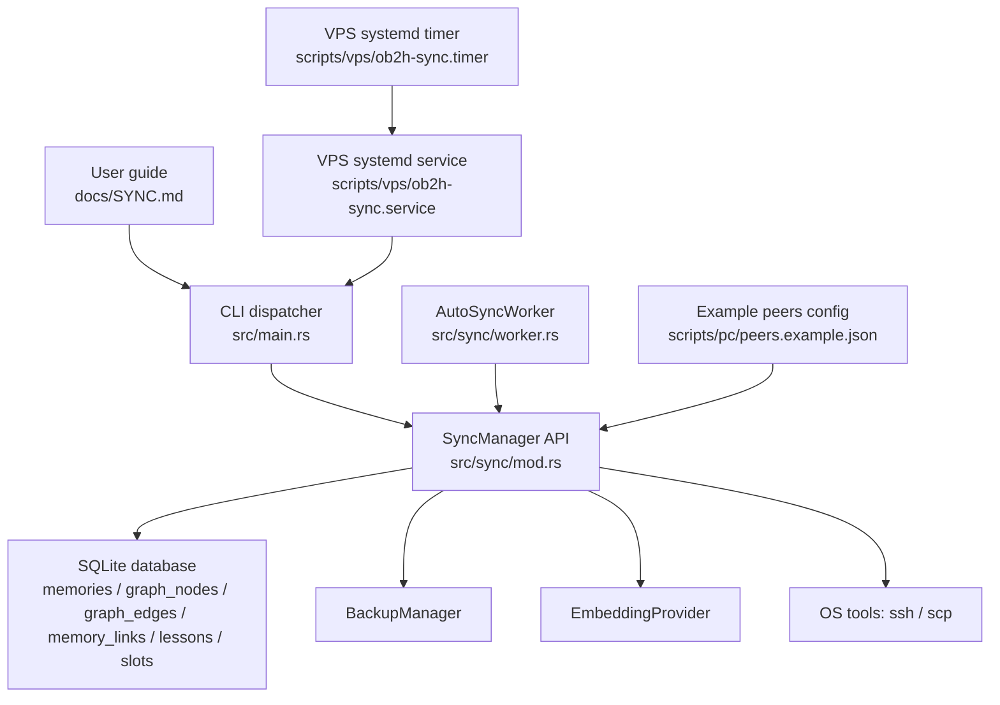
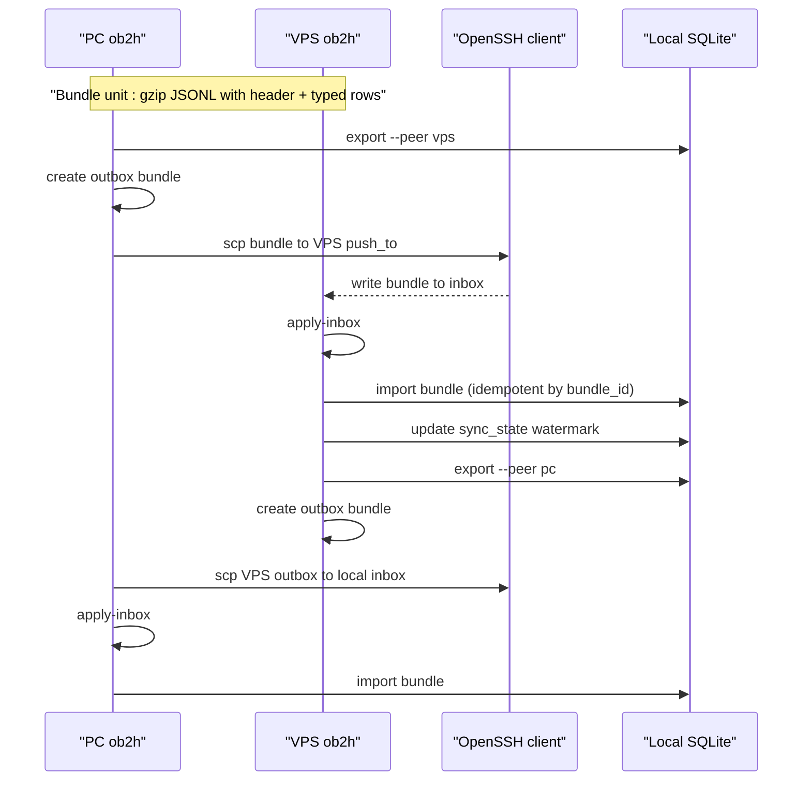
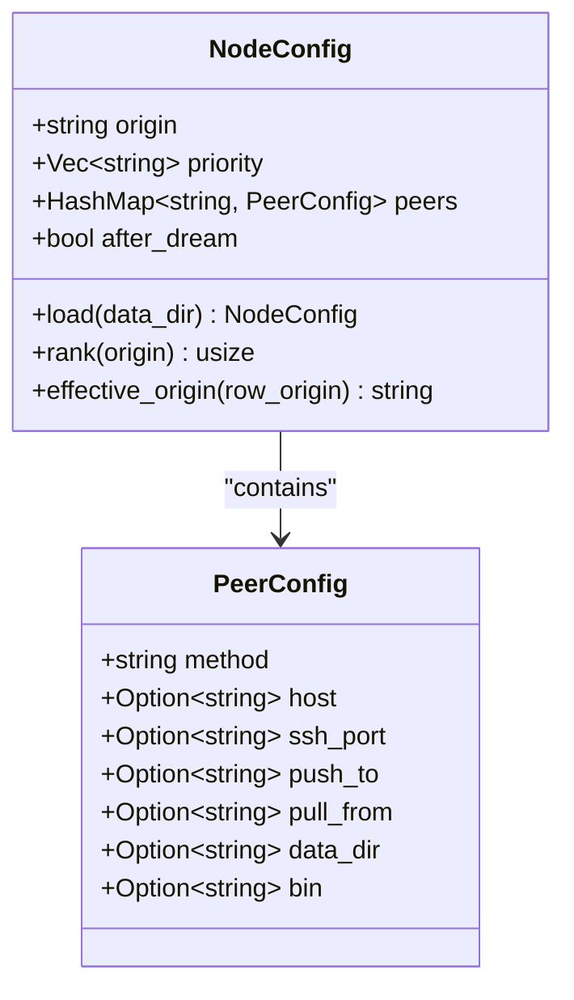
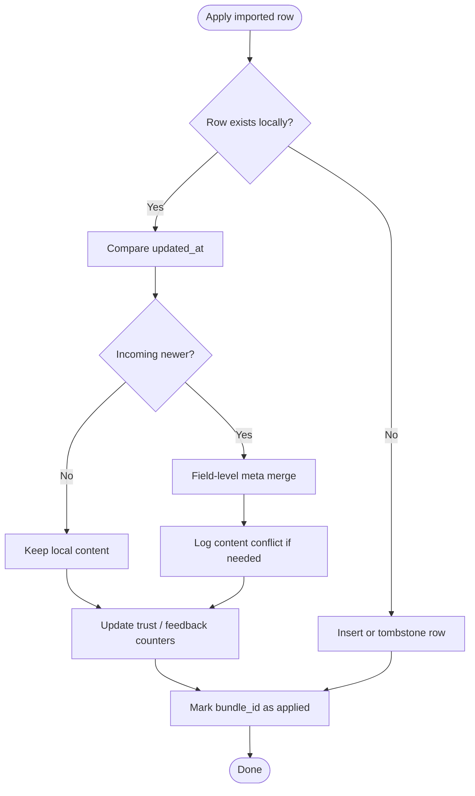
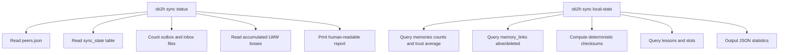
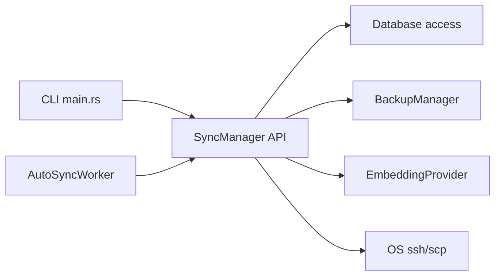

# Synchronization Commands

<cite>
**Referenced Files in This Document**
- [main.rs](file://src/main.rs)
- [mod.rs](file://src/sync/mod.rs)
- [worker.rs](file://src/sync/worker.rs)
- [SYNC.md](file://docs/SYNC.md)
- [peers.example.json](file://scripts/pc/peers.example.json)
- [ob2h-sync.service](file://scripts/vps/ob2h-sync.service)
- [ob2h-sync.timer](file://scripts/vps/ob2h-sync.timer)
</cite>

## Table of Contents
1. [Introduction](#introduction)
2. [Project Structure](#project-structure)
3. [Core Components](#core-components)
4. [Architecture Overview](#architecture-overview)
5. [Detailed Component Analysis](#detailed-component-analysis)
6. [Dependency Analysis](#dependency-analysis)
7. [Performance Considerations](#performance-considerations)
8. [Troubleshooting Guide](#troubleshooting-guide)
9. [Conclusion](#conclusion)
10. [Appendices](#appendices)

## Introduction
This document explains the OB2H synchronization commands that keep two OB2H instances consistent across machines, such as a local PC and a remote VPS. It covers all sync subcommands, peer configuration, bundle formats, SSH authentication, conflict resolution, practical PC-to-VPS setups, connectivity troubleshooting, and monitoring health.

The synchronization mechanism is file-based: bundles are transferred between machines rather than live databases. Each machine maintains its own SQLite database; only incremental data deltas are moved through `data/sync/outbox` and `data/sync/inbox`.

## Project Structure
The synchronization feature is implemented primarily in the sync module and wired into the CLI entry point. Supporting documentation and deployment scripts are provided separately.

**Diagram sources**
- [main.rs:268-318](file://src/main.rs#L268-L318)
- [mod.rs:196-229](file://src/sync/mod.rs#L196-L229)
- [worker.rs:9-63](file://src/sync/worker.rs#L9-L63)
- [SYNC.md:32-57](file://docs/SYNC.md#L32-L57)
- [peers.example.json:1-14](file://scripts/pc/peers.example.json#L1-L14)
- [ob2h-sync.service:1-10](file://scripts/vps/ob2h-sync.service#L1-L10)
- [ob2h-sync.timer:1-10](file://scripts/vps/ob2h-sync.timer#L1-L10)

**Section sources**
- [main.rs:268-318](file://src/main.rs#L268-L318)
- [mod.rs:196-229](file://src/sync/mod.rs#L196-L229)
- [worker.rs:9-63](file://src/sync/worker.rs#L9-L63)
- [SYNC.md:32-57](file://docs/SYNC.md#L32-L57)
- [peers.example.json:1-14](file://scripts/pc/peers.example.json#L1-L14)
- [ob2h-sync.service:1-10](file://scripts/vps/ob2h-sync.service#L1-L10)
- [ob2h-sync.timer:1-10](file://scripts/vps/ob2h-sync.timer#L1-L10)

## Core Components
- **SyncManager**: central object for exporting, importing, pushing, pulling, verifying, and reporting sync state.
- **NodeConfig**: parsed from `data/sync/peers.json`; defines origin, priority, peer connections, and automatic sync behavior.
- **PeerConfig**: per-peer transport settings (SSH or manual), host, ports, and directory paths.
- **ImportStats**: counters for applied records, conflicts, and idempotency flags.
- **AutoSyncWorker**: background worker that periodically pushes and pulls configured SSH peers.

Key responsibilities:
- Export delta bundles based on per-peer watermarks.
- Import bundles with LWW conflict resolution and optional field-level metadata merge.
- Transfer bundles via SSH using `scp`.
- Apply inbox bundles automatically.
- Compare local and remote statistics without moving data.
- Report human-readable status and JSON statistics.

**Section sources**
- [mod.rs:33-105](file://src/sync/mod.rs#L33-L105)
- [mod.rs:109-125](file://src/sync/mod.rs#L109-L125)
- [mod.rs:196-229](file://src/sync/mod.rs#L196-L229)
- [worker.rs:9-63](file://src/sync/worker.rs#L9-L63)

## Architecture Overview
The typical PC-to-VPS flow uses the PC as the initiator because it may be behind NAT. The VPS applies incoming bundles and prepares outgoing bundles on schedule.

**Diagram sources**
- [SYNC.md:32-57](file://docs/SYNC.md#L32-L57)
- [mod.rs:253-469](file://src/sync/mod.rs#L253-L469)
- [mod.rs:1501-1574](file://src/sync/mod.rs#L1501-L1574)

## Detailed Component Analysis

### Peer Configuration
Peer configuration lives in `data/sync/peers.json`. It controls:
- Machine identity (`origin`)
- Conflict tie-break order (`priority`)
- Automatic sync after auto-dreams (`after_dream`)
- Per-peer transport and directories

**Diagram sources**
- [mod.rs:33-105](file://src/sync/mod.rs#L33-L105)

Configuration fields:
- `method`: `ssh` for automatic SCP transfer, or `manual` for manual bundle movement.
- `host`: SSH alias or `user@host`, typically defined in `~/.ssh/config`.
- `ssh_port`: optional port override when not defined in SSH config.
- `push_to`: remote directory where this machine’s bundles are placed.
- `pull_from`: remote directory from which this machine retrieves other bundles.
- `data_dir` and `bin`: used by `sync verify` to run remote statistics collection.

Example peer configuration:
- See [peers.example.json:1-14](file://scripts/pc/peers.example.json#L1-L14).

**Section sources**
- [mod.rs:33-105](file://src/sync/mod.rs#L33-L105)
- [peers.example.json:1-14](file://scripts/pc/peers.example.json#L1-L14)
- [SYNC.md:100-137](file://docs/SYNC.md#L100-L137)

### Bundle Format
A bundle is a compressed JSON Lines payload with a header line followed by typed rows.

Header fields include:
- `type`: always `bundle`
- `bundle_id`: unique identifier for idempotent imports
- `origin`: machine identity
- `peer`: target peer name
- `created_at`: creation timestamp
- `version`: bundle format version
- `full`: whether this is a full export or a delta
- `from` and `to`: watermark range
- `counts`: counts per row type

Supported row types:
- `proj`: project metadata
- `node`: knowledge graph nodes
- `edge`: knowledge graph edges
- `mem`: memory facts
- `mlink`: typed memory links
- `lesson`: lifecycle lessons
- `slot`: lifecycle slots

Optional end-to-end encryption:
- If `OB2H_SYNC_KEY` is set, bundles are wrapped in an encrypted container before compression.
- Decryption requires the same environment variable during import.

Watermarking:
- Exports use per-peer `last_export_at` as a cursor.
- Full exports ignore the cursor but still advance the watermark afterward.

Idempotency:
- Imported bundles are tracked by `bundle_id`. Re-importing the same bundle is a no-op.

**Section sources**
- [mod.rs:253-469](file://src/sync/mod.rs#L253-L469)
- [mod.rs:509-733](file://src/sync/mod.rs#L509-L733)
- [mod.rs:127-192](file://src/sync/mod.rs#L127-L192)
- [SYNC.md:49-67](file://docs/SYNC.md#L49-L67)
- [SYNC.md:257-276](file://docs/SYNC.md#L257-L276)

### Conflict Resolution
Conflict resolution ensures deterministic merging when both machines edit the same record.

Rules:
- Content conflicts use later-write-wins based on `updated_at`.
- When timestamps are equal, the machine earlier in `priority` wins.
- Metadata merges at the field level:
  - `meta` is deep merged with incoming keys winning.
  - `access_count` takes the maximum of local and incoming.
  - `trust` and feedback metrics are combined according to implementation rules.
- Tombstones (`deleted_at`) hide deleted records everywhere; re-saving the same key restores it.
- Conflicts are logged to `data/sync/conflicts.jsonl`.
- Optional preservation of losing versions is controlled by `OB2H_SYNC_KEEP_LOSERS=1`.

**Diagram sources**
- [mod.rs:747-754](file://src/sync/mod.rs#L747-L754)
- [mod.rs:757-800](file://src/sync/mod.rs#L757-L800)
- [mod.rs:688-724](file://src/sync/mod.rs#L688-L724)
- [SYNC.md:58-67](file://docs/SYNC.md#L58-L67)

**Section sources**
- [mod.rs:747-754](file://src/sync/mod.rs#L747-L754)
- [mod.rs:757-800](file://src/sync/mod.rs#L757-L800)
- [mod.rs:688-724](file://src/sync/mod.rs#L688-L724)
- [SYNC.md:58-67](file://docs/SYNC.md#L58-L67)

### SSH Authentication Setup
SSH-based transfer relies on the system’s OpenSSH client and standard SSH configuration.

Requirements:
- `ssh` and `scp` must be available on PATH.
- Passwordless SSH access from the initiating machine to the peer should work.
- Use `~/.ssh/config` for aliases, keys, and ports.

Verification steps:
- Test SSH connectivity with a simple command.
- Confirm SCP can copy files to the remote path.

Transport details:
- `push` exports a bundle and copies it to the peer’s `push_to` directory.
- `pull` copies all matching bundles from the peer’s `pull_from` directory into the local inbox and applies them.
- `verify` runs a remote command via SSH to collect peer statistics.

**Section sources**
- [SYNC.md:81-98](file://docs/SYNC.md#L81-L98)
- [mod.rs:1519-1574](file://src/sync/mod.rs#L1519-L1574)
- [mod.rs:1722-1755](file://src/sync/mod.rs#L1722-L1755)

### Practical PC-to-VPS Setup
Recommended workflow:
1. Configure SSH access from PC to VPS.
2. Create `data/sync/peers.json` on PC with the VPS peer.
3. Create minimal `data/sync/peers.json` on VPS with its own origin.
4. Create required inbox/outbox directories on VPS.
5. Set up scheduling:
   - On VPS, enable the systemd timer and service.
   - On PC, optionally register a scheduled task or rely on `after_dream`.
6. Perform the first exchange manually.

Manual first exchange:
- PC: export and push to VPS.
- VPS: apply inbox and export back to PC.
- PC: pull VPS bundles and apply.
- Verify status and consistency.

Automated operation:
- VPS timer runs daily to apply inbox and prepare outbox.
- PC can trigger sync after auto-dreams or via scheduled tasks.

**Section sources**
- [SYNC.md:76-175](file://docs/SYNC.md#L76-L175)
- [ob2h-sync.service:1-10](file://scripts/vps/ob2h-sync.service#L1-L10)
- [ob2h-sync.timer:1-10](file://scripts/vps/ob2h-sync.timer#L1-L10)
- [peers.example.json:1-14](file://scripts/pc/peers.example.json#L1-L14)

### Monitoring Sync Health
Two primary monitoring approaches:

- Human-readable status:
  - Shows origin, priority, peers, watermarks, last export/import times, and bundle counts.
  - Includes accumulated LWW conflict loss counter.

- JSON statistics:
  - Provides counts and checksums for memories, links, lessons, and slots.
  - Used by `sync verify` to compare local and remote state without transferring data.

**Diagram sources**
- [mod.rs:1803-1880](file://src/sync/mod.rs#L1803-L1880)
- [mod.rs:1602-1719](file://src/sync/mod.rs#L1602-L1719)

**Section sources**
- [mod.rs:1803-1880](file://src/sync/mod.rs#L1803-L1880)
- [mod.rs:1602-1719](file://src/sync/mod.rs#L1602-L1719)

## Dependency Analysis
The sync subsystem depends on several core components:

Coupling and cohesion:
- `SyncManager` encapsulates most sync logic, keeping CLI thin.
- Background worker coordinates periodic operations without duplicating business logic.
- External dependencies are limited to filesystem, SQLite, and OS SSH tools.

Potential circular dependencies:
- None observed within the sync module; dependencies are unidirectional toward infrastructure services.

External integration points:
- SSH client for remote execution and file transfer.
- Backup manager for pre-import snapshots.
- Embedding provider for recomputing missing embeddings during import.

**Diagram sources**
- [main.rs:268-318](file://src/main.rs#L268-L318)
- [mod.rs:196-229](file://src/sync/mod.rs#L196-L229)
- [worker.rs:9-63](file://src/sync/worker.rs#L9-L63)

**Section sources**
- [main.rs:268-318](file://src/main.rs#L268-L318)
- [mod.rs:196-229](file://src/sync/mod.rs#L196-L229)
- [worker.rs:9-63](file://src/sync/worker.rs#L9-L63)

## Performance Considerations
- Incremental exports reduce transfer volume by using per-peer watermarks.
- Full exports are useful for resynchronization or initial setup.
- Bundle import is transactional: either fully applied or rolled back.
- Missing embeddings are recomputed locally during import to avoid breaking search.
- Applied bundle IDs are retained with a bounded history to prevent unbounded growth.
- Conflict journaling is append-only and written after successful import.

Recommendations:
- Prefer delta exports for routine syncs.
- Use full exports when resetting drift or recovering from corruption.
- Ensure time synchronization across machines to avoid unnecessary LWW conflicts.
- Monitor accumulated LWW losses and drift reports regularly.

[No sources needed since this section provides general guidance]

## Troubleshooting Guide
Common issues and resolutions:

- Remote destination open failure:
  - Cause: remote `push_to` directory does not exist.
  - Resolution: create the directory on the remote machine.

- Peer not found:
  - Cause: misspelled peer name or missing `peers.json`.
  - Resolution: ensure correct peer name and valid configuration file.

- Push/pull appears silent:
  - Cause: automatic sync disabled and no scheduler running.
  - Resolution: run commands manually or configure scheduling.

- Conflict count increases:
  - Cause: local edits older than incoming edits.
  - Resolution: expected under LWW; check timestamps and NTP.

- Same fact moves between machines:
  - Cause: inconsistent clocks.
  - Resolution: synchronize time across machines.

- Bundle not applied repeatedly:
  - Cause: idempotency by `bundle_id`.
  - Resolution: this is intentional; do not reimport unless you need recovery.

- Sync disabled due to bad configuration:
  - Cause: invalid `peers.json`.
  - Resolution: fix JSON syntax errors.

Connectivity checks:
- Validate SSH and SCP reachability.
- Confirm remote directories exist and are writable.
- For `verify`, ensure `data_dir` and binary path are configured correctly.

**Section sources**
- [SYNC.md:211-221](file://docs/SYNC.md#L211-L221)
- [mod.rs:1538-1574](file://src/sync/mod.rs#L1538-L1574)
- [mod.rs:1722-1755](file://src/sync/mod.rs#L1722-L1755)

## Conclusion
OB2H synchronization provides reliable cross-machine data consistency through file-based bundles, SSH transport, and deterministic conflict resolution. The CLI exposes clear subcommands for inspection, export, import, automated inbox processing, transfer, verification, and statistics. With proper peer configuration, SSH setup, and scheduling, PC-to-VPS synchronization becomes predictable and maintainable.

[No sources needed since this section summarizes without analyzing specific files]

## Appendices

### Sync Subcommand Reference
- `status`: prints origin, priority, peers, watermarks, last export/import timestamps, bundle counts, and accumulated LWW conflict losses.
- `export --peer <name>`: writes delta bundles to `data/sync/outbox`; use `--full` for complete bundles.
- `import <files...>`: applies one or more bundles with idempotency and conflict logging.
- `apply-inbox`: applies all bundles in `data/sync/inbox`.
- `push --peer <name>`: exports and transfers bundles to the peer via SSH.
- `pull --peer <name>`: retrieves bundles from the peer via SSH and applies them.
- `verify [--peer <name>]`: compares local and remote statistics without transferring data.
- `local-stats`: outputs JSON statistics including counts and checksums.

**Section sources**
- [main.rs:268-318](file://src/main.rs#L268-L318)
- [mod.rs:1501-1574](file://src/sync/mod.rs#L1501-L1574)
- [mod.rs:1602-1719](file://src/sync/mod.rs#L1602-L1719)
- [mod.rs:1722-1800](file://src/sync/mod.rs#L1722-L1800)
- [mod.rs:1803-1880](file://src/sync/mod.rs#L1803-L1880)