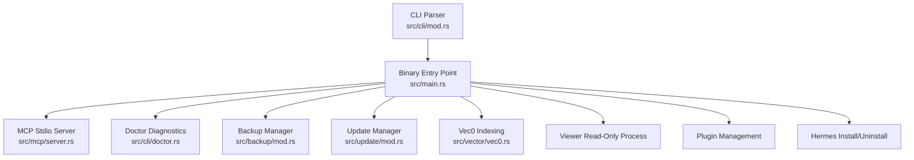
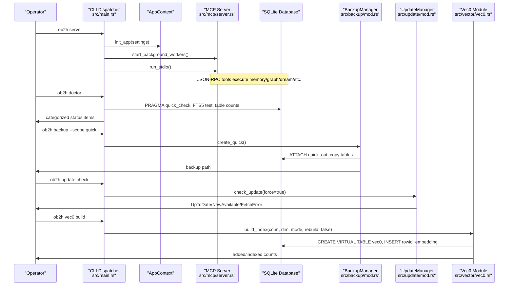
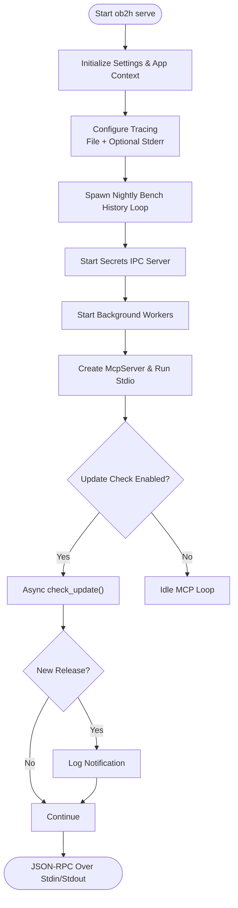
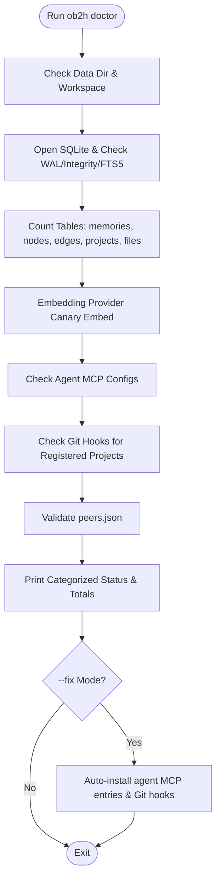
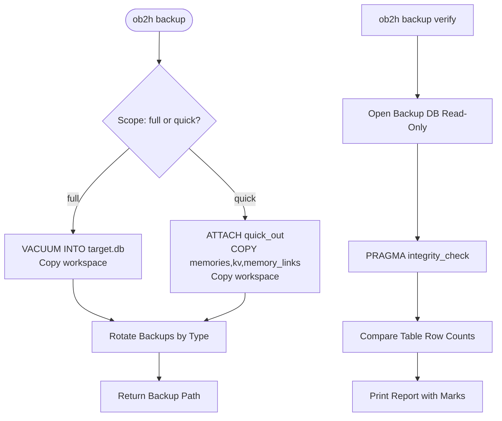
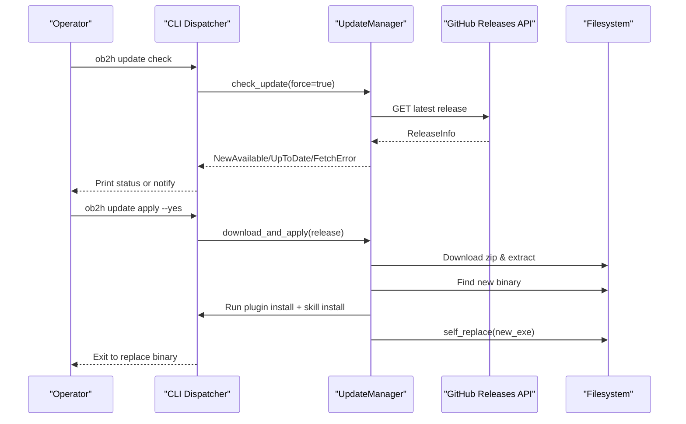
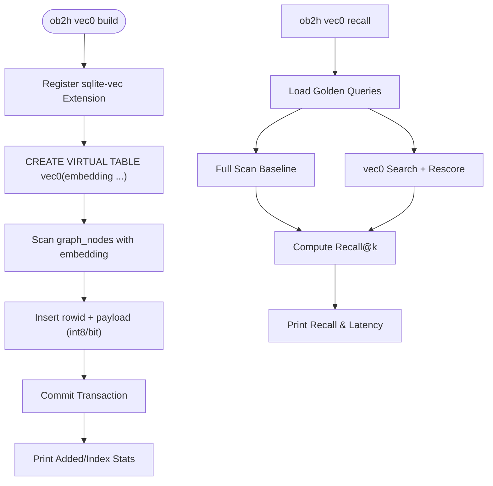
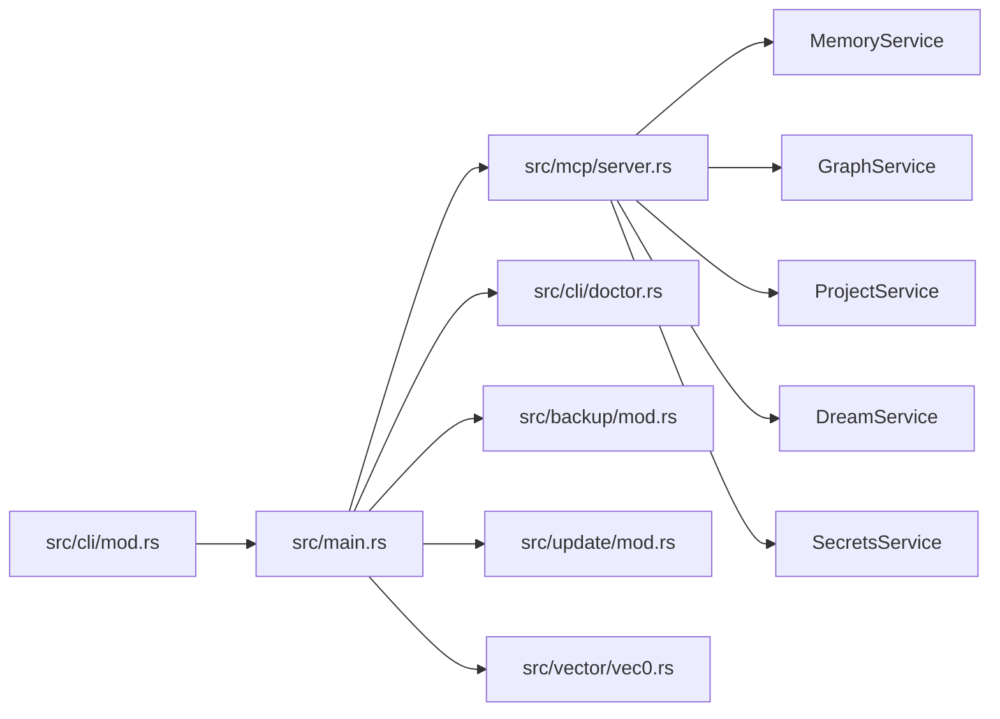

# System Utilities

<cite>
**Referenced Files in This Document**   
- [README.md](file://README.md)
- [main.rs](file://src/main.rs)
- [mod.rs](file://src/cli/mod.rs)
- [doctor.rs](file://src/cli/doctor.rs)
- [mod.rs](file://src/backup/mod.rs)
- [server.rs](file://src/mcp/server.rs)
- [mod.rs](file://src/update/mod.rs)
- [vec0.rs](file://src/vector/vec0.rs)
</cite>

## Table of Contents
1. [Introduction](#introduction)
2. [Project Structure](#project-structure)
3. [Core Components](#core-components)
4. [Architecture Overview](#architecture-overview)
5. [Detailed Component Analysis](#detailed-component-analysis)
6. [Dependency Analysis](#dependency-analysis)
7. [Performance Considerations](#performance-considerations)
8. [Troubleshooting Guide](#troubleshooting-guide)
9. [Conclusion](#conclusion)

## Introduction
This document explains the OB2H system utility commands used for diagnostics, monitoring, maintenance, and integration. It focuses on:

- `serve`: MCP stdio server startup and background update checks.
- `doctor`: environment, database, embedding provider, agent integrations, Git hooks, sync configuration, and auto-fix behavior.
- `backup`: full and quick backup creation, rotation, and verification.
- `stats`: storage statistics via the MCP tool layer.
- `viewer`: read-only GUI data inspection process.
- `install` / `uninstall`: Hermes integration setup and removal.
- `plugin`: MemoryProvider plugin management for Hermes.
- `update`: GitHub releases integration for checking and applying updates.
- `vec0`: experimental vector indexing over graph nodes with recall evaluation.

The goal is to help operators understand diagnostic outputs, backup strategies, monitoring approaches, and system health assessment procedures without needing to read source code directly.

## Project Structure
OB2H exposes a single CLI binary whose command tree is defined centrally. The main entry point initializes application context, logging, optional background workers, and then dispatches to subcommands. Many operational commands (`stats`, `dream`, `lessons`, `audit`, `ralph`, `secrets`) are thin wrappers around MCP tools or services initialized through the shared application context.

**Diagram sources**
- [mod.rs:16-147](file://src/cli/mod.rs#L16-L147)
- [main.rs:17-585](file://src/main.rs#L17-L585)
- [server.rs:138-206](file://src/mcp/server.rs#L138-L206)
- [doctor.rs:61-167](file://src/cli/doctor.rs#L61-L167)
- [mod.rs:23-70](file://src/backup/mod.rs#L23-L70)
- [mod.rs:210-381](file://src/update/mod.rs#L210-L381)
- [vec0.rs:170-248](file://src/vector/vec0.rs#L170-L248)

**Section sources**
- [mod.rs:16-147](file://src/cli/mod.rs#L16-L147)
- [main.rs:17-585](file://src/main.rs#L17-L585)

## Core Components
This section summarizes the core utility commands and their responsibilities.

| Command | Purpose | Key Behaviors | Typical Outputs |
|---|---|---|---|
| `ob2h serve` | Start MCP stdio server | Initializes app context, optional background workers, IPC secrets server, nightly bench loop, daily update check; runs JSON-RPC over stdin/stdout | Logs, MCP tool responses, update notifications |
| `ob2h doctor [--fix]` | Deep diagnostics | Checks directories, SQLite integrity/WAL/FTS5, embeddings provider, AI agents (Claude, Cursor, Windsurf, Gemini/Antigravity, Hermes, Qwen, OpenCode, DSH), Git hooks, sync peers; can auto-fix agent configs and hooks | Categorized status items with OK/Warn/Error symbols and details |
| `ob2h backup [--scope full\|quick] [--verify <path>]` | Create or verify backups | Full uses VACUUM INTO + workspace copy; quick copies memories/kv/memory_links + workspace; rotate keeps separate counts for full/quick; verify opens backup read-only and compares table row counts | Backup path, verification report with integrity and per-table counts |
| `ob2h stats` | Storage statistics | Calls MCP tool `omnes_stats` | Tool output summarizing memory/graph/project metrics |
| `ob2h viewer [--data-dir]` | GUI-based read-only inspection | Runs as separate process before init_app; no migrations, no DB writes; lockfile prevents multiple instances | Native window with tabs for memory, graph, sessions, lessons, slots, secrets, stats |
| `ob2h install` | Register OB2H in Hermes | Writes ob2h.json with binary/data_dir paths, suggests enabling `provider: ob2h` | Installation path and config instructions |
| `ob2h uninstall` | Remove Hermes registration | Removes ob2h.json entries and plugin directory if present | Removal confirmation |
| `ob2h plugin {install\|uninstall\|status}` | Manage MemoryProvider plugin | Installs plugin files into `$HERMES_HOME/plugins/ob2h`; updates ob2h.json paths; checks presence and active provider | Plugin path, status, next steps |
| `ob2h update {check\|status\|apply [--yes]}` | GitHub releases integration | Checks latest release using configured repo/channel; notifies user; applies by downloading zip, unpacking, self-replace, re-running plugin/skill install | Version info, availability, apply progress |
| `ob2h vec0 {build\|stats\|recall}` | Experimental vector indexing | Builds sqlite-vec index over graph_nodes; reports indexed vs total nodes; evaluates recall@k against brute-force baseline | Indexed counts, recall score, latency comparison |

**Section sources**
- [main.rs:62-585](file://src/main.rs#L62-L585)
- [mod.rs:23-147](file://src/cli/mod.rs#L23-L147)

## Architecture Overview
The CLI is the orchestrator. For most operations it constructs an application context containing settings, database connection, embedding provider, memory service, workspace, git store, LLM client, consolidator, graph service, project service, dream service, backup manager, sync manager, Ralph service, secrets service, lessons/slots lifecycle services, and watcher. Commands either call into these services directly or invoke MCP tools.

**Diagram sources**
- [main.rs:62-585](file://src/main.rs#L62-L585)
- [server.rs:138-206](file://src/mcp/server.rs#L138-L206)
- [mod.rs:23-70](file://src/backup/mod.rs#L23-L70)
- [mod.rs:210-381](file://src/update/mod.rs#L210-L381)
- [vec0.rs:170-248](file://src/vector/vec0.rs#L170-L248)

## Detailed Component Analysis

### `serve` — MCP stdio server startup
`serve` is the default behavior when no subcommand is provided. It:

- Initializes application settings and ensures required directories exist.
- Configures tracing: file logging always, stderr only outside stdio mode.
- Spawns nightly benchmark history loop.
- Starts IPC secrets server.
- Starts background workers.
- Creates MCP server instance and runs stdio loop.
- Optionally performs non-blocking update check at startup and logs notification.

**Diagram sources**
- [main.rs:17-90](file://src/main.rs#L17-L90)
- [server.rs:138-206](file://src/mcp/server.rs#L138-L206)

Operational notes:
- In stdio mode, logs go to file only; stderr is reserved for MCP protocol messages.
- Update checks do not block server startup; they run asynchronously.
- If update is enabled and a new version is found, a user-facing message is emitted.

**Section sources**
- [main.rs:17-90](file://src/main.rs#L17-L90)
- [server.rs:138-206](file://src/mcp/server.rs#L138-L206)

### `doctor` — Environment and dependency diagnostics with auto-fix
`doctor` performs a comprehensive health check across filesystem, database, embeddings, agents, Git hooks, and sync configuration. With `--fix`, it attempts to repair common misconfigurations such as missing MCP entries in agent configs and absent Git hooks.

Key checks:
- Data directory and workspace existence.
- SQLite file presence, WAL journal mode, integrity check, FTS5 trigram search.
- Table counters for memories, graph nodes, edges, projects, and project files.
- Embedding provider canary embed and backend detection.
- Agent MCP configurations: Claude, Cursor, Windsurf, Gemini/Antigravity, Hermes, Qwen Code, OpenCode, DSH.
- Git hooks installed for registered projects.
- Sync peers configuration validity.

**Diagram sources**
- [doctor.rs:61-167](file://src/cli/doctor.rs#L61-L167)
- [doctor.rs:170-326](file://src/cli/doctor.rs#L170-L326)
- [doctor.rs:328-388](file://src/cli/doctor.rs#L328-L388)
- [doctor.rs:390-564](file://src/cli/doctor.rs#L390-L564)
- [doctor.rs:566-653](file://src/cli/doctor.rs#L566-L653)
- [doctor.rs:668-703](file://src/cli/doctor.rs#L668-L703)

Diagnostic output interpretation:
- Each item has category, name, status symbol (OK/Warn/Error), and details.
- Errors indicate critical issues (e.g., DB open failure, FTS5 error).
- Warnings suggest improvements (e.g., missing workspace, fake embedding backend, missing agent MCP entry).
- Summary prints totals and suggests running `ob2h doctor --fix`.

Auto-fix capabilities:
- Adds MCP entries for supported agents if missing.
- Installs Git hooks for registered projects.
- Does not modify arbitrary user files beyond documented locations.

**Section sources**
- [doctor.rs:61-167](file://src/cli/doctor.rs#L61-L167)
- [doctor.rs:170-326](file://src/cli/doctor.rs#L170-L326)
- [doctor.rs:328-388](file://src/cli/doctor.rs#L328-L388)
- [doctor.rs:390-564](file://src/cli/doctor.rs#L390-L564)
- [doctor.rs:566-653](file://src/cli/doctor.rs#L566-L653)
- [doctor.rs:668-703](file://src/cli/doctor.rs#L668-L703)

### `backup` — Full/Quick Backup Creation and Verification
Backup strategy supports two modes:

- Full backup: atomic snapshot of live database using `VACUUM INTO`, plus workspace copy.
- Quick backup: copies only memories, kv, memory_links tables and workspace; intended for frequent lightweight snapshots.

Rotation:
- Separate retention limits for full and quick backups.
- Oldest backups removed when exceeding configured keep counts.

Verification:
- Opens backup database read-only.
- Runs integrity check.
- Compares row counts for each present table between backup and live database.
- Reports discrepancies.

**Diagram sources**
- [mod.rs:23-70](file://src/backup/mod.rs#L23-L70)
- [mod.rs:72-122](file://src/backup/mod.rs#L72-L122)
- [mod.rs:124-159](file://src/backup/mod.rs#L124-L159)

Operational guidance:
- Use full backups periodically for complete recovery.
- Use quick backups frequently for fast restore of memory state.
- Always verify backups after creation or before relying on them.
- Monitor rotation to avoid disk exhaustion.

**Section sources**
- [mod.rs:23-70](file://src/backup/mod.rs#L23-L70)
- [mod.rs:72-122](file://src/backup/mod.rs#L72-L122)
- [mod.rs:124-159](file://src/backup/mod.rs#L124-L159)

### `stats` — Storage Statistics
`stats` delegates to the MCP tool `omnes_stats`. This provides a consistent interface for retrieving storage and memory statistics from the running server.

Behavior:
- Constructs MCP server context.
- Calls `omnes_stats` tool.
- Prints returned text.

Use cases:
- Monitoring memory growth.
- Checking graph size and edge counts.
- Verifying project metadata and scan results.

**Section sources**
- [main.rs:249-254](file://src/main.rs#L249-L254)

### `viewer` — GUI-Based Data Inspection
`viewer` is a separate read-only process that starts before application initialization to avoid migrations, directory creation, or database writes. It:

- Accepts optional `--data-dir`.
- Resolves data directory from settings if not provided.
- Starts the viewer with secrets TTL derived from settings.
- Exits immediately after viewer process completes.

Design constraints:
- Strictly read-only.
- Single-instance enforced via lockfile.
- Available only when built with GUI feature.

Monitoring approach:
- Use `ob2h viewer` to inspect memory, graph, sessions, lessons, slots, secrets, and stats.
- Use `ob2h doctor` to confirm viewer availability and whether another instance is already running.

**Section sources**
- [main.rs:22-34](file://src/main.rs#L22-L34)
- [doctor.rs:139-153](file://src/cli/doctor.rs#L139-L153)

### `install` / `uninstall` — Hermes Integration
`install` registers OB2H with Hermes by writing `ob2h.json` with absolute paths to the current binary and data directory, and instructs users to enable `provider: ob2h` in Hermes configuration.

`uninstall` removes the plugin directory and advises removing the provider line from Hermes config.

Operational notes:
- Paths are normalized for cross-platform compatibility.
- After installation, restart Hermes to activate tools.
- Use `ob2h plugin status` to verify plugin presence and active provider.

**Section sources**
- [main.rs:257-262](file://src/main.rs#L257-L262)
- [main.rs:733-784](file://src/main.rs#L733-L784)
- [main.rs:787-798](file://src/main.rs#L787-L798)

### `plugin` — MemoryProvider Plugin Management
Plugin commands manage the Python MemoryProvider plugin under `$HERMES_HOME/plugins/ob2h`.

- `plugin install`: copies plugin files, updates `ob2h.json` with binary/data_dir, prints next steps.
- `plugin uninstall`: removes plugin directory and prints cleanup advice.
- `plugin status`: checks plugin presence and active provider in Hermes config.

Integration points:
- Depends on `HERMES_HOME` discovery logic.
- Updates `ob2h.json` to pin binary and data directory.
- Guides enabling `memory.provider: ob2h` in Hermes config.

**Section sources**
- [main.rs:704-784](file://src/main.rs#L704-L784)
- [main.rs:787-798](file://src/main.rs#L787-L798)

### `update` — GitHub Releases Integration
The update subsystem integrates with GitHub Releases to check for new versions and optionally apply them.

Capabilities:
- `update check`: force-checks GitHub for latest release; prints status or notifies user.
- `update status`: shows current version, repository, channel, auto-check setting, last check time, and last seen tag.
- `update apply [--yes]`: downloads appropriate asset, unpacks, runs plugin/skill install with new binary, self-replaces executable, and exits to allow replacement.

Safety features:
- Non-blocking update checks during `serve`.
- Daily gate controlled by stored timestamp and interval.
- Zip Slip protection during extraction.
- Interactive confirmation unless `--yes` is passed.

**Diagram sources**
- [main.rs:354-455](file://src/main.rs#L354-L455)
- [mod.rs:210-381](file://src/update/mod.rs#L210-L381)
- [mod.rs:323-381](file://src/update/mod.rs#L323-L381)
- [mod.rs:408-451](file://src/update/mod.rs#L408-L451)
- [mod.rs:454-510](file://src/update/mod.rs#L454-L510)

**Section sources**
- [main.rs:354-455](file://src/main.rs#L354-L455)
- [mod.rs:210-381](file://src/update/mod.rs#L210-L381)
- [mod.rs:323-381](file://src/update/mod.rs#L323-L381)
- [mod.rs:408-451](file://src/update/mod.rs#L408-L451)
- [mod.rs:454-510](file://src/update/mod.rs#L454-L510)

### `vec0` — Experimental Vector Indexing
`vec0` provides an experimental sqlite-vec index over `graph_nodes` behind the `OB2H_VEC0` flag. It supports:

- Building index in `int8` or `bit` modes.
- Reporting index statistics.
- Evaluating recall@k against brute-force baseline.

Modes:
- `int8`: cosine distance over int8 payloads; recall-safe with rescore step.
- `bit`: Hamming distance over bit vectors; faster but lower recall; suitable as coarse filter with oversample.

Operations:
- `vec0 build [--rebuild]`: creates or rebuilds index; returns added rows.
- `vec0 stats`: reports indexed count, nodes with embedding, dimension, mode, oversample.
- `vec0 recall [--k] [--limit] [--golden]`: measures recall@k and average latency vs brute-force.

**Diagram sources**
- [vec0.rs:170-248](file://src/vector/vec0.rs#L170-L248)
- [vec0.rs:287-347](file://src/vector/vec0.rs#L287-L347)
- [main.rs:320-350](file://src/main.rs#L320-L350)
- [main.rs:600-700](file://src/main.rs#L600-L700)

Acceptance criteria:
- Recall@10 should meet or exceed 0.99 for production readiness.
- Empty index triggers explicit error advising to run `ob2h vec0 build`.

**Section sources**
- [vec0.rs:1-16](file://src/vector/vec0.rs#L1-L16)
- [vec0.rs:64-86](file://src/vector/vec0.rs#L64-L86)
- [vec0.rs:170-248](file://src/vector/vec0.rs#L170-L248)
- [vec0.rs:287-347](file://src/vector/vec0.rs#L287-L347)
- [main.rs:320-350](file://src/main.rs#L320-L350)
- [main.rs:600-700](file://src/main.rs#L600-L700)

## Dependency Analysis
The CLI dispatcher depends on several modules:

- CLI definitions define command structure and arguments.
- Main dispatches to specific handlers.
- MCP server provides tool execution and background loops.
- Backup manager handles database and workspace snapshots.
- Update manager interacts with GitHub Releases and filesystem.
- Vec0 module interacts with SQLite extensions and similarity utilities.

**Diagram sources**
- [mod.rs:16-147](file://src/cli/mod.rs#L16-L147)
- [main.rs:17-585](file://src/main.rs#L17-L585)
- [server.rs:27-52](file://src/mcp/server.rs#L27-L52)

Coupling and cohesion:
- CLI is cohesive per command family.
- Main centralizes orchestration but remains readable due to clear branches.
- MCP server encapsulates tool routing and background tasks.
- Backup, update, and vec0 modules are focused on their domains.

Potential circular dependencies:
- No direct cycles observed among analyzed modules.
- Dependencies flow from CLI → main → domain modules.

External integration points:
- GitHub Releases API for updates.
- SQLite extensions for vec0.
- OS filesystem for backups and plugin installation.
- MCP clients for agent integrations.

**Section sources**
- [mod.rs:16-147](file://src/cli/mod.rs#L16-L147)
- [main.rs:17-585](file://src/main.rs#L17-L585)
- [server.rs:27-52](file://src/mcp/server.rs#L27-L52)

## Performance Considerations
- `serve` spawns background tasks and processes requests concurrently; long-running tools do not block the JSON-RPC loop.
- `backup full` uses `VACUUM INTO` which is atomic but may be expensive on large databases; schedule during low-traffic windows.
- `backup quick` is lighter and suitable for frequent snapshots.
- `update check` is non-blocking during `serve`; network errors are logged rather than failing startup.
- `vec0 build` scans all nodes with embeddings; consider rebuilding only when necessary.
- `vec0 recall` compares brute-force baseline with approximate search; use golden sets to validate performance.

[No sources needed since this section provides general guidance]

## Troubleshooting Guide
Common issues and resolutions:

- **Database integrity errors**:
  - Run `ob2h doctor` to check WAL mode and integrity.
  - If FTS5 fails, rebuild or repair the index as indicated by doctor details.

- **Embedding provider fallback**:
  - Doctor warns about fake backend; verify model configuration or external API endpoint.
  - Ensure `OB2H_EMBED_PROVIDER` and related environment variables are set correctly.

- **Agent MCP configuration missing**:
  - Run `ob2h doctor --fix` to add MCP entries for supported agents.
  - Restart the agent after fix.

- **Git hooks not installed**:
  - Doctor reports missing hooks; `--fix` installs them for registered projects.
  - Alternatively, use project hook installation commands where applicable.

- **Backup verification mismatch**:
  - Review per-table discrepancy marks in verification report.
  - Recreate backup and verify again.

- **Update fetch errors**:
  - Check network connectivity and GitHub API rate limits.
  - Inspect logs for detailed error messages.

- **Vec0 index empty**:
  - Error indicates need to run `ob2h vec0 build`.
  - Validate `OB2H_VEC0` flag and mode settings.

**Section sources**
- [doctor.rs:197-326](file://src/cli/doctor.rs#L197-L326)
- [doctor.rs:328-388](file://src/cli/doctor.rs#L328-L388)
- [doctor.rs:390-564](file://src/cli/doctor.rs#L390-L564)
- [mod.rs:72-122](file://src/backup/mod.rs#L72-L122)
- [main.rs:600-700](file://src/main.rs#L600-L700)

## Conclusion
OB2H’s system utilities provide a robust toolkit for operating, diagnosing, and maintaining the knowledge graph and memory system. Operators should regularly run `ob2h doctor`, maintain both full and quick backups, monitor `ob2h stats`, use `ob2h viewer` for safe inspection, keep integrations updated via `ob2h update`, and evaluate experimental features like `ob2h vec0` with recall benchmarks. These practices ensure reliable operation, recoverability, and continuous improvement of the OB2H environment.

[No sources needed since this section summarizes without analyzing specific files]