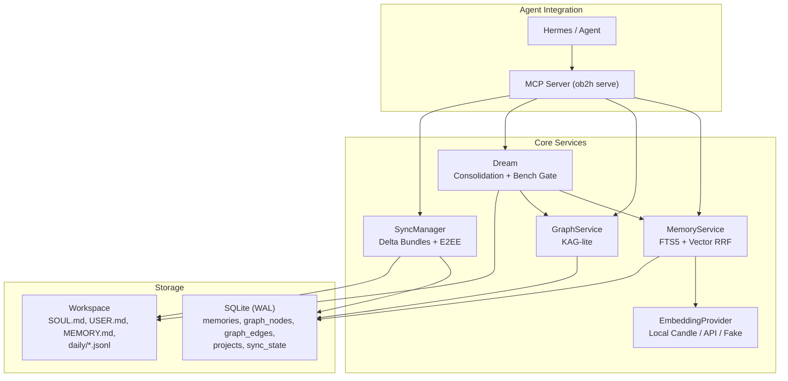
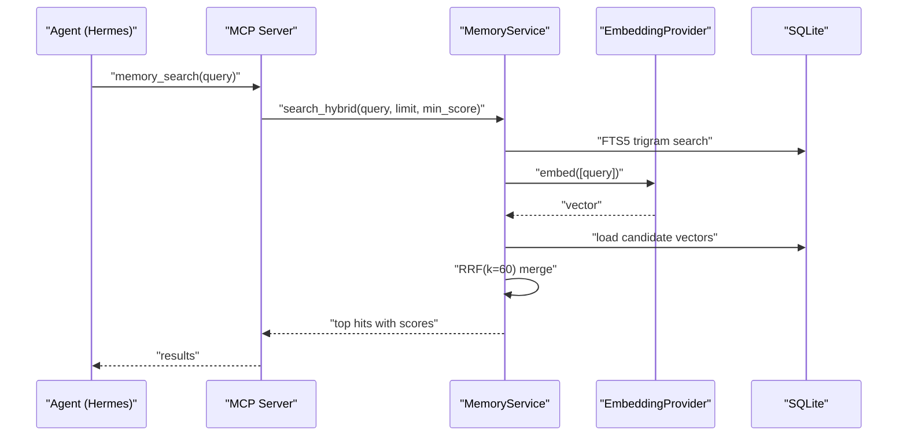
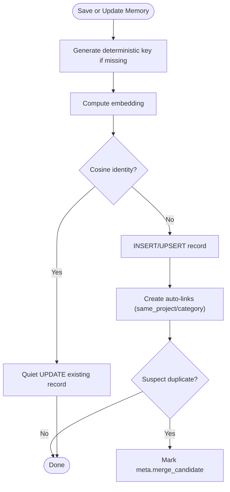
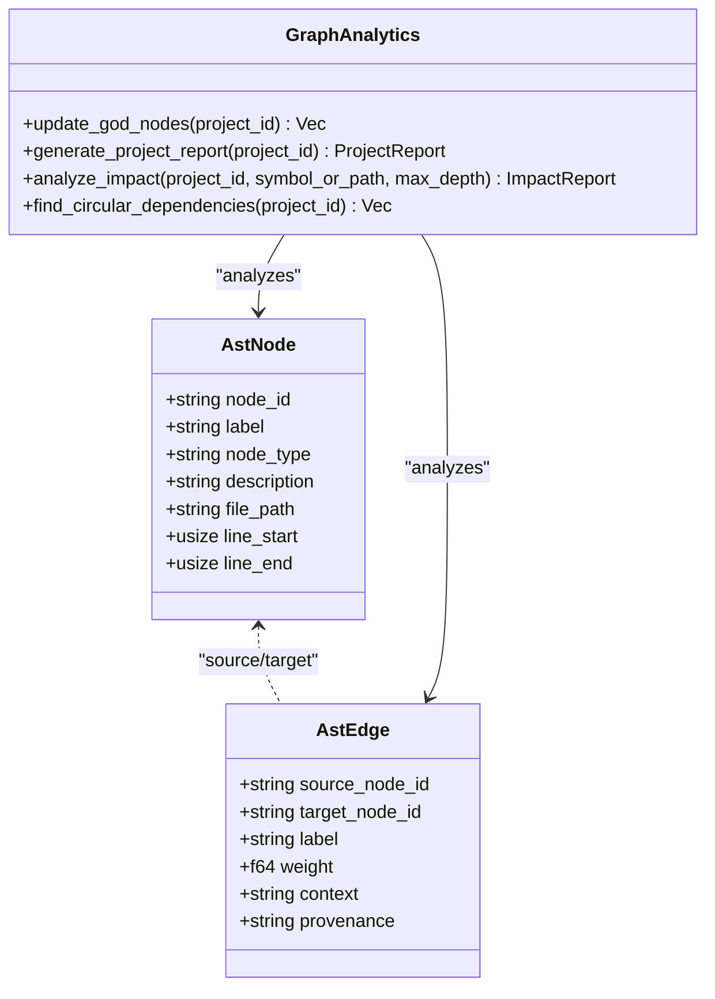
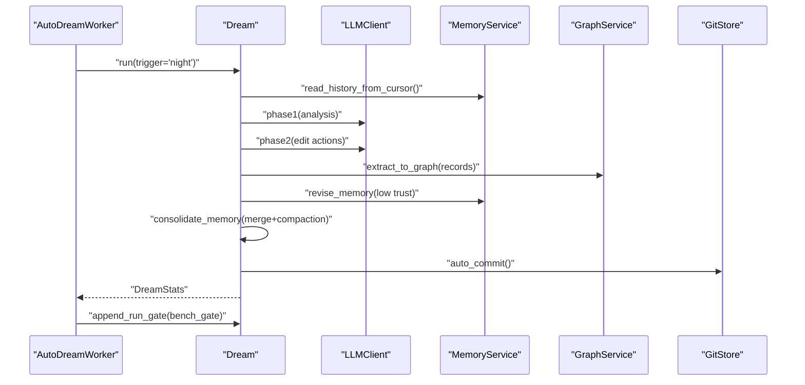
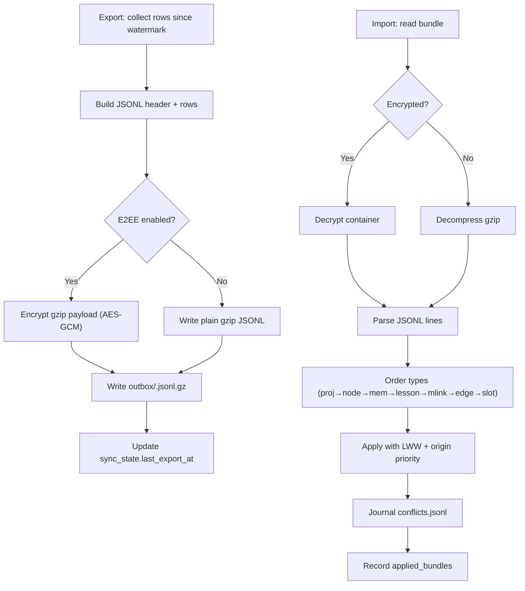
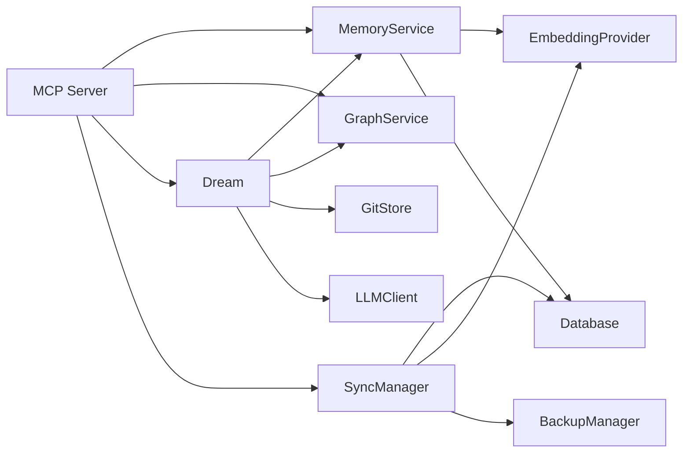

# Core Concepts

<cite>
**Referenced Files in This Document**
- [README.md](file://README.md)
- [ARCHITECTURE.md](file://docs/ARCHITECTURE.md)
- [memory_service.rs](file://src/memory/service.rs)
- [memory_mod.rs](file://src/memory/mod.rs)
- [db_models.rs](file://src/db/models.rs)
- [graph_analytics.rs](file://src/graph/analytics.rs)
- [graph_blast.rs](file://src/graph/blast.rs)
- [ast.rs](file://src/project/ast.rs)
- [dream_mod.rs](file://src/dream/mod.rs)
- [dream_consolidate.rs](file://src/dream/consolidate.rs)
- [dream_bench_gate.rs](file://src/dream/bench_gate.rs)
- [sync_mod.rs](file://src/sync/mod.rs)
- [sync_worker.rs](file://src/sync/worker.rs)
- [embedding_mod.rs](file://src/embedding/mod.rs)
- [mcp_mod.rs](file://src/mcp/mod.rs)
</cite>

## Table of Contents
1. [Introduction](#introduction)
2. [Project Structure](#project-structure)
3. [Core Components](#core-components)
4. [Architecture Overview](#architecture-overview)
5. [Detailed Component Analysis](#detailed-component-analysis)
6. [Dependency Analysis](#dependency-analysis)
7. [Performance Considerations](#performance-considerations)
8. [Troubleshooting Guide](#troubleshooting-guide)
9. [Conclusion](#conclusion)

## Introduction
This document explains OB2H’s core concepts: the hybrid memory system, trust scoring and lifecycle management, the knowledge graph built from AST parsing and relationship extraction, automated dream processing with quality gates, and cross-machine synchronization with delta bundles and optional end-to-end encryption. It also provides beginner-friendly conceptual overviews for AST parsing, vector embeddings, the MCP protocol, and CRDT-like sync patterns, using terminology consistent with the codebase.

## Project Structure
OB2H is a Rust application exposing an MCP server that agents call to access memory, knowledge graphs, project AST analysis, dream automation, and synchronization. The SQLite database stores memories, graph nodes/edges, projects, and sync state; the workspace directory holds MD files and daily logs.

**Diagram sources**
- [ARCHITECTURE.md:11-53](file://docs/ARCHITECTURE.md#L11-L53)
- [mcp_mod.rs:1-8](file://src/mcp/mod.rs#L1-L8)
- [memory_mod.rs:1-5](file://src/memory/mod.rs#L1-L5)
- [embedding_mod.rs:1-38](file://src/embedding/mod.rs#L1-L38)

**Section sources**
- [ARCHITECTURE.md:11-53](file://docs/ARCHITECTURE.md#L11-L53)
- [README.md:27-57](file://README.md#L27-L57)

## Core Components
- Hybrid memory search combining FTS5 trigram full-text search and cosine vector similarity, merged via Reciprocal Rank Fusion (RRF k=60).
- Trust scoring and lifecycle: per-record trust evolves through usage feedback, agent feedback, and nightly dream revision; tombstones mark deletions without immediate physical removal.
- Knowledge graph: deterministic AST parsing extracts nodes and typed edges; analytics compute God Nodes and blast radius; relationships are upserted with deduplication.
- Dream processing: two-phase LLM-driven editing, session fact extraction into the graph, memory trust revision, offline consolidation (merge candidates and compaction), and bench gate regression prevention.
- Cross-machine sync: incremental delta bundles by watermark, field-level merge conflicts with journaling, idempotent imports, and optional AES-GCM end-to-end encryption.

**Section sources**
- [memory_service.rs:17-21](file://src/memory/service.rs#L17-L21)
- [memory_service.rs:48-167](file://src/memory/service.rs#L48-L167)
- [memory_service.rs:489-636](file://src/memory/service.rs#L489-L636)
- [memory_service.rs:683-757](file://src/memory/service.rs#L683-L757)
- [graph_analytics.rs:92-198](file://src/graph/analytics.rs#L92-L198)
- [graph_analytics.rs:377-616](file://src/graph/analytics.rs#L377-L616)
- [ast.rs:1-52](file://src/project/ast.rs#L1-L52)
- [dream_mod.rs:145-287](file://src/dream/mod.rs#L145-L287)
- [dream_consolidate.rs:68-85](file://src/dream/consolidate.rs#L68-L85)
- [dream_bench_gate.rs:160-332](file://src/dream/bench_gate.rs#L160-L332)
- [sync_mod.rs:1-6](file://src/sync/mod.rs#L1-L6)
- [sync_mod.rs:127-192](file://src/sync/mod.rs#L127-L192)

## Architecture Overview
The system exposes MCP tools for memory, workspace, knowledge graph, project AST, dream, and service operations. Memory search uses hybrid retrieval; graph analytics provide architectural summaries and impact analysis; dream orchestrates nightly consolidation and regression checks; sync manages peer-to-peer delta bundles.

**Diagram sources**
- [memory_service.rs:576-636](file://src/memory/service.rs#L576-L636)
- [embedding_mod.rs:210-239](file://src/embedding/mod.rs#L210-L239)
- [ARCHITECTURE.md:203-243](file://docs/ARCHITECTURE.md#L203-L243)

## Detailed Component Analysis

### Memory System: Hybrid Search, Trust Scoring, Lifecycle
- Hybrid search: FTS5 trigram results and vector cosine top-k are merged with RRF k=60; access counters and last-access timestamps are updated for eligible hits.
- Save-time duplicate detection: cosine identity threshold triggers quiet update; suspect range marks `meta.merge_candidate` for offline consolidation.
- Trust scoring: usage increments trust slightly; explicit feedback (`helpful`, `unhelpful`, `outdated`) applies larger deltas; dream revision applies verdicts (`confirmed`, `outdated`, `contradicted`).
- Lifecycle: forget sets tombstone on records and soft-deletes related links; maintenance later purges tombstones; merges redirect links and preserve provenance.

**Diagram sources**
- [memory_service.rs:48-167](file://src/memory/service.rs#L48-L167)
- [memory_service.rs:169-213](file://src/memory/service.rs#L169-L213)

**Section sources**
- [memory_service.rs:48-167](file://src/memory/service.rs#L48-L167)
- [memory_service.rs:489-636](file://src/memory/service.rs#L489-L636)
- [memory_service.rs:683-757](file://src/memory/service.rs#L683-L757)
- [memory_service.rs:454-487](file://src/memory/service.rs#L454-L487)
- [db_models.rs:18-33](file://src/db/models.rs#L18-L33)

### Knowledge Graph: AST Parsing, Relationship Extraction, Analytics
- AST parsing: deterministic scanner across many languages/formats produces nodes (Module, Class, Function, etc.) and typed edges (IMPORTS, CALLS, DEFINES, INHERITS, ROUTE, QUERIES_TABLE, etc.).
- Relationship extraction: LLM-based extractor chunks text and infers entities/relations; nodes are deduplicated by `sha256(label|type)`; edges carry contexts and provenance.
- Analytics: God Nodes detection excludes infrastructure hubs; blast radius BFS computes affected callers and risk level; circular dependency detection uses Tarjan’s SCC.

**Diagram sources**
- [ast.rs:15-52](file://src/project/ast.rs#L15-L52)
- [graph_analytics.rs:92-198](file://src/graph/analytics.rs#L92-L198)
- [graph_analytics.rs:377-616](file://src/graph/analytics.rs#L377-L616)

**Section sources**
- [ast.rs:1-52](file://src/project/ast.rs#L1-L52)
- [graph_analytics.rs:92-198](file://src/graph/analytics.rs#L92-L198)
- [graph_analytics.rs:377-616](file://src/graph/analytics.rs#L377-L616)
- [graph_blast.rs:1-25](file://src/graph/blast.rs#L1-L25)

### Dream Processing: Automated Nightly Consolidation, Quality Gates
- Phases: Phase 1 analyzes recent history against current memory files; Phase 2 performs minimal edits to MD files; session facts are extracted into the graph; low-trust records are revised; merge candidates are consolidated; compaction creates summary digests.
- Bench gate: after successful dream, a quick golden-set benchmark runs; if recall@5 or MRR degrades beyond thresholds, the workspace is restored to the previous commit; timeouts skip rollback decisions.

**Diagram sources**
- [dream_mod.rs:145-287](file://src/dream/mod.rs#L145-L287)
- [dream_consolidate.rs:68-85](file://src/dream/consolidate.rs#L68-L85)
- [dream_bench_gate.rs:160-332](file://src/dream/bench_gate.rs#L160-L332)

**Section sources**
- [dream_mod.rs:145-287](file://src/dream/mod.rs#L145-L287)
- [dream_consolidate.rs:68-85](file://src/dream/consolidate.rs#L68-L85)
- [dream_bench_gate.rs:160-332](file://src/dream/bench_gate.rs#L160-L332)

### Cross-Machine Synchronization: Delta Bundles, Field-Level Conflicts, E2EE
- Export: collects rows from memories, graph_nodes, graph_edges, projects, memory_links, lessons, slots since last watermark; writes gzip JSONL bundle; optionally encrypts payload with AES-GCM derived from Argon2id passphrase.
- Import: idempotent by bundle_id; orders dependencies (proj → node → mem → lesson → mlink → edge → slot); applies LWW conflict resolution with origin priority; journals content conflicts; recomputes missing embeddings locally when needed.
- Auto-sync worker: periodically pushes/pulls SSH peers; supports manual transport mode.

**Diagram sources**
- [sync_mod.rs:247-469](file://src/sync/mod.rs#L247-L469)
- [sync_mod.rs:506-733](file://src/sync/mod.rs#L506-L733)
- [sync_mod.rs:127-192](file://src/sync/mod.rs#L127-L192)
- [sync_worker.rs:1-65](file://src/sync/worker.rs#L1-L65)

**Section sources**
- [sync_mod.rs:247-469](file://src/sync/mod.rs#L247-L469)
- [sync_mod.rs:506-733](file://src/sync/mod.rs#L506-L733)
- [sync_mod.rs:127-192](file://src/sync/mod.rs#L127-L192)
- [sync_worker.rs:1-65](file://src/sync/worker.rs#L1-L65)

### Conceptual Overviews for Beginners
- AST parsing: converting source code into a structured tree of nodes (classes, functions, modules) and edges (imports, calls, inheritance). OB2H’s scanner is deterministic, language-aware, and produces typed nodes/edges without LLM cost.
- Vector embeddings: representing text as numeric vectors so semantic similarity can be computed (cosine). OB2H uses local Candle models by default, with API/fallback providers and caching.
- MCP protocol: a standardized way for agents to call tools/resources/prompts exposed by ob2h serve; agents invoke memory, graph, project, and dream tools via JSON-RPC over stdio.
- CRDT-like sync patterns: OB2H uses Last-Writer-Wins (LWW) with origin priority, tombstones for deletes, and idempotent bundle application; while not a full CRDT, it provides conflict-free replication semantics suitable for memory/graph data.

[No sources needed since this section provides general guidance]

## Dependency Analysis
High-level component dependencies:
- MCP server depends on MemoryService, GraphService, Dream, SyncManager.
- MemoryService depends on EmbeddingProvider and Database.
- Dream depends on MemoryService, GraphService, Workspace/GitStore, LLMClient.
- SyncManager depends on Database, EmbeddingProvider, BackupManager, NodeConfig.

**Diagram sources**
- [mcp_mod.rs:1-8](file://src/mcp/mod.rs#L1-L8)
- [memory_service.rs:30-38](file://src/memory/service.rs#L30-L38)
- [embedding_mod.rs:31-38](file://src/embedding/mod.rs#L31-L38)
- [dream_mod.rs:110-143](file://src/dream/mod.rs#L110-L143)
- [sync_mod.rs:194-229](file://src/sync/mod.rs#L194-L229)

**Section sources**
- [mcp_mod.rs:1-8](file://src/mcp/mod.rs#L1-L8)
- [memory_service.rs:30-38](file://src/memory/service.rs#L30-L38)
- [embedding_mod.rs:31-38](file://src/embedding/mod.rs#L31-L38)
- [dream_mod.rs:110-143](file://src/dream/mod.rs#L110-L143)
- [sync_mod.rs:194-229](file://src/sync/mod.rs#L194-L229)

## Performance Considerations
- Hybrid search uses FTS5 trigram plus cosine similarity with RRF merging; caching embeddings reduces repeated model calls.
- SQLite WAL and short transactions ensure concurrency safety; tombstones avoid expensive physical deletes during active sync windows.
- Dream phases are bounded (max iterations, batch sizes); bench gate enforces time budgets and avoids partial decisions on timeout.
- Sync bundles are gzipped JSONL; E2EE adds cryptographic overhead but keeps payloads small and secure.

[No sources needed since this section provides general guidance]

## Troubleshooting Guide
- Memory search returns no results: verify FTS5 index exists and query is non-empty; check vector provider availability and embedding dimension consistency.
- Dream fails or stalls: inspect dream status/log; ensure LLM client is configured; confirm workspace cursors and git commits exist; check bench gate settings and golden set presence.
- Sync conflicts: review `sync/conflicts.jsonl`; adjust peer priorities; ensure both sides have same embedding provider or allow re-embedding on import; verify E2EE passphrase matches.
- God Nodes or blast radius reports seem off: re-run project scan; ensure graph nodes/edges are up to date; check project filters and deleted_at tombstones.

**Section sources**
- [memory_service.rs:489-636](file://src/memory/service.rs#L489-L636)
- [dream_mod.rs:618-646](file://src/dream/mod.rs#L618-L646)
- [dream_bench_gate.rs:160-332](file://src/dream/bench_gate.rs#L160-L332)
- [sync_mod.rs:702-733](file://src/sync/mod.rs#L702-L733)

## Conclusion
OB2H integrates long-term memory, a deterministic code knowledge graph, automated nightly consolidation, and secure cross-machine synchronization. Its hybrid search, trust scoring, and lifecycle mechanisms keep memory useful and reliable; AST-driven analytics surface architectural risks; dream automation improves coherence and prevents regressions; sync ensures consistency across machines with robust conflict handling and optional encryption. Together, these components form a cohesive foundation for AI-agent-assisted development.