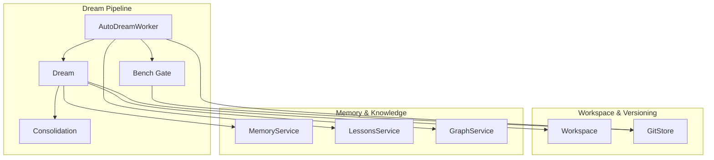
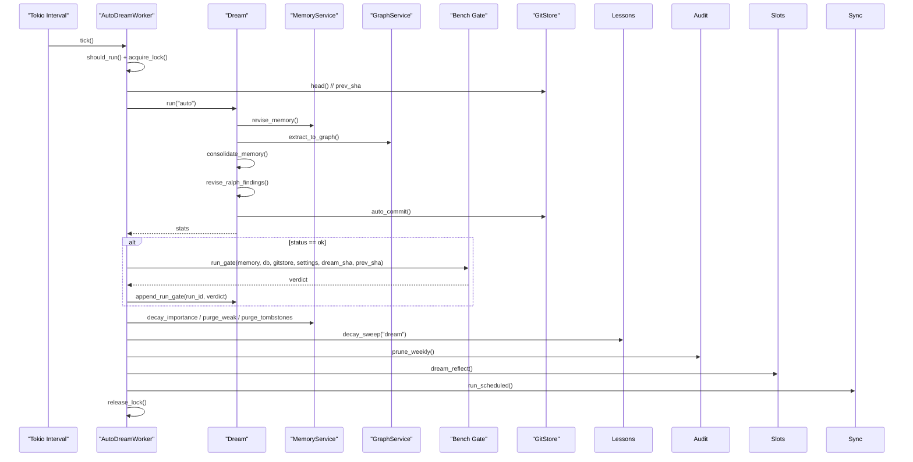
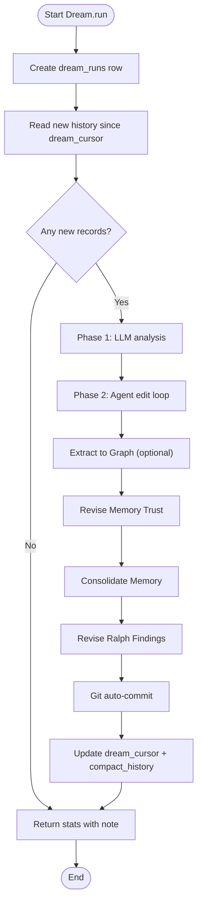
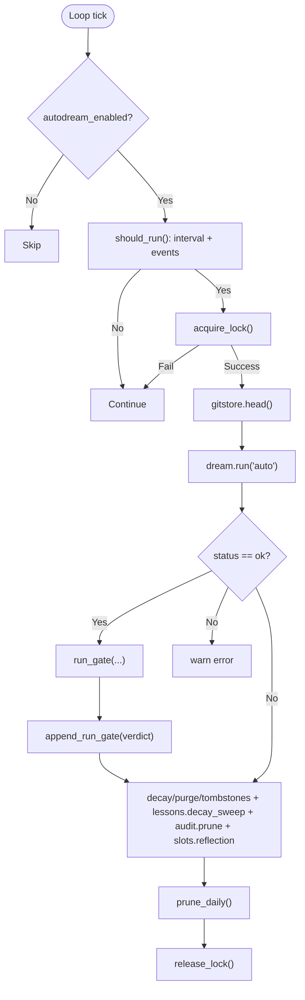
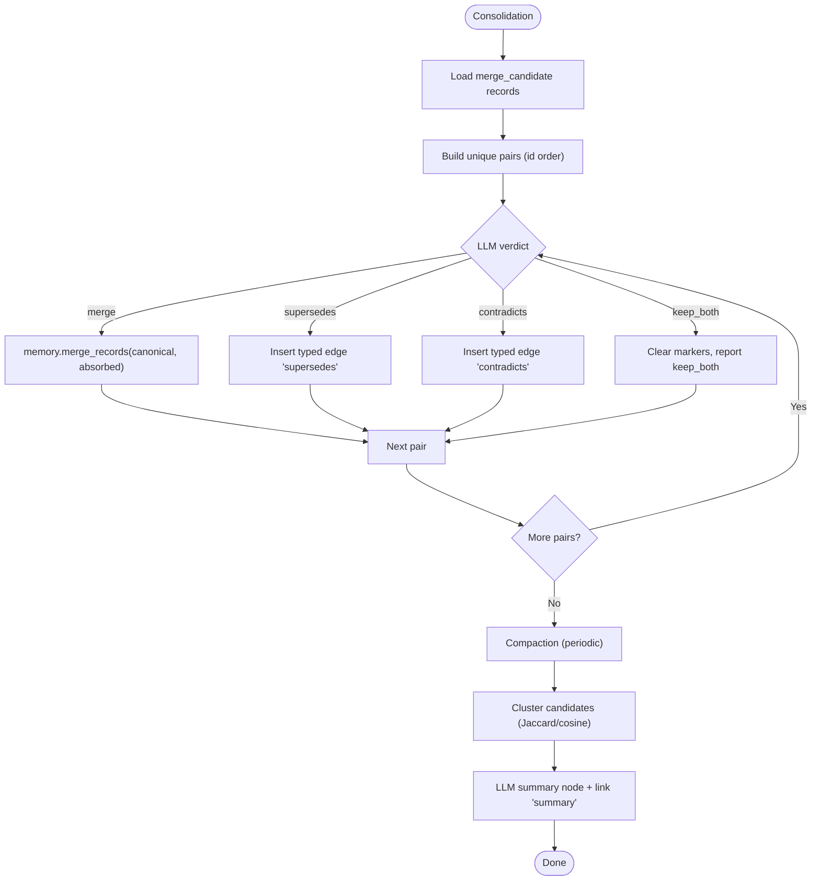
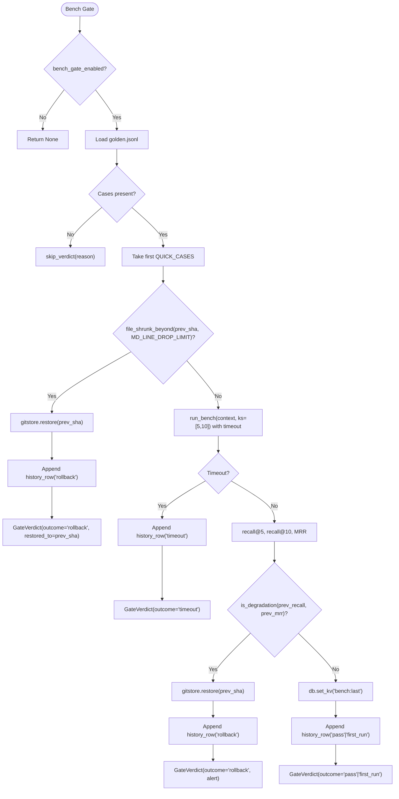
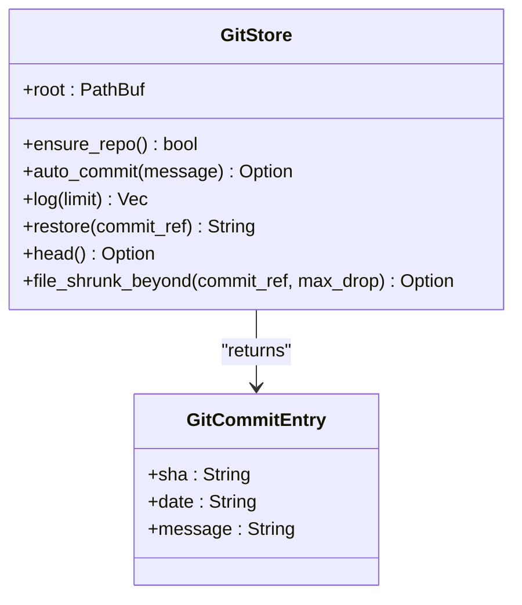
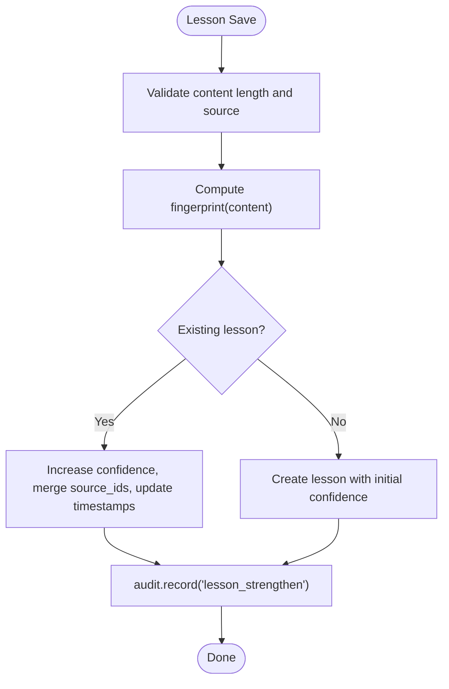
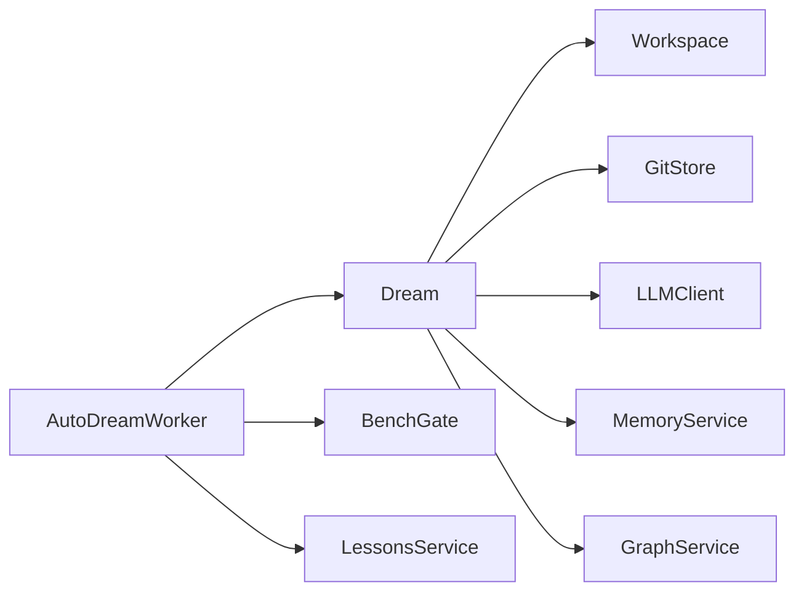

# Dream Processing Concepts

<cite>
**Referenced Files in This Document**
- [mod.rs](file://src/dream/mod.rs)
- [autodream.rs](file://src/dream/autodream.rs)
- [consolidate.rs](file://src/dream/consolidate.rs)
- [bench_gate.rs](file://src/dream/bench_gate.rs)
- [git.rs](file://src/workspace/git.rs)
- [mod.rs](file://src/workspace/mod.rs)
- [lessons.rs](file://src/lifecycle/lessons.rs)
</cite>

## Table of Contents
1. [Introduction](#introduction)
2. [Project Structure](#project-structure)
3. [Core Components](#core-components)
4. [Architecture Overview](#architecture-overview)
5. [Detailed Component Analysis](#detailed-component-analysis)
6. [Dependency Analysis](#dependency-analysis)
7. [Performance Considerations](#performance-considerations)
8. [Troubleshooting Guide](#troubleshooting-guide)
9. [Conclusion](#conclusion)

## Introduction
This document explains OB2H’s automated nightly dream processing system: how it runs during idle periods, consolidates conversations, extracts lessons and graph entities, optimizes memory organization, enforces quality gates, and uses Git-backed workspace versioning for rollback and change tracking. It also covers the benchmark-driven regression prevention system, autodream opportunity detection, and how user interactions shape future processing decisions.

## Project Structure
The dream processing system is implemented under `src/dream` with supporting components in `src/workspace`, `src/lifecycle`, and integration points to LLM, memory, and graph services.

**Diagram sources**
- [autodream.rs:36-145](file://src/dream/autodream.rs#L36-L145)
- [mod.rs:145-288](file://src/dream/mod.rs#L145-L288)
- [consolidate.rs:68-85](file://src/dream/consolidate.rs#L68-L85)
- [bench_gate.rs:160-332](file://src/dream/bench_gate.rs#L160-L332)
- [git.rs:16-82](file://src/workspace/git.rs#L16-L82)
- [mod.rs:29-79](file://src/workspace/mod.rs#L29-L79)
- [lessons.rs:82-133](file://src/lifecycle/lessons.rs#L82-L133)

**Section sources**
- [autodream.rs:1-145](file://src/dream/autodream.rs#L1-L145)
- [mod.rs:1-288](file://src/dream/mod.rs#L1-L288)
- [consolidate.rs:1-85](file://src/dream/consolidate.rs#L1-L85)
- [bench_gate.rs:1-332](file://src/dream/bench_gate.rs#L1-L332)
- [git.rs:1-82](file://src/workspace/git.rs#L1-L82)
- [mod.rs:1-79](file://src/workspace/mod.rs#L1-L79)
- [lessons.rs:1-133](file://src/lifecycle/lessons.rs#L1-L133)

## Core Components
- AutoDreamWorker: schedules and guards dream runs, performs post-dream maintenance (decay, purge, tombstone cleanup), optional lesson decay sweep, audit ledger pruning, slot reflection, and sync.
- Dream: orchestrates multi-phase processing: analysis, agent edits, graph extraction, memory revision, consolidation, Ralph findings revision, cursor advancement, history compaction, and Git commit.
- Consolidation: offline merge candidate evaluation, typed edge creation, and periodic compaction into summary nodes.
- Bench Gate: quick golden-set regression check after successful dreams; can trigger rollback if workspace integrity or metrics degrade.
- Workspace & GitStore: file I/O for MEMORY.md/SOUL.md/USER.md/history.jsonl, daily logs, cursors, plus Git auto-commit, log, restore, HEAD capture, and integrity checks.
- LessonsService: procedural knowledge with confidence, reinforcement, recency boost, weekly decay sweep, and tombstone-based deletion policy.

**Section sources**
- [autodream.rs:36-145](file://src/dream/autodream.rs#L36-L145)
- [mod.rs:145-288](file://src/dream/mod.rs#L145-L288)
- [consolidate.rs:68-85](file://src/dream/consolidate.rs#L68-L85)
- [bench_gate.rs:160-332](file://src/dream/bench_gate.rs#L160-L332)
- [git.rs:43-82](file://src/workspace/git.rs#L43-L82)
- [mod.rs:173-281](file://src/workspace/mod.rs#L173-L281)
- [lessons.rs:165-279](file://src/lifecycle/lessons.rs#L165-L279)

## Architecture Overview
The nightly pipeline is triggered by AutoDreamWorker on a schedule and guarded by locks and thresholds. On success, Dream executes its phases and then Bench Gate validates performance and workspace integrity.

**Diagram sources**
- [autodream.rs:61-145](file://src/dream/autodream.rs#L61-L145)
- [mod.rs:145-288](file://src/dream/mod.rs#L145-L288)
- [bench_gate.rs:160-332](file://src/dream/bench_gate.rs#L160-L332)
- [git.rs:53-82](file://src/workspace/git.rs#L53-L82)

## Detailed Component Analysis

### Dream Pipeline Orchestration
Dream.run initializes a run record, reads new history entries from the workspace cursor, and executes:
- Phase 1: LLM analysis of recent history against current memory files.
- Phase 2: Agent loop issuing read/edit actions to update memory files safely.
- Extract to Graph: optional extraction of session facts into the graph service.
- Memory Revision: trust adjustments and typed edges for outdated/contradicted records.
- Consolidation: merge candidates and compaction into digest nodes.
- Ralph Findings Revision: reverify stale code knowledge.
- Cursor advancement and history compaction.
- Git auto-commit with descriptive message.

**Diagram sources**
- [mod.rs:145-288](file://src/dream/mod.rs#L145-L288)

**Section sources**
- [mod.rs:145-288](file://src/dream/mod.rs#L145-L288)

### Autodream Scheduling and Opportunity Detection
AutoDreamWorker:
- Spawns a Tokio interval loop based on configured intervals.
- Guards execution via lock file and staleness handling.
- Determines whether to run using minimum time interval and minimum event count since last run.
- Captures Git HEAD before running Dream.
- After successful Dream, runs Bench Gate and appends verdict to the run stats.
- Performs routine maintenance: memory decay/purge/tombstone cleanup, lesson decay sweep, audit ledger pruning, optional slot reflection, and scheduled sync.

**Diagram sources**
- [autodream.rs:61-145](file://src/dream/autodream.rs#L61-L145)
- [autodream.rs:169-224](file://src/dream/autodream.rs#L169-L224)
- [autodream.rs:226-271](file://src/dream/autodream.rs#L226-L271)

**Section sources**
- [autodream.rs:61-145](file://src/dream/autodream.rs#L61-L145)
- [autodream.rs:169-224](file://src/dream/autodream.rs#L169-L224)
- [autodream.rs:226-271](file://src/dream/autodream.rs#L226-L271)

### Consolidation Rules and Quality Gates
Consolidation operates in two modes:
- Merge candidates: pairs marked for potential merging are evaluated by LLM to decide merge, keep_both, supersedes, or contradicts. Merges use a shared engine that marks absorbed records and redirects links. Typed edges are created for relationships.
- Compaction: periodically clusters low-trust, low-importance, low-access records and generates summary nodes linked back to members.

Quality gates include:
- Deduplication: merge_candidate markers and deduplicated pair processing.
- Relevance scoring: Jaccard similarity on tokenized keys and cosine similarity on embeddings.
- Thresholds: high-trust and high-access exclusions, cluster size limits, and interval throttling.

**Diagram sources**
- [consolidate.rs:87-190](file://src/dream/consolidate.rs#L87-L190)
- [consolidate.rs:250-336](file://src/dream/consolidate.rs#L250-L336)
- [consolidate.rs:338-420](file://src/dream/consolidate.rs#L338-L420)

**Section sources**
- [consolidate.rs:87-190](file://src/dream/consolidate.rs#L87-L190)
- [consolidate.rs:250-336](file://src/dream/consolidate.rs#L250-L336)
- [consolidate.rs:338-420](file://src/dream/consolidate.rs#L338-L420)

### Benchmark-Driven Regression Prevention
Bench Gate runs after a successful Dream:
- Loads a small golden set (first N cases).
- Checks workspace integrity: if tracked MD files lost more than a threshold of non-empty lines compared to the pre-Dream commit, triggers immediate rollback.
- Runs quick benchmark in context mode within a timeout budget.
- Compares recall@5 and MRR against bench:last; if degradation exceeds thresholds, restores previous workspace commit and records an alert.
- On pass or first run, updates bench:last and appends history entry.

**Diagram sources**
- [bench_gate.rs:160-332](file://src/dream/bench_gate.rs#L160-L332)
- [bench_gate.rs:34-38](file://src/dream/bench_gate.rs#L34-L38)
- [git.rs:143-166](file://src/workspace/git.rs#L143-L166)

**Section sources**
- [bench_gate.rs:160-332](file://src/dream/bench_gate.rs#L160-L332)
- [git.rs:143-166](file://src/workspace/git.rs#L143-L166)

### Git-Backed Workspace Versioning and Rollback
GitStore provides:
- Auto-commit of tracked files (SOUL.md, USER.md, memory/MEMORY.md) with descriptive messages.
- Log retrieval for commits with SHA, date, and message.
- Restore to a specific commit for only tracked files.
- HEAD capture for rollback targets.
- Workspace integrity check comparing line counts between committed state and current files.

**Diagram sources**
- [git.rs:16-82](file://src/workspace/git.rs#L16-L82)
- [git.rs:84-166](file://src/workspace/git.rs#L84-L166)

**Section sources**
- [git.rs:43-82](file://src/workspace/git.rs#L43-L82)
- [git.rs:84-166](file://src/workspace/git.rs#L84-L166)

### Learning from User Interactions
LessonsService supports procedural knowledge with:
- Deterministic fingerprinting for deduplication.
- Reinforcement when repeated content is saved, increasing confidence.
- Recency boost factored into recall scoring.
- Weekly decay sweep that reduces confidence over time without deleting records (tombstone policy).
- Sources tagged as manual, consolidation, recap, or dream.

**Diagram sources**
- [lessons.rs:86-91](file://src/lifecycle/lessons.rs#L86-L91)
- [lessons.rs:165-279](file://src/lifecycle/lessons.rs#L165-L279)

**Section sources**
- [lessons.rs:86-91](file://src/lifecycle/lessons.rs#L86-L91)
- [lessons.rs:165-279](file://src/lifecycle/lessons.rs#L165-L279)

## Dependency Analysis
Dream depends on multiple services and subsystems:
- Workspace for reading/writing memory files and history.
- GitStore for version control operations.
- LLMClient for analysis, editing, and consolidation prompts.
- MemoryService for trust revision and merging.
- GraphService for extracting and upserting entities and edges.
- Bench Gate for regression checks.
- LessonsService for decay sweeps.

**Diagram sources**
- [mod.rs:110-143](file://src/dream/mod.rs#L110-L143)
- [autodream.rs:36-59](file://src/dream/autodream.rs#L36-L59)
- [bench_gate.rs:160-170](file://src/dream/bench_gate.rs#L160-L170)

**Section sources**
- [mod.rs:110-143](file://src/dream/mod.rs#L110-L143)
- [autodream.rs:36-59](file://src/dream/autodream.rs#L36-L59)
- [bench_gate.rs:160-170](file://src/dream/bench_gate.rs#L160-L170)

## Performance Considerations
- Dream iteration limit prevents runaway agent loops.
- Consolidation groups are limited per run to bound LLM calls.
- Compaction is throttled to once every 30 days.
- Bench Gate uses a quick subset of golden cases and a timeout budget to avoid long-running regressions.
- History compaction keeps only recent entries to reduce IO overhead.
- Daily log archival compresses old logs into monthly archives without data loss.

[No sources needed since this section provides general guidance]

## Troubleshooting Guide
Common issues and diagnostics:
- Dream run errors: captured in dream_runs.stats.error field; review DreamStats.error and status.
- Bench Gate skipped: verify presence of golden.jsonl and configuration flags; check reason in GateVerdict.reason.
- Workspace rollback: if tracked MD files lose significant content, Bench Gate restores previous commit; inspect alert and restored_to fields.
- Consolidation failures: warnings logged; check DreamStats.consolidation for partial results.
- Memory revision failures: warnings logged; check DreamStats.memory_revision for applied changes.
- Lesson decay sweep: ensure kv cursor is updated; check candidates_for_forget in decay output.

**Section sources**
- [mod.rs:155-181](file://src/dream/mod.rs#L155-L181)
- [bench_gate.rs:176-190](file://src/dream/bench_gate.rs#L176-L190)
- [bench_gate.rs:194-220](file://src/dream/bench_gate.rs#L194-L220)
- [consolidate.rs:78-83](file://src/dream/consolidate.rs#L78-L83)
- [lessons.rs:457-543](file://src/lifecycle/lessons.rs#L457-L543)

## Conclusion
OB2H’s dream processing system automates nightly memory optimization through a robust pipeline: analysis, agent edits, graph extraction, trust revision, consolidation, and Ralph findings updates. It integrates Git-backed versioning for safe rollbacks and employs a benchmark-driven gate to prevent regressions. Autodream detects opportunities based on time and event thresholds, while lessons learn from interactions with confidence and recency modeling. Together, these components provide a resilient, self-improving memory system that consolidates conversations, extracts lessons, and maintains high-quality, relevant knowledge over time.