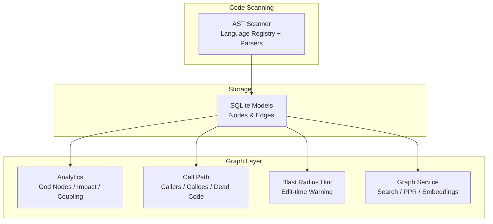
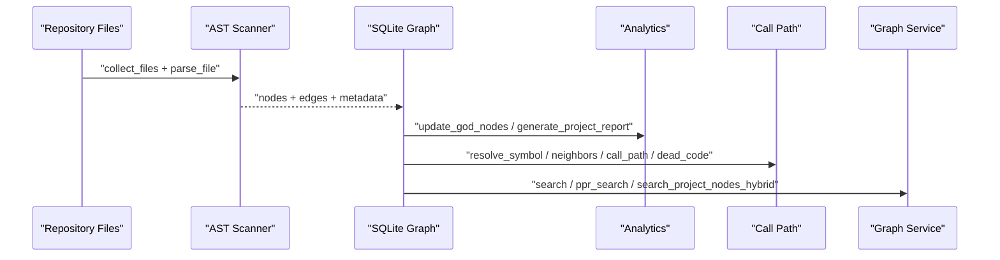
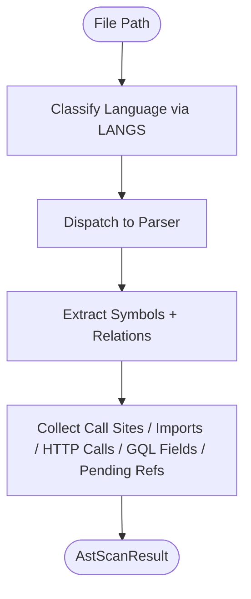
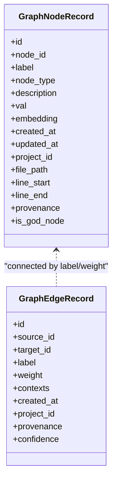
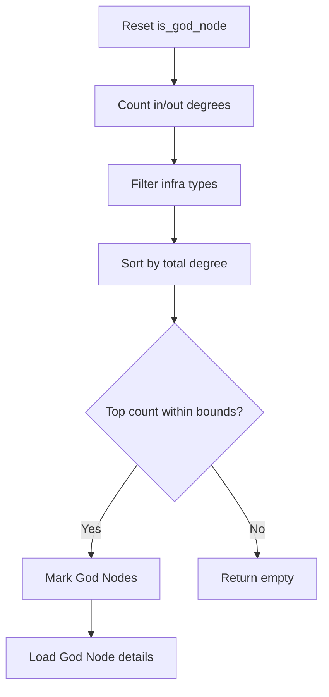
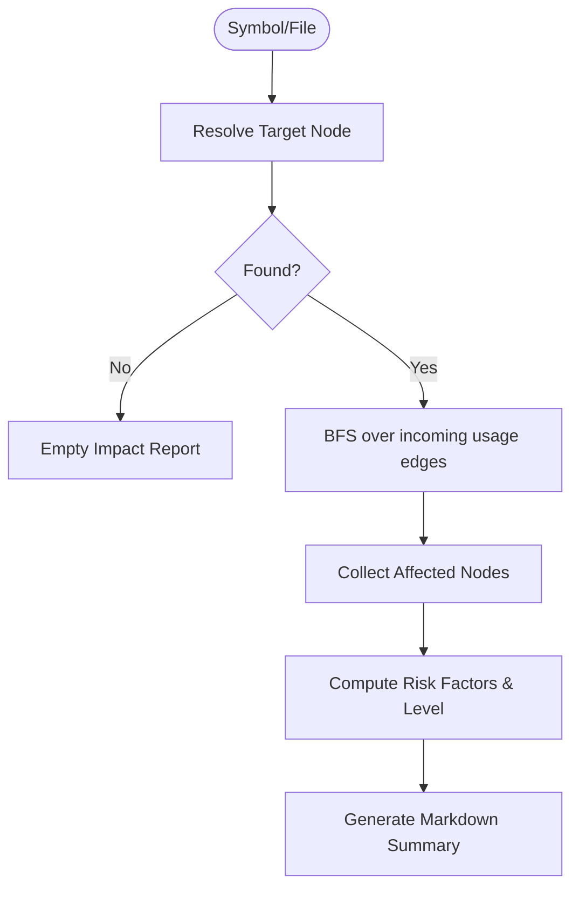
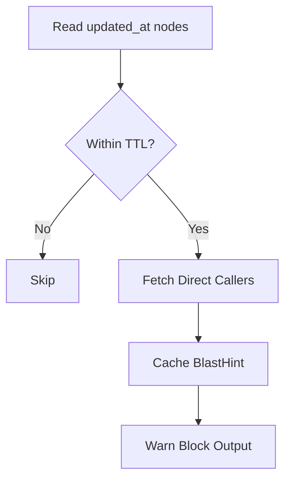
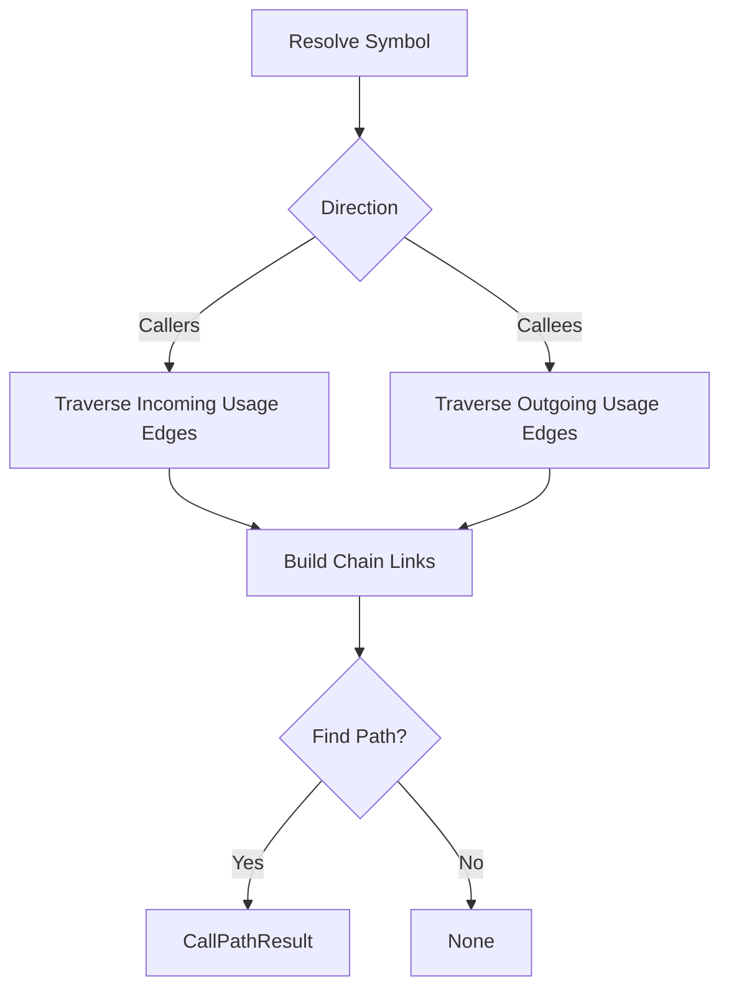
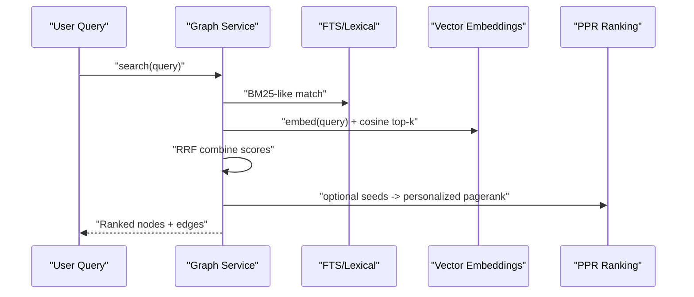
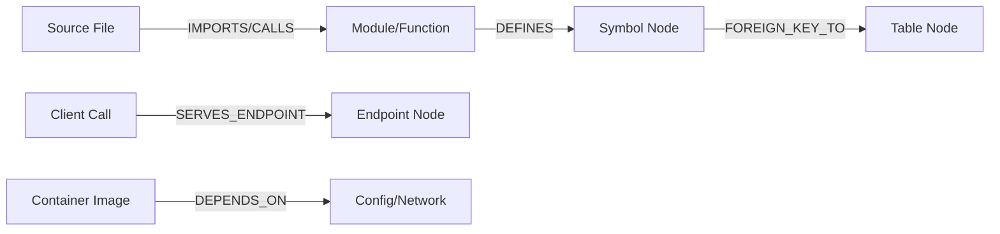

# Knowledge Graph Concepts

<cite>
**Referenced Files in This Document**
- [README.md](file://README.md)
- [ast.rs](file://src/project/ast.rs)
- [analytics.rs](file://src/graph/analytics.rs)
- [blast.rs](file://src/graph/blast.rs)
- [callpath.rs](file://src/graph/callpath.rs)
- [service.rs](file://src/graph/service.rs)
- [models.rs](file://src/db/models.rs)
</cite>

## Table of Contents
1. [Introduction](#introduction)
2. [Project Structure](#project-structure)
3. [Core Components](#core-components)
4. [Architecture Overview](#architecture-overview)
5. [Detailed Component Analysis](#detailed-component-analysis)
6. [Dependency Analysis](#dependency-analysis)
7. [Performance Considerations](#performance-considerations)
8. [Troubleshooting Guide](#troubleshooting-guide)
9. [Conclusion](#conclusion)

## Introduction
This document explains OB2H’s knowledge graph concepts for code analysis and relationship extraction. It covers how AST parsing works across 31+ programming languages, how automatic relationship extraction identifies dependencies, imports, function calls, and architectural patterns, and how the parsed code is transformed into an interconnected graph of nodes and edges. It also documents advanced analysis features such as God Nodes detection, blast radius assessment, call path tracing, semantic search, and architectural understanding beyond simple text matching.

OB2H builds a deterministic AST-based code graph without LLM token costs during scanning. The graph supports structural queries, impact analysis, dead-code detection, Personalized PageRank reasoning, and hybrid semantic search over both lexical and vector embeddings.

**Section sources**
- [README.md:27-53](file://README.md#L27-L53)

## Project Structure
The knowledge graph pipeline spans several modules:

- Code scanning and AST extraction live under `src/project/ast.rs`.
- Graph analytics (God Nodes, blast radius, coupling metrics, circular dependencies) live under `src/graph/analytics.rs`.
- Structural queries (callers, callees, call paths, dead code) live under `src/graph/callpath.rs`.
- Edit-time blast-radius hints live under `src/graph/blast.rs`.
- Graph service (search, PPR, embedding integration, upserts) lives under `src/graph/service.rs`.
- Database models for graph nodes and edges live under `src/db/models.rs`.

**Diagram sources**
- [ast.rs:1-119](file://src/project/ast.rs#L1-L119)
- [analytics.rs:90-200](file://src/graph/analytics.rs#L90-L200)
- [callpath.rs:1-84](file://src/graph/callpath.rs#L1-L84)
- [blast.rs:1-52](file://src/graph/blast.rs#L1-L52)
- [service.rs:96-104](file://src/graph/service.rs#L96-L104)
- [models.rs:64-95](file://src/db/models.rs#L64-L95)

**Section sources**
- [ast.rs:1-119](file://src/project/ast.rs#L1-L119)
- [analytics.rs:90-200](file://src/graph/analytics.rs#L90-L200)
- [callpath.rs:1-84](file://src/graph/callpath.rs#L1-L84)
- [blast.rs:1-52](file://src/graph/blast.rs#L1-L52)
- [service.rs:96-104](file://src/graph/service.rs#L96-L104)
- [models.rs:64-95](file://src/db/models.rs#L64-L95)

## Core Components
- AST scanner and language registry: defines supported languages/formats, file matching rules, node types, edge labels, and per-language parsers.
- Graph analytics: computes God Nodes, project reports, blast radius, circular dependencies, and component stability metrics.
- Call path utilities: resolves symbols, traverses callers/callees, reconstructs call chains, and detects dead code.
- Edit-time blast hint: caches recent changes and top callers to provide lightweight warnings.
- Graph service: performs hybrid search (FTS/LIKE + vector), PPR ranking, and entity/edge upserts with embeddings.
- Storage models: SQLite records for projects, memory, documents/chunks, graph nodes, and graph edges.

Key data structures:
- `AstNode` and `AstEdge`: extracted graph elements from source files.
- `AstScanResult`: aggregated scan output including nodes, edges, call sites, imports, HTTP calls, GraphQL field refs, and pending references.
- `GraphNodeRecord` and `GraphEdgeRecord`: persisted graph entities with provenance, weights, contexts, and optional embeddings.

**Section sources**
- [ast.rs:15-119](file://src/project/ast.rs#L15-L119)
- [models.rs:64-95](file://src/db/models.rs#L64-L95)

## Architecture Overview
The knowledge graph is built by scanning code, extracting symbols and relationships, persisting them as nodes and edges, and then running analytical and query services on top of the stored graph.

**Diagram sources**
- [ast.rs:121-233](file://src/project/ast.rs#L121-L233)
- [analytics.rs:92-200](file://src/graph/analytics.rs#L92-L200)
- [callpath.rs:105-128](file://src/graph/callpath.rs#L105-L128)
- [service.rs:236-460](file://src/graph/service.rs#L236-L460)

## Detailed Component Analysis

### AST Parsing Across 31+ Languages
OB2H uses a centralized language registry to classify files and dispatch to language-specific parsers. Each language specification declares:
- Human-readable name
- Matcher (extension, filename, or predicate)
- Node types produced by the parser
- Edge labels produced by the parser
- File size cap
- Parser tag
- Fixture and sample path for tests

Supported categories include:
- Programming languages: Rust, Python, TS/JS, Go, SQL, PHP, Dart, Java, C#, C/C++, Kotlin, Swift, Ruby, Scala, Lua, Elixir, Shell.
- Web/UI: HTML, CSS/SCSS, Vue/Svelte SFC.
- Contracts/APIs: Protocol Buffers, GraphQL, OpenAPI/Swagger.
- Infrastructure/IaC: Terraform/OpenTofu, Dockerfile, docker-compose, Kubernetes/Helm YAML.
- Package manifests: Cargo.toml, package.json, pyproject.toml, requirements.txt, go.mod, pubspec.yaml, composer.json.
- Special formats: Jupyter notebooks, Solidity, Zig.

The scanner produces:
- Nodes: modules/files, classes, structs, interfaces, traits/mixins, functions/methods, tables, routes, endpoints, schemas, external packages, CSS classes/ids/vars, K8s resources, base images, etc.
- Edges: IMPORTS, DEFINES, CALLS, IMPLEMENTS, INHERITS, DEPENDS_ON, FOREIGN_KEY_TO, plus framework heuristics like ROUTE, QUERIES_TABLE, STYLES, BINDS_CLASS, SERVES_ENDPOINT, QUERIES_FIELD, USES_SCHEMA, MOUNTS, BINDS_SELECTOR.

Advanced extraction artifacts:
- Call sites and imports for type-pass resolution.
- HTTP call literals bridging client-side calls to server routes.
- GraphQL field references bridging schema fields to usage.
- Pending references resolved after full scan (e.g., Terraform depends_on, K8s configMapRef/secretRef).

**Diagram sources**
- [ast.rs:121-233](file://src/project/ast.rs#L121-L233)
- [ast.rs:100-119](file://src/project/ast.rs#L100-L119)

**Section sources**
- [ast.rs:121-233](file://src/project/ast.rs#L121-L233)
- [ast.rs:100-119](file://src/project/ast.rs#L100-L119)

### Automatic Relationship Extraction
Relationships are inferred from static patterns and framework conventions:
- Import/dependency edges: module/package/file-level imports and manifest dependencies.
- Definition edges: file-to-symbol definitions.
- Inheritance/implementations: class/trait/interface relationships.
- Function calls: call-site extraction with skip-lists to avoid keywords.
- Framework routes: decorators/attributes mapping to route nodes.
- Data relations: SQL foreign keys, ORM table names, GraphQL fields.
- UI/style relations: CSS selectors, class bindings, element attributes.
- Infrastructure relations: container images, environment variables, ports, volumes, networks, Helm/K8s resource links.

Provenance tracking distinguishes:
- EXTRACTED: standard scan.
- RESOLVED: type-pass resolution.
- INFERRED: heuristic bridges (routes, styles, mounts, selectors).

**Section sources**
- [ast.rs:34-52](file://src/project/ast.rs#L34-L52)
- [ast.rs:1447-1459](file://src/project/ast.rs#L1447-L1459)
- [ast.rs:1420-1445](file://src/project/ast.rs#L1420-L1445)

### Graph Building Process
Parsed AST results are persisted as graph nodes and edges. The database model includes:
- Node identity (`node_id`, `label`, `node_type`)
- Location metadata (`file_path`, line ranges)
- Provenance and optional embedding
- God node flag and value counters

Edges store:
- Source/target IDs
- Label and weight
- Contexts (JSON array)
- Provenance and confidence

**Diagram sources**
- [models.rs:64-95](file://src/db/models.rs#L64-L95)

**Section sources**
- [models.rs:64-95](file://src/db/models.rs#L64-L95)

### Advanced Analysis Features

#### God Nodes Detection
God Nodes are highly connected architectural hubs. The algorithm:
- Resets previous God Node flags per project.
- Computes in-degree and out-degree for all nodes.
- Excludes infrastructure hubs (external packages, base images, CSS classes) to avoid skew.
- Selects top candidates by total degree (top 10% or minimum top-5, clamped between 3 and 20).
- Marks nodes in the database and returns detailed info.

**Diagram sources**
- [analytics.rs:92-198](file://src/graph/analytics.rs#L92-L198)

**Section sources**
- [analytics.rs:92-198](file://src/graph/analytics.rs#L92-L198)

#### Blast Radius Assessment
Impact analysis answers “what breaks if I change X?”:
- Resolves target symbol or file path.
- Performs BFS over incoming usage edges (CALLS/IMPORTS/IMPLEMENTS/DEPENDS_ON).
- Collects affected nodes with depth, edge label, provenance, and God Node status.
- Computes risk factors and assigns Low/Medium/High risk level.
- Produces a Markdown summary with recommendations.

**Diagram sources**
- [analytics.rs:377-616](file://src/graph/analytics.rs#L377-L616)

**Section sources**
- [analytics.rs:377-616](file://src/graph/analytics.rs#L377-L616)

#### Edit-Time Blast Radius Hints
For developer feedback during edits:
- Watches recently updated symbols within a TTL window.
- Retrieves direct callers (depth 1) using usage edge labels.
- Caches a compact hint with symbol, file path, callers, and expiry.
- Provides a warn-only block when enabled via environment flag.

**Diagram sources**
- [blast.rs:96-144](file://src/graph/blast.rs#L96-L144)
- [blast.rs:146-196](file://src/graph/blast.rs#L146-L196)

**Section sources**
- [blast.rs:96-144](file://src/graph/blast.rs#L96-L144)
- [blast.rs:146-196](file://src/graph/blast.rs#L146-L196)

#### Call Path Tracing
Structural queries enable:
- Symbol resolution by exact match, LIKE, or file path.
- Neighbors traversal (callers/callees) with bounded depth and limit.
- Explicit path reconstruction from source to target via BFS parent pointers.
- Dead code detection excluding entrypoints (main, lifecycle hooks, test code, public API markers, framework decorators).

**Diagram sources**
- [callpath.rs:105-128](file://src/graph/callpath.rs#L105-L128)
- [callpath.rs:151-219](file://src/graph/callpath.rs#L151-L219)
- [callpath.rs:221-311](file://src/graph/callpath.rs#L221-L311)
- [callpath.rs:396-446](file://src/graph/callpath.rs#L396-L446)

**Section sources**
- [callpath.rs:105-128](file://src/graph/callpath.rs#L105-L128)
- [callpath.rs:151-219](file://src/graph/callpath.rs#L151-L219)
- [callpath.rs:221-311](file://src/graph/callpath.rs#L221-L311)
- [callpath.rs:396-446](file://src/graph/callpath.rs#L396-L446)

### Semantic Search and Architectural Understanding
Beyond text matching, OB2H enables:
- Hybrid search combining lexical scoring (FTS5/LIKE) and vector similarity (cosine via RRF k=60).
- Optional vec0 optimization for fast binary-first pass with rescore.
- PPR (Personalized PageRank) over the graph with edge-type-aware weights to find multi-hop related facts unreachable by linear search.
- Reasoning that composes retrieved entities and relations into structured JSON answers with confidence and used entities/relations.

**Diagram sources**
- [service.rs:236-460](file://src/graph/service.rs#L236-L460)
- [service.rs:546-674](file://src/graph/service.rs#L546-L674)

**Section sources**
- [service.rs:236-460](file://src/graph/service.rs#L236-L460)
- [service.rs:546-674](file://src/graph/service.rs#L546-L674)

## Dependency Analysis
The knowledge graph exposes rich dependency information through typed edges and provenance:
- Code-level dependencies: IMPORTS, CALLS, IMPLEMENTS, INHERITS, DEPENDS_ON.
- Data-level dependencies: FOREIGN_KEY_TO, QUERIES_TABLE, QUERIES_FIELD.
- Contract-level dependencies: USES_SCHEMA, SERVES_ENDPOINT, ROUTE.
- UI/style dependencies: STYLES, BINDS_CLASS, BINDS_SELECTOR.
- Infrastructure dependencies: MOUNTS, DEPENDS_ON across containers/images/networks/volumes.

Coupling metrics compute afferent/efferent counts and instability per file/component, enabling architectural stability insights. Circular dependency detection uses Tarjan’s SCC algorithm to surface problematic cycles.

**Diagram sources**
- [ast.rs:34-52](file://src/project/ast.rs#L34-L52)
- [analytics.rs:763-835](file://src/graph/analytics.rs#L763-L835)

**Section sources**
- [ast.rs:34-52](file://src/project/ast.rs#L34-L52)
- [analytics.rs:763-835](file://src/graph/analytics.rs#L763-L835)

## Performance Considerations
- Deterministic AST parsing avoids LLM token costs during scanning.
- File size caps prevent heavy parsing of large non-source files; large files are tracked by hash only.
- FTS5 fallback ensures robustness if the index is unavailable.
- vec0 optimization provides a fast binary-first pass before rescore with real vectors.
- PPR uses mass iteration with damping and edge-type weights for scalable multi-hop ranking.
- Edit-time blast hints cache recent changes and callers to minimize repeated computation.

[No sources needed since this section provides general guidance]

## Troubleshooting Guide
Common issues and mitigations:
- FTS5 unavailable: search falls back to full scan with warning logs.
- Missing symbols in blast radius: report indicates symbol not found; verify project scan completeness.
- No affected nodes: symbol may be isolated or a leaf consumer; consider expanding max_depth.
- High-risk changes: recommended to coordinate interface changes, run full test suites, and maintain backward compatibility.
- Circular dependencies: review identified SCCs and refactor cyclic imports.

**Section sources**
- [service.rs:268-289](file://src/graph/service.rs#L268-L289)
- [analytics.rs:417-435](file://src/graph/analytics.rs#L417-L435)
- [analytics.rs:590-604](file://src/graph/analytics.rs#L590-L604)
- [analytics.rs:618-761](file://src/graph/analytics.rs#L618-L761)

## Conclusion
OB2H’s knowledge graph transforms heterogeneous codebases into a unified, analyzable structure. By combining precise AST parsing across many languages, typed relationship extraction, and advanced graph analytics, it enables semantic search, architectural insight, impact assessment, and automated reasoning. The system balances performance and accuracy through deterministic scanning, caching, and optimized search strategies, while providing actionable insights for safe refactoring and long-term project health.

[No sources needed since this section summarizes without analyzing specific files]