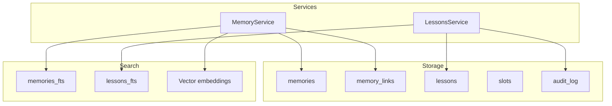
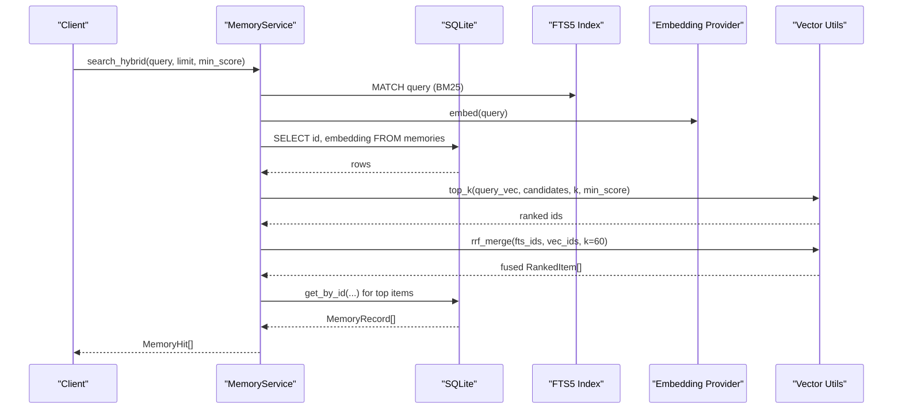
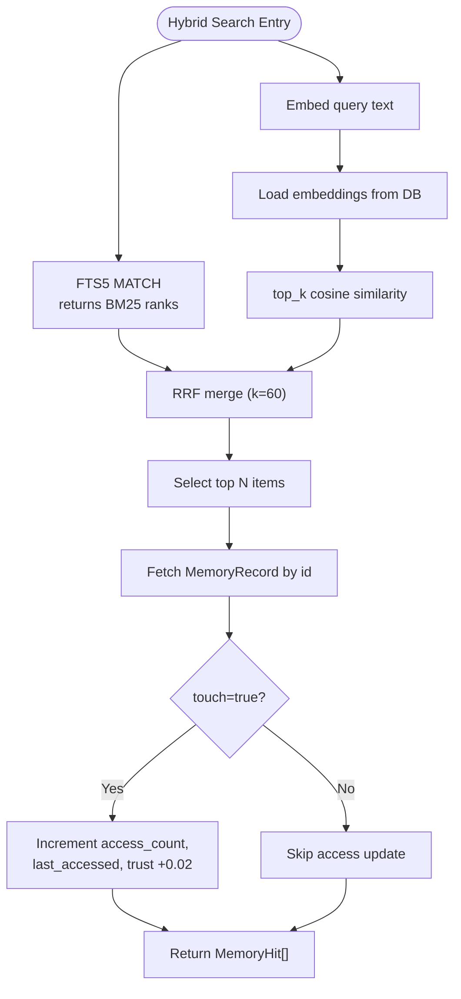
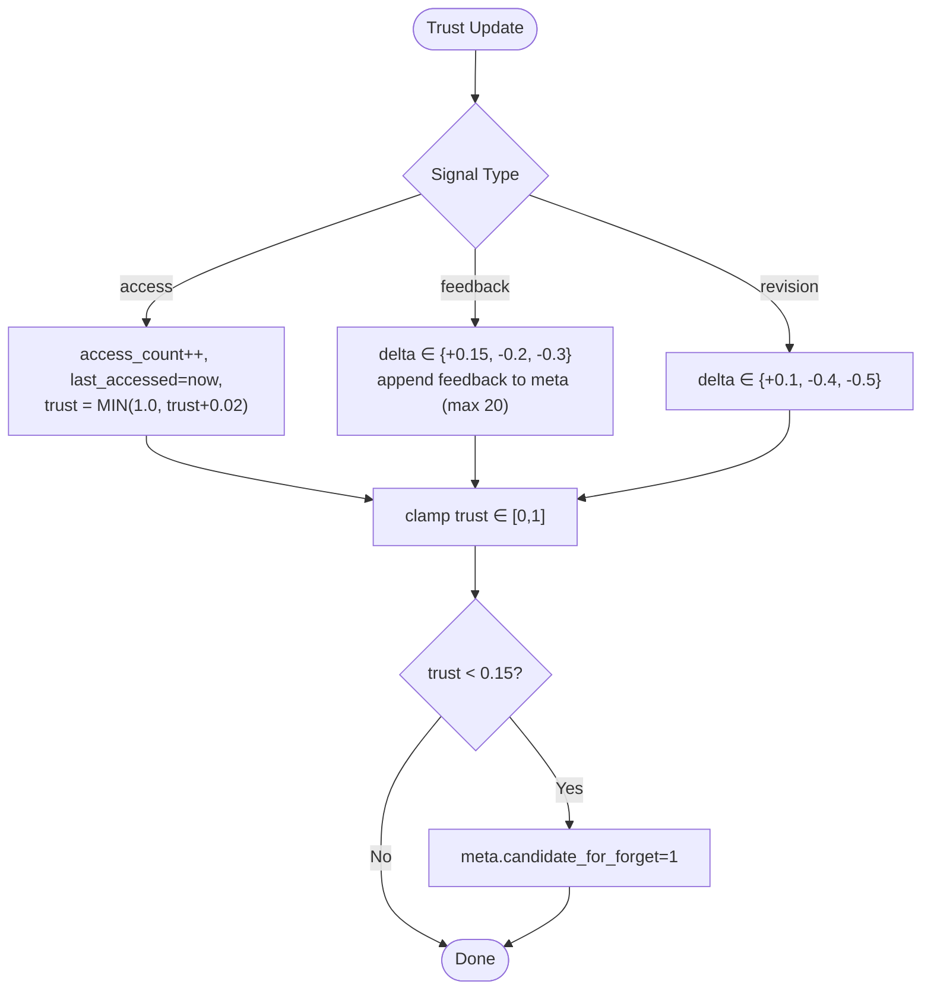
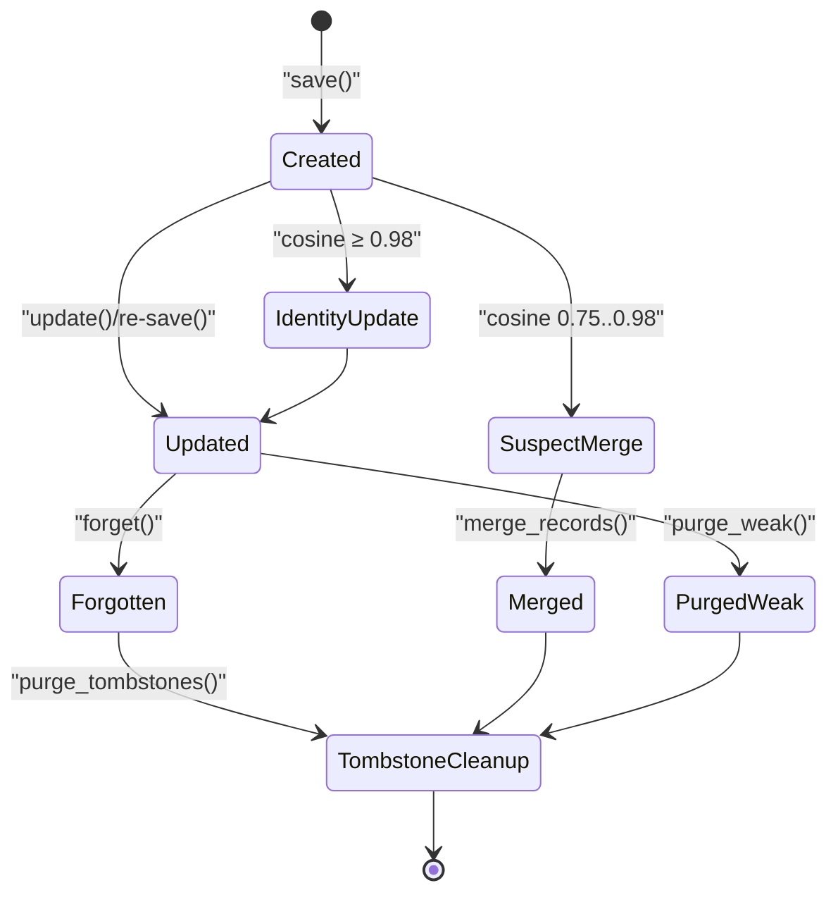
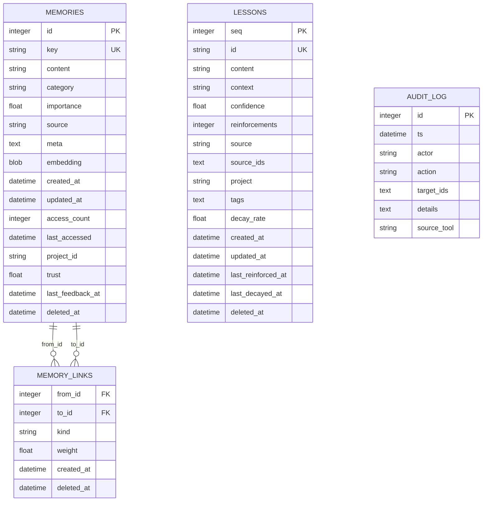
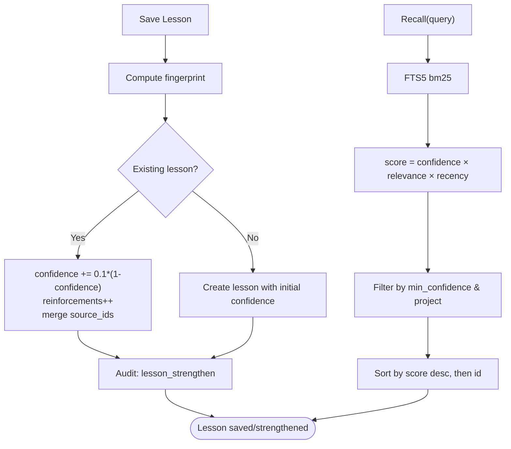
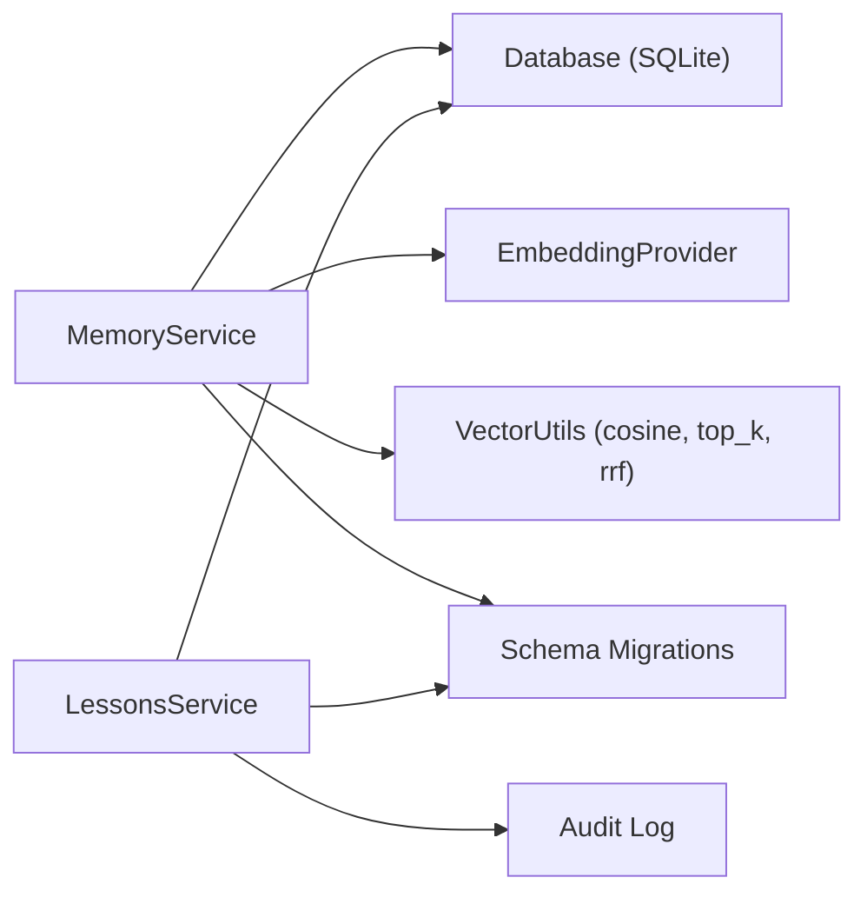

# Memory System Concepts

<cite>
**Referenced Files in This Document**
- [models.rs](file://src/db/models.rs)
- [schema.rs](file://src/db/schema.rs)
- [service.rs](file://src/memory/service.rs)
- [mod.rs](file://src/vector/mod.rs)
- [rrf.rs](file://src/vector/rrf.rs)
- [similarity.rs](file://src/vector/similarity.rs)
- [lessons.rs](file://src/lifecycle/lessons.rs)
- [mod.rs](file://src/lifecycle/mod.rs)
</cite>

## Table of Contents
1. [Introduction](#introduction)
2. [Project Structure](#project-structure)
3. [Core Components](#core-components)
4. [Architecture Overview](#architecture-overview)
5. [Detailed Component Analysis](#detailed-component-analysis)
6. [Dependency Analysis](#dependency-analysis)
7. [Performance Considerations](#performance-considerations)
8. [Troubleshooting Guide](#troubleshooting-guide)
9. [Conclusion](#conclusion)

## Introduction
This document explains the memory system concepts behind OB2H’s persistent memory architecture. It focuses on how memories are stored and retrieved, how hybrid search combines full-text search with vector embeddings, how trust scoring evaluates memory quality and relevance, how lifecycle management handles creation, consolidation, deduplication, and archival, how categories organize memories, and how provenance tracks data lineage. Practical examples illustrate memory operations, trust score calculations, and lifecycle transitions.

## Project Structure
The memory subsystem spans several modules:
- Data models and schema migrations define the SQLite tables, indexes, FTS5 virtual tables, and lifecycle tables.
- The memory service implements save, update, delete, search, feedback, merging, linking, decay, and context building.
- Vector utilities provide embedding serialization, cosine similarity, top-k search, and RRF fusion for hybrid ranking.
- Lifecycle lessons implement durable procedural knowledge with confidence, reinforcement, decay, and audit logging.

**Diagram sources**
- [schema.rs:222-334](file://src/db/schema.rs#L222-L334)
- [schema.rs:384-450](file://src/db/schema.rs#L384-L450)
- [service.rs:489-636](file://src/memory/service.rs#L489-L636)
- [lessons.rs:281-354](file://src/lifecycle/lessons.rs#L281-L354)

**Section sources**
- [models.rs:18-33](file://src/db/models.rs#L18-L33)
- [schema.rs:222-334](file://src/db/schema.rs#L222-L334)
- [schema.rs:384-450](file://src/db/schema.rs#L384-L450)
- [service.rs:30-38](file://src/memory/service.rs#L30-L38)
- [lessons.rs:82-84](file://src/lifecycle/lessons.rs#L82-L84)

## Core Components
- MemoryRecord: represents a persisted memory entry including content, category, importance, source, metadata, embedding, timestamps, access metrics, and project association.
- MemoryService: orchestrates persistence, embedding generation, deduplication, hybrid search, feedback-driven trust updates, link management, decay, and context assembly.
- LessonsService: manages durable lessons with fingerprint-based deduplication, reinforcement, confidence decay, and FTS5-backed recall.
- Vector utilities: serialize/deserialize embeddings (including quantized int8), compute cosine similarity, perform top-k retrieval, and fuse FTS and vector results via RRF.

Key responsibilities:
- Hybrid search: FTS5 BM25 + vector cosine similarity merged by RRF.
- Trust scoring: incremental adjustments from access, feedback, and revision; decay over time; candidate marking for forget.
- Lifecycle: soft deletes (tombstones), merge flows, typed links, lessons with confidence and decay, slots, and audit logging.

**Section sources**
- [models.rs:18-33](file://src/db/models.rs#L18-L33)
- [service.rs:30-38](file://src/memory/service.rs#L30-L38)
- [service.rs:48-167](file://src/memory/service.rs#L48-L167)
- [service.rs:685-757](file://src/memory/service.rs#L685-L757)
- [service.rs:912-925](file://src/memory/service.rs#L912-L925)
- [lessons.rs:82-84](file://src/lifecycle/lessons.rs#L82-L84)
- [lessons.rs:165-279](file://src/lifecycle/lessons.rs#L165-L279)
- [similarity.rs:16-28](file://src/vector/similarity.rs#L16-L28)
- [rrf.rs:13-50](file://src/vector/rrf.rs#L13-L50)

## Architecture Overview
OB2H’s memory layer is a hybrid retrieval system backed by SQLite:
- Full-text search uses FTS5 trigram indices on memories and lessons.
- Semantic search stores quantized embeddings as BLOBs and computes cosine similarity in-memory.
- Hybrid ranking fuses both result lists using Reciprocal Rank Fusion (RRF).
- Trust and lifecycle state are persisted alongside content and linked through typed edges.

**Diagram sources**
- [service.rs:576-636](file://src/memory/service.rs#L576-L636)
- [service.rs:489-574](file://src/memory/service.rs#L489-L574)
- [rrf.rs:13-50](file://src/vector/rrf.rs#L13-L50)
- [similarity.rs:99-126](file://src/vector/similarity.rs#L99-L126)

## Detailed Component Analysis

### Hybrid Search: FTS5 + Vector Embeddings
- FTS5 index:
  - `memories_fts` mirrors `memories.content` with trigram tokenization and triggers keep it in sync.
  - Queries return BM25 ranks; negative values mean better matches.
- Vector search:
  - Embeddings are serialized as compact int8 vectors with per-vector scale (v2 format).
  - Cosine similarity is computed in-memory; top-k filtering applies a minimum score threshold.
- Hybrid fusion:
  - RRF merges FTS and vector rank lists with constant k=60 to balance lexical and semantic signals.
  - Each hit records match_type ("fts", "vector", or "hybrid") and an RRF score.

**Diagram sources**
- [service.rs:576-636](file://src/memory/service.rs#L576-L636)
- [service.rs:489-574](file://src/memory/service.rs#L489-L574)
- [rrf.rs:13-50](file://src/vector/rrf.rs#L13-L50)
- [similarity.rs:99-126](file://src/vector/similarity.rs#L99-L126)

**Section sources**
- [schema.rs:305-334](file://src/db/schema.rs#L305-L334)
- [service.rs:489-574](file://src/memory/service.rs#L489-L574)
- [service.rs:576-636](file://src/memory/service.rs#L576-L636)
- [similarity.rs:16-28](file://src/vector/similarity.rs#L16-L28)
- [similarity.rs:99-126](file://src/vector/similarity.rs#L99-L126)
- [rrf.rs:13-50](file://src/vector/rrf.rs#L13-L50)

### Trust Scoring Mechanism
Trust measures memory reliability and recency, updated by multiple signals:
- Access confirmation: each accessed record increments access_count, last_accessed, and trust by +0.02 (capped at 1.0).
- Feedback: helpful (+0.15), unhelpful (-0.2), outdated (-0.3); feedback history is kept in meta (last 20 entries).
- Dream revision: confirmed (+0.1), outdated (-0.4), contradicted (-0.5).
- Decay: importance and trust decay multiplicatively by a configurable rate.
- Forget candidacy: trust below a threshold marks records as candidates for forgetting without auto-deletion.

**Diagram sources**
- [service.rs:665-681](file://src/memory/service.rs#L665-L681)
- [service.rs:685-757](file://src/memory/service.rs#L685-L757)
- [service.rs:790-804](file://src/memory/service.rs#L790-L804)
- [service.rs:806-837](file://src/memory/service.rs#L806-L837)
- [service.rs:912-925](file://src/memory/service.rs#L912-L925)

Practical example:
- A memory receives two “helpful” feedbacks and one “outdated”. Starting trust 0.5:
  - After first helpful: 0.65
  - After second helpful: 0.80
  - After outdated: 0.50
- If trust drops below 0.15, the record is marked as a forget candidate but remains until explicit deletion.

**Section sources**
- [service.rs:665-681](file://src/memory/service.rs#L665-L681)
- [service.rs:685-757](file://src/memory/service.rs#L685-L757)
- [service.rs:790-804](file://src/memory/service.rs#L790-L804)
- [service.rs:806-837](file://src/memory/service.rs#L806-L837)
- [service.rs:912-925](file://src/memory/service.rs#L912-L925)

### Lifecycle Management: Creation, Consolidation, Deduplication, Archival
Creation and upsert:
- Deterministic key generation based on content hash if not provided.
- Upsert by unique key; tombstone cleared on re-save; origin reset to local.
- Embedding generated and stored; identity-duplicate detection via cosine threshold avoids new rows.

Deduplication and consolidation:
- Save-time pre-check compares cosine similarity against existing live records:
  - Identity-level (≥0.98): quiet UPDATE of existing record.
  - Suspect-level (0.75–0.98): mark new record as merge_candidate for later review.
- Explicit merge flow selects canonical record (by trust/importance if unspecified), unions metadata, sums access counts, sets max importance, and tombstoning absorbed records with redirect of links.

Archival and maintenance:
- Soft delete (forget) sets deleted_at timestamp; related links are soft-deleted too.
- Weak record purge marks low-importance, low-access records as tombstones.
- Tombstone cleanup removes old deleted records and links after retention window.

**Diagram sources**
- [service.rs:48-167](file://src/memory/service.rs#L48-L167)
- [service.rs:215-335](file://src/memory/service.rs#L215-L335)
- [service.rs:454-487](file://src/memory/service.rs#L454-L487)
- [service.rs:1312-1345](file://src/memory/service.rs#L1312-L1345)

**Section sources**
- [service.rs:48-167](file://src/memory/service.rs#L48-L167)
- [service.rs:215-335](file://src/memory/service.rs#L215-L335)
- [service.rs:454-487](file://src/memory/service.rs#L454-L487)
- [service.rs:1312-1345](file://src/memory/service.rs#L1312-L1345)

### Category System and Provenance Tracking
Categories:
- Memories include a category field used to group related content and create automatic links between same-category records.
- Categories influence auto-linking and can be used for filtering and presentation.

Provenance and lineage:
- Graph nodes and edges carry provenance fields indicating manual vs automated derivation.
- Memory links are typed (e.g., same_project, category, entity) and support relationships like supersedes, contradicts, causes.
- Audit log records actions across lifecycle events for traceability.

**Diagram sources**
- [schema.rs:222-334](file://src/db/schema.rs#L222-L334)
- [schema.rs:384-450](file://src/db/schema.rs#L384-L450)
- [models.rs:18-33](file://src/db/models.rs#L18-L33)

**Section sources**
- [service.rs:839-862](file://src/memory/service.rs#L839-L862)
- [schema.rs:222-334](file://src/db/schema.rs#L222-L334)
- [schema.rs:384-450](file://src/db/schema.rs#L384-L450)

### Lessons Lifecycle: Confidence, Reinforcement, Decay
Lessons represent durable procedural knowledge:
- Fingerprint-based deduplication ensures a single lesson per normalized content.
- Repeated saves reinforce confidence using a saturating formula and merge source IDs.
- Recall uses FTS5 BM25 with confidence and recency boosting; fallback to LIKE when needed.
- Weekly decay reduces confidence for idle lessons, with a floor and candidate reporting.

**Diagram sources**
- [lessons.rs:86-91](file://src/lifecycle/lessons.rs#L86-L91)
- [lessons.rs:165-279](file://src/lifecycle/lessons.rs#L165-L279)
- [lessons.rs:281-354](file://src/lifecycle/lessons.rs#L281-L354)
- [lessons.rs:457-543](file://src/lifecycle/lessons.rs#L457-L543)

**Section sources**
- [lessons.rs:86-91](file://src/lifecycle/lessons.rs#L86-L91)
- [lessons.rs:165-279](file://src/lifecycle/lessons.rs#L165-L279)
- [lessons.rs:281-354](file://src/lifecycle/lessons.rs#L281-L354)
- [lessons.rs:457-543](file://src/lifecycle/lessons.rs#L457-L543)

### Practical Examples

#### Memory Operations
- Save:
  - Generate deterministic key if missing.
  - Embed content; check cosine similarity against existing records.
  - Upsert by key; set origin to local; clear tombstone if re-saving.
  - Auto-links created for same_project and category.
- Update:
  - Optionally refresh embedding if content changes.
- Forget:
  - Soft-delete record and related links.
- Merge:
  - Choose canonical record; union metadata; sum access counts; tombstone absorbed records; redirect links.

**Section sources**
- [service.rs:48-167](file://src/memory/service.rs#L48-L167)
- [service.rs:414-452](file://src/memory/service.rs#L414-L452)
- [service.rs:454-487](file://src/memory/service.rs#L454-L487)
- [service.rs:215-335](file://src/memory/service.rs#L215-L335)

#### Trust Score Calculations
- Access:
  - Each access increments access_count, last_accessed, and trust by +0.02 (clamped to 1.0).
- Feedback:
  - Helpful (+0.15), unhelpful (-0.2), outdated (-0.3).
  - Last 20 feedback entries stored in meta.
- Revision:
  - Confirmed (+0.1), outdated (-0.4), contradicted (-0.5).
- Decay:
  - Multiplicative decay applied to importance and trust.

**Section sources**
- [service.rs:665-681](file://src/memory/service.rs#L665-L681)
- [service.rs:685-757](file://src/memory/service.rs#L685-L757)
- [service.rs:790-804](file://src/memory/service.rs#L790-L804)
- [service.rs:912-925](file://src/memory/service.rs#L912-L925)

#### Lifecycle Transitions
- Creation → Updated (on re-save)
- Creation → SuspectMerge (cosine 0.75–0.98)
- Creation → IdentityUpdate (cosine ≥ 0.98)
- Updated → Forgotten (soft delete)
- Updated → PurgedWeak (low importance/access)
- Forgotten/Merged → TombstoneCleanup (after retention)

**Section sources**
- [service.rs:48-167](file://src/memory/service.rs#L48-L167)
- [service.rs:454-487](file://src/memory/service.rs#L454-L487)
- [service.rs:1312-1345](file://src/memory/service.rs#L1312-L1345)

## Dependency Analysis
The memory system depends on:
- SQLite schema and migrations for persistence and indexing.
- Embedding provider for generating vector representations.
- Vector utilities for similarity computation and RRF fusion.
- Lifecycle services for lessons, slots, and audit logging.

**Diagram sources**
- [service.rs:30-38](file://src/memory/service.rs#L30-L38)
- [service.rs:489-636](file://src/memory/service.rs#L489-L636)
- [mod.rs:1-9](file://src/vector/mod.rs#L1-L9)
- [schema.rs:452-518](file://src/db/schema.rs#L452-L518)
- [lessons.rs:82-84](file://src/lifecycle/lessons.rs#L82-L84)

**Section sources**
- [service.rs:30-38](file://src/memory/service.rs#L30-L38)
- [mod.rs:1-9](file://src/vector/mod.rs#L1-L9)
- [schema.rs:452-518](file://src/db/schema.rs#L452-L518)
- [lessons.rs:82-84](file://src/lifecycle/lessons.rs#L82-L84)

## Performance Considerations
- FTS5 trigram indexing provides fast lexical search with BM25 ranking.
- Vector embeddings are stored as compact int8 vectors with per-vector scale to reduce storage and improve I/O.
- Hybrid search uses RRF with k=60 to balance lexical and semantic results efficiently.
- Access counters and last_accessed timestamps help prioritize frequently used memories.
- Decay functions prevent staleness from dominating long-term storage.
- Tombstone-based soft deletes avoid expensive physical deletions during active operations and allow replication-friendly deletion semantics.

[No sources needed since this section provides general guidance]

## Troubleshooting Guide
Common issues and resolutions:
- Empty search results:
  - Ensure FTS5 index exists; fallback to LIKE may occur if MATCH fails.
  - Verify query length and tokenization behavior.
- Low trust scores:
  - Provide positive feedback (“helpful”) to increase trust.
  - Avoid “outdated” unless the information is genuinely stale.
  - Use revision verdicts (“confirmed”, “outdated”, “contradicted”) judiciously.
- Duplicate memories:
  - Check cosine thresholds; identity duplicates are quietly updated, suspect duplicates are flagged for merge.
  - Use explicit merge to consolidate records and redirect links.
- Stale or weak memories:
  - Run decay and purge operations to maintain database hygiene.
  - Review forget candidates and explicitly remove obsolete records.

**Section sources**
- [service.rs:489-538](file://src/memory/service.rs#L489-L538)
- [service.rs:685-757](file://src/memory/service.rs#L685-L757)
- [service.rs:806-837](file://src/memory/service.rs#L806-L837)
- [service.rs:1312-1345](file://src/memory/service.rs#L1312-L1345)

## Conclusion
OB2H’s memory system integrates robust persistence, hybrid search, trust scoring, and lifecycle management into a cohesive architecture. FTS5 and vector embeddings complement each other through RRF fusion, while trust evolves via access, feedback, and revision signals. Lifecycle operations ensure data integrity through deduplication, consolidation, and archival, with categories and provenance providing organization and traceability. Lessons add durable procedural knowledge with confidence and decay mechanisms. Together, these components deliver a scalable, query-efficient, and semantically aware memory store suitable for agent-driven workflows.

[No sources needed since this section summarizes without analyzing specific files]