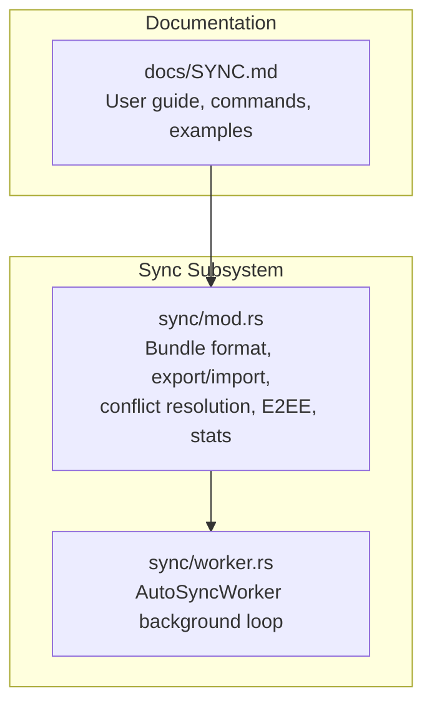
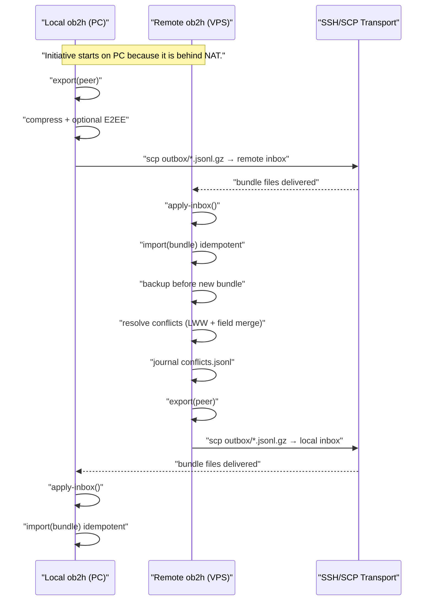
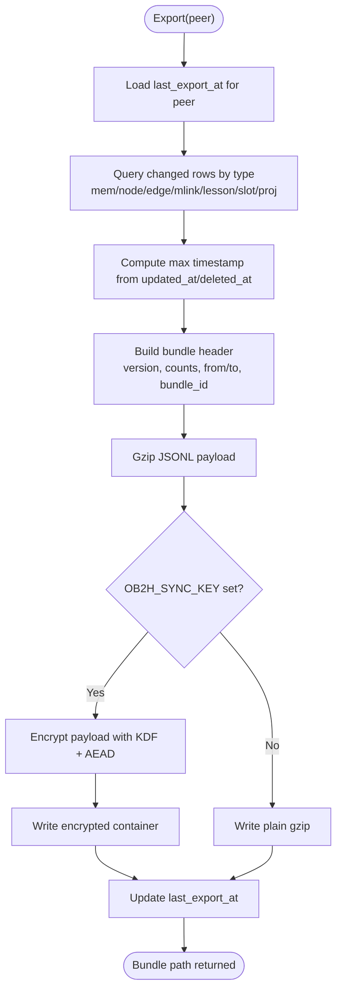
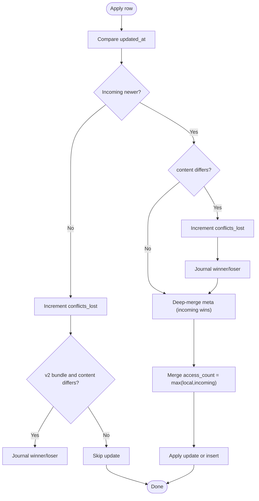
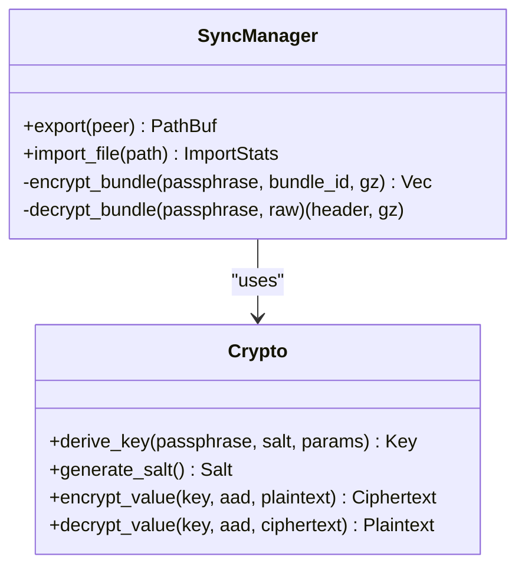
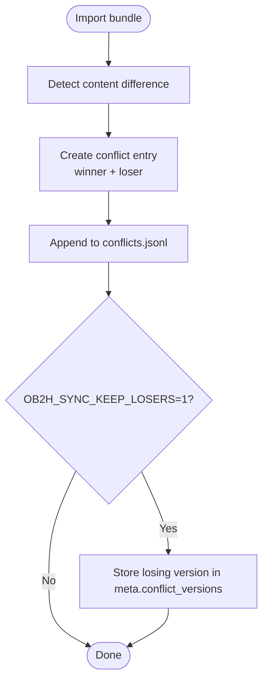
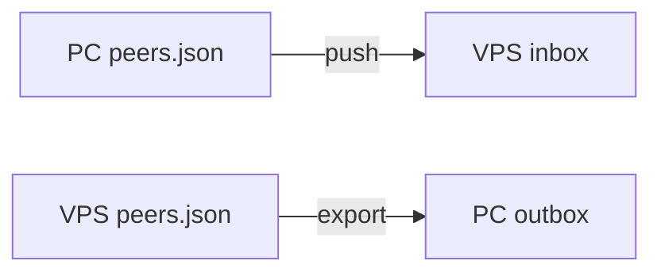
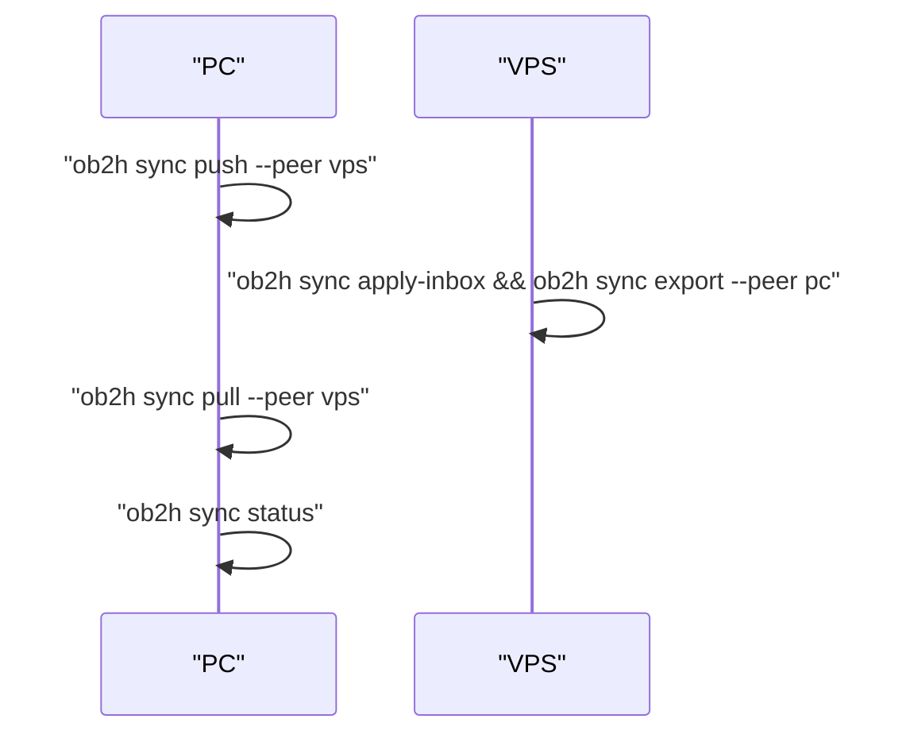
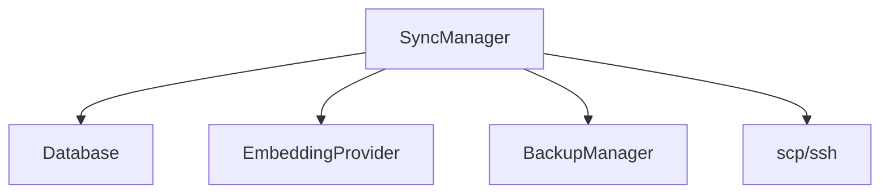

# Synchronization Concepts

<cite>
**Referenced Files in This Document**
- [SYNC.md](file://docs/SYNC.md)
- [mod.rs](file://src/sync/mod.rs)
- [worker.rs](file://src/sync/worker.rs)
</cite>

## Table of Contents
1. [Introduction](#introduction)
2. [Project Structure](#project-structure)
3. [Core Components](#core-components)
4. [Architecture Overview](#architecture-overview)
5. [Detailed Component Analysis](#detailed-component-analysis)
6. [Dependency Analysis](#dependency-analysis)
7. [Performance Considerations](#performance-considerations)
8. [Troubleshooting Guide](#troubleshooting-guide)
9. [Conclusion](#conclusion)
10. [Appendices](#appendices)

## Introduction
This section documents OB2H’s cross-machine synchronization system. It explains how two instances (for example, a local PC and a remote VPS) share knowledge without exposing live databases or relying on cloud services. The system moves compact, incremental “bundles” over SSH, resolves concurrent edits intelligently, optionally encrypts bundles end-to-end, journals merge conflicts, and provides backup and recovery guarantees around import operations.

At a high level:
- Each machine exports only changed rows since the last successful export.
- Bundles are gzip-compressed JSONL files with a header describing bundle identity, version, counts, and time bounds.
- Import is idempotent by `bundle_id`, applies changes atomically, and creates an automatic backup before applying new bundles.
- Conflicts are resolved using a later-write-wins strategy with an origin priority tie-breaker, while metadata can be merged field-by-field.
- Optional end-to-end encryption protects bundle payloads even if they pass through untrusted storage or intermediate directories.

## Project Structure
The synchronization subsystem lives under `src/sync` and is documented at `docs/SYNC.md`.

**Diagram sources**
- [mod.rs:1-28](file://src/sync/mod.rs#L1-L28)
- [worker.rs:1-65](file://src/sync/worker.rs#L1-L65)
- [SYNC.md:1-20](file://docs/SYNC.md#L1-L20)

**Section sources**
- [mod.rs:1-28](file://src/sync/mod.rs#L1-L28)
- [worker.rs:1-65](file://src/sync/worker.rs#L1-L65)
- [SYNC.md:1-20](file://docs/SYNC.md#L1-L20)

## Core Components
- **Node configuration**: Defines this machine’s identity (`origin`), LWW tie-break order (`priority`), peer definitions, and whether to sync automatically after each auto-dream run.
- **Peer configuration**: Describes transport method (`ssh` or `manual`), host alias, optional SSH port, and remote inbox/outbox paths.
- **SyncManager**: Central orchestrator for exporting delta bundles, importing bundles, pushing/pulling via SSH, verifying drift without data transfer, and reporting status.
- **AutoSyncWorker**: Background worker that periodically pushes and pulls configured SSH peers.

Key responsibilities:
- Exporting incremental deltas per peer based on a watermark cursor.
- Applying bundles atomically with idempotency and conflict journaling.
- Optionally encrypting bundle payloads end-to-end.
- Providing verification and status utilities for operators.

**Section sources**
- [mod.rs:31-105](file://src/sync/mod.rs#L31-L105)
- [mod.rs:194-245](file://src/sync/mod.rs#L194-L245)
- [worker.rs:9-65](file://src/sync/worker.rs#L9-L65)

## Architecture Overview
The sync architecture uses file-based bundles moved over SSH. There is no direct database replication; instead, machines exchange compressed JSONL bundles containing only changed records.

**Diagram sources**
- [mod.rs:247-469](file://src/sync/mod.rs#L247-L469)
- [mod.rs:506-733](file://src/sync/mod.rs#L506-L733)
- [mod.rs:1498-1574](file://src/sync/mod.rs#L1498-L1574)
- [SYNC.md:32-57](file://docs/SYNC.md#L32-L57)

## Detailed Component Analysis

### Delta Bundle Format
A bundle is a gzip-compressed JSONL file with:
- A header line describing bundle identity, origin, target peer, creation time, version, full/delta mode, watermark bounds, and row counts.
- One row per changed record across tables such as memories, graph nodes, graph edges, memory links, lessons, slots, and projects.

Important properties:
- Incremental by default: only rows updated after the last export watermark are included.
- Full bundles are supported for periodic resyncs or manual use.
- Version 2 bundles include richer fields like trust, feedback timestamps, typed memory links, lessons, and slots.
- Tombstones represent deletions using `deleted_at`; re-importing the same key can resurrect a deleted item.

**Diagram sources**
- [mod.rs:247-469](file://src/sync/mod.rs#L247-L469)

**Section sources**
- [mod.rs:247-469](file://src/sync/mod.rs#L247-L469)
- [SYNC.md:49-57](file://docs/SYNC.md#L49-L57)
- [SYNC.md:257-276](file://docs/SYNC.md#L257-L276)

### Field-Level Merge Conflict Resolution
Conflict resolution follows these rules:
- Later-write-wins (LWW): compare `updated_at`; the newer timestamp wins.
- Tie-break by origin priority: if timestamps are equal, the origin earlier in `priority` wins.
- For v2 bundles, metadata (`meta`) is deep-merged so incoming keys override existing ones.
- `access_count` is merged as the maximum of local and incoming values.
- Content conflicts are always recorded in an append-only conflict journal.
- When enabled, losing content versions are preserved in `meta.conflict_versions`.

**Diagram sources**
- [mod.rs:747-754](file://src/sync/mod.rs#L747-L754)
- [mod.rs:853-963](file://src/sync/mod.rs#L853-L963)
- [mod.rs:965-1002](file://src/sync/mod.rs#L965-L1002)

**Section sources**
- [mod.rs:747-754](file://src/sync/mod.rs#L747-L754)
- [mod.rs:853-963](file://src/sync/mod.rs#L853-L963)
- [mod.rs:965-1002](file://src/sync/mod.rs#L965-L1002)
- [SYNC.md:58-68](file://docs/SYNC.md#L58-L68)

### End-to-End AES-GCM Encryption
Bundles can be encrypted end-to-end when both sides share a passphrase via `OB2H_SYNC_KEY`:
- On export, the gzip payload is wrapped in an encrypted container with a magic header, KDF parameters, salt, bundle ID, and ciphertext.
- On import, the container is detected by its magic prefix; decryption requires the same passphrase.
- The header is authenticated as associated data to prevent tampering.
- If the environment variable is not set, bundles remain uncompressed but still gzip-compressed.

**Diagram sources**
- [mod.rs:127-192](file://src/sync/mod.rs#L127-L192)
- [mod.rs:441-449](file://src/sync/mod.rs#L441-L449)
- [mod.rs:506-528](file://src/sync/mod.rs#L506-L528)

**Section sources**
- [mod.rs:127-192](file://src/sync/mod.rs#L127-L192)
- [mod.rs:441-449](file://src/sync/mod.rs#L441-L449)
- [mod.rs:506-528](file://src/sync/mod.rs#L506-L528)
- [README.md:42](file://README.md#L42)
- [README.md:157-161](file://README.md#L157-L161)
- [README.md:323](file://README.md#L323)

### Conflict Journaling System
Every content conflict is recorded in an append-only journal file:
- Location: `data/sync/conflicts.jsonl`.
- Entries include timestamp, bundle ID, key, field name, and both winner and loser versions with their origins and timestamps.
- When enabled via `OB2H_SYNC_KEEP_LOSERS=1`, losing content versions are also stored in `meta.conflict_versions` (bounded to recent entries).

**Diagram sources**
- [mod.rs:702-724](file://src/sync/mod.rs#L702-L724)
- [mod.rs:826-890](file://src/sync/mod.rs#L826-L890)
- [mod.rs:965-1002](file://src/sync/mod.rs#L965-L1002)

**Section sources**
- [mod.rs:702-724](file://src/sync/mod.rs#L702-L724)
- [mod.rs:826-890](file://src/sync/mod.rs#L826-L890)
- [mod.rs:965-1002](file://src/sync/mod.rs#L965-L1002)
- [SYNC.md:63](file://docs/SYNC.md#L63)
- [SYNC.md:267-272](file://docs/SYNC.md#L267-L272)

### Peer Configuration Examples
Example peer configuration for a PC targeting a VPS:
- `origin`: identifies this machine.
- `priority`: defines LWW tie-break order.
- `after_dream`: enables automatic push+pull after each auto-dream run.
- `peers.vps.method`: transport method (`ssh`).
- `peers.vps.host`: SSH alias or user@host.
- `peers.vps.push_to` / `pull_from`: remote directories for bundles.

**Diagram sources**
- [SYNC.md:100-137](file://docs/SYNC.md#L100-L137)

**Section sources**
- [SYNC.md:100-137](file://docs/SYNC.md#L100-L137)

### Sync Workflows
Typical workflows:
- Manual one-shot exchange:
  - PC: export and push to VPS.
  - VPS: apply inbox and export back to PC.
  - PC: pull VPS bundles and apply.
- Automated scheduling:
  - VPS: systemd timer applies inbox and prepares outbox.
  - PC: Windows task scheduler or `after_dream: true` triggers push+pull.

**Diagram sources**
- [SYNC.md:163-175](file://docs/SYNC.md#L163-L175)

**Section sources**
- [SYNC.md:143-175](file://docs/SYNC.md#L143-L175)

### CRDT-like Consistency Model
While not a formal CRDT library, the sync model exhibits CRDT-like properties:
- Commutative application: bundles are applied incrementally and idempotently by `bundle_id`.
- Monotonic counters: reinforcement counts for lessons are merged as maximums.
- Tombstone semantics: deletions propagate consistently across machines.
- Deterministic aggregation: verification computes checksums over stable identifiers and timestamps.

These properties help maintain integrity across distributed systems without requiring a central coordinator.

**Section sources**
- [mod.rs:1004-1008](file://src/sync/mod.rs#L1004-L1008)
- [mod.rs:1600-1719](file://src/sync/mod.rs#L1600-L1719)
- [SYNC.md:65-67](file://docs/SYNC.md#L65-L67)

### Security Considerations
- Transport security: SSH provides encryption for SCP transfers.
- Data-at-rest protection: optional end-to-end encryption for bundles via `OB2H_SYNC_KEY`.
- No telemetry: personal data leaves the machine only in configured bundles.
- Backup before import: automatic snapshots protect against data loss during synchronization failures.

**Section sources**
- [SYNC.md:202-209](file://docs/SYNC.md#L202-L209)
- [mod.rs:127-192](file://src/sync/mod.rs#L127-L192)
- [mod.rs:557-560](file://src/sync/mod.rs#L557-L560)

### Performance Optimizations
- Delta bundles reduce bandwidth by sending only changed rows.
- Watermarks avoid re-exporting already sent data.
- Gzip compression reduces payload size.
- Optional E2EE adds cryptographic overhead but protects sensitive data.
- Verification computes lightweight checksums without transferring content.

**Section sources**
- [mod.rs:247-469](file://src/sync/mod.rs#L247-L469)
- [mod.rs:1600-1719](file://src/sync/mod.rs#L1600-L1719)

### Troubleshooting Common Sync Issues
Common symptoms and resolutions:
- SCP destination open failure: ensure remote `push_to` directory exists.
- Peer not found: check spelling and existence of `peers.json`.
- Silent push/pull: verify scheduling or `after_dream` setting.
- Lost LWW conflicts: normal metric indicating older local edits were overwritten.
- Fact jumping between machines: ensure clocks are synchronized via NTP.
- Bundle not applied repeatedly: expected due to idempotency by `bundle_id`.
- Sync disabled until fix: indicates malformed `peers.json`.

**Section sources**
- [SYNC.md:211-222](file://docs/SYNC.md#L211-L222)

## Dependency Analysis
The sync module depends on:
- Database access for reading/writing records and tracking state.
- Embedding provider for recomputing missing embeddings during import.
- Backup manager for creating snapshots before applying new bundles.
- External tools: `scp` and `ssh` for transport and remote verification.

**Diagram sources**
- [mod.rs:194-229](file://src/sync/mod.rs#L194-L229)
- [mod.rs:570-625](file://src/sync/mod.rs#L570-L625)
- [mod.rs:1519-1574](file://src/sync/mod.rs#L1519-L1574)

**Section sources**
- [mod.rs:194-229](file://src/sync/mod.rs#L194-L229)
- [mod.rs:570-625](file://src/sync/mod.rs#L570-L625)
- [mod.rs:1519-1574](file://src/sync/mod.rs#L1519-L1574)

## Performance Considerations
- Prefer delta exports for routine synchronization; use full exports periodically or when needed.
- Ensure consistent timestamps across machines to minimize unnecessary conflicts.
- Use scheduled automation to keep watermarks moving and avoid large backlog bundles.
- Monitor conflict metrics and drift reports to detect divergence early.
- Enable E2EE only when necessary due to cryptographic overhead.

[No sources needed since this section provides general guidance]

## Troubleshooting Guide
Operational checks:
- Verify SSH connectivity and SCP functionality.
- Confirm `peers.json` structure and permissions.
- Inspect `data/sync/inbox` and `data/sync/outbox` for unexpected files.
- Review `data/sync/conflicts.jsonl` for detailed conflict history.
- Run `ob2h sync verify` to compare local and remote statistics without transferring data.
- Use `ob2h sync status` to inspect origins, priorities, watermarks, and conflict totals.

**Section sources**
- [SYNC.md:190-209](file://docs/SYNC.md#L190-L209)
- [mod.rs:1721-1800](file://src/sync/mod.rs#L1721-L1800)
- [mod.rs:1802-1880](file://src/sync/mod.rs#L1802-L1880)

## Conclusion
OB2H’s synchronization system provides a robust, secure, and efficient mechanism for sharing knowledge across machines. By combining delta bundles, LWW conflict resolution with field-level merging, optional end-to-end encryption, conflict journaling, and automated backups, it ensures data integrity and operational resilience. Operators can rely on verification and status tools to maintain consistency and quickly resolve issues.

[No sources needed since this section summarizes without analyzing specific files]

## Appendices

### Commands Reference
- `status`: shows origin, priorities, watermarks, bundle counts, and accumulated lost conflicts.
- `export --peer <name>`: exports changes to `data/sync/outbox/`; supports full bundles.
- `import <files...>`: applies specific bundles.
- `apply-inbox`: applies all bundles in `data/sync/inbox/`.
- `push --peer <name>`: exports and SCPs to peer.
- `pull --peer <name>`: SCPs from peer and applies inbox.
- `verify [--peer <name>]`: compares statistics without transferring data.

**Section sources**
- [SYNC.md:190-201](file://docs/SYNC.md#L190-L201)