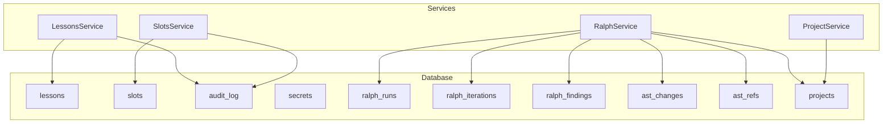
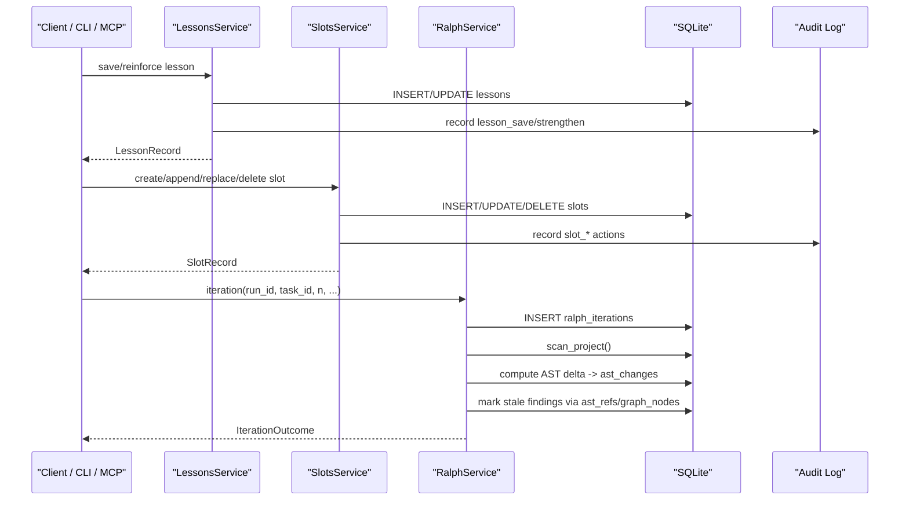
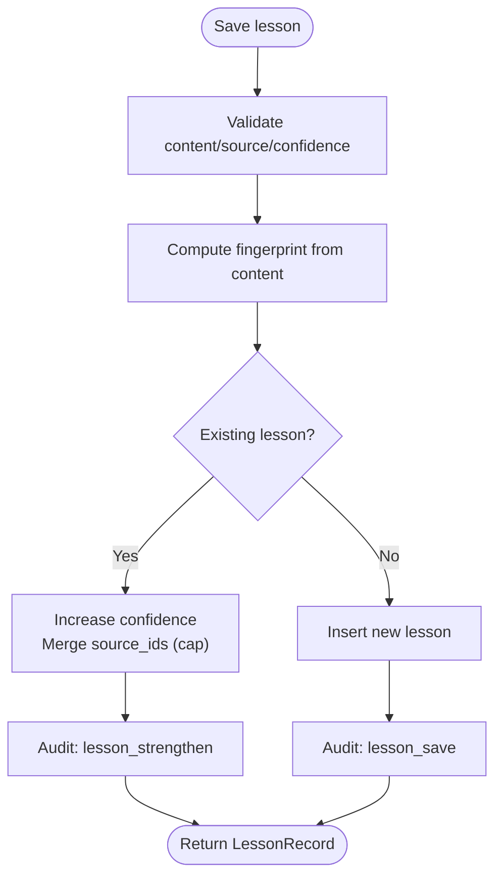
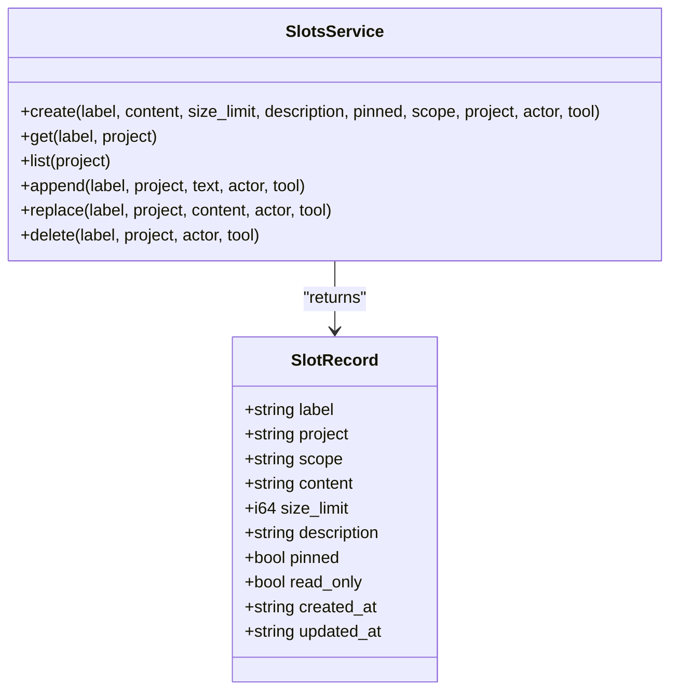
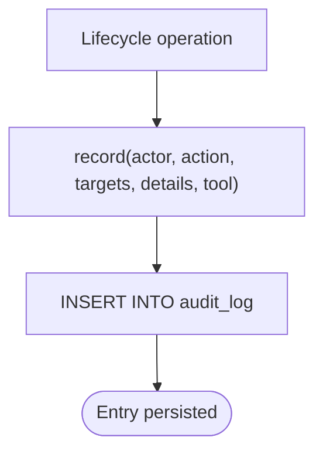
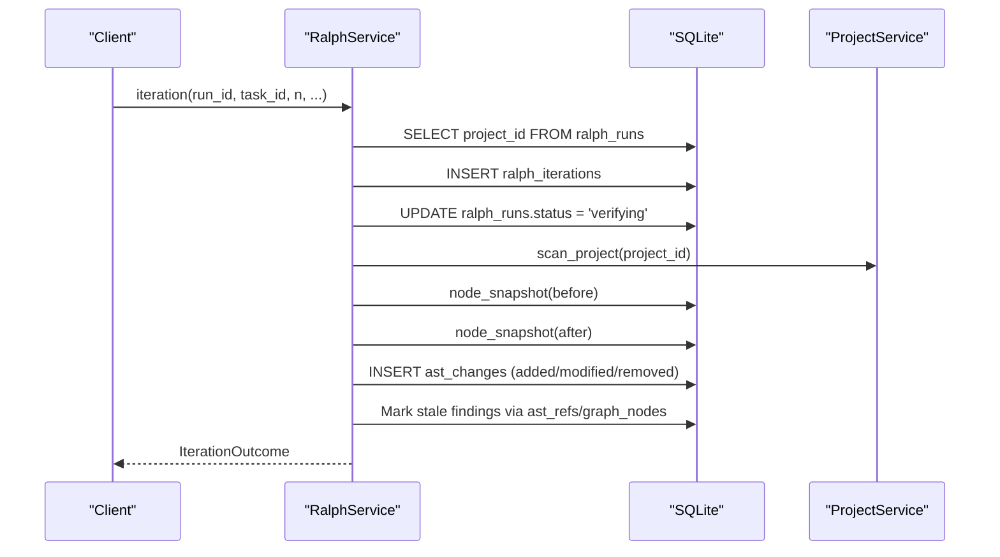
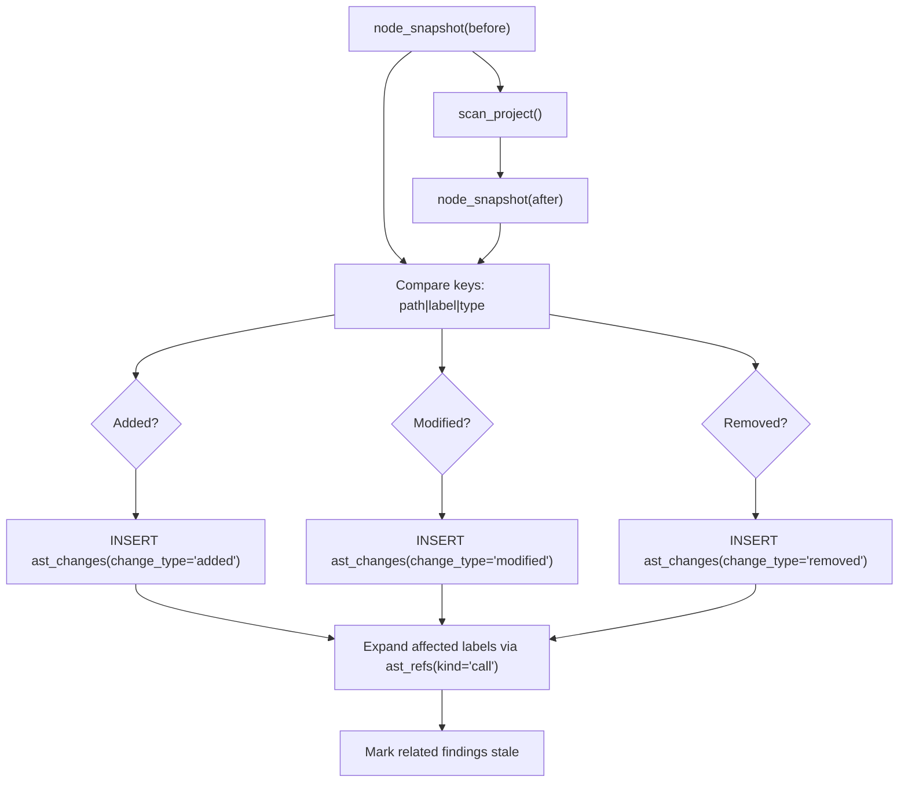
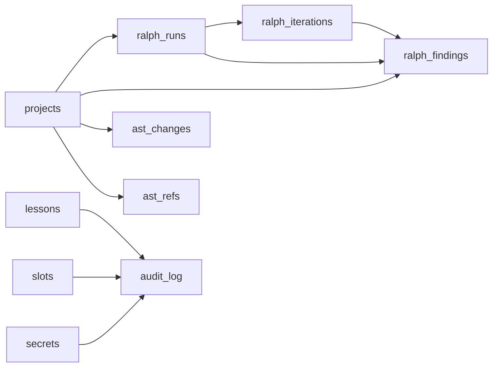

# Advanced Features Tables

<cite>
**Referenced Files in This Document**
- [schema.rs](file://src/db/schema.rs)
- [lessons.rs](file://src/lifecycle/lessons.rs)
- [slots.rs](file://src/lifecycle/slots.rs)
- [audit.rs](file://src/lifecycle/audit.rs)
- [mod.rs](file://src/ralph/mod.rs)
- [ast.rs](file://src/project/ast.rs)
</cite>

## Table of Contents
1. [Introduction](#introduction)
2. [Project Structure](#project-structure)
3. [Core Components](#core-components)
4. [Architecture Overview](#architecture-overview)
5. [Detailed Component Analysis](#detailed-component-analysis)
6. [Dependency Analysis](#dependency-analysis)
7. [Performance Considerations](#performance-considerations)
8. [Troubleshooting Guide](#troubleshooting-guide)
9. [Conclusion](#conclusion)
10. [Appendices](#appendices)

## Introduction
This document describes OB2H’s advanced feature tables and how they enable lifecycle management, context persistence, a security vault, development cycle tracking, and AST reference resolution. The focus is on:
- lessons, slots, audit_log (lifecycle and context)
- secrets (security vault)
- ralph_runs, ralph_iterations, ralph_findings (development cycles)
- ast_changes, ast_refs (AST deltas and cross-file references)

These tables are defined through versioned migrations and consumed by domain services that implement automated processing, code analysis, and security management workflows.

## Project Structure
The advanced features are implemented across:
- Database schema and migrations: `src/db/schema.rs`
- Lifecycle layer (lessons, slots, audit): `src/lifecycle/lessons.rs`, `src/lifecycle/slots.rs`, `src/lifecycle/audit.rs`
- Ralph knowledge layer (runs, iterations, findings, AST delta): `src/ralph/mod.rs`
- AST extraction and reference structures: `src/project/ast.rs`

**Diagram sources**
- [schema.rs:31-207](file://src/db/schema.rs#L31-L207)
- [schema.rs:337-450](file://src/db/schema.rs#L337-L450)
- [lessons.rs:82-133](file://src/lifecycle/lessons.rs#L82-L133)
- [slots.rs:48-50](file://src/lifecycle/slots.rs#L48-L50)
- [mod.rs:30-34](file://src/ralph/mod.rs#L30-L34)

**Section sources**
- [schema.rs:1-519](file://src/db/schema.rs#L1-L519)
- [lessons.rs:1-545](file://src/lifecycle/lessons.rs#L1-L545)
- [slots.rs:1-554](file://src/lifecycle/slots.rs#L1-L554)
- [audit.rs:1-109](file://src/lifecycle/audit.rs#L1-L109)
- [mod.rs:1-800](file://src/ralph/mod.rs#L1-L800)
- [ast.rs:1-119](file://src/project/ast.rs#L1-L119)

## Core Components
- Lessons: procedural experience with confidence, reinforcement, decay, and FTS search.
- Slots: editable agent-owned memory units with size limits, pinning, and project/global scoping.
- Audit log: append-only ledger for lifecycle and secret operations.
- Secrets: encrypted storage with PIN protection.
- Ralph runs/iterations/findings: structured development cycles with verdicts and metrics.
- AST changes and refs: deterministic AST deltas and cross-file call/import references.

**Section sources**
- [schema.rs:384-450](file://src/db/schema.rs#L384-L450)
- [schema.rs:111-207](file://src/db/schema.rs#L111-L207)
- [schema.rs:337-348](file://src/db/schema.rs#L337-L348)
- [mod.rs:1-100](file://src/ralph/mod.rs#L1-L100)

## Architecture Overview
The advanced features integrate around the database schema and domain services:

**Diagram sources**
- [lessons.rs:163-279](file://src/lifecycle/lessons.rs#L163-L279)
- [slots.rs:259-449](file://src/lifecycle/slots.rs#L259-L449)
- [mod.rs:150-247](file://src/ralph/mod.rs#L150-L247)
- [schema.rs:384-450](file://src/db/schema.rs#L384-L450)
- [schema.rs:111-207](file://src/db/schema.rs#L111-L207)

## Detailed Component Analysis

### Lessons Table
Purpose:
- Store procedural lessons with confidence, reinforcement history, source attribution, tags, and optional project scope.
- Support recall using FTS5 BM25 over content/context, combined with confidence and recency boost.
- Provide soft-delete tombstones and weekly decay sweep without auto-deletion.

Key fields and behavior:
- Primary key: `seq INTEGER AUTOINCREMENT`; unique id: `id TEXT UNIQUE`.
- Fields include content, context, confidence, reinforcements, source, source_ids, project, tags, decay_rate, timestamps, last_reinforced_at, last_decayed_at, deleted_at.
- FTS virtual table `lessons_fts` indexes content and context; triggers keep it in sync.
- Decay sweep reduces confidence based on weeks since baseline, with a floor and candidate threshold reporting.

Relationships:
- Soft-delete via `deleted_at`.
- Audited via `audit_log` on save, strengthen, delete, and decay events.

Complexity notes:
- Recall uses FTS5 with fallback to LIKE for short or unusual queries.
- Score combines relevance (BM25), confidence, and recency boost.

**Diagram sources**
- [lessons.rs:163-279](file://src/lifecycle/lessons.rs#L163-L279)

**Section sources**
- [schema.rs:384-424](file://src/db/schema.rs#L384-L424)
- [lessons.rs:40-91](file://src/lifecycle/lessons.rs#L40-L91)
- [lessons.rs:156-279](file://src/lifecycle/lessons.rs#L156-L279)
- [lessons.rs:281-401](file://src/lifecycle/lessons.rs#L281-L401)
- [lessons.rs:457-543](file://src/lifecycle/lessons.rs#L457-L543)

### Slots Table
Purpose:
- Provide editable, bounded-memory slots for agents with pinned injection into context.
- Support global and per-project scopes where project-level slots shadow global ones.
- Enforce strict label validation, size limits, read-only protection, and append/replace semantics.

Key fields and behavior:
- Primary key: `(label, project)`; default project is empty string for global.
- Fields include content, size_limit, description, pinned, read_only, timestamps.
- Pinned slots can be injected into agent context up to a configurable budget.
- Seed defaults are lazily created per project and globally.

Relationships:
- Audited via `audit_log` on create, append, replace, delete.

Complexity notes:
- List resolves shadowing by preferring project-scoped slots over global for the same label.
- Append enforces 413-like semantics when exceeding size_limit.

**Diagram sources**
- [slots.rs:32-46](file://src/lifecycle/slots.rs#L32-L46)
- [slots.rs:136-449](file://src/lifecycle/slots.rs#L136-L449)

**Section sources**
- [schema.rs:426-438](file://src/db/schema.rs#L426-L438)
- [slots.rs:52-75](file://src/lifecycle/slots.rs#L52-L75)
- [slots.rs:77-134](file://src/lifecycle/slots.rs#L77-L134)
- [slots.rs:190-243](file://src/lifecycle/slots.rs#L190-L243)
- [slots.rs:259-449](file://src/lifecycle/slots.rs#L259-L449)

### Audit Log Table
Purpose:
- Append-only ledger recording lifecycle operations (lessons, slots) and secret-related metadata.
- Supports filtering by action, listing recent entries, and periodic pruning.

Key fields and behavior:
- Auto-increment id, timestamp, actor, action, target_ids (JSON array), details (JSON object), source_tool.
- Indexes optimize lookup by action.
- Pruning supports one-time and weekly rotation with cursor-based scheduling.

Relationships:
- Consumed by LessonsService and SlotsService for all write paths.

**Diagram sources**
- [audit.rs:30-53](file://src/lifecycle/audit.rs#L30-L53)

**Section sources**
- [schema.rs:440-450](file://src/db/schema.rs#L440-L450)
- [audit.rs:1-109](file://src/lifecycle/audit.rs#L1-L109)

### Secrets Table
Purpose:
- Securely store sensitive values with encryption and PIN protection.
- Track access patterns and hints while never logging secret contents.

Key fields and behavior:
- Primary key: name; ciphertext stored as BLOB; hint text; timestamps; access_count; last_accessed.
- Service exposes crypto primitives, IPC server/client, and PIN input mechanisms.

Relationships:
- Audit log records metadata only; no secret values are written to audit.

**Section sources**
- [schema.rs:337-348](file://src/db/schema.rs#L337-L348)
- [mod.rs:1-15](file://src/secrets/mod.rs#L1-L15)

### Ralph Runs, Iterations, Findings Tables
Purpose:
- Track development cycles with runs, iterations, and findings.
- Compute automatic verdicts from test summaries, record AST deltas, and propagate staleness.

Key relationships:
- ralph_runs: run-level metadata, status, autonomy, budgets, timestamps.
- ralph_iterations: per-task iterations with git diffs, hypothesis/plan/result, tests_summary, verdict, ladder_rung, context_ref, tokens/duration.
- ralph_findings: findings linked to runs/iterations/projects with kind, content, symbols, verdict, embedding, meta, staleness.

Processing logic:
- start(): ensures one active run per (project, feature).
- iteration(): inserts iteration, scans project, computes AST delta, adds findings, updates run status.
- record_ast_delta(): compares node snapshots before/after scan, writes added/modified/removed changes, marks related findings stale via ast_refs and graph_nodes.
- set_verdict(): allows manual or automated verdict updates.
- context(): builds a context package including spec fragments, negative experience, reuse candidates, invariants, architecture zone.

**Diagram sources**
- [mod.rs:150-247](file://src/ralph/mod.rs#L150-L247)
- [mod.rs:249-416](file://src/ralph/mod.rs#L249-L416)
- [schema.rs:129-207](file://src/db/schema.rs#L129-L207)

**Section sources**
- [schema.rs:129-207](file://src/db/schema.rs#L129-L207)
- [mod.rs:98-247](file://src/ralph/mod.rs#L98-L247)
- [mod.rs:249-416](file://src/ralph/mod.rs#L249-L416)
- [mod.rs:423-525](file://src/ralph/mod.rs#L423-L525)
- [mod.rs:527-725](file://src/ralph/mod.rs#L527-L725)

### AST Changes and AST Refs Tables
Purpose:
- ast_changes: deterministic deltas between AST snapshots, capturing added/modified/removed nodes with signatures and location deltas.
- ast_refs: precise incremental resolution of cross-file CALLS/IMPORTS, enabling staleness propagation and reuse candidate discovery.

Key fields and behavior:
- ast_changes: path, node_key, label, node_type, change_type, sig_before/sig_after, loc_delta, timestamps.
- ast_refs: project_id, rel_path, line, kind, name, module, item, alias, timestamps.

Usage:
- RalphService computes deltas by comparing node snapshots keyed by path|label|type and signature.
- Staleness pass expands affected labels via ast_refs (kind=call) to invalidate related findings.

**Diagram sources**
- [mod.rs:249-416](file://src/ralph/mod.rs#L249-L416)
- [schema.rs:111-127](file://src/db/schema.rs#L111-L127)
- [schema.rs:190-207](file://src/db/schema.rs#L190-L207)

**Section sources**
- [schema.rs:111-127](file://src/db/schema.rs#L111-L127)
- [schema.rs:190-207](file://src/db/schema.rs#L190-L207)
- [mod.rs:249-416](file://src/ralph/mod.rs#L249-L416)
- [ast.rs:54-98](file://src/project/ast.rs#L54-L98)

## Dependency Analysis
Inter-table dependencies:
- ralph_iterations references ralph_runs (run_id).
- ralph_findings optionally references ralph_runs (run_id) and ralph_iterations (iteration_id), plus projects (project_id).
- ast_changes references projects (project_id), optionally ralph_runs (run_id) and ralph_iterations (iteration_id).
- ast_refs references projects (project_id).
- lessons and slots are independent but audited by audit_log.
- secrets are independent but audited by audit_log.

Coupling and cohesion:
- RalphService tightly couples runs/iterations/findings with AST deltas and project scanning.
- LessonsService and SlotsService encapsulate lifecycle concerns with clear boundaries and audit integration.
- AuditLog is a low-coupling append-only sink used by multiple domains.

External dependencies:
- ProjectService provides project metadata and scanning capabilities used by RalphService.
- SQLite FTS5 enables efficient full-text search for lessons and graph nodes.

Potential circular dependencies:
- None observed; dependencies flow from services to schema and from RalphService to ProjectService.

**Diagram sources**
- [schema.rs:129-207](file://src/db/schema.rs#L129-L207)
- [schema.rs:384-450](file://src/db/schema.rs#L384-L450)
- [schema.rs:337-348](file://src/db/schema.rs#L337-L348)

**Section sources**
- [schema.rs:129-207](file://src/db/schema.rs#L129-L207)
- [schema.rs:384-450](file://src/db/schema.rs#L384-L450)
- [schema.rs:337-348](file://src/db/schema.rs#L337-L348)

## Performance Considerations
- FTS5 indexing:
  - lessons_fts and graph_nodes_fts provide BM25 search performance; avoid full scans.
- Index usage:
  - idx_memories_cat_imp, idx_graph_nodes_provenance, idx_ast_refs_proj_path, idx_ast_refs_target_name, idx_ast_changes_proj, idx_ast_changes_iter, idx_ralph_iterations_run, idx_ralph_findings_proj.
- Query patterns:
  - Lessons recall uses FTS5 with fallback to LIKE; ensure query length and tokenization are considered.
  - Ralph iteration triggers project scans; batch operations and limit results where possible.
- Memory and size constraints:
  - Slots enforce size limits and budget caps for pinned context injection.
  - Lessons decay sweep is throttled via KV cursor to run periodically.

[No sources needed since this section provides general guidance]

## Troubleshooting Guide
Common issues and resolutions:
- Lessons:
  - Empty or oversized content: validate content length and non-empty checks.
  - Invalid source enum: ensure source is one of allowed values.
  - Confidence range: must be within 0.0–1.0.
- Slots:
  - Label validation: must start with lowercase letter, contain only a-z, 0-9, underscore, and length cap.
  - Scope mismatch: project-scoped slots require a project identifier.
  - Read-only protection: cannot append/replace/delete read-only slots.
  - Size limit exceeded: use slot_replace to compact content.
- Ralph:
  - Active run conflict: only one active run per (project, feature); archive or report before starting another.
  - Verdict constraints: only allowed verdicts accepted.
  - Finding kind constraints: only allowed kinds accepted.
- Audit:
  - Ensure audit entries do not contain secret values; only names and metadata are recorded.

**Section sources**
- [lessons.rs:163-183](file://src/lifecycle/lessons.rs#L163-L183)
- [slots.rs:52-67](file://src/lifecycle/slots.rs#L52-L67)
- [slots.rs:271-289](file://src/lifecycle/slots.rs#L271-L289)
- [slots.rs:322-414](file://src/lifecycle/slots.rs#L322-L414)
- [mod.rs:103-148](file://src/ralph/mod.rs#L103-L148)
- [mod.rs:423-449](file://src/ralph/mod.rs#L423-L449)
- [audit.rs:1-10](file://src/lifecycle/audit.rs#L1-L10)

## Conclusion
OB2H’s advanced feature tables provide a robust foundation for lifecycle management, context persistence, secure secret handling, iterative development tracking, and precise AST analysis. The schema evolves through well-defined migrations, and domain services enforce business rules, performance constraints, and auditability. Together, these components support automated processing, code analysis, and security management at scale.

[No sources needed since this section summarizes without analyzing specific files]

## Appendices

### Migration History and Version-Specific Schema Changes
- M1 (v1.0): Base schema with kv, memories, documents, chunks, graph_nodes, graph_edges, dream_runs, FTS5 for memories/chunks.
- M2 (v0.9+): Sync columns origin/deleted_at/updated_at; sync_state table.
- M3 (v1.0+): projects table; project_id on memories/documents/chunks/graph_nodes/graph_edges; provenance/confidence/is_god_node.
- M4 (v1.2+): project_files for incremental AST scanning.
- M5 (v1.3): trust and memory_links for machine signals and deterministic links.
- M6 (v1.3): Ralph Knowledge Layer — ralph_runs, ralph_iterations, ralph_findings, ast_changes.
- M7 (v1.4): soft-delete for memory_links.
- M8 (v1.8+): ast_refs for precise incremental cross-file references.
- M9 (v1.9): secrets table for encrypted storage.
- M10 (v1.9): graph_nodes_fts for fast lexical search.
- M11 (v1.9.9): lessons, lessons_fts, slots, audit_log for lifecycle and context.

**Section sources**
- [schema.rs:222-334](file://src/db/schema.rs#L222-L334)
- [schema.rs:7-26](file://src/db/schema.rs#L7-L26)
- [schema.rs:28-67](file://src/db/schema.rs#L28-L67)
- [schema.rs:69-81](file://src/db/schema.rs#L69-L81)
- [schema.rs:83-102](file://src/db/schema.rs#L83-L102)
- [schema.rs:104-109](file://src/db/schema.rs#L104-L109)
- [schema.rs:111-127](file://src/db/schema.rs#L111-L127)
- [schema.rs:129-207](file://src/db/schema.rs#L129-L207)
- [schema.rs:337-348](file://src/db/schema.rs#L337-L348)
- [schema.rs:350-374](file://src/db/schema.rs#L350-L374)
- [schema.rs:376-450](file://src/db/schema.rs#L376-L450)