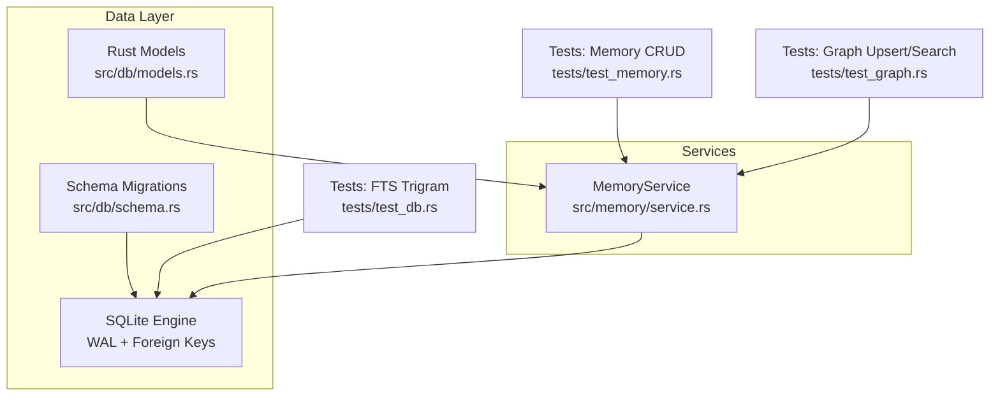
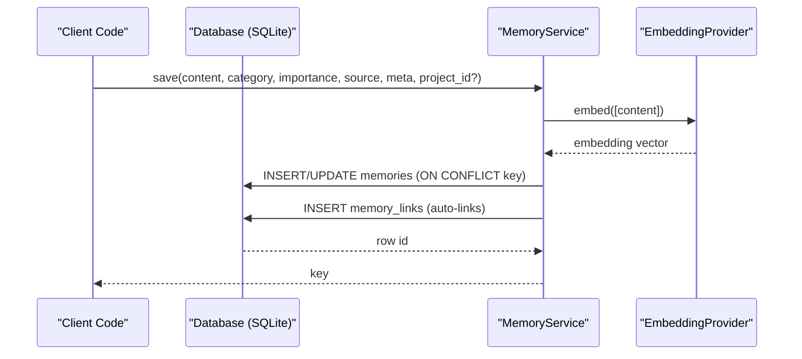
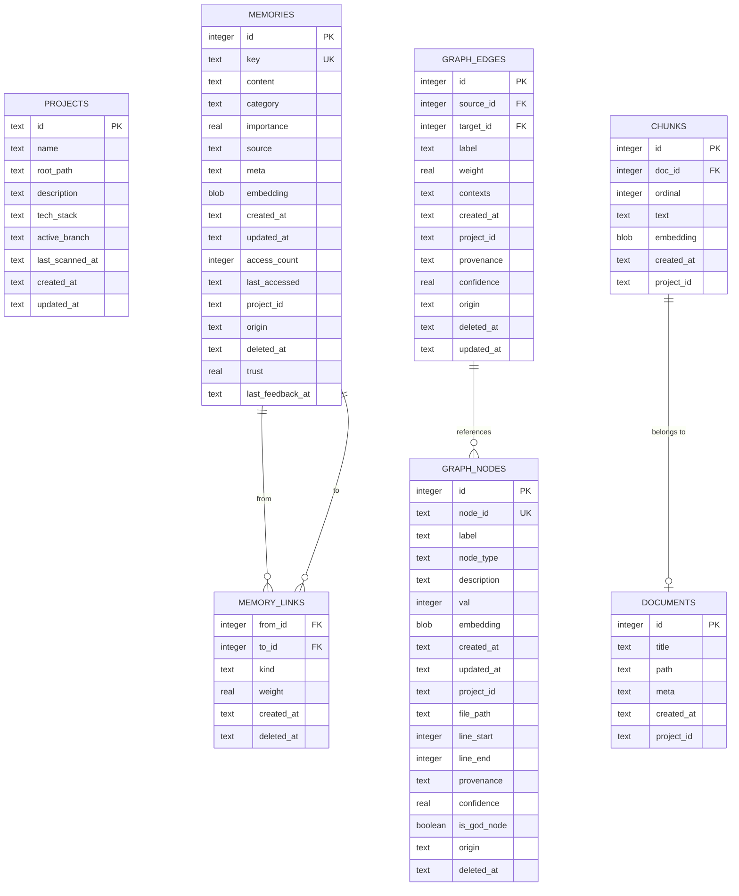

# Core Tables

<cite>
**Referenced Files in This Document**
- [schema.rs](file://src/db/schema.rs)
- [models.rs](file://src/db/models.rs)
- [mod.rs](file://src/db/mod.rs)
- [service.rs](file://src/memory/service.rs)
- [test_db.rs](file://tests/test_db.rs)
- [test_memory.rs](file://tests/test_memory.rs)
- [test_graph.rs](file://tests/test_graph.rs)
</cite>

## Table of Contents
1. [Introduction](#introduction)
2. [Project Structure](#project-structure)
3. [Core Components](#core-components)
4. [Architecture Overview](#architecture-overview)
5. [Detailed Component Analysis](#detailed-component-analysis)
6. [Dependency Analysis](#dependency-analysis)
7. [Performance Considerations](#performance-considerations)
8. [Troubleshooting Guide](#troubleshooting-guide)
9. [Conclusion](#conclusion)

## Introduction
This document provides comprehensive data model documentation for OB2H’s core database tables: memories, graph_nodes, graph_edges, projects, and documents. It explains schema definitions, field types, constraints, primary/foreign keys, referential integrity policies, usage patterns, sample data examples, common queries, indexing strategies, and performance considerations. The goal is to make the data layer accessible to both technical and non-technical readers while remaining precise and traceable to the codebase.

## Project Structure
The data model is defined in the SQLite schema migrations and mirrored by Rust models used across services. Key files:
- Schema migrations define table structures, indexes, FTS virtual tables, and triggers.
- Rust models map to rows for application logic.
- Database initialization applies migrations and configures SQLite settings (WAL, foreign keys).

**Diagram sources**
- [schema.rs:1-519](file://src/db/schema.rs#L1-L519)
- [models.rs:1-107](file://src/db/models.rs#L1-L107)
- [mod.rs:1-131](file://src/db/mod.rs#L1-L131)
- [service.rs:1-200](file://src/memory/service.rs#L1-L200)
- [test_memory.rs:1-48](file://tests/test_memory.rs#L1-L48)
- [test_graph.rs:1-68](file://tests/test_graph.rs#L1-L68)
- [test_db.rs:1-47](file://tests/test_db.rs#L1-L47)

**Section sources**
- [schema.rs:1-519](file://src/db/schema.rs#L1-L519)
- [models.rs:1-107](file://src/db/models.rs#L1-L107)
- [mod.rs:1-131](file://src/db/mod.rs#L1-L131)

## Core Components
This section summarizes the five core tables and their roles:
- memories: Stores user/system knowledge with full-text search, vector embeddings, trust signals, project scoping, and soft-delete support.
- graph_nodes: Represents entities/artifacts in a knowledge graph with provenance, confidence, optional file location, and FTS search.
- graph_edges: Encodes relationships between nodes with weights, contexts, provenance, confidence, timestamps, and soft-delete.
- projects: Defines project boundaries and metadata; used to scope memories, documents, chunks, graph nodes/edges, and AST artifacts.
- documents: Top-level document records that can be chunked into smaller pieces for embedding and retrieval.

Key responsibilities:
- memories: Hybrid search (FTS + vector), identity-duplicate detection, auto-linking, decay/purge, context building.
- graph_nodes/graph_edges: Entity/relation storage, upsert semantics, neighborhood search, reasoning pipelines.
- projects: Organizational unit for scanning, incremental processing, and isolation.
- documents/chunks: Content ingestion pipeline for text analysis and embeddings.

**Section sources**
- [schema.rs:222-334](file://src/db/schema.rs#L222-L334)
- [schema.rs:30-67](file://src/db/schema.rs#L30-L67)
- [models.rs:5-107](file://src/db/models.rs#L5-L107)

## Architecture Overview
The data architecture centers on SQLite with versioned migrations, FTS5 indexes, and vector embeddings stored as BLOBs. Services interact through a thread-safe Database wrapper that enforces transactions and WAL mode.

**Diagram sources**
- [service.rs:48-167](file://src/memory/service.rs#L48-L167)
- [schema.rs:222-334](file://src/db/schema.rs#L222-L334)

## Detailed Component Analysis

### Table: memories
Purpose:
- Persistent store for human-readable facts, preferences, and system-generated insights.
- Supports hybrid search via FTS5 and vector similarity.
- Tracks access metrics, trust, project scoping, and soft-delete tombstones.

Schema highlights:
- Primary key: id (INTEGER AUTOINCREMENT).
- Unique constraint: key (TEXT UNIQUE NOT NULL).
- Fields include content, category, importance, source, meta, embedding (BLOB), timestamps, access_count, last_accessed, project_id, origin, deleted_at, trust, last_feedback_at.
- Indexes:
  - idx_memories_cat_imp ON (category, importance DESC).
  - idx_memories_project ON (project_id).
  - idx_memories_trust ON (trust).
- FTS5 virtual table: memories_fts (content, trigram tokenizer).
- Soft delete: deleted_at TEXT supports LWW sync and tombstone propagation.

Constraints and integrity:
- No explicit foreign keys to other tables from memories.
- Soft-delete pattern used across sync and consolidation flows.

Usage patterns:
- Upsert by key with ON CONFLICT handling.
- Identity-duplicate detection using cosine similarity threshold before insert.
- Auto-linking to related memories based on category/project.
- Decay and purge operations update importance and timestamps.

Sample data example:
- Insert a memory with key, content, category, importance, source, meta, embedding, created_at, updated_at, project_id.

Common queries:
- Full-text search: SELECT ... FROM memories_fts WHERE memories_fts MATCH 'query'.
- Vector similarity: use serialized embedding column with cosine/top-k helpers.
- Project-scoped retrieval: SELECT ... FROM memories WHERE project_id = ? AND deleted_at IS NULL.

Indexing strategy:
- Composite index on (category, importance) optimizes ranking queries.
- Separate index on trust improves filtering by trust thresholds.
- FTS5 with trigram tokenizer enables efficient lexical search.

Performance considerations:
- Embeddings are stored as compact BLOBs; serialization/deserialization overhead is minimal.
- Avoid full scans by leveraging FTS and indexes; prefer project-scoped filters.

**Section sources**
- [schema.rs:222-334](file://src/db/schema.rs#L222-L334)
- [schema.rs:87-102](file://src/db/schema.rs#L87-L102)
- [schema.rs:104-109](file://src/db/schema.rs#L104-L109)
- [service.rs:48-167](file://src/memory/service.rs#L48-L167)
- [test_db.rs:11-45](file://tests/test_db.rs#L11-L45)
- [test_memory.rs:6-47](file://tests/test_memory.rs#L6-L47)

### Table: graph_nodes
Purpose:
- Represents entities or artifacts in the knowledge graph (e.g., persons, modules, systems).
- Supports semantic search via FTS5 and vector embeddings.
- Includes provenance, confidence, optional file location, and “god node” flag.

Schema highlights:
- Primary key: id (INTEGER AUTOINCREMENT).
- Unique constraint: node_id (TEXT UNIQUE NOT NULL).
- Fields include label, node_type, description, val, embedding (BLOB), timestamps, project_id, file_path, line_start, line_end, provenance, confidence, is_god_node, origin, deleted_at.
- Indexes:
  - idx_graph_nodes_label ON (label).
  - idx_graph_nodes_type ON (node_type).
  - idx_graph_nodes_project ON (project_id).
  - idx_graph_nodes_provenance ON (provenance).
- FTS5 virtual table: graph_nodes_fts (label, description, trigram tokenizer).

Constraints and integrity:
- No direct foreign keys from graph_nodes to other tables.
- Soft-delete supported via deleted_at; used in sync and analytics.

Usage patterns:
- Upsert by node_id with incrementing val for repeated mentions.
- Neighborhood search returns 1-hop neighbors via graph_edges.
- Reasoning pipelines consume nodes and edges to answer questions.

Sample data example:
- Insert a node with node_id, label, node_type, description, embedding, created_at, updated_at, project_id.

Common queries:
- Lexical search: SELECT ... FROM graph_nodes_fts WHERE graph_nodes_fts MATCH 'query'.
- Vector similarity: use embedding BLOB with top-k cosine.
- Project-scoped listing: SELECT ... FROM graph_nodes WHERE project_id = ? AND deleted_at IS NULL.

Indexing strategy:
- Label and type indexes optimize filtering and grouping.
- Project and provenance indexes improve scoped queries.
- FTS5 avoids LIKE %...% scans.

Performance considerations:
- Embeddings stored as BLOBs; ensure consistent dimensionality per provider.
- Prefer FTS over LIKE for large graphs.

**Section sources**
- [schema.rs:268-293](file://src/db/schema.rs#L268-L293)
- [schema.rs:30-67](file://src/db/schema.rs#L30-L67)
- [schema.rs:350-374](file://src/db/schema.rs#L350-L374)
- [test_graph.rs:8-67](file://tests/test_graph.rs#L8-L67)

### Table: graph_edges
Purpose:
- Encodes directed relationships between graph_nodes with labels, weights, and contextual information.
- Supports provenance, confidence, timestamps, and soft-delete.

Schema highlights:
- Primary key: id (INTEGER AUTOINCREMENT).
- Unique constraint: (source_id, target_id, label).
- Foreign keys:
  - source_id REFERENCES graph_nodes(id) ON DELETE CASCADE.
  - target_id REFERENCES graph_nodes(id) ON DELETE CASCADE.
- Fields include label, weight, contexts (TEXT), timestamps, project_id, provenance, confidence, origin, deleted_at, updated_at.
- Indexes:
  - idx_graph_edges_src ON (source_id).
  - idx_graph_edges_dst ON (target_id).
  - idx_graph_edges_project ON (project_id).

Constraints and integrity:
- Enforced cascade deletion ensures orphan edges are removed when nodes are deleted.
- Soft-delete via deleted_at supports tombstone replication.

Usage patterns:
- Create edges during entity relation extraction.
- Query 1-hop neighborhoods for search expansion and reasoning.

Sample data example:
- Insert an edge linking two nodes with label, weight, contexts, timestamps, project_id.

Common queries:
- Neighbors of a node: SELECT ... FROM graph_edges WHERE source_id = ? OR target_id = ?.
- Project-scoped edges: SELECT ... FROM graph_edges WHERE project_id = ? AND deleted_at IS NULL.

Indexing strategy:
- Source/target indexes optimize neighbor lookups.
- Project index improves scoped queries.

Performance considerations:
- Use precomputed adjacency lists for hot paths if needed.
- Avoid scanning all edges; filter by project and direction.

**Section sources**
- [schema.rs:282-293](file://src/db/schema.rs#L282-L293)
- [schema.rs:30-67](file://src/db/schema.rs#L30-L67)

### Table: projects
Purpose:
- Defines project boundaries, metadata, and scan state.
- Used to scope memories, documents, chunks, graph nodes/edges, and AST references.

Schema highlights:
- Primary key: id (TEXT PRIMARY KEY).
- Fields include name, root_path, description, tech_stack, active_branch, last_scanned_at, timestamps.
- Index: idx_projects_root_path ON (root_path).

Constraints and integrity:
- Referenced by many tables via project_id; no FK enforcement at this level but logical scoping is enforced by application logic.

Usage patterns:
- Create project record before scanning or ingesting content.
- Filter queries by project_id to isolate workspaces.

Sample data example:
- Insert a project with id, name, root_path, description, tech_stack, active_branch, timestamps.

Common queries:
- Lookup by root path: SELECT ... FROM projects WHERE root_path = ?.
- List projects: SELECT ... FROM projects ORDER BY updated_at DESC.

Indexing strategy:
- Root path index accelerates workspace resolution.

Performance considerations:
- Keep project metadata small; avoid storing large blobs here.

**Section sources**
- [schema.rs:30-48](file://src/db/schema.rs#L30-L48)
- [models.rs:5-16](file://src/db/models.rs#L5-L16)

### Table: documents
Purpose:
- Represents top-level documents that may be chunked for embedding and retrieval.
- Can be associated with a project.

Schema highlights:
- Primary key: id (INTEGER AUTOINCREMENT).
- Fields include title, path, meta, timestamps, project_id.

Constraints and integrity:
- No direct FK to projects; project_id is logical scoping.

Usage patterns:
- Create document record before chunking.
- Retrieve chunks by doc_id for embedding and FTS.

Sample data example:
- Insert a document with title, path, meta, timestamps, project_id.

Common queries:
- List documents by project: SELECT ... FROM documents WHERE project_id = ?.
- Fetch chunks for a document: SELECT ... FROM chunks WHERE doc_id = ?.

Indexing strategy:
- No dedicated indexes beyond PK; rely on doc_id joins.

Performance considerations:
- Chunking should batch inserts to reduce transaction overhead.

**Section sources**
- [schema.rs:250-266](file://src/db/schema.rs#L250-L266)
- [models.rs:43-62](file://src/db/models.rs#L43-L62)

## Dependency Analysis
Relationships among core tables:
- graph_edges.source_id -> graph_nodes.id (CASCADE).
- graph_edges.target_id -> graph_nodes.id (CASCADE).
- memories, graph_nodes, graph_edges, documents, chunks reference projects.project_id logically (no FK constraints in schema for these columns).
- memory_links connects memories to memories (self-referencing) with soft-delete.

**Diagram sources**
- [schema.rs:222-334](file://src/db/schema.rs#L222-L334)
- [schema.rs:30-67](file://src/db/schema.rs#L30-L67)
- [schema.rs:87-109](file://src/db/schema.rs#L87-L109)

**Section sources**
- [schema.rs:222-334](file://src/db/schema.rs#L222-L334)
- [schema.rs:30-67](file://src/db/schema.rs#L30-L67)
- [schema.rs:87-109](file://src/db/schema.rs#L87-L109)

## Performance Considerations
- WAL mode and busy_timeout configured for concurrent access.
- FTS5 with trigram tokenizer for fast lexical search on memories and graph_nodes.
- Vector embeddings stored as BLOBs; use compact serialization and cosine similarity utilities.
- Indexes:
  - memories: (category, importance), project_id, trust.
  - graph_nodes: label, node_type, project_id, provenance.
  - graph_edges: source_id, target_id, project_id.
- Soft-delete pattern reduces expensive deletes; tombstones enable LWW sync.
- Batch writes for chunks and links to minimize transaction overhead.
- Avoid LIKE %...%; prefer FTS MATCH.

[No sources needed since this section provides general guidance]

## Troubleshooting Guide
Common issues and resolutions:
- Duplicate memories: Check identity-duplicate detection thresholds and cosine similarity; review merge_candidate markers in meta.
- Missing neighbors: Ensure graph_edges exist for both directions if undirected behavior is expected; verify project_id scoping.
- Slow searches: Confirm FTS indexes are populated; avoid full scans by adding project_id filters.
- Sync conflicts: Verify origin and deleted_at fields; tombstones must propagate correctly.

Operational checks:
- Validate schema_version matches expected value.
- Inspect counts of soft-deleted rows to detect backlog.
- Review access_count and last_accessed for memory freshness.

**Section sources**
- [mod.rs:22-57](file://src/db/mod.rs#L22-L57)
- [service.rs:86-167](file://src/memory/service.rs#L86-L167)
- [test_db.rs:7-45](file://tests/test_db.rs#L7-L45)

## Conclusion
OB2H’s core data model centers on well-indexed, versioned SQLite tables supporting hybrid search, vector embeddings, and soft-delete semantics. Projects provide logical scoping across memories, documents, chunks, and graph elements. Graph nodes and edges form a flexible knowledge graph with provenance and confidence signals. Proper indexing, FTS usage, and project scoping are essential for performance at scale.

[No sources needed since this section summarizes without analyzing specific files]