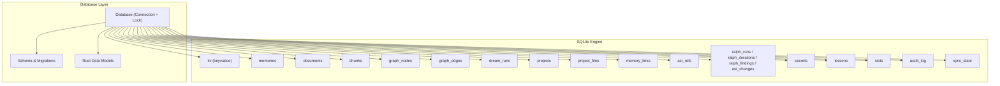
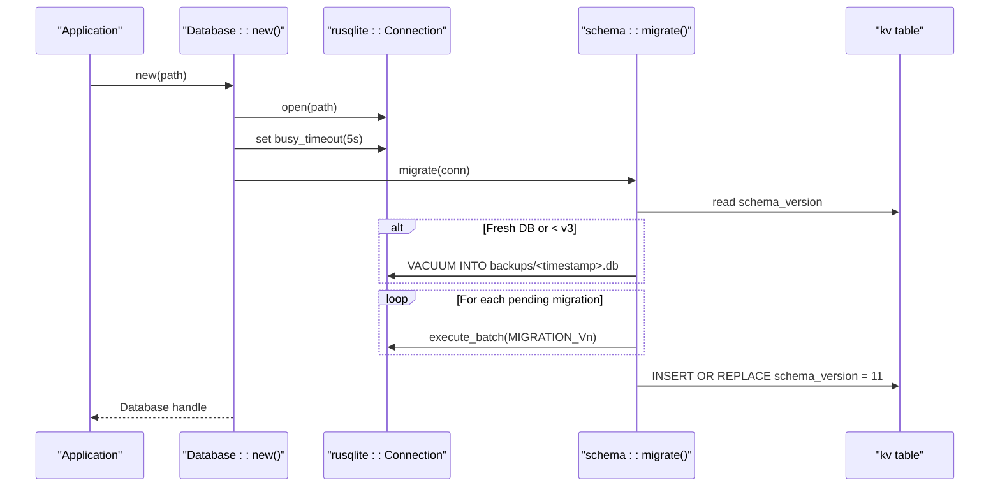
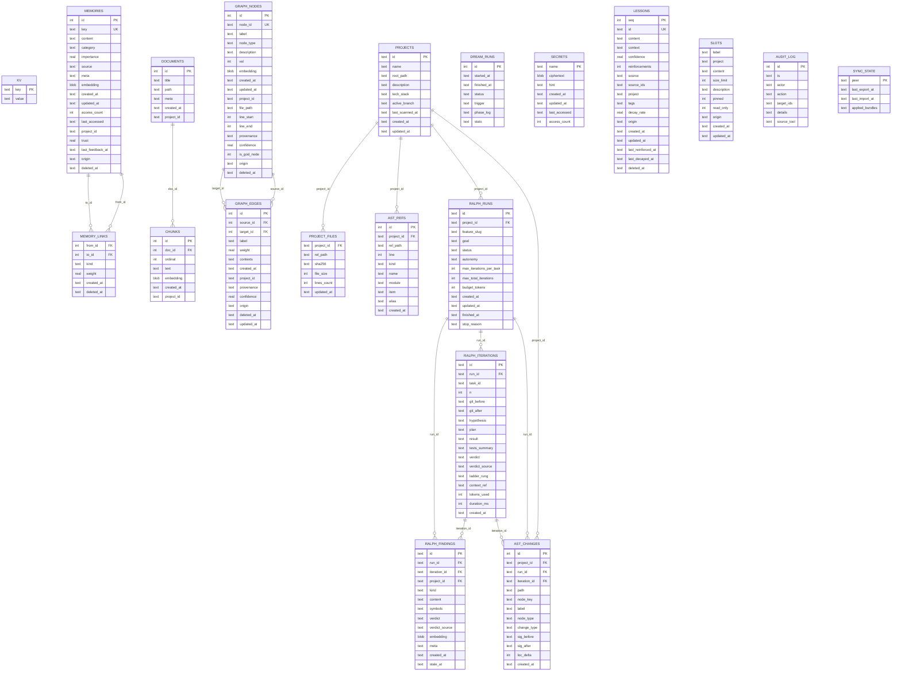
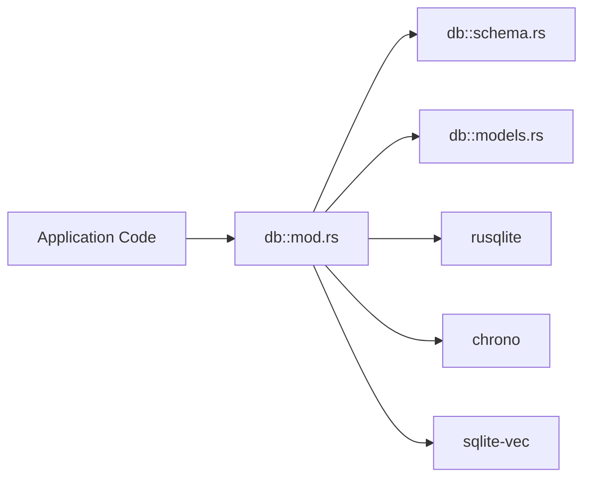

# Database Schema

<cite>
**Referenced Files in This Document**
- [schema.rs](file://src/db/schema.rs)
- [models.rs](file://src/db/models.rs)
- [mod.rs](file://src/db/mod.rs)
</cite>

## Table of Contents
1. [Introduction](#introduction)
2. [Project Structure](#project-structure)
3. [Core Components](#core-components)
4. [Architecture Overview](#architecture-overview)
5. [Detailed Component Analysis](#detailed-component-analysis)
6. [Dependency Analysis](#dependency-analysis)
7. [Performance Considerations](#performance-considerations)
8. [Troubleshooting Guide](#troubleshooting-guide)
9. [Conclusion](#conclusion)
10. [Appendices](#appendices)

## Introduction
This document describes OB2H’s SQLite database schema and data model. It covers all persistent entities, relationships, constraints, indexes, full-text search virtual tables, migration history, access patterns, performance characteristics, lifecycle policies, security considerations, and upgrade procedures. The goal is to provide a complete reference for developers, operators, and reviewers who need to understand how OB2H stores and evolves its data.

## Project Structure
The database layer is implemented in Rust under `src/db`. The key files are:
- `schema.rs`: SQL DDL, FTS5 virtual tables, triggers, and versioned migrations.
- `models.rs`: Rust structs that mirror core tables used by application code.
- `mod.rs`: Connection management, transaction helpers, WAL mode, busy timeout, backup behavior, and KV store helpers.

**Diagram sources**
- [mod.rs:17-57](file://src/db/mod.rs#L17-L57)
- [schema.rs:210-518](file://src/db/schema.rs#L210-L518)

**Section sources**
- [mod.rs:1-131](file://src/db/mod.rs#L1-L131)
- [schema.rs:1-519](file://src/db/schema.rs#L1-L519)
- [models.rs:1-107](file://src/db/models.rs#L1-L107)

## Core Components
This section summarizes the main entities and their roles.

- kv: Stores configuration and metadata such as `schema_version`.
- memories: Core knowledge entries with content, category, importance, embeddings, access metrics, project linkage, trust, feedback timestamps, and soft-delete support.
- memory_relations: Legacy relation table between memories keyed by unique string keys.
- documents/chunks: Parsed document content split into chunks; supports embeddings and project linkage.
- graph_nodes/graph_edges: Code/semantic graph representation with provenance, confidence, god-node flags, file location, and project linkage.
- dream_runs: Historical runs of the “dream” subsystem.
- projects/project_files: Project definitions and incremental scan tracking via SHA256 and line counts.
- memory_links: Deterministic auto-links between memories with kind, weight, and soft-delete.
- ast_refs: AST-level references enabling precise incremental cross-file resolution.
- Ralph Knowledge Layer: ralph_runs, ralph_iterations, ralph_findings, ast_changes for structured development cycles and change tracking.
- secrets: Encrypted secret storage with access metrics.
- lessons/slots: Lifecycle-aware learning artifacts and workspace context slots with origin-based merge semantics.
- audit_log: Append-only audit trail for actions.
- sync_state: Sync state per peer including watermarks and applied bundles.

**Section sources**
- [schema.rs:222-334](file://src/db/schema.rs#L222-L334)
- [schema.rs:30-81](file://src/db/schema.rs#L30-L81)
- [schema.rs:87-127](file://src/db/schema.rs#L87-L127)
- [schema.rs:131-207](file://src/db/schema.rs#L131-L207)
- [schema.rs:337-348](file://src/db/schema.rs#L337-L348)
- [schema.rs:384-450](file://src/db/schema.rs#L384-L450)
- [schema.rs:10-26](file://src/db/schema.rs#L10-L26)

## Architecture Overview
The database uses SQLite with WAL mode enabled, foreign keys enforced, and a single-process mutex around connections. Migrations are versioned and idempotent, applying only missing steps based on the stored `schema_version` in `kv`. Full-text search is provided via FTS5 virtual tables backed by triggers.

**Diagram sources**
- [mod.rs:23-57](file://src/db/mod.rs#L23-L57)
- [schema.rs:452-518](file://src/db/schema.rs#L452-L518)

## Detailed Component Analysis

### Entity Relationship Model
The following diagram shows primary entities and their relationships.

**Diagram sources**
- [schema.rs:222-334](file://src/db/schema.rs#L222-L334)
- [schema.rs:30-81](file://src/db/schema.rs#L30-L81)
- [schema.rs:87-127](file://src/db/schema.rs#L87-L127)
- [schema.rs:131-207](file://src/db/schema.rs#L131-L207)
- [schema.rs:337-348](file://src/db/schema.rs#L337-L348)
- [schema.rs:384-450](file://src/db/schema.rs#L384-L450)
- [schema.rs:10-26](file://src/db/schema.rs#L10-L26)

### Primary Keys, Foreign Keys, and Constraints
- Primary keys:
  - `kv.key`, `memories.id`, `documents.id`, `chunks.id`, `graph_nodes.id`, `graph_edges.id`, `dream_runs.id`
  - `projects.id`, `project_files(project_id, rel_path)`, `memory_links(from_id, to_id, kind)`
  - `ast_refs.id`, `ralph_runs.id`, `ralph_iterations.id`, `ralph_findings.id`, `ast_changes.id`
  - `secrets.name`, `lessons.seq`, `slots(label, project)`, `audit_log.id`, `sync_state.peer`
- Unique constraints:
  - `memories.key`, `graph_nodes.node_id`, `ralph_runs(project_id, feature_slug)`, `ralph_iterations(run_id, task_id, n)`
- Foreign keys and referential integrity:
  - `chunks.doc_id -> documents.id ON DELETE CASCADE`
  - `graph_edges.source_id/target_id -> graph_nodes.id ON DELETE CASCADE`
  - `project_files.project_id -> projects.id ON DELETE CASCADE`
  - `ast_refs.project_id -> projects.id ON DELETE CASCADE`
  - `ralph_runs.project_id -> projects.id ON DELETE CASCADE`
  - `ralph_iterations.run_id -> ralph_runs.id ON DELETE CASCADE`
  - `ralph_findings.run_id -> ralph_runs.id ON DELETE SET NULL`
  - `ralph_findings.iteration_id -> ralph_iterations.id ON DELETE SET NULL`
  - `ast_changes.project_id/run_id/iteration_id -> projects/ralph_runs/ralph_iterations`
  - `memory_links.from_id/to_id -> memories.id ON DELETE CASCADE`
  - `memory_relations.source_key/target_key -> memories.key ON DELETE CASCADE`
- Check constraints:
  - `ralph_iterations.verdict IN ('verified','failed','unconfirmed','overturned','stale')`
  - `ralph_findings.verdict IN ('verified','failed','unconfirmed','overturned','stale')`
- Soft deletes:
  - `memories.deleted_at`, `graph_nodes.deleted_at`, `graph_edges.deleted_at`, `memory_links.deleted_at`, `lessons.deleted_at`
- Defaults and types:
  - Timestamps use ISO-8601 strings; numeric fields include `REAL` for confidence/trimportance/trust and `INTEGER` for counters.

**Section sources**
- [schema.rs:222-334](file://src/db/schema.rs#L222-L334)
- [schema.rs:30-81](file://src/db/schema.rs#L30-L81)
- [schema.rs:87-127](file://src/db/schema.rs#L87-L127)
- [schema.rs:131-207](file://src/db/schema.rs#L131-L207)
- [schema.rs:384-450](file://src/db/schema.rs#L384-L450)
- [schema.rs:10-26](file://src/db/schema.rs#L10-L26)

### Indexes and Performance Optimizations
Indexes are defined to optimize common queries:
- Project-scoped scans: `idx_projects_root_path`, `idx_*_project` across memories/documents/chunks/graph_nodes/graph_edges/project_files/ast_refs/ralph_findings/ast_changes.
- Graph traversal: `idx_graph_edges_src`, `idx_graph_edges_dst`, `idx_graph_nodes_label`, `idx_graph_nodes_type`.
- Memory retrieval and ranking: `idx_memories_cat_imp`, `idx_memories_trust`.
- Linking and filtering: `idx_memlink_from`, `idx_memlink_to`, `idx_memlink_deleted`.
- Iteration and change queries: `idx_ralph_iterations_run`, `idx_ast_changes_proj`, `idx_ast_changes_iter`.
- Lessons filtering: `lessons_project_idx(project, deleted_at)`.
- Audit log ordering: `audit_log_action_idx(action, id)`.

Full-text search virtual tables:
- `memories_fts(content)` with trigram tokenization and triggers for insert/update/delete.
- `chunks_fts(text)` with trigram tokenization and triggers.
- `graph_nodes_fts(label, description)` with trigram tokenization and triggers; includes backfill of existing nodes.
- `lessons_fts(content, context)` with trigram tokenization and triggers; includes backfill of existing lessons.

These FTS5 tables avoid full-table scans for lexical search and reduce reliance on `LIKE '%...%'`.

**Section sources**
- [schema.rs:239-293](file://src/db/schema.rs#L239-L293)
- [schema.rs:42-80](file://src/db/schema.rs#L42-L80)
- [schema.rs:90-108](file://src/db/schema.rs#L90-L108)
- [schema.rs:125-126](file://src/db/schema.rs#L125-L126)
- [schema.rs:170-206](file://src/db/schema.rs#L170-L206)
- [schema.rs:305-333](file://src/db/schema.rs#L305-L333)
- [schema.rs:354-374](file://src/db/schema.rs#L354-L374)
- [schema.rs:404-424](file://src/db/schema.rs#L404-L424)
- [schema.rs:449](file://src/db/schema.rs#L449)

### Data Validation Rules and Business Constraints
- Verdict enums: `ralph_iterations.verdict` and `ralph_findings.verdict` are constrained to a fixed set of values.
- Uniqueness:
  - `memories.key` ensures deduplication by stable identifier.
  - `graph_nodes.node_id` prevents duplicate graph nodes.
  - `ralph_runs(project_id, feature_slug)` enforces one run per feature per project.
  - `ralph_iterations(run_id, task_id, n)` ensures ordered iterations per task.
- Referential integrity:
  - All child records cascade or null out appropriately when parents are removed.
- Soft delete semantics:
  - Tombstone columns (`deleted_at`) enable consistent replication and logical deletion without breaking foreign keys.
- Origin-based merge:
  - Fields like `origin` on memories, graph nodes/edges, lessons, and slots support Last-Wins (LWW) merge during sync.

**Section sources**
- [schema.rs:161-181](file://src/db/schema.rs#L161-L181)
- [schema.rs:227-228](file://src/db/schema.rs#L227-L228)
- [schema.rs:270-271](file://src/db/schema.rs#L270-L271)
- [schema.rs:146-169](file://src/db/schema.rs#L146-L169)
- [schema.rs:8-9](file://src/db/schema.rs#L8-L9)
- [schema.rs:379-383](file://src/db/schema.rs#L379-L383)

### Data Access Patterns, Caching Strategies, and Query Optimization
- Connection and concurrency:
  - A single `Mutex<Connection>` serializes access; `busy_timeout(5s)` allows concurrent processes to wait rather than fail immediately.
  - WAL mode improves concurrency and durability.
- Transaction helpers:
  - `with_tx` wraps operations in transactions with automatic commit/rollback.
- KV store:
  - Simple key/value API for settings and metadata (e.g., `schema_version`).
- Vector extension:
  - `sqlite-vec` is registered before opening connections to enable vector operations.
- Query optimization:
  - Use FTS5 virtual tables for lexical search instead of pattern matching.
  - Prefer indexed columns for filtering (e.g., `project_id`, `category`, `trust`, `provenance`, `node_type`, `label`).
  - Leverage composite indexes where applicable (e.g., `ralph_iterations(run_id, task_id, n)`, `ast_refs(project_id, rel_path)`).

**Section sources**
- [mod.rs:17-57](file://src/db/mod.rs#L17-L57)
- [mod.rs:74-93](file://src/db/mod.rs#L74-L93)
- [mod.rs:95-114](file://src/db/mod.rs#L95-L114)
- [schema.rs:452-455](file://src/db/schema.rs#L452-L455)

### Data Lifecycle Policies, Retention Rules, and Archival Procedures
- Soft deletes:
  - Entities such as memories, graph nodes/edges, memory links, and lessons expose `deleted_at` for logical deletion while preserving referential integrity.
- Backups:
  - Before migrating databases older than v3, the system creates a snapshot using `VACUUM INTO` into a `backups/` directory with a timestamped filename.
- Archival:
  - No explicit archival tables are defined; soft deletes and append-only logs (e.g., `audit_log`) preserve historical information.
- Retention:
  - No built-in retention policy is enforced at the schema level; application logic should implement purging or archival strategies if required.

**Section sources**
- [schema.rs:8-9](file://src/db/schema.rs#L8-L9)
- [schema.rs:107-109](file://src/db/schema.rs#L107-L109)
- [schema.rs:384-403](file://src/db/schema.rs#L384-L403)
- [mod.rs:36-51](file://src/db/mod.rs#L36-L51)

### Data Migration Paths and Upgrade Procedures
- Versioning:
  - `SCHEMA_VERSION = 11`; current version is stored in `kv.schema_version`.
- Migration flow:
  - On startup, the system reads `schema_version`, backs up pre-v3 databases, then applies missing migrations in order.
  - After successful migrations, it updates `kv.schema_version` to the current version.
- Migration summary:
  - M1 (v1): Base schema with memories, relations, documents/chunks, graph nodes/edges, dream_runs, and FTS5 for memories/chunks.
  - M2 (v0.9+): Sync columns (`origin`, `deleted_at`, `updated_at`) and `sync_state`.
  - M3 (v1.0+): Projects, project-scoped columns, provenance/confidence, god-node flag.
  - M4 (v1.2+): `project_files` for incremental AST scanning.
  - M5 (v1.3): Trust and feedback columns; `memory_links` with deterministic kinds and weights.
  - M6 (v1.3): Ralph Knowledge Layer tables.
  - M7 (v1.4): Soft-delete for memory links.
  - M8 (v1.8+): `ast_refs` for precise cross-file references.
  - M9 (v1.9): `secrets` table for encrypted secrets.
  - M10 (v1.9): FTS5 index for `graph_nodes(label, description)`.
  - M11 (v1.9.9): Lessons with FTS5, slots, and audit_log.

Upgrade procedure:
- Ensure WAL mode and foreign keys are enabled.
- Verify `schema_version` in `kv`.
- Apply missing migrations sequentially.
- Confirm final `schema_version` equals `SCHEMA_VERSION`.

**Section sources**
- [schema.rs:5](file://src/db/schema.rs#L5)
- [schema.rs:210-220](file://src/db/schema.rs#L210-L220)
- [schema.rs:452-518](file://src/db/schema.rs#L452-L518)

### Security, Privacy, and Access Controls
- Secrets encryption:
  - `secrets.ciphertext` stores encrypted payloads; plaintext is not persisted.
- Access metrics:
  - `secrets.access_count` and `last_accessed` track usage for auditing and potential rate limiting.
- Audit logging:
  - `audit_log` captures actor, action, targets, details, and source tool for traceability.
- Data isolation:
  - Project-scoped columns (`project_id`, `project`) help isolate data by project boundaries.
- Sync safety:
  - `origin` and tombstones ensure safe multi-peer synchronization without accidental overwrites.

Operational notes:
- The database file itself is protected by OS permissions; no additional encryption is applied at the SQLite level beyond the `secrets` table.
- Access controls are enforced by application logic; the schema provides structural safeguards but not authentication.

**Section sources**
- [schema.rs:337-348](file://src/db/schema.rs#L337-L348)
- [schema.rs:440-450](file://src/db/schema.rs#L440-L450)
- [schema.rs:8-9](file://src/db/schema.rs#L8-L9)

## Dependency Analysis
The database layer depends on:
- rusqlite for connection and query execution.
- chrono for UTC timestamps.
- sqlite-vec extension registration prior to connection.

**Diagram sources**
- [mod.rs:1-15](file://src/db/mod.rs#L1-L15)
- [mod.rs:23-31](file://src/db/mod.rs#L23-L31)
- [schema.rs:1-5](file://src/db/schema.rs#L1-L5)

**Section sources**
- [mod.rs:1-15](file://src/db/mod.rs#L1-L15)
- [schema.rs:1-5](file://src/db/schema.rs#L1-L5)

## Performance Considerations
- Concurrency:
  - WAL mode and busy timeout improve multi-process stability.
  - Mutex serialization avoids race conditions on the connection.
- Search:
  - FTS5 virtual tables significantly reduce full-scan costs for textual queries.
- Indexing:
  - Composite indexes align with common query patterns (project-scoped scans, link traversals, iteration ordering).
- Embeddings:
  - BLOB embeddings are stored alongside content; consider partitioning or archival if sizes grow large.
- Vector operations:
  - Registering sqlite-vec early enables efficient similarity searches.

[No sources needed since this section provides general guidance]

## Troubleshooting Guide
Common issues and resolutions:
- Migration failures:
  - Verify `schema_version` in `kv` and ensure migrations are applied in order.
  - Check for pre-existing backups in `backups/` if upgrading from very old schemas.
- Concurrency errors:
  - Increase `busy_timeout` if frequent lock contention occurs.
- FTS inconsistencies:
  - Rebuild FTS indices by running the corresponding migration again or re-running backfills.
- Referential integrity violations:
  - Ensure foreign keys are enabled (`PRAGMA foreign_keys=ON`) and parent records exist before inserting children.

**Section sources**
- [mod.rs:36-57](file://src/db/mod.rs#L36-L57)
- [schema.rs:452-518](file://src/db/schema.rs#L452-L518)

## Conclusion
OB2H’s SQLite schema is a robust, versioned design supporting rich domain models: memories, graphs, projects, lessons, slots, and audit trails. It emphasizes reliability through WAL mode, foreign key enforcement, soft deletes, and comprehensive indexing. Full-text search is optimized via FTS5 virtual tables, and lifecycle features like lessons and slots integrate seamlessly with sync and audit mechanisms. The migration system ensures smooth upgrades across 11 versions, while security is addressed through encrypted secrets and detailed audit logging.

[No sources needed since this section summarizes without analyzing specific files]

## Appendices

### Appendix A: Key Tables Summary
- kv: Metadata store.
- memories: Core knowledge entries with access metrics, trust, and project linkage.
- memory_relations/memory_links: Relations and deterministic links between memories.
- documents/chunks: Parsed content with embeddings.
- graph_nodes/graph_edges: Semantic/code graph with provenance and confidence.
- dream_runs: Dream subsystem history.
- projects/project_files: Project definitions and incremental scan tracking.
- ast_refs: AST-level references for cross-file analysis.
- Ralph Knowledge Layer: Structured development cycles and changes.
- secrets: Encrypted secret storage.
- lessons/slots: Learning artifacts and workspace context slots.
- audit_log: Append-only audit trail.
- sync_state: Peer sync state and watermarks.

**Section sources**
- [schema.rs:222-334](file://src/db/schema.rs#L222-L334)
- [schema.rs:30-81](file://src/db/schema.rs#L30-L81)
- [schema.rs:87-127](file://src/db/schema.rs#L87-L127)
- [schema.rs:131-207](file://src/db/schema.rs#L131-L207)
- [schema.rs:337-348](file://src/db/schema.rs#L337-L348)
- [schema.rs:384-450](file://src/db/schema.rs#L384-L450)
- [schema.rs:10-26](file://src/db/schema.rs#L10-L26)