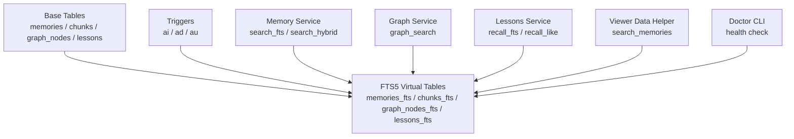
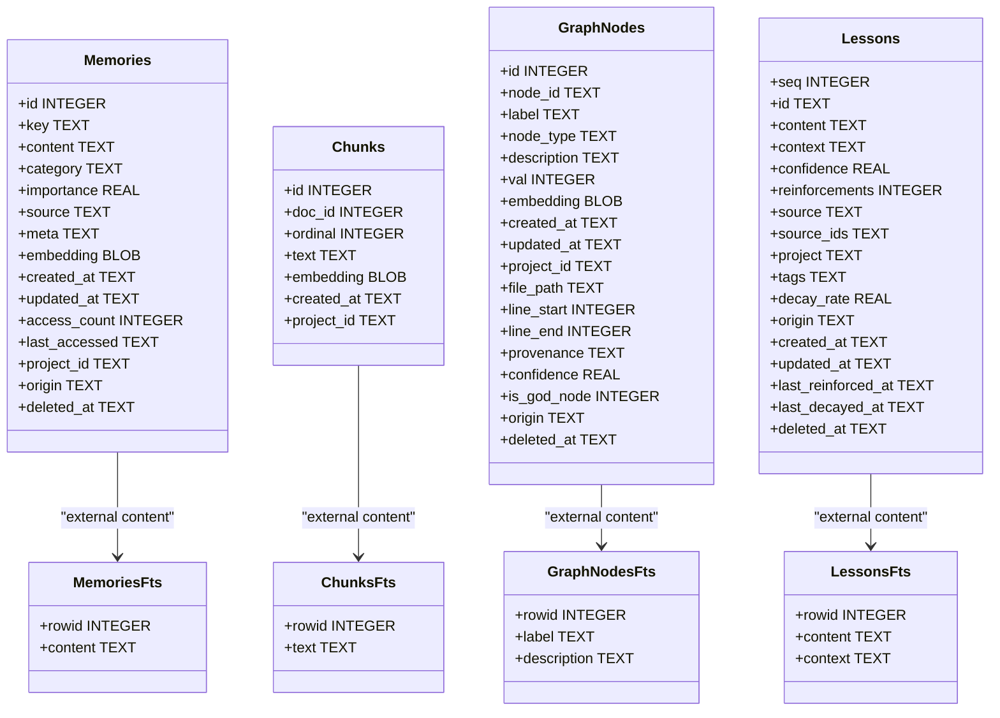
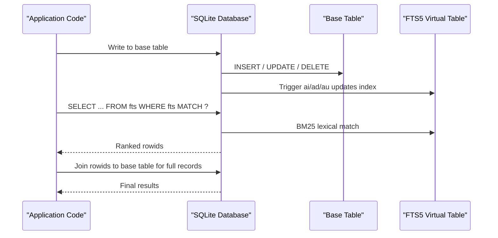
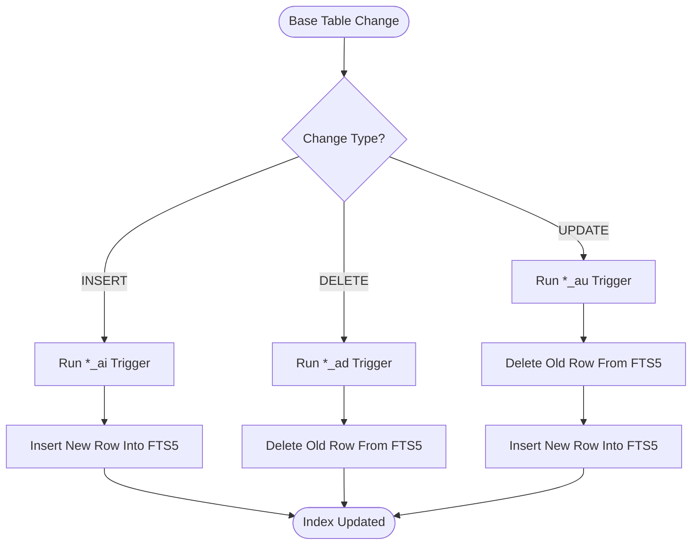
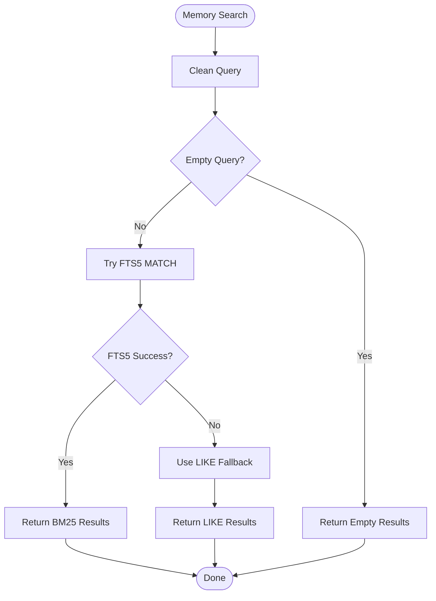
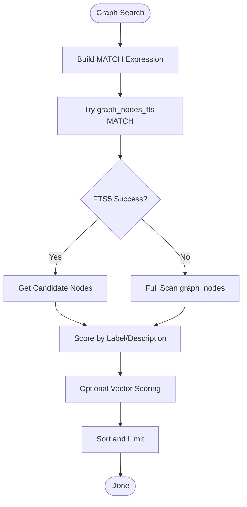
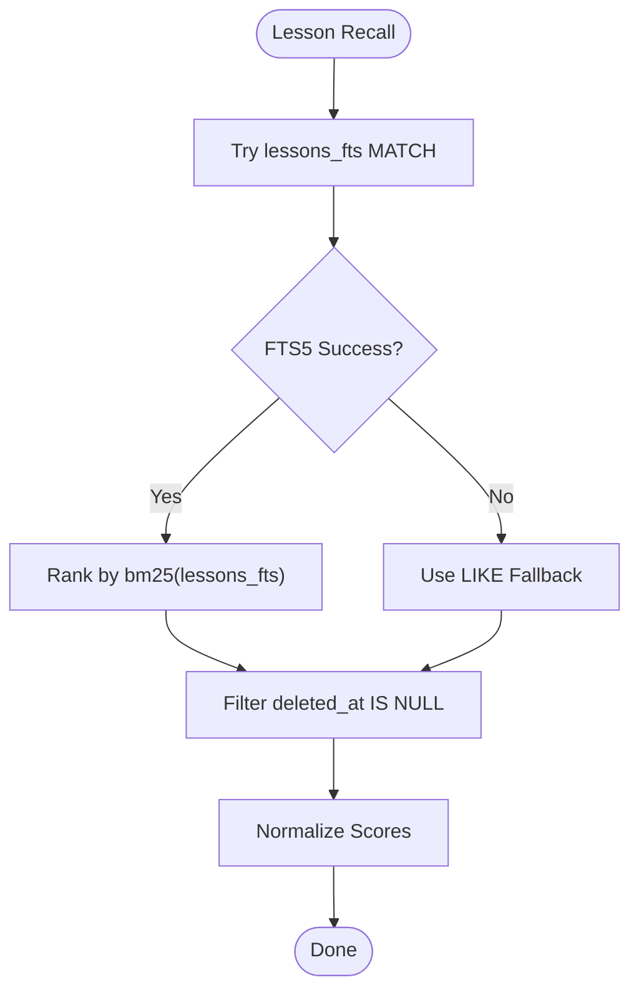
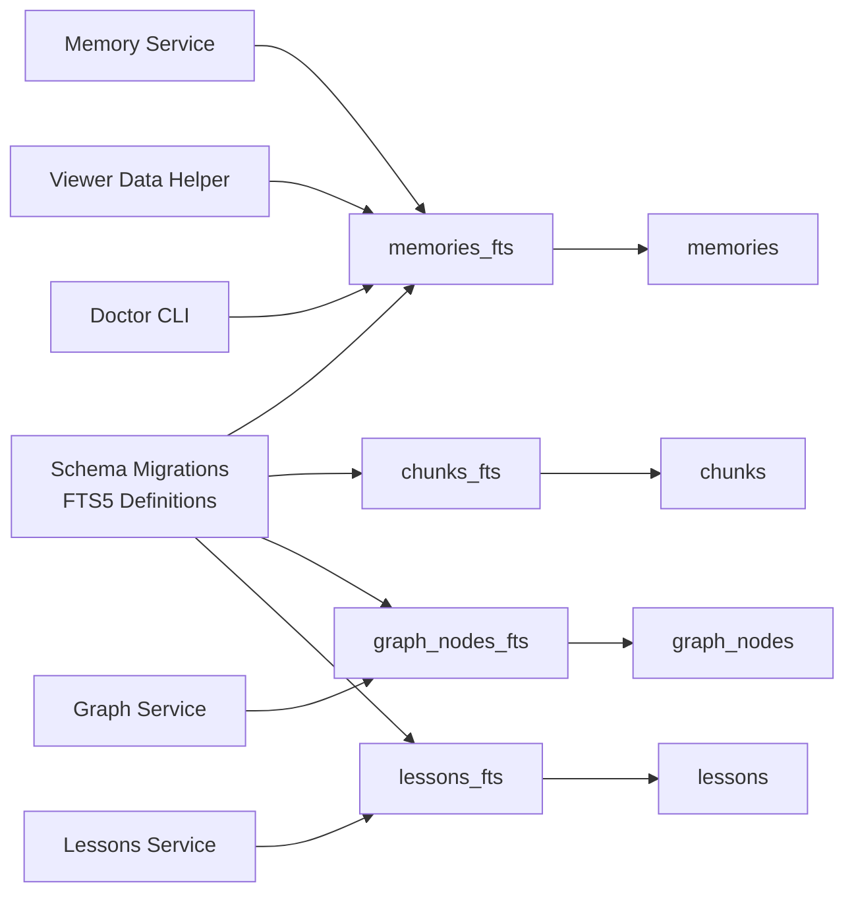
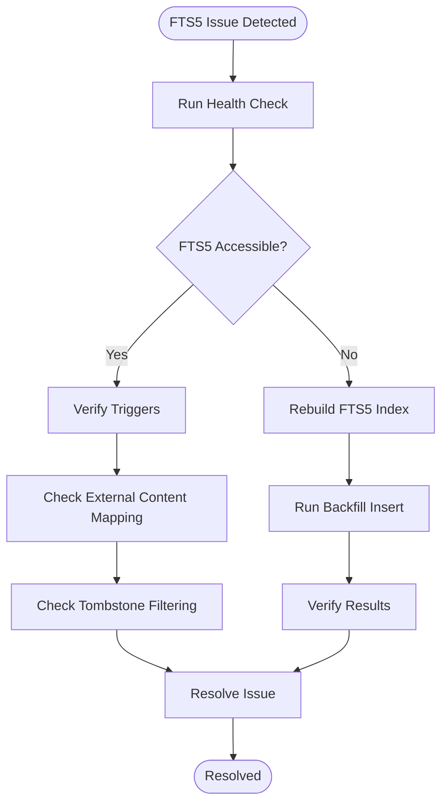

# Full-Text Search Indexes

<cite>
**Referenced Files in This Document**
- [schema.rs](file://src/db/schema.rs)
- [ARCHITECTURE.md](file://docs/ARCHITECTURE.md)
- [service.rs (memory)](file://src/memory/service.rs)
- [service.rs (graph)](file://src/graph/service.rs)
- [lessons.rs](file://src/lifecycle/lessons.rs)
- [data.rs (viewer)](file://src/viewer/data.rs)
- [doctor.rs](file://src/cli/doctor.rs)
</cite>

## Table of Contents
1. [Introduction](#introduction)
2. [Project Structure](#project-structure)
3. [Core Components](#core-components)
4. [Architecture Overview](#architecture-overview)
5. [Detailed Component Analysis](#detailed-component-analysis)
6. [Dependency Analysis](#dependency-analysis)
7. [Performance Considerations](#performance-considerations)
8. [Troubleshooting Guide](#troubleshooting-guide)
9. [Conclusion](#conclusion)

## Introduction
This document explains OB2H’s full-text search layer built on SQLite FTS5 virtual tables and trigram tokenization. It covers the four indexed domains:

- `memories_fts` — full-text index over long-term memory content.
- `chunks_fts` — full-text index over document chunks.
- `graph_nodes_fts` — full-text index over knowledge graph nodes.
- `lessons_fts` — full-text index over lifecycle lessons.

The design uses SQLite’s external content pattern so that FTS5 stores only an inverted index; the actual text remains in the base tables. Synchronization between base tables and indexes is implemented with database triggers, and application code provides fallbacks when FTS5 is unavailable or malformed.

## Project Structure
FTS5 definitions and trigger synchronization live in the schema migration layer. Querying logic is spread across domain services and viewer helpers:

| Area | Responsibility |
|---|---|
| Schema migrations | Define FTS5 virtual tables, columns, tokenizers, external content mappings, and INSERT/UPDATE/DELETE triggers. |
| Memory service | Hybrid search combining FTS5 BM25 and vector similarity via reciprocal rank fusion. |
| Graph service | Lexical graph search using `graph_nodes_fts`, with a full-table fallback. |
| Lessons service | Recall queries using `bm25(lessons_fts)` and LIKE fallback. |
| Viewer data helper | UI search for memories, switching between FTS5 MATCH and LIKE based on query length. |
| Doctor CLI | Lightweight health check against `memories_fts`. |

**Diagram sources**
- [schema.rs:305-334](file://src/db/schema.rs#L305-L334)
- [schema.rs:350-374](file://src/db/schema.rs#L350-L374)
- [schema.rs:376-424](file://src/db/schema.rs#L376-L424)
- [service.rs (memory):489-537](file://src/memory/service.rs#L489-L537)
- [service.rs (graph):268-289](file://src/graph/service.rs#L268-L289)
- [lessons.rs:356-401](file://src/lifecycle/lessons.rs#L356-L401)
- [data.rs (viewer):79-146](file://src/viewer/data.rs#L79-L146)
- [doctor.rs:259-259](file://src/cli/doctor.rs#L259-L259)

**Section sources**
- [schema.rs:305-334](file://src/db/schema.rs#L305-L334)
- [schema.rs:350-374](file://src/db/schema.rs#L350-L374)
- [schema.rs:376-424](file://src/db/schema.rs#L376-L424)
- [ARCHITECTURE.md:170-177](file://docs/ARCHITECTURE.md#L170-L177)

## Core Components
OB2H defines four FTS5 virtual tables, each aligned to a base table:

| FTS5 Table | Base Table | Indexed Columns | External Content Mapping | Tokenizer | Rowid Mapping |
|---|---|---|---|---|---|
| `memories_fts` | `memories` | `content` | `content='memories'`, `content_rowid='id'` | `trigram` | `memories.id` |
| `chunks_fts` | `chunks` | `text` | `content='chunks'`, `content_rowid='id'` | `trigram` | `chunks.id` |
| `graph_nodes_fts` | `graph_nodes` | `label`, `description` | `content='graph_nodes'`, `content_rowid='id'` | `trigram` | `graph_nodes.id` |
| `lessons_fts` | `lessons` | `content`, `context` | `content='lessons'`, `content_rowid='seq'` | `trigram` | `lessons.seq` |

Key implementation details:

- All indexes use `tokenize='trigram'`, which splits searchable terms into three-character tokens. This supports Russian and other languages where word boundaries are not whitespace-delimited.
- External content avoids duplicating large text blobs by storing only the inverted index in the virtual table and reading actual text from the base table.
- Each FTS5 table has three triggers:
  - `*_ai` after INSERT: insert the new row into the index.
  - `*_ad` after DELETE: remove the old row from the index.
  - `*_au` after UPDATE: delete the old version and insert the new version.
- Migrations V10 and V11 include backfill inserts to populate existing rows into their respective FTS5 tables.

**Diagram sources**
- [schema.rs:222-293](file://src/db/schema.rs#L222-L293)
- [schema.rs:305-334](file://src/db/schema.rs#L305-L334)
- [schema.rs:350-374](file://src/db/schema.rs#L350-L374)
- [schema.rs:384-424](file://src/db/schema.rs#L384-L424)

**Section sources**
- [schema.rs:305-334](file://src/db/schema.rs#L305-L334)
- [schema.rs:350-374](file://src/db/schema.rs#L350-L374)
- [schema.rs:376-424](file://src/db/schema.rs#L376-L424)
- [ARCHITECTURE.md:170-177](file://docs/ARCHITECTURE.md#L170-L177)

## Architecture Overview
The FTS5 architecture follows a consistent pattern:

1. **Schema Layer**: Migration functions create virtual tables and triggers.
2. **Write Path**: Application writes to base tables; SQLite triggers update FTS5 automatically.
3. **Read Path**: Application queries FTS5 with `MATCH`; results are joined back to base tables for full records.
4. **Fallback Path**: If FTS5 fails, application code falls back to `LIKE` or full scans.
5. **Hybrid Ranking**: For memories, FTS5 BM25 scores are combined with vector similarity using reciprocal rank fusion.

**Diagram sources**
- [schema.rs:305-334](file://src/db/schema.rs#L305-L334)
- [schema.rs:350-374](file://src/db/schema.rs#L350-L374)
- [schema.rs:376-424](file://src/db/schema.rs#L376-L424)
- [service.rs (memory):489-537](file://src/memory/service.rs#L489-L537)
- [service.rs (graph):268-289](file://src/graph/service.rs#L268-L289)
- [lessons.rs:356-401](file://src/lifecycle/lessons.rs#L356-L401)

## Detailed Component Analysis

### Trigram Tokenization Strategy
All four FTS5 tables use `tokenize='trigram'`. This means:

- Text is split into overlapping three-character sequences.
- Queries can match partial words, making it effective for Russian and other non-whitespace-delimited languages.
- Short queries may still be useful because trigrams capture character-level patterns.
- The tokenizer is applied at index time and query time consistently.

The trigram approach trades off some precision for robustness across languages and avoids language-specific stemmers or dictionaries.

**Section sources**
- [schema.rs:305-334](file://src/db/schema.rs#L305-L334)
- [schema.rs:350-374](file://src/db/schema.rs#L350-L374)
- [schema.rs:376-424](file://src/db/schema.rs#L376-L424)
- [ARCHITECTURE.md:170-177](file://docs/ARCHITECTURE.md#L170-L177)

### Trigger-Based Synchronization Mechanisms
Each FTS5 table has three triggers:

| Trigger Type | Behavior |
|---|---|
| After INSERT (`*_ai`) | Inserts the new row into the FTS5 index using the base table’s primary key as `rowid`. |
| After DELETE (`*_ad`) | Deletes the old row from the FTS5 index. |
| After UPDATE (`*_au`) | Deletes the old version and inserts the new version, keeping the index consistent. |

For example:

- `memories_fts_ai` inserts `new.id` and `new.content`.
- `memories_fts_ad` deletes `old.id` and `old.content`.
- `memories_fts_au` deletes the old version and inserts the new version.

The same pattern applies to `chunks_fts`, `graph_nodes_fts`, and `lessons_fts`.

**Diagram sources**
- [schema.rs:305-334](file://src/db/schema.rs#L305-L334)
- [schema.rs:350-374](file://src/db/schema.rs#L350-L374)
- [schema.rs:376-424](file://src/db/schema.rs#L376-L424)

**Section sources**
- [schema.rs:305-334](file://src/db/schema.rs#L305-L334)
- [schema.rs:350-374](file://src/db/schema.rs#L350-L374)
- [schema.rs:376-424](file://src/db/schema.rs#L376-L424)

### External Content Pattern
External content avoids data duplication by telling FTS5 where to find the actual text:

- `content='memories'` tells `memories_fts` to read `content` from the `memories` table.
- `content_rowid='id'` maps FTS5 `rowid` to `memories.id`.
- Similar mappings exist for `chunks`, `graph_nodes`, and `lessons`.

Benefits:

- No duplicate storage of large text fields.
- Updates to base tables automatically propagate through triggers.
- Joins between FTS5 results and base tables return complete records without reindexing.

Trade-offs:

- FTS5 cannot store arbitrary computed columns directly; it relies on base table columns.
- If the base table schema changes, both the base table and FTS5 mapping must remain consistent.

**Section sources**
- [schema.rs:305-334](file://src/db/schema.rs#L305-L334)
- [schema.rs:350-374](file://src/db/schema.rs#L350-L374)
- [schema.rs:376-424](file://src/db/schema.rs#L376-L424)

### Query Patterns

#### Memories Search
The memory service implements:

- `search_fts`: Uses `memories_fts MATCH` and returns `(id, rank)`. FTS5 BM25 ranks are negative, so the code negates them.
- Fallback: If FTS5 fails, it uses `LIKE '%query%'` on `memories.content`.
- `search_hybrid`: Combines FTS5 and vector results using reciprocal rank fusion with `k=60`.

**Diagram sources**
- [service.rs (memory):489-537](file://src/memory/service.rs#L489-L537)

#### Graph Nodes Search
The graph service:

- Queries `graph_nodes_fts MATCH` to get candidate node IDs.
- Falls back to a full scan if FTS5 is unavailable or broken.
- Applies additional scoring based on label and description matches.
- Optionally combines with vector similarity.

**Diagram sources**
- [service.rs (graph):268-349](file://src/graph/service.rs#L268-L349)

#### Lessons Recall
The lessons service:

- Uses `bm25(lessons_fts)` for ranking.
- Negates BM25 scores because lower BM25 values mean better matches.
- Falls back to `LIKE` on `content` and `context` if FTS5 is unavailable.
- Filters out tombstoned lessons via `deleted_at IS NULL`.

**Diagram sources**
- [lessons.rs:356-401](file://src/lifecycle/lessons.rs#L356-L401)

#### Viewer Memory Search
The viewer helper:

- Uses FTS5 MATCH when the query has at least three characters.
- Falls back to `LIKE` for shorter queries.
- Joins `memories_fts.rowid` to `memories.id`.
- Applies filters for project, category, source, minimum trust, and tombstones.

**Section sources**
- [service.rs (memory):489-537](file://src/memory/service.rs#L489-L537)
- [service.rs (graph):268-349](file://src/graph/service.rs#L268-L349)
- [lessons.rs:356-401](file://src/lifecycle/lessons.rs#L356-L401)
- [data.rs (viewer):79-146](file://src/viewer/data.rs#L79-L146)

### Ranking Algorithms

| Domain | Primary Ranking | Secondary Ranking | Notes |
|---|---|---|---|
| Memories | FTS5 BM25 | Vector cosine similarity | Combined via reciprocal rank fusion with `k=60`. |
| Graph Nodes | Lexical match score | Optional vector similarity | Label matches weighted higher than description matches. |
| Lessons | `bm25(lessons_fts)` | None specified | Scores are negated for usability. |
| Chunks | Not directly queried by application code | N/A | Index exists for potential future use. |

BM25 behavior:

- Lower BM25 values indicate better matches.
- Application code negates BM25 scores to make higher values mean better matches.
- Reciprocal rank fusion combines ranked lists from different retrieval methods without requiring normalized scores.

**Section sources**
- [service.rs (memory):489-537](file://src/memory/service.rs#L489-L537)
- [service.rs (memory):576-636](file://src/memory/service.rs#L576-L636)
- [service.rs (graph):291-349](file://src/graph/service.rs#L291-L349)
- [lessons.rs:356-380](file://src/lifecycle/lessons.rs#L356-L380)

### Performance Tuning Options

| Option | Effect | Location |
|---|---|---|
| `tokenize='trigram'` | Enables character-trigram tokenization for multilingual support. | All FTS5 table definitions. |
| Query length threshold | Viewer switches to FTS5 only for queries with three or more characters. | Viewer memory search. |
| Hybrid search k-value | Reciprocal rank fusion uses `k=60` for merging FTS5 and vector results. | Memory hybrid search. |
| FTS5 fallback | Graceful degradation to `LIKE` or full scans when FTS5 fails. | Memory, graph, and lessons services. |
| Tombstone filtering | Searches exclude soft-deleted records via `deleted_at IS NULL`. | All search paths. |
| Backfill inserts | Existing data is populated into FTS5 during migration. | M10 and M11 migrations. |

Recommended tuning practices:

- Keep queries meaningful; very short queries may benefit from LIKE fallback.
- Use filters such as project, category, source, and minimum trust to reduce search space.
- Monitor FTS5 availability; the system already handles failures gracefully.
- Avoid unnecessary joins when only FTS5 rowids are needed.

**Section sources**
- [schema.rs:305-334](file://src/db/schema.rs#L305-L334)
- [schema.rs:350-374](file://src/db/schema.rs#L350-L374)
- [schema.rs:376-424](file://src/db/schema.rs#L376-L424)
- [data.rs (viewer):79-146](file://src/viewer/data.rs#L79-L146)
- [service.rs (memory):576-636](file://src/memory/service.rs#L576-L636)

## Dependency Analysis
The FTS5 layer depends on several components:

**Diagram sources**
- [schema.rs:305-334](file://src/db/schema.rs#L305-L334)
- [schema.rs:350-374](file://src/db/schema.rs#L350-L374)
- [schema.rs:376-424](file://src/db/schema.rs#L376-L424)
- [service.rs (memory):489-537](file://src/memory/service.rs#L489-L537)
- [service.rs (graph):268-289](file://src/graph/service.rs#L268-L289)
- [lessons.rs:356-401](file://src/lifecycle/lessons.rs#L356-L401)
- [data.rs (viewer):79-146](file://src/viewer/data.rs#L79-L146)
- [doctor.rs:259-259](file://src/cli/doctor.rs#L259-L259)

**Section sources**
- [schema.rs:305-334](file://src/db/schema.rs#L305-L334)
- [schema.rs:350-374](file://src/db/schema.rs#L350-L374)
- [schema.rs:376-424](file://src/db/schema.rs#L376-L424)
- [service.rs (memory):489-537](file://src/memory/service.rs#L489-L537)
- [service.rs (graph):268-289](file://src/graph/service.rs#L268-L289)
- [lessons.rs:356-401](file://src/lifecycle/lessons.rs#L356-L401)
- [data.rs (viewer):79-146](file://src/viewer/data.rs#L79-L146)
- [doctor.rs:259-259](file://src/cli/doctor.rs#L259-L259)

## Performance Considerations
- Trigram tokenization improves multilingual recall but increases index size compared to word-based tokenizers.
- External content avoids duplicating large text fields, reducing storage overhead.
- Trigger-based synchronization keeps indexes consistent with minimal application complexity.
- Fallback mechanisms ensure availability even when FTS5 is unavailable or corrupted.
- Hybrid search balances lexical precision with semantic recall.
- Tombstone filtering prevents soft-deleted records from appearing in search results.
- Backfill inserts during migration avoid cold-start performance issues.

[No sources needed since this section provides general guidance]

## Troubleshooting Guide

### Symptoms
- FTS5 queries return no results unexpectedly.
- Search falls back to `LIKE` or full scans.
- Index corruption or invalid MATCH syntax errors.
- Stale or missing index entries after bulk operations.

### Diagnostic Steps
1. **Check FTS5 availability**:
   - Run a simple `memories_fts MATCH` query.
   - The doctor CLI includes a health check against `memories_fts`.

2. **Verify trigger consistency**:
   - Ensure INSERT, UPDATE, and DELETE triggers are present.
   - Confirm that base table changes propagate to FTS5.

3. **Validate external content mapping**:
   - Confirm `content=` and `content_rowid=` point to the correct base table and primary key.

4. **Check tombstone filtering**:
   - Ensure queries filter `deleted_at IS NULL` where appropriate.

5. **Rebuild index if necessary**:
   - Drop and recreate the FTS5 virtual table.
   - Re-run the backfill insert from the corresponding migration.

### Maintenance Procedures
- **Backfill**: M10 and M11 include `INSERT INTO ... SELECT` statements to populate existing data.
- **Health checks**: Use the doctor CLI to verify FTS5 accessibility.
- **Monitoring**: Watch for fallback logs indicating FTS5 unavailability.
- **Cleanup**: Soft-delete tombstones are filtered; physical cleanup should follow retention policies.

**Diagram sources**
- [doctor.rs:259-259](file://src/cli/doctor.rs#L259-L259)
- [schema.rs:305-334](file://src/db/schema.rs#L305-L334)
- [schema.rs:350-374](file://src/db/schema.rs#L350-L374)
- [schema.rs:376-424](file://src/db/schema.rs#L376-L424)

**Section sources**
- [doctor.rs:259-259](file://src/cli/doctor.rs#L259-L259)
- [service.rs (graph):284-289](file://src/graph/service.rs#L284-L289)
- [schema.rs:305-334](file://src/db/schema.rs#L305-L334)
- [schema.rs:350-374](file://src/db/schema.rs#L350-L374)
- [schema.rs:376-424](file://src/db/schema.rs#L376-L424)

## Conclusion
OB2H’s FTS5 full-text search layer provides robust, multilingual search across memories, chunks, graph nodes, and lessons. The design emphasizes:

- Consistent trigram tokenization for Russian and other languages.
- Trigger-based synchronization for automatic index maintenance.
- External content to avoid data duplication.
- Graceful fallbacks to preserve availability.
- Hybrid ranking for improved recall and precision.

Operational reliability is reinforced by health checks, tombstone filtering, and migration backfills. When troubleshooting, focus on FTS5 accessibility, trigger consistency, external content mapping, and tombstone filtering.

[No sources needed since this section summarizes without analyzing specific files]