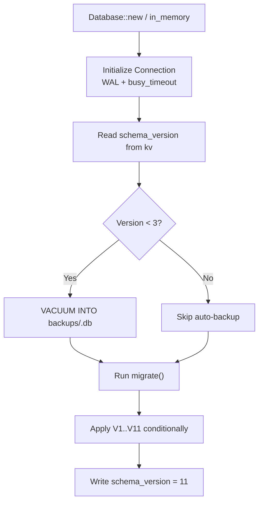
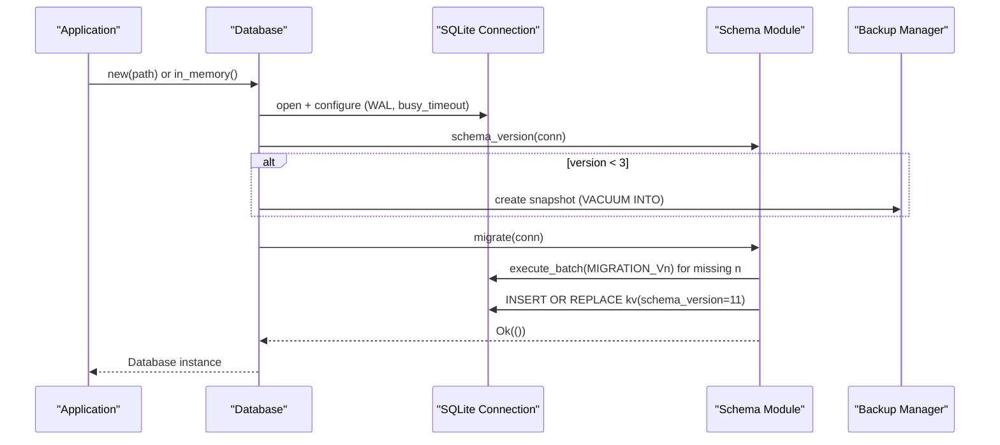
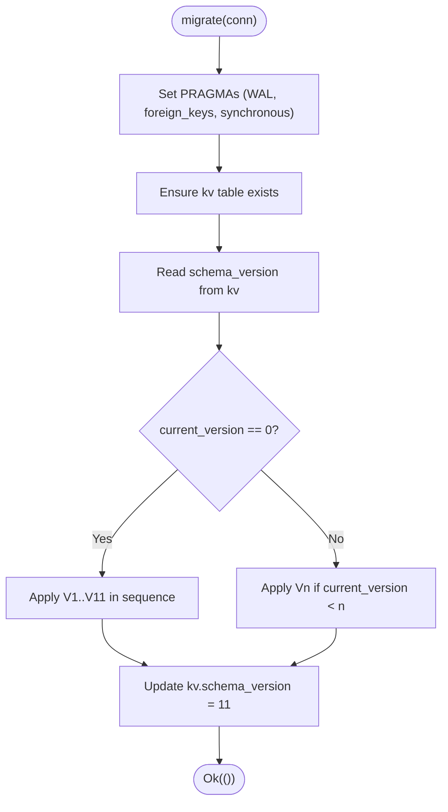
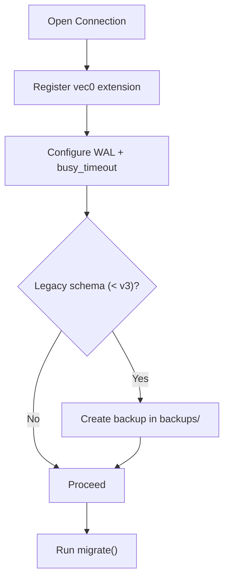
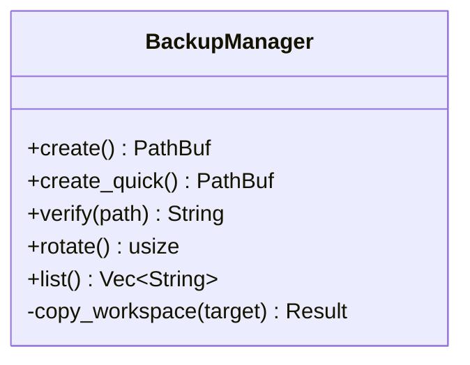
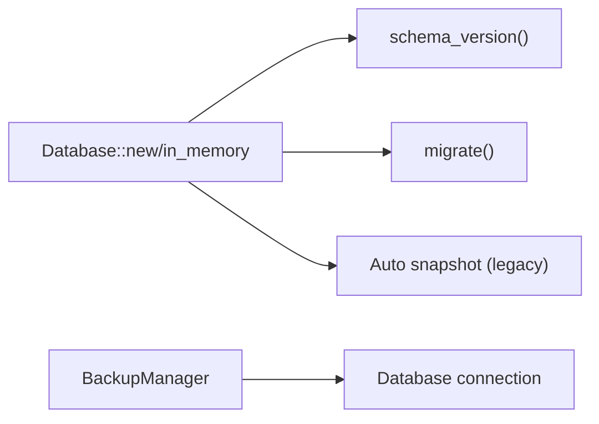

# Migrations and Versioning

<cite>
**Referenced Files in This Document**
- [schema.rs](file://src/db/schema.rs)
- [mod.rs](file://src/db/mod.rs)
- [backup/mod.rs](file://src/backup/mod.rs)
- [test_migration_m3.rs](file://tests/test_migration_m3.rs)
- [test_db.rs](file://tests/test_db.rs)
</cite>

## Table of Contents
1. [Introduction](#introduction)
2. [Project Structure](#project-structure)
3. [Core Components](#core-components)
4. [Architecture Overview](#architecture-overview)
5. [Detailed Component Analysis](#detailed-component-analysis)
6. [Dependency Analysis](#dependency-analysis)
7. [Performance Considerations](#performance-considerations)
8. [Troubleshooting Guide](#troubleshooting-guide)
9. [Conclusion](#conclusion)
10. [Appendices](#appendices)

## Introduction
This document explains OB2H’s SQLite schema migration system across 11 versions (M1–M11). It covers the migration strategy, backward compatibility approach, upgrade procedures, data transformation requirements, execution flow, error handling, rollback strategies, and verification steps. It also provides step-by-step upgrade guidance for common version transitions and recommendations for pre-upgrade backups and post-upgrade validation.

## Project Structure
The migration system is implemented within the database layer:
- Schema definitions and migration logic live in a dedicated module.
- Database initialization triggers migrations automatically and creates safety snapshots for legacy databases.
- A backup subsystem provides full and quick snapshots with rotation and verification.

**Diagram sources**
- [mod.rs:23-57](file://src/db/mod.rs#L23-L57)
- [schema.rs:452-518](file://src/db/schema.rs#L452-L518)

**Section sources**
- [mod.rs:1-131](file://src/db/mod.rs#L1-L131)
- [schema.rs:1-519](file://src/db/schema.rs#L1-L519)

## Core Components
- Schema constants and migration SQL: each migration (M1–M11) is defined as a constant string and applied sequentially based on the current schema version.
- Migration runner: reads the current version, applies only missing migrations, and updates the stored version atomically at the end.
- Database bootstrap: opens the connection, configures WAL mode and timeouts, optionally snapshots old databases before migration, then invokes the migration runner.
- Backup utilities: provide full and quick backups, rotation policies, and integrity verification to ensure recoverability.

Key responsibilities:
- Backward compatibility: additive changes where possible; non-breaking defaults; soft deletes via tombstones.
- Safety: automatic snapshotting for very old schemas; transactional operations around user code paths; robust error propagation.
- Observability: audit ledger and FTS indexes introduced in later migrations improve traceability and search performance.

**Section sources**
- [schema.rs:5-519](file://src/db/schema.rs#L5-L519)
- [mod.rs:23-57](file://src/db/mod.rs#L23-L57)
- [backup/mod.rs:23-122](file://src/backup/mod.rs#L23-L122)

## Architecture Overview
The migration architecture follows a versioned, additive schema evolution model:
- The current schema version is stored in a key-value table.
- On startup, the application checks the stored version and applies any missing migrations in order.
- For legacy databases (version < 3), an automatic snapshot is created before migration to protect against breaking changes.
- Later migrations introduce new tables and indexes without altering existing primary structures, preserving compatibility.

**Diagram sources**
- [mod.rs:23-57](file://src/db/mod.rs#L23-L57)
- [schema.rs:452-518](file://src/db/schema.rs#L452-L518)

## Detailed Component Analysis

### Migration Runner and Version Control
- Current schema version constant defines the target state (v11).
- Migration function sets PRAGMAs for performance and safety, ensures the key-value table exists, reads the current version, and applies migrations conditionally.
- After applying all required migrations, it writes the final schema version into the key-value store.

**Diagram sources**
- [schema.rs:452-518](file://src/db/schema.rs#L452-L518)

**Section sources**
- [schema.rs:210-220](file://src/db/schema.rs#L210-L220)
- [schema.rs:452-518](file://src/db/schema.rs#L452-L518)

### Migration M1: Initial Schema
Purpose:
- Establishes core tables for memories, documents, chunks, graph nodes/edges, dream runs, and FTS5 virtual tables for full-text search.
- Defines initial relationships and indices.

Data transformations:
- None (fresh database).

Breaking changes:
- None (baseline schema).

Upgrade notes:
- Applied automatically when schema_version is 0.

**Section sources**
- [schema.rs:222-334](file://src/db/schema.rs#L222-L334)

### Migration M2: Sync Columns and State
Purpose:
- Adds synchronization fields to memories, graph_nodes, and graph_edges.
- Introduces sync_state table to track peer export/import timestamps and applied bundles.
- Normalizes updated_at values for edges.

Data transformations:
- Sets default origin values and backfills updated_at for edges using created_at.

Breaking changes:
- Non-breaking additions; default values ensure compatibility.

Upgrade notes:
- Applied when upgrading from v1 to v2.

**Section sources**
- [schema.rs:7-26](file://src/db/schema.rs#L7-L26)
- [schema.rs:478-480](file://src/db/schema.rs#L478-L480)

### Migration M3: Projects, Graph Provenance, God Nodes
Purpose:
- Introduces projects table and associates memories/documents/chunks/graph entities with projects.
- Adds provenance and confidence columns to graph nodes/edges.
- Adds god node flag and file path/line range metadata to graph nodes.

Data transformations:
- Adds nullable project_id columns; existing rows remain compatible.

Breaking changes:
- Non-breaking; adds optional project context.

Upgrade notes:
- Applied when upgrading from v2 to v3.

**Section sources**
- [schema.rs:28-67](file://src/db/schema.rs#L28-L67)
- [schema.rs:481-483](file://src/db/schema.rs#L481-L483)

### Migration M4: Project Files Tracking
Purpose:
- Adds project_files table to support incremental AST scanning by tracking file hashes and metadata per project.

Data transformations:
- New table only; no changes to existing tables.

Breaking changes:
- None.

Upgrade notes:
- Applied when upgrading from v3 to v4.

**Section sources**
- [schema.rs:69-81](file://src/db/schema.rs#L69-L81)
- [schema.rs:484-486](file://src/db/schema.rs#L484-L486)

### Migration M5: Trust and Memory Links
Purpose:
- Adds trust and last_feedback_at to memories to capture machine signals of confirmed usage.
- Introduces memory_links table for deterministic associations between memories with typed relations.

Data transformations:
- Adds nullable trust column with default value; new table for links.

Breaking changes:
- Non-breaking; trust defaults preserve behavior.

Upgrade notes:
- Applied when upgrading from v4 to v5.

**Section sources**
- [schema.rs:83-102](file://src/db/schema.rs#L83-L102)
- [schema.rs:487-489](file://src/db/schema.rs#L487-L489)

### Migration M6: Ralph Knowledge Layer
Purpose:
- Adds tables for Ralph runs, iterations, findings, and AST changes to support development cycles and change tracking.

Data transformations:
- New tables only; no changes to existing tables.

Breaking changes:
- None.

Upgrade notes:
- Applied when upgrading from v5 to v6.

**Section sources**
- [schema.rs:129-207](file://src/db/schema.rs#L129-L207)
- [schema.rs:490-492](file://src/db/schema.rs#L490-L492)

### Migration M7: Soft-Delete for Memory Links
Purpose:
- Adds deleted_at column to memory_links to support soft-delete semantics and tombstone replication.

Data transformations:
- Adds nullable deleted_at column; existing links remain active.

Breaking changes:
- Non-breaking; consumers must filter out tombstoned links.

Upgrade notes:
- Applied when upgrading from v6 to v7.

**Section sources**
- [schema.rs:104-109](file://src/db/schema.rs#L104-L109)
- [schema.rs:493-495](file://src/db/schema.rs#L493-L495)

### Migration M8: AST References
Purpose:
- Adds ast_refs table to enable precise incremental resolution of cross-file references (CALLS/IMPORTS).

Data transformations:
- New table only; no changes to existing tables.

Breaking changes:
- None.

Upgrade notes:
- Applied when upgrading from v7 to v8.

**Section sources**
- [schema.rs:111-127](file://src/db/schema.rs#L111-L127)
- [schema.rs:496-498](file://src/db/schema.rs#L496-L498)

### Migration M9: Secrets Storage
Purpose:
- Adds secrets table to store encrypted secrets with access metrics and hints.

Data transformations:
- New table only; no changes to existing tables.

Breaking changes:
- None.

Upgrade notes:
- Applied when upgrading from v8 to v9.

**Section sources**
- [schema.rs:337-348](file://src/db/schema.rs#L337-L348)
- [schema.rs:499-501](file://src/db/schema.rs#L499-L501)

### Migration M10: Graph Nodes FTS Index
Purpose:
- Creates FTS5 virtual table over graph_nodes(label, description) for fast lexical search using BM25.
- Adds triggers to keep the index synchronized and performs a backfill of existing nodes.

Data transformations:
- New virtual table and triggers; backfills existing data.

Breaking changes:
- None.

Upgrade notes:
- Applied when upgrading from v9 to v10.

**Section sources**
- [schema.rs:350-374](file://src/db/schema.rs#L350-L374)
- [schema.rs:502-504](file://src/db/schema.rs#L502-L504)

### Migration M11: Lessons, Slots, Audit Ledger
Purpose:
- Adds lessons table with FTS5 indexing for content/context, slots table for workspace context, and audit_log table for append-only auditing.
- Includes origin fields for LWW merge semantics and deletion tombstones.

Data transformations:
- New tables only; no changes to existing tables.

Breaking changes:
- None.

Upgrade notes:
- Applied when upgrading from v10 to v11.

**Section sources**
- [schema.rs:376-450](file://src/db/schema.rs#L376-L450)
- [schema.rs:505-507](file://src/db/schema.rs#L505-L507)

### Database Initialization and Pre-Migration Snapshots
- Opens the connection and registers vector extensions before opening.
- Configures WAL mode and busy timeout for concurrent access.
- If the database has a legacy schema (version < 3), creates a timestamped snapshot in backups/ using VACUUM INTO prior to migration.
- Invokes the migration runner to apply missing migrations and update schema_version.

**Diagram sources**
- [mod.rs:23-57](file://src/db/mod.rs#L23-L57)

**Section sources**
- [mod.rs:23-57](file://src/db/mod.rs#L23-L57)

### Backup System
- Full backup uses VACUUM INTO to create an atomic copy of the live database and copies the workspace directory.
- Quick backup captures only critical tables (memories, kv, memory_links) plus workspace.
- Rotation policy maintains separate limits for full and quick backups.
- Verification opens the backup read-only, runs integrity_check, and compares row counts for selected tables against the live database.

**Diagram sources**
- [backup/mod.rs:13-208](file://src/backup/mod.rs#L13-L208)

**Section sources**
- [backup/mod.rs:23-122](file://src/backup/mod.rs#L23-L122)
- [backup/mod.rs:124-177](file://src/backup/mod.rs#L124-L177)

## Dependency Analysis
- Database initialization depends on schema version detection and migration execution.
- Legacy database handling triggers automatic snapshots before migration.
- Backup manager depends on the database connection to perform atomic snapshots and verification.

**Diagram sources**
- [mod.rs:23-57](file://src/db/mod.rs#L23-L57)
- [schema.rs:210-220](file://src/db/schema.rs#L210-L220)
- [schema.rs:452-518](file://src/db/schema.rs#L452-L518)
- [backup/mod.rs:23-122](file://src/backup/mod.rs#L23-L122)

**Section sources**
- [mod.rs:23-57](file://src/db/mod.rs#L23-L57)
- [schema.rs:210-220](file://src/db/schema.rs#L210-L220)
- [schema.rs:452-518](file://src/db/schema.rs#L452-L518)
- [backup/mod.rs:23-122](file://src/backup/mod.rs#L23-L122)

## Performance Considerations
- PRAGMA settings during migration optimize journaling and concurrency.
- FTS5 indexes introduced in M10 and M11 significantly improve search performance compared to full scans.
- WAL mode and busy_timeout reduce contention under concurrent access patterns.

[No sources needed since this section provides general guidance]

## Troubleshooting Guide
Common issues and resolutions:
- Migration fails due to schema mismatch: verify that the database was not manually altered; restore from backup if necessary.
- Very old databases (version < 3): ensure the backups directory exists and has write permissions; the system will attempt to create a snapshot automatically.
- Concurrent access errors: confirm WAL mode is enabled and busy_timeout is configured; check for long-running transactions blocking migrations.
- Post-migration inconsistencies: run backup verification to compare row counts and integrity of the backup against the live database.

Verification steps after upgrade:
- Confirm schema_version equals the current SCHEMA_VERSION.
- Validate presence of expected tables and indexes introduced by recent migrations.
- Run backup verification to ensure consistency.

**Section sources**
- [mod.rs:36-53](file://src/db/mod.rs#L36-L53)
- [schema.rs:452-518](file://src/db/schema.rs#L452-L518)
- [backup/mod.rs:72-122](file://src/backup/mod.rs#L72-L122)

## Conclusion
OB2H’s migration system provides a safe, additive, and verifiable path from older schemas to the latest version. Automatic snapshots for legacy databases, conditional migration application, and comprehensive backup utilities ensure data integrity and recovery options. Users should follow the recommended upgrade procedures and verification steps to maintain a healthy database state.

[No sources needed since this section summarizes without analyzing specific files]

## Appendices

### Step-by-Step Upgrade Guides

#### Upgrading from M1 to M2
- Ensure the database contains the baseline schema (M1).
- On application startup, the system will detect version 1 and apply M2 automatically.
- Verify sync_state table exists and updated_at values are populated for edges.

**Section sources**
- [schema.rs:7-26](file://src/db/schema.rs#L7-L26)
- [schema.rs:478-480](file://src/db/schema.rs#L478-L480)

#### Upgrading from M2 to M3
- Ensure the database contains M2 schema.
- Application will apply M3, adding projects and related columns.
- Existing memories/documents/chunks/graph entries remain compatible with null project_id.

**Section sources**
- [schema.rs:28-67](file://src/db/schema.rs#L28-L67)
- [schema.rs:481-483](file://src/db/schema.rs#L481-L483)

#### Upgrading from M3 to M4
- Apply M4 to add project_files tracking.
- No changes to existing tables; incremental AST scanning becomes available.

**Section sources**
- [schema.rs:69-81](file://src/db/schema.rs#L69-L81)
- [schema.rs:484-486](file://src/db/schema.rs#L484-L486)

#### Upgrading from M4 to M5
- Apply M5 to add trust and memory_links.
- Existing memories gain a trust column with default value.

**Section sources**
- [schema.rs:83-102](file://src/db/schema.rs#L83-L102)
- [schema.rs:487-489](file://src/db/schema.rs#L487-L489)

#### Upgrading from M5 to M6
- Apply M6 to add Ralph knowledge layer tables.
- No changes to existing tables.

**Section sources**
- [schema.rs:129-207](file://src/db/schema.rs#L129-L207)
- [schema.rs:490-492](file://src/db/schema.rs#L490-L492)

#### Upgrading from M6 to M7
- Apply M7 to add soft-delete support for memory_links.
- Consumers must filter out tombstoned links.

**Section sources**
- [schema.rs:104-109](file://src/db/schema.rs#L104-L109)
- [schema.rs:493-495](file://src/db/schema.rs#L493-L495)

#### Upgrading from M7 to M8
- Apply M8 to add ast_refs table.
- Enables precise incremental reference resolution.

**Section sources**
- [schema.rs:111-127](file://src/db/schema.rs#L111-L127)
- [schema.rs:496-498](file://src/db/schema.rs#L496-L498)

#### Upgrading from M8 to M9
- Apply M9 to add secrets storage.
- No changes to existing tables.

**Section sources**
- [schema.rs:337-348](file://src/db/schema.rs#L337-L348)
- [schema.rs:499-501](file://src/db/schema.rs#L499-L501)

#### Upgrading from M9 to M10
- Apply M10 to add FTS5 index for graph_nodes.
- Triggers synchronize index; backfill populates existing nodes.

**Section sources**
- [schema.rs:350-374](file://src/db/schema.rs#L350-L374)
- [schema.rs:502-504](file://src/db/schema.rs#L502-L504)

#### Upgrading from M10 to M11
- Apply M11 to add lessons, slots, and audit_log.
- No changes to existing tables; new capabilities added.

**Section sources**
- [schema.rs:376-450](file://src/db/schema.rs#L376-L450)
- [schema.rs:505-507](file://src/db/schema.rs#L505-L507)

### Data Backup Recommendations Before Upgrades
- For legacy databases (version < 3), rely on automatic snapshots created before migration.
- Optionally run a full backup using the backup manager to ensure a consistent snapshot.
- Verify the backup immediately after creation using the verification utility.

**Section sources**
- [mod.rs:36-53](file://src/db/mod.rs#L36-L53)
- [backup/mod.rs:23-43](file://src/backup/mod.rs#L23-L43)
- [backup/mod.rs:72-122](file://src/backup/mod.rs#L72-L122)

### Verification Procedures After Completion
- Confirm schema_version equals the current SCHEMA_VERSION.
- Validate presence of new tables and indexes introduced by the latest migration.
- Run backup verification to compare row counts and integrity against the live database.

**Section sources**
- [schema.rs:210-220](file://src/db/schema.rs#L210-L220)
- [schema.rs:452-518](file://src/db/schema.rs#L452-L518)
- [backup/mod.rs:72-122](file://src/backup/mod.rs#L72-L122)

### Rollback Strategies
- Use the automatically created snapshot for legacy databases (version < 3) to restore the pre-migration state.
- For newer databases, maintain manual backups using the backup manager before upgrades.
- In case of partial migration failure, restore from the most recent verified backup.

**Section sources**
- [mod.rs:36-53](file://src/db/mod.rs#L36-L53)
- [backup/mod.rs:23-43](file://src/backup/mod.rs#L23-L43)

### Testing and Validation
- Integration tests validate fresh database migrations and upgrade paths from earlier versions.
- Tests assert schema_version and presence of new tables/columns after migration.

**Section sources**
- [test_migration_m3.rs:1-110](file://tests/test_migration_m3.rs#L1-L110)
- [test_db.rs:1-47](file://tests/test_db.rs#L1-L47)