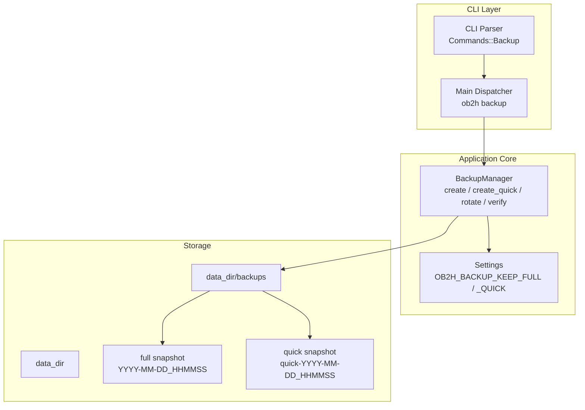
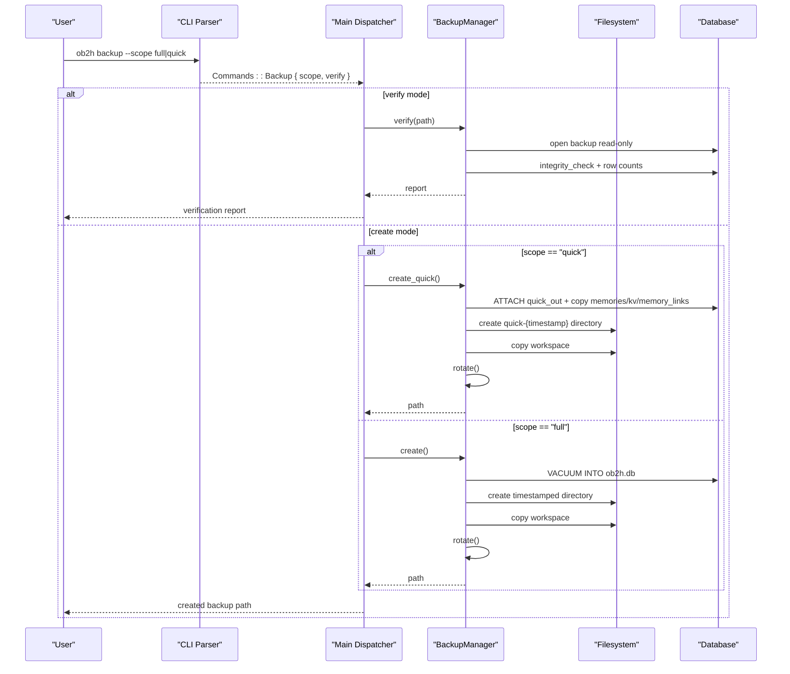
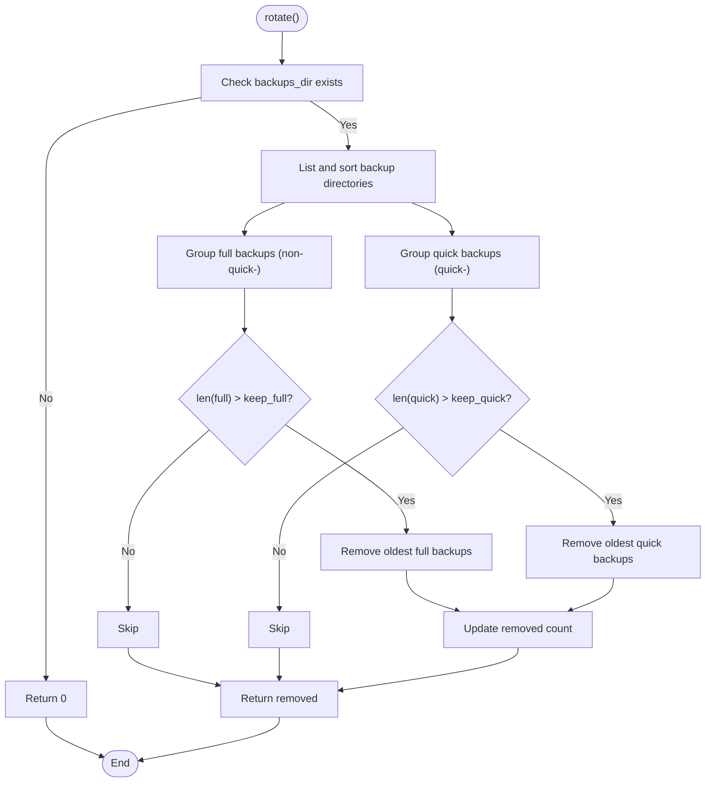
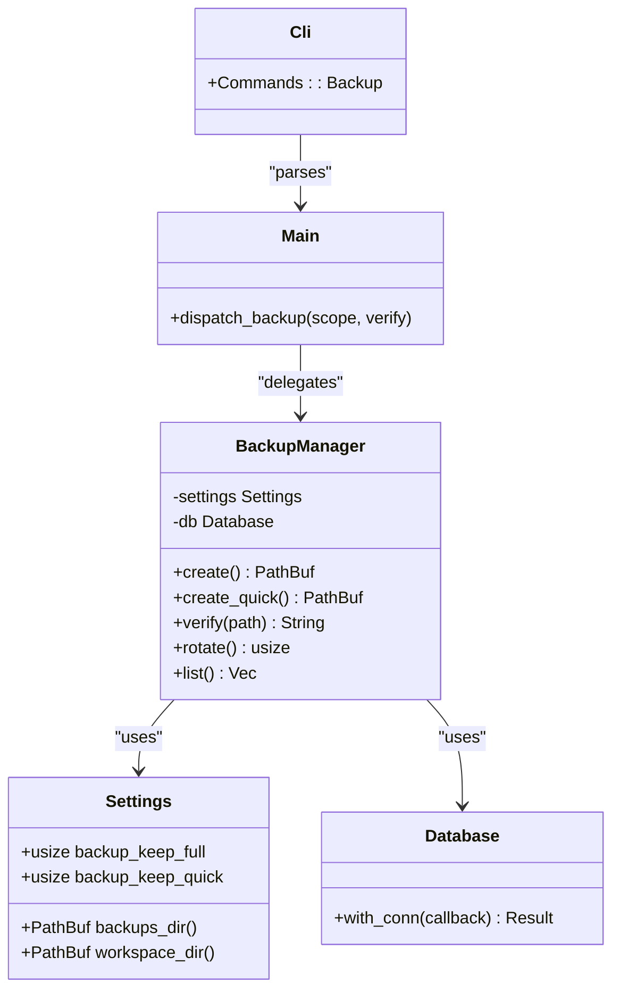

# Backup Retention Management

<cite>
**Referenced Files in This Document**
- [backup/mod.rs](file://src/backup/mod.rs)
- [config.rs](file://src/config.rs)
- [main.rs](file://src/main.rs)
- [cli/mod.rs](file://src/cli/mod.rs)
</cite>

## Table of Contents
1. [Introduction](#introduction)
2. [Project Structure](#project-structure)
3. [Core Components](#core-components)
4. [Architecture Overview](#architecture-overview)
5. [Detailed Component Analysis](#detailed-component-analysis)
6. [Dependency Analysis](#dependency-analysis)
7. [Performance Considerations](#performance-considerations)
8. [Troubleshooting Guide](#troubleshooting-guide)
9. [Conclusion](#conclusion)
10. [Appendices](#appendices)

## Introduction
This document explains how backup retention and rotation are implemented to manage storage space efficiently. It covers:
- Separate retention counters for full and quick backups
- Automatic cleanup of old backups based on configured limits
- Directory organization strategies for backups
- Configuration parameters `OB2H_BACKUP_KEEP_FULL` and `OB2H_BACKUP_KEEP_QUICK`
- Storage optimization techniques
- Monitoring backup growth
- Examples of retention policy configurations
- Manual cleanup procedures
- Capacity planning guidelines for different deployment scenarios

## Project Structure
Backup-related functionality is primarily implemented in the backup module, with configuration loaded from environment variables and exposed through CLI commands.

**Diagram sources**
- [main.rs:146-158](file://src/main.rs#L146-L158)
- [cli/mod.rs:38-46](file://src/cli/mod.rs#L38-L46)
- [config.rs:303-310](file://src/config.rs#L303-L310)
- [backup/mod.rs:23-70](file://src/backup/mod.rs#L23-L70)

**Section sources**
- [main.rs:146-158](file://src/main.rs#L146-L158)
- [cli/mod.rs:38-46](file://src/cli/mod.rs#L38-L46)
- [config.rs:303-310](file://src/config.rs#L303-L310)
- [backup/mod.rs:23-70](file://src/backup/mod.rs#L23-L70)

## Core Components
- BackupManager: orchestrates creation of full and quick backups, verification, listing, and rotation.
- Settings: loads retention limits from environment variables and provides paths for data and backups directories.
- CLI: exposes `ob2h backup --scope full|quick` and `ob2h backup --verify <path>`.

Key responsibilities:
- Full backup: atomic database snapshot plus workspace copy.
- Quick backup: lightweight memory snapshot (memories, kv, memory_links) plus workspace copy.
- Rotation: separate retention for full and quick backups; oldest directories removed when exceeding configured counts.
- Verification: integrity check and row count comparison between backup and live database.

**Section sources**
- [backup/mod.rs:13-21](file://src/backup/mod.rs#L13-L21)
- [backup/mod.rs:23-70](file://src/backup/mod.rs#L23-L70)
- [backup/mod.rs:75-122](file://src/backup/mod.rs#L75-L122)
- [backup/mod.rs:124-159](file://src/backup/mod.rs#L124-L159)
- [config.rs:303-310](file://src/config.rs#L303-L310)
- [cli/mod.rs:38-46](file://src/cli/mod.rs#L38-L46)

## Architecture Overview
The backup system integrates CLI entry points, settings resolution, and backup operations into a cohesive flow.

**Diagram sources**
- [main.rs:146-158](file://src/main.rs#L146-L158)
- [backup/mod.rs:23-70](file://src/backup/mod.rs#L23-L70)
- [backup/mod.rs:75-122](file://src/backup/mod.rs#L75-L122)

## Detailed Component Analysis

### BackupManager: Creation, Verification, Rotation
- Full backup creation uses an atomic database snapshot via VACUUM INTO and copies the workspace.
- Quick backup creation attaches a temporary output database and copies only memory-related tables, then copies the workspace.
- Verification opens the backup file or directory, runs integrity checks, and compares row counts for present tables against the live database.
- Rotation scans the backups directory, sorts entries by name, groups them into full and quick categories, and removes the oldest directories beyond configured limits.

**Diagram sources**
- [backup/mod.rs:124-159](file://src/backup/mod.rs#L124-L159)

**Section sources**
- [backup/mod.rs:23-70](file://src/backup/mod.rs#L23-L70)
- [backup/mod.rs:75-122](file://src/backup/mod.rs#L75-L122)
- [backup/mod.rs:124-159](file://src/backup/mod.rs#L124-L159)

### Configuration Parameters
Retention limits are loaded from environment variables:
- `OB2H_BACKUP_KEEP_FULL`: number of full backups to retain (default 3).
- `OB2H_BACKUP_KEEP_QUICK`: number of quick backups to retain (default 14).

These values are stored in Settings and used by BackupManager during rotation.

**Section sources**
- [config.rs:303-310](file://src/config.rs#L303-L310)
- [config.rs:399-400](file://src/config.rs#L399-L400)
- [backup/mod.rs:139-142](file://src/backup/mod.rs#L139-L142)

### CLI Entry Points
- `ob2h backup --scope full|quick`: creates a backup of the specified type.
- `ob2h backup --verify <path>`: verifies an existing backup directory or database file.

The main dispatcher routes these commands to BackupManager methods.

**Section sources**
- [cli/mod.rs:38-46](file://src/cli/mod.rs#L38-L46)
- [main.rs:146-158](file://src/main.rs#L146-L158)

## Dependency Analysis
BackupManager depends on Settings for configuration and paths, and on Database for snapshots and verification. The CLI layer depends on the main dispatcher, which delegates to BackupManager.

**Diagram sources**
- [config.rs:303-310](file://src/config.rs#L303-L310)
- [backup/mod.rs:13-21](file://src/backup/mod.rs#L13-L21)
- [main.rs:146-158](file://src/main.rs#L146-L158)
- [cli/mod.rs:38-46](file://src/cli/mod.rs#L38-L46)

**Section sources**
- [backup/mod.rs:13-21](file://src/backup/mod.rs#L13-L21)
- [config.rs:303-310](file://src/config.rs#L303-L310)
- [main.rs:146-158](file://src/main.rs#L146-L158)
- [cli/mod.rs:38-46](file://src/cli/mod.rs#L38-L46)

## Performance Considerations
- Full backups perform an atomic VACUUM INTO operation, which can be I/O intensive but ensures consistency.
- Quick backups copy only memory-related tables, significantly reducing size and time compared to full backups.
- Rotation is O(n log n) due to sorting directory names, followed by linear removal of excess backups.
- Verification performs integrity checks and row count comparisons, which are relatively fast but depend on database size.

Optimization tips:
- Use quick backups frequently for rapid recovery of memory state.
- Schedule full backups less frequently to balance storage usage and recovery completeness.
- Monitor backup sizes and adjust retention limits accordingly.

[No sources needed since this section provides general guidance]

## Troubleshooting Guide
Common issues and resolutions:
- Backup verification reports discrepancies: check table presence and row counts between backup and live database.
- Excessive disk usage: reduce `OB2H_BACKUP_KEEP_FULL` and/or `OB2H_BACKUP_KEEP_QUICK`.
- Missing backups directory: ensure `ensure_dirs()` has been called and the data directory is writable.

Manual cleanup procedures:
- Identify old backup directories under `data_dir/backups`.
- Remove directories older than desired retention period, ensuring not to delete active or recently created backups.
- Re-run rotation after manual cleanup if necessary.

Monitoring backup growth:
- Periodically list backup directories and compute total size.
- Track changes in counts of full and quick backups over time.
- Set alerts for disk usage thresholds.

**Section sources**
- [backup/mod.rs:75-122](file://src/backup/mod.rs#L75-L122)
- [backup/mod.rs:124-159](file://src/backup/mod.rs#L124-L159)
- [config.rs:425-427](file://src/config.rs#L425-L427)

## Conclusion
The backup retention system provides flexible control over storage usage through separate retention counters for full and quick backups. Configuration via environment variables allows tuning retention policies to match operational needs. Automated rotation ensures that old backups are cleaned up according to configured limits, while verification tools help maintain backup integrity. Proper capacity planning and monitoring are essential to balance storage efficiency with recovery requirements.

[No sources needed since this section summarizes without analyzing specific files]

## Appendices

### Configuration Examples
- Default retention:
  - `OB2H_BACKUP_KEEP_FULL=3`
  - `OB2H_BACKUP_KEEP_QUICK=14`
- Aggressive retention:
  - `OB2H_BACKUP_KEEP_FULL=2`
  - `OB2H_BACKUP_KEEP_QUICK=7`
- Extended retention:
  - `OB2H_BACKUP_KEEP_FULL=5`
  - `OB2H_BACKUP_KEEP_QUICK=30`

### Manual Cleanup Steps
1. Navigate to `data_dir/backups`.
2. Identify directories older than desired retention period.
3. Delete selected directories using appropriate file management tools.
4. Verify remaining backups with `ob2h backup --verify <path>`.

### Capacity Planning Guidelines
- Small deployments:
  - Keep fewer full backups (e.g., 2–3) and moderate quick backups (e.g., 7–14).
- Medium deployments:
  - Balance full and quick backups based on change frequency and recovery SLAs.
- Large deployments:
  - Consider offloading full backups to external storage and retaining more quick backups for rapid recovery.

[No sources needed since this section provides general guidance]