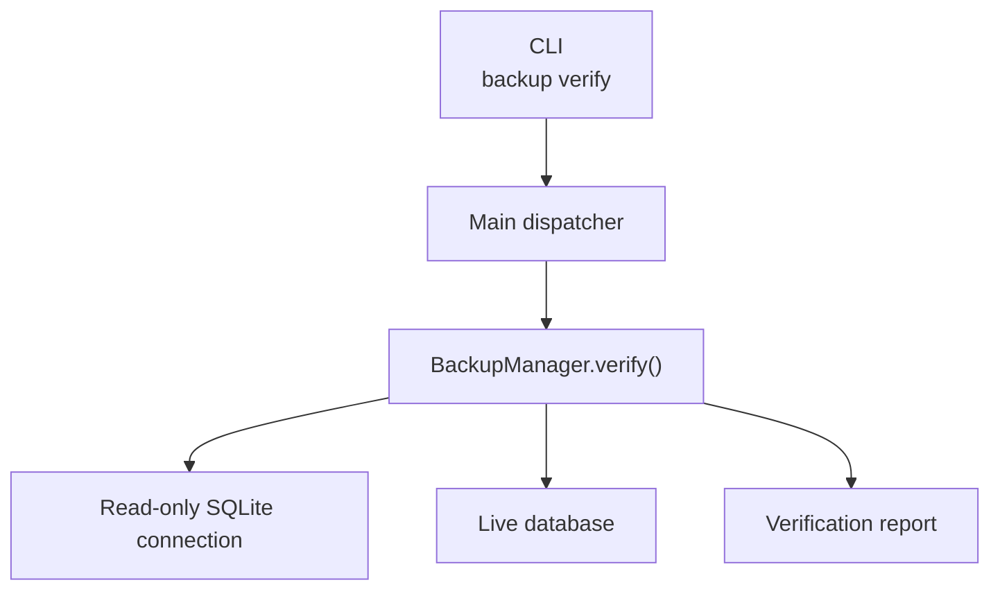
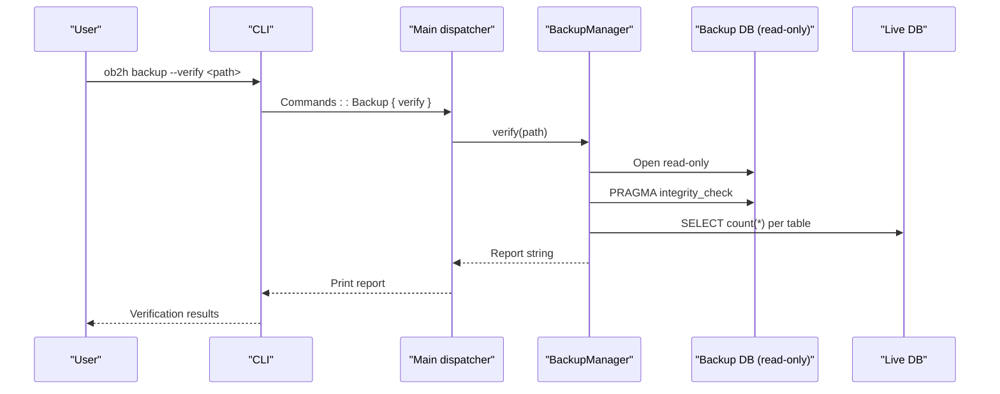
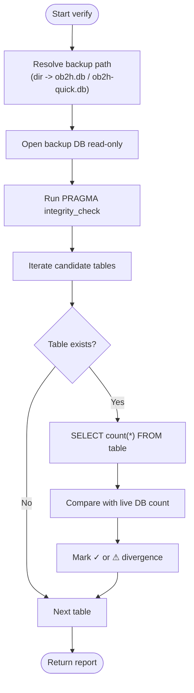
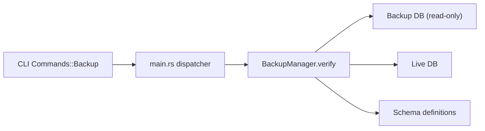

# Backup Verification

<cite>
**Referenced Files in This Document**
- [backup/mod.rs](file://src/backup/mod.rs)
- [cli/mod.rs](file://src/cli/mod.rs)
- [main.rs](file://src/main.rs)
- [db/schema.rs](file://src/db/schema.rs)
- [scripts/vps/ob2h-sync.timer](file://scripts/vps/ob2h-sync.timer)
- [scripts/vps/ob2h-sync.service](file://scripts/vps/ob2h-sync.service)
</cite>

## Table of Contents
1. [Introduction](#introduction)
2. [Project Structure](#project-structure)
3. [Core Components](#core-components)
4. [Architecture Overview](#architecture-overview)
5. [Detailed Component Analysis](#detailed-component-analysis)
6. [Dependency Analysis](#dependency-analysis)
7. [Performance Considerations](#performance-considerations)
8. [Troubleshooting Guide](#troubleshooting-guide)
9. [Conclusion](#conclusion)
10. [Appendices](#appendices)

## Introduction
This document explains the backup verification procedures that ensure data integrity and recoverability for the OB2H knowledge store. It focuses on the verify command, which opens a backup database read-only, runs SQLite’s integrity check, and compares row counts between the backup and live databases for key tables. The document also covers how to interpret verification reports, how consistency checks differ across table types (full vs quick backups), and how to automate verification with scheduling and alerting. Finally, it provides best practices for regular backup testing and validation workflows.

## Project Structure
The backup verification feature is implemented as part of the backup subsystem and exposed through the CLI:
- Backup logic and verification are implemented in the backup module.
- The CLI defines the backup subcommand and its verify option.
- The main entry point routes the CLI command to the backup manager.
- Database schema definitions clarify which tables exist and are relevant to verification.
- Systemd timer/service examples illustrate how to schedule periodic tasks on Linux.

**Diagram sources**
- [cli/mod.rs:38-46](file://src/cli/mod.rs#L38-L46)
- [main.rs:146-158](file://src/main.rs#L146-L158)
- [backup/mod.rs:72-122](file://src/backup/mod.rs#L72-L122)

**Section sources**
- [backup/mod.rs:1-208](file://src/backup/mod.rs#L1-L208)
- [cli/mod.rs:38-46](file://src/cli/mod.rs#L38-L46)
- [main.rs:146-158](file://src/main.rs#L146-L158)

## Core Components
- BackupManager.verify(path): Opens the specified backup file or directory, detects ob2h.db or ob2h-quick.db, opens it read-only, executes PRAGMA integrity_check, and compares row counts for selected tables against the live database. Returns a human-readable report string.
- CLI Commands::Backup: Declares the backup subcommand with scope (full|quick) and an optional verify argument pointing to a backup path or database file.
- Main dispatcher: When verify is provided, calls BackupManager.verify and prints the report; otherwise creates full or quick backups based on scope.

Key responsibilities:
- Read-only access to backup files to avoid accidental writes.
- Integrity validation via SQLite’s built-in integrity check.
- Row count comparison for critical tables to detect divergence between backup and live state.
- Support for both full and quick backup formats.

**Section sources**
- [backup/mod.rs:72-122](file://src/backup/mod.rs#L72-L122)
- [cli/mod.rs:38-46](file://src/cli/mod.rs#L38-L46)
- [main.rs:146-158](file://src/main.rs#L146-L158)

## Architecture Overview
The verification flow connects the CLI to the backup manager, which interacts with both the backup file and the live database.

**Diagram sources**
- [cli/mod.rs:38-46](file://src/cli/mod.rs#L38-L46)
- [main.rs:146-158](file://src/main.rs#L146-L158)
- [backup/mod.rs:72-122](file://src/backup/mod.rs#L72-L122)

## Detailed Component Analysis

### BackupManager.verify Implementation
The verify method performs the following steps:
- Path resolution: If the input is a directory, it looks for ob2h.db first, then ob2h-quick.db; if neither exists, it returns an error. If the input is a file, it uses it directly.
- Read-only opening: Uses a read-only SQLite connection to the backup file.
- Integrity check: Executes PRAGMA integrity_check and captures the result or error message.
- Table presence detection: For each candidate table (memories, graph_nodes, memory_links, chunks, kv), checks whether the table exists in the backup.
- Row count comparison: For present tables, compares the row count in the backup with the live database and appends a status marker to the report.
- Report generation: Produces a text report including the file path, integrity check result, and per-table counts with match/mismatch markers.

**Diagram sources**
- [backup/mod.rs:72-122](file://src/backup/mod.rs#L72-L122)

**Section sources**
- [backup/mod.rs:72-122](file://src/backup/mod.rs#L72-L122)

### CLI Command Definition
The backup subcommand supports:
- scope: full or quick (default full).
- verify: optional path to an existing backup directory or database file to validate instead of creating a new backup.

When verify is set, the main dispatcher invokes BackupManager.verify and prints the resulting report.

**Section sources**
- [cli/mod.rs:38-46](file://src/cli/mod.rs#L38-L46)
- [main.rs:146-158](file://src/main.rs#L146-L158)

### Data Model and Table Coverage
Verification compares row counts for these tables:
- memories
- graph_nodes
- memory_links
- chunks
- kv

These tables are defined in the database schema and represent core data areas:
- memories: primary knowledge entries.
- graph_nodes: code graph nodes.
- memory_links: relationships between memories.
- chunks: document chunks.
- kv: key-value metadata.

Note: Quick backups only include a subset of tables (memories, kv, memory_links) plus workspace content, while full backups include the entire database.

**Section sources**
- [db/schema.rs:222-334](file://src/db/schema.rs#L222-L334)
- [db/schema.rs:337-450](file://src/db/schema.rs#L337-L450)
- [backup/mod.rs:45-70](file://src/backup/mod.rs#L45-L70)

### Verification Report Format
The verification report is a plain text string containing:
- File path of the checked backup.
- Result of PRAGMA integrity_check (success value or error message).
- Per-table lines showing backup count, live count, and a marker indicating match or divergence.

Example structure (descriptive):
- Line 1: file path
- Line 2: integrity_check result
- Subsequent lines: table name, backup count, live count, and status marker

Interpretation:
- A matching count indicates consistency for that table.
- A mismatched count signals potential divergence and requires investigation.
- An integrity_check error indicates corruption or issues with the backup file.

**Section sources**
- [backup/mod.rs:95-121](file://src/backup/mod.rs#L95-L121)

### Consistency Checks Across Table Types
- Full backups: All tables present in the live database are candidates for verification; verify checks presence and compares counts for the listed tables.
- Quick backups: Only specific tables are included by design (memories, kv, memory_links); verify skips absent tables gracefully.

Implications:
- For quick backups, absence of certain tables (e.g., graph_nodes, chunks) is expected and not treated as inconsistency.
- For full backups, missing tables may indicate incomplete creation or migration issues.

**Section sources**
- [backup/mod.rs:45-70](file://src/backup/mod.rs#L45-L70)
- [backup/mod.rs:101-121](file://src/backup/mod.rs#L101-L121)

## Dependency Analysis
The verification workflow depends on:
- CLI parsing for the backup subcommand and verify flag.
- Main dispatcher routing to BackupManager.verify.
- SQLite read-only connection to the backup file.
- Live database connection for row count comparisons.
- Schema definitions to understand which tables exist and are relevant.

**Diagram sources**
- [cli/mod.rs:38-46](file://src/cli/mod.rs#L38-L46)
- [main.rs:146-158](file://src/main.rs#L146-L158)
- [backup/mod.rs:72-122](file://src/backup/mod.rs#L72-L122)
- [db/schema.rs:222-334](file://src/db/schema.rs#L222-L334)

**Section sources**
- [cli/mod.rs:38-46](file://src/cli/mod.rs#L38-L46)
- [main.rs:146-158](file://src/main.rs#L146-L158)
- [backup/mod.rs:72-122](file://src/backup/mod.rs#L72-L122)
- [db/schema.rs:222-334](file://src/db/schema.rs#L222-L334)

## Performance Considerations
- Read-only backup access avoids write overhead and ensures safety during verification.
- PRAGMA integrity_check is efficient but can be expensive on large databases; run it during off-peak hours.
- Row count comparisons are lightweight but require two queries per table (backup and live).
- Quick backups reduce I/O and storage footprint, making frequent verification feasible.

[No sources needed since this section provides general guidance]

## Troubleshooting Guide
Common issues and resolutions:
- Missing backup file or directory: Ensure the path points to a valid backup directory containing ob2h.db or ob2h-quick.db, or to a direct database file.
- Integrity check failure: Indicates corruption or unsupported state; re-create the backup from the live database and re-run verification.
- Row count mismatches: Investigate recent changes to the live database or incomplete backup creation; consider re-running backup and verification.
- Quick backup expectations: Absence of non-memory tables (e.g., graph_nodes, chunks) is normal; do not treat as inconsistency.

Operational tips:
- Automate verification after backup creation.
- Log verification outputs and monitor for divergences.
- Use system schedulers to run verification periodically.

**Section sources**
- [backup/mod.rs:72-122](file://src/backup/mod.rs#L72-L122)

## Conclusion
The backup verification process provides a robust mechanism to ensure data integrity and recoverability by validating SQLite integrity and comparing row counts for critical tables between backup and live databases. By integrating verification into automated schedules and monitoring outputs, teams can maintain confidence in their backups and quickly detect inconsistencies. Best practices emphasize regular testing, clear reporting, and appropriate handling of differences between full and quick backups.

[No sources needed since this section summarizes without analyzing specific files]

## Appendices

### Automated Verification Scheduling
On Linux systems, use systemd timers and services to schedule periodic tasks. While the provided examples target sync operations, they can serve as templates for scheduling backup verification:
- Timer definition: Configure OnCalendar and Persistent options to run at desired intervals.
- Service definition: Define ExecStart to invoke the verification command and log results.

Example references:
- Timer configuration pattern.
- Service configuration pattern.

**Section sources**
- [scripts/vps/ob2h-sync.timer:1-10](file://scripts/vps/ob2h-sync.timer#L1-L10)
- [scripts/vps/ob2h-sync.service:1-10](file://scripts/vps/ob2h-sync.service#L1-L10)

### Best Practices for Regular Backup Testing and Validation Workflows
- Schedule verification immediately after backup creation.
- Run verification daily for critical environments and weekly for less critical ones.
- Monitor verification logs and set up alerts for integrity failures or row count mismatches.
- Validate both full and quick backups according to their intended use cases.
- Retain multiple verified backups to support recovery scenarios.
- Periodically test restoration procedures to confirm end-to-end recoverability.

[No sources needed since this section provides general guidance]