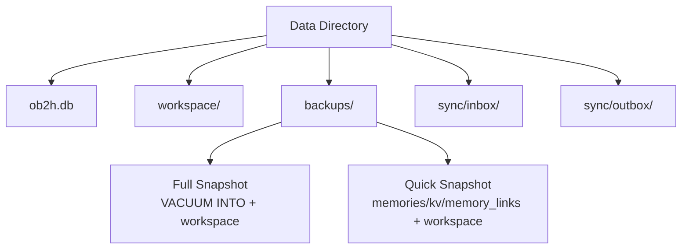
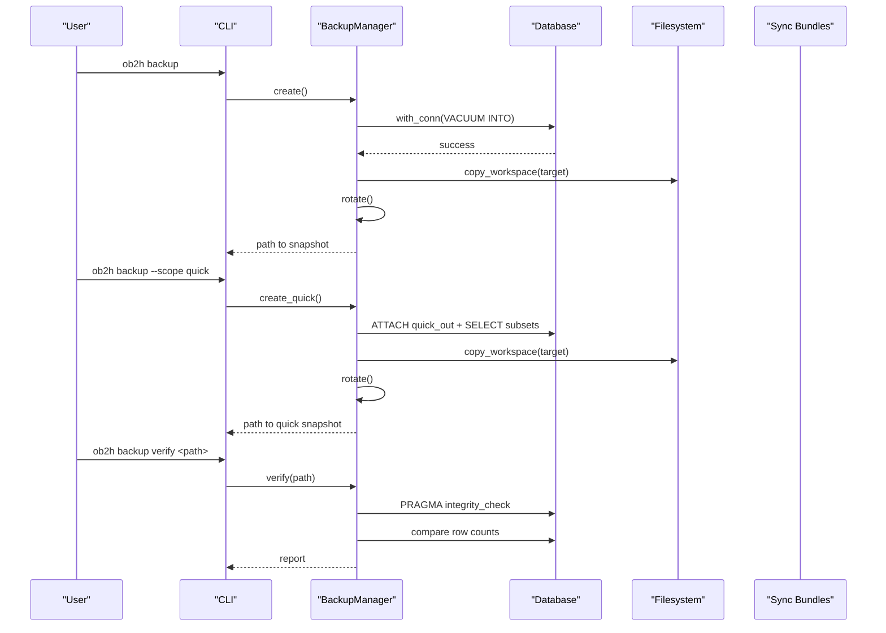
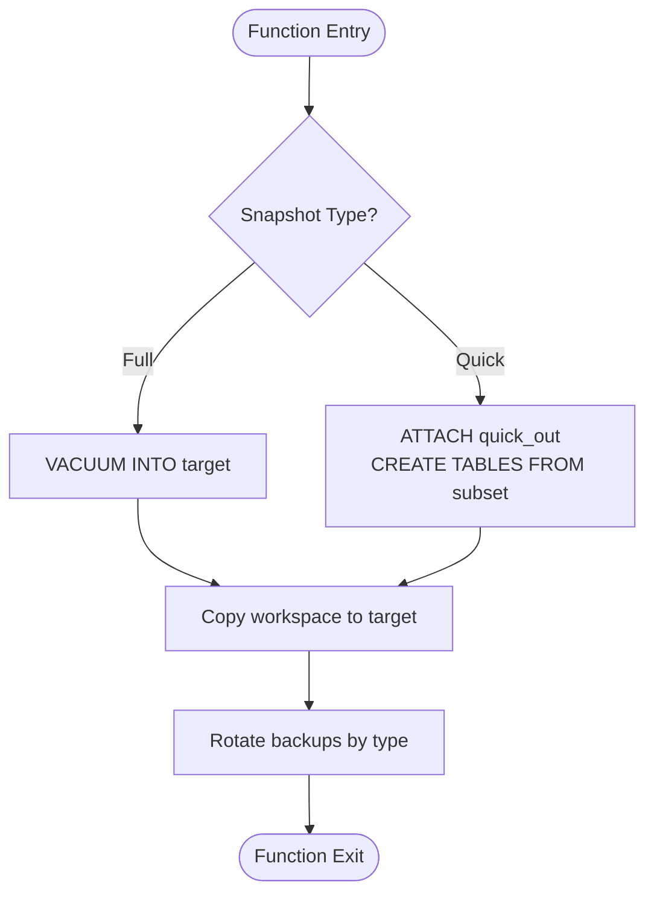
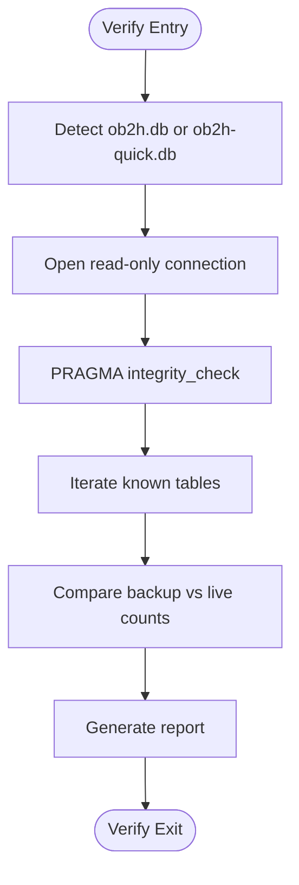
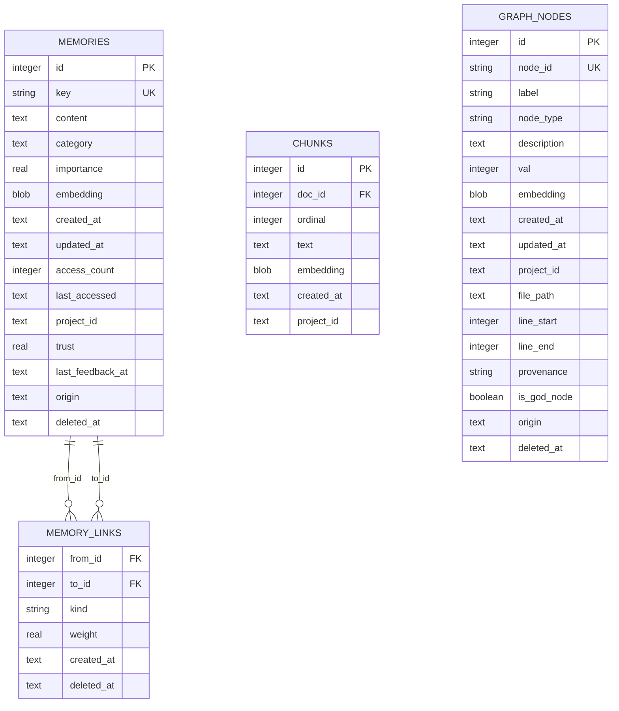
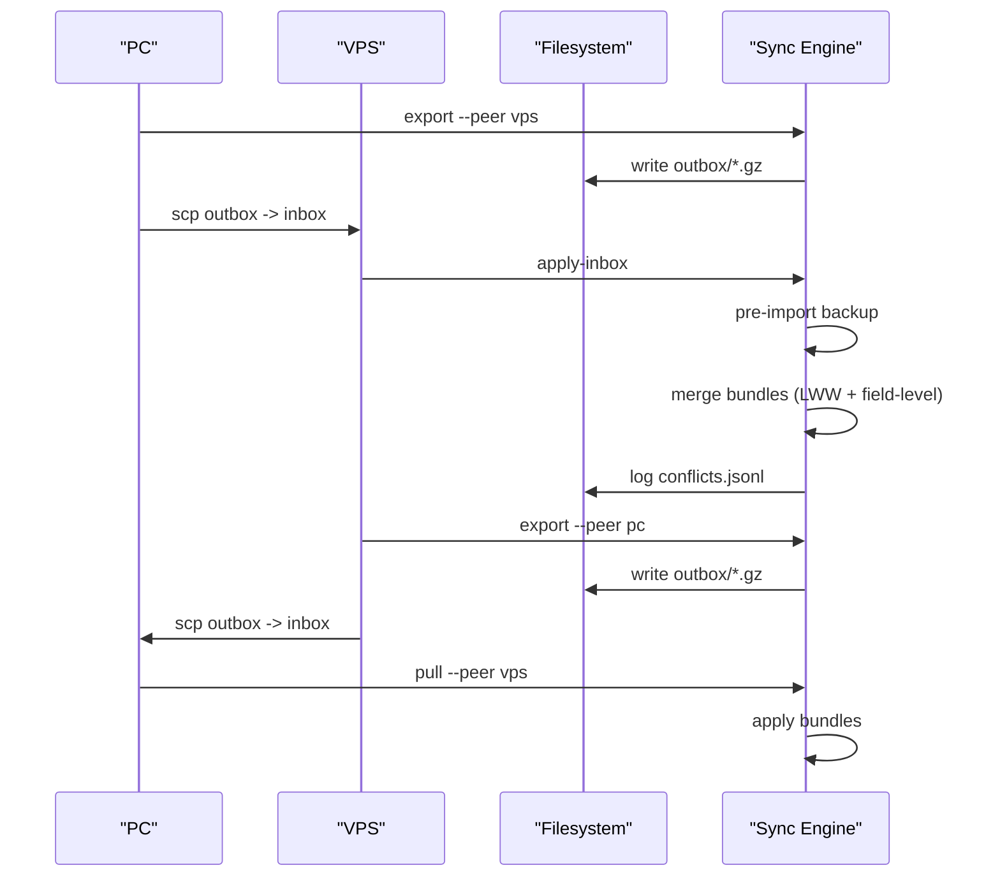
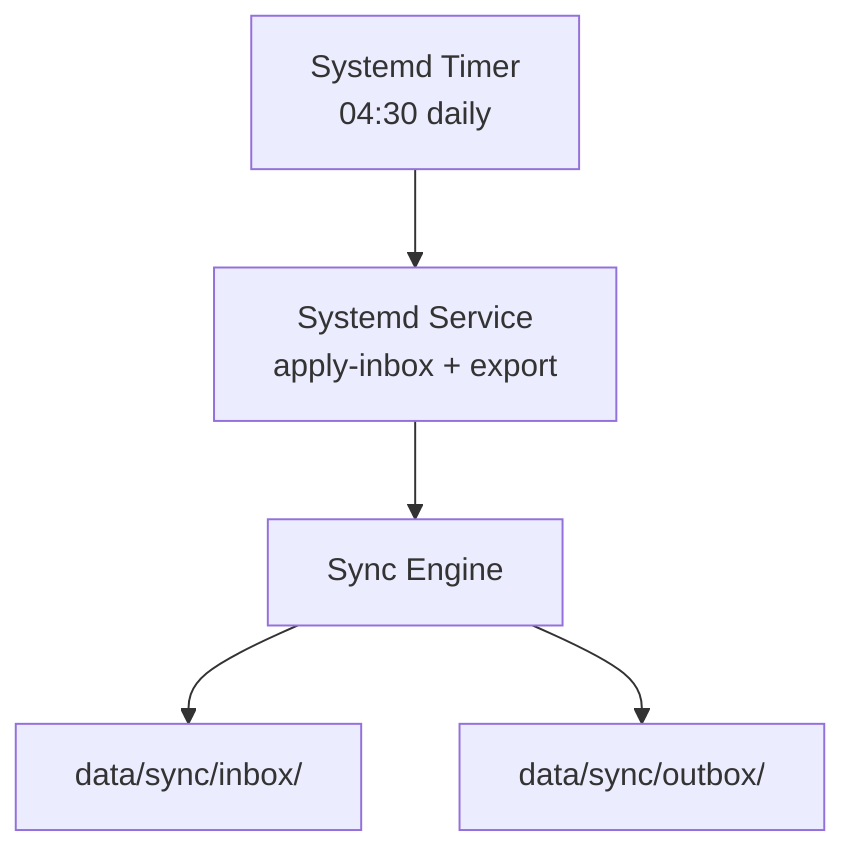
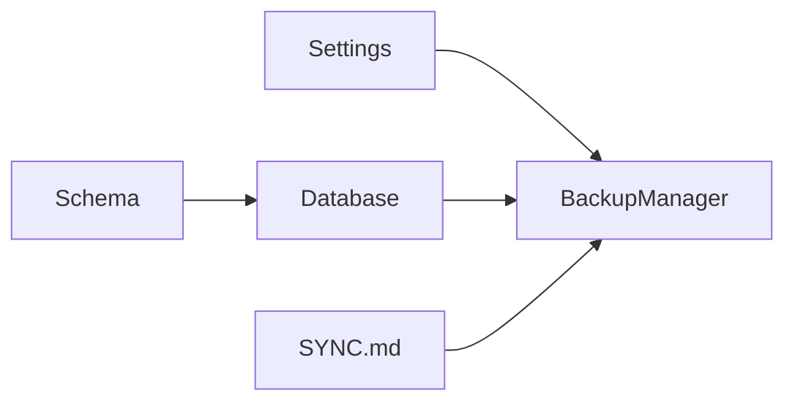

# Backup and Recovery

<cite>
**Referenced Files in This Document**
- [README.md](file://README.md)
- [src/backup/mod.rs](file://src/backup/mod.rs)
- [src/config.rs](file://src/config.rs)
- [src/db/mod.rs](file://src/db/mod.rs)
- [src/db/schema.rs](file://src/db/schema.rs)
- [docs/SYNC.md](file://docs/SYNC.md)
- [scripts/vps/ob2h-sync.timer](file://scripts/vps/ob2h-sync.timer)
- [scripts/vps/ob2h-sync.service](file://scripts/vps/ob2h-sync.service)
</cite>

## Table of Contents
1. [Introduction](#introduction)
2. [Project Structure](#project-structure)
3. [Core Components](#core-components)
4. [Architecture Overview](#architecture-overview)
5. [Detailed Component Analysis](#detailed-component-analysis)
6. [Dependency Analysis](#dependency-analysis)
7. [Performance Considerations](#performance-considerations)
8. [Troubleshooting Guide](#troubleshooting-guide)
9. [Conclusion](#conclusion)
10. [Appendices](#appendices)

## Introduction
This document provides comprehensive backup and recovery guidance for OB2H’s SQLite-based knowledge store, including full and quick backups, incremental change tracking via sync bundles, automated scheduling, recovery procedures for common failure scenarios, verification routines, retention policies, and testing strategies to ensure data integrity. It also covers how FTS5 indexes and vector embeddings are preserved during backups and how cross-machine synchronization interacts with backup and recovery.

## Project Structure
OB2H stores its primary database as a single SQLite file under the configured data directory, along with workspace files, logs, and backups. The backup subsystem creates timestamped snapshot directories that include an atomic database copy and a copy of the workspace. Configuration controls where data lives and how many backups to retain. Sync bundles provide incremental change tracking between machines without copying the live database.

**Diagram sources**
- [src/config.rs:417-427](file://src/config.rs#L417-L427)
- [src/backup/mod.rs:23-43](file://src/backup/mod.rs#L23-L43)
- [src/backup/mod.rs:48-70](file://src/backup/mod.rs#L48-L70)
- [docs/SYNC.md:32-56](file://docs/SYNC.md#L32-L56)

**Section sources**
- [src/config.rs:417-427](file://src/config.rs#L417-L427)
- [src/backup/mod.rs:23-70](file://src/backup/mod.rs#L23-L70)
- [docs/SYNC.md:32-56](file://docs/SYNC.md#L32-L56)

## Core Components
- BackupManager: Creates full and quick snapshots, verifies backup integrity, rotates old backups, lists available backups, and copies the workspace into each snapshot.
- Settings: Provides paths for data, workspace, backups, and rotation limits for full and quick backups.
- Database: Manages SQLite connections, migration, and pre-migration safety snapshots.
- Schema: Defines tables, FTS5 virtual tables, triggers, and migrations; includes vector embedding columns and FTS5 indexes for text search.
- Sync Bundles: Incremental change tracking across machines using append-only JSONL bundles with LWW merge semantics and conflict logging.

Key responsibilities:
- Full backup: Atomic VACUUM INTO snapshot plus workspace copy.
- Quick backup: Lightweight export of memories, kv, memory_links plus workspace copy.
- Verification: Read-only open, integrity_check, row count comparison against live DB.
- Retention: Separate keep counts for full and quick backups.
- Scheduling: Systemd timer/service on Linux for sync apply/export; user can schedule backups via OS scheduler or automation.

**Section sources**
- [src/backup/mod.rs:13-187](file://src/backup/mod.rs#L13-L187)
- [src/config.rs:73-78](file://src/config.rs#L73-L78)
- [src/config.rs:417-427](file://src/config.rs#L417-L427)
- [src/db/mod.rs:22-57](file://src/db/mod.rs#L22-L57)
- [src/db/schema.rs:222-334](file://src/db/schema.rs#L222-L334)
- [docs/SYNC.md:58-67](file://docs/SYNC.md#L58-L67)

## Architecture Overview
The backup and recovery architecture integrates three layers:
- Storage layer: SQLite database (WAL mode), workspace files, and backup snapshots.
- Backup layer: Full and quick snapshot creation, verification, rotation, and listing.
- Sync layer: Incremental bundle export/import with LWW merge, conflict journaling, and automatic pre-import snapshots.

**Diagram sources**
- [src/backup/mod.rs:23-70](file://src/backup/mod.rs#L23-L70)
- [src/backup/mod.rs:75-122](file://src/backup/mod.rs#L75-L122)
- [src/db/mod.rs:22-57](file://src/db/mod.rs#L22-L57)

## Detailed Component Analysis

### BackupManager: Full and Quick Snapshots
- Full snapshot: Uses VACUUM INTO to atomically copy the live database, then copies the workspace directory into the snapshot folder. Afterward, it rotates backups based on configured retention.
- Quick snapshot: Attaches a temporary output database and copies only memories, kv, and memory_links tables, then copies the workspace. This is significantly smaller than a full snapshot.
- Verification: Opens the backup read-only, runs PRAGMA integrity_check, and compares row counts for selected tables between the backup and live database.
- Rotation: Separately retains full and quick snapshots according to settings.
- Listing: Lists all backup directories sorted by name.

**Diagram sources**
- [src/backup/mod.rs:23-43](file://src/backup/mod.rs#L23-L43)
- [src/backup/mod.rs:48-70](file://src/backup/mod.rs#L48-L70)
- [src/backup/mod.rs:124-159](file://src/backup/mod.rs#L124-L159)

**Section sources**
- [src/backup/mod.rs:23-70](file://src/backup/mod.rs#L23-L70)
- [src/backup/mod.rs:124-159](file://src/backup/mod.rs#L124-L159)

### BackupVerification
- Reads either ob2h.db or ob2h-quick.db from the specified path.
- Runs integrity_check and reports any errors.
- Compares row counts for key tables present in the backup against the live database.
- Produces a human-readable report indicating matches or discrepancies.

**Diagram sources**
- [src/backup/mod.rs:75-122](file://src/backup/mod.rs#L75-L122)

**Section sources**
- [src/backup/mod.rs:75-122](file://src/backup/mod.rs#L75-L122)

### Retention Policy and Rotation
- Full and quick backups are rotated independently.
- Retention counts are configurable via environment variables.
- Rotation removes oldest snapshots when exceeding configured limits.

Configuration keys:
- OB2H_BACKUP_KEEP_FULL: Number of full snapshots to retain.
- OB2H_BACKUP_KEEP_QUICK: Number of quick snapshots to retain.

**Section sources**
- [src/config.rs:303-310](file://src/config.rs#L303-L310)
- [src/backup/mod.rs:124-159](file://src/backup/mod.rs#L124-L159)

### Data Model and Indexes Preserved by Backups
- Vector embeddings: Stored as BLOBs in memories, chunks, and graph_nodes.
- FTS5 indexes: Virtual tables for memories, chunks, graph_nodes, and lessons with trigram tokenization and triggers keeping indexes in sync.
- Backups preserve both base tables and FTS5 virtual tables because they are part of the database schema and content.

**Diagram sources**
- [src/db/schema.rs:222-334](file://src/db/schema.rs#L222-L334)
- [src/db/schema.rs:350-374](file://src/db/schema.rs#L350-L374)
- [src/db/schema.rs:384-450](file://src/db/schema.rs#L384-L450)

**Section sources**
- [src/db/schema.rs:222-334](file://src/db/schema.rs#L222-L334)
- [src/db/schema.rs:350-374](file://src/db/schema.rs#L350-L374)
- [src/db/schema.rs:384-450](file://src/db/schema.rs#L384-L450)

### Incremental Change Tracking and Cross-Machine Sync
- Sync uses incremental JSONL bundles containing deltas since the last watermark per peer.
- Live database is never transferred; only bundles move between machines.
- Merge semantics: Later-write-wins for content with tie-break by peer priority; deep merge for metadata; tombstones for deletions.
- Conflict journaling: Conflicts recorded in conflicts.jsonl; optional preservation of losing versions.
- Automatic backup before applying new bundles ensures recoverability.

**Diagram sources**
- [docs/SYNC.md:32-56](file://docs/SYNC.md#L32-L56)
- [docs/SYNC.md:58-67](file://docs/SYNC.md#L58-L67)
- [docs/SYNC.md:190-200](file://docs/SYNC.md#L190-L200)

**Section sources**
- [docs/SYNC.md:32-67](file://docs/SYNC.md#L32-L67)
- [docs/SYNC.md:190-200](file://docs/SYNC.md#L190-L200)

### Automated Scheduling
- On Linux, systemd timer and service automate sync apply and export at a scheduled time.
- Users can schedule full backups via OS schedulers (cron, Task Scheduler) or integrate with application workflows.
- README documents CLI commands for backup and verification.

**Diagram sources**
- [scripts/vps/ob2h-sync.timer:1-10](file://scripts/vps/ob2h-sync.timer#L1-L10)
- [scripts/vps/ob2h-sync.service:1-10](file://scripts/vps/ob2h-sync.service#L1-L10)

**Section sources**
- [scripts/vps/ob2h-sync.timer:1-10](file://scripts/vps/ob2h-sync.timer#L1-L10)
- [scripts/vps/ob2h-sync.service:1-10](file://scripts/vps/ob2h-sync.service#L1-L10)
- [README.md:237-279](file://README.md#L237-L279)

## Dependency Analysis
- BackupManager depends on Settings for paths and retention configuration.
- BackupManager depends on Database for executing VACUUM INTO and reading live counts.
- Database initializes vec0 extension before opening connections and performs migrations, including pre-migration snapshots for older schemas.
- Schema defines FTS5 virtual tables and triggers that maintain index consistency.
- Sync bundles rely on schema fields like origin, deleted_at, updated_at, and sync_state table for watermarks.

**Diagram sources**
- [src/backup/mod.rs:13-21](file://src/backup/mod.rs#L13-L21)
- [src/db/mod.rs:22-57](file://src/db/mod.rs#L22-L57)
- [src/db/schema.rs:452-518](file://src/db/schema.rs#L452-L518)
- [docs/SYNC.md:223-243](file://docs/SYNC.md#L223-L243)

**Section sources**
- [src/backup/mod.rs:13-21](file://src/backup/mod.rs#L13-L21)
- [src/db/mod.rs:22-57](file://src/db/mod.rs#L22-L57)
- [src/db/schema.rs:452-518](file://src/db/schema.rs#L452-L518)
- [docs/SYNC.md:223-243](file://docs/SYNC.md#L223-L243)

## Performance Considerations
- Full backups use VACUUM INTO, which produces an atomic, consistent snapshot but may be I/O intensive for large databases.
- Quick backups reduce size by exporting only essential tables (memories, kv, memory_links), suitable for frequent schedules.
- WAL mode improves concurrency and reduces lock contention during backups and sync operations.
- FTS5 indexes add storage overhead but enable fast text search; triggers keep them synchronized automatically.
- Vector embeddings stored as BLOBs increase database size; consider quantization utilities if needed.

[No sources needed since this section provides general guidance]

## Troubleshooting Guide
Common issues and resolutions:
- Backup verification reports mismatched row counts: Investigate whether the backup is a quick snapshot missing certain tables; use full backup for complete verification.
- Sync conflicts detected: Review conflicts.jsonl; ensure clocks are synchronized across machines; adjust peer priority if necessary.
- Pre-migration snapshot created: Indicates an older schema version; the system automatically backs up before migrating; verify the snapshot exists.
- Missing backup directories: Ensure data directory and backups subdirectory exist; Settings.ensure_dirs creates required directories.

Operational checks:
- Run ob2h backup verify on recent snapshots to confirm integrity.
- Monitor sync status and conflict counters.
- Validate that workspace files are included in snapshots.

**Section sources**
- [src/backup/mod.rs:75-122](file://src/backup/mod.rs#L75-L122)
- [docs/SYNC.md:211-221](file://docs/SYNC.md#L211-L221)
- [src/db/mod.rs:36-51](file://src/db/mod.rs#L36-L51)
- [src/config.rs:440-454](file://src/config.rs#L440-L454)

## Conclusion
OB2H provides robust backup and recovery capabilities through atomic full snapshots, lightweight quick snapshots, rigorous verification, and incremental sync bundles with safe merge semantics. Retention policies allow controlled growth of backup storage, while automated scheduling supports operational reliability. By preserving FTS5 indexes and vector embeddings within snapshots and leveraging sync conflict journals, the system ensures data integrity and recoverability across diverse failure scenarios.

[No sources needed since this section summarizes without analyzing specific files]

## Appendices

### Backup Commands Reference
- Create full backup: ob2h backup
- Create quick backup: ob2h backup --scope quick
- Verify backup: ob2h backup verify <path>
- List backups: Use backup list functionality via CLI or filesystem inspection

**Section sources**
- [README.md:237-279](file://README.md#L237-L279)

### Environment Variables for Backup Retention
- OB2H_BACKUP_KEEP_FULL: Number of full snapshots to retain.
- OB2H_BACKUP_KEEP_QUICK: Number of quick snapshots to retain.

**Section sources**
- [src/config.rs:303-310](file://src/config.rs#L303-L310)