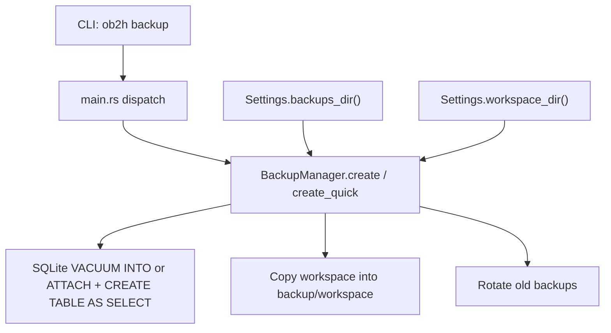
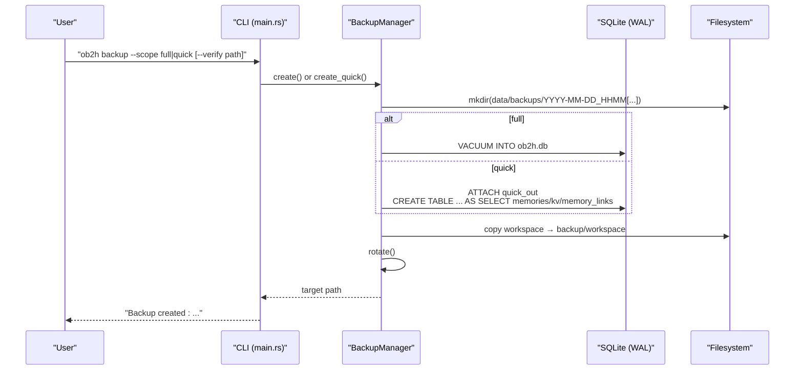
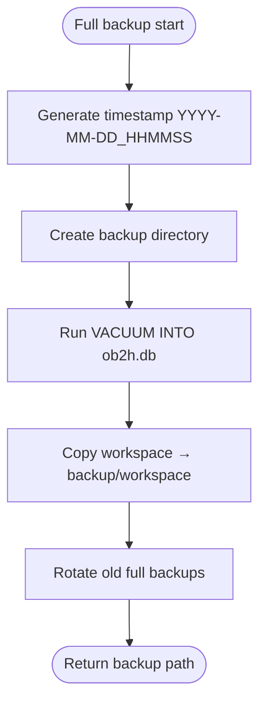
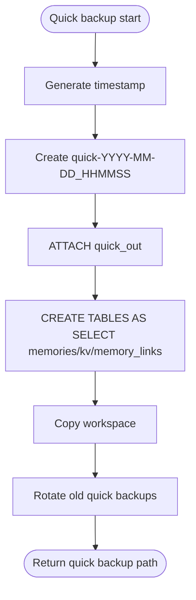
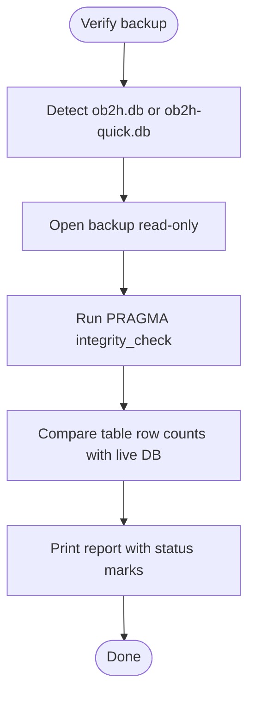
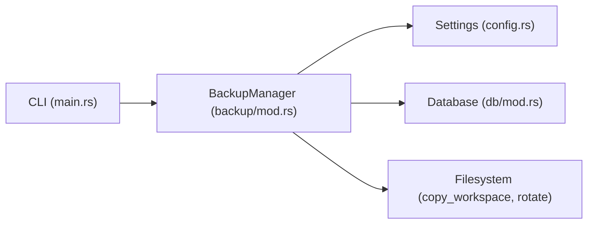

# Full Backups

<cite>
**Referenced Files in This Document**
- [src/backup/mod.rs](file://src/backup/mod.rs)
- [src/config.rs](file://src/config.rs)
- [src/main.rs](file://src/main.rs)
- [src/cli/mod.rs](file://src/cli/mod.rs)
- [src/db/mod.rs](file://src/db/mod.rs)
- [README.md](file://README.md)
- [docs/ARCHITECTURE.md](file://docs/ARCHITECTURE.md)
</cite>

## Table of Contents
1. [Introduction](#introduction)
2. [Project Structure](#project-structure)
3. [Core Components](#core-components)
4. [Architecture Overview](#architecture-overview)
5. [Detailed Component Analysis](#detailed-component-analysis)
6. [Dependency Analysis](#dependency-analysis)
7. [Performance Considerations](#performance-considerations)
8. [Troubleshooting Guide](#troubleshooting-guide)
9. [Conclusion](#conclusion)
10. [Appendices](#appendices)

## Introduction
This document explains full backup procedures in OB2H, focusing on the atomic snapshot mechanism that captures a consistent state of the SQLite database, including FTS5 indexes and vector embeddings. It also covers the quick backup mode, backup directory layout, timestamp naming, workspace inclusion, rotation policy, scheduling strategies, storage expectations, performance characteristics, manual commands, automated configuration, and monitoring completion.

## Project Structure
OB2H stores its data under `data/`, with backups placed under `data/backups/`. The backup manager creates one subdirectory per backup, copies the live database atomically, includes the workspace, and rotates old snapshots according to configured retention limits.

**Diagram sources**
- [src/main.rs:146-157](file://src/main.rs#L146-L157)
- [src/backup/mod.rs:23-43](file://src/backup/mod.rs#L23-L43)
- [src/backup/mod.rs:48-70](file://src/backup/mod.rs#L48-L70)
- [src/config.rs:421-427](file://src/config.rs#L421-L427)

**Section sources**
- [src/config.rs:421-427](file://src/config.rs#L421-L427)
- [docs/ARCHITECTURE.md:46-52](file://docs/ARCHITECTURE.md#L46-L52)

## Core Components
- BackupManager: implements full and quick backups, verification, listing, and rotation.
- Settings: provides paths for data, workspace, and backups; holds retention counts.
- CLI entrypoints: expose `ob2h backup` (full|quick) and `ob2h backup verify <path>`.
- Database layer: opens SQLite with WAL and busy_timeout; registers sqlite-vec extension before opening connections.

Key responsibilities:
- Atomic full snapshot via `VACUUM INTO`.
- Quick snapshot of memory-related tables only.
- Workspace copy into each backup.
- Rotation by type (full vs quick).
- Read-only integrity and row-count verification against the live database.

**Section sources**
- [src/backup/mod.rs:13-43](file://src/backup/mod.rs#L13-L43)
- [src/backup/mod.rs:48-122](file://src/backup/mod.rs#L48-L122)
- [src/backup/mod.rs:125-177](file://src/backup/mod.rs#L125-L177)
- [src/config.rs:303-310](file://src/config.rs#L303-L310)
- [src/db/mod.rs:22-35](file://src/db/mod.rs#L22-L35)

## Architecture Overview
The backup flow is invoked from the CLI and handled by the backup module. Both full and quick modes produce timestamped directories under `data/backups/`, include the workspace, and rotate old snapshots.

**Diagram sources**
- [src/main.rs:146-157](file://src/main.rs#L146-L157)
- [src/backup/mod.rs:23-43](file://src/backup/mod.rs#L23-L43)
- [src/backup/mod.rs:48-70](file://src/backup/mod.rs#L48-L70)

## Detailed Component Analysis

### Full Backup: VACUUM INTO Atomic Snapshot
A full backup captures the complete database state at a point in time using SQLite’s `VACUUM INTO`. This operation writes a new database file atomically, ensuring consistency even while the live database is being modified. It includes all tables, FTS5 virtual tables, triggers, and vector embedding blobs.

Behavior:
- Creates a timestamped directory under `data/backups/`.
- Runs `VACUUM INTO` to produce `ob2h.db` inside the backup directory.
- Copies the entire workspace into `backup/workspace`.
- Rotates old full backups based on `backup_keep_full`.

**Diagram sources**
- [src/backup/mod.rs:23-43](file://src/backup/mod.rs#L23-L43)

**Section sources**
- [src/backup/mod.rs:23-43](file://src/backup/mod.rs#L23-L43)

### Quick Backup: Memory-Focused Snapshot
Quick backup targets only memory-related tables (`memories`, `kv`, `memory_links`) plus the workspace. It uses an attached output database and `CREATE TABLE ... AS SELECT` to export those tables quickly.

Behavior:
- Creates a directory named `quick-YYYY-MM-DD_HHMMSS`.
- Produces `ob2h-quick.db` containing only selected tables.
- Copies the workspace.
- Rotates old quick backups based on `backup_keep_quick`.

**Diagram sources**
- [src/backup/mod.rs:48-70](file://src/backup/mod.rs#L48-L70)

**Section sources**
- [src/backup/mod.rs:48-70](file://src/backup/mod.rs#L48-L70)

### Backup Verification
Verification opens a backup read-only, runs `PRAGMA integrity_check`, and compares row counts for common tables between the backup and the live database. It supports both full (`ob2h.db`) and quick (`ob2h-quick.db`) backups.

**Diagram sources**
- [src/backup/mod.rs:75-122](file://src/backup/mod.rs#L75-L122)

**Section sources**
- [src/backup/mod.rs:75-122](file://src/backup/mod.rs#L75-L122)

### Backup Directory Layout and Naming
- Root: `<data_dir>/backups/`
- Full backup: `<data_dir>/backups/YYYY-MM-DD_HHMMSS/ob2h.db`
- Quick backup: `<data_dir>/backups/quick-YYYY-MM-DD_HHMMSS/ob2h-quick.db`
- Each backup includes a `workspace/` subtree copied from `<data_dir>/workspace/`.

Workspace contents are preserved, except lock files such as `autodream.lock` are intentionally skipped during copy.

**Section sources**
- [src/backup/mod.rs:23-38](file://src/backup/mod.rs#L23-L38)
- [src/backup/mod.rs:48-66](file://src/backup/mod.rs#L48-L66)
- [src/backup/mod.rs:179-186](file://src/backup/mod.rs#L179-L186)
- [src/backup/mod.rs:189-207](file://src/backup/mod.rs#L189-L207)
- [docs/ARCHITECTURE.md:183-201](file://docs/ARCHITECTURE.md#L183-L201)

### Rotation Policy
Rotation is separate for full and quick backups:
- Full backups are retained up to `backup_keep_full`.
- Quick backups are retained up to `backup_keep_quick`.
- Oldest directories are removed when the count exceeds the limit.

Defaults:
- `OB2H_BACKUP_KEEP_FULL=3`
- `OB2H_BACKUP_KEEP_QUICK=14`

**Section sources**
- [src/backup/mod.rs:125-159](file://src/backup/mod.rs#L125-L159)
- [src/config.rs:303-310](file://src/config.rs#L303-L310)
- [README.md:320-320](file://README.md#L320-L320)

### Scheduling Strategies
Recommended approaches:
- Cron/systemd timer: schedule full backups daily or weekly.
- Windows Task Scheduler: schedule `ob2h backup --scope full` periodically.
- CI/CD pipelines: run full backups after major operations (e.g., quantization, large imports).
- Quick backups: schedule more frequently (e.g., hourly) to capture recent memory changes with minimal overhead.

Example automation patterns:
- Daily full backup at off-peak hours.
- Hourly quick backup during active usage.
- Pre-migration or pre-sync full backup when performing risky operations.

Note: OB2H itself does not implement a scheduler; use your OS scheduler or orchestration tool.

### Storage Requirements
Typical full backup size is around ~1 GB, dominated by vector embeddings and graph nodes. Quick backups are significantly smaller (~10–30 MB), since they include only memory-related tables and the workspace.

Retention can multiply disk usage:
- With defaults (3 full, 14 quick), plan for multiple gigabytes depending on dataset size.
- Adjust `OB2H_BACKUP_KEEP_FULL` and `OB2H_BACKUP_KEEP_QUICK` to fit available disk space.

**Section sources**
- [src/backup/mod.rs:45-47](file://src/backup/mod.rs#L45-L47)
- [docs/ARCHITECTURE.md:46-52](file://docs/ARCHITECTURE.md#L46-L52)

### Performance Considerations
- Full backup uses `VACUUM INTO`, which performs a consistent rewrite of the database. Expect I/O-bound latency proportional to database size.
- Quick backup avoids copying the entire database and is much faster and lighter on I/O.
- WAL mode and `busy_timeout` allow concurrent readers/writers; backups do not block normal operations but may increase I/O load.
- Vector embeddings (BLOBs) and FTS5 indexes are included in full backups; their size drives backup duration and storage.

**Section sources**
- [src/db/mod.rs:22-35](file://src/db/mod.rs#L22-L35)
- [src/backup/mod.rs:23-43](file://src/backup/mod.rs#L23-L43)
- [src/backup/mod.rs:48-70](file://src/backup/mod.rs#L48-L70)

### Manual Backup Commands
- Create a full backup:
  - `ob2h backup`
  - `ob2h backup --scope full`
- Create a quick backup:
  - `ob2h backup --scope quick`
- Verify an existing backup:
  - `ob2h backup verify <path-to-backup-directory-or-db-file>`

These commands are exposed through the CLI and delegate to `BackupManager`.

**Section sources**
- [src/cli/mod.rs:38-46](file://src/cli/mod.rs#L38-L46)
- [src/main.rs:146-157](file://src/main.rs#L146-L157)
- [README.md:275-279](file://README.md#L275-L279)

### Automated Backup Configuration
Use your system scheduler to call the CLI:
- Linux/macOS cron:
  - Schedule `ob2h backup --scope full` daily.
  - Optionally schedule `ob2h backup --scope quick` hourly.
- systemd timer:
  - Define a service invoking `ob2h backup --scope full`.
  - Enable and start the timer unit.
- Windows Task Scheduler:
  - Create a task running `ob2h.exe backup --scope full` at desired intervals.

Environment variables for tuning:
- `OB2H_DATA_DIR`: base directory for data, workspace, logs, and backups.
- `OB2H_BACKUP_KEEP_FULL`: number of full backups to retain.
- `OB2H_BACKUP_KEEP_QUICK`: number of quick backups to retain.

**Section sources**
- [src/config.rs:303-310](file://src/config.rs#L303-L310)
- [src/config.rs:421-427](file://src/config.rs#L421-L427)
- [README.md:300-329](file://README.md#L300-L329)

### Monitoring Backup Completion
- CLI prints the created backup path upon success.
- Logs are written to `<data_dir>/logs/ob2h.log`; check for messages indicating backup creation.
- Use `ob2h backup verify <path>` to validate integrity and row counts.
- List backups with `ob2h backup list` (if implemented in your environment) or inspect `<data_dir>/backups/`.

**Section sources**
- [src/main.rs:146-157](file://src/main.rs#L146-L157)
- [src/backup/mod.rs:40-42](file://src/backup/mod.rs#L40-L42)
- [src/backup/mod.rs:75-122](file://src/backup/mod.rs#L75-L122)

## Dependency Analysis
The backup subsystem depends on configuration, database access, and filesystem operations.

**Diagram sources**
- [src/main.rs:146-157](file://src/main.rs#L146-L157)
- [src/backup/mod.rs:23-43](file://src/backup/mod.rs#L23-L43)
- [src/config.rs:421-427](file://src/config.rs#L421-L427)
- [src/db/mod.rs:22-35](file://src/db/mod.rs#L22-L35)

**Section sources**
- [src/backup/mod.rs:23-43](file://src/backup/mod.rs#L23-L43)
- [src/config.rs:421-427](file://src/config.rs#L421-L427)
- [src/db/mod.rs:22-35](file://src/db/mod.rs#L22-L35)

## Performance Considerations
- Prefer quick backups for frequent snapshots to reduce I/O pressure.
- Schedule full backups during low-activity periods.
- Monitor disk throughput and ensure sufficient free space for temporary files created by `VACUUM INTO`.
- Keep retention counts aligned with available storage to avoid excessive growth.

## Troubleshooting Guide
Common issues and resolutions:
- Missing backup directory:
  - Ensure `OB2H_DATA_DIR` points to the intended location.
  - Confirm `data/backups/` exists or is created by the application.
- Backup verification fails:
  - Run `ob2h backup verify <path>` to get detailed integrity and row-count differences.
- Unexpected disk usage growth:
  - Reduce `OB2H_BACKUP_KEEP_FULL` and/or `OB2H_BACKUP_KEEP_QUICK`.
- Slow full backups:
  - Check disk I/O saturation; consider scheduling during off-peak hours or using quick backups more often.

**Section sources**
- [src/backup/mod.rs:75-122](file://src/backup/mod.rs#L75-L122)
- [src/config.rs:303-310](file://src/config.rs#L303-L310)

## Conclusion
OB2H provides robust full and quick backup mechanisms. Full backups use `VACUUM INTO` to capture a consistent snapshot of the entire database, including FTS5 indexes and vector embeddings, along with the workspace. Quick backups offer a fast, lightweight alternative focused on memory-related tables. Proper scheduling, retention tuning, and verification ensure reliable recovery and predictable storage usage.

## Appendices

### Key Environment Variables for Backups
- `OB2H_DATA_DIR`: Base directory for data, workspace, logs, and backups.
- `OB2H_BACKUP_KEEP_FULL`: Number of full backups to retain.
- `OB2H_BACKUP_KEEP_QUICK`: Number of quick backups to retain.

**Section sources**
- [README.md:300-329](file://README.md#L300-L329)
- [src/config.rs:303-310](file://src/config.rs#L303-L310)